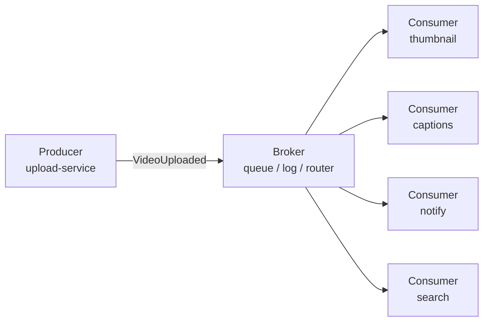
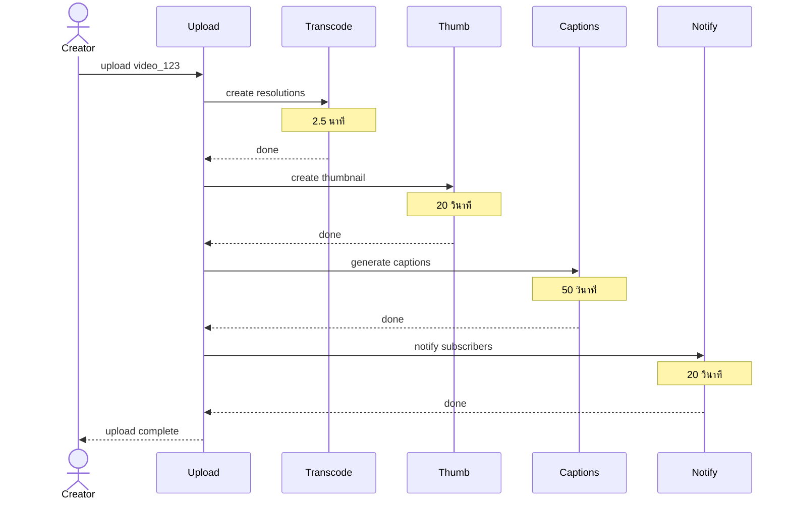
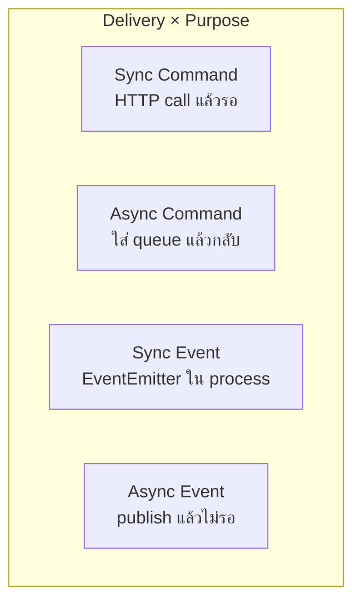
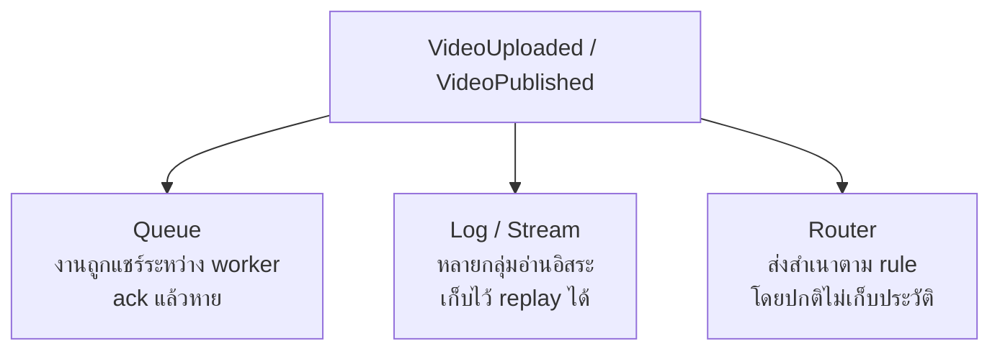
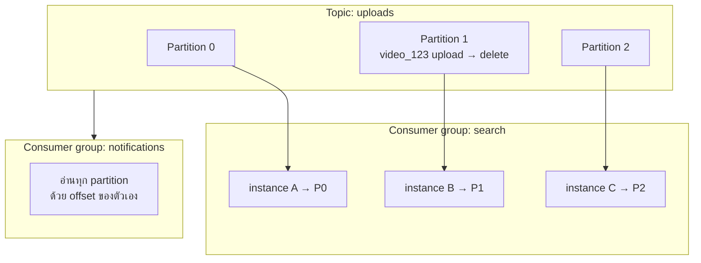
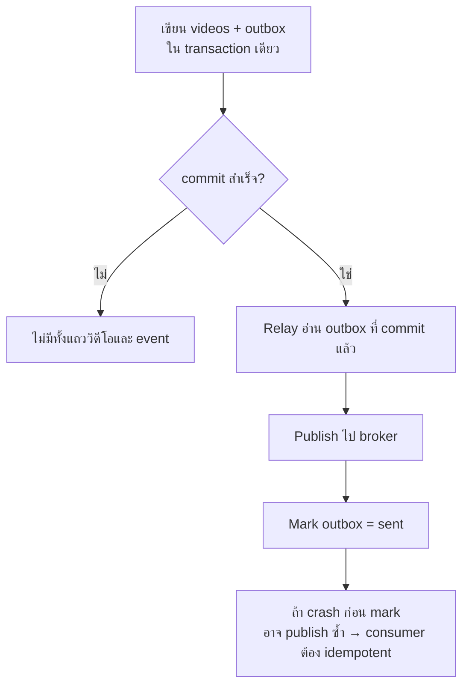
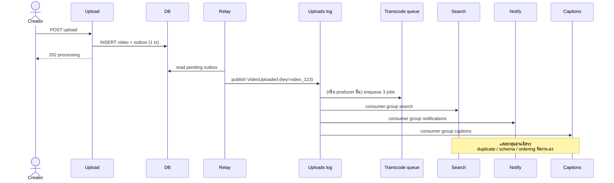

# Event-Driven Architecture — สรุปคอร์สแบบละเอียด

> **แหล่งที่มา:** [Event-Driven Architecture Full Course: Beginner to Advanced](https://youtu.be/W25_BbZCZD0) (~112 นาที)  
> **ตัวอย่างในคลิป:** แพลตฟอร์มอัปโหลดวิดีโอ (`user_42` อัปโหลด `video_123` ชื่อ *My first vlog*)  
> **เอกสารนี้:** สรุปแนวคิดจากคลิป + แผนภาพ + ตัวอย่าง Java Spring Boot ที่ map แนวคิดเดียวกัน

---

## สารบัญ

1. [ภาพรวม 3 ส่วนของระบบ Event-Driven](#1-ภาพรวม-3-ส่วนของระบบ-event-driven)
2. [ปัญหาของ Direct Call](#2-ปัญหาของ-direct-call)
3. [Event vs Command vs Query](#3-event-vs-command-vs-query)
4. [โครงสร้าง Event (Envelope + Payload)](#4-โครงสร้าง-event-envelope--payload)
5. [Queue vs Log vs Router](#5-queue-vs-log-vs-router)
6. [สิ่งที่ได้ และสิ่งที่แลกมา](#6-สิ่งที่ได้-และสิ่งที่แลกมา)
7. [Failure Modes ที่ต้องรับมือ](#7-failure-modes-ที่ต้องรับมือ)
8. [Transactional Outbox](#8-transactional-outbox)
9. [Schema Evolution](#9-schema-evolution)
10. [Walkthrough ทั้งเส้นทาง](#10-walkthrough-ทั้งเส้นทาง)
11. [เมื่อไหร่ควรใช้ / ไม่ควรใช้](#11-เมื่อไหร่ควรใช้--ไม่ควรใช้)
12. [Spring Boot Example (เต็มชุด)](#12-spring-boot-example-เต็มชุด)

---

## 1. ภาพรวม 3 ส่วนของระบบ Event-Driven

ทุกระบบ event-driven มี 3 ส่วนหลัก

| ส่วน | บทบาท | ในตัวอย่างคลิป |
|---|---|---|
| **Producer** | ส่งข้อความว่าเกิดอะไรขึ้นแล้ว | Upload service หลังเก็บไฟล์สำเร็จ |
| **Broker** | รับข้อความ แล้วส่งต่อ / เก็บไว้ | Kafka topic, SQS queue, SNS/EventBridge |
| **Consumer** | รับข้อความแล้วทำงานของตัวเอง | Transcoder, Thumbnail, Captions, Notify, Search |



หลังอัปโหลด แพลตฟอร์มต้องทำหลายงาน: สร้างหลายความละเอียด, thumbnail, captions, แจ้ง subscriber — และในอนาคตอาจมี Shorts

---

## 2. ปัญหาของ Direct Call

ถ้า upload service เรียกทุก service ตามลำดับแล้วรอคำตอบ



### 3 ปัญหาหลักที่คลิปชี้

1. **Creator รอรวมทุกขั้น** — ตัวอย่างรอ ~4 นาที เพราะงานรันต่อกัน (แม้รันคู่ขนานก็ยังรอช้าสุด ~2.5 นาที และ upload service ยังต้องรู้จักทุกปลายทาง)
2. **หนึ่ง service พัง = upload ล้มทั้งก้อน** — captions down ทำให้รายงาน failed ทั้งที่ไฟล์เก็บสำเร็จแล้ว
3. **เพิ่มฟีเจอร์ต้องแก้ upload service** — อยากทำ Shorts ต้องเพิ่ม call ที่ 5 แล้ว deploy ตัวรับอัปโหลด

รากเดียวกัน: **upload service เป็นคนเลือกและควบคุมทุกขั้น**

แนวแก้: publish `VideoUploaded` แล้วให้แต่ละ service ตัดสินใจเองว่าจะทำอะไร

---

## 3. Event vs Command vs Query

| ชนิด | ความหมาย | ชื่อตัวอย่าง | ผู้รับ |
|---|---|---|---|
| **Event** | สิ่งที่เกิดไปแล้ว | `VideoUploaded`, `video.uploaded` | หลาย listener ได้ |
| **Command** | สั่งให้ทำงาน | `TranscodeVideo` | โดยปกติหนึ่ง handler |
| **Query** | ขอข้อมูล (ไม่เปลี่ยน state) | get status → `uploaded` | service ที่ถือข้อมูล |

กฎตั้งชื่อจากคลิป

- Event ใช้ past tense: `video.uploaded`, `video.deleted`
- Command ใช้คำสั่ง: `TranscodeVideo`, `SendNotification`
- อย่าตั้งชื่อ command แบบ passive-aggressive เช่น `SendNotificationEvent` ทั้งที่จริง ๆ คือสั่ง notify



**Async ≠ Event-driven**

- ใส่ command ลง queue = async แต่ยังเป็น command (sender ยังเลือกงาน)
- Event ใน process เดียวกันแบบ sync ก็ยังเป็น event-driven ในระดับ listener

คำถามตรวจดีไซน์: **ใครเป็นคนเลือก action ถัดไป?**

- `TranscodeVideo` → producer เลือก
- `VideoUploaded` → แต่ละ consumer เลือกเอง

---

## 4. โครงสร้าง Event (Envelope + Payload)

คลิปแยกสองชั้น

- **Envelope** — ระบุตัวตน, route, trace
- **Payload / data** — รายละเอียดธุรกิจที่ consumer ต้องใช้

### ตัวอย่าง JSON จากคลิป

```json
{
  "id": "evt_8f2a",
  "type": "video.uploaded",
  "source": "upload-service",
  "time": "2025-09-30T14:02:11Z",
  "version": 1,
  "key": "video_123",
  "correlationId": "req_77c",
  "data": {
    "videoId": "video_123",
    "creatorId": "user_42",
    "title": "My first vlog",
    "durationSeconds": 272,
    "storageUrl": "s3://videos/video_123/original.mp4"
  }
}
```

| Field | ใช้ทำอะไร | ข้อควรระวัง |
|---|---|---|
| `id` + `source` | ระบุ event หนึ่งใบ (CloudEvents ต้องการคู่ที่ unique) | retry ต้องใช้ id เดิม อย่าสร้างใหม่ทุกครั้ง |
| `type` | เลือก event ที่สนใจ | เปลี่ยนชื่อแล้ว routing/consumer พังได้ |
| `time` | เวลาที่ producer บันทึก | นาฬิกาคนละเครื่องเทียบลำดับกันไม่ได้ |
| `version` | รูปแบบของ `data` | ไม่ใช่ `specversion` ของ CloudEvents |
| `key` | กลุ่มที่เกี่ยวข้อง (video id) | ใช้ partition / ลำดับต่อวิดีโอ |
| `correlationId` | ตามหนึ่ง request ข้าม service | ห้ามใช้เป็น duplicate key |

### Thin vs Fat event

| แบบ | ข้อดี | ข้อเสีย |
|---|---|---|
| Thin (มีแค่ `videoId`) | ข้อความเล็ก | consumer ต้องยิงกลับไปหา producer หลายครั้ง |
| Fat (มี title, creator, storageUrl, …) | ทำงานต่อได้ทันที | ขึ้นกับ field ใน event มากขึ้นเวลาเปลี่ยน schema |

### Claim-check pattern

อย่าใส่ไฟล์วิดีโอทั้งก้อนใน message

1. เก็บไฟล์ใน object storage ก่อน
2. ใส่แค่ `storageUrl` ใน event
3. consumer ใช้ credential ของตัวเองไปดึงไฟล์
4. อย่าใส่ access token ใน message

CloudEvents ต้องการอย่างน้อย: `id`, `source`, `specversion`, `type`

---

## 5. Queue vs Log vs Router



| พฤติกรรม | ใช้เมื่อ | ตัวอย่างผลิตภัณฑ์ |
|---|---|---|
| **Queue** | งานหนึ่งชิ้นทำครั้งเดียว แชร์ระหว่าง worker (competing consumers) | SQS, RabbitMQ classic queue, ActiveMQ |
| **Log** | หลาย service อ่าน event เดียวกัน / ต้องการ replay | Kafka, Kinesis, Event Hubs, Redis Streams, RabbitMQ Streams |
| **Router** | fan-out ตาม subscription rule | SNS, EventBridge |

ในตัวอย่างคลิปเลือกคนละแบบตามงาน

- Transcode jobs → **queue** (1080p / 720p / 480p คนละ job)
- Upload history → **log** (search, notify, recommendations อ่านคนละ consumer group)
- `VideoPublished` → **router** (+ อาจมี queue ต่อท้ายถ้า service ยุ่ง)

> ชื่อผลิตภัณฑ์อย่างเดียวไม่พอ — RabbitMQ มีทั้ง classic queue และ Streams, Kafka มีทั้ง consumer group และ share groups ต้องเลือกตามโหมดที่ตั้งค่า

### Log: topic, partition, consumer group, offset



จุดสำคัญจากคลิป

- ใช้ `key = videoId` เพื่อให้ upload/publish/delete ของวิดีโอเดียวกันอยู่ใน partition เดียวกัน
- ใน consumer group ปกติ จำนวน reader ที่ทำงานจริง ≤ จำนวน partition
- แต่ละ group มี offset ของตัวเอง → restart กลุ่มหนึ่งไม่กระทบอีกกลุ่ม
- commit offset ก่อนงานจบ → เสี่ยงข้ามงาน; commit หลังจบ → เสี่ยงซ้ำ → consumer ต้อง idempotent

### Dead-letter queue

Poison message (เช่น `video_999` ไฟล์พัง) retry ไม่จบ

1. ตั้งจำนวนครั้งสูงสุด (เช่น SQS `maxReceiveCount = 3`)
2. ครบแล้วย้ายไป DLQ
3. ต้องมีคนเฝ้าและตัดสินใจ แก้แล้ว retry หรือทิ้ง

---

## 6. สิ่งที่ได้ และสิ่งที่แลกมา

### ได้

| หัวข้อ | ผล |
|---|---|
| ตอบ creator เร็วขึ้น | บันทึก + publish แล้วตอบ `processing` ไม่รอ 4 นาที |
| แยก failure | captions พัง อีก service ยังทำงานต่อ |
| Fan-out | เพิ่ม Shorts โดย subscribe event ไม่แก้ upload service |
| Scale แยก | เพิ่ม transcode worker โดยไม่ต้อง scale upload |
| Load leveling | burst 1,000 อัปโหลด → broker เก็บคิว แล้วค่อย ๆ เคลียร์ |
| Replay | service ใหม่ / แก้บั๊ก แล้วอ่านประวัติที่ยังอยู่ใน retention |

### แลกมา

| หัวข้อ | ผล |
|---|---|
| Eventual consistency | หน้าจอต้องโชว์ “กำลังประมวลผล” |
| ตามงานยากขึ้น | ไม่มีฟังก์ชันเดียวที่เห็นทั้ง flow → ต้องมี log/metric/trace + `correlationId` |
| Operational cost | ดูแล queue, retry, schema, lag, DLQ |
| Consumer lag | broker เร็ว ≠ แจ้งเตือนถึง user เร็ว ถ้า notify ค้างคิว |

วัด queue: จำนวนข้อความรอ + อายุข้อความเก่าสุด  
วัด log: consumer lag = ตำแหน่งท้าย log − ตำแหน่งที่กลุ่มอ่านถึง

---

## 7. Failure Modes ที่ต้องรับมือ

### 7.1 Delivery semantics

| สัญญา | ความหมาย |
|---|---|
| At-most-once | อาจหาย แต่ไม่ซ้ำ |
| At-least-once | ไม่หายเพราะ retry → อาจซ้ำ (พบบ่อย) |
| Exactly-once | ขอบเขตจำกัด มักอยู่ใน broker transaction ไม่ครอบคลุม push notification ภายนอก |

ทางปฏิบัติที่ใช้บ่อย: **at-least-once + idempotent consumer = effectively-once**

### 7.2 Idempotency

ตัวอย่าง: notify ส่งแจ้งเตือนแล้ว crash ก่อน ack → worker อีกรอบส่งซ้ำ

แก้: เก็บ `source` + `id` ที่ประมวลผลแล้วใน storage ที่ทนทาน แล้วข้าม duplicate

ห้ามใช้ `correlationId` เป็น duplicate key เพราะหนึ่ง request มีหลาย event ที่ถูกต้อง (`VideoUploaded` แล้วตามด้วย `VideoTranscoded`)

### 7.3 Ordering

ปัญหา: upload กับ delete ไปคนละ partition → delete มาก่อนแล้วไม่เจออะไร ตามด้วย upload → วิดีโอที่ลบแล้วกลับไปโผล่ใน search

แก้ที่ producer: ใช้ key เดียวกัน (`video_123`)  
แก้ที่ consumer: retry ก่อนเดินต่อ event ถัดไปในลำดับเดียวกัน (ถ้าแยกไป retry topic แล้วอ่านต่อ ลำดับพังได้อีก)

timestamp จากนาฬิกาเครื่อง **ไม่พอ** สำหรับเรียงลำดับข้าม producer

### 7.4 Observability

Dashboard เขียวทุก service ยังตาม captions ที่หายไม่ได้ ต้องมี

- `correlationId` ใน event และ log
- `source` เพื่อรู้ว่าใครผลิต event
- distributed tracing context ผ่าน message

---

## 8. Transactional Outbox

ปัญหา dual-write: บันทึก DB กับ publish broker เป็นคนละระบบ



ลำดับผิดก็พัง

- เซฟ DB ก่อนแล้ว crash → มีวิดีโอแต่ไม่มี event
- publish ก่อนแล้ว DB fail → consumer ทำงานกับวิดีโอที่ไม่มีใน DB

Relay ได้สองทาง: poll outbox หรืออ่าน CDC (binlog / WAL / DynamoDB Streams)  
Outbox กัน event หายหลัง commit — **ไม่กัน publish ซ้ำ**

---

## 9. Schema Evolution

เมื่อ captions ต้องการ `language` แต่ event เก่าไม่มี

| ทิศทาง | ความหมาย | ตัวอย่าง |
|---|---|---|
| **Backward compatible** | reader ใหม่ อ่าน data เก่าได้ | captions ใหม่เจอ event v1 → ใส่ default `en` |
| **Forward compatible** | reader เก่า อ่าน data ใหม่ได้ | search เก่า ignore field `language` |
| **Full compatible** | ทั้งสองทิศทาง | deploy คนละจังหวะได้ |

แนวทางจากคลิป

- เพิ่ม field แบบ optional + default (tolerant reader)
- rename / remove / เปลี่ยน type ต้องมีแผน migration (ชั่วคราวรองรับทั้งสองชื่อ ฯลฯ)
- ใช้ `version` + upcaster แปลงตอนอ่าน โดยไม่แก้ประวัติใน log
- Schema registry ตรวจโครงสร้างก่อน publish — แต่ไม่จับความหมายธุรกิจ (เช่น เปลี่ยนหน่วยวินาที → มิลลิวินาที แล้วยังเป็น number)
- ถ้า replay ย้อนหลายปี ต้องเช็ค compatibility แบบ transitive กับ schema เก่าทั้งหมด ไม่ใช่แค่เวอร์ชันก่อนหน้า

---

## 10. Walkthrough ทั้งเส้นทาง



เปรียบเทียบสองดีไซน์ท้ายคลิป

| หัวข้อ | Direct call | Event-driven |
|---|---|---|
| เวลารอ creator | ~4 นาที | หลังบันทึก + outbox |
| captions พัง | upload fail | อื่นยังทำต่อ captions ตามทีหลัง |
| เพิ่ม Shorts | แก้ upload service | subscribe อย่างเดียว |

รูปแบบที่คลิปบอกว่าอยู่คนละปัญหา: Event Sourcing, CQRS, Saga — **ใช้ events ไม่ได้แปลว่าต้องใช้ทั้งสาม**

---

## 11. เมื่อไหร่ควรใช้ / ไม่ควรใช้

### เหมาะเมื่อ

- การเปลี่ยนแปลงหนึ่งครั้งต้องมีหลายปฏิกิริยาอิสระ
- งานพื้นหลังใช้ capacity คนละแบบ (transcode vs notify)
- ต้องการทนต่อ outage ของ consumer บางตัว
- ต้องการ replay / service ใหม่ดูประวัติ

### ไม่จำเป็นเมื่อ

- ต้องการคำตอบทันที (เช่น อ่าน title ของวิดีโอ) → HTTP ตรง ๆ ดีกว่า
- หลายขั้นต้อง commit ร่วมกันจริง ๆ → event consumer อิสระไม่ได้ให้ shared transaction
- แอปเล็ก ต้นทุนคิว/retry/schema สูงเกินประโยชน์

หนึ่งระบบใช้ได้ทั้งสองแบบ: อัปโหลดใช้ events, อ่าน title ใช้ query ตรง

---

## 12. Spring Boot Example (เต็มชุด)

ตัวอย่างด้านล่าง map แนวคิดจากคลิปไปยัง Spring Boot 3 + Kafka  
โฟกัสที่ contract และ pattern ไม่ใช่ production-harding ทุกมุม

โครงแนะนำ

```text
video-platform/
├── upload-service/          # producer + outbox
├── notify-service/          # idempotent consumer
├── captions-service/        # schema-tolerant consumer
└── shared-events/           # event types
```

### 12.1 Shared event model

```java
package com.example.events;

import java.time.Instant;
import java.util.UUID;

public record CloudEventEnvelope<T>(
    String id,
    String source,
    String type,
    String specversion,
    Instant time,
    int version,
    String key,
    String correlationId,
    T data
) {
  public static <T> CloudEventEnvelope<T> of(
      String source,
      String type,
      String key,
      String correlationId,
      int version,
      T data
  ) {
    return new CloudEventEnvelope<>(
        UUID.randomUUID().toString(),
        source,
        type,
        "1.0",
        Instant.now(),
        version,
        key,
        correlationId,
        data
    );
  }
}
```

```java
package com.example.events;

public record VideoUploadedData(
    String videoId,
    String creatorId,
    String title,
    int durationSeconds,
    String storageUrl,
    String language // null ได้ใน version 1
) {}
```

### 12.2 Upload API — รับไฟล์แล้วตอบเร็ว

```java
package com.example.upload.api;

import com.example.upload.service.UploadService;
import jakarta.validation.constraints.NotBlank;
import org.springframework.http.HttpStatus;
import org.springframework.web.bind.annotation.*;

@RestController
@RequestMapping("/videos")
public class UploadController {

  private final UploadService uploadService;

  public UploadController(UploadService uploadService) {
    this.uploadService = uploadService;
  }

  @PostMapping
  @ResponseStatus(HttpStatus.ACCEPTED)
  public UploadAcceptedResponse upload(@RequestBody UploadRequest request) {
    String correlationId = java.util.UUID.randomUUID().toString();
    String videoId = uploadService.accept(request, correlationId);
    return new UploadAcceptedResponse(videoId, "PROCESSING", correlationId);
  }

  public record UploadRequest(
      @NotBlank String creatorId,
      @NotBlank String title,
      int durationSeconds,
      @NotBlank String storageUrl
  ) {}

  public record UploadAcceptedResponse(
      String videoId,
      String status,
      String correlationId
  ) {}
}
```

### 12.3 Outbox entity + service (dual-write แก้ใน DB เดียว)

```java
package com.example.upload.outbox;

import jakarta.persistence.*;
import java.time.Instant;

@Entity
@Table(name = "outbox")
public class OutboxMessage {

  public enum Status { PENDING, SENT }

  @Id
  private String id;

  @Column(nullable = false)
  private String aggregateKey;

  @Column(nullable = false)
  private String type;

  @Lob
  @Column(nullable = false)
  private String payloadJson;

  @Enumerated(EnumType.STRING)
  @Column(nullable = false)
  private Status status = Status.PENDING;

  @Column(nullable = false)
  private Instant createdAt = Instant.now();

  protected OutboxMessage() {}

  public OutboxMessage(String id, String aggregateKey, String type, String payloadJson) {
    this.id = id;
    this.aggregateKey = aggregateKey;
    this.type = type;
    this.payloadJson = payloadJson;
  }

  public String getId() { return id; }
  public String getAggregateKey() { return aggregateKey; }
  public String getType() { return type; }
  public String getPayloadJson() { return payloadJson; }
  public Status getStatus() { return status; }

  public void markSent() {
    this.status = Status.SENT;
  }
}
```

```java
package com.example.upload.domain;

import jakarta.persistence.Entity;
import jakarta.persistence.Id;
import jakarta.persistence.Table;

@Entity
@Table(name = "videos")
public class Video {

  @Id
  private String id;
  private String creatorId;
  private String title;
  private int durationSeconds;
  private String storageUrl;
  private String status;

  protected Video() {}

  public Video(String id, String creatorId, String title, int durationSeconds, String storageUrl) {
    this.id = id;
    this.creatorId = creatorId;
    this.title = title;
    this.durationSeconds = durationSeconds;
    this.storageUrl = storageUrl;
    this.status = "PROCESSING";
  }

  public String getId() { return id; }
}
```

```java
package com.example.upload.service;

import com.example.events.CloudEventEnvelope;
import com.example.events.VideoUploadedData;
import com.example.upload.api.UploadController.UploadRequest;
import com.example.upload.domain.Video;
import com.example.upload.domain.VideoRepository;
import com.example.upload.outbox.OutboxMessage;
import com.example.upload.outbox.OutboxRepository;
import com.fasterxml.jackson.databind.ObjectMapper;
import java.util.UUID;
import org.springframework.stereotype.Service;
import org.springframework.transaction.annotation.Transactional;

@Service
public class UploadService {

  private final VideoRepository videos;
  private final OutboxRepository outbox;
  private final ObjectMapper objectMapper;

  public UploadService(VideoRepository videos, OutboxRepository outbox, ObjectMapper objectMapper) {
    this.videos = videos;
    this.outbox = outbox;
    this.objectMapper = objectMapper;
  }

  @Transactional
  public String accept(UploadRequest request, String correlationId) {
    String videoId = "video_" + UUID.randomUUID().toString().substring(0, 8);

    videos.save(new Video(
        videoId,
        request.creatorId(),
        request.title(),
        request.durationSeconds(),
        request.storageUrl()
    ));

    // สำคัญ: ใช้ event id คงที่เพื่อให้ retry/relay ซ้ำแล้วยังเป็น event เดิม
    String eventId = "evt_" + UUID.randomUUID().toString().substring(0, 8);

    var envelope = new CloudEventEnvelope<>(
        eventId,
        "upload-service",
        "video.uploaded",
        "1.0",
        java.time.Instant.now(),
        2,
        videoId,
        correlationId,
        new VideoUploadedData(
            videoId,
            request.creatorId(),
            request.title(),
            request.durationSeconds(),
            request.storageUrl(),
            "en"
        )
    );

    try {
      outbox.save(new OutboxMessage(
          eventId,
          videoId,
          envelope.type(),
          objectMapper.writeValueAsString(envelope)
      ));
    } catch (Exception e) {
      throw new IllegalStateException("failed to serialize outbox event", e);
    }

    return videoId;
  }
}
```

### 12.4 Message relay — publish จาก outbox ไป Kafka

```java
package com.example.upload.outbox;

import org.springframework.data.jpa.repository.JpaRepository;
import org.springframework.data.jpa.repository.Query;
import java.util.List;

public interface OutboxRepository extends JpaRepository<OutboxMessage, String> {

  @Query("""
      select o from OutboxMessage o
      where o.status = com.example.upload.outbox.OutboxMessage$Status.PENDING
      order by o.createdAt
      """)
  List<OutboxMessage> findPending();
}
```

```java
package com.example.upload.outbox;

import com.fasterxml.jackson.databind.JsonNode;
import com.fasterxml.jackson.databind.ObjectMapper;
import org.springframework.kafka.core.KafkaTemplate;
import org.springframework.scheduling.annotation.Scheduled;
import org.springframework.stereotype.Component;
import org.springframework.transaction.annotation.Transactional;

@Component
public class OutboxRelay {

  private final OutboxRepository outbox;
  private final KafkaTemplate<String, String> kafka;
  private final ObjectMapper objectMapper;

  public OutboxRelay(
      OutboxRepository outbox,
      KafkaTemplate<String, String> kafka,
      ObjectMapper objectMapper
  ) {
    this.outbox = outbox;
    this.kafka = kafka;
    this.objectMapper = objectMapper;
  }

  @Scheduled(fixedDelayString = "1000")
  @Transactional
  public void publishPending() throws Exception {
    for (OutboxMessage message : outbox.findPending()) {
      JsonNode node = objectMapper.readTree(message.getPayloadJson());
      String key = node.path("key").asText(message.getAggregateKey());

      // key = videoId → Kafka จัดเข้า partition เดียวกันสำหรับวิดีโอเดียวกัน
      kafka.send("uploads", key, message.getPayloadJson()).get();
      message.markSent();
    }
  }
}
```

> ถ้า relay publish สำเร็จแล้ว crash ก่อน `markSent` จะส่งซ้ำได้ — consumer ต้อง idempotent ตามที่คลิปสอน

`application.yml` ฝั่ง producer

```yaml
spring:
  application:
    name: upload-service
  datasource:
    url: jdbc:postgresql://localhost:5432/upload
    username: upload
    password: upload
  jpa:
    hibernate:
      ddl-auto: validate
  kafka:
    bootstrap-servers: localhost:9092
    producer:
      key-serializer: org.apache.kafka.common.serialization.StringSerializer
      value-serializer: org.apache.kafka.common.serialization.StringSerializer
      acks: all

management:
  endpoints:
    web:
      exposure:
        include: health,info
```

### 12.5 Async command — enqueue งาน transcode

Event บอกว่าอัปโหลดแล้ว ส่วนงานตัดความละเอียดยังเป็น command คนละคิว

```java
package com.example.upload.transcode;

import org.springframework.kafka.core.KafkaTemplate;
import org.springframework.stereotype.Component;

@Component
public class TranscodeJobPublisher {

  private final KafkaTemplate<String, String> kafka;

  public TranscodeJobPublisher(KafkaTemplate<String, String> kafka) {
    this.kafka = kafka;
  }

  public void enqueueJobs(String videoId, String storageUrl) {
    for (String resolution : new String[] {"1080p", "720p", "480p"}) {
      String body = """
          {
            "type": "TranscodeVideo",
            "videoId": "%s",
            "storageUrl": "%s",
            "resolution": "%s"
          }
          """.formatted(videoId, storageUrl, resolution);
      // key แยกตาม job ได้ เพราะแต่ละ resolution อิสระกัน (competing consumers)
      kafka.send("transcode.jobs", videoId + ":" + resolution, body);
    }
  }
}
```

ในดีไซน์เต็ม มักมี consumer ของ `video.uploaded` ใน upload/orchestrator หรือ service แยกที่แปลง event → jobs เหล่านี้

### 12.6 Notify consumer — idempotent

```java
package com.example.notify.domain;

import jakarta.persistence.Entity;
import jakarta.persistence.Id;
import jakarta.persistence.Table;
import java.time.Instant;

@Entity
@Table(name = "processed_events")
public class ProcessedEvent {

  @Id
  private String eventId; // ใช้ source+id ในของจริง ถ้าหลาย producer

  private Instant processedAt = Instant.now();

  protected ProcessedEvent() {}

  public ProcessedEvent(String eventId) {
    this.eventId = eventId;
  }
}
```

```java
package com.example.notify.consumer;

import com.example.events.CloudEventEnvelope;
import com.example.events.VideoUploadedData;
import com.example.notify.domain.ProcessedEvent;
import com.example.notify.domain.ProcessedEventRepository;
import com.example.notify.service.PushNotifier;
import com.fasterxml.jackson.core.type.TypeReference;
import com.fasterxml.jackson.databind.ObjectMapper;
import org.slf4j.Logger;
import org.slf4j.LoggerFactory;
import org.springframework.kafka.annotation.KafkaListener;
import org.springframework.messaging.handler.annotation.Header;
import org.springframework.messaging.handler.annotation.Payload;
import org.springframework.stereotype.Component;
import org.springframework.transaction.annotation.Transactional;

@Component
public class VideoUploadedNotifyListener {

  private static final Logger log = LoggerFactory.getLogger(VideoUploadedNotifyListener.class);

  private final ObjectMapper objectMapper;
  private final ProcessedEventRepository processedEvents;
  private final PushNotifier pushNotifier;

  public VideoUploadedNotifyListener(
      ObjectMapper objectMapper,
      ProcessedEventRepository processedEvents,
      PushNotifier pushNotifier
  ) {
    this.objectMapper = objectMapper;
    this.processedEvents = processedEvents;
    this.pushNotifier = pushNotifier;
  }

  @KafkaListener(topics = "uploads", groupId = "notifications")
  @Transactional
  public void onMessage(
      @Payload String raw,
      @Header(name = "kafka_receivedMessageKey", required = false) String key
  ) throws Exception {
    CloudEventEnvelope<VideoUploadedData> event = objectMapper.readValue(
        raw,
        new TypeReference<>() {}
    );

    if (!"video.uploaded".equals(event.type())) {
      return;
    }

    String dedupeKey = event.source() + ":" + event.id();
    if (processedEvents.existsById(dedupeKey)) {
      log.info("skip duplicate eventId={} correlationId={}", event.id(), event.correlationId());
      return;
    }

    // งานภายนอก broker: ถ้า push สำเร็จแล้ว crash ก่อน save อาจซ้ำได้
    // production ต้องให้ push provider รองรับ idempotency key ด้วย
    pushNotifier.notifySubscribers(event.data().creatorId(), event.data().videoId());

    processedEvents.save(new ProcessedEvent(dedupeKey));
    log.info(
        "notified videoId={} correlationId={} partitionKey={}",
        event.data().videoId(),
        event.correlationId(),
        key
    );
  }
}
```

```yaml
spring:
  kafka:
    consumer:
      group-id: notifications
      auto-offset-reset: earliest
      key-deserializer: org.apache.kafka.common.serialization.StringDeserializer
      value-deserializer: org.apache.kafka.common.serialization.StringDeserializer
      enable-auto-commit: false
    listener:
      ack-mode: record
```

### 12.7 Captions consumer — tolerant reader + version

```java
package com.example.captions.consumer;

import com.fasterxml.jackson.databind.JsonNode;
import com.fasterxml.jackson.databind.ObjectMapper;
import org.springframework.kafka.annotation.KafkaListener;
import org.springframework.stereotype.Component;

@Component
public class VideoUploadedCaptionsListener {

  private final ObjectMapper objectMapper;
  private final CaptionGenerator captionGenerator;

  public VideoUploadedCaptionsListener(ObjectMapper objectMapper, CaptionGenerator captionGenerator) {
    this.objectMapper = objectMapper;
    this.captionGenerator = captionGenerator;
  }

  @KafkaListener(topics = "uploads", groupId = "captions")
  public void onMessage(String raw) throws Exception {
    JsonNode root = objectMapper.readTree(raw);
    if (!"video.uploaded".equals(root.path("type").asText())) {
      return;
    }

    int version = root.path("version").asInt(1);
    JsonNode data = root.path("data");

    String videoId = data.path("videoId").asText();
    String storageUrl = data.path("storageUrl").asText();
    String language = upcastLanguage(version, data);

    captionGenerator.generate(videoId, storageUrl, language);
  }

  /** Upcaster: ไม่แก้ประวัติใน log แปลงตอนอ่าน */
  private static String upcastLanguage(int version, JsonNode data) {
    if (version >= 2 && data.hasNonNull("language")) {
      return data.get("language").asText();
    }
    return "en"; // default สำหรับ history version 1
  }
}
```

### 12.8 Query ยังใช้ HTTP ตรง

คลิปย้ำว่าอ่าน title ไม่จำเป็นต้องผ่าน event

```java
package com.example.upload.api;

import com.example.upload.domain.VideoRepository;
import org.springframework.web.bind.annotation.GetMapping;
import org.springframework.web.bind.annotation.PathVariable;
import org.springframework.web.bind.annotation.RestController;

@RestController
public class VideoQueryController {

  private final VideoRepository videos;

  public VideoQueryController(VideoRepository videos) {
    this.videos = videos;
  }

  @GetMapping("/videos/{videoId}")
  public VideoView get(@PathVariable String videoId) {
    var video = videos.findById(videoId)
        .orElseThrow(() -> new VideoNotFoundException(videoId));
    return new VideoView(video.getId(), video.getTitle(), video.getStatus());
  }

  public record VideoView(String videoId, String title, String status) {}
}
```

### 12.9 Dependencies หลัก (Maven)

```xml
<dependencies>
  <dependency>
    <groupId>org.springframework.boot</groupId>
    <artifactId>spring-boot-starter-web</artifactId>
  </dependency>
  <dependency>
    <groupId>org.springframework.boot</groupId>
    <artifactId>spring-boot-starter-data-jpa</artifactId>
  </dependency>
  <dependency>
    <groupId>org.springframework.kafka</groupId>
    <artifactId>spring-kafka</artifactId>
  </dependency>
  <dependency>
    <groupId>org.postgresql</groupId>
    <artifactId>postgresql</artifactId>
    <scope>runtime</scope>
  </dependency>
</dependencies>
```

### 12.10 Checklist ตอนเอาไปใช้จริง

- [ ] Producer เขียน business row + outbox ใน transaction เดียว
- [ ] Event `id` คงที่ตอน retry
- [ ] Kafka key = entity ที่ต้องรักษาลำดับ (เช่น `videoId`)
- [ ] แต่ละ consumer group ชื่อคงที่และไม่ปนกันโดยไม่ตั้งใจ
- [ ] Consumer idempotent ด้วย `source:id`
- [ ] มี DLQ + จำกัด retry สำหรับ poison message
- [ ] ส่งต่อ `correlationId` ใน event และ MDC/log
- [ ] Schema เพิ่ม field แบบ optional ก่อน แล้วค่อยบังคับใช้
- [ ] หน้า UI รองรับสถานะ `PROCESSING` / eventual consistency
- [ ] Query ที่ต้องคำตอบทันที ยังใช้ sync API

---

## สรุปสั้น ๆ จากทั้งคอร์ส

1. Direct call รวมความล่าช้า, ความพัง, และการเพิ่มฟีเจอร์ไว้ที่ producer
2. Event รายงานอดีต, Command สั่งงาน, Query ขอข้อมูล
3. Envelope ใช้ระบุตัวตน/route/trace — payload ใส่ข้อมูลที่ consumer ใช้จริง (+ claim-check สำหรับไฟล์ใหญ่)
4. เลือก broker ตามพฤติกรรม: queue แชร์งาน, log เก็บประวัติ, router กระจายสำเนา
5. ต้องรับมือ duplicate, ordering, poison message, missing work
6. Outbox + idempotent consumer แก้ dual-write และ at-least-once
7. Schema ต้องทนทั้งอ่านของเก่าและของใหม่
8. ใช้ EDA ตรงที่ต้องการปฏิกิริยาอิสระ — คง direct call ตรงที่คำตอบต้องทันที

---

*สรุปอ้างอิงเนื้อหาจากวิดีโอ [W25_BbZCZD0](https://youtu.be/W25_BbZCZD0) ตัวอย่างโค้ด Spring Boot เป็นการแปลงแนวคิดจากคลิปให้อยู่ในรูปแบบที่นำไปทดลองได้*
