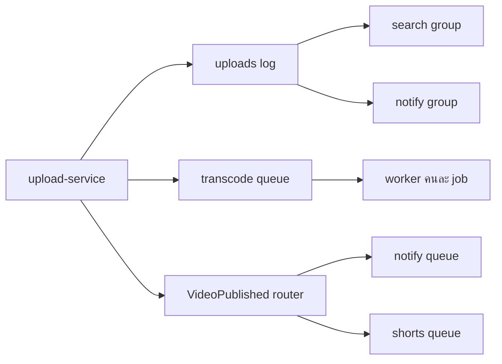

Producer ส่งข้อความให้ broker แล้วเลิกสนใจว่าใครจะทำต่อ แบบของ broker ตอบสองคำถามนี้ต่างกัน: **ข้อความหนึ่งชิ้นมีกี่คนได้ทำงานกับมัน** และ **อ่านเสร็จแล้วข้อความยังอยู่ไหม**

<cursor-content kind="visualization" src="visualizations/queue-log-router.html"></cursor-content>

ตัวอย่างทั้งสามรูปมาจากแพลตฟอร์มอัปโหลดวิดีโอชุดเดียวกัน งานแปลงไฟล์เข้า **queue** ประวัติการอัปโหลดอยู่บน **log** และเหตุการณ์ `VideoPublished` ถูก **router** ก๊อปปี้ไปตามกฎ

## Queue — งานหนึ่งชิ้น คนทำหนึ่งคน

Queue คือแถวของงาน Worker ที่ว่างดึงงานชิ้นหน้าไปทำ คนอื่นดึงชิ้นเดียวกันไม่ได้อีก เรียกว่า competing consumers

ในรูป `1080p` หลุดออกจากคิวไปอยู่กับ worker A แล้ว `720p` กับ `480p` ยังรออยู่ Worker B กับ C ว่าง แต่ไม่ได้สำเนาของ `1080p`

ลำดับที่ใช้จริงเป็นแบบนี้

1. Producer ใส่ job ลงคิว แล้วตอบผู้ใช้ไปก่อน ไม่รอให้แปลงไฟล์จบ
2. Worker รับ job ไปทำ ระหว่างนั้น job ถูกซ่อนจากคนอื่นชั่วคราว
3. ทำจบแล้วส่ง **ack** คิวถึงลบ job นั้น
4. ถ้า worker ตายก่อน ack ครบเวลาที่ซ่อนไว้ job กลับมาให้คนถัดไป

เพราะข้อ 4 งานอาจมาซ้ำได้ Consumer ต้องทำให้ทำซ้ำแล้วผลเหมือนเดิม เช่น บันทึกด้วย `videoId + resolution` ถ้ามีแถวนี้อยู่แล้วก็ข้าม

ใช้เมื่องานต้องเกิดครั้งเดียว Transcode `1080p`, `720p`, `480p` เป็นคนละ job เพราะแต่ละความละเอียดทำคนละรอบ วัดคิวจากจำนวนข้อความที่รอ และอายุของข้อความที่เก่าสุด

ของที่ใช้โหมดนี้ได้แก่ SQS, RabbitMQ classic queue, ActiveMQ

## Log — ทุกกลุ่มอ่านเทปเดียวกัน คนละที่คั่น

Log เขียนต่อท้ายอย่างเดียว ใครอ่านจบแล้วข้อความไม่หาย แต่ละกลุ่มมีที่คั่นของตัวเอง เรียกว่า **offset** กลุ่มนี้คือ consumer group

ในรูปเทปมีสามเหตุการณ์ตามลำดับ `VideoUploaded` แล้ว `VideoPublished` แล้ว `VideoDeleted`

- กลุ่ม notify อ่านถึงแค่ `VideoUploaded` ที่คั่นของมันอยู่หลังเหตุการณ์แรก
- กลุ่ม search อ่านไปถึง `VideoPublished` ที่คั่นอยู่หลังเหตุการณ์ที่สอง
- เหตุการณ์ใหม่ต่อท้ายด้าน append

Search อ่านช้า ไม่ดึง notify ให้ช้าตาม เพราะคนละ offset Restart กลุ่มหนึ่งก็ไม่ขยับที่คั่นของอีกกลุ่ม อยากให้ service ใหม่อ่านประวัติเก่า ก็เลื่อน offset กลับไปในช่วงที่ยังอยู่ใน retention ช่วงนี้คือ replay

เทปยาวมักถูกหั่นเป็น **partition** ใช้ key เป็น `videoId` แล้ว upload, publish, delete ของวิดีโอเดียวกันจะเรียงใน partition เดียวกัน ในกลุ่มหนึ่ง จำนวนตัวที่อ่านงานจริงพร้อมกันไม่เกินจำนวน partition

จด offset ก่อนทำงานเสร็จ แล้วโปรเซสล่ม งานชิ้นนั้นจะถูกข้าม จดหลังทำงานเสร็จ แล้วล่มก่อนจด งานจะมาซ้ำ ทางที่ใช้บ่อยคือรับได้ว่ามาซ้ำ แล้วให้ consumer กันซ้ำเองด้วย `eventId`

วัดด้วย consumer lag คือตำแหน่งท้ายเทป ลบด้วย offset ที่กลุ่มนั้นอ่านถึง

ของที่ใช้โหมดนี้ได้แก่ Kafka, Kinesis, Event Hubs, Redis Streams, RabbitMQ Streams

คำว่า pub/sub ในที่นี้หมายถึงแบบนี้: publish ครั้งเดียว แล้วแต่ละกลุ่มที่สมัครไว้มาอ่านเองจากเทป คนในกลุ่มเดียวกันยังช่วยกันอ่านคนละ partition ได้

## Router — ก๊อปปี้ตามกฎ แล้วไม่เก็บเทป

Router ดูข้อความที่เข้ามา แล้วส่งสำเนาให้ทุกปลายทางที่กฎตรง มันไม่ได้เป็นสมุดให้ย้อนอ่าน

ในรูป `VideoPublished` เข้า router กฎส่งสำเนาไป `notify` และ `shorts` กลุ่ม `search` ไม่มีกฎที่ตรง จึงไม่ได้สำเนานี้

เพิ่มผู้รับรายใหม่ได้โดยเพิ่มกฎ ฝั่ง upload-service ไม่ต้องแก้ ถ้า subscriber ตัวหนึ่งล่ม ตัวอื่นยังได้สำเนาของตัวเอง

จุดที่ต้องต่อให้ครบ: router ส่งแล้วไม่เก็บ ถ้า `notify` ล่มอยู่ตอนสำเนาถูกส่งไป สำเนานั้นหายไปกับช่วงที่มันล่ม งานที่รับพลาดไม่ได้จึงให้ router ใส่สำเนาเข้า **queue ของปลายทาง** อีกที คิวนั้นจะเก็บจนกว่า worker จะ ack

ของที่ใช้โหมดนี้ได้แก่ SNS และ EventBridge ผลิตภัณฑ์พวกนี้ก็ถูกเรียกว่า pub/sub เช่นกัน ต่างจาก log ตรงที่สัญญาหลักคือกระจายสำเนาตอนนั้น ส่วนประวัติเอาไว้ replay ไม่ใช่ของที่ router ถือไว้ให้

## เลือกจากงาน ไม่ได้เลือกจากชื่อผลิตภัณฑ์

| | Queue | Log | Router |
|---|---|---|---|
| ใครได้ข้อความ | worker คนเดียว | ทุก consumer group | ทุกปลายทางที่กฎตรง |
| หลังอ่านจบ | ack แล้วหายจากคิว | ยังอยู่จนหมด retention | broker ไม่ได้เก็บเทป |
| ย้อนอ่าน | ไม่มีสำเนาให้ย้อน | เลื่อน offset กลับได้ | ต้องมีที่เก็บอื่นเอง |
| งานที่เหมาะ | ทำครั้งเดียว แบ่งให้คนว่าง | หลายฝ่ายต้องเห็นประวัติเดียวกัน | กระจายเหตุการณ์ตามกฎ |
| ตัวเลขที่เฝ้า | ความลึกคิว และอายุข้อความเก่าสุด | consumer lag | สำเนาที่ส่งออก และคิวที่ต่อท้าย |

RabbitMQ มีทั้ง classic queue และ Streams Kafka มีทั้ง consumer group แบบอ่านคนละ offset และ share group ที่แชร์งานคล้ายคิว ต้องดูโหมดที่ตั้งไว้

ในอัปโหลดครั้งเดียว สามแบบอยู่ด้วยกันแบบนี้

`VideoUploaded` ลง log เพื่อให้ search กับ notify อ่านย้อนได้ Job แปลงไฟล์ลง queue เพื่อให้มีคนทำแต่ละความละเอียดครั้งเดียว พอวิดีโอเผยแพร่ `VideoPublished` ผ่าน router แล้วตกไปที่คิวของแต่ละผู้รับ กันสำเนาหายตอนผู้รับไม่ว่าง