# #1 — Spring Boot & Spring Framework: ภาพรวมก่อนเริ่ม

> **วิดีโอ:** [Spring Boot & Spring Framework Full Course | Spring Boot Full Course #1](https://youtu.be/Q04sTEwC7Kg) — Coder Army, ~43 นาที
> **แหล่งที่ใช้สรุป:** ซับไตเติลภาษาฮินดีที่ YouTube สร้างอัตโนมัติ
> **เวอร์ชันในโค้ด:** Spring Boot 4.1 + Java 21 (ใส่หมายเหตุไว้ทุกจุดที่ Spring Boot 3.x ต่างกัน)

ตอนนี้ยังไม่ได้เขียน Spring จริงจัง ผู้สอนใช้ทั้งตอนตอบคำถามเดียว: **ทำไมต้องมี Spring** เขาเริ่มจาก HTTP request ที่ยังไม่มี framework อะไรเลย แล้วไล่ดูว่า Java เปล่า ๆ ขาดอะไร Servlet มาช่วยตรงไหน และ Spring มาแก้ปัญหาอะไรต่อจาก Servlet

ส่วนที่ติดป้าย `💡 เพิ่มเติม` คือของที่ผมเติมเอง ไม่ได้อยู่ในวิดีโอ ส่วนที่ติด `⚠️ แก้จากวิดีโอ` คือจุดที่วิดีโอพูดคลาดเคลื่อน

---


## สารบัญ


| เวลา                                         | หัวข้อ                                                                                          |
| -------------------------------------------- | ----------------------------------------------------------------------------------------------- |
| [0:00](https://youtu.be/Q04sTEwC7Kg?t=0)     | [1. เป้าหมายของซีรีส์](#1-เป้าหมายของซีรีส์)                                                    |
| [1:35](https://youtu.be/Q04sTEwC7Kg?t=95)    | [2. Client–Server Architecture](#2-clientserver-architecture)                                   |
| [6:22](https://youtu.be/Q04sTEwC7Kg?t=382)   | [3. HTTP และ HTTPS](#3-http-และ-https)                                                          |
| [8:47](https://youtu.be/Q04sTEwC7Kg?t=527)   | [4. โครงสร้างของ HTTP Request](#4-โครงสร้างของ-http-request)                                    |
| [13:06](https://youtu.be/Q04sTEwC7Kg?t=786)  | [5. โครงสร้างของ HTTP Response](#5-โครงสร้างของ-http-response)                                  |
| [14:54](https://youtu.be/Q04sTEwC7Kg?t=894)  | [6. ทบทวน Core Java: source → bytecode → JVM](#6-ทบทวน-core-java-source--bytecode--jvm)         |
| [16:28](https://youtu.be/Q04sTEwC7Kg?t=988)  | [7. Endpoint คือการเรียก method](#7-endpoint-คือการเรียก-method)                                |
| [18:24](https://youtu.be/Q04sTEwC7Kg?t=1104) | [8. Program flow กับ Website flow](#8-program-flow-กับ-website-flow)                            |
| [20:27](https://youtu.be/Q04sTEwC7Kg?t=1227) | [9. ทำเว็บด้วย](#9-ทำเว็บด้วย-javanet-ได้ไหม) `java.net` [ได้ไหม](#9-ทำเว็บด้วย-javanet-ได้ไหม) |
| [25:07](https://youtu.be/Q04sTEwC7Kg?t=1507) | [10. งานที่ต้องเขียนเองทั้งหมด](#10-งานที่ต้องเขียนเองทั้งหมด)                                  |
| [29:14](https://youtu.be/Q04sTEwC7Kg?t=1754) | [11. Servlet และ Servlet Container](#11-servlet-และ-servlet-container)                          |
| [33:06](https://youtu.be/Q04sTEwC7Kg?t=1986) | [12. ทำไม Spring Framework ถึงเกิดขึ้น](#12-ทำไม-spring-framework-ถึงเกิดขึ้น)                  |
| [33:51](https://youtu.be/Q04sTEwC7Kg?t=2031) | [13. Spring คือ Ecosystem](#13-spring-คือ-ecosystem)                                            |
| [34:50](https://youtu.be/Q04sTEwC7Kg?t=2090) | [14. ชั้นของ Spring: Core, Modules, Boot](#14-ชั้นของ-spring-core-modules-boot)                 |
| [38:36](https://youtu.be/Q04sTEwC7Kg?t=2316) | [15. Spring Data: JDBC → JPA → Hibernate](#15-spring-data-jdbc--jpa--hibernate)                 |
| [40:49](https://youtu.be/Q04sTEwC7Kg?t=2449) | [16. สถาปัตยกรรมรวมของ Spring](#16-สถาปัตยกรรมรวมของ-spring)                                    |
| [41:29](https://youtu.be/Q04sTEwC7Kg?t=2489) | [17. Monolith กับ Microservices](#17-monolith-กับ-microservices)                                |
| —                                            | [18. โค้ดตัวอย่าง: endpoint เดียวกันสามยุค](#18-โค้ดตัวอย่าง-endpoint-เดียวกันสามยุค)           |
| —                                            | [19. สรุปท้ายตอน](#19-สรุปท้ายตอน)                                                              |


---


## 1. เป้าหมายของซีรีส์

[▶ 0:00](https://youtu.be/Q04sTEwC7Kg?t=0)

ผู้สอนบอกว่าการเรียน Spring Boot อย่างเดียวไม่พอ ถ้ารู้แค่ syntax ของ Spring Boot จะไม่รู้ว่าข้างในทำงานอย่างไร เพราะ Spring Boot วางอยู่บน **Spring Core** และถ้าทำเว็บก็ใช้ **Spring MVC** อยู่ข้างใต้

ซีรีส์นี้จึงจะสอนตั้งแต่ Spring Core, Spring MVC ไปจนถึง Spring Framework ทั้งระบบ เป้าหมายคือให้ตอบคำถามสัมภาษณ์ Spring ได้ และสร้างโปรเจกต์เองได้

ผู้สอนบอกว่าจะลงโน้ตและแบบฝึกหัดไว้ในช่องทางที่แนบลิงก์ไว้ใน description ของแต่ละวิดีโอ

---


## 2. Client–Server Architecture

[▶ 1:35](https://youtu.be/Q04sTEwC7Kg?t=95)

### เกิดอะไรขึ้นตอนเปิดเว็บ

ตัวอย่างในวิดีโอ: พิมพ์ URL ของ Amazon ใน browser

1. Browser ส่ง **request** ไปยัง server ของ Amazon
2. Server คือคอมพิวเตอร์เครื่องหนึ่งที่ host แอปพลิเคชันของ Amazon ไว้
3. Server ประมวลผล request แล้วส่ง **response** กลับมา
4. Browser เอา response ไปแสดงผลเป็นหน้าเว็บ

ฝั่งที่ขอเรียกว่า **client** ฝั่งที่ตอบเรียกว่า **server** รูปแบบนี้คือ **Client–Server Architecture**

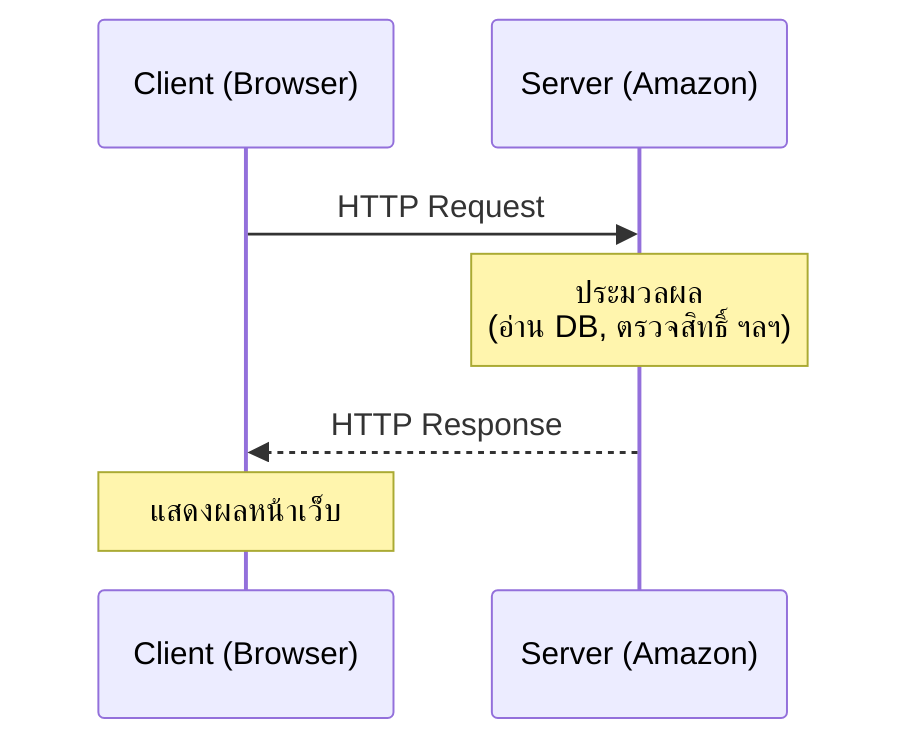


### Client คืออะไร

[▶ 3:48](https://youtu.be/Q04sTEwC7Kg?t=228)

**ใครก็ตามที่ส่ง request ไปหา server ถือเป็น client** client จึงไม่จำเป็นต้องเป็นคนหรือ browser


| ชนิดของ client    | ตัวอย่าง                                                                              |
| ----------------- | ------------------------------------------------------------------------------------- |
| Browser           | Chrome, Safari                                                                        |
| Mobile app        | แอป Amazon บน Android/iOS                                                             |
| Frontend app      | แอป React ที่เรียก backend                                                            |
| API tool          | Postman (โปรแกรมสำหรับยิง API ไปที่ backend)                                          |
| **Server อีกตัว** | ใน microservices, `order-service` เรียก `payment-service` หรือ `notification-service` |


แถวสุดท้ายสำคัญ: เมื่อ server ตัวหนึ่งเรียก server อีกตัว **server ตัวที่เรียกก็มีบทบาทเป็น client** การเป็น client หรือ server จึงขึ้นกับว่าใครเป็นฝ่ายส่ง request ไม่ได้ขึ้นกับว่าเป็นเครื่องแบบไหน

### Server คืออะไร

[▶ 5:11](https://youtu.be/Q04sTEwC7Kg?t=311)

Server คือสิ่งที่ **รับ request → ประมวลผล → ส่ง response กลับ** การประมวลผลอาจมีหลายขั้น เช่น

- เก็บข้อมูลลง database
- ดึงข้อมูลกลับไปให้ client
- อัปเดตหรือลบข้อมูล
- **Authenticate** ผู้ใช้ เช่น ส่ง login request ไปที่ codermy.in แล้ว server ตรวจว่าเป็นผู้ใช้จริงหรือไม่

ผู้สอนสรุปสั้น ๆ ว่า **client ขอข้อมูล ส่วน server ตอบกลับ**

---


## 3. HTTP และ HTTPS

[▶ 6:22](https://youtu.be/Q04sTEwC7Kg?t=382)

### HTTP คืออะไร

**HTTP = HyperText Transfer Protocol**

Client กับ server จะส่งข้อมูลกันแบบไหนก็ได้ไม่ได้ ต้องมี "ภาษากลาง" ร่วมกัน **Protocol** คือ rule book ที่กำหนดว่า

- request มีโครงสร้างแบบไหน
- response มีโครงสร้างแบบไหน
- client ต้องการทำอะไร (ผ่าน **HTTP method**)
- ข้อมูลถูกส่งข้ามเครือข่ายอย่างไร


### HTTP Methods

[▶ 7:31](https://youtu.be/Q04sTEwC7Kg?t=451)


| Method   | ความหมายตามวิดีโอ           |
| -------- | --------------------------- |
| `GET`    | ดึงข้อมูลอย่างเดียว         |
| `POST`   | สร้างหรือเก็บข้อมูลใหม่     |
| `PUT`    | อัปเดตข้อมูล                |
| `PATCH`  | อัปเดตเฉพาะบางส่วนของข้อมูล |
| `DELETE` | ลบข้อมูล                    |


> 💡 **เพิ่มเติม — PUT กับ PATCH ต่างกันตรงไหน**
> ตามแนวปฏิบัติของ REST, `PUT` คือการแทนที่ resource ทั้งก้อนด้วยข้อมูลที่ส่งไป ถ้าไม่ส่ง field ไหน ก็ถือว่า field นั้นถูกเคลียร์ ส่วน `PATCH` ส่งเฉพาะ field ที่จะเปลี่ยน
> อีกเรื่องที่ต่างกันคือ `GET`, `PUT`, `DELETE` เป็น **idempotent** (เรียกซ้ำกี่ครั้งก็ได้ผลเหมือนกัน) แต่ `POST` ไม่ใช่ เรื่องนี้สำคัญตอนออกแบบ retry


### HTTP กับ HTTPS

[▶ 8:16](https://youtu.be/Q04sTEwC7Kg?t=496)

- HTTP ส่งข้อมูลแบบ **ไม่เข้ารหัส** ใครดักฟังกลางทางก็อ่านได้
- **HTTPS** คือ HTTP ตัวเดิม ตัว `S` ย่อมาจาก **Secure** request และ response ถูกเข้ารหัสทั้งสองทาง จึงไม่มีใครดักฟังกลางทางได้

> 💡 **เพิ่มเติม:** การเข้ารหัสของ HTTPS มาจาก **TLS** ซึ่งทำงานอยู่ใต้ HTTP ข้อความ HTTP ข้างในยังเหมือนเดิมทุกอย่าง ในระบบจริง TLS มักถูกปลดที่ load balancer หรือ reverse proxy ตัวแอป Spring Boot หลังจากนั้นจึงมักรับ HTTP ธรรมดาภายในเครือข่าย

---


## 4. โครงสร้างของ HTTP Request

[▶ 8:47](https://youtu.be/Q04sTEwC7Kg?t=527)

### Request มี 4 ส่วน


| ส่วน                      | คืออะไร                  | ตัวอย่าง                   |
| ------------------------- | ------------------------ | -------------------------- |
| **Method**                | ต้องการทำอะไร            | `GET`, `POST`              |
| **URL / Path / Endpoint** | ต้องการ resource ไหน     | `/courses`                 |
| **Headers**               | metadata แบบ key–value   | `Accept: application/json` |
| **Body**                  | ข้อมูลรายละเอียดที่ส่งไป | JSON ของ email/password    |


### ตัวอย่างที่ 1: `GET /courses`

[▶ 9:20](https://youtu.be/Q04sTEwC7Kg?t=560)

ต้องการรายชื่อคอร์สทั้งหมดจาก codermy.in

```http
GET /courses HTTP/1.1
Host: www.codermy.in
Accept: application/json
```

- **Method** = `GET` เพราะต้องการดึงข้อมูล
- **Host** = `www.codermy.in`
- **Endpoint** = `/courses` URL เต็มคือ `www.codermy.in/courses`
- **Header** `Accept: application/json` = client รับ response แบบ JSON
- **ไม่มี body** เพราะ GET แค่ขอดึงข้อมูล ไม่มีอะไรต้องส่งไปเก็บ

เมื่อ request มาถึง `/courses` server อาจตรวจก่อนว่าผู้ใช้ authenticate แล้วหรือยัง จากนั้นดึงคอร์สจาก database แล้วส่งกลับ

### ตัวอย่างที่ 2: `POST /login`

[▶ 11:49](https://youtu.be/Q04sTEwC7Kg?t=709)

```http
POST /login HTTP/1.1
Host: www.codermy.in
Content-Type: application/json

{
  "email": "user@example.com",
  "password": "secret"
}
```

- `Content-Type: application/json` บอก server ว่า **body ที่ส่งมาเป็น JSON**
- body มี email และ password
- server อ่าน body แล้ว authenticate ถ้าถูกต้องก็ส่ง response สำเร็จกลับไป

> 💡 **เพิ่มเติม —** `Accept` **กับ** `Content-Type` **สลับกันบ่อย**
>
> - `Accept` = client บอกว่า **อยากได้ response** แบบไหน
> - `Content-Type` = บอกว่า **body ที่แนบมากับข้อความนี้** เป็นแบบไหน (ใช้ได้ทั้งใน request และ response)
>
> ใน Spring สองตัวนี้ผูกกับ `produces` และ `consumes` ของ `@RequestMapping` ถ้าส่ง `Content-Type` ผิด Spring จะตอบ `415 Unsupported Media Type` ถ้า `Accept` ขอแบบที่ server ทำให้ไม่ได้ จะได้ `406 Not Acceptable`

---


## 5. โครงสร้างของ HTTP Response

[▶ 13:06](https://youtu.be/Q04sTEwC7Kg?t=786)

### Response มี 3 ส่วน


| ส่วน            | คืออะไร                                      |
| --------------- | -------------------------------------------- |
| **Status code** | ผลลัพธ์สำเร็จหรือล้มเหลว และล้มเหลวเพราะอะไร |
| **Headers**     | metadata เช่น `Content-Type`                 |
| **Body**        | ข้อมูลที่ตอบกลับ                             |


ตัวอย่าง response ของ login ที่สำเร็จ

```http
HTTP/1.1 200 OK
Content-Type: application/json

{
  "message": "Login successful"
}
```


### Status codes ที่พูดถึงในวิดีโอ


| Code                        | ความหมาย                  |
| --------------------------- | ------------------------- |
| `200 OK`                    | สำเร็จ                    |
| `201 Created`               | สร้าง resource สำเร็จ     |
| `404 Not Found`             | ไม่พบ resource            |
| `500 Internal Server Error` | server พังระหว่างประมวลผล |


> ⚠️ **แก้จากวิดีโอ:** ในวิดีโอพูดว่า `503` คือ Internal Server Error ที่ถูกคือ `500 Internal Server Error` ส่วน `503` คือ **Service Unavailable** หมายถึง server ยังรับงานไม่ได้ชั่วคราว เช่นกำลัง deploy หรือ overload

> 💡 **เพิ่มเติม — กลุ่มของ status code**
>
>
> | กลุ่ม | ความหมาย        | ตัวอย่างที่เจอบ่อยใน Spring                                                            |
> | ----- | --------------- | -------------------------------------------------------------------------------------- |
> | `2xx` | สำเร็จ          | `200`, `201`, `204 No Content`                                                         |
> | `3xx` | redirect        | `302` ตอน login ด้วย form                                                              |
> | `4xx` | client ส่งมาผิด | `400` validation ไม่ผ่าน, `401` ยังไม่ login, `403` ไม่มีสิทธิ์, `404`, `409 Conflict` |
> | `5xx` | server ผิด      | `500`, `502`, `503`, `504`                                                             |
>
>
> เรื่อง status code จะกลับมาอีกตอนทำ Exception Handling (#17) และ Spring Security (#35)

---


## 6. ทบทวน Core Java: source → bytecode → JVM

[▶ 14:54](https://youtu.be/Q04sTEwC7Kg?t=894)

โปรแกรม Java ปกติที่เขียนกันมา

```java
public class Main {
  public static void main(String[] args) {
    // code
  }
}
```

1. เขียนลงไฟล์ `Main.java` (ชื่อไฟล์ต้องตรงกับชื่อ public class)
2. Compile ด้วย `javac` จะได้ **bytecode** คือ `Main.class`
3. Bytecode เป็น **platform independent** รันได้ทุก OS ที่มี JVM นี่คือที่มาของคำว่า "Write Once, Run Anywhere"
4. **JVM** ให้ sandbox สำหรับรัน bytecode

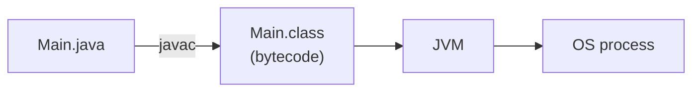


ประเด็นสำคัญ: **โค้ด Java ไม่ได้รันบน OS โดยตรง** มันรันอยู่ใน JVM และ JVM เองเป็น process หนึ่งบน OS

---


## 7. Endpoint คือการเรียก method

[▶ 16:28](https://youtu.be/Q04sTEwC7Kg?t=988)

ผู้สอนใช้ **first-principles thinking** ไล่ทีละขั้น

- ถ้า server รันแอป Java อยู่ ตอนที่เรายิง `codermy.in/courses` เราก็กำลังคุยกับโค้ด Java ที่ compile แล้วและรันอยู่บน JVM ของเครื่อง server
- Java เป็นภาษา object-oriented ทุกอย่างเกิดใน **method** ของ **class**
- ดังนั้นการยิง `/courses` สุดท้ายก็คือ **การเรียก method หนึ่ง** เช่น `getCourses()` ที่ไปดึงรายการคอร์สมาให้
- `/signup` ก็จะไปเรียกอีก method หนึ่ง เช่น `signup()`

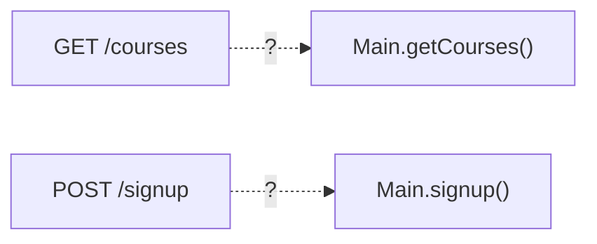


**คำถามที่ Core Java ยังตอบไม่ได้:** จะ **map** endpoint หนึ่งไปหา method หนึ่งใน class ได้อย่างไร

---


## 8. Program flow กับ Website flow

[▶ 18:24](https://youtu.be/Q04sTEwC7Kg?t=1104)

### โปรแกรม Java ปกติ

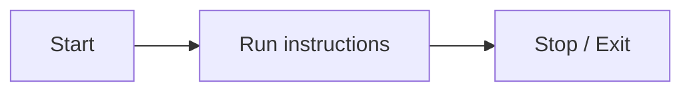


### เว็บไซต์

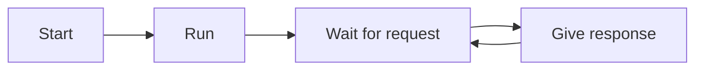


เว็บไซต์อย่าง Instagram ต้องตอบได้ตลอด 24/7 **ต้องไม่ exit**

> "A website is not a program that runs once. A website is a program that stays up continuously."

ถ้าคิดแบบ Core Java ก็อาจ hack ด้วย `while (true) { ... }` ให้โปรแกรมไม่จบ

แต่ต่อให้โปรแกรมไม่จบแล้ว **ก็ยังไม่ได้ตอบคำถามเดิม** ว่าจะเอา HTTP request ไป map เข้ากับ method ได้อย่างไร และใครเป็นคนเรียก method นั้น

Core Java สอนเรื่อง class, object, inheritance และ OOP แต่ไม่ได้สอนว่าจะ **อ่าน HTTP request, อ่าน URL, header, body และสร้าง HTTP response** อย่างไร

---


## 9. ทำเว็บด้วย `java.net` ได้ไหม

[▶ 21:55](https://youtu.be/Q04sTEwC7Kg?t=1315)

คำตอบคือ **ได้และไม่ได้**

### ส่วนที่ได้

Java มี package `java.net` มาตั้งแต่ Java 1.0 มี class อย่าง `Socket` และ `ServerSocket` ไว้ listen network

```java
ServerSocket server = new ServerSocket(8080);
```


### Port คืออะไร

[▶ 23:09](https://youtu.be/Q04sTEwC7Kg?t=1389)

ในคอมพิวเตอร์เครื่องหนึ่งมีหลายแอปรันพร้อมกัน เช่น WhatsApp, Chrome, Spotify

- request ที่เข้ามาทางเครือข่ายจะมี **IP address** ของเครื่องติดมา
- แต่ต้องรู้ต่อว่าเป็นของแอปไหนในเครื่อง ส่วนนี้ดูจาก **port number**
- แต่ละแอปจอง port ของตัวเอง เช่น `8080`

`new ServerSocket(8080)` จึงแปลว่าแอป Java ของเราจะรอรับทุก request ที่เข้ามาที่ port 8080

### [localhost](http://localhost)

[▶ 24:21](https://youtu.be/Q04sTEwC7Kg?t=1461)

- `localhost` = เครื่องตัวเอง IP คือ `127.0.0.1`
- `localhost:8080` = ส่ง request ไปที่ port 8080 บนเครื่องตัวเอง

> 💡 **เพิ่มเติม:** port `8080` เป็นค่า default ของ Spring Boot (`server.port`) ตัวเลขนี้จะเจออีกแทบทุกตอนในคอร์ส

---


## 10. งานที่ต้องเขียนเองทั้งหมด

[▶ 25:07](https://youtu.be/Q04sTEwC7Kg?t=1507)

ตรงนี้คือคำตอบ "ไม่ได้" **โค้ดใน** `java.net` **ไม่รู้จัก HTTP** สำหรับมันแล้ว request ที่เข้ามาเป็นแค่ **stream of bytes** มันอ่านได้ แต่ไม่รู้ว่า `GET`, `/courses` หรือ `Host` หมายถึงอะไร

ถ้าจะทำเว็บด้วย `ServerSocket` ล้วน ต้องเขียนเองทั้งหมดนี้

1. **Read input stream** — อ่าน bytes ด้วย `BufferedReader`
2. **Parse request manually** — แยกเองว่า method, path, header และ body อยู่ตรงไหน
3. **Map method กับ endpoint** — เขียน `if (endpoint.equals("/courses")) { ... } else if ...` เอง
4. **Build HTTP response manually** — ประกอบ status line, header และ body ให้ตรงตาม protocol เอง
5. **Multithreading** — [▶ 28:08](https://youtu.be/Q04sTEwC7Kg?t=1688) ถ้ามีแค่ main thread ระหว่างที่จัดการ request แรกอยู่ ผู้ใช้คนที่สองจะต้องรอ จึงต้องสร้าง thread เองเพื่อรับผู้ใช้หลายคนพร้อมกัน (concurrent)

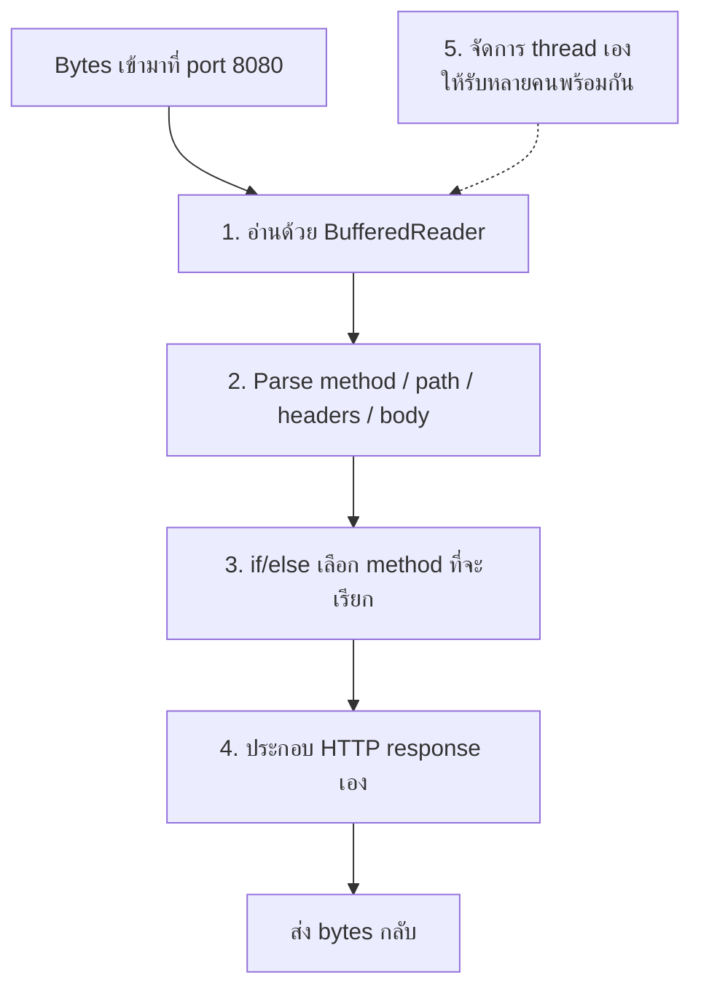


ทั้งหมดนี้คือ **boilerplate code** ที่ทุกเว็บแอปต้องเขียนซ้ำกันหมด และไม่เกี่ยวกับ business logic เลย

> 💡 **เพิ่มเติม:** โค้ดเต็มของ server แบบนี้อยู่ใน [ส่วนที่ 18 แบบที่ 1](#แบบที่-1-javanet-ล้วน--ทุกอย่างทำเอง) ลองรันดู จะเห็นว่าแค่ endpoint เดียวก็ต้องเขียนเยอะแค่ไหน

---


## 11. Servlet และ Servlet Container

[▶ 29:14](https://youtu.be/Q04sTEwC7Kg?t=1754)

### ที่มา

**Servlet** และ **Servlet Container** ถูกสร้างขึ้นมาเพื่อลบงานที่ทำเองทั้งหมดในส่วนที่ 10 เป็นมาตรฐานแรกของ Java ที่ออกแบบมาสำหรับเว็บโดยเฉพาะ

> ⚠️ **แก้จากวิดีโอ (เล็กน้อย):** วิดีโอบอกว่า Servlet ออกปี 1997 ในฐานะ package ของ Java Enterprise Edition ที่ละเอียดกว่าคือ Servlet API 1.0 ออกปี 1997 ก่อนจะมี J2EE แล้วต่อมาจึงกลายเป็นส่วนหนึ่งของ J2EE (ปี 1999) ปัจจุบันมาตรฐานนี้ชื่อ **Jakarta EE** และ package เปลี่ยนจาก `javax.servlet` เป็น `jakarta.servlet`


### Servlet คืออะไร

- **Servlet** คือ Java class ธรรมดาที่รันอยู่ **ข้างใน Servlet Container**
- Servlet Container เองก็รันอยู่ใน JVM ตามปกติ
- ในชีวิตประจำวันเรามักเรียก Servlet Container ว่า **"server"**


### Servlet Container ที่นิยม


| Container    | หมายเหตุ                                   |
| ------------ | ------------------------------------------ |
| **Tomcat**   | นิยมที่สุด และเป็น default ของ Spring Boot |
| **Jetty**    | ทางเลือกที่นิยมรองลงมา                     |
| **Undertow** | วิดีโอยกเป็นตัวอย่าง                       |


> ⚠️ **Spring Boot 4 vs 3:** **Spring Boot 4 เลิกรองรับ Undertow แล้ว** เพราะ Spring Framework 7 ต้องการ Servlet 6.1 ซึ่ง Undertow ยังไม่รองรับ ใน Boot 4 จึงเหลือ embedded server ฝั่ง servlet แค่ **Tomcat 11** และ **Jetty 12.1** ถ้าเจอ `spring-boot-starter-undertow` ในโปรเจกต์ Boot 3.x ต้องย้ายก่อนอัปเกรด
> ([Spring Boot 4.0 release notes](https://github.com/spring-projects/spring-boot/wiki/Spring-Boot-4.0.0-M2-Release-Notes))


### Tomcat ทำอะไรให้

[▶ 31:21](https://youtu.be/Q04sTEwC7Kg?t=1881)

งานทั้งหมดในส่วนที่ 10 Tomcat ทำให้หมด

- เปิด port
- อ่าน bytes ที่เข้ามา
- แปลง bytes เป็น HTTP request
- ดู URL แล้วเลือก **Servlet** ที่ต้องเรียก
- **จัดการ thread** ให้เอง
- สร้าง HTTP response จากสิ่งที่ Servlet คืนมา

เหลือให้เราโฟกัสที่ **business logic** อย่างเดียว

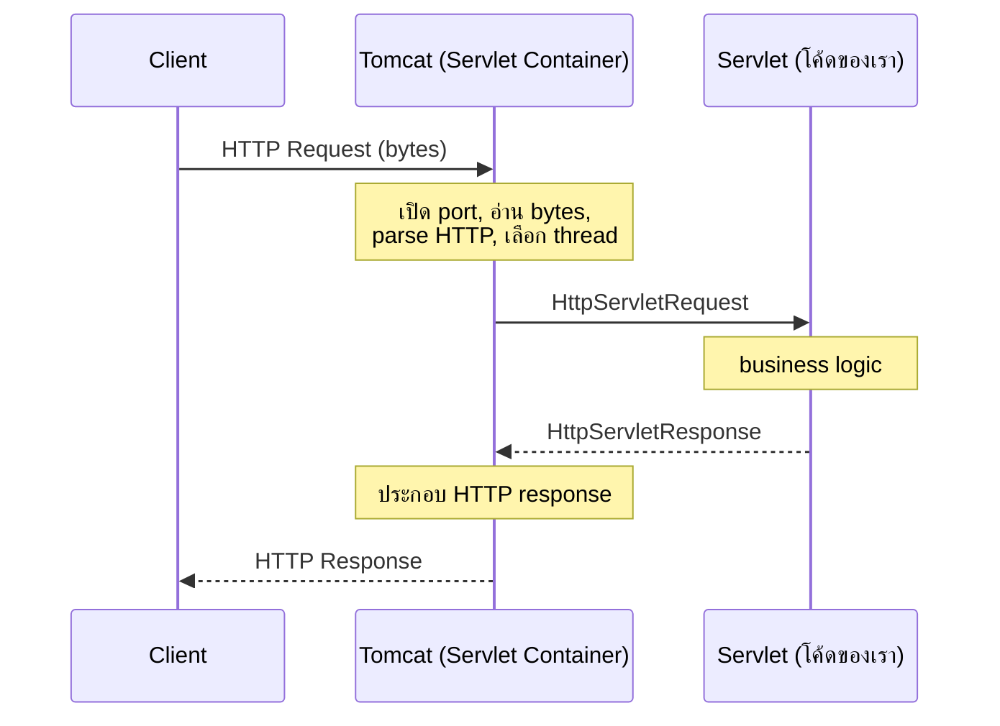


- Tomcat เป็น server จึง **ทำงานตลอดเวลา** ไม่ exit คอยรอ request
- มีได้ **หลาย Servlet** แต่ละ request จะถูกส่งไปที่ Servlet ที่ตรงกับ URL ของมัน
- method ที่เคยต้อง map เองในส่วนที่ 7 ตอนนี้ไปเขียนไว้ **ใน Servlet**

> 💡 **เพิ่มเติม — จุดนี้เชื่อมกับ Spring Boot อย่างไร**
> สมัยก่อนต้องติดตั้ง Tomcat แยกบน server แล้ว deploy แอปเป็นไฟล์ `.war` เข้าไป (รายละเอียดอยู่ในตอน #14)
> Spring Boot เปลี่ยนเป็น **embedded Tomcat** คือ Tomcat ถูกบรรจุมาใน `.jar` ของแอปเลย สั่ง `java -jar app.jar` แล้ว Tomcat ก็เริ่มทำงานพร้อมแอป บรรทัด `Tomcat started on port 8080` ใน log ตอนสตาร์ท Spring Boot คือสิ่งนี้

---


## 12. ทำไม Spring Framework ถึงเกิดขึ้น

[▶ 33:06](https://youtu.be/Q04sTEwC7Kg?t=1986)

ถ้า Servlet ใช้งานได้ดีอยู่แล้ว ทำไมยังต้องมี Spring?

เพราะเมื่อโค้ดแบบ Servlet โตจนเป็น **enterprise application** แอปจะ **tightly coupled** คือ object จำนวนมากผูกกันแน่นจนสเกลและแก้ไขได้ยาก

Spring เสนอแนวคิดหลักใหม่เพื่อทำให้แอป **loosely coupled**

- **Dependency Injection (DI)**
- **Inversion of Control (IoC)**

(สองเรื่องนี้มีตอนของตัวเองคือ #4 และ #5)

> 💡 **เพิ่มเติม — tightly coupled หน้าตาเป็นอย่างไร**
>
> ```java
> public class CourseService {
>   private final MySqlCourseRepository repo = new MySqlCourseRepository();
> }
> ```
>
> `CourseService` สร้าง dependency เองด้วย `new` จึงผูกตายกับ MySQL ถ้าจะเปลี่ยน database หรือใส่ตัวปลอมตอนเขียน test ต้องแก้ class นี้
> แบบ loosely coupled จะรับ dependency ผ่าน constructor แล้วให้ **IoC container** ของ Spring เป็นคนสร้างและส่งเข้ามา
>
> ```java
> public class CourseService {
>   private final CourseRepository repo;
>
>   public CourseService(CourseRepository repo) {
>     this.repo = repo;
>   }
> }
> ```

---


## 13. Spring คือ Ecosystem

[▶ 33:51](https://youtu.be/Q04sTEwC7Kg?t=2031)

ผู้สอนบอกว่าเรียก Spring ว่า "framework" ตัวเดียว **ไม่ถูก** Spring คือ **ecosystem** ที่มีหลาย framework อยู่ข้างใน

และ Spring ไม่ได้มีไว้ทำเว็บอย่างเดียว ที่ [spring.io](https://spring.io) ในหัวข้อ "What Spring can do" มี

- GenAI applications
- Microservices
- Reactive applications
- Cloud applications
- Event-driven systems
- **Web apps** (ซึ่งคอร์สนี้เน้น)
- Serverless
- Batch processing

---


## 14. ชั้นของ Spring: Core, Modules, Boot

[▶ 34:50](https://youtu.be/Q04sTEwC7Kg?t=2090)

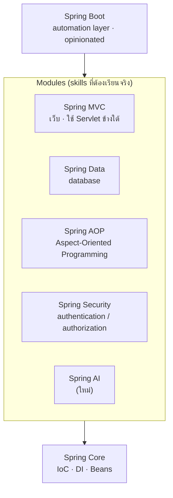


### Spring Core — ฐานของทุกอย่าง

คือแนวคิดหลักที่ Spring นำมา: **Dependency Injection, Inversion of Control, Beans** ทุก module ใช้ core ตัวเดียวกันนี้

### Modules ที่วางบน Core


| Module              | ใช้ทำอะไร                                                                                              |
| ------------------- | ------------------------------------------------------------------------------------------------------ |
| **Spring MVC**      | สร้างเว็บแอป **ข้างในใช้ Servlet** เราจึงไม่ต้องเขียน Servlet ตรง ๆ แต่ยังต้องเข้าใจไว้สำหรับตอน debug |
| **Spring Data**     | ต่อ database                                                                                           |
| **Spring AOP**      | Aspect-Oriented Programming (ตอน #22–25)                                                               |
| **Spring Security** | login, authentication (ตอน #35–39)                                                                     |
| **Spring AI**       | module ใหม่ ผู้สอนจัดไว้เป็นส่วนเสริม                                                                  |


### Spring Boot — ชั้นบนสุด

[▶ 36:22](https://youtu.be/Q04sTEwC7Kg?t=2182)

**ความเข้าใจผิดที่เจอบ่อย:** คิดว่า Spring Boot มาแทน Spring Framework **ไม่ใช่**

- ผู้สอนบอกว่า **Spring Boot ไม่ใช่ skill** skill จริงคือ module ตรงกลาง (MVC, Data, AOP, Security)
- Spring Boot คือ **automation layer** ที่วางอยู่บนสุด เป้าหมายคือให้เริ่มพัฒนาแอปได้เร็ว ("boot up" ได้เร็ว) ชื่อจึงเป็น Spring **Boot**
- Spring Boot เป็น **opinionated framework** มันตั้งค่าโปรเจกต์ให้ด้วย configuration ที่มันเลือกไว้ก่อน
  - ถ้าค่าที่เลือกไว้ใช้ได้ ก็เริ่มเขียน API ได้เลย
  - ถ้าใช้ไม่ได้ ก็ override ได้
- ถ้าใช้ Spring MVC ตรง ๆ โดยไม่มี Boot ต้องเขียน configuration เองเยอะมาก

**ประเด็นสำคัญ:** จะ override ค่าของ Boot ได้ถูก ต้องเข้าใจก่อนว่า MVC, Data, AOP และ Security ทำงานอย่างไรข้างใน **เรียน Spring Boot โดยข้ามสิ่งเหล่านี้ไม่ได้**

> 💡 **เพิ่มเติม — "opinionated" ในทางปฏิบัติ**
> แค่ใส่ `spring-boot-starter-web` (Boot 4 ใช้ชื่อ `spring-boot-starter-webmvc`) Boot ก็จะ
>
> - ใส่ embedded Tomcat ให้ และตั้ง port เป็น 8080
> - ลงทะเบียน `DispatcherServlet` (Servlet ตัวเดียวที่เป็น front controller ของ Spring MVC รายละเอียดในตอน #15)
> - ตั้ง Jackson ไว้แปลง object เป็น JSON และกลับกัน
>
> กลไกที่อยู่เบื้องหลังคือ **auto-configuration** (ตอน #9) ทุกค่า override ได้ เช่น `server.port=9090` ใน `application.properties` (ตอน #10)

> ⚠️ **Spring Boot 4 vs 3 — ชื่อ starter:** Boot 4 แยก starter ออกเป็น module เล็กลง starter ของเว็บแบบ servlet ชื่อใหม่คือ `spring-boot-starter-webmvc` ชื่อเดิม `spring-boot-starter-web` ยังใช้ได้แต่ถูก deprecate แล้ว ใน Boot 3.x ใช้ `spring-boot-starter-web`

---


## 15. Spring Data: JDBC → JPA → Hibernate

[▶ 38:36](https://youtu.be/Q04sTEwC7Kg?t=2316)

### ยุค JDBC

**JDBC = Java Database Connectivity** เขียน SQL ตรง ๆ ในโค้ด Java

```java
// Demo.java
String sql = "SELECT * FROM courses";
```


### ยุค JPA

[▶ 39:20](https://youtu.be/Q04sTEwC7Kg?t=2360)

**JPA = Java Persistence API** แนวคิดคือไม่ต้องเขียน SQL เอง เรียก method แล้วระบบจะคุยกับ database ให้

**แต่มันไม่ได้เป็นเวทมนตร์** database เข้าใจแค่ SQL ดังนั้นข้างในก็ยังต้องมี JDBC

- **JPA ไม่ใช่ implementation** JPA เป็นแค่ **specification** (rule book)
- **Hibernate** คือ implementation ของ JPA
- Hibernate ใช้ **JDBC** ข้างใน

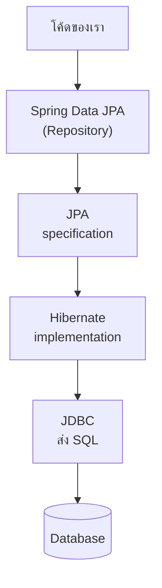


**ประเด็นสำคัญ:** จะเข้าใจ Spring Data JPA ต้องเข้าใจ Hibernate และจะเข้าใจ Hibernate ต้องเข้าใจ JDBC คอร์สจึงเรียงลำดับเป็น JDBC (#26), Spring JDBC (#27), Hibernate (#28–29), JPA (#30–31) แล้วค่อยถึง Spring Data JPA (#32)

> ⚠️ **แก้จากวิดีโอ (ความแม่นยำ):** วิดีโอพูดเหมือน "Spring JPA" เป็นผู้คิดแนวคิดนี้ ที่ถูกคือ **JPA เป็นมาตรฐานของ Java EE** (ออกปี 2006 ปัจจุบันชื่อ **Jakarta Persistence**) ไม่ใช่ของ Spring ส่วน **Spring Data JPA** เป็น module ของ Spring ที่สร้าง `Repository` ครอบ JPA ไว้อีกชั้น เพื่อลด boilerplate นอกจาก Hibernate แล้ว JPA ยังมี implementation อื่น เช่น EclipseLink แต่ Spring Boot ใช้ Hibernate เป็น default

> 💡 **เพิ่มเติม — เทียบใน Spring Boot ทีละชั้น**
>
> ```java
> // JDBC ล้วน (ตอน #26)
> try (Connection c = dataSource.getConnection();
>      PreparedStatement ps = c.prepareStatement("SELECT id, name FROM courses");
>      ResultSet rs = ps.executeQuery()) {
>   while (rs.next()) { /* map ทีละแถวเอง */ }
> }
>
> // Spring Data JPA (ตอน #32) ไม่มี SQL ในโค้ดของเรา
> public interface CourseRepository extends JpaRepository<Course, Long> {
>   List<Course> findByNameContaining(String keyword);
> }
> ```
>
> Hibernate ยังสร้าง SQL ให้อยู่ข้างใน เปิด `spring.jpa.show-sql=true` ก็เห็นได้

---


## 16. สถาปัตยกรรมรวมของ Spring

[▶ 40:49](https://youtu.be/Q04sTEwC7Kg?t=2449)

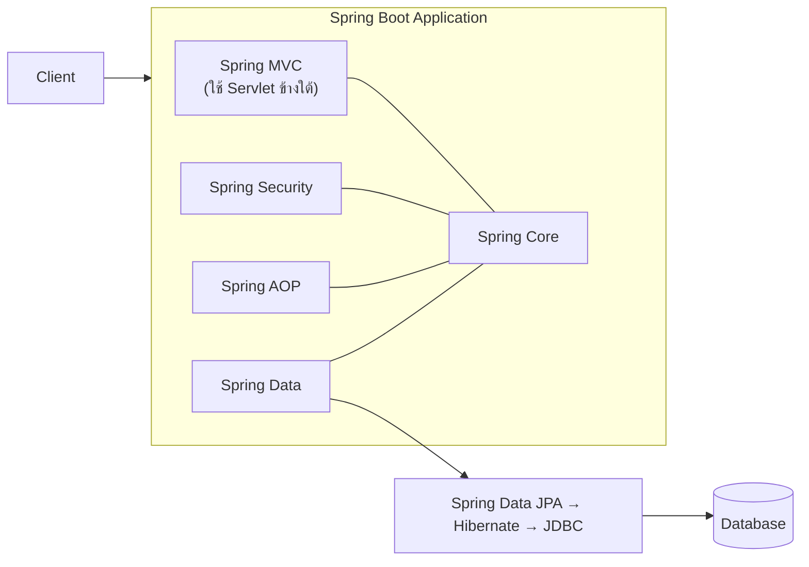


- Client ส่ง request เข้ามาที่ **Spring Boot application**
- Spring Boot ประกอบด้วย MVC, Security, AOP, Data ทุกตัวใช้ **Spring Core** ร่วมกัน
- ถ้าต้องคุยกับ database ก็ผ่าน **Spring Data JPA → Hibernate → JDBC**
- **Spring MVC ใช้ Servlet ข้างใน**

---


## 17. Monolith กับ Microservices

[▶ 41:29](https://youtu.be/Q04sTEwC7Kg?t=2489)

นักเรียนมักถามว่า "Spring Microservices" คือ module อีกตัวหรือเปล่า **ไม่ใช่** microservices คือ **รูปแบบสถาปัตยกรรม** ว่าจะประกอบแอปขึ้นมาอย่างไร

### สองแบบที่ทำได้


| แบบ               | ลักษณะ                                    |
| ----------------- | ----------------------------------------- |
| **Monolithic**    | แอปเดียวรับทุก endpoint                   |
| **Microservices** | แยกเป็น service เล็กหลายตัวที่เรียกกันเอง |


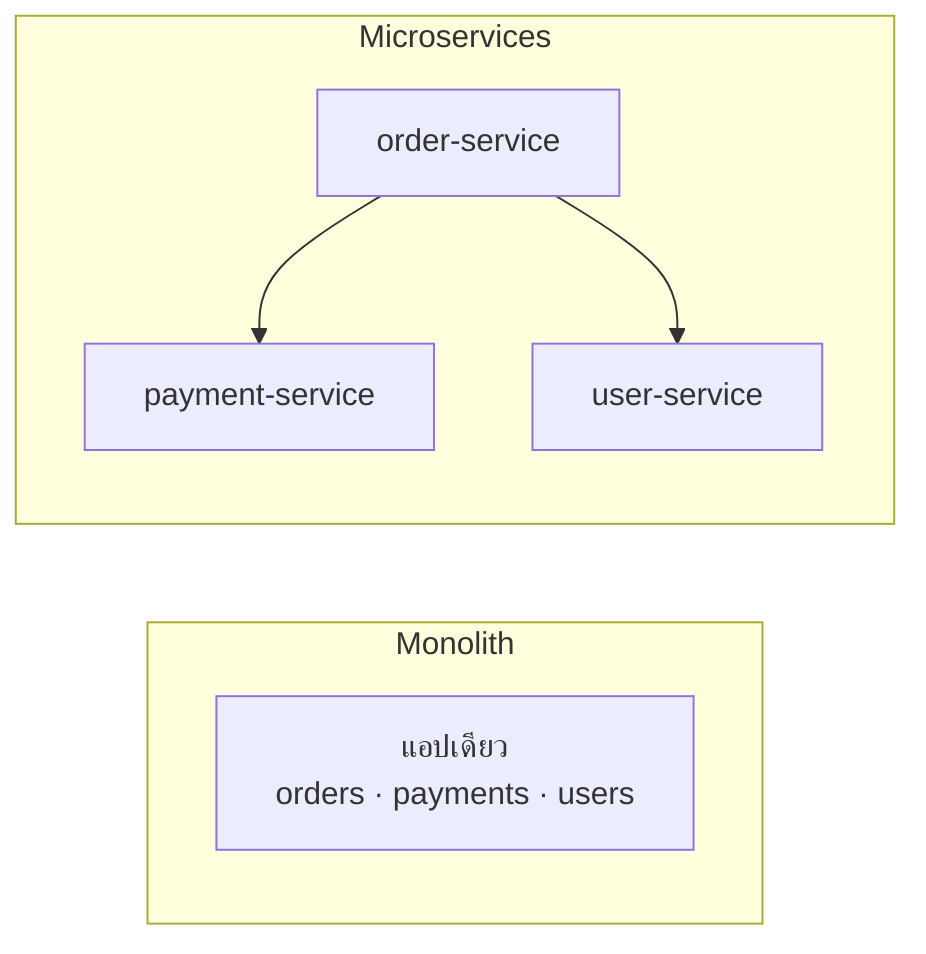


แยก service อย่างไรจะสอนในซีรีส์ ถ้าเข้าใจสถาปัตยกรรมนี้ทั้งหมด ผู้สอนบอกว่าคุณคือ **Java Full Stack Developer**

> 💡 **เพิ่มเติม:** ใน ecosystem ของ Spring ชุดเครื่องมือสำหรับ microservices คือ **Spring Cloud** (Gateway, Config, service discovery, circuit breaker ผ่าน Resilience4j) ทุกตัวใช้ Spring Boot เป็นฐาน แต่ละ service ก็คือแอป Spring Boot ธรรมดาหนึ่งตัว
> ตอน #41–42 ของ playlist (members-only) เป็นโปรเจกต์ microservices กับ API Gateway

---


## 18. โค้ดตัวอย่าง: endpoint เดียวกันสามยุค

> 💡 **เพิ่มเติมทั้งส่วน:** วิดีโอตอนนี้อธิบายด้วยคำพูดและกระดานอย่างเดียว ไม่ได้เขียนโค้ด ส่วนนี้คือโค้ดที่ทำ endpoint `GET /courses` ตัวเดียวกันใน **สามยุค** ตามลำดับที่วิดีโอเล่า จะได้เห็นว่าแต่ละชั้นลบงานอะไรออกไป


### แบบที่ 1: `java.net` ล้วน — ทุกอย่างทำเอง

ตรงกับ [ส่วนที่ 9–10](#10-งานที่ต้องเขียนเองทั้งหมด) ไฟล์เดียว ไม่มี dependency (compile และทดสอบด้วย Java 21 แล้ว)

```java
import java.io.BufferedReader;
import java.io.IOException;
import java.io.InputStreamReader;
import java.io.OutputStream;
import java.net.ServerSocket;
import java.net.Socket;
import java.nio.charset.StandardCharsets;
import java.util.HashMap;
import java.util.Map;
import java.util.concurrent.ExecutorService;
import java.util.concurrent.Executors;

public class RawHttpServer {

  public static void main(String[] args) throws IOException {
    // (5) multithreading: ทำ thread pool เอง
    ExecutorService workers = Executors.newFixedThreadPool(10);

    try (ServerSocket server = new ServerSocket(8080)) {
      System.out.println("Listening on http://localhost:8080");
      while (true) {                       // website flow: ไม่ exit
        Socket client = server.accept();   // รอ request ถัดไป
        workers.submit(() -> handle(client));
      }
    }
  }

  private static void handle(Socket client) {
    try (client;
         BufferedReader in = new BufferedReader(
             new InputStreamReader(client.getInputStream(), StandardCharsets.UTF_8));
         OutputStream out = client.getOutputStream()) {

      // (1) read input stream + (2) parse request เอง
      String requestLine = in.readLine();          // "GET /courses HTTP/1.1"
      if (requestLine == null || requestLine.isBlank()) {
        return;
      }
      String[] parts = requestLine.split(" ");
      String method = parts[0];
      String path = parts[1];

      Map<String, String> headers = new HashMap<>();
      String line;
      while ((line = in.readLine()) != null && !line.isEmpty()) {
        int colon = line.indexOf(':');
        headers.put(line.substring(0, colon).trim().toLowerCase(), line.substring(colon + 1).trim());
      }

      // (3) map endpoint -> method เอง
      String status;
      String body;
      if (method.equals("GET") && path.equals("/courses")) {
        status = "200 OK";
        body = getCourses();
      } else {
        status = "404 Not Found";
        body = "{\"error\":\"not found\"}";
      }

      // (4) build HTTP response เอง
      byte[] bytes = body.getBytes(StandardCharsets.UTF_8);
      String response = "HTTP/1.1 " + status + "\r\n"
          + "Content-Type: application/json\r\n"
          + "Content-Length: " + bytes.length + "\r\n"
          + "Connection: close\r\n"
          + "\r\n";
      out.write(response.getBytes(StandardCharsets.UTF_8));
      out.write(bytes);
    } catch (IOException e) {
      System.err.println("request failed: " + e.getMessage());
    }
  }

  private static String getCourses() {
    return "[{\"id\":1,\"name\":\"Spring Boot\"},{\"id\":2,\"name\":\"DSA\"}]";
  }
}
```

รัน

```bash
javac RawHttpServer.java && java RawHttpServer
# อีก terminal
curl -i http://localhost:8080/courses
```

ผลที่ได้

```http
HTTP/1.1 200 OK
Content-Type: application/json
Content-Length: 53
Connection: close

[{"id":1,"name":"Spring Boot"},{"id":2,"name":"DSA"}]
```

**สิ่งที่โค้ดนี้ยังไม่ได้ทำ:** อ่าน body ตาม `Content-Length`, ใช้ connection ซ้ำ (keep-alive), แปลง JSON, ตรวจ request ที่ผิดรูป, HTTPS, timeout ถ้าจะทำให้ครบต้องเขียนอีกหลายร้อยบรรทัด นี่คือเหตุผลที่ต้องมี Servlet Container

### แบบที่ 2: Servlet — Tomcat ทำงาน HTTP ให้

ตรงกับ [ส่วนที่ 11](#11-servlet-และ-servlet-container) ไม่ต้องเปิด socket ไม่ต้อง parse ไม่ต้องจัดการ thread เหลือแค่ business logic

```java
import jakarta.servlet.annotation.WebServlet;
import jakarta.servlet.http.HttpServlet;
import jakarta.servlet.http.HttpServletRequest;
import jakarta.servlet.http.HttpServletResponse;
import java.io.IOException;

@WebServlet("/courses")                        // container map URL -> servlet ให้
public class CoursesServlet extends HttpServlet {

  @Override
  protected void doGet(HttpServletRequest req, HttpServletResponse resp) throws IOException {
    resp.setStatus(HttpServletResponse.SC_OK);
    resp.setContentType("application/json");
    resp.getWriter().write("[{\"id\":1,\"name\":\"Spring Boot\"},{\"id\":2,\"name\":\"DSA\"}]");
  }
}
```

- `doGet` ถูกเรียกเฉพาะ `GET` ถ้าเป็น `POST` จะไปที่ `doPost`
- Tomcat แปลง bytes เป็น `HttpServletRequest` ให้ และแปลง `HttpServletResponse` กลับเป็น bytes ให้
- **ยังเหลือ:** แปลง JSON เอง, ถ้ามีหลายร้อย endpoint ก็ต้องมีหลายร้อย servlet, และต้อง package เป็น `.war` แล้ว deploy เข้า Tomcat ที่ติดตั้งแยกไว้ (ตอน #14)

> ⚠️ **Boot 4 vs 3:** ทั้งคู่ใช้ `jakarta.servlet` แล้ว (Boot 4 ใช้ Servlet 6.1/Tomcat 11, Boot 3 ใช้ Servlet 6.0/Tomcat 10.1) ถ้าเจอบทเรียนเก่าที่ใช้ `javax.servlet` นั่นคือก่อน Boot 3 ใช้กับ Boot 3 ขึ้นไปไม่ได้


### แบบที่ 3: Spring Boot — เหลือแค่ business logic

ตรงกับ [ส่วนที่ 14](#14-ชั้นของ-spring-core-modules-boot)

`pom.xml` (เฉพาะส่วนสำคัญ)

```xml
<parent>
  <groupId>org.springframework.boot</groupId>
  <artifactId>spring-boot-starter-parent</artifactId>
  <version>4.1.1</version>
</parent>

<properties>
  <java.version>21</java.version>
</properties>

<dependencies>
  <dependency>
    <groupId>org.springframework.boot</groupId>
    <artifactId>spring-boot-starter-webmvc</artifactId>
  </dependency>
</dependencies>
```

> Boot 3.x: ใช้ `<version>3.5.x</version>` และ artifact `spring-boot-starter-web`

`CourseApplication.java`

```java
package com.example.courses;

import org.springframework.boot.SpringApplication;
import org.springframework.boot.autoconfigure.SpringBootApplication;

@SpringBootApplication
public class CourseApplication {
  public static void main(String[] args) {
    SpringApplication.run(CourseApplication.class, args);   // สตาร์ท embedded Tomcat ที่ :8080
  }
}
```

`CourseController.java`

```java
package com.example.courses;

import java.util.List;
import org.springframework.web.bind.annotation.GetMapping;
import org.springframework.web.bind.annotation.RestController;

@RestController
public class CourseController {

  public record Course(long id, String name) {}

  @GetMapping("/courses")             // map GET /courses -> method นี้
  public List<Course> getCourses() {
    return List.of(new Course(1, "Spring Boot"), new Course(2, "DSA"));
  }
}
```

```bash
./mvnw spring-boot:run
curl -i http://localhost:8080/courses
```

```http
HTTP/1.1 200
Content-Type: application/json
Content-Length: 53

[{"id":1,"name":"Spring Boot"},{"id":2,"name":"DSA"}]
```

> สังเกตว่า Tomcat ส่ง `HTTP/1.1 200` โดยไม่มีคำว่า `OK` ต่อท้าย ข้อความนี้เรียกว่า reason phrase ตามมาตรฐาน HTTP ไม่บังคับ client ทุกตัวอ่านแค่ตัวเลข ใน HTTP/2 ไม่มี reason phrase เลย

ไม่มี socket, ไม่มี parse, ไม่มี if/else ของ path, ไม่ต้องต่อ JSON string เอง, ไม่มี thread pool และไม่ต้องติดตั้ง Tomcat แยก **แต่งานทั้งหมดนี้ยังเกิดขึ้นอยู่ข้างใต้** Boot แค่ทำให้

### เทียบส่วนของ HTTP กับ annotation ใน Spring

ตัวอย่างนี้ map ส่วนของ request/response จาก [ส่วนที่ 4–5](#4-โครงสร้างของ-http-request) ไปยัง annotation ของ Spring ใช้ endpoint `POST /login` ตามวิดีโอ (ยังไม่ได้ตรวจสิทธิ์จริง เป็นแค่ตัวอย่างโครงสร้าง ส่วน authentication จริงอยู่ในตอน #35–38)

```java
package com.example.courses;

import org.springframework.http.HttpStatus;
import org.springframework.http.MediaType;
import org.springframework.http.ResponseEntity;
import org.springframework.web.bind.annotation.PostMapping;
import org.springframework.web.bind.annotation.RequestBody;
import org.springframework.web.bind.annotation.RequestHeader;
import org.springframework.web.bind.annotation.RestController;

@RestController
public class LoginController {

  public record LoginRequest(String email, String password) {}
  public record LoginResponse(String message) {}

  @PostMapping(                                         // Method + Path
      path = "/login",
      consumes = MediaType.APPLICATION_JSON_VALUE,      // ต้องการ Content-Type: application/json
      produces = MediaType.APPLICATION_JSON_VALUE)      // ตอบเป็น JSON (เทียบกับ Accept)
  public ResponseEntity<LoginResponse> login(
      @RequestHeader(value = "User-Agent", required = false) String userAgent,   // Header
      @RequestBody LoginRequest request) {                                      // Body (JSON -> record)

    if ("user@example.com".equals(request.email()) && "secret".equals(request.password())) {
      return ResponseEntity.ok(new LoginResponse("Login successful"));          // 200 + body
    }
    return ResponseEntity.status(HttpStatus.UNAUTHORIZED)                        // 401
        .body(new LoginResponse("Invalid credentials"));
  }
}
```


| ส่วนของ HTTP                           | ใน Spring                                                                       |
| -------------------------------------- | ------------------------------------------------------------------------------- |
| Method                                 | `@GetMapping`, `@PostMapping`, `@PutMapping`, `@PatchMapping`, `@DeleteMapping` |
| Path / Endpoint                        | ค่าใน mapping annotation เช่น `"/login"`                                        |
| Request header                         | `@RequestHeader`                                                                |
| Request body                           | `@RequestBody` (Jackson แปลง JSON เป็น object)                                  |
| `Content-Type` ของ request             | `consumes`                                                                      |
| `Accept` / `Content-Type` ของ response | `produces`                                                                      |
| Status code                            | `ResponseEntity.status(...)` หรือ `@ResponseStatus`                             |
| Response body                          | ค่าที่ return (Jackson แปลง object เป็น JSON)                                   |


> ⚠️ **Boot 4 vs 3 — Jackson:** Boot 4 ใช้ **Jackson 3** เป็นค่า default (package `tools.jackson`) ส่วน Boot 3 ใช้ Jackson 2 (package `com.fasterxml.jackson`) ยกเว้น annotation อย่าง `@JsonProperty` ที่ยังอยู่ใน `com.fasterxml.jackson.annotation` เหมือนเดิม โค้ดด้านบนไม่ได้เรียก Jackson ตรง ๆ จึงใช้ได้ทั้งคู่ แต่ถ้าโปรเจกต์ import `ObjectMapper` เอง ต้องเปลี่ยน import ตอนอัปเกรด (Boot 4 ใช้ `JsonMapper` แทน)
> ([Spring Boot 4.0 Migration Guide](https://github.com/spring-projects/spring-boot/wiki/Spring-Boot-4.0-Migration-Guide))

---


## 19. สรุปท้ายตอน


### ลำดับความคิดของทั้งตอน

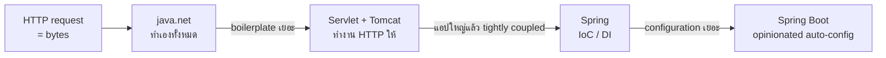


### ประเด็นที่ต้องจำ

1. **Client** คือใครก็ได้ที่ส่ง request รวมถึง server ที่ไปเรียก server ตัวอื่น
2. **HTTP request** มี 4 ส่วน: method, path, headers, body **response** มี 3 ส่วน: status code, headers, body
3. **Endpoint ก็คือการเรียก method** สิ่งที่ยากคือการ map request ไปหา method
4. เว็บไซต์ต้อง **รันตลอด** ไม่ exit
5. `java.net` ฟังเครือข่ายได้ แต่ **ไม่รู้จัก HTTP** ต้อง parse, map, build response และจัดการ thread เองทั้งหมด
6. **Servlet Container** (Tomcat) รับงานทั้งหมดนั้นแทน **Servlet** คือ class ที่มี business logic
7. **Spring** เกิดมาเพราะแอป Servlet ขนาดใหญ่ tightly coupled จึงนำ **IoC/DI** มาใช้
8. Spring เป็น **ecosystem**: Core อยู่ล่างสุด, MVC/Data/AOP/Security อยู่ตรงกลาง, **Boot** อยู่บนสุดเป็น automation layer
9. **Spring Boot ไม่ได้มาแทน Spring** ต้องเข้าใจ module ข้างใต้จึงจะ override ค่าของ Boot ได้ถูก
10. **Data access:** Spring Data JPA → JPA (spec) → Hibernate (implementation) → JDBC → DB
11. **Microservices** เป็นสถาปัตยกรรม ไม่ใช่ module


### คำถามทบทวน

1. ทำไม server ที่ไปเรียก API ของ server อีกตัวถึงนับเป็น client
2. `GET /courses` ปกติแล้วทำไมไม่มี body
3. `Accept` กับ `Content-Type` ต่างกันอย่างไร
4. ถ้ามีแค่ `ServerSocket` ต้องเขียนอะไรเองบ้าง ให้ครบ 5 อย่าง
5. Servlet กับ Servlet Container ต่างกันอย่างไร และอะไรรันอยู่ข้างในอะไร
6. ทำไมคนถึงบอกว่า "Spring Boot ไม่ใช่ skill"
7. ถ้า Hibernate ไม่ใช้ JDBC ข้างใน ต้องมีอะไรมาแทน
8. แอป Spring Boot 3.x ที่ใช้ Undertow ต้องแก้อะไรก่อนอัปเกรดเป็น Boot 4


### ตอนถัดไป

[#2 — Build Your First Spring Boot Application | REST API](./02-first-spring-boot-application.md) ผู้สอนบอกว่าจะเริ่มเขียนโค้ดจริงตอนแรก