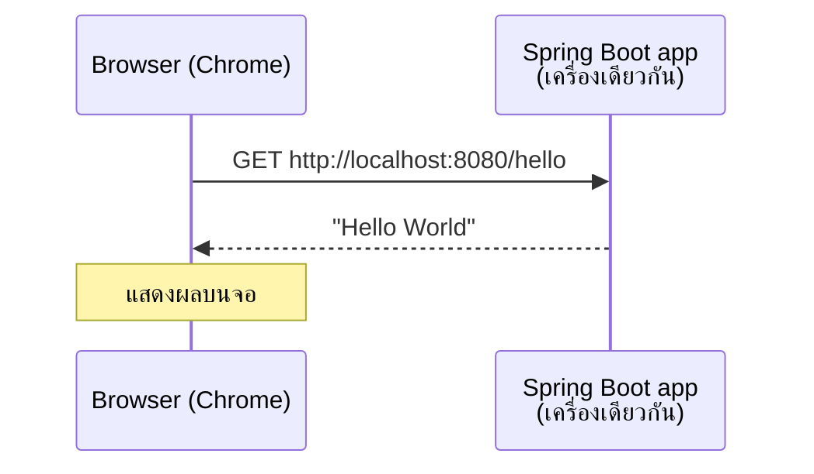
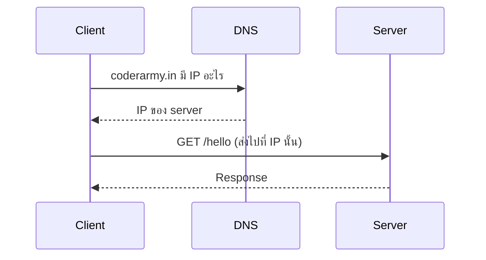
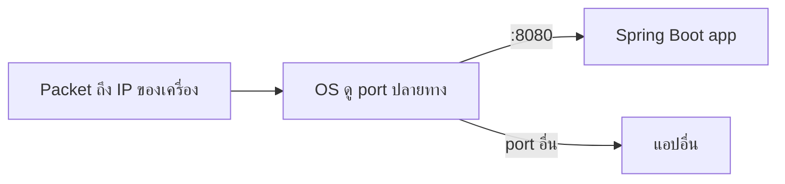
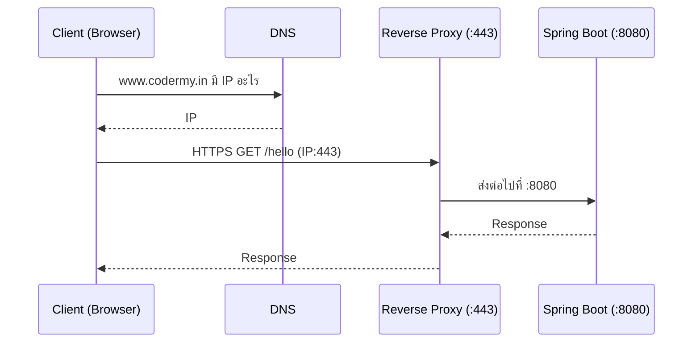
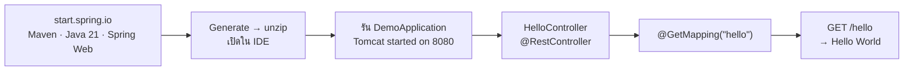

# #2 — สร้างแอป Spring Boot ตัวแรก: Hello World REST API

> **วิดีโอ:** [Build Your First Spring Boot Application | REST API | Spring Boot Full Course #2](https://youtu.be/PVreyET_Q6I) — Coder Army, ~31 นาที
> **แหล่งที่ใช้สรุป:** ซับไตเติลภาษาฮินดีที่ YouTube สร้างอัตโนมัติ
> **เวอร์ชันในโค้ด:** Spring Boot 4.1 + Java 21 (ใส่หมายเหตุไว้ทุกจุดที่ Spring Boot 3.x ต่างกัน)

ตอนนี้ตอบคำถามเดียว: **จากศูนย์ไปจนถึงเปิด browser แล้วเห็น "Hello World" ต้องทำอะไรบ้าง** ผู้สอนเริ่มจากทบทวนว่า request เดินทางจาก browser ไปถึงแอปอย่างไร (IP, DNS, port, reverse proxy) จากนั้นสร้างโปรเจกต์ด้วย Spring Initializr เขียน controller หนึ่ง class แล้วรันให้เห็นผลใน browser ผู้สอนตั้งใจไม่อธิบาย syntax ในตอนนี้ เป้าหมายคือให้เห็นว่า Spring Boot ตั้งค่าทุกอย่างให้เร็วแค่ไหน

ส่วนที่ติดป้าย `💡 เพิ่มเติม` คือของที่ผมเติมเอง ไม่ได้อยู่ในวิดีโอ ส่วนที่ติด `⚠️ แก้จากวิดีโอ` คือจุดที่วิดีโอพูดคลาดเคลื่อน

---

## สารบัญ

| เวลา | หัวข้อ |
|---|---|
| [0:00](https://youtu.be/PVreyET_Q6I?t=0) | [1. เป้าหมายของตอน](#1-เป้าหมายของตอน) |
| [0:43](https://youtu.be/PVreyET_Q6I?t=43) | [2. Flow ที่จะสร้าง](#2-flow-ที่จะสร้าง) |
| [2:15](https://youtu.be/PVreyET_Q6I?t=135) | [3. IP Address และ DNS](#3-ip-address-และ-dns) |
| [4:42](https://youtu.be/PVreyET_Q6I?t=282) | [4. localhost คือเครื่องตัวเอง](#4-localhost-คือเครื่องตัวเอง) |
| [5:08](https://youtu.be/PVreyET_Q6I?t=308) | [5. Port Number](#5-port-number) |
| [6:41](https://youtu.be/PVreyET_Q6I?t=401) | [6. Port มาตรฐานและ Reverse Proxy](#6-port-มาตรฐานและ-reverse-proxy) |
| [9:54](https://youtu.be/PVreyET_Q6I?t=594) | [7. ลองเปิดเว็บก่อนมีแอป](#7-ลองเปิดเว็บก่อนมีแอป) |
| [10:20](https://youtu.be/PVreyET_Q6I?t=620) | [8. เตรียมเครื่อง: IDE และ Java](#8-เตรียมเครื่อง-ide-และ-java) |
| [11:11](https://youtu.be/PVreyET_Q6I?t=671) | [9. Spring Initializr คืออะไร](#9-spring-initializr-คืออะไร) |
| [14:44](https://youtu.be/PVreyET_Q6I?t=884) | [10. ตัวเลือกบน start.spring.io](#10-ตัวเลือกบน-startspringio) |
| [18:09](https://youtu.be/PVreyET_Q6I?t=1089) | [11. โครงสร้างโปรเจกต์ที่ได้](#11-โครงสร้างโปรเจกต์ที่ได้) |
| [19:31](https://youtu.be/PVreyET_Q6I?t=1171) | [12. รันแอปครั้งแรก](#12-รันแอปครั้งแรก) |
| [20:00](https://youtu.be/PVreyET_Q6I?t=1200) | [13. Embedded Tomcat และ Whitelabel Error Page](#13-embedded-tomcat-และ-whitelabel-error-page) |
| [21:17](https://youtu.be/PVreyET_Q6I?t=1277) | [14. Controller แรก: HelloController](#14-controller-แรก-hellocontroller) |
| [23:48](https://youtu.be/PVreyET_Q6I?t=1428) | [15. `@GetMapping`: ผูก endpoint กับ method](#15-getmapping-ผูก-endpoint-กับ-method) |
| [25:26](https://youtu.be/PVreyET_Q6I?t=1526) | [16. ส่ง HTML กลับไป](#16-ส่ง-html-กลับไป) |
| [26:01](https://youtu.be/PVreyET_Q6I?t=1561) | [17. คำถามที่ยังไม่มีคำตอบ](#17-คำถามที่ยังไม่มีคำตอบ) |
| [27:07](https://youtu.be/PVreyET_Q6I?t=1627) | [18. เปลี่ยน port ด้วย `server.port`](#18-เปลี่ยน-port-ด้วย-serverport) |
| [27:52](https://youtu.be/PVreyET_Q6I?t=1672) | [19. หลาย endpoint ใน controller เดียว](#19-หลาย-endpoint-ใน-controller-เดียว) |
| [29:20](https://youtu.be/PVreyET_Q6I?t=1760) | [20. ทำไมยังต้องเรียน Spring ข้างใต้](#20-ทำไมยังต้องเรียน-spring-ข้างใต้) |
| — | [21. โค้ดฉบับสมบูรณ์และ test](#21-โค้ดฉบับสมบูรณ์และ-test) |
| — | [22. สรุปท้ายตอน](#22-สรุปท้ายตอน) |

---

## 1. เป้าหมายของตอน

[▶ 0:00](https://youtu.be/PVreyET_Q6I?t=0)

วันนี้จะสร้างแอป Spring Boot ของตัวเอง งานง่ายมาก: เปิด browser พิมพ์ URL แล้วเห็นคำว่า **Hello World**

ผู้สอนยอมรับตรง ๆ ว่ายังไม่ได้เรียน syntax ของ Spring Boot เลย จึงจะไม่เข้าใจโค้ดที่เขียน และ **ตั้งใจให้เป็นแบบนั้น** สิ่งที่อยากให้เห็นคือ

- การสร้างแอป Spring Boot ง่ายแค่ไหน
- Spring Boot ตั้งค่าทุกอย่างให้อัตโนมัติ เราจึงเริ่มเขียน **business logic** ได้ทันที

ส่วนที่ว่า Spring Boot ตั้งค่าให้ได้อย่างไร จะค่อย ๆ อธิบายในตอนถัด ๆ ไป

---

## 2. Flow ที่จะสร้าง

[▶ 0:43](https://youtu.be/PVreyET_Q6I?t=43)

- **Client** คือ browser ของเราเอง (Google Chrome)
- **Server** คือแอป Spring Boot ที่เราจะเขียน รันอยู่บนคอมพิวเตอร์เครื่องเดียวกัน
- เพราะทั้งคู่อยู่เครื่องเดียวกัน เราจึงยิงไปที่ **`localhost`** ของตัวเอง พร้อม port **`8080`**
- request คือ `GET` ไปที่ endpoint **`/hello`**
- server ตอบกลับเป็น string `Hello World` แล้ว browser แสดงผลบนจอ



---

## 3. IP Address และ DNS

[▶ 2:15](https://youtu.be/PVreyET_Q6I?t=135)

### ทุกเครื่องมี IP address

อุปกรณ์ทุกเครื่องมี **IP address** อยากรู้ IP ของตัวเองก็ค้น Google ว่า "what is my ip" แล้วเข้าเว็บแรก (whatismyip.com) จะเห็นทั้ง **IPv4** และ **IPv6**

[▶ 2:47](https://youtu.be/PVreyET_Q6I?t=167) ผู้สอนบอกว่าถ้า client จากที่ไหนในโลกจะส่ง request มาหาคอมพิวเตอร์ของเขา ก็ต้องส่งมาที่ IP นี้

> ⚠️ **แก้จากวิดีโอ (เล็กน้อย):** IP ที่เว็บ whatismyip แสดงคือ **public IP ของ router** ไม่ใช่ของ laptop โดยตรง เครื่องในบ้านหรือออฟฟิศมักใช้ public IP เดียวกันผ่าน **NAT** ส่วนตัวเครื่องเองมี private IP (เช่น `192.168.x.x`) request จากข้างนอกที่ส่งมาที่ public IP จะ **ไปไม่ถึง** laptop ถ้าไม่ได้ตั้ง port forwarding ไว้ที่ router ดังนั้นประโยค "IP unique ต่อเครื่อง และใครในโลกก็ส่งมาถึงได้" จึงจริงเฉพาะเครื่องที่มี public IP ของตัวเอง เช่น server บน cloud

### DNS: จากชื่อโดเมนเป็น IP

[▶ 2:57](https://youtu.be/PVreyET_Q6I?t=177)

ภาพ client–server ในตอนที่แล้วยังง่ายเกินไป ตอนนั้นเราเขียน host เป็นชื่อเลย เช่น `www.coderarmy.in` แต่จริง ๆ แล้ว request ไม่ได้ถูกส่งไปที่ "ชื่อ" สิ่งที่ใช้ระบุเครื่องคือ **IP address**

[▶ 3:44](https://youtu.be/PVreyET_Q6I?t=224) ขั้นตอนจริงคือ

1. Client ต้องหา IP ของ host `coderarmy.in` ก่อน จึงไปถาม **DNS**
2. หน้าที่ของ DNS คือ **resolve** ชื่อโดเมนให้เป็น IP แล้วส่ง IP กลับมาให้ client
3. Client ใช้ IP นั้นยิง request ไปหา server เช่น `GET /hello`
4. Server ได้รับ request แล้วตอบ response กลับไป



---

## 4. localhost คือเครื่องตัวเอง

[▶ 4:42](https://youtu.be/PVreyET_Q6I?t=282)

ถ้า client คือ browser ของเรา และ server คือแอป Spring Boot ที่รันบนเครื่องเดียวกัน host จะไม่ใช่ IP จาก DNS อีกต่อไป แต่เป็น **`127.0.0.1`**

- `127.0.0.1` เป็น **IP ตายตัว** หมายถึง "ส่ง request หาตัวเอง"
- ใช้คำว่า **`localhost`** แทนได้

นี่คือเหตุผลที่ URL ใน flow ของเราคือ `localhost:8080/hello` host คือ `localhost` และ endpoint คือ `/hello`

---

## 5. Port Number

[▶ 5:08](https://youtu.be/PVreyET_Q6I?t=308)

IP address พา data packet มาถึง **เครื่อง** ได้ แต่ในเครื่องมีหลายแอปรันพร้อมกัน เช่น Chrome, WhatsApp, Spotify ที่รันอยู่เบื้องหลัง และแอป Spring Boot ของเรา

เมื่อ packet มาถึงเครื่องแล้ว OS จะรู้ได้อย่างไรว่าต้องส่งต่อให้แอปไหน คำตอบคือ **port number**

- นอกจาก IP แล้วยังมีอีกตัวเลขที่ใช้ระบุปลายทาง เรียกว่า **port number**
- IP เดียวมีได้หลาย port และ **แต่ละ port มีแอปเดียว** รับอยู่
- สมมติแอป Spring Boot รันที่ port `8080` แอปอื่นก็อยู่ port อื่น
- เพราะแอปแต่ละตัวอยู่คนละ port เวลายิงไปที่ `localhost` จึงต้องบอก port ด้วยว่าจะยิงไปที่ port ไหนของ server



> ⚠️ **แก้จากวิดีโอ (เล็กน้อย):** วิดีโอยกตัวอย่างว่า Chrome, WhatsApp, Spotify แต่ละตัว "รันอยู่บน port ของตัวเอง" แบบเดียวกับ Spring Boot ที่จริงมีสองบทบาทที่ต่างกัน
> - **ฝั่ง server** (เช่น Spring Boot) **listen** ที่ port ตายตัว เช่น `8080` เพื่อรอ request
> - **ฝั่ง client** (เช่น Chrome) ไม่ได้จอง port ตายตัว ทุกครั้งที่เปิด connection ออกไป OS จะสุ่ม **ephemeral port** ให้ชั่วคราว response ที่ตอบกลับมาจึงรู้ว่าต้องส่งให้ Chrome
>
> หลักการ "port ใช้แยกว่า packet เป็นของแอปไหน" ยังถูกต้องทั้งสองกรณี

---

## 6. Port มาตรฐานและ Reverse Proxy

[▶ 6:41](https://youtu.be/PVreyET_Q6I?t=401)

### ถ้าไม่ได้ระบุ port แล้วรู้ได้อย่างไร

กลับไปที่ flow ของ DNS: client ได้แค่ IP มาจาก DNS แล้วยิงไปที่ IP นั้น **ไม่ได้ส่ง port ไปด้วย** แล้ว OS ของ server จะรู้ได้อย่างไรว่า request นี้มาที่ port ไหน

คำตอบคือมี **port มาตรฐาน**

| Protocol | Port |
|---|---|
| HTTP | `80` |
| HTTPS | `443` |

ตัวอย่าง: พิมพ์ `https://www.codermy.in` แล้วเข้าหน้าแรกได้ เพราะเป็น HTTPS browser จึงต่อ port `443` ให้กับ host เอง

> ⚠️ **แก้จากวิดีโอ:** วิดีโอพูดว่า request แบบ HTTP "ไปที่ port 80 เสมอ" และ HTTPS "ไปที่ 443 เสมอ" ที่ถูกคือ 80 และ 443 เป็น **ค่า default** ที่ browser ใช้ **เมื่อ URL ไม่ได้ระบุ port** ถ้าระบุ port ไว้ใน URL ก็ใช้ port นั้น ตัวอย่างที่ชัดที่สุดคือ `http://localhost:8080/hello` ในตอนนี้เอง เป็น HTTP แต่ไปที่ port 8080

### Reverse Proxy

[▶ 8:05](https://youtu.be/PVreyET_Q6I?t=485)

ปัญหาต่อมา: request มาที่ port `443` แต่แอป Spring Boot บน server รันที่ `8080` (เปลี่ยน port ได้ แต่สมมติว่าไม่เปลี่ยน)

[▶ 8:29](https://youtu.be/PVreyET_Q6I?t=509) ระหว่าง client กับแอปจึงมีอีกตัวหนึ่งเรียกว่า **reverse proxy** หน้าที่ของมันคือ **map** request ที่เข้ามาทาง port `443` ไปที่ port `8080` request HTTPS ทุกตัวจึงไปถึงแอปที่ `8080`

- Reverse proxy ถือเป็นส่วนหนึ่งของ server ผู้สอนบอกว่าจะมองว่า reverse proxy กับแอปรวมกันคือ "server" ก็ได้
- จากนั้น server ดู endpoint `/hello` แล้วรู้ว่าต้องเรียกโค้ดส่วนไหน



> ⚠️ **แก้จากวิดีโอ (คำศัพท์):** วิดีโอบอกว่า request จะถูก "**redirect**" ไปที่ port 8080 ที่ถูกคือ reverse proxy **ส่งต่อ (forward / proxy)** request ไปให้แอปแล้วรับ response กลับมาส่งให้ client เอง client ไม่รู้เลยว่ามี port 8080 อยู่ข้างหลัง ส่วน **redirect** ใน HTTP คือ server ตอบ `3xx` พร้อม header `Location` ให้ client ไปยิง URL ใหม่เอง ซึ่งเป็นคนละกลไก

> 💡 **เพิ่มเติม:** reverse proxy ที่เจอบ่อยคือ Nginx, HAProxy หรือ load balancer ของ cloud ในทางปฏิบัติมันมักเป็นตัวถอดรหัส TLS ด้วย (TLS termination ตามที่เล่าไว้ใน [#1](./01-spring-ecosystem-introduction.md#3-http-และ-https)) แล้วส่ง HTTP ธรรมดาเข้าไปที่ `:8080`

### ทบทวนทั้งเส้นทาง

[▶ 9:12](https://youtu.be/PVreyET_Q6I?t=552)

1. Client ส่งชื่อโดเมนไปถาม DNS และได้ IP ของ server กลับมา
2. Port ถูกต่อท้าย IP ให้อัตโนมัติ ถ้าเป็น HTTPS คือ `443`
3. Reverse proxy ที่ server map `443` ไปที่ `8080` ซึ่งเป็น port ที่แอป Spring Boot รับอยู่
4. แอปดู endpoint (`/hello`) แล้วเรียกโค้ดที่ตรงกัน

---

## 7. ลองเปิดเว็บก่อนมีแอป

[▶ 9:54](https://youtu.be/PVreyET_Q6I?t=594)

ผู้สอนพิมพ์ `localhost:8080/hello` ใน browser ตอนนี้ได้ **"This site can't be reached"** เพราะยังไม่มีแอปไหนรันอยู่ที่ port 8080

เป้าหมายของตอนคือทำให้ URL เดียวกันนี้แสดงคำว่า Hello World

---

## 8. เตรียมเครื่อง: IDE และ Java

[▶ 10:20](https://youtu.be/PVreyET_Q6I?t=620)

ก่อนเริ่มต้องมีสองอย่าง

1. **IDE** ผู้สอนใช้ **IntelliJ IDEA** เพราะนิยมที่สุดสำหรับงาน Java จะใช้ Eclipse หรือ NetBeans ก็ได้ ทุก IDE ทำงานแบบเดียวกัน
2. **Java** ติดตั้งเวอร์ชันล่าสุดตัวไหนก็ได้ ถ้าไม่รู้วิธีติดตั้ง ให้ถาม ChatGPT ผู้สอนบอกว่าส่วนนี้ให้ลองหาเอง

> 💡 **เพิ่มเติม:** Spring Boot 4 ต้องใช้ **Java 17 ขึ้นไป** ([Spring Boot 4.0 Migration Guide](https://github.com/spring-projects/spring-boot/wiki/Spring-Boot-4.0-Migration-Guide)) โน้ตชุดนี้ใช้ Java 21 ตรวจเวอร์ชันได้ด้วย `java -version`

---

## 9. Spring Initializr คืออะไร

[▶ 11:11](https://youtu.be/PVreyET_Q6I?t=671)

เว็บที่จะใช้คือ **Spring Initializr** ที่ [start.spring.io](https://start.spring.io)

### ปัญหาที่ Initializr แก้

ถ้าต้องสร้างเว็บแอป Java เองตั้งแต่ศูนย์ ต้องดูแลหลายเรื่องก่อนจะเริ่มเขียนโค้ดได้

- **สร้างโครงโฟลเดอร์** เวลาเขียนโค้ดเล่น ๆ เราวางไฟล์ไว้ตรงไหนก็ได้ แต่เว็บแอปมี class เยอะ ต้องมีโครงโฟลเดอร์ที่เป็นระบบ
- **ตั้งค่า configuration** หลายอย่าง
- **ดาวน์โหลด dependency** หลายตัว
- **กำหนดเวอร์ชันของ Spring Boot**
- **กำหนดเวอร์ชันของ Java**
- **วางโครง package** ว่า package ไหนอยู่ตรงไหน

### Dependency คืออะไร

[▶ 12:11](https://youtu.be/PVreyET_Q6I?t=731)

สมมติโค้ด Java ของเราต้องต่อกับ database MySQL

- ต้องมี **MySQL connector** ซึ่งเป็น **library** ที่มีคนเขียนไว้แล้ว
- library คือโค้ดสำเร็จรูปที่คนอื่นทำเป็น template ไว้ เรามีหน้าที่แค่เอามาใช้ ไม่ต้องเขียน connector เอง
- เมื่อโค้ดเราใช้ library ภายนอก library นั้นจะกลายเป็น **dependency** เพราะโค้ดเรา **depend** กับมัน

เรื่องนี้จะชัดขึ้นในตอน Maven (#3)

### เหตุผลที่ Spring ทำ Initializr

[▶ 13:56](https://youtu.be/PVreyET_Q6I?t=836)

งานทั้งหมดข้างบนยังไม่ได้แตะ **business code** แม้แต่บรรทัดเดียว (business code คือ logic จริงที่แอปต้องทำ) มีแต่เล่นกับ configuration, โครงโฟลเดอร์ และ dependency

ทีม Spring จึงทำ Spring Initializr ขึ้นมา

1. เลือก option ที่ต้องการบนหน้าเว็บ
2. กด **Generate** จะได้ไฟล์ zip
3. unzip แล้วได้ **skeleton** ของโปรเจกต์ที่ตั้งค่า Spring Boot ไว้แล้ว ทั้งเวอร์ชัน Java, เวอร์ชัน Spring Boot และโครงโฟลเดอร์
4. เราเริ่มเขียน business logic ได้ทันที

ผู้สอนบอกว่าจะใช้เว็บนี้บ่อยมากตลอดคอร์ส

---

## 10. ตัวเลือกบน start.spring.io

[▶ 14:44](https://youtu.be/PVreyET_Q6I?t=884)

ผู้สอนไล่ทีละตัวเลือก บางตัวจะอธิบายละเอียดในตอนถัดไป

### Project: Maven

มีให้เลือก 3 แบบคือ **Gradle - Groovy**, **Gradle - Kotlin** และ **Maven** ทั้งซีรีส์ใช้ **Maven** เพราะนิยมที่สุด

ทั้งหมดนี้คือ **project management tool** สำหรับจัดการโปรเจกต์ Java ทำไมต้องมีและทำงานอย่างไรอยู่ในตอนหน้า

### Language: Java

เลือก **Java** ไม่ใช้ Kotlin หรือ Groovy

### Spring Boot version

[▶ 15:16](https://youtu.be/PVreyET_Q6I?t=916)

ในรายการมีหลายเวอร์ชัน บางตัวมีคำต่อท้าย

| คำต่อท้าย | ความหมายตามวิดีโอ | ควรใช้ไหม |
|---|---|---|
| `SNAPSHOT` | work in progress ยังไม่เสร็จ อาจมี bug | ไม่ |
| `RC` | **Release Candidate** เกือบ final แล้ว แต่ยังไม่ได้ release จริง | ไม่ (ไม่เสี่ยง) |
| ไม่มีคำต่อท้าย | stable | ใช่ |

ผู้สอนเลือก **4.0.6** ซึ่งเป็นเวอร์ชัน stable ตอนอัดวิดีโอ และบอกว่าใน stable ด้วยกันจะเลือกตัวล่าสุด ทั้งซีรีส์ใช้ **Spring Boot 4** ใช้ 4.0.6, 4.0.7 หรือ 4.1 ก็ได้ ถ้าดูวิดีโอตอนที่ Spring Boot 5 ออกแล้ว บางอย่างจะเปลี่ยนไปบ้าง แต่หลักใหญ่เหมือนเดิม

> 💡 **เพิ่มเติม:** ยังมีคำต่อท้ายอีกแบบคือ `M` (**Milestone**) ซึ่งเป็นรุ่นทดสอบก่อน `RC` ตอนที่เขียนโน้ตนี้ start.spring.io แสดง `4.2.0 (SNAPSHOT)`, `4.2.0 (M2)`, `4.1.2 (SNAPSHOT)`, `4.1.1`, `4.0.9 (SNAPSHOT)`, `4.0.8` และค่า default คือ **4.1.1** โค้ดในโน้ตนี้จึงใช้ 4.1.1

### Project Metadata

[▶ 16:13](https://youtu.be/PVreyET_Q6I?t=973)

มีสามช่องคือ **Group**, **Artifact** และ **Package name** ตอนนี้ปล่อยเป็นค่า default ไปก่อน ความหมายจริงอยู่ในตอน Maven

> 💡 **เพิ่มเติม:** ค่า default คือ Group = `com.example`, Artifact = `demo`, Package name = `com.example.demo` นี่คือเหตุผลที่ class หลักชื่อ `DemoApplication` และอยู่ใน package `com.example.demo`

### Packaging: Jar

[▶ 16:30](https://youtu.be/PVreyET_Q6I?t=990)

| ตัวเลือก | ย่อมาจาก |
|---|---|
| **Jar** | Java Archive |
| **War** | Web Archive |

สมัยก่อนเว็บแอป Java ใช้ **war** ทุกวันนี้แอป Spring Boot รุ่นใหม่ใช้ **jar** จึงเลือก jar รายละเอียดอยู่ในตอนถัด ๆ ไป

> 💡 **เพิ่มเติม:** war ยังมีให้เลือกและยังใช้ได้ ใช้ในกรณีที่ต้อง deploy เข้า Servlet Container ที่ติดตั้งแยกไว้ (ตอน #14) ส่วน jar ของ Spring Boot มี embedded Tomcat อยู่ข้างในและรันด้วย `java -jar` ได้เลย

### Configuration: Properties

[▶ 16:46](https://youtu.be/PVreyET_Q6I?t=1006)

เลือกได้ระหว่าง **Properties** กับ **YAML** ใช้แบบไหนก็ได้ ตอนนี้เลือก Properties (YAML อยู่ในตอน #18)

### Java: 21

[▶ 16:53](https://youtu.be/PVreyET_Q6I?t=1013)

ตอนอัดวิดีโอมีตัวเลือก 17, 21, 25, 26 ผู้สอนเลือก **21** เพราะไม่ใหม่และไม่เก่าเกินไป

> 💡 **เพิ่มเติม:** ตอนที่เขียนโน้ตนี้ตัวเลือกเป็น 17, 21, 25, 27 และค่า default คือ 17 ถ้าจะใช้ 21 ตามวิดีโอต้องเปลี่ยนเอง

### Dependencies: Spring Web

[▶ 17:09](https://youtu.be/PVreyET_Q6I?t=1029)

เราอยากให้โค้ดคุยกับเว็บได้ คือ **listen ที่ port** ได้ จึงต้องเพิ่ม dependency ชื่อ **Spring Web**

คำอธิบายบนเว็บคือ

> Build web, including RESTful, applications using Spring MVC. Uses Apache Tomcat as the default embedded container.

- สร้างเว็บแอปรวมถึง **RESTful application** ด้วย **Spring MVC**
- ใช้ **Apache Tomcat** เป็น **embedded container** โดย default ซึ่งก็คือ Servlet Container จากตอนที่แล้ว
- Tomcat ถูกบรรจุมาในแอปแล้ว **ไม่ต้องดาวน์โหลดแยก**

[▶ 18:03](https://youtu.be/PVreyET_Q6I?t=1083) กด **Generate** แล้วได้ไฟล์ `demo.zip`

> ⚠️ **Boot 4 vs 3 — Spring Web สร้าง starter ตัวไหน:** บนหน้าเว็บยังชื่อ "Spring Web" เหมือนเดิม แต่ `pom.xml` ที่ได้ต่างกัน
>
> | | Boot 4 | Boot 3.x |
> |---|---|---|
> | main | `spring-boot-starter-webmvc` | `spring-boot-starter-web` |
> | test | `spring-boot-starter-webmvc-test` | `spring-boot-starter-test` |
>
> Boot 4 แยก starter เป็น module ย่อย และทุก starter มี test starter คู่กัน `spring-boot-starter-web` ยังใช้ได้แต่ถูก deprecate แล้ว ส่วน `spring-boot-starter-webmvc-test` ดึง `spring-boot-starter-test` มาให้เอง จึงไม่ต้องประกาศแยก
> (ยืนยันจาก `pom.xml` ที่ generate จาก start.spring.io ด้วย Boot 4.1.1 และ [Spring Boot 4.0 Migration Guide](https://github.com/spring-projects/spring-boot/wiki/Spring-Boot-4.0-Migration-Guide) หัวข้อ Starters และ Deprecated Starters)

`pom.xml` ที่ start.spring.io สร้างให้ (Boot 4.1.1, Java 21, Spring Web) เฉพาะส่วนสำคัญ ตัด XML header และ element ที่เป็นค่าว่าง (`<description>`, `<url>`, `<licenses>`, `<developers>`, `<scm>`) ออก

```xml
<parent>
	<groupId>org.springframework.boot</groupId>
	<artifactId>spring-boot-starter-parent</artifactId>
	<version>4.1.1</version>
	<relativePath/> <!-- lookup parent from repository -->
</parent>
<groupId>com.example</groupId>
<artifactId>demo</artifactId>
<version>0.0.1-SNAPSHOT</version>

<properties>
	<java.version>21</java.version>
</properties>

<dependencies>
	<dependency>
		<groupId>org.springframework.boot</groupId>
		<artifactId>spring-boot-starter-webmvc</artifactId>
	</dependency>
	<dependency>
		<groupId>org.springframework.boot</groupId>
		<artifactId>spring-boot-starter-webmvc-test</artifactId>
		<scope>test</scope>
	</dependency>
</dependencies>

<build>
	<plugins>
		<plugin>
			<groupId>org.springframework.boot</groupId>
			<artifactId>spring-boot-maven-plugin</artifactId>
		</plugin>
	</plugins>
</build>
```

> 💡 **เพิ่มเติม — generate จาก terminal:** start.spring.io เรียกผ่าน HTTP ได้ตรง ๆ คำสั่งนี้ได้โปรเจกต์เดียวกับในวิดีโอ (`dependencies=web` คือ "Spring Web")
>
> ```bash
> curl https://start.spring.io/starter.zip -d type=maven-project -d bootVersion=4.1.1 \
>   -d name=demo -d javaVersion=21 -d packaging=jar -d dependencies=web -o demo.zip
> ```

---

## 11. โครงสร้างโปรเจกต์ที่ได้

[▶ 18:09](https://youtu.be/PVreyET_Q6I?t=1089)

unzip `demo.zip` แล้วเปิดใน IntelliJ IDEA: **Open** แล้วเลือกโฟลเดอร์ `demo` รอสักพักให้ IDE โหลดโปรเจกต์เสร็จ

[▶ 18:29](https://youtu.be/PVreyET_Q6I?t=1109) ผู้สอนบอกว่าตอนนี้จะมีหลายอย่างที่ยังไม่เข้าใจ เช่น `mvnw` คืออะไร `src` คืออะไร `pom.xml` คืออะไร

- เปิด `src` จะเจอ `main` กับ `test`
- ใน `main` มี `java` กับ `resources`
- ใน `java` มีโฟลเดอร์ `com/example/demo` ข้างในคือไฟล์ **`DemoApplication.java`**

```text
demo/
├── .mvn/wrapper/maven-wrapper.properties
├── mvnw, mvnw.cmd
├── pom.xml
├── HELP.md
├── .gitignore, .gitattributes
└── src/
    ├── main/
    │   ├── java/com/example/demo/
    │   │   └── DemoApplication.java
    │   └── resources/
    │       ├── application.properties
    │       ├── static/
    │       └── templates/
    └── test/
        └── java/com/example/demo/
            └── DemoApplicationTests.java
```

> 💡 **เพิ่มเติม — แต่ละไฟล์คืออะไร (สั้น ๆ):**
>
> | ไฟล์ / โฟลเดอร์ | หน้าที่ |
> |---|---|
> | `pom.xml` | นิยามโปรเจกต์สำหรับ Maven: parent, เวอร์ชัน Java, dependency, plugin (ตอน #3) |
> | `mvnw`, `mvnw.cmd`, `.mvn/` | **Maven Wrapper** สั่ง `./mvnw ...` แล้วมันดาวน์โหลด Maven เวอร์ชันที่กำหนดมาให้เอง ไม่ต้องติดตั้ง Maven ในเครื่อง |
> | `src/main/java` | โค้ด Java ของแอป |
> | `src/main/resources` | ไฟล์ที่ไม่ใช่ Java เช่น `application.properties` (ตอน #10), `static/` สำหรับไฟล์ HTML/CSS/JS, `templates/` สำหรับ template engine |
> | `src/test/java` | โค้ด test |
> | `HELP.md` | ลิงก์ไปเอกสารของ dependency ที่เลือก |

### `DemoApplication.java`

[▶ 18:51](https://youtu.be/PVreyET_Q6I?t=1131)

```java
package com.example.demo;

import org.springframework.boot.SpringApplication;
import org.springframework.boot.autoconfigure.SpringBootApplication;

@SpringBootApplication
public class DemoApplication {

	public static void main(String[] args) {
		SpringApplication.run(DemoApplication.class, args);
	}

}
```

โค้ดนี้ดูคุ้นตา เพราะมี `public static void main` และใน Java การทำงานเริ่มจาก `main` เสมอ

นอกจากนั้นยังไม่เข้าใจอะไรเลย

- annotation **`@SpringBootApplication`** คืออะไร
- method **`SpringApplication.run`** ทำอะไร
- ทำไมไม่ได้เขียนอะไรอีกเลย

ผู้สอนบอกว่ายังไม่ต้องกังวลเรื่องพวกนี้ ทั้งโครงโฟลเดอร์ annotation และโค้ดที่มีมาให้ สิ่งที่ต้องรู้ตอนนี้คือ **template และ skeleton ของแอป Spring Boot พร้อมแล้ว**

> 💡 **เพิ่มเติม — ภาพรวมก่อนถึงตอน #9:**
> - `@SpringBootApplication` คือ annotation ที่รวมสามตัวไว้ด้วยกัน: `@SpringBootConfiguration` (class นี้เป็น configuration), `@EnableAutoConfiguration` (เปิด auto-configuration) และ `@ComponentScan` (สแกนหา class ที่มี annotation อย่าง `@RestController` ใน package นี้และ package ย่อย)
> - `SpringApplication.run(...)` สร้าง IoC container ของ Spring (`ApplicationContext`) ใช้ auto-configuration ตั้งค่าทุกอย่าง แล้วสตาร์ท embedded Tomcat
>
> รายละเอียดจริงอยู่ในตอน #5 (IoC container) และ #9 (`@SpringBootApplication` และ auto-configuration)

---

## 12. รันแอปครั้งแรก

[▶ 19:31](https://youtu.be/PVreyET_Q6I?t=1171)

เพื่อดูว่า skeleton ใช้งานได้ ผู้สอนเพิ่ม `System.out.println("Hello World")` ใน `main` ตอนนี้ยัง **ไม่ได้** พิมพ์ลง browser แค่พิมพ์ลง **console** เหมือนแอป Java ทั่วไป

```java
package com.example.demo;

import org.springframework.boot.SpringApplication;
import org.springframework.boot.autoconfigure.SpringBootApplication;

@SpringBootApplication
public class DemoApplication {

	public static void main(String[] args) {
		SpringApplication.run(DemoApplication.class, args);
		System.out.println("Hello World");
	}

}
```

> 💡 **เพิ่มเติม:** ซับไม่ได้บอกว่าบรรทัด `println` อยู่ก่อนหรือหลัง `SpringApplication.run` โค้ดนี้วางไว้หลัง ผลคือ `Hello World` ขึ้นหลัง log สตาร์ทแอป

จากนั้นกด **Run DemoApplication** ใน IDE รอสักครู่ log จะขึ้นมาเยอะ ผู้สอนบอกว่ายังไม่ต้องสนใจ log สิ่งที่เห็นคือ `Hello World` พิมพ์ออกมา แปลว่าแอปทำงานได้ปกติ

> 💡 **เพิ่มเติม:** log และผล `curl` ทุกจุดในโน้ตนี้มาจากการรันจริงด้วย Spring Boot 4.1.1 บนเครื่องที่ตั้ง port เป็น `9002` เพื่อไม่ให้ชนกับโปรแกรมอื่น ตัวเลข port ใน log จึงเป็น 9002 ถ้ารันตามวิดีโอจะเห็น `8080` (และ `9090` หลังจากเปลี่ยน port ใน[ส่วนที่ 18](#18-เปลี่ยน-port-ด้วย-serverport))

ผลที่ได้จริง

```text
  .   ____          _            __ _ _
 /\\ / ___'_ __ _ _(_)_ __  __ _ \ \ \ \
( ( )\___ | '_ | '_| | '_ \/ _` | \ \ \ \
 \\/  ___)| |_)| | | | | || (_| |  ) ) ) )
  '  |____| .__|_| |_|_| |_\__, | / / / /
 =========|_|==============|___/=/_/_/_/

 :: Spring Boot ::                (v4.1.1)

... INFO 8696 --- [demo] [main] com.example.demo.DemoApplication         : Starting DemoApplication v0.0.1-SNAPSHOT using Java 21.0.12.1 with PID 8696
... INFO 8696 --- [demo] [main] com.example.demo.DemoApplication         : No active profile set, falling back to 1 default profile: "default"
... INFO 8696 --- [demo] [main] o.s.boot.tomcat.TomcatWebServer          : Tomcat initialized with port 9002 (http)
... INFO 8696 --- [demo] [main] o.apache.catalina.core.StandardService   : Starting service [Tomcat]
... INFO 8696 --- [demo] [main] o.apache.catalina.core.StandardEngine    : Starting Servlet engine: [Apache Tomcat/11.0.24]
... INFO 8696 --- [demo] [main] b.w.c.s.WebApplicationContextInitializer : Root WebApplicationContext: initialization completed in 236 ms
... INFO 8696 --- [demo] [main] o.s.boot.tomcat.TomcatWebServer          : Tomcat started on port 9002 (http) with context path '/'
... INFO 8696 --- [demo] [main] com.example.demo.DemoApplication         : Started DemoApplication in 0.511 seconds (process running for 0.668)
Hello World
```

(ตัด timestamp และ path ของ jar ออกจากแต่ละบรรทัดให้อ่านง่าย)

> 💡 **เพิ่มเติม — รันนอก IDE:** ใช้ Maven Wrapper ที่มากับโปรเจกต์
>
> ```bash
> ./mvnw spring-boot:run
> # หรือ build เป็น jar แล้วรัน
> ./mvnw -DskipTests package
> java -jar target/demo-0.0.1-SNAPSHOT.jar
> ```

---

## 13. Embedded Tomcat และ Whitelabel Error Page

[▶ 20:00](https://youtu.be/PVreyET_Q6I?t=1200)

แอปรันแล้ว แปลว่าเปิด `localhost:8080/hello` แล้วจะเห็นอะไรไหม คำตอบคือ **เห็นอะไรบางอย่าง แต่ไม่ใช่ Hello World**

### Tomcat started on port 8080

[▶ 20:12](https://youtu.be/PVreyET_Q6I?t=1212)

ทันทีที่รันแอป Spring Boot **embedded server จะเริ่มทำงาน** ดูได้จาก log

1. `Tomcat initialized with port 8080` Tomcat ซึ่งเป็น Servlet Container ได้ port 8080
2. `Starting service [Tomcat]` เริ่ม service
3. `Starting Servlet engine` เริ่ม engine
4. `Tomcat started on port 8080` สุดท้าย Tomcat พร้อมรับ request ที่ port 8080

> ⚠️ **Boot 4 vs 3 — ชื่อ logger และเวอร์ชัน Tomcat:** ใน Boot 4 บรรทัด Tomcat ใน log มาจาก `o.s.boot.tomcat.TomcatWebServer` (class `org.springframework.boot.tomcat.TomcatWebServer`) ส่วน Boot 3.x จะเห็น `o.s.b.w.embedded.tomcat.TomcatWebServer` (`org.springframework.boot.web.embedded.tomcat`) เพราะ Boot 4 แยก module และแต่ละ module มี root package เป็น `org.springframework.boot.<module>` และ Boot 4 ใช้ Tomcat 11 ส่วน Boot 3.x ใช้ Tomcat 10.1 ถ้าเคย grep log ด้วยชื่อ class เดิมต้องแก้
> ([Spring Boot 4.0 Migration Guide](https://github.com/spring-projects/spring-boot/wiki/Spring-Boot-4.0-Migration-Guide) หัวข้อ Module Dependencies และ Package Organization และ log จากการรันจริง)

### Whitelabel Error Page

[▶ 20:44](https://youtu.be/PVreyET_Q6I?t=1244)

เมื่อ server รันอยู่ที่ port 8080 จะเปิด `/hello` หรือลบ `/hello` ออกเหลือแค่ `localhost:8080` ก็ได้ผลเหมือนกัน port นั้นพร้อมรับ network call แล้ว browser จะแสดง

> **Whitelabel Error Page**
> This application has no explicit mapping for /error, so you are seeing this as a fallback.

ผู้สอนอธิบายว่า endpoint นี้ยังไม่มีใคร map ไว้ จึงได้หน้า error และเพราะเรายังไม่ได้ทำหน้า fallback สำหรับ error เอง จึงเห็นหน้านี้

ตอนนี้ยังไม่ต้องสนใจหน้านี้ สิ่งที่ต้องการคือ **หลักฐานว่า server รันแล้ว** ซึ่งก็คือบรรทัด `Tomcat started on port 8080`

> 💡 **เพิ่มเติม — ข้อความในหน้านี้หมายถึงอะไร:** มีสองชั้นซ้อนกัน
> 1. `/hello` ไม่มี handler รับ Spring จึงตัดสินว่าเป็น `404 Not Found`
> 2. Spring Boot ส่ง error ต่อไปที่ path `/error` เพื่อสร้างหน้า error ประโยค "no explicit mapping for /error" แปลว่าเรายังไม่ได้ทำหน้า error ของตัวเอง Boot จึงใช้หน้า "whitelabel" ที่มีมาให้
>
> หน้าตาของ error ขึ้นกับ header `Accept` ของ client browser ได้หน้า HTML ข้างบน แต่ถ้ายิงด้วย `curl` จะได้ JSON (ผลจริง)
>
> ```http
> $ curl -i http://localhost:9002/hello
> HTTP/1.1 404
> Content-Type: application/json
>
> {"timestamp":"2026-10-16T00:17:18.093Z","status":404,"error":"Not Found","path":"/hello"}
> ```
>
> browser ส่ง `Accept: text/html` จึงได้ HTML ส่วน `curl` ส่ง `Accept: */*` จึงได้ JSON (ทั้งสองแบบตอบ `404`) การทำหน้า error เองอยู่ในตอน Exception Handling (#17)

---

## 14. Controller แรก: HelloController

[▶ 21:17](https://youtu.be/PVreyET_Q6I?t=1277)

ถึงเวลาเขียนโค้ด (ซึ่งรู้อยู่แล้วว่ายังไม่เข้าใจ)

1. ไปที่ package `com.example.demo`
2. สร้าง Java class ใหม่ชื่อ **`HelloController`**
3. ตอนนี้ให้มองว่าเป็นแค่ Java class ธรรมดา controller คืออะไรจะเรียนทีหลัง
4. ใส่ annotation **`@RestController`** ไว้บน class

### Controller คืออะไร (ฉบับย่อ)

[▶ 21:53](https://youtu.be/PVreyET_Q6I?t=1313)

ผู้สอนให้มอง controller เป็น **gateway สำหรับเขียน API endpoint** ข้างใน controller เราจะเขียนว่า

- ถ้ามีคนยิง `/hello` ให้เรียก method ไหน
- ถ้ามีคนยิง `/orders` ให้เรียก method ไหน

นี่คือคำถามเดียวกับที่ค้างไว้ใน[ตอนที่ 1](./01-spring-ecosystem-introduction.md#7-endpoint-คือการเรียก-method): **จะ map URL หรือ endpoint ไปหา method ของ Java ได้อย่างไร** ตอนนี้จะได้เห็นคำตอบ

### เขียน method `hello()`

[▶ 22:25](https://youtu.be/PVreyET_Q6I?t=1345)

ผู้สอนเริ่มพิมพ์ `public void hello()` แล้วเปลี่ยนเป็น return type `String` เพราะ method นี้ต้องคืน string `"Hello World"` เป็น Java ธรรมดา ไม่มีอะไรใหม่

```java
package com.example.demo;

import org.springframework.web.bind.annotation.RestController;

@RestController
public class HelloController {

	public String hello() {
		return "Hello World";
	}

}
```

> 💡 **เพิ่มเติม — ทำไมต้องวางใน `com.example.demo`:** `@SpringBootApplication` สแกนหา component เฉพาะใน package ของ `DemoApplication` และ package ย่อยเท่านั้น ถ้าย้าย `HelloController` ไปไว้ที่ `com.other` Spring จะไม่เห็น class นี้ และ `/hello` จะได้ 404 ทั้งที่โค้ดถูกทุกบรรทัด (ตอน #5)

### เรียก method เอง

[▶ 22:57](https://youtu.be/PVreyET_Q6I?t=1377)

ใครจะเป็นคนเรียก `hello()` ถ้าเรียกเองก็ทำได้ตามแบบ Java ปกติ: สร้าง object ของ `HelloController` เรียก `hello()` เก็บผลไว้ใน `s` แล้วพิมพ์ออกมา

```java
package com.example.demo;

import org.springframework.boot.SpringApplication;
import org.springframework.boot.autoconfigure.SpringBootApplication;

@SpringBootApplication
public class DemoApplication {

	public static void main(String[] args) {
		SpringApplication.run(DemoApplication.class, args);

		HelloController controller = new HelloController();
		String s = controller.hello();
		System.out.println(s);
	}

}
```

รันใหม่ (rerun ทุกครั้งเพื่อให้การแก้ไขมีผล) แล้ว console แสดง `Hello World` อีกครั้ง คราวนี้มาจากการที่ **เราเรียก `hello()` ของ `HelloController` เอง**

```text
... o.s.boot.tomcat.TomcatWebServer          : Tomcat started on port 9002 (http) with context path '/'
... com.example.demo.DemoApplication         : Started DemoApplication in 0.475 seconds (process running for 0.63)
Hello World
```

[▶ 23:36](https://youtu.be/PVreyET_Q6I?t=1416) แต่ผู้สอนไม่ต้องการเรียกเอง แบบนี้คือสิ่งที่ทำใน Java มาตลอด สิ่งที่ต้องการคือ **ถ้ามีคนพิมพ์ `/hello` ใน browser แล้ว method นี้ถูกเรียก**

> 💡 **เพิ่มเติม:** ในขั้นนี้ `/hello` ยังได้ `404` อยู่ ตรวจแล้วด้วย `curl -i http://localhost:9002/hello` ซึ่งได้ `HTTP/1.1 404` เพราะ `@RestController` อย่างเดียวบอกแค่ว่า class นี้เป็น controller ยังไม่ได้บอกว่า method ไหนรับ endpoint ไหน

---

## 15. `@GetMapping`: ผูก endpoint กับ method

[▶ 23:48](https://youtu.be/PVreyET_Q6I?t=1428)

ต้องเพิ่ม annotation อีกตัว

1. **`@GetMapping`** เพราะต้องการให้รับ `GET`
2. ใส่ endpoint ลงไป ผู้สอนพิมพ์ `"/hello"` แล้วบอกว่า **ไม่ต้องใส่ `/` ข้างหน้าก็ได้** เขียนแค่ `"hello"` พอ

ความหมาย: ถ้ามีคนยิง endpoint `hello` ให้เรียก method นี้ แค่นี้ก็เสร็จ ไม่ต้องทำอะไรเพิ่ม

[▶ 24:17](https://youtu.be/PVreyET_Q6I?t=1457) ลบโค้ดที่เรียก method เองออกจาก `main` เพราะไม่ต้องใช้แล้ว

`HelloController.java`

```java
package com.example.demo;

import org.springframework.web.bind.annotation.GetMapping;
import org.springframework.web.bind.annotation.RestController;

@RestController
public class HelloController {

	@GetMapping("hello")
	public String hello() {
		return "Hello World";
	}

}
```

`DemoApplication.java` กลับเป็นแบบที่ generate มาใน[ส่วนที่ 11](#demoapplicationjava) คือใน `main` เหลือแค่ `SpringApplication.run(...)`

[▶ 24:27](https://youtu.be/PVreyET_Q6I?t=1467) rerun แล้ว console **ไม่มี** `Hello World` แล้ว มีแค่ log ว่า Tomcat สตาร์ทที่ 8080

[▶ 24:33](https://youtu.be/PVreyET_Q6I?t=1473) เปิด browser พิมพ์ `/hello` แล้วกด Enter หน้าเว็บแสดง **Hello World** ผู้สอนบอกว่า **ยินดีด้วย นี่คือแอป Spring Boot ตัวแรกของเรา**

ผลจริง

```http
$ curl -i http://localhost:9002/hello
HTTP/1.1 200
Content-Type: text/plain;charset=UTF-8
Content-Length: 11

Hello World
```

> 💡 **เพิ่มเติม:** ตรวจแล้วว่า `@GetMapping("hello")` กับ `@GetMapping("/hello")` ได้ผลเหมือนกัน Spring เติม `/` ข้างหน้าให้ แต่ในโค้ดจริงนิยมเขียน `"/hello"` เพื่อให้อ่านตรงกับ URL

> 💡 **เพิ่มเติม:** `@GetMapping` รับเฉพาะ `GET` ลองยิง `curl -i -X POST http://localhost:9002/hello` จะได้ `HTTP/1.1 405` พร้อม header `Allow: GET`

### ทบทวนว่าเขียนอะไรไปบ้าง

[▶ 24:48](https://youtu.be/PVreyET_Q6I?t=1488)

โค้ดที่ต้องเขียนน้อยมาก

1. เข้า Spring Initializr แล้วดาวน์โหลดโปรเจกต์
2. ไม่ได้แก้โครงโฟลเดอร์เลย
3. สร้างไฟล์ `HelloController` หนึ่งไฟล์ มี method เดียวคือ `hello()`
4. ใส่ annotation สองตัว
   - **`@RestController`** บอก Spring Boot ว่า class นี้เป็น controller คือเป็น gateway ที่เขียน API endpoint ไว้ข้างใน
   - **`@GetMapping("hello")`** บอกว่า `GET /hello` ให้มาที่ method นี้

พอพิมพ์ `/hello` ใน browser method `hello()` ก็ถูกเรียก คืนค่า `"Hello World"` และ string นั้นไปแสดงบนจอ

> 💡 **เพิ่มเติม — "REST" ใน `@RestController`:** `@RestController` คือ `@Controller` + `@ResponseBody` แปลว่า **ค่าที่ method return จะถูกเขียนลง response body ตรง ๆ** ถ้า return `String` ก็ได้ string นั้น ถ้า return object หรือ `List` Spring จะแปลงเป็น JSON ให้ (ดูตัวอย่าง `GET /courses` ใน[ตอนที่ 1](./01-spring-ecosystem-introduction.md#แบบที่-3-spring-boot--เหลือแค่-business-logic)) ส่วน `@Controller` เฉย ๆ จะตีความค่าที่ return เป็น **ชื่อ view** ของ template engine (ตอน #15)

---

## 16. ส่ง HTML กลับไป

[▶ 25:26](https://youtu.be/PVreyET_Q6I?t=1526)

ผู้สอนลองครอบ string ด้วย tag `<h1>` แล้วบันทึกและ rerun

```java
	@GetMapping("hello")
	public String hello() {
		return "<h1>Hello World</h1>";
	}
```

เปิด `/hello` อีกครั้ง คำว่า Hello World แสดงเป็นหัวข้อตัวใหญ่ตาม tag `<h1>` (ผู้สอนบอกว่าในจอซูมไว้อยู่ แต่ถึงปรับกลับเป็น 100% ก็ยังใหญ่กว่าตัวหนังสือปกติ)

> 💡 **เพิ่มเติม — ทำไม browser ถึงแสดงเป็น HTML:** Spring เลือก `Content-Type` ของ response ตาม header `Accept` ที่ client ส่งมา ผลจริงจากการรัน
>
> ```http
> $ curl -i -H 'Accept: text/html,application/xhtml+xml,application/xml;q=0.9,*/*;q=0.8' http://localhost:9002/hello
> HTTP/1.1 200
> Content-Type: text/html;charset=UTF-8
> Content-Length: 20
>
> <h1>Hello World</h1>
> ```
>
> browser ส่ง `Accept` ที่ขึ้นต้นด้วย `text/html` จึงได้ `Content-Type: text/html` และ browser render tag ให้ แต่ถ้ายิงด้วย `curl` เปล่า ๆ (`Accept: */*`) จะได้ `text/plain` และเห็น `<h1>` เป็นตัวอักษรตรง ๆ การต่อ HTML เป็น string แบบนี้เหมาะกับการทดลองเท่านั้น ถ้าต้องการหน้าเว็บจริงให้ใช้ template engine อย่าง Thymeleaf หรือให้ frontend เรียก API ที่ตอบเป็น JSON

---

## 17. คำถามที่ยังไม่มีคำตอบ

[▶ 26:01](https://youtu.be/PVreyET_Q6I?t=1561)

ผู้สอนตั้งคำถามที่ตอนนี้ยังตอบไม่ได้

1. **ใครสตาร์ท Tomcat** log บอกว่า `Tomcat started on port 8080` แต่ใครเป็นคนสั่ง
2. **เราติดตั้ง Tomcat หรือเปล่า** คำตอบคือ **ติดตั้ง** แต่ไม่ได้ติดตั้งแยกเอง Tomcat มากับ skeleton ที่ดาวน์โหลดจาก Initializr ตามที่คำอธิบายของ Spring Web บอกไว้ว่า "Uses Apache Tomcat as the default embedded container"
3. **`/hello` ไปถึง method `hello()` ได้อย่างไร** ข้างในมีการ map อย่างไร ตอนนี้ยังไม่รู้

นอกจากนี้ยังไม่ได้เรียน syntax ด้วยซ้ำว่า `@RestController` และ `@GetMapping` คืออะไร คำถามข้างบนเป็นแค่คำถามที่เกิดขึ้นเองตามธรรมชาติ และงานภายในอีกหลายอย่างก็ยังไม่รู้ว่าทำงานอย่างไร

> 💡 **เพิ่มเติม — คำตอบแบบย่อ (รายละเอียดอยู่ในตอน #9 และ #15):**
>
> ```mermaid
> flowchart TD
>     RUN["SpringApplication.run()"] --> AC["auto-configuration<br/>เจอ Tomcat และ Spring MVC ใน classpath"]
>     AC --> T["สร้างและสตาร์ท embedded Tomcat"]
>     AC --> DS["ลงทะเบียน DispatcherServlet"]
>     AC --> SCAN["component scan เจอ HelloController<br/>จดว่า GET /hello คือ hello()"]
>     REQ["GET /hello"] --> T
>     T --> DS
>     DS -->|"หา handler ที่ตรงกับ GET /hello"| H["HelloController.hello()"]
>     H -->|"return String"| DS
>     DS -->|"เขียนลง response body"| T
> ```
>
> Tomcat และ Spring MVC อยู่ใน classpath เพราะ `spring-boot-starter-webmvc` auto-configuration จึงสร้าง embedded Tomcat และลงทะเบียน **`DispatcherServlet`** (Servlet ตัวเดียวที่รับทุก request) ให้ ส่วนคนที่เรียก `hello()` คือ `DispatcherServlet` ไม่ใช่โค้ดของเรา

---

## 18. เปลี่ยน port ด้วย `server.port`

[▶ 27:07](https://youtu.be/PVreyET_Q6I?t=1627)

port `8080` ไม่ได้ตายตัว เปลี่ยนได้ที่ไฟล์ **`application.properties`** ในโฟลเดอร์ `src/main/resources`

```properties
spring.application.name=demo
server.port=9090
```

rerun แล้ว log จะบอกว่า Tomcat สตาร์ทที่ port **9090**

ผลจริง (ตอนรันตั้ง `server.port=9002`)

```text
... o.s.boot.tomcat.TomcatWebServer          : Tomcat initialized with port 9002 (http)
... o.apache.catalina.core.StandardService   : Starting service [Tomcat]
... o.apache.catalina.core.StandardEngine    : Starting Servlet engine: [Apache Tomcat/11.0.24]
... o.s.boot.tomcat.TomcatWebServer          : Tomcat started on port 9002 (http) with context path '/'
... com.example.demo.DemoApplication         : Started DemoApplication in 0.543 seconds (process running for 0.778)
```

[▶ 27:37](https://youtu.be/PVreyET_Q6I?t=1657) ผู้สอนบอกว่าคนที่ listen port นี้ไม่ใช่แอป Spring Boot แต่เป็น **Tomcat server**

- ถ้ากลับไปเปิด `localhost:8080` จะได้ **"This site can't be reached"** เพราะไม่มีอะไรรับที่ 8080 แล้ว
- ต้องเปิด `localhost:9090/hello` แทน แล้วจะเห็น Hello World

> 💡 **เพิ่มเติม — Tomcat อยู่ที่ไหน:** embedded Tomcat ไม่ได้เป็นโปรแกรมแยก มันเป็น library ที่รันอยู่ใน **JVM process เดียวกับแอป** ที่ผู้สอนบอกว่า "Tomcat เป็นคน listen" หมายถึง connector ของ Tomcat ที่อยู่ในแอปเป็นตัวเปิด port ถ้าปิดแอป Tomcat ก็ปิดตามไปด้วย

> 💡 **เพิ่มเติม — override จาก command line:** ไม่ต้องแก้ไฟล์ก็ได้ ส่ง argument ตอนรัน
>
> ```bash
> java -jar target/demo-0.0.1-SNAPSHOT.jar --server.port=9090
> ```
>
> argument จาก command line มีลำดับความสำคัญสูงกว่า `application.properties` (เรื่องลำดับของ property source อยู่ในตอน #10)

---

## 19. หลาย endpoint ใน controller เดียว

[▶ 27:52](https://youtu.be/PVreyET_Q6I?t=1672)

controller หนึ่งตัวมีได้หลาย endpoint ผู้สอนเพิ่ม endpoint `/bye`

- ถ้ามีคนยิง `/bye` ก็เรียก method หนึ่ง
- **ชื่อ method ไม่จำเป็นต้องตรงกับชื่อ endpoint** อย่าง `hello` ที่บังเอิญตรงกัน ตัวนี้ตั้งชื่อว่า `greetBye`
- method นี้คืนคำว่า `Bye`

```java
package com.example.demo;

import org.springframework.web.bind.annotation.GetMapping;
import org.springframework.web.bind.annotation.RestController;

@RestController
public class HelloController {

	@GetMapping("hello")
	public String hello() {
		return "<h1>Hello World</h1>";
	}

	@GetMapping("bye")
	public String greetBye() {
		return "Bye";
	}

}
```

[▶ 28:21](https://youtu.be/PVreyET_Q6I?t=1701) rerun (ต้อง rerun ทุกครั้งเพื่อให้การแก้ไขถูก deploy) แล้ว

- `/hello` ยังได้ Hello World
- `/bye` ได้ `Bye`

ผลจริง

```http
$ curl -i http://localhost:9002/bye
HTTP/1.1 200
Content-Type: text/plain;charset=UTF-8
Content-Length: 3

Bye
```

`hello()` และ `greetBye()` ถูกเรียกตาม endpoint ที่ยิงเข้ามา ทั้งคู่คืน string และ browser แสดง string นั้น

> 💡 **เพิ่มเติม:** URL ใช้ค่าใน `@GetMapping` ไม่ได้ใช้ชื่อ method ลองยิง `/greetBye` จะได้ `404`

[▶ 28:48](https://youtu.be/PVreyET_Q6I?t=1728) ผู้สอนสรุปว่าภายใน 10 นาทีเราสร้างแอป Spring Boot ที่แสดง Hello World ได้แล้ว และลองเพิ่ม endpoint อื่น ๆ เล่นได้ตามสบาย ประเด็นของตอนนี้คือ **Spring Boot เร็วมาก** มันตั้งค่าทุกอย่างให้ เราไม่ได้ตั้งค่าอะไรเลยและเริ่มคิดเรื่อง business logic ได้ทันที

---

## 20. ทำไมยังต้องเรียน Spring ข้างใต้

[▶ 29:20](https://youtu.be/PVreyET_Q6I?t=1760)

หลายคนอาจสงสัยว่า ถ้า Spring Boot ง่ายขนาดนี้และตั้งค่าให้หมด จะเรียน Spring MVC หรือส่วนอื่นของ Spring Framework ไปทำไม เรียน Spring Boot อย่างเดียวไม่พอหรือ

ผู้สอนตอบสองข้อ

### 1. เข้าใจ Spring Boot โดยตรงไม่ได้

ต่อให้จะสอนแค่ Spring Boot ก็ต้องอธิบายว่า `@GetMapping` คืออะไร `@RestController` คืออะไร และต้องอธิบายแนวคิดเบื้องหลังซึ่งก็คือ **Spring Core** สุดท้ายก็ต้องพูดถึงสถาปัตยกรรมของ Spring ทั้งหมดอยู่ดี

### 2. Debug ไม่ได้

[▶ 29:50](https://youtu.be/PVreyET_Q6I?t=1790)

สมมติเขียน endpoint `/bye` และ method ไว้ครบ รันแล้วแต่ไม่เห็นคำว่า Bye ถ้าไม่รู้ว่าข้างในทำงานอย่างไรก็จะ debug ไม่ได้

- ไม่รู้ว่า annotation แต่ละตัวทำอะไร
- ไม่รู้ว่า `@RestController` คืออะไร
- ไม่รู้ว่า endpoint ถูกเรียกได้อย่างไร **ในเมื่อ `main` ไม่ได้เรียกอะไรเลย**

จากความรู้ Java ที่ผ่านมา โค้ดจะทำงานก็ต่อเมื่อถูกเรียกจาก `main` แต่ในแอปนี้มีอะไรบางอย่างทำงานอยู่เบื้องหลัง คือ `SpringApplication.run` ถ้าเปิดเข้าไปดูข้างใน `run` ตอนนี้ก็จะไม่เข้าใจอะไรเลย

**ประเด็นสำคัญ:** ต้องเรียนสถาปัตยกรรมของ Spring ทั้งหมด จึงจะเป็น Java Full Stack Developer ที่ดีได้

### ปิดท้าย

[▶ 30:32](https://youtu.be/PVreyET_Q6I?t=1832)

วันนี้สร้างแอป Spring Boot ที่แสดง Hello World บนจอได้แล้ว วิดีโอถัด ๆ ไปจะอธิบายว่าโครงโปรเจกต์แต่ละส่วนหมายถึงอะไร Spring Core คืออะไร และข้อสงสัยทั้งหมดจะได้คำตอบ

---

## 21. โค้ดฉบับสมบูรณ์และ test

> 💡 **เพิ่มเติมทั้งส่วน:** รวมโค้ดสุดท้ายของตอนไว้ที่เดียว และเพิ่ม test ของ controller เพื่อให้เห็นว่า `spring-boot-starter-webmvc-test` ที่ Initializr ใส่มาใช้ทำอะไร ทุกไฟล์ build และรันกับ Spring Boot 4.1.1 + Java 21 แล้ว

### โค้ดของแอป

| ไฟล์ | เนื้อหา |
|---|---|
| `pom.xml` | ตามที่ generate มาใน[ส่วนที่ 10](#dependencies-spring-web) ไม่ต้องแก้ |
| `DemoApplication.java` | ตามที่ generate มาใน[ส่วนที่ 11](#demoapplicationjava) ไม่ต้องแก้ |
| `HelloController.java` | ฉบับสุดท้ายใน[ส่วนที่ 19](#19-หลาย-endpoint-ใน-controller-เดียว) (`/hello` และ `/bye`) |
| `application.properties` | ตาม[ส่วนที่ 18](#18-เปลี่ยน-port-ด้วย-serverport) (`server.port=9090`) |

### Test ของ controller

`src/test/java/com/example/demo/HelloControllerTest.java`

```java
package com.example.demo;

import static org.springframework.test.web.servlet.request.MockMvcRequestBuilders.get;
import static org.springframework.test.web.servlet.result.MockMvcResultMatchers.content;
import static org.springframework.test.web.servlet.result.MockMvcResultMatchers.status;

import org.junit.jupiter.api.Test;
import org.springframework.beans.factory.annotation.Autowired;
import org.springframework.boot.webmvc.test.autoconfigure.WebMvcTest;
import org.springframework.test.web.servlet.MockMvc;

@WebMvcTest(HelloController.class)
class HelloControllerTest {

	@Autowired
	MockMvc mockMvc;

	@Test
	void helloReturnsGreeting() throws Exception {
		mockMvc.perform(get("/hello"))
				.andExpect(status().isOk())
				.andExpect(content().string("<h1>Hello World</h1>"));
	}

	@Test
	void byeReturnsBye() throws Exception {
		mockMvc.perform(get("/bye"))
				.andExpect(status().isOk())
				.andExpect(content().string("Bye"));
	}

}
```

- `@WebMvcTest(HelloController.class)` สร้างเฉพาะส่วน Spring MVC กับ controller ตัวนี้ ไม่สตาร์ท Tomcat จริง
- `MockMvc` จำลอง HTTP request เข้าไปที่ `DispatcherServlet` โดยตรง
- ไฟล์ `DemoApplicationTests` ที่ Initializr สร้างมา (`@SpringBootTest` + `contextLoads()`) ตรวจแค่ว่า context ทั้งแอปสตาร์ทได้

รัน test

```bash
./mvnw test
```

ผลจริง

```text
[INFO] Running com.example.demo.HelloControllerTest
[INFO] Tests run: 2, Failures: 0, Errors: 0, Skipped: 0, Time elapsed: 1.260 s -- in com.example.demo.HelloControllerTest
[INFO] Running com.example.demo.DemoApplicationTests
[INFO] Tests run: 1, Failures: 0, Errors: 0, Skipped: 0, Time elapsed: 0.110 s -- in com.example.demo.DemoApplicationTests
[INFO] Tests run: 3, Failures: 0, Errors: 0, Skipped: 0
[INFO] BUILD SUCCESS
```

> ⚠️ **Boot 4 vs 3 — package ของ test annotation:** ใน Boot 4 `@WebMvcTest` และ `@AutoConfigureMockMvc` ย้ายไปอยู่ใน module `spring-boot-webmvc-test` package **`org.springframework.boot.webmvc.test.autoconfigure`** ส่วน Boot 3.x อยู่ที่ `org.springframework.boot.test.autoconfigure.web.servlet` ถ้าคัดลอก test จากบทความเก่ามาใช้ import จะ compile ไม่ผ่าน อีกเรื่องคือใน Boot 4 `@SpringBootTest` เฉย ๆ **ไม่ได้ให้ `MockMvc` แล้ว** ต้องใส่ `@AutoConfigureMockMvc` เพิ่ม
> ([Spring Boot 4.0 Migration Guide](https://github.com/spring-projects/spring-boot/wiki/Spring-Boot-4.0-Migration-Guide) หัวข้อ Test Code และ Using MockMVC and @SpringBootTest และตรวจจาก jar `spring-boot-webmvc-test-4.1.1`)

เรื่อง testing แบบเต็มอยู่ในตอน #40

---

## 22. สรุปท้ายตอน

### ลำดับของทั้งตอน



### ประเด็นที่ต้องจำ

1. Client หา IP ของ server จาก **DNS** แล้วยิงไปที่ IP นั้น **port** บอกว่า packet เป็นของแอปไหนในเครื่อง
2. **`localhost`** คือ `127.0.0.1` หมายถึงเครื่องตัวเอง Spring Boot รันที่ port **8080** โดย default
3. ถ้า URL ไม่ระบุ port, HTTP ใช้ **80** และ HTTPS ใช้ **443** ใน production มักมี **reverse proxy** รับที่ 443 แล้วส่งต่อให้แอปที่ 8080
4. **Spring Initializr** (start.spring.io) สร้าง skeleton ให้ ทั้งโครงโฟลเดอร์ เวอร์ชัน Java/Boot และ dependency เราเริ่มเขียน business logic ได้เลย
5. เลือกเวอร์ชัน Boot ที่ **ไม่มี** `SNAPSHOT` หรือ `RC` ต่อท้าย
6. **Dependency** คือ library ภายนอกที่โค้ดเราใช้ **Spring Web** ให้ Spring MVC และ **embedded Tomcat**
7. ใน Boot 4 "Spring Web" คือ **`spring-boot-starter-webmvc`** (+ `spring-boot-starter-webmvc-test`) ใน Boot 3 คือ `spring-boot-starter-web` (+ `spring-boot-starter-test`)
8. `main` ของแอป Spring Boot มีแค่ `SpringApplication.run(...)` ซึ่งสตาร์ท Tomcat และ Spring ให้
9. **Whitelabel Error Page** แปลว่า server รันแล้ว แต่ path นั้นยังไม่มีใคร map
10. **`@RestController`** บอกว่า class นี้เป็น controller **`@GetMapping("hello")`** ผูก `GET /hello` กับ method ค่าที่ return ไปอยู่ใน response body
11. ชื่อ method ไม่ต้องตรงกับ endpoint controller เดียวมีได้หลาย endpoint
12. เปลี่ยน port ด้วย **`server.port`** ใน `application.properties`
13. Spring Boot ง่ายเพราะมันซ่อนงานไว้ จะ debug ได้ต้องเข้าใจ **Spring Core** และ **Spring MVC** ข้างใต้

### คำถามทบทวน

1. ถ้าพิมพ์ `https://www.codermy.in` โดยไม่ระบุ port browser ส่ง request ไปที่ port อะไร แล้วทำไมแอปที่รันที่ 8080 ถึงยังได้รับ request
2. reverse proxy "ส่งต่อ" request ต่างจาก HTTP "redirect" อย่างไร
3. ทำไมไม่ควรเลือกเวอร์ชัน `SNAPSHOT` หรือ `RC` บน start.spring.io
4. ถ้าเลือก "Spring Web" บน start.spring.io กับ Boot 4 จะได้ starter ชื่ออะไรใน `pom.xml` และ Boot 3 ได้ชื่ออะไร
5. เห็น Whitelabel Error Page แปลว่าอะไรเกี่ยวกับสถานะของแอป
6. ตอนที่ `HelloController` มีแค่ `@RestController` ยังไม่มี `@GetMapping` ทำไม `/hello` ยังได้ 404
7. ถ้าย้าย `HelloController` ไปไว้ใน package `com.other` จะเกิดอะไรขึ้น เพราะอะไร
8. ทำไม browser แสดง `<h1>Hello World</h1>` เป็นหัวข้อตัวใหญ่ แต่ `curl` แสดง tag ออกมาตรง ๆ
9. หลังตั้ง `server.port=9090` เปิด `localhost:8080/hello` จะได้อะไร
10. `main` ไม่ได้เรียก `hello()` เลย แล้วใครเป็นคนเรียก

### ตอนถัดไป

[#3 — Master Apache Maven in one video | POM, Dependencies & Lifecycle](./03-apache-maven.md) ผู้สอนบอกไว้ในตอนนี้ว่าตอนหน้าจะอธิบายว่า Maven คืออะไร ทำไมต้องมี และ Group/Artifact บน Initializr หมายถึงอะไร
