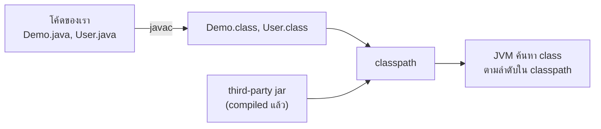
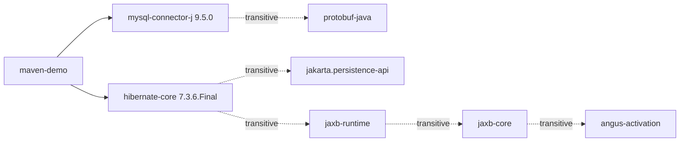
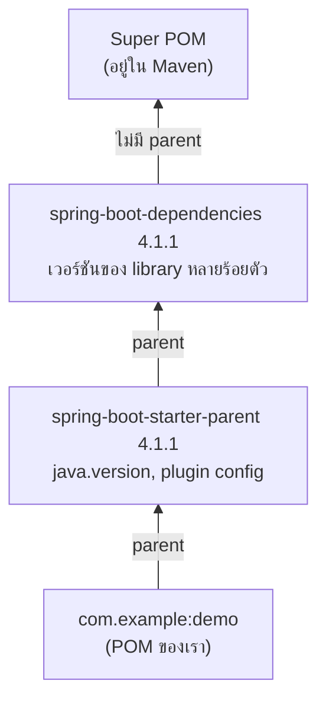
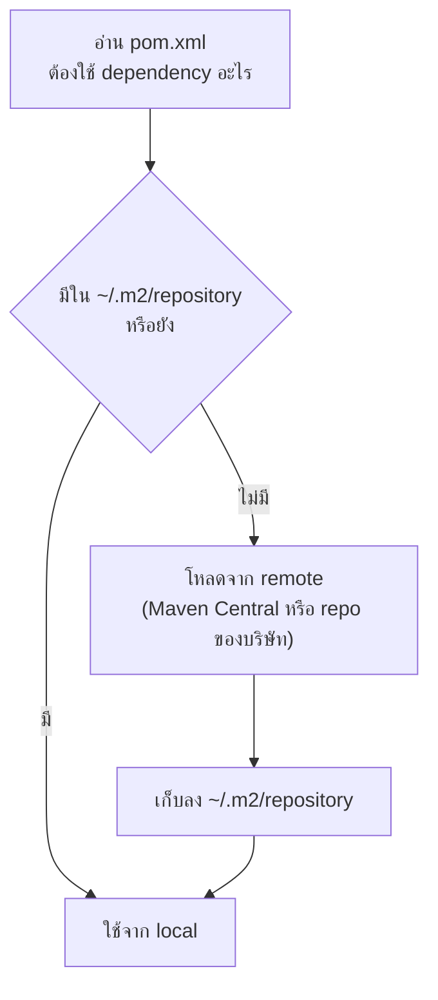
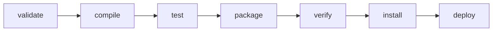
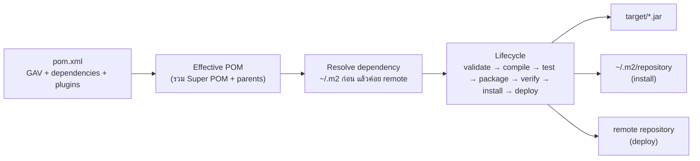

# #3 — Apache Maven: POM, Dependencies และ Build Lifecycle

> **วิดีโอ:** [Master Apache Maven in one video | POM, Dependencies & Lifecycle | Spring Boot Full Course #3](https://youtu.be/N2EXGMJVwUU) — Coder Army, ~1 ชั่วโมง 28 นาที
> **แหล่งที่ใช้สรุป:** ซับไตเติลภาษาฮินดีที่ YouTube สร้างอัตโนมัติ
> **เวอร์ชันในโค้ด:** Spring Boot 4.1 + Java 21 (ใส่หมายเหตุไว้ทุกจุดที่ Spring Boot 3.x ต่างกัน) คำสั่ง `mvn` ทั้งหมดรันจริงด้วย Apache Maven 3.9.16

ตอนนี้ตอบคำถามว่า **Maven ทำอะไรให้เรา และทำอย่างไร** ผู้สอนเริ่มจากปัญหาพื้นฐานก่อน คือจะแชร์โค้ด Java หลายไฟล์ให้คนอื่นอย่างไร (คำตอบคือ JAR) แล้วจะเอา library ของคนอื่นมาใช้อย่างไร จากนั้นจึงแนะนำ Maven และไล่ดูทีละส่วน ได้แก่ โครงสร้างโฟลเดอร์ `pom.xml` และ GAV dependency กับ transitive dependency, Parent POM, Super POM และ Effective POM, repository ทั้ง local และ remote, build lifecycle และปิดท้ายด้วย archetype

ส่วนที่ติดป้าย `💡 เพิ่มเติม` คือของที่ผมเติมเอง ไม่ได้อยู่ในวิดีโอ ส่วนที่ติด `⚠️ แก้จากวิดีโอ` คือจุดที่วิดีโอพูดคลาดเคลื่อน

---

## สารบัญ

| เวลา | หัวข้อ |
|---|---|
| [0:00](https://youtu.be/N2EXGMJVwUU?t=0) | [1. ทำไมต้องมี Build Tool](#1-ทำไมต้องมี-build-tool) |
| [0:39](https://youtu.be/N2EXGMJVwUU?t=39) | [2. JAR คืออะไร](#2-jar-คืออะไร) |
| [4:40](https://youtu.be/N2EXGMJVwUU?t=280) | [3. Library กับ Application](#3-library-กับ-application) |
| [11:11](https://youtu.be/N2EXGMJVwUU?t=671) | [4. Classpath](#4-classpath) |
| [12:50](https://youtu.be/N2EXGMJVwUU?t=770) | [5. ปัญหาของการจัดการ jar เอง](#5-ปัญหาของการจัดการ-jar-เอง) |
| [16:00](https://youtu.be/N2EXGMJVwUU?t=960) | [6. Maven คืออะไร](#6-maven-คืออะไร) |
| [18:49](https://youtu.be/N2EXGMJVwUU?t=1129) | [7. สร้างโปรเจกต์ Maven ใน IntelliJ](#7-สร้างโปรเจกต์-maven-ใน-intellij) |
| [21:16](https://youtu.be/N2EXGMJVwUU?t=1276) | [8. โครงสร้างโฟลเดอร์มาตรฐาน](#8-โครงสร้างโฟลเดอร์มาตรฐาน) |
| [30:53](https://youtu.be/N2EXGMJVwUU?t=1853) | [9. compile และโฟลเดอร์ target](#9-compile-และโฟลเดอร์-target) |
| [34:53](https://youtu.be/N2EXGMJVwUU?t=2093) | [10. package และชื่อไฟล์ jar](#10-package-และชื่อไฟล์-jar) |
| [36:00](https://youtu.be/N2EXGMJVwUU?t=2160) | [11. pom.xml และ GAV](#11-pomxml-และ-gav) |
| [41:30](https://youtu.be/N2EXGMJVwUU?t=2490) | [12. Properties และ Packaging](#12-properties-และ-packaging) |
| [44:16](https://youtu.be/N2EXGMJVwUU?t=2656) | [13. Dependencies และ Transitive Dependencies](#13-dependencies-และ-transitive-dependencies) |
| [53:11](https://youtu.be/N2EXGMJVwUU?t=3191) | [14. pom.xml ของโปรเจกต์ Spring Boot](#14-pomxml-ของโปรเจกต์-spring-boot) |
| [54:57](https://youtu.be/N2EXGMJVwUU?t=3297) | [15. Parent POM, Super POM และ Effective POM](#15-parent-pom-super-pom-และ-effective-pom) |
| [1:01:03](https://youtu.be/N2EXGMJVwUU?t=3663) | [16. Repositories: Local, Central และ Remote](#16-repositories-local-central-และ-remote) |
| [1:11:44](https://youtu.be/N2EXGMJVwUU?t=4304) | [17. Build Lifecycle และ Phases](#17-build-lifecycle-และ-phases) |
| [1:20:31](https://youtu.be/N2EXGMJVwUU?t=4831) | [18. ใช้ mvn บน command line](#18-ใช้-mvn-บน-command-line) |
| [1:24:25](https://youtu.be/N2EXGMJVwUU?t=5065) | [19. Archetype](#19-archetype) |
| — | [20. Maven Wrapper](#20-maven-wrapper) |
| — | [21. Maven 4 กับ Maven 3](#21-maven-4-กับ-maven-3) |
| — | [22. สรุปท้ายตอน](#22-สรุปท้ายตอน) |

---

## 1. ทำไมต้องมี Build Tool

[▶ 0:00](https://youtu.be/N2EXGMJVwUU?t=0)

เวลาเขียนโปรเจกต์ Java ต้องมี tool สำหรับจัดการโปรเจกต์ ในตลาดมีหลายตัว เช่น **Maven** และ **Gradle** ผู้สอนเลือก Maven เพราะสองเหตุผล

- ใช้กันแพร่หลาย มีโปรเจกต์จำนวนมากที่ใช้ Maven อยู่แล้ว
- เข้าใจง่าย

เป้าหมายของตอนนี้คือเข้าใจ Maven ให้ลึก ว่ามันคืออะไร ทำอะไรให้เราได้บ้าง และทำให้ชีวิตง่ายขึ้นแค่ไหน

---

## 2. JAR คืออะไร

[▶ 0:39](https://youtu.be/N2EXGMJVwUU?t=39)

### Flow ปกติของ Java

ก่อนเข้าเรื่อง Maven ต้องเข้าใจ **JAR file** ก่อน (ตอนที่แล้วเราสร้าง jar จากโปรเจกต์ที่โหลดมาจาก Spring Initializr)

flow ที่รู้กันอยู่แล้วคือ เขียน `Demo.java` แล้วส่งผ่าน compiler จะได้ **bytecode** คือ `Demo.class` ซึ่ง JVM ตัวไหนก็รันได้

### ปัญหาเมื่อมีหลายไฟล์

[▶ 1:22](https://youtu.be/N2EXGMJVwUU?t=82)

โปรเจกต์จริง (ไม่จำเป็นต้องเป็นเว็บ อาจเป็นแอป console ก็ได้) มี class จำนวนมาก เช่น `Order.java`, `User.java`, `Payment.java` เมื่อ compile แล้วแต่ละไฟล์ก็จะได้ `.class` ของตัวเอง

ถ้าจะแชร์โปรเจกต์ให้เพื่อน ทำได้สองแบบที่ไม่ดีทั้งคู่

1. **ส่ง `.class` ทีละไฟล์** ทางอีเมลหรือช่องทางอื่น เพื่อนต้องโหลดทีละไฟล์แล้วรันเอง ไม่ไหว
2. **zip ทั้งโฟลเดอร์ส่งไป** ทำได้ แต่ผู้สอนเรียกว่า "ugly" เพราะ
   - โปรเจกต์จริงมีไฟล์เป็นร้อย บางไฟล์อาจหลุดหายไป
   - โครงสร้างโฟลเดอร์อาจไม่เป็นอย่างที่ตั้งใจ เพื่อนอาจใช้โครงสร้างอื่น
   - ไฟล์ที่ไม่ใช่ Java เช่นรูปภาพ static resource หรือไฟล์ properties อาจตกหล่น

### JAR = Java ARchive

[▶ 3:35](https://youtu.be/N2EXGMJVwUU?t=215)

Java จึงต้องมีวิธีมาตรฐานสำหรับแพ็กไฟล์หลายไฟล์ของโปรเจกต์ไปแชร์ จึงเกิด **JAR (Java ARchive)** ขึ้น ให้นึกถึงมันเป็น **zip file** ที่ทำหน้าที่เป็น **package** อย่างหนึ่ง ข้างในมีได้

- `.class` หลายไฟล์ (**compiled code เสมอ** ไม่ใช่ `.java`)
- **resources** เช่นรูปภาพ ไฟล์ properties
- **โฟลเดอร์และ package** ทั้งหมดที่เราสร้างไว้

เพื่อนเอา jar ไปใส่ในแอปพลิเคชันของเขาได้ทันที

### ประโยชน์สองข้อของ JAR

[▶ 4:40](https://youtu.be/N2EXGMJVwUU?t=280)

1. **แชร์โค้ด Java ของเราได้ง่าย** เช่น ทำ library `calculator` แล้วแพ็กเป็น `calculator.jar` ส่งให้คนอื่น
2. **ใช้ library ของ third party ในโปรเจกต์ตัวเอง** [▶ 6:23](https://youtu.be/N2EXGMJVwUU?t=383) เช่น จะต่อ database ต้องมี connector (MySQL ใช้ MySQL connector, Postgres ใช้ Postgres connector) เราไม่เขียน connector เองตั้งแต่ศูนย์ แต่โหลด `mysql-connector.jar` มาใช้

ไม่ว่าจะเป็นฝั่งแชร์โค้ดเองหรือใช้ของคนอื่น ทุกอย่างอยู่ในรูป jar หมด โปรเจกต์ Spring Boot ก็ใช้ dependency ของ Spring Boot และ Spring MVC ที่มาเป็น jar เช่นกัน

---

## 3. Library กับ Application

[▶ 5:02](https://youtu.be/N2EXGMJVwUU?t=302)

| | Library | Application |
|---|---|---|
| รันเองได้ไหม | ไม่ได้ อาจไม่มี `main` เลย | ได้ มี `main` |
| ข้างในมีอะไร | class และ package ให้คนอื่นเรียกใช้ | แอปทั้งตัวที่รันได้ |
| ตัวอย่าง | `calculator.jar`, MySQL connector, library ในตัว Java | แอป Spring Boot |

เมื่อ application ใช้ library ตัวไหน library ตัวนั้นจะกลายเป็น **dependency** ของ application คำนี้คือศัพท์ที่ทั้ง Spring Boot และ Maven ใช้

### Jar ของ library ไม่มี dependency อยู่ข้างใน

[▶ 7:44](https://youtu.be/N2EXGMJVwUU?t=464)

คำถามที่คนสงสัยบ่อย: ถ้าโปรเจกต์ของเรามีโค้ดของเราเอง (`Demo.java`, `User.java`) และใช้ `mysql-connector.jar` ด้วย เวลาแพ็กเป็น jar ตัว connector จะติดไปด้วยไหม คำตอบคือ **ขึ้นกับว่าเป็น library หรือ application**

- **Library** (เช่น `my-library.jar`) ข้างในมีแค่โค้ดของเรา **ไม่มี jar ภายนอก** ที่ใช้อยู่
- แล้วคนที่เอา library ไปใช้จะรู้ได้อย่างไรว่าต้องมี MySQL connector ด้วย คำตอบคือมี **ไฟล์พิเศษ** ที่บอกว่า library นี้ต้องพึ่ง library อะไรบ้าง ถ้าใช้ Maven ไฟล์นั้นคือ **`pom.xml`**
- **Application** เช่นแอป Spring Boot [▶ 9:41](https://youtu.be/N2EXGMJVwUU?t=581) มี `Main.java` ที่รันได้ jar ที่ได้ (`my-application.jar`) เป็น **executable jar** รันได้ด้วยตัวเอง และ dependency อย่าง MySQL connector จะติดไปในตัว ไม่ต้องโหลดแยก

> ⚠️ **แก้จากวิดีโอ:** วิดีโอพูดเหมือนว่าแพ็ก application เมื่อไรก็จะได้ executable jar ที่มี dependency อยู่ข้างในเสมอ ที่ถูกคือ **jar ที่ Maven สร้างตามปกติ (`maven-jar-plugin`) ไม่มี dependency อยู่ข้างในและรันด้วย `java -jar` ไม่ได้** ต่อให้มี `main` ก็ตาม สิ่งที่ทำให้แอป Spring Boot เป็น executable jar ที่มี dependency อยู่ข้างใน (เรียกว่า fat jar หรือ uber jar) คือ **`spring-boot-maven-plugin`** ที่มาจัด jar ใหม่หลัง `package` (ดูผลรันจริงใน[ส่วนที่ 14](#fat-jar-ที่-spring-boot-สร้าง))
>
> ผลรันจริงกับโปรเจกต์ Maven เปล่าที่มี `main`:
>
> ```text
> $ java -cp target/maven-demo-1.0-SNAPSHOT.jar org.example.Main
> Hello World
> $ java -jar target/maven-demo-1.0-SNAPSHOT.jar
> no main manifest attribute, in target/maven-demo-1.0-SNAPSHOT.jar
> ```

> 💡 **เพิ่มเติม:** "ไฟล์พิเศษ" ที่วิดีโอพูดถึงมีอยู่จริงทั้งสองที่ ใน jar ที่ Maven สร้างจะมีสำเนา `pom.xml` อยู่ที่ `META-INF/maven/<groupId>/<artifactId>/pom.xml` (ดู[ส่วนที่ 10](#10-package-และชื่อไฟล์-jar)) แต่ตัวที่ Maven ฝั่งผู้ใช้อ่านจริงตอน resolve dependency คือไฟล์ `.pom` ที่วางคู่กับ `.jar` ใน repository เช่น `mysql-connector-j-9.5.0.pom`

---

## 4. Classpath

[▶ 11:11](https://youtu.be/N2EXGMJVwUU?t=671)

โค้ดที่เราเขียนมีสองส่วน คือ **โค้ด Java ของเราเอง** กับ **third-party library** ที่เป็น jar ทั้งสองส่วนถูกใช้ร่วมกันตอน compile แล้ว JVM ก็รันผลลัพธ์

ข้อสังเกตคือ jar ของ third party เป็น **compiled code อยู่แล้ว** (package ถูกสร้างจาก `.class` เสมอ) compiler จึง compile เฉพาะโค้ด `.java` ของเรา

ตอนรัน ถ้าโค้ดเราเรียก class หรือ method ของ library JVM จะรู้ได้อย่างไรว่าต้องไปหาที่ไหน คำตอบคือ **classpath** ให้มองเป็น "ที่พิเศษ" ที่ JVM ใช้ค้นหา class

1. ดูก่อนว่า class นั้นอยู่ในโค้ดของเราไหม ถ้าเจอก็ใช้เลย
2. ถ้าไม่เจอ ก็ไปค้นใน bytecode ของ jar ที่อยู่บน classpath ถ้าเจอก็ใช้ตัวนั้น



> 💡 **เพิ่มเติม:** classpath คือรายการ path ที่ส่งให้ `javac` และ `java` ผ่าน `-cp` เช่น `java -cp target/classes:lib/mysql-connector-j-9.5.0.jar org.example.Main` สิ่งที่ Maven ทำให้คือสร้างรายการนี้จาก dependency ใน `pom.xml` ให้อัตโนมัติ (และแยก classpath ของ compile, test และ runtime ตาม scope ดู[ส่วนที่ 13](#scope))

---

## 5. ปัญหาของการจัดการ jar เอง

[▶ 12:50](https://youtu.be/N2EXGMJVwUU?t=770)

สมมติจะต่อแอปกับ MySQL ก็ต้องมี jar ของ MySQL connector วิธีง่ายสุดคือ Google หา "mysql connector jar download" แล้วโหลดจาก mysql.com (ในวิดีโอเห็นเวอร์ชัน 9.7.0 ให้เลือกตาม OS)

สำหรับ jar เดียวก็ง่าย แต่ในทางปฏิบัติมีปัญหาหลายข้อ

1. **Manual effort** แอปจริงใช้ jar เป็นร้อยตัว ต้องโหลดทีละตัวเอง
2. **Version mismatch** [▶ 14:06](https://youtu.be/N2EXGMJVwUU?t=846) ตอนนี้ Spring Framework 7 ทำงานคู่กับ Spring Boot 4 ถ้าเผลอใช้ Spring 6 กับ Boot 4 ก็ใช้ไม่ได้ หรือโหลด dependency ของ Spring 7 มาแต่ไปโหลดของ Spring Boot 3 ก็จะ mismatch ต้องคุมเวอร์ชันเองทั้งหมด
3. **Transitive dependencies** [▶ 15:00](https://youtu.be/N2EXGMJVwUU?t=900) dependency ตัวหนึ่งพึ่ง dependency อีกหลายตัว เช่นโหลด Spring Boot 4 มาแล้วมันต้องใช้ตัวอื่นอีก เราต้องรู้เองว่าคือตัวไหนแล้วโหลดเพิ่ม
4. **แชร์ library ให้คนอื่นยาก** [▶ 15:13](https://youtu.be/N2EXGMJVwUU?t=913) ถ้าแพ็ก library เป็น jar ส่งให้เพื่อน เพื่อนก็ไม่รู้ว่ามันต้องใช้ jar อะไร อาจต้องเขียน text file รายการ dependency แนบไป แล้วต้องระบุเวอร์ชันให้ตรงด้วย เพื่อนก็ต้องโหลดเองอีกรอบ

> ⚠️ **Boot 4 vs 3:** คู่เวอร์ชันที่ผู้สอนยกมาถูกต้อง Spring Boot 4 ต้องใช้ **Spring Framework 7.x** ส่วน Spring Boot 3 ใช้ Spring Framework 6.x ดู dependency management ของ Boot สองรุ่นใน `~/.m2` ได้ `spring-boot-dependencies-4.1.1.pom` กำหนด `spring-framework.version` เป็น `7.0.9` ส่วน `spring-boot-dependencies-3.5.16.pom` กำหนดเป็น `6.2.19`
> ([Spring Boot 4.0 Migration Guide](https://github.com/spring-projects/spring-boot/wiki/Spring-Boot-4.0-Migration-Guide): "you must use Spring Framework 7.x")

---

## 6. Maven คืออะไร

[▶ 16:00](https://youtu.be/N2EXGMJVwUU?t=960)

Maven บอกว่าไม่ต้องทำเองทั้งหมดนั้น ให้เราโฟกัสที่ business logic แล้ว **บอก Maven แค่ว่าต้องการ dependency อะไร** Maven จะโหลดให้เอง ถ้า dependency นั้นพึ่งตัวอื่นต่อ (transitive) Maven ก็โหลดให้ด้วยโดยไม่ต้องบอก

[▶ 16:48](https://youtu.be/N2EXGMJVwUU?t=1008) นิยามสั้นที่สุดตามผู้สอน: **Maven คือ project management tool** มันจัดการความซับซ้อนทั้งหมดที่เกิดจากการเขียนแอปหรือ library ที่ใช้ third-party library หลายตัว

### Maven ทำ 4 อย่างให้เรา

[▶ 17:13](https://youtu.be/N2EXGMJVwUU?t=1033)

1. **ให้ folder structure มาตรฐาน** ที่ทุกคนใช้เหมือนกันและไม่เปลี่ยน ถ้าคนในทีมต่างคนต่างวางโครงสร้างเอง คนหนึ่งวาง main class ไว้ที่หนึ่ง อีกคนวาง configuration class ไว้อีกที่ จะยุ่งมาก
2. **Compile โค้ด Java** ทั้งโปรเจกต์ในคลิกเดียว
3. **สร้าง jar** ของโปรเจกต์ การ compile และการสร้าง jar เป็นส่วนหนึ่งของ **lifecycle** ของ Maven ซึ่งมีหลาย phase เช่น `clean`, `compile`, `test`
4. **โหลด dependency** หรือ jar ภายนอกให้

---

## 7. สร้างโปรเจกต์ Maven ใน IntelliJ

[▶ 18:49](https://youtu.be/N2EXGMJVwUU?t=1129)

### ติดตั้ง Maven

มีสองทาง

1. ค้น "maven download" จะเจอเว็บของ **Apache Maven** (เป็นโปรเจกต์ของ Apache) โหลดมาแล้วตั้ง path เองให้เรียกได้จาก command line
2. ใช้ Maven ที่ **มากับ IDE** เช่น IntelliJ IDEA มี Maven ติดมาให้แล้ว ผู้สอนใช้ทางนี้

### สร้างโปรเจกต์ใหม่

ใน IntelliJ กด **New Project**

- **Name:** `maven-demo`
- **Build system** [▶ 19:43](https://youtu.be/N2EXGMJVwUU?t=1183) มีให้เลือกสามแบบ คือ IntelliJ (build system ในตัว), **Maven** และ Gradle ผู้สอนเลือก Maven
- **JDK:** ในวิดีโอใช้ JDK 23 (โน้ตนี้ใช้ 21)
- **Add sample code:** ติ๊กไว้ จะได้ `Main` ที่มี `main` มาให้
- **Advanced Settings** [▶ 20:45](https://youtu.be/N2EXGMJVwUU?t=1245) ถามสองค่า คือ **GroupId** (ค่า default `org.example`) และ **ArtifactId** (`maven-demo`) ปล่อยไว้ตามนั้น

### ทำไมไม่ใช้ build system ของ IntelliJ

ถ้าใช้ build system ของ IntelliJ เราใช้ได้คนเดียว แต่คนอื่นในทีมอาจใช้ Maven หรือ Gradle โครงสร้างโฟลเดอร์ วิธี compile วิธี package และวิธีโหลด dependency จะต่างกันหมด การเลือก Maven ทำให้ทีมมีมาตรฐานเดียว ไม่ว่าใครจะใช้ IntelliJ, Eclipse หรือ NetBeans build system ก็ยังเป็น Maven เหมือนกัน

ผู้สอนอธิบายว่า build system คือส่วนหนึ่งของ Maven ที่กำหนดว่าจะ build, compile และ package โค้ดอย่างไร

---

## 8. โครงสร้างโฟลเดอร์มาตรฐาน

[▶ 21:16](https://youtu.be/N2EXGMJVwUU?t=1276)

เมื่อสร้างเสร็จ ผู้สอนลบโค้ดตัวอย่างข้างใน `main` ออก ให้เหลือแค่ `Main` กับ `main` เปล่า ๆ แล้วไล่ดูโครงสร้าง

- **External Libraries** jar ภายนอกทุกตัวที่โหลดมาจะโผล่ที่นี่ ตอนนี้มีแค่ JDK
- `.gitignore`, `.mvn` (ไฟล์ภายในของ Maven) และ `.idea` (ไฟล์ภายในของ IntelliJ) ข้ามไปได้
- สองอย่างที่สำคัญคือโฟลเดอร์ **`src`** และไฟล์ **`pom.xml`** [▶ 22:02](https://youtu.be/N2EXGMJVwUU?t=1322) ซึ่งเป็น **ไฟล์ที่สำคัญที่สุดของ Maven** ย่อมาจาก **Project Object Model**

```text
maven-demo/
├── pom.xml
└── src/
    ├── main/
    │   ├── java/              # โค้ด .java ทั้งหมด (business logic)
    │   │   └── org/example/
    │   │       ├── Main.java
    │   │       ├── Demo.java
    │   │       └── controller/
    │   │           └── HelloController.java
    │   └── resources/         # ไฟล์ที่ไม่ใช่ Java: text, รูป, properties
    └── test/
        └── java/              # test case วางโครงสร้าง package เดียวกับ main
```

[▶ 22:21](https://youtu.be/N2EXGMJVwUU?t=1341)

- **`src`** คือที่อยู่ของแอปที่เรากำลังสร้าง แบ่งเป็น `main` กับ `test`
- **`src/main`** คือโค้ดแอปจริง แบ่งเป็น
  - **`java`** ไฟล์ `.java` ทั้งหมด เช่น `Demo.java`, `Main.java`
  - **`resources`** ไฟล์ที่ไม่ใช่ Java เช่น text file, static image, properties
- **`src/test`** คือ test case หรือ unit test ซึ่งใช้ library อย่าง **JUnit** และ **Mockito** (คอร์สนี้จะใช้ในภายหลัง)

### groupId กลายเป็น package

[▶ 23:28](https://youtu.be/N2EXGMJVwUU?t=1408)

ใต้ `src/main/java` IntelliJ สร้าง package จาก groupId ไว้ให้ คือ `org.example` อย่าสับสนกับจุด **`org.example` คือโฟลเดอร์ `org` ที่มีโฟลเดอร์ `example` อยู่ข้างใน** IntelliJ แค่แสดงต่อกันด้วยจุดเพราะ `org` มีโฟลเดอร์ย่อยแค่ตัวเดียว ผู้สอนพิสูจน์โดยสร้าง package `org.example2` แล้วจะเห็นแยกเป็นสองโฟลเดอร์ใต้ `org` (แล้วลบทิ้ง)

จากนั้นสร้างไฟล์ตัวอย่าง `Demo.java`, `Demo2.java` และ package `org.example.controller` ที่มี `HelloController.java` (ชื่อนี้มาจากตอนที่แล้ว ใน Spring Boot มักมีโฟลเดอร์ `controller` เสมอ) ผู้สอนบอกว่าสร้างไว้ดูเฉย ๆ ไม่ได้ใช้จริง ไฟล์ `Main.java` ได้มาเพราะติ๊ก "Add sample code" ไว้ ถ้าไม่ติ๊กต้องสร้างเอง

> 💡 **เพิ่มเติม:** Maven เองไม่ได้บังคับให้ package ตรงกับ groupId ตัวที่สร้าง package ตั้งต้นให้คือ IDE, archetype หรือ Spring Initializr ตามธรรมเนียม (Initializr ใช้ `groupId.artifactId` เป็น package เช่น `com.example.demo`) ส่วนที่ Maven ใช้ groupId เป็นโฟลเดอร์จริงคือ local repository (ดู[ส่วนที่ 16](#16-repositories-local-central-และ-remote))

### เทียบกับโปรเจกต์ Spring Boot

[▶ 26:23](https://youtu.be/N2EXGMJVwUU?t=1583)

ผู้สอนเปิดโปรเจกต์จากตอนที่แล้วเทียบกัน ถ้าไม่มีก็สร้างใหม่ที่ Spring Initializr ได้

- **Project:** Maven, **Language:** Java
- **Spring Boot:** เวอร์ชัน 4.x ตัวไหนก็ได้ (ในวิดีโอมี 4.0.7 หรือ 4.1.0) **อย่าใช้ SNAPSHOT** เพราะยังอยู่ระหว่างพัฒนาและอาจมี bug
- **Group/Artifact:** `com.example` / `demo`, **Packaging:** Jar, **Configuration:** Properties, **Java:** 21
- **Dependencies:** Spring Web แล้วกด Generate ได้ zip มา unzip แล้วเปิดใน IntelliJ

โครงสร้างเกือบเหมือนกัน ต่างกันตรงที่

- มีโฟลเดอร์ **`target`** เพิ่ม (มีเฉพาะคนที่เคย build ไปแล้วในตอนที่แล้ว) ผู้สอนลบทิ้งก่อนด้วยการ clean แล้วจะอธิบายภายหลัง
- package คือ `com.example.demo` ซึ่งมาจาก groupId `com.example` บวก artifactId `demo` ข้างในมี `DemoApplication` ที่ Spring Boot สร้างให้ และ `HelloController` ที่เขียนเองในตอนที่แล้ว
- [▶ 29:31](https://youtu.be/N2EXGMJVwUU?t=1771) `src/main/resources` ไม่ว่าง เพราะเป็น starter project ของ Spring Boot มีโฟลเดอร์ `static`, `templates` และไฟล์ **`application.properties`** (ที่เคยใช้เปลี่ยน port)
- [▶ 29:49](https://youtu.be/N2EXGMJVwUU?t=1789) `src/test/java` มีโครงสร้าง `com/example/demo` เหมือนฝั่ง main และมี `DemoApplicationTests` ซึ่งเป็น test ของ `DemoApplication`

**กฎคือ test ของ class ไหนให้วางใน package เดียวกันฝั่ง test** เช่นจะเขียน test ของ `HelloController` ก็สร้าง `HelloControllerTest` ใน `src/test/java/com/example/demo/` ส่วนวิธีเขียน test จะมาทีหลัง (โค้ด test ที่รันจริงอยู่ใน[ส่วนที่ 14](#โค้ดของโปรเจกต์-demo))

---

## 9. compile และโฟลเดอร์ target

[▶ 30:53](https://youtu.be/N2EXGMJVwUU?t=1853)

ผู้สอนกลับไปที่ `maven-demo` แล้วเขียน `main` ให้พิมพ์ Hello World

```java
package org.example;

public class Main {
    public static void main(String[] args) {
        System.out.println("Hello World");
    }
}
```

ตอนกด Run ข้างในจะเกิดการ compile แล้วจึงรัน เนื่องจากเป็นโปรเจกต์ Maven งาน compile, package และสร้าง jar จึงเป็นงานของ Maven

### Maven tool window

[▶ 31:36](https://youtu.be/N2EXGMJVwUU?t=1896)

ใน IntelliJ มีไอคอน Maven (ถ้าไม่เห็นเปิดได้ใน Settings) ข้างในมี **Lifecycle**, **Plugins** และ **Repositories** ใน Lifecycle มีหลาย phase เช่น `clean`, `validate`, `compile`, `test`

[▶ 31:56](https://youtu.be/N2EXGMJVwUU?t=1916) กด `compile` แล้วได้ BUILD SUCCESS และมีโฟลเดอร์ **`target`** เกิดขึ้น ข้างในมี `classes`, `generated-sources`, `maven-status` ใน `classes` มีโครงสร้างโฟลเดอร์เหมือน `src/main/java` ทุกอย่าง แต่เป็นไฟล์ `.class`

ผลรันจริงในโน้ตนี้ (เทียบได้กับการกด `compile` ใน IntelliJ)

```text
$ mvn clean compile
[INFO] --- clean:3.2.0:clean (default-clean) @ maven-demo ---
[INFO] Deleting .../maven-demo/target
[INFO] --- resources:3.4.0:resources (default-resources) @ maven-demo ---
[INFO] --- compiler:3.15.0:compile (default-compile) @ maven-demo ---
[INFO] Compiling 3 source files with javac [debug target 21] to target/classes
[INFO] BUILD SUCCESS

$ find target -type f
target/classes/org/example/Demo.class
target/classes/org/example/Main.class
target/classes/org/example/controller/HelloController.class
target/maven-status/maven-compiler-plugin/compile/default-compile/createdFiles.lst
target/maven-status/maven-compiler-plugin/compile/default-compile/inputFiles.lst
```

พอเปิด `Main.class` ใน IntelliJ จะเห็นเป็นโค้ดอ่านได้ ไม่ใช่ bytecode ดิบ เพราะ IDE decompile กลับมาให้ดู (เรื่องที่เคยพูดในคอร์ส Java) ประเด็นคือ **Maven วาง bytecode ในโครงสร้างโฟลเดอร์เดียวกับซอร์ส** ถ้าลบ `target` ทิ้ง ก็ compile ใหม่หรือกด Run ก็จะได้กลับมา

### ปุ่ม Run ของ IntelliJ ไม่ได้ใช้ Maven

[▶ 33:34](https://youtu.be/N2EXGMJVwUU?t=2014)

ตอนกดปุ่ม Run สีเขียว (Run `Main.java`) **bytecode ไม่ได้มาจาก Maven** IntelliJ ใช้ build system ของตัวเอง compile แล้วรันเอง แต่เพราะรู้ว่าเป็นโปรเจกต์ Maven มันจึงวางผลลัพธ์ไว้ที่ `target/classes` ในโครงสร้างเดียวกัน ไม่สร้างโฟลเดอร์แบบอื่น ดูจากข้างนอกเลยเหมือน Maven compile แต่ถ้าลงลึกจะต่างกัน

---

## 10. package และชื่อไฟล์ jar

[▶ 34:53](https://youtu.be/N2EXGMJVwUU?t=2093)

ใน Lifecycle กด **`package`** Maven จะ build jar ไว้ใน `target` ชื่อ `maven-demo-1.0-SNAPSHOT.jar` (ผู้สอนบอกให้จำชื่อนี้ไว้ จะอธิบายทีหลัง) jar นี้มีทุกอย่างที่เราเขียนไว้ และแชร์ให้คนอื่นได้

ผลรันจริง

```text
$ mvn package
[INFO] --- resources:3.4.0:resources (default-resources) @ maven-demo ---
[INFO] --- compiler:3.15.0:compile (default-compile) @ maven-demo ---
[INFO] --- resources:3.4.0:testResources (default-testResources) @ maven-demo ---
[INFO] --- compiler:3.15.0:testCompile (default-testCompile) @ maven-demo ---
[INFO] --- surefire:3.5.4:test (default-test) @ maven-demo ---
[INFO] No tests to run.
[INFO] --- jar:3.5.0:jar (default-jar) @ maven-demo ---
[INFO] Building jar: .../maven-demo/target/maven-demo-1.0-SNAPSHOT.jar
[INFO] BUILD SUCCESS

$ jar tf target/maven-demo-1.0-SNAPSHOT.jar
META-INF/MANIFEST.MF
org/example/controller/HelloController.class
org/example/Demo.class
org/example/Main.class
META-INF/maven/org.example/maven-demo/pom.xml
META-INF/maven/org.example/maven-demo/pom.properties
```

(ตัดบรรทัดที่เป็นโฟลเดอร์ออก) สังเกตว่า `package` รันทุก phase ก่อนหน้าด้วย ได้แก่ resources, compile, testCompile และ test ก่อนจะถึง jar เรื่องนี้จะอธิบายใน[ส่วนที่ 17](#17-build-lifecycle-และ-phases)

ถึงตรงนี้เห็นแล้ว 3 ใน 4 อย่างที่ Maven ทำ คือ folder structure, compile และสร้าง jar ข้อสุดท้ายคือโหลด dependency ซึ่งต้องเข้าใจ `pom.xml` ก่อน

---

## 11. pom.xml และ GAV

[▶ 36:00](https://youtu.be/N2EXGMJVwUU?t=2160)

**POM = Project Object Model** มันบอก Maven (และเรา) ทุกอย่างเกี่ยวกับโปรเจกต์ เช่นชื่อโปรเจกต์ เวอร์ชัน third-party library ที่ใช้ และ plugin ที่ใช้ โปรเจกต์เปล่ามี POM สั้น ๆ แต่จะยาวขึ้นเรื่อย ๆ เมื่อเพิ่ม dependency และ configuration

`pom.xml` ที่ IntelliJ สร้างให้ (เปลี่ยน Java เป็น 21)

```xml
<?xml version="1.0" encoding="UTF-8"?>
<project xmlns="http://maven.apache.org/POM/4.0.0"
         xmlns:xsi="http://www.w3.org/2001/XMLSchema-instance"
         xsi:schemaLocation="http://maven.apache.org/POM/4.0.0 http://maven.apache.org/xsd/maven-4.0.0.xsd">
    <modelVersion>4.0.0</modelVersion>

    <groupId>org.example</groupId>
    <artifactId>maven-demo</artifactId>
    <version>1.0-SNAPSHOT</version>

    <properties>
        <maven.compiler.source>21</maven.compiler.source>
        <maven.compiler.target>21</maven.compiler.target>
        <project.build.sourceEncoding>UTF-8</project.build.sourceEncoding>
    </properties>

</project>
```

### `<project>` และ schema

[▶ 37:26](https://youtu.be/N2EXGMJVwUU?t=2246)

- **`<project>`** คือ root tag ทุก POM เริ่มด้วย tag นี้
- [▶ 37:35](https://youtu.be/N2EXGMJVwUU?t=2255) สามบรรทัด `xmlns`, `xmlns:xsi`, `xsi:schemaLocation` บอก **schema** คือกฎของ POM ว่าใช้ tag อะไรได้บ้าง (XML tag เปิดแล้วต้องปิด) เช่น `modelVersion` ใช้ได้ แต่จะใส่ tag อะไรก็ได้ไม่ได้ ผู้สอนลองใส่ `<abc></abc>` IntelliJ ขึ้นว่า "Invalid content was found" เพราะผิดกฎของ schema

### `modelVersion`

[▶ 38:32](https://youtu.be/N2EXGMJVwUU?t=2312)

บอกเวอร์ชันของ **รูปแบบ POM** ไม่ใช่เวอร์ชันของ Maven Maven เวอร์ชันไหนก็ได้ ส่วน POM model คือ **`4.0.0`**

> 💡 **เพิ่มเติม:** Maven 3 ทุกรุ่นใช้ `modelVersion` `4.0.0` เท่านั้น Maven 4 (ยังเป็น release candidate ตอนที่เขียน) เพิ่ม model `4.1.0` แต่ยัง build POM `4.0.0` ได้ตามเดิม ดู[ส่วนที่ 21](#21-maven-4-กับ-maven-3)

### GAV: groupId, artifactId, version

[▶ 38:48](https://youtu.be/N2EXGMJVwUU?t=2328)

สาม tag ที่สำคัญที่สุด รวมกันเรียกว่า **GAV** ทั้งสามค่ารวมกันใช้ **ระบุตัวโปรเจกต์แบบไม่ซ้ำใครทั้งโลก** ถ้าเราอัปโหลด jar ขึ้นอินเทอร์เน็ต ต้องไม่มี jar อื่นชื่อเดียวกัน คนอื่นจะได้อ้างถึง library ของเราได้ถูกตัว

**groupId** [▶ 39:12](https://youtu.be/N2EXGMJVwUU?t=2352) ต้อง unique ธรรมเนียมนี้มาจาก Maven ไม่ใช่ของ Spring คือใช้ **ชื่อ domain กลับด้าน** เพราะ domain ไม่ซ้ำกันอยู่แล้ว

- domain `coderarmy.in` ใช้ groupId เป็น `in.coderarmy`
- ต่อท้ายได้อีก เช่น `in.coderarmy.course`, `in.coderarmy.java`, `in.coderarmy.spring`
- ถ้าไม่มี domain ของตัวเอง ใช้ `org.example` ฝึกได้

**artifactId** [▶ 40:42](https://youtu.be/N2EXGMJVwUU?t=2442) คือชื่อโปรเจกต์ ในที่นี้คือ `maven-demo`

**version** [▶ 40:48](https://youtu.be/N2EXGMJVwUU?t=2448) ค่า default คือ `1.0-SNAPSHOT` ตามที่คุยในตอนที่แล้ว SNAPSHOT หมายถึงงานที่ยังพัฒนาอยู่และอาจมี bug โปรเจกต์ของเราก็ยังอยู่ระหว่างสร้าง จึงเป็น SNAPSHOT เมื่อทำเสร็จและทดสอบแล้วไม่มี bug ก็ลบ `-SNAPSHOT` ออก เพื่อบอกว่าเป็นเวอร์ชันที่ใช้ได้จริง นี่เป็นธรรมเนียม

> 💡 **เพิ่มเติม:** `-SNAPSHOT` ไม่ได้เป็นแค่ธรรมเนียม Maven ใช้มันจริงด้วย SNAPSHOT ถูกมองว่าเปลี่ยนได้ Maven จึงไปเช็ก remote repository หาตัวที่ใหม่กว่าเป็นระยะ ส่วน release (ไม่มี `-SNAPSHOT`) ถูกมองว่าไม่เปลี่ยนแล้ว โหลดครั้งเดียวก็ใช้ตลอด และ repository ส่วนใหญ่รวมถึง Maven Central ไม่ยอมให้อัปโหลดทับ release เดิม สังเกตใน Effective POM ของ[ส่วนที่ 15](#15-parent-pom-super-pom-และ-effective-pom) ว่า Central ตั้ง `<snapshots><enabled>false</enabled>` คือไม่ให้บริการ SNAPSHOT

---

## 12. Properties และ Packaging

[▶ 41:30](https://youtu.be/N2EXGMJVwUU?t=2490)

### `<properties>` คือ key–value

ชื่อ tag คือ key และค่าข้างในคือ value เช่น `maven.compiler.source` เป็น `21` (วิดีโอเป็น 23), `maven.compiler.target` เป็น `21`, `project.build.sourceEncoding` เป็น `UTF-8` ทั้งหมดนี้ IntelliJ สร้างให้

[▶ 42:04](https://youtu.be/N2EXGMJVwUU?t=2524) เพิ่ม key เองได้ เช่น `java.version` หรือ key ที่ตั้งชื่อเองอย่าง `author.name` ค่า `Aditya` ก็ไม่ error เพราะใน `<properties>` ตั้ง key อะไรก็ได้

### ใช้ property ด้วย `${...}`

[▶ 42:37](https://youtu.be/N2EXGMJVwUU?t=2557)

ค่าใน properties เรียกใช้ที่ไหนก็ได้ใน POM ด้วย `${key}` ผู้สอนทดลองเปลี่ยน version ให้มีชื่อตัวเองต่อท้าย

```xml
<version>1.0-SNAPSHOT-${author.name}</version>

<properties>
    <maven.compiler.source>21</maven.compiler.source>
    <maven.compiler.target>21</maven.compiler.target>
    <project.build.sourceEncoding>UTF-8</project.build.sourceEncoding>
    <java.version>21</java.version>
    <author.name>Aditya</author.name>
</properties>
```

กด `package` ใหม่ ได้ jar ชื่อ `maven-demo-1.0-SNAPSHOT-Aditya.jar` แล้วผู้สอนก็ลบออก

ผลรันจริง

```text
$ mvn package
[WARNING] Some problems were encountered while building the effective model for org.example:maven-demo:jar:1.0-SNAPSHOT-Aditya
[WARNING] 'version' contains an expression but should be a constant. @ org.example:maven-demo:1.0-SNAPSHOT-${author.name}, .../pom.xml, line 9, column 14
[WARNING] It is highly recommended to fix these problems because they threaten the stability of your build.
[WARNING] For this reason, future Maven versions might no longer support building such malformed projects.
[INFO] Building jar: .../maven-demo-props/target/maven-demo-1.0-SNAPSHOT-Aditya.jar
[INFO] BUILD SUCCESS
```

> 💡 **เพิ่มเติม:** build ผ่านจริงตามวิดีโอ แต่ Maven เตือนว่า `version` ของโปรเจกต์ควรเป็นค่าคงที่ (ข้อยกเว้นที่ Maven ยอมรับคือ property แบบ CI-friendly `${revision}`, `${sha1}`, `${changelist}`) ส่วนการใช้ `${...}` ใน `<version>` ของ dependency หรือ plugin ใช้ได้ปกติ และเป็นการใช้งานที่เจอบ่อยที่สุด เช่น `<version>${mysql.version}</version>` นอกจากนี้ `1.0-SNAPSHOT-Aditya` ไม่ได้ลงท้ายด้วย `-SNAPSHOT` แล้ว Maven จึงนับเป็น release ไม่ใช่ SNAPSHOT

### `<packaging>`

[▶ 43:54](https://youtu.be/N2EXGMJVwUU?t=2634)

tag ที่เจอบ่อยในเทมเพลตของโปรเจกต์ต่าง ๆ ค่าที่ใช้คือ `jar` หรือ `war` (Web ARchive) เราต้องการ jar จึงใส่ `jar` และถ้าไม่ใส่เลย **ค่า default ก็คือ `jar`**

```xml
<packaging>jar</packaging>
```

> 💡 **เพิ่มเติม:** ค่าที่เจออีกตัวคือ `pom` ใช้กับ parent POM หรือ BOM ที่ไม่มีโค้ด เช่น `spring-boot-starter-parent` เอง (ดู[ส่วนที่ 15](#15-parent-pom-super-pom-และ-effective-pom)) ส่วน `war` จะกลับมาในตอน #14 ที่ deploy เข้า Tomcat ภายนอก

---

## 13. Dependencies และ Transitive Dependencies

[▶ 44:16](https://youtu.be/N2EXGMJVwUU?t=2656)

ข้อที่ 4 ของ Maven คือโหลด dependency แทนการโหลดเอง ใส่ไว้ใน tag **`<dependencies>`** ทีละตัว แต่ละ `<dependency>` มี **groupId, artifactId และ version** เหมือนโปรเจกต์ของเรา เพราะ jar ทุกตัวบนอินเทอร์เน็ตก็มี GAV ของตัวเอง

ปัญหาคือเราไม่รู้ว่า MySQL connector มี groupId และ artifactId อะไร **ไม่ต้องจำ** ให้ไปหาที่เว็บ

### mvnrepository.com

[▶ 45:41](https://youtu.be/N2EXGMJVwUU?t=2741)

ที่ [mvnrepository.com](https://mvnrepository.com) ค้น "mysql connector" จะเจอ **MySQL Connector/J** เป็นอันแรก เปิดเข้าไปจะเห็นหลายเวอร์ชัน

**ควรเลือกเวอร์ชันไหน** [▶ 46:15](https://youtu.be/N2EXGMJVwUU?t=2775) ผู้สอนแนะนำว่า **ไม่ควรเอาเวอร์ชันล่าสุด** เพราะมีโอกาสเจอ bug มากที่สุด อาจยังทดสอบไม่มากและมีคนใช้น้อย ย้อนไปเวอร์ชันก่อนหน้าจะเห็นจำนวนคนใช้เพิ่มขึ้น (168 คน 193 คน) แต่ก็ไม่ควรย้อนไปไกลจน version mismatch ผู้สอนเลือก **9.5.0** ซึ่งเป็นตัวที่สามนับจากล่าสุด

ในหน้าเวอร์ชันมี snippet ให้เลือกหลายระบบ (Maven, Gradle, SBT, Mill, Ivy, Grape) กดแท็บ Maven ก็คัดลอก แล้ววางใน `<dependencies>` ได้เลย (ลบบรรทัด comment ออกได้)

```xml
<dependency>
    <groupId>com.mysql</groupId>
    <artifactId>mysql-connector-j</artifactId>
    <version>9.5.0</version>
    <scope>compile</scope>
</dependency>
```

- **groupId** `com.mysql` คนทำคือ MySQL
- **artifactId** `mysql-connector-j` ชื่อโปรเจกต์ของเขา
- **version** `9.5.0`

> 💡 **เพิ่มเติม:** แหล่งค้นหาทางการของ Maven Central คือ [central.sonatype.com](https://central.sonatype.com) ส่วน mvnrepository.com เป็นเว็บของบุคคลที่สามที่รวบรวมข้อมูลไว้ ทั้งสองให้ snippet แบบเดียวกัน

### Scope

[▶ 47:29](https://youtu.be/N2EXGMJVwUU?t=2849)

`<scope>` เป็น **optional** ผู้สอนบอกว่า snippet ของเวอร์ชันเก่า ๆ จะไม่มีบรรทัดนี้ มีแค่ GAV scope บอกว่า dependency นี้จำเป็นใน phase ไหนของโค้ด

- **ค่า default คือ `compile`** คือต้องใช้ตอน compile
- บางครั้งเป็น **`test`** คือใช้เฉพาะ phase ทดสอบ (จะชัดขึ้นตอนเรียนเรื่อง phase)

field ที่บังคับจริงคือ GAV เท่านั้น

> 💡 **เพิ่มเติม — scope ทั้งหมดของ Maven:**
>
> | Scope | ใช้ตอน compile โค้ดหลัก | อยู่ใน test | อยู่ตอนรัน / ใน fat jar | ส่งต่อแบบ transitive | ตัวอย่าง |
> |---|---|---|---|---|---|
> | `compile` (default) | ✅ | ✅ | ✅ | ✅ | `spring-boot-starter-webmvc` |
> | `runtime` | ❌ | ✅ | ✅ | ✅ | JDBC driver เช่น `mysql-connector-j` |
> | `test` | ❌ | ✅ | ❌ | ❌ | `spring-boot-starter-webmvc-test`, JUnit |
> | `provided` | ✅ | ✅ | ❌ (คาดว่า container มีให้) | ❌ | Servlet API ตอน deploy เป็น war (ตอน #14) |
> | `system` | ✅ | ✅ | ❌ | ❌ | jar จาก path ในเครื่อง ไม่แนะนำ |
> | `import` | ใช้เฉพาะใน `<dependencyManagement>` กับ BOM | | | | `junit-bom` ใน[ส่วนที่ 19](#19-archetype) |
>
> โค้ดเราไม่ควร import class ของ JDBC driver ตรง ๆ (ใช้ผ่าน `java.sql` / `DataSource`) Spring Initializr จึงใส่ `mysql-connector-j` เป็น `runtime` ถ้าใส่เป็น `runtime` แล้วเผลอ import class ของ driver ในโค้ด compile จะ fail ทันที ซึ่งเป็นสิ่งที่ต้องการ

### กด Reload แล้ว Maven จึงโหลด

[▶ 48:31](https://youtu.be/N2EXGMJVwUU?t=2911)

แค่เขียน dependency ลงไปยังไม่โหลด External Libraries ยังมีแค่ JDK ต้องสั่ง Maven ด้วยการกดไอคอน **M พร้อมลูกศร reload** ที่ลอยขึ้นมา (หรือปุ่ม reload ใน Maven tool window)

ของผู้สอนโหลดเร็วเพราะเคยโหลดไว้แล้วและ **cache อยู่ในเครื่อง** ครั้งแรกของเราจะช้ากว่า (ที่ cache อยู่ที่ไหนดู[ส่วนที่ 16](#16-repositories-local-central-และ-remote))

### Transitive dependency ตัวแรก: protobuf

[▶ 49:09](https://youtu.be/N2EXGMJVwUU?t=2949)

เสร็จแล้ว External Libraries มี **สองตัว** คือ MySQL connector และ **Google Protobuf** ทั้งที่ขอแค่ตัวเดียว เปิดดูใน Maven tool window ส่วน **Dependencies** จะเห็นลำดับชั้น MySQL connector มี protobuf อยู่ข้างใน แปลว่า protobuf เป็น **transitive dependency** คือ MySQL connector ต้องใช้ protobuf จึงจะทำงานได้ Maven จึงโหลดมาให้ด้วย (External Libraries แสดงเป็นรายการแบน ๆ ไม่บอกว่าใครพึ่งใคร)

### เพิ่ม Hibernate

[▶ 50:26](https://youtu.be/N2EXGMJVwUU?t=3026)

สมมติว่าจะใช้ Hibernate (ยังไม่ได้เรียน แต่ต้องใส่ dependency ก่อนอยู่ดี) ค้น "hibernate" ใน mvnrepository เจอ **Hibernate ORM Hibernate Core** เลือกเวอร์ชันถอยมาจากล่าสุดนิดหน่อย ผู้สอนบอกว่าเลือกล่าสุดก็ได้ แต่ถอยมานิดเป็นแนวปฏิบัติที่ดี ในวิดีโอเลือก **7.3.6.Final** วางแล้วจะมีปุ่มให้ sync ขึ้นมา พอกด Maven ก็โหลดจากอินเทอร์เน็ต ("Analyzing project") แล้วเส้นแดงใต้ dependency ก็หายไป

`<dependencies>` ใน `pom.xml` ตอนนี้ (วางต่อจาก `</properties>`)

```xml
    <dependencies>
        <!-- https://mvnrepository.com/artifact/com.mysql/mysql-connector-j -->
        <dependency>
            <groupId>com.mysql</groupId>
            <artifactId>mysql-connector-j</artifactId>
            <version>9.5.0</version>
            <scope>compile</scope>
        </dependency>
        <!-- https://mvnrepository.com/artifact/org.hibernate.orm/hibernate-core -->
        <dependency>
            <groupId>org.hibernate.orm</groupId>
            <artifactId>hibernate-core</artifactId>
            <version>7.3.6.Final</version>
            <scope>compile</scope>
        </dependency>
    </dependencies>
```

External Libraries มี jar เพิ่มขึ้นมาก ทั้งของ Jakarta, GlassFish และ Eclipse ใน Maven tool window มี dependency ตรงแค่สองตัวตามที่เขียนไว้ คือ MySQL connector และ Hibernate แต่ Hibernate พึ่งอีกหลายตัว และบางตัวก็พึ่งต่อไปอีกชั้น ผู้สอนบอกว่าเราไม่ต้องสนใจพวกนี้ เราต้องการ Hibernate ก็ได้ Hibernate และสิ่งที่ Hibernate ต้องใช้ก็ได้มาครบ ไม่ต้องจำชื่อด้วย แค่ค้นใน mvnrepository แล้วเลือกเวอร์ชันที่ดี

`mvn dependency:tree` แสดงลำดับชั้นเดียวกับใน Maven tool window บน command line ผลรันจริง

```text
$ mvn dependency:tree
[INFO] --- dependency:3.7.0:tree (default-cli) @ maven-demo ---
[INFO] org.example:maven-demo:jar:1.0-SNAPSHOT
[INFO] +- com.mysql:mysql-connector-j:jar:9.5.0:compile
[INFO] |  \- com.google.protobuf:protobuf-java:jar:4.31.1:compile
[INFO] \- org.hibernate.orm:hibernate-core:jar:7.3.6.Final:compile
[INFO]    +- jakarta.persistence:jakarta.persistence-api:jar:3.2.0:compile
[INFO]    +- jakarta.transaction:jakarta.transaction-api:jar:2.0.1:compile
[INFO]    +- org.jboss.logging:jboss-logging:jar:3.6.1.Final:runtime
[INFO]    +- org.hibernate.models:hibernate-models:jar:1.1.1:runtime
[INFO]    +- net.bytebuddy:byte-buddy:jar:1.18.8:runtime
[INFO]    +- jakarta.xml.bind:jakarta.xml.bind-api:jar:4.0.4:runtime
[INFO]    |  \- jakarta.activation:jakarta.activation-api:jar:2.1.4:runtime
[INFO]    +- org.glassfish.jaxb:jaxb-runtime:jar:4.0.6:runtime
[INFO]    |  \- org.glassfish.jaxb:jaxb-core:jar:4.0.6:runtime
[INFO]    |     +- org.eclipse.angus:angus-activation:jar:2.0.3:runtime
[INFO]    |     +- org.glassfish.jaxb:txw2:jar:4.0.6:runtime
[INFO]    |     \- com.sun.istack:istack-commons-runtime:jar:4.1.2:runtime
[INFO]    +- jakarta.inject:jakarta.inject-api:jar:2.0.1:runtime
[INFO]    \- org.antlr:antlr4-runtime:jar:4.13.2:runtime
[INFO] BUILD SUCCESS
```



> 💡 **เพิ่มเติม — Maven รู้ได้อย่างไรว่าต้องโหลด protobuf:** มันอ่านไฟล์ `mysql-connector-j-9.5.0.pom` ที่โหลดมาคู่กับ jar ในนั้นประกาศ `protobuf-java` เป็น dependency ปกติ และประกาศ `oci-java-sdk-common` เป็น `<optional>true</optional>` dependency ที่เป็น optional **ไม่ถูกส่งต่อแบบ transitive** เราจึงเห็นแค่ protobuf ใน tree อีกเรื่องที่เห็นใน output คือ dependency ส่วนใหญ่ของ Hibernate มาเป็น `runtime` เพราะ Hibernate ประกาศไว้เป็น `runtime` ใน POM ของมัน ทำให้โค้ดเรา compile กับ API พวกนั้นตรง ๆ ไม่ได้ แต่ตอนรันก็ยังอยู่บน classpath

> 💡 **เพิ่มเติม — ถ้าสอง dependency ต้องการเวอร์ชันต่างกัน:** Maven เลือก **ตัวที่ใกล้ root ที่สุด** (nearest wins) ถ้าลึกเท่ากันก็เอาตัวที่ประกาศก่อน ไม่ได้เลือกตัวใหม่สุด ใช้ `mvn dependency:tree -Dverbose` ดูได้ว่าตัวไหนถูกตัดทิ้ง (`omitted for duplicate` หรือ `omitted for conflict`) ถ้าต้องการบังคับเวอร์ชันให้ใช้ `<dependencyManagement>` ซึ่งเป็นกลไกเดียวกับที่ Spring Boot ใช้ในส่วนถัดไป

---

## 14. pom.xml ของโปรเจกต์ Spring Boot

[▶ 53:11](https://youtu.be/N2EXGMJVwUU?t=3191)

ผู้สอนเปิด `pom.xml` ของโปรเจกต์ Spring Boot จากตอนที่แล้ว ซึ่งยาวกว่า เพราะ Spring Boot ใส่ของบางอย่างไว้ให้

- ส่วนบน (`<project>`, schema, `modelVersion`) เหมือนเดิม
- มี tag พิเศษคือ **`<parent>`** อธิบายในส่วนถัดไป
- GAV เป็น `com.example` / `demo` / `0.0.1-SNAPSHOT`
- มี tag ว่าง ๆ หลายตัว (`<url/>`, `<licenses>`, `<developers>`, `<scm>`) ข้ามได้
- `<properties>` มี **`java.version`** ใส่ไว้ให้ ใช้อ้างถึงในที่อื่นได้
- `<dependencies>` ไม่ว่าง มีสองตัวที่ Initializr ใส่ให้ คือ
  - **`spring-boot-starter-webmvc`** สำหรับสร้างเว็บแอปด้วย Web MVC
  - **`spring-boot-starter-webmvc-test`** สำหรับ test case
- [▶ 54:36](https://youtu.be/N2EXGMJVwUU?t=3276) **`<build>`** มี **`<plugins>`** อยู่ข้างใน ผู้สอนให้มองว่า Maven ต้องใช้ plugin เพื่อทำงานใน lifecycle เช่น compile, package, verify และ install ซึ่ง plugin เหล่านั้นเขียนไว้ตรงนี้ (ยังไม่ต้องลงลึก)

Initializr เป็นประโยชน์ตรงนี้ คือได้เทมเพลตที่มี dependency ครบ Maven sync ให้ แล้ว External Libraries ก็มีของครบ ใน Maven tool window จะเห็น starter ทั้งสองตัวและ dependency ข้างใต้

### โค้ดของโปรเจกต์ demo

`pom.xml`

```xml
<?xml version="1.0" encoding="UTF-8"?>
<project xmlns="http://maven.apache.org/POM/4.0.0" xmlns:xsi="http://www.w3.org/2001/XMLSchema-instance"
    xsi:schemaLocation="http://maven.apache.org/POM/4.0.0 https://maven.apache.org/xsd/maven-4.0.0.xsd">
    <modelVersion>4.0.0</modelVersion>
    <parent>
        <groupId>org.springframework.boot</groupId>
        <artifactId>spring-boot-starter-parent</artifactId>
        <version>4.1.1</version>
        <relativePath/> <!-- lookup parent from repository -->
    </parent>
    <groupId>com.example</groupId>
    <artifactId>demo</artifactId>
    <version>0.0.1-SNAPSHOT</version>
    <name>demo</name>
    <description>Demo project for Spring Boot</description>
    <url/>
    <licenses><license/></licenses>
    <developers><developer/></developers>
    <scm><connection/><developerConnection/><tag/><url/></scm>
    <properties>
        <java.version>21</java.version>
    </properties>
    <dependencies>
        <dependency>
            <groupId>org.springframework.boot</groupId>
            <artifactId>spring-boot-starter-webmvc</artifactId>
        </dependency>

        <dependency>
            <groupId>org.springframework.boot</groupId>
            <artifactId>spring-boot-starter-webmvc-test</artifactId>
            <scope>test</scope>
        </dependency>
    </dependencies>

    <build>
        <plugins>
            <plugin>
                <groupId>org.springframework.boot</groupId>
                <artifactId>spring-boot-maven-plugin</artifactId>
            </plugin>
        </plugins>
    </build>

</project>
```

สังเกตว่า dependency ทั้งสองตัว **ไม่มี `<version>`** เพราะ parent กำหนดให้แล้ว (ดูส่วนถัดไป)

> ⚠️ **Boot 4 vs 3:** Boot 4 แยก starter เป็น module ย่อย starter ของเว็บชื่อ **`spring-boot-starter-webmvc`** (ชื่อเดิม `spring-boot-starter-web` ยังใช้ได้แต่ deprecated แล้ว) และ **starter แต่ละตัวมี test starter คู่กัน** Initializr จึงใส่ `spring-boot-starter-webmvc-test` ให้ ซึ่งดึง `spring-boot-starter-test` (JUnit, Mockito, AssertJ) มาให้เอง ใน Boot 3.x จะใช้ `spring-boot-starter-web` คู่กับ `spring-boot-starter-test`
> ([Spring Boot 4.0 Migration Guide](https://github.com/spring-projects/spring-boot/wiki/Spring-Boot-4.0-Migration-Guide) หัวข้อ Starters และ Deprecated Starters)

`src/main/java/com/example/demo/DemoApplication.java`

```java
package com.example.demo;

import org.springframework.boot.SpringApplication;
import org.springframework.boot.autoconfigure.SpringBootApplication;

@SpringBootApplication
public class DemoApplication {

    public static void main(String[] args) {
        SpringApplication.run(DemoApplication.class, args);
    }

}
```

`src/main/java/com/example/demo/HelloController.java` (จากตอนที่แล้ว)

```java
package com.example.demo;

import org.springframework.web.bind.annotation.GetMapping;
import org.springframework.web.bind.annotation.RestController;

@RestController
public class HelloController {

    @GetMapping("/hello")
    public String hello() {
        return "Hello World";
    }

}
```

`src/main/resources/application.properties` (ตั้ง port เป็น 9003 สำหรับทดสอบในโน้ตนี้)

```properties
spring.application.name=demo
server.port=9003
```

`src/test/java/com/example/demo/DemoApplicationTests.java` (Initializr สร้างให้)

```java
package com.example.demo;

import org.junit.jupiter.api.Test;
import org.springframework.boot.test.context.SpringBootTest;

@SpringBootTest
class DemoApplicationTests {

    @Test
    void contextLoads() {
    }

}
```

> 💡 **เพิ่มเติม:** ในวิดีโอสร้างไฟล์ `HelloControllerTest` เปล่าไว้เฉย ๆ นี่คือเนื้อหาที่ test `GET /hello` ได้จริงโดยไม่ต้องสตาร์ท Tomcat (`@WebMvcTest` โหลดเฉพาะชั้น web) เรื่อง testing จะมีตอนของมันเอง
>
> ```java
> package com.example.demo;
>
> import static org.springframework.test.web.servlet.request.MockMvcRequestBuilders.get;
> import static org.springframework.test.web.servlet.result.MockMvcResultMatchers.content;
> import static org.springframework.test.web.servlet.result.MockMvcResultMatchers.status;
>
> import org.junit.jupiter.api.Test;
> import org.springframework.beans.factory.annotation.Autowired;
> import org.springframework.boot.webmvc.test.autoconfigure.WebMvcTest;
> import org.springframework.test.web.servlet.MockMvc;
>
> @WebMvcTest(HelloController.class)
> class HelloControllerTest {
>
>     @Autowired
>     private MockMvc mockMvc;
>
>     @Test
>     void helloReturnsHelloWorld() throws Exception {
>         mockMvc.perform(get("/hello"))
>                 .andExpect(status().isOk())
>                 .andExpect(content().string("Hello World"));
>     }
>
> }
> ```

> ⚠️ **Boot 4 vs 3:** `@WebMvcTest` ย้าย package ใน Boot 4 เป็น `org.springframework.boot.webmvc.test.autoconfigure.WebMvcTest` (อยู่ใน jar `spring-boot-webmvc-test`) ใน Boot 3.x คือ `org.springframework.boot.test.autoconfigure.web.servlet.WebMvcTest` (อยู่ใน `spring-boot-test-autoconfigure`) ตรวจจากไฟล์ jar ของ 4.1.1 และ 3.5.16 ใน `~/.m2` โดยตรง เป็นผลจาก modularization ใน Migration Guide หัวข้อ Test Code ("root package of each such module is `org.springframework.boot.<module>.test`")

### Fat jar ที่ Spring Boot สร้าง

> 💡 **เพิ่มเติม:** ส่วนนี้คือผลรันจริงที่ใช้ยืนยันหมายเหตุใน[ส่วนที่ 3](#3-library-กับ-application)

```text
$ mvn clean package
[INFO] --- surefire:3.5.6:test (default-test) @ demo ---
[INFO] Tests run: 1, Failures: 0, Errors: 0, Skipped: 0, Time elapsed: 1.358 s -- in com.example.demo.HelloControllerTest
[INFO] Tests run: 1, Failures: 0, Errors: 0, Skipped: 0, Time elapsed: 0.176 s -- in com.example.demo.DemoApplicationTests
[INFO] Tests run: 2, Failures: 0, Errors: 0, Skipped: 0
[INFO] --- jar:3.5.1:jar (default-jar) @ demo ---
[INFO] Building jar: .../demo/target/demo-0.0.1-SNAPSHOT.jar
[INFO] --- spring-boot:4.1.1:repackage (repackage) @ demo ---
[INFO] Replacing main artifact .../demo/target/demo-0.0.1-SNAPSHOT.jar with repackaged archive, adding nested dependencies in BOOT-INF/.
[INFO] BUILD SUCCESS

$ ls -la target/*.jar*
target/demo-0.0.1-SNAPSHOT.jar           19.0M
target/demo-0.0.1-SNAPSHOT.jar.original   3.1K
```

`maven-jar-plugin` สร้าง jar ธรรมดาก่อน (3.1 KB มีแค่ class ของเรา) แล้ว `spring-boot-maven-plugin` ซึ่งผูกกับ phase `package` ก็นำ jar นั้นไปจัดใหม่ เก็บตัวเดิมไว้เป็น `.original`

```text
$ jar tf target/demo-0.0.1-SNAPSHOT.jar | grep -E '^BOOT-INF/(classes/com|lib/)' | head -4
BOOT-INF/classes/com/example/demo/DemoApplication.class
BOOT-INF/classes/com/example/demo/HelloController.class
BOOT-INF/lib/logback-classic-1.5.38.jar
BOOT-INF/lib/logback-core-1.5.38.jar
(BOOT-INF/lib มี jar 34 ตัว ไม่มี JUnit หรือ Mockito เพราะเป็น scope test)

$ unzip -p target/demo-0.0.1-SNAPSHOT.jar META-INF/MANIFEST.MF | grep Class
Main-Class: org.springframework.boot.loader.launch.JarLauncher
Start-Class: com.example.demo.DemoApplication

$ java -jar target/demo-0.0.1-SNAPSHOT.jar
... Tomcat started on port 9003 (http) with context path '/'
... Started DemoApplication in 3.0 seconds (process running for 3.965)

$ curl -i localhost:9003/hello
HTTP/1.1 200
Content-Type: text/plain;charset=UTF-8
Content-Length: 11

Hello World
```

`Main-Class` ใน manifest คือตัวที่ทำให้ `java -jar` ใช้ได้ และ `JarLauncher` รู้วิธีโหลด jar ซ้อนใน `BOOT-INF/lib`

> ⚠️ **Boot 4 vs 3:** ใน Boot 4 dependency ที่ประกาศเป็น `<optional>true</optional>` **ไม่ถูกใส่ลงใน fat jar แล้ว** (ต้องเปิดเองด้วย `<includeOptional>true</includeOptional>` ของ `spring-boot-maven-plugin`) ส่วน Boot 3.x ใส่ให้ ถ้ามี dependency แบบ optional ที่ต้องใช้ตอนรัน ต้องเช็กหลังอัปเกรด
> ([Spring Boot 4.0 Migration Guide](https://github.com/spring-projects/spring-boot/wiki/Spring-Boot-4.0-Migration-Guide) หัวข้อ Optional Dependencies in Maven)

---

## 15. Parent POM, Super POM และ Effective POM

[▶ 54:57](https://youtu.be/N2EXGMJVwUU?t=3297)

### POM รองรับ inheritance

ผู้สอนกลับไปที่ `maven-demo` ซึ่งไม่มี `<parent>` เพื่ออธิบาย **POM รองรับ inheritance** และบนสุดมี **Super POM** เทียบได้กับ class `Object` ของ Java ที่เป็น parent ของทุก class ทุก POM inherit จาก parent ของมัน ถ้าไม่ระบุ parent ก็ inherit จาก Super POM โดยปริยาย เหมือน class ที่ไม่ได้ `extends` อะไรก็ยัง extends `Object` อยู่

เหตุผลที่มี inheritance คือ POM ต้องใช้ configuration อีกมากที่เราไม่เห็นในไฟล์ ของพวกนั้นอยู่ใน Super POM แล้ว POM ของเรา **ใช้ของ Super POM ได้เลย** ถ้าต้องใส่ทุกอย่างในไฟล์ของเรา POM จะหนักมาก เราจึงเขียนเฉพาะสิ่งที่ต้องใช้ตรง ๆ ที่เหลือรับมาจาก parent

### Show Effective POM

[▶ 56:08](https://youtu.be/N2EXGMJVwUU?t=3368)

ใน IntelliJ คลิกขวาที่ `pom.xml` เลือก **Maven** แล้วเลือก **Show Effective POM** จะได้ไฟล์ `maven-demo-effective-pom.xml`

ในไฟล์นี้มี GAV, properties และ dependency (MySQL, Hibernate) เหมือนของเรา แต่มีส่วนที่ไฟล์ของเราไม่มี [▶ 56:56](https://youtu.be/N2EXGMJVwUU?t=3416) เช่น **`<repositories>`**, plugin repositories, ค่าของ build, resources, test resources และ plugin management

บน command line ใช้ `mvn help:effective-pom` ผลรันจริง (ตัดเฉพาะส่วนต้น)

```text
$ mvn help:effective-pom -Doutput=effective-pom.xml
```

```xml
<!-- Effective POM for project 'org.example:maven-demo:jar:1.0-SNAPSHOT'    -->
<project ...>
  <groupId>org.example</groupId> ... <dependencies>...</dependencies>   <!-- ของเรา -->
  <repositories>                                                        <!-- มาจาก Super POM -->
    <repository>
      <snapshots><enabled>false</enabled></snapshots>
      <id>central</id>
      <name>Central Repository</name>
      <url>https://repo.maven.apache.org/maven2</url>
    </repository>
  </repositories>
  <build>
    <sourceDirectory>.../maven-demo/src/main/java</sourceDirectory>
    <outputDirectory>.../maven-demo/target/classes</outputDirectory>
    <directory>.../maven-demo/target</directory>
    <finalName>maven-demo-1.0-SNAPSHOT</finalName>
    ...
```

ไฟล์ทั้งหมดยาว 253 บรรทัด จาก POM ของเราที่มีแค่ราว 30 บรรทัด ค่า `src/main/java`, `target/classes` และ `finalName` ที่เห็นนี้คือที่มาของ folder structure และชื่อ jar ใน[ส่วนที่ 8–10](#8-โครงสร้างโฟลเดอร์มาตรฐาน)

### Override ค่าของ parent

[▶ 57:28](https://youtu.be/N2EXGMJVwUU?t=3448)

ถ้าต้องการเปลี่ยนค่าที่มาจาก parent เช่น `<repositories>` ก็เขียน tag นั้นใน POM ของเรา (แบบเดียวกับที่เขียน `<dependencies>`) แล้วตัวของเราจะถูกใช้แทน [▶ 57:59](https://youtu.be/N2EXGMJVwUU?t=3479) สรุปสั้น ๆ คือ `<repositories>` บอกว่า Maven จะโหลด MySQL connector และ Hibernate **จากที่ไหน** ค่า default คือ **Central Repository** ที่มี URL ระบุไว้ ถ้าบริษัทมี repository ของตัวเองก็เปลี่ยนให้โหลดจากที่นั่นได้ (รายละเอียดใน[ส่วนที่ 16](#เปลี่ยน-repository))

### Super POM กับ Effective POM ต่างกันอย่างไร

[▶ 59:07](https://youtu.be/N2EXGMJVwUU?t=3547)

ผู้สอนบอกว่าสองคำนี้คนสับสนบ่อย และตัวเขาเองก็ใช้ปนกันก่อนหน้านี้

- **Super POM** = parent ของทุก POM มีอยู่เสมอ
- **Effective POM** = POM ที่ **Maven ใช้จริงในที่สุด** ตอน build หรือทำงานใด ๆ คือ POM ของเรารวมกับทุกอย่างที่เขียนไว้ใน Super POM

ผู้สอนสรุปว่าในทางปฏิบัติแยกสองคำนี้ไม่ค่อยสำคัญ

> ⚠️ **แก้จากวิดีโอ:** ที่ [56:17](https://youtu.be/N2EXGMJVwUU?t=3377) วิดีโอบอกว่าไฟล์ effective POM "ไม่ใช่ POM ของเรา แต่เป็น parent ของ POM เรา คือ Super POM" และที่ [58:49](https://youtu.be/N2EXGMJVwUU?t=3529) บอกว่า parent ของ `maven-demo` คือ effective POM ทั้งสองข้อไม่ถูก (ผู้สอนแยกให้ถูกเองในภายหลังที่ 59:07) **Effective POM ไม่ใช่ parent ของใคร** มันคือผลลัพธ์จากการรวม POM ทุกชั้นในสาย (Super POM, parent ทุกตัว, POM ของเรา และ profile ที่เปิดอยู่) แล้วแทนค่า `${...}` แล้ว แต่ละโปรเจกต์มี effective POM ของตัวเอง สังเกตว่าในไฟล์มี GAV และ dependency ของ `maven-demo` อยู่ด้วย ซึ่ง Super POM ไม่มี
>
> ตัว Super POM จริงอยู่ในไฟล์ jar ของ Maven
>
> ```text
> $ unzip -l /opt/homebrew/Cellar/maven/3.9.16/libexec/lib/maven-model-builder-3.9.16.jar | grep pom-4.0.0.xml
>      4524  05-13-2026 21:36   org/apache/maven/model/pom-4.0.0.xml
> ```
>
> ในนั้นมี `<repository>` ของ `central` และ `<finalName>${project.artifactId}-${project.version}</finalName>` ซึ่งเป็นแหล่งของค่าที่เห็นใน effective POM

### สาย parent ของโปรเจกต์ Spring Boot

[▶ 1:00:08](https://youtu.be/N2EXGMJVwUU?t=3608)

โปรเจกต์ `demo` มี parent ของตัวเองคือ `org.springframework.boot:spring-boot-starter-parent` กด Ctrl/Cmd แล้วคลิกเข้าไปดูได้ ตัวนั้นก็มี parent อีกคือ `spring-boot-dependencies` และ `spring-boot-dependencies` ไม่มี parent แล้ว จึงเป็นลูกของ Super POM



ทำไมต้องมีหลายชั้น เหตุผลเดียวกับ multilevel inheritance ใน Java คือแต่ละชั้นประกาศของบางอย่างไว้ และบางชั้นต้อง override ของชั้นบน

ยืนยันจากไฟล์จริงใน `~/.m2`

```text
$ grep -A4 '<parent>' spring-boot-starter-parent-4.1.1.pom
  <parent>
    <groupId>org.springframework.boot</groupId>
    <artifactId>spring-boot-dependencies</artifactId>
    <version>4.1.1</version>
  </parent>

$ grep -c '<parent>' spring-boot-dependencies-4.1.1.pom
0

$ grep -n -E '<packaging>|<java.version>|<maven.compiler.release>' spring-boot-starter-parent-4.1.1.pom
10:  <packaging>pom</packaging>
14:    <java.version>17</java.version>
16:    <maven.compiler.release>${java.version}</maven.compiler.release>
```

> 💡 **เพิ่มเติม — แต่ละชั้นทำอะไร:**
> - **`spring-boot-starter-parent`** ตั้งค่า build เช่น `java.version` (default 17 ถ้าเราใส่ 21 ใน POM ของเราก็ override) แล้วส่งต่อเป็น `maven.compiler.release` ตั้ง encoding และตั้ง plugin เช่น `spring-boot-maven-plugin` ให้ผูกกับ goal `repackage`
> - **`spring-boot-dependencies`** มี `<dependencyManagement>` ที่กำหนดเวอร์ชันของ library หลายร้อยตัวที่ทดสอบแล้วว่าใช้ด้วยกันได้ ทำให้เราไม่ต้องใส่ `<version>` ใน dependency และแก้ปัญหา version mismatch ใน[ส่วนที่ 5](#5-ปัญหาของการจัดการ-jar-เอง) ไปได้ ในโปรเจกต์ Boot ถ้าเพิ่ม `mysql-connector-j` หรือ `hibernate-core` โดยไม่ใส่ version ก็จะได้ตัวที่ Boot กำหนด ไม่ใช่ตัวที่เลือกเองใน mvnrepository
> - ถ้าต้องการเปลี่ยนเวอร์ชันของ library ที่ Boot คุมอยู่ ให้ override property เช่น `<hibernate.version>...</hibernate.version>` ใน POM ของเรา

> ⚠️ **Boot 4 vs 3:** เวอร์ชันที่ parent สองรุ่นคุมไว้ (อ่านจาก `spring-boot-dependencies-*.pom` ใน `~/.m2`)
>
> | Property | Boot 4.1.1 | Boot 3.5.16 |
> |---|---|---|
> | `spring-framework.version` | 7.0.9 | 6.2.19 |
> | `hibernate.version` | 7.4.5.Final | 6.6.53.Final |
> | `tomcat.version` | 11.0.24 | 10.1.55 |
> | `junit-jupiter.version` | 6.0.3 | 5.12.2 |
> | `mysql.version` | 9.7.0 | 9.7.0 |
>
> ถ้าเพิ่ม `hibernate-core` โดยไม่ใส่ version ในโปรเจกต์ Boot 4.1.1 จะได้ 7.4.5.Final ไม่ใช่ 7.3.6.Final ที่วิดีโอเลือกในโปรเจกต์ Maven เปล่า ส่วน Boot 3.x จะได้ Hibernate 6.6

---

## 16. Repositories: Local, Central และ Remote

[▶ 1:01:03](https://youtu.be/N2EXGMJVwUU?t=3663)

ใน effective POM ของ `maven-demo` มี `<repositories>` ที่ชี้ไปยัง **Central Repository** พร้อม URL Maven ทำ repository ขนาดใหญ่ที่มี jar เป็นหมื่นเป็นแสนตัว เราโหลดตัวไหนก็ได้ โดยบอก artifactId, groupId และ version

### Maven ใช้ repository สองแบบ

[▶ 1:01:45](https://youtu.be/N2EXGMJVwUU?t=3705)

1. **Maven Central** ตามที่เห็นข้างบน
2. **Local repository** [▶ 1:02:02](https://youtu.be/N2EXGMJVwUU?t=3722) Maven สร้างโฟลเดอร์ซ่อนชื่อ **`.m2`** ในเครื่อง ข้างในมีโฟลเดอร์ **`repository`** ที่เก็บทุกอย่างที่โหลดมาจากอินเทอร์เน็ต

> ⚠️ **แก้จากวิดีโอ (เล็กน้อย):** วิดีโอบอกว่าบน Mac `.m2` อยู่ที่ "root level" ที่ถูกคืออยู่ใน **home directory ของ user** (`~/.m2` คือ `/Users/<user>/.m2`) ไม่ใช่ root ของดิสก์ ซึ่งเหมือนกับ Windows (`C:\Users\<user>\.m2`) ที่ผู้สอนบอกไว้ ใน output ของ `mvn clean install` ช่วงท้ายวิดีโอก็เห็น path เป็น `/Users/<user>/.m2/...`

### Flow การหา dependency

เวลาเราเขียน MySQL connector หรือ Hibernate ลงใน POM

1. Maven ดูก่อนว่า dependency นั้น **มีอยู่ใน local repository** (`~/.m2/repository`) หรือยัง ถ้ามีก็ใช้จากตรงนั้น
2. ถ้าไม่มี จึงไปโหลดจาก **Maven Central**
3. ตอนโหลดจาก Central จะทำสองอย่าง คือแสดงใน External Libraries และ **เก็บลงใน `.m2` เป็น cache**

ประโยชน์ของ cache คือ build ครั้งที่สองไม่ต้องโหลดใหม่ **build แรกจึงช้า** ถ้ามี dependency 100–200 ตัวจะเห็นความต่างชัด ส่วนครั้งต่อไปจะเร็วมาก

ผลรันจริงตอนเพิ่ม dependency ครั้งแรก (ยังไม่มีใน `~/.m2`)

```text
$ mvn compile
[INFO] Downloading from central: https://repo.maven.apache.org/maven2/com/mysql/mysql-connector-j/9.5.0/mysql-connector-j-9.5.0.pom
[INFO] Downloading from central: https://repo.maven.apache.org/maven2/com/google/protobuf/protobuf-java/4.31.1/protobuf-java-4.31.1.pom
[INFO] Downloading from central: https://repo.maven.apache.org/maven2/org/hibernate/orm/hibernate-core/7.3.6.Final/hibernate-core-7.3.6.Final.pom
[INFO] Downloading from central: https://repo.maven.apache.org/maven2/com/mysql/mysql-connector-j/9.5.0/mysql-connector-j-9.5.0.jar
...

$ ls ~/.m2/repository/com/mysql/mysql-connector-j/9.5.0/
_remote.repositories
mysql-connector-j-9.5.0.jar
mysql-connector-j-9.5.0.jar.sha1
mysql-connector-j-9.5.0.pom
mysql-connector-j-9.5.0.pom.sha1
```

รอบถัดไปจะไม่มีบรรทัด `Downloading` แล้ว

### ชื่อ jar คือ artifactId-version

[▶ 1:03:48](https://youtu.be/N2EXGMJVwUU?t=3828)

ชื่อ jar ที่ `package` สร้างคือ `maven-demo-1.0-SNAPSHOT.jar` ซึ่งเป็น **artifactId ขีด version** เสมอ jar ของ third party ก็ตั้งชื่อแบบเดียวกัน เช่น artifactId `mysql-connector-j` version `9.5.0` ได้ไฟล์ `mysql-connector-j-9.5.0.jar` เพราะชื่อขึ้นต้นด้วย artifactId บางทีจึงเรียก library พวกนี้ว่า **artifact** ("กำลังโหลด artifact")

> ⚠️ **แก้จากวิดีโอ:** ที่ [1:03:48–1:04:38](https://youtu.be/N2EXGMJVwUU?t=3828) วิดีโอบอกว่าเมื่อกด `package` jar ของเราจะถูกเก็บลงใน `.m2` ด้วย ที่ถูกคือ **`package` สร้าง jar ไว้ใน `target/` เท่านั้น** ตัวที่คัดลอก jar ลง `~/.m2/repository` คือ phase **`install`** ซึ่งผู้สอนอธิบายถูกต้องในภายหลังที่ [1:17:19](https://youtu.be/N2EXGMJVwUU?t=4639) ผลรันจริง: หลัง `mvn package` ยังไม่มีโฟลเดอร์ `~/.m2/repository/org/example` เลย และ log ของ `package` ไม่มีบรรทัด `Installing` แต่ `mvn install` มี (ดู[ส่วนที่ 17](#install))

> 💡 **เพิ่มเติม:** ชื่อ `artifactId-version` มาจากค่า `<finalName>${project.artifactId}-${project.version}</finalName>` ใน Super POM ถ้าต้องการชื่ออื่นก็ใส่ `<build><finalName>app</finalName></build>` ได้ แต่ชื่อนี้มีผลแค่ไฟล์ใน `target/` ไฟล์ใน `~/.m2` ยังตั้งชื่อตาม GAV เสมอ

### เปิดดู `.m2`

[▶ 1:05:17](https://youtu.be/N2EXGMJVwUU?t=3917)

ใน Finder กด **Cmd + Shift + .** เพื่อแสดงไฟล์ซ่อน (Windows ก็เปิดการแสดงไฟล์ซ่อนเหมือนกัน) หรือใช้ terminal `cd ~/.m2` แล้ว `ls` จะเจอ `repository`

ข้างใน `repository` เรียงเป็นโฟลเดอร์ตาม groupId เช่น `com/mysql/mysql-connector-j` ข้างในมีโฟลเดอร์ของ MySQL connector build ครั้งหน้าจะดึงจากที่นี่แทนการโหลดจากอินเทอร์เน็ต



### Remote repository อื่น ๆ

[▶ 1:06:25](https://youtu.be/N2EXGMJVwUU?t=3985)

repository แบบที่สามคือ **other remote repositories** Maven Central เองก็เป็น remote repository แบบหนึ่ง แต่บริษัทที่ใช้ Maven (เช่นทำ Spring Boot) อาจมี **private repository ของทั้งบริษัท** แทนการโหลดจาก Central ตรง ๆ เหตุผลมีสองข้อ

1. **library ภายในเป็นของ private** บริษัทเขียน library ใช้เองซึ่งไม่มีบน Central และไม่ต้องการเผยแพร่ ก็เก็บไว้ใน remote repository ของบริษัทแล้วโหลดจากที่นั่น
2. **ความปลอดภัย** Central เป็น repository เปิด artifact บางตัวอาจมีช่องโหว่ มี bug หรือ error-prone ใช้ตรง ๆ อาจเป็นภัยด้าน security การใช้ repository ของบริษัทที่เก็บเฉพาะ artifact ที่ผ่านการทดสอบแล้วจึงเป็น "safe space"

### เปลี่ยน repository

[▶ 1:07:45](https://youtu.be/N2EXGMJVwUU?t=4065)

ผู้สอน override `<repositories>` ใน POM แต่ละ `<repository>` มี `id` (ตั้งเองได้ เช่น `company-repo`) และ `url`

```xml
<repositories>
    <repository>
        <id>company-repo</id>
        <url>https://repo.coderarmy.in/maven</url>
    </repository>
</repositories>
```

ผู้สอนบอกว่าตอนรัน Maven จะไปโหลดจาก URL นี้แทน Central และเพราะ URL นี้ไม่มีอยู่จริงก็จะ error เขาจึง comment ทิ้งไว้ใน POM ให้ดูเป็นตัวอย่าง

> ⚠️ **แก้จากวิดีโอ:** การเพิ่ม `<repositories>` ใน POM **ไม่ได้แทนที่ Central** แต่ **เพิ่ม** repository เข้าไป โดย Central จาก Super POM ยังถูกต่อท้ายอยู่ (ยกเว้นตั้ง `id` เป็น `central` ซึ่งจะทับตัวเดิม) Maven ลอง `company-repo` ก่อน ถ้าไม่เจอก็ไปที่ Central และ build ผ่าน ผลรันจริงด้วย local repository ว่าง ๆ:
>
> ```text
> $ mvn -Dmaven.repo.local=/tmp/m2-fresh compile
> [INFO] Downloading from company-repo: https://repo.coderarmy.in/maven/com/mysql/mysql-connector-j/9.5.0/mysql-connector-j-9.5.0.pom
> [INFO] Downloading from central: https://repo.maven.apache.org/maven2/com/mysql/mysql-connector-j/9.5.0/mysql-connector-j-9.5.0.pom
> [INFO] Downloaded from central: https://repo.maven.apache.org/maven2/com/mysql/mysql-connector-j/9.5.0/mysql-connector-j-9.5.0.pom (3.2 kB at 117 kB/s)
> ...
> [INFO] BUILD SUCCESS
> ```
>
> ใน `mvn help:effective-pom` ก็เห็น `<repository>` สองตัว คือ `company-repo` แล้วตามด้วย `central`
>
> ถ้าต้องการให้ **ทุก request ไปที่ repository ของบริษัทเท่านั้น** (เพื่อเหตุผลด้าน security ที่ผู้สอนยกมา) วิธีมาตรฐานคือ `<mirror>` ใน `~/.m2/settings.xml` ไม่ใช่ใน POM:
>
> ```xml
> <settings>
>   <mirrors>
>     <mirror>
>       <id>company-mirror</id>
>       <mirrorOf>*</mirrorOf>
>       <url>https://repo.coderarmy.in/maven</url>
>     </mirror>
>   </mirrors>
> </settings>
> ```
>
> แบบนี้จึงจะ error ตามที่วิดีโอคาด เพราะ Maven ไม่ไปที่ Central อีก แม้แต่ plugin ก็โหลดผ่าน mirror:
>
> ```text
> $ mvn -s settings-mirror.xml -Dmaven.repo.local=/tmp/m2-mirror compile
> [INFO] BUILD FAILURE
> [ERROR] Plugin org.apache.maven.plugins:maven-resources-plugin:3.4.0 or one of its dependencies could not be resolved:
> [ERROR]   ... Could not transfer artifact org.apache.maven.plugins:maven-resources-plugin:pom:3.4.0 from/to company-mirror (https://repo.coderarmy.in/maven): ...
> ```
>
> ในบริษัทจริง URL นี้มักเป็น Nexus หรือ Artifactory ที่ proxy Central ไว้อีกชั้น

### Flow ทั้งหมด

[▶ 1:08:49](https://youtu.be/N2EXGMJVwUU?t=4129)

ผู้สอนสรุป flow การโหลดตอนทำงานกับ POM

1. Maven อ่าน `pom.xml` ว่าต้องโหลด dependency อะไร
2. **check local repository first** คือดูใน `.m2/repository` ก่อน ถ้าเจอก็ใช้เลย
3. ถ้าไม่เจอ ไปที่ Maven Central (หรือ repository ของบริษัทถ้าตั้งไว้)
4. **store downloaded jar in local** เก็บลง `.m2` เป็น cache

### ทดลองลบ `.m2/repository`

[▶ 1:09:59](https://youtu.be/N2EXGMJVwUU?t=4199)

ผู้สอนย้าย `repository` ทั้งหมดลงถังขยะ โปรเจกต์ทั้งหมดใช้ไม่ได้ทันที External Libraries เหลือแค่ JDK (MySQL, Hibernate หายหมด) โปรเจกต์ Spring Boot ก็เหมือนกัน

จากนั้นกด sync ที่ `maven-demo` ใช้เวลานานขึ้นเพราะโหลดจากอินเทอร์เน็ตใหม่ทั้งหมด ("Downloading plugins for maven-demo") ระหว่างนั้นเจอ **unresolved dependency** เพราะบางตัวยังพยายามดึงจาก local ผู้สอนแก้โดยกด **Reload All Maven Projects** (ไม่ใช่ Sync) ให้ reload ใหม่ตั้งแต่ต้น แล้วทุกอย่างก็กลับมา ทั้งใน External Libraries ใน Maven tool window และในโฟลเดอร์ `repository`

> 💡 **เพิ่มเติม:** ไม่ต้องลบ `.m2` ทั้งหมดเพื่อแก้ปัญหา มีวิธีที่ตรงกว่า เช่น `mvn -U` (บังคับเช็ก SNAPSHOT และ metadata ใหม่) หรือ `mvn dependency:purge-local-repository` (ลบเฉพาะ dependency ของโปรเจกต์นั้นแล้วโหลดใหม่) ถ้าจะลบเอง ให้ลบเฉพาะโฟลเดอร์ของ artifact ที่เสีย

---

## 17. Build Lifecycle และ Phases

[▶ 1:11:44](https://youtu.be/N2EXGMJVwUU?t=4304)

โค้ด Java ผ่านหลาย phase ก่อนจะได้ผลลัพธ์ เช่น compile แล้วรัน และระหว่างนั้นยังมี phase ที่เรามองไม่เห็นอีกหลายตัว Maven จัดการ phase เหล่านี้ทั้งหมด ใน Maven tool window ส่วน Lifecycle มี `clean`, `validate`, `compile`, `test`, `package`, `verify`, `install`, `site`, `deploy` Maven บอกว่าจะจัดการโปรเจกต์ให้ครบ end-to-end ตั้งแต่ clean และ validate ไปจนถึง deploy

### สาม lifecycle

[▶ 1:12:34](https://youtu.be/N2EXGMJVwUU?t=4354)

1. **clean lifecycle** มี phase เดียวคือ `clean`
2. **default lifecycle** สำคัญที่สุด มีหลาย phase คือทุกตัวยกเว้น `clean` และ `site` ได้แก่ `validate`, `compile`, `test`, `package`, `verify`, `install`, `deploy`
3. **site lifecycle** มี phase เดียวคือ `site`

> ⚠️ **แก้จากวิดีโอ:** IntelliJ แสดงแค่ phase หลัก ใน Maven 3 **clean lifecycle มี 3 phase** (`pre-clean`, `clean`, `post-clean`) **site lifecycle มี 4 phase** (`pre-site`, `site`, `post-site`, `site-deploy`) และ **default lifecycle มี 23 phase** ส่วนเจ็ดตัวที่วิดีโอพูดถึงเป็น phase หลัก (ผู้สอนพูดเองว่ามี phase ระหว่างกลางที่ซ่อนอยู่) ผลรันจริง:
>
> ```text
> $ mvn help:describe -Dcmd=clean
> 'clean' is a phase within the 'clean' lifecycle, which has the following phases:
> * pre-clean: Not defined
> * clean: org.apache.maven.plugins:maven-clean-plugin:3.2.0:clean
> * post-clean: Not defined
>
> $ mvn help:describe -Dcmd=site
> 'site' is a phase within the 'site' lifecycle, which has the following phases:
> * pre-site: Not defined
> * site: org.apache.maven.plugins:maven-site-plugin:3.12.1:site
> * post-site: Not defined
> * site-deploy: org.apache.maven.plugins:maven-site-plugin:3.12.1:deploy
>
> $ mvn help:describe -Dcmd=deploy
> It is a part of the lifecycle for the POM packaging 'jar'. This lifecycle includes the following phases:
> * validate: Not defined
> * initialize: Not defined
> * generate-sources: Not defined
> * process-sources: Not defined
> * generate-resources: Not defined
> * process-resources: org.apache.maven.plugins:maven-resources-plugin:3.4.0:resources
> * compile: org.apache.maven.plugins:maven-compiler-plugin:3.15.0:compile
> * process-classes: Not defined
> * generate-test-sources: Not defined
> * process-test-sources: Not defined
> * generate-test-resources: Not defined
> * process-test-resources: org.apache.maven.plugins:maven-resources-plugin:3.4.0:testResources
> * test-compile: org.apache.maven.plugins:maven-compiler-plugin:3.15.0:testCompile
> * process-test-classes: Not defined
> * test: org.apache.maven.plugins:maven-surefire-plugin:3.5.4:test
> * prepare-package: Not defined
> * package: org.apache.maven.plugins:maven-jar-plugin:3.5.0:jar
> * pre-integration-test: Not defined
> * integration-test: Not defined
> * post-integration-test: Not defined
> * verify: Not defined
> * install: org.apache.maven.plugins:maven-install-plugin:3.1.4:install
> * deploy: org.apache.maven.plugins:maven-deploy-plugin:3.1.4:deploy
> ```

### รัน phase ไหน ก็รัน phase ก่อนหน้าทั้งหมด

[▶ 1:13:21](https://youtu.be/N2EXGMJVwUU?t=4401)

phase ใน default lifecycle **เรียงเป็นแถว** คือ validate, compile, test, package, verify, install, deploy

- สั่ง `validate` ก็ validate อย่างเดียว
- สั่ง `compile` ก็ validate ก่อนแล้วค่อย compile
- สั่ง `deploy` ก็ผ่าน validate, compile, test, package, verify, install แล้วจึง deploy

**สั่ง phase ไหนก็ตาม ทุก phase ก่อนหน้าจะถูกรันด้วย**



> 💡 **เพิ่มเติม — phase ไม่ได้ทำงานเอง plugin เป็นคนทำ:** แต่ละ phase เป็นแค่ "จุด" ในลำดับ งานจริงทำโดย **plugin goal** ที่ผูกไว้กับ phase นั้น (ในรูปแบบ `plugin:goal`) ดูได้ใน output ข้างบน เช่น `compile` ผูกกับ `maven-compiler-plugin:compile` และ `package` ผูกกับ `maven-jar-plugin:jar` และในโปรเจกต์ Boot ยังมี `spring-boot-maven-plugin:repackage` ผูกกับ `package` เพิ่มอีกตัว phase ที่เป็น `Not defined` ถ้าไม่มี plugin ผูกไว้ ก็ไม่มีอะไรเกิดขึ้น นอกจากนี้ยังเรียก goal ตรง ๆ โดยไม่ผ่าน lifecycle ได้ เช่น `mvn dependency:tree`, `mvn help:effective-pom`

### validate

[▶ 1:14:25](https://youtu.be/N2EXGMJVwUU?t=4465)

กดใน IntelliJ หรือพิมพ์ `mvn validate` ใช้ตรวจ **โครงสร้างของโปรเจกต์** ว่ามี POM ที่อ่านได้ โครงสร้างถูกต้อง และมีข้อมูลที่จำเป็นครบ

```text
$ mvn validate
[INFO] BUILD SUCCESS
$ ls target
ls: target: No such file or directory
```

> 💡 **เพิ่มเติม:** ตามค่า default ไม่มี plugin ผูกกับ `validate` เลย (`Not defined` ใน output ข้างบน) การตรวจว่า POM อ่านได้และถูก schema เกิดขึ้นตอน Maven โหลดโปรเจกต์ทุกครั้ง ไม่ว่าจะสั่ง phase ไหน phase นี้มีไว้ให้ผูก plugin ตรวจเพิ่ม เช่น `maven-enforcer-plugin` (บังคับเวอร์ชัน Java หรือ Maven ขั้นต่ำ หรือห้ามมี dependency บางตัว)

### compile

[▶ 1:14:49](https://youtu.be/N2EXGMJVwUU?t=4489)

แปลง `.java` เป็น `.class` แล้วเก็บใน `target/classes` (ทำไปแล้วใน[ส่วนที่ 9](#9-compile-และโฟลเดอร์-target))

### test

[▶ 1:15:06](https://youtu.be/N2EXGMJVwUU?t=4506)

รัน test case ที่เราเขียนไว้ (`maven-demo` ไม่มี test แต่โปรเจกต์ Spring Boot มี `HelloControllerTest`) ด้วย JUnit หรือ Mockito ตามที่ใช้ และแน่นอนว่าจะ validate และ compile ก่อน เพราะต้อง compile ก่อนจึงจะ test ได้

`mvn test` ใน `maven-demo` รัน resources, compile, testResources, testCompile แล้วจบที่ `surefire:3.5.4:test` (ไม่มี jar)

### package

[▶ 1:15:41](https://youtu.be/N2EXGMJVwUU?t=4541)

สร้าง jar ไว้ใน `target` (ใน `target` ของผู้สอนมีหลาย jar เพราะเคยสร้างทั้งแบบมีชื่อ Aditya และแบบธรรมดา) การ `package` ผ่าน validate, compile (jar ทำจาก `.class`) และ test ว่าทุกอย่างทำงานถูก **jar จะไม่ถูกสร้างถ้าไม่ผ่าน test** ถ้ามี test อยู่ ถ้าไม่ได้เขียน test ไว้เลย jar ก็ถูกสร้างตามปกติ

ผลรันจริงในโปรเจกต์ `demo` เมื่อแก้ test ให้คาดหวังผิด

```text
$ mvn package
[ERROR] Tests run: 1, Failures: 1, Errors: 0, Skipped: 0, Time elapsed: 1.644 s <<< FAILURE! -- in com.example.demo.HelloControllerTest
java.lang.AssertionError: Response content expected:<Hello> but was:<Hello World>
[ERROR] Tests run: 2, Failures: 1, Errors: 0, Skipped: 0
[INFO] BUILD FAILURE
$ ls target/*.jar
ls: target/*.jar: No such file or directory

$ mvn -DskipTests package
[INFO] Tests are skipped.
[INFO] Building jar: .../target/demo-0.0.1-SNAPSHOT.jar
[INFO] BUILD SUCCESS
```

> 💡 **เพิ่มเติม:** `-DskipTests` compile test แต่ไม่รัน ส่วน `-Dmaven.test.skip=true` ข้ามแม้แต่การ compile test ใช้ตอนจำเป็นเท่านั้น เพราะมันทำให้ประกันที่ phase `test` ให้ไว้หายไป

### verify

[▶ 1:16:23](https://youtu.be/N2EXGMJVwUU?t=4583)

ใช้ตรวจได้หลายอย่าง เช่น **integration test** หรือ **code quality** ต้องเพิ่ม plugin ใน `<plugins>` ของ `pom.xml` (โปรเจกต์ Spring Boot มี tag นี้อยู่แล้ว) เช่น plugin ที่ตรวจว่าไม่มีช่องว่างเกิน หรือไม่มีตัวแปรที่ประกาศแล้วไม่ได้ใช้ ตั้งไว้ระดับทีมได้ว่าทุกคนที่ verify โปรเจกต์ต้องผ่านทั้ง integration test และ code quality (unit test ผ่านไปแล้วที่ phase `test`) ทั้งหมดนี้เกิด **ก่อน install**

`maven-demo` ไม่มี plugin ผูกกับ `verify` ผลรันของ `mvn verify` จึงมีแค่ goal ชุดเดียวกับ `package` และจบที่ `jar:3.5.0:jar`

> 💡 **เพิ่มเติม:** plugin ที่นิยมผูกกับช่วงนี้ ได้แก่ `maven-failsafe-plugin` (integration test ที่ phase `integration-test` และตรวจผลที่ `verify`), `jacoco-maven-plugin` (code coverage) และ Checkstyle, SpotBugs หรือ PMD (code quality) ในงานจริง CI ส่วนใหญ่รัน `mvn verify` เพราะครบทุกการตรวจโดยไม่ต้องเขียนอะไรลง `~/.m2`

### install

[▶ 1:17:19](https://youtu.be/N2EXGMJVwUU?t=4639)

phase ที่น่าสนใจ jar ที่ `package` สร้างไว้จะถูก **install ลง local repository** (`.m2/repository`) ซึ่งเก็บทั้ง jar ที่โหลดมาและ jar ที่เราสร้างเอง ก่อนถึง install ก็ผ่าน validate, compile, test, package และ verify ครบ จึงตรวจได้ว่า integration test ผ่าน code quality ดี หรือดู code coverage ได้ ก่อนลง local

```text
$ mvn install
...
[INFO] --- jar:3.5.0:jar (default-jar) @ maven-demo ---
[INFO] --- install:3.1.4:install (default-install) @ maven-demo ---
[INFO] Installing .../maven-demo/pom.xml to /Users/<you>/.m2/repository/org/example/maven-demo/1.0-SNAPSHOT/maven-demo-1.0-SNAPSHOT.pom
[INFO] Installing .../maven-demo/target/maven-demo-1.0-SNAPSHOT.jar to /Users/<you>/.m2/repository/org/example/maven-demo/1.0-SNAPSHOT/maven-demo-1.0-SNAPSHOT.jar
[INFO] BUILD SUCCESS
```

> 💡 **เพิ่มเติม:** ประโยชน์จริงของ `install` คือให้โปรเจกต์อื่น **ในเครื่องเดียวกัน** ใช้ jar นี้เป็น dependency ได้ด้วย GAV `org.example:maven-demo:1.0-SNAPSHOT` เหมือนเป็น library จาก Central ถ้าไม่ได้ทำ library ให้โปรเจกต์อื่นใช้ ส่วนใหญ่ `package` หรือ `verify` ก็พอ

### deploy

[▶ 1:18:08](https://youtu.be/N2EXGMJVwUU?t=4688)

นำ artifact ที่ install ไว้ใน local ขึ้นไปที่ **remote repository** ซึ่งปกติเป็นของทั้งบริษัท (แบบเดียวกับ "other remote repositories" ใน[ส่วนที่ 16](#remote-repository-อื่น-ๆ)) เพื่อให้คนในทีมหรือทีมอื่นโหลด jar ของเราไปใช้ได้ เหมือนที่เราโหลดจาก Central

[▶ 1:18:40](https://youtu.be/N2EXGMJVwUU?t=4720) **อย่าสับสนกับการ push โค้ดขึ้น Git** (GitHub หรือ GitLab) Git เก็บซอร์สโค้ดทั้งหมดที่ merge กันไปสู่ production ส่วน `deploy` ของ Maven แค่วาง jar หรือ artifact ลงใน remote repository ที่มี jar อื่นอยู่ ให้คนในทีมโหลดไปใช้ได้

`maven-demo` ไม่ได้ตั้งปลายทางไว้ `deploy` จึง fail ที่ goal สุดท้ายหลังผ่าน install ไปแล้ว

```text
$ mvn deploy
...
[INFO] --- install:3.1.4:install (default-install) @ maven-demo ---
[INFO] --- deploy:3.1.4:deploy (default-deploy) @ maven-demo ---
[INFO] BUILD FAILURE
[ERROR] Failed to execute goal org.apache.maven.plugins:maven-deploy-plugin:3.1.4:deploy (default-deploy) on project maven-demo: Deployment failed: repository element was not specified in the POM inside distributionManagement element or in -DaltDeploymentRepos...
```

> 💡 **เพิ่มเติม:** ปลายทางของ `deploy` ตั้งใน `<distributionManagement>` ของ POM (แยก repository ของ release กับ snapshot) ส่วน username และ password ใส่ใน `<servers>` ของ `~/.m2/settings.xml` โดยใช้ `id` ตรงกัน **ห้ามใส่ credential ลงใน `pom.xml`** เพราะ POM อยู่ใน Git และถูก publish ไปพร้อม artifact

### clean

[▶ 1:19:27](https://youtu.be/N2EXGMJVwUU?t=4767)

clean lifecycle มีแค่ `clean` และเป็นอิสระจาก default lifecycle มันลบ build เก่าทั้งหมดใน `target` ผู้สอนกดให้ดู โฟลเดอร์ `target` หายไป artifact ที่สร้างไว้ในโปรเจกต์ถูกลบ **แต่ของที่อยู่ใน local repository ไม่ถูกลบ** ยังอยู่ครบ

```text
$ mvn clean
[INFO] --- clean:3.2.0:clean (default-clean) @ maven-demo ---
[INFO] Deleting .../maven-demo/target
[INFO] BUILD SUCCESS
```

### site

[▶ 1:19:57](https://youtu.be/N2EXGMJVwUU?t=4797)

ใช้สร้าง **เอกสารและรายงาน** ของโปรเจกต์ กดแล้วใช้เวลานาน เพราะต้องโหลดของจาก Central หลายอย่าง เสร็จแล้วใน `target/site` มี CSS, รูป, dependency summary และรายงานอื่น ๆ ส่วนใหญ่ไม่ค่อยได้ใช้ ผู้สอน clean ทิ้ง งานหลักจะอยู่ที่ default lifecycle กับ clean lifecycle

```text
$ mvn site
[INFO] --- site:3.12.1:site (default-site) @ maven-demo ---
[INFO] Generating "Dependencies" report         --- maven-project-info-reports-plugin:3.9.0:dependencies
[INFO] Generating "Summary" report              --- maven-project-info-reports-plugin:3.9.0:summary
[INFO] BUILD SUCCESS

$ ls target/site
css  dependencies.html  dependency-info.html  images  index.html
plugin-management.html  plugins.html  project-info.html  summary.html
```

(ตัด warning ออก เช่นเรื่องที่ `maven-project-info-reports-plugin` ไม่ได้ระบุเวอร์ชัน)

---

## 18. ใช้ mvn บน command line

[▶ 1:20:31](https://youtu.be/N2EXGMJVwUU?t=4831)

นอกจากกดใน IntelliJ ก็พิมพ์ใน terminal ได้ เช่น `mvn compile` ซึ่งจะ validate แล้ว compile เหมือนกัน

### ติดตั้ง mvn สำหรับ terminal

[▶ 1:21:01](https://youtu.be/N2EXGMJVwUU?t=4861)

ครั้งแรกจะเจอว่าไม่มี `mvn` เพราะ Maven ที่มากับ IntelliJ ไม่ได้อยู่บน PATH ต้องติดตั้งสำหรับ command line (ผู้สอนแนะนำให้ทำ)

- **Mac:** `brew install maven`
- **Windows:** Chocolatey `choco install maven` (ผู้สอนไม่แน่ใจว่า Chocolatey ยังใช้ได้)
- หรือโหลดจากเว็บ Maven แล้วตั้ง path เอง

```text
$ mvn -v
Apache Maven 3.9.16 (2bdd9fddda4b155ebf8000e807eb73fd829a51d5)
Maven home: /opt/homebrew/Cellar/maven/3.9.16/libexec
Java version: 21.0.12.1, vendor: Homebrew, runtime: /opt/homebrew/Cellar/openjdk@21/21.0.12.1/libexec/openjdk.jdk/Contents/Home
```

จากนั้นใช้ `mvn compile`, `mvn install`, `mvn deploy` ฯลฯ ได้เลย

> 💡 **เพิ่มเติม:** โปรเจกต์ที่มาจาก Spring Initializr มี **Maven Wrapper** (`./mvnw`) มาให้ ใช้แทน `mvn` ได้โดยไม่ต้องติดตั้ง Maven เอง ดู[ส่วนที่ 20](#20-maven-wrapper)

### รวมหลายคำสั่ง

[▶ 1:21:42](https://youtu.be/N2EXGMJVwUU?t=4902)

ต่อหลาย phase จากคนละ lifecycle ได้ในคำสั่งเดียว เช่น **`mvn clean compile`** จะ clean artifact เก่าก่อน แล้ว compile ใหม่

### `mvn clean install` คำสั่งที่ใช้บ่อยที่สุด

[▶ 1:22:04](https://youtu.be/N2EXGMJVwUU?t=4924)

ลบ artifact เก่าใน `target` แล้ว build ใหม่ คือ validate, compile, test, package (สร้าง jar), verify จากนั้น install jar ลง `.m2` ผู้สอนบอกว่าใน `maven-demo` ไม่มี test และไม่มีอะไรผูกกับ verify ทั้งสองจึงถูกข้าม

```text
$ mvn clean install
[INFO] --- clean:3.2.0:clean (default-clean) @ maven-demo ---
[INFO] --- resources:3.4.0:resources (default-resources) @ maven-demo ---
[INFO] --- compiler:3.15.0:compile (default-compile) @ maven-demo ---
...
[INFO] --- surefire:3.5.4:test (default-test) @ maven-demo ---
[INFO] --- jar:3.5.0:jar (default-jar) @ maven-demo ---
[INFO] --- install:3.1.4:install (default-install) @ maven-demo ---
[INFO] Installing .../maven-demo/target/maven-demo-1.0-SNAPSHOT.jar to /Users/<you>/.m2/repository/org/example/maven-demo/1.0-SNAPSHOT/maven-demo-1.0-SNAPSHOT.jar
[INFO] BUILD SUCCESS
```

> 💡 **เพิ่มเติม:** output แสดงว่า phase `test` ไม่ได้ถูกข้าม Surefire ยังรัน แค่ไม่เจอ test ให้รัน ส่วน `verify` ไม่มีบรรทัดของตัวเองเพราะไม่มี plugin ผูกไว้ ไม่ใช่เพราะถูกข้าม และแม้คำสั่งนี้จะใช้บ่อย การ `install` ทุกครั้งก็ไม่จำเป็น ถ้าไม่ได้มีโปรเจกต์อื่นในเครื่องที่ต้องใช้ jar นี้ `mvn clean verify` หรือ `mvn clean package` ก็พอ และไม่ทิ้งของไว้ใน `~/.m2`

### หา jar ใน `.m2`

[▶ 1:22:47](https://youtu.be/N2EXGMJVwUU?t=4967)

log บอก path ที่ install ไว้ คือใน home ของ user, `.m2/repository/org/example/maven-demo/1.0-SNAPSHOT/` ผู้สอนตามไปดูในโฟลเดอร์

```text
~/.m2/repository/
└── org/example/            # groupId (จุดกลายเป็นโฟลเดอร์)
    └── maven-demo/         # artifactId
        └── 1.0-SNAPSHOT/   # version
            ├── maven-demo-1.0-SNAPSHOT.jar   # artifactId-version.jar
            └── maven-demo-1.0-SNAPSHOT.pom
```

layout คือ **groupId แล้วต่อด้วย artifactId แล้วต่อด้วย version** และในนั้นคือไฟล์ชื่อ artifactId-version.jar

ผู้สอนตั้งข้อสังเกตว่าใน `maven-demo` package ใต้ `src/main/java` มีแค่ `org.example` (IntelliJ ใช้แค่ groupId) ไม่มี `maven-demo` ต่อท้าย ปกติจะมี artifactId ต่อด้วย ดูจากโปรเจกต์ Spring Boot ที่เป็น `com.example.demo` จะสร้าง package เองก็ได้ แต่ในวิดีโอไม่ได้สร้าง

---

## 19. Archetype

[▶ 1:24:25](https://youtu.be/N2EXGMJVwUU?t=5065)

ตอนสร้างโปรเจกต์ใหม่ใน IntelliJ มีอีกตัวเลือกคือ **Maven Archetype** **archetype คือเทมเพลตสำเร็จรูป** จะได้ไม่ต้องเขียนทุกอย่างตั้งแต่ศูนย์

- [▶ 1:24:55](https://youtu.be/N2EXGMJVwUU?t=5095) ใน catalog **Internal** (ที่ติดมากับ IDE จึงมีตัวเลือกน้อย) มี **quickstart** ผู้สอนตั้งชื่อ `maven-demo-2`, JDK 23, เวอร์ชัน archetype 1.1 แล้วกด Create ในหน้าต่างใหม่
- ผลที่ได้คือ `pom.xml` ที่มี dependency ของ **JUnit** ติดมาแล้ว `src/main` มี `App` ที่พิมพ์ Hello World และฝั่ง test มี `AppTest` ไว้เขียน unit test

[▶ 1:25:13](https://youtu.be/N2EXGMJVwUU?t=5113) นอกจาก Internal ยังมี catalog อื่น เช่น **Maven Central** ที่มี archetype ให้เลือกมาก รวมถึงของ Spring เช่น Spring JPA หรือ Spring Boot web starter ซึ่งทำได้คล้ายกับที่ทำผ่าน Spring Initializr

[▶ 1:26:27](https://youtu.be/N2EXGMJVwUU?t=5187) ผู้สอนลองเลือก **spring-boot-starter archetype** ตั้งชื่อ `spring-boot-demo` ได้โปรเจกต์ที่ POM ด้านบนมี comment ของ Apache license ยาว มี dependency ของ Spring Boot starter และ Hibernate Validator มี plugin ติดมา และมีคลาสตัวอย่างใน `src/main/java` dependency ไหนไม่ใช้ก็ลบได้ ผู้สอนบอกว่าจะใช้ archetype ก็ได้ แต่ชื่อคลาสที่ได้ไม่ตรงกับ naming convention ที่คอร์สใช้ และสุดท้ายเราก็มี Spring Initializr อยู่แล้ว

ผลรันจริงของ quickstart ผ่าน command line (archetype เวอร์ชัน 1.5)

```text
$ mvn archetype:generate \
    -DarchetypeGroupId=org.apache.maven.archetypes \
    -DarchetypeArtifactId=maven-archetype-quickstart \
    -DarchetypeVersion=1.5 \
    -DgroupId=org.example -DartifactId=maven-demo-2 -Dversion=1.0-SNAPSHOT \
    -DinteractiveMode=false
[INFO] Parameter: groupId, Value: org.example
[INFO] Parameter: artifactId, Value: maven-demo-2
[INFO] Parameter: package, Value: org.example
[INFO] BUILD SUCCESS

$ find maven-demo-2 -type f | sort
maven-demo-2/.mvn/jvm.config
maven-demo-2/.mvn/maven.config
maven-demo-2/pom.xml
maven-demo-2/src/main/java/org/example/App.java
maven-demo-2/src/test/java/org/example/AppTest.java

$ cd maven-demo-2 && mvn test
[INFO] Running org.example.AppTest
[INFO] Tests run: 1, Failures: 0, Errors: 0, Skipped: 0
[INFO] BUILD SUCCESS
```

`App` พิมพ์ `Hello World!` ส่วน `AppTest` มี test เดียวคือ `assertTrue(true)` dependency ใน `pom.xml` ที่ได้ (quickstart 1.5 ใช้ JUnit 5 ผ่าน BOM)

```xml
<dependencyManagement>
  <dependencies>
    <dependency>
      <groupId>org.junit</groupId>
      <artifactId>junit-bom</artifactId>
      <version>5.11.0</version>
      <type>pom</type>
      <scope>import</scope>
    </dependency>
  </dependencies>
</dependencyManagement>

<dependencies>
  <dependency>
    <groupId>org.junit.jupiter</groupId>
    <artifactId>junit-jupiter-api</artifactId>
    <scope>test</scope>
  </dependency>
  <!-- และ junit-jupiter-params แบบเดียวกัน -->
</dependencies>
```

> 💡 **เพิ่มเติม:** สิ่งที่ได้จาก quickstart ขึ้นกับเวอร์ชันของ archetype เวอร์ชัน 1.1 ที่ใช้ในวิดีโอให้ `junit:junit:3.8.1` (ตรวจจาก `archetype-resources/pom.xml` ใน jar ของ archetype) ส่วน 1.5 ให้ JUnit 5 (Jupiter) และไม่มี Mockito ทั้งสองเวอร์ชัน ส่วน `<scope>import</scope>` ที่เห็นข้างบนคือการ **นำเข้า BOM** (Bill of Materials) เพื่อคุมเวอร์ชันของ artifact ทั้งตระกูล ทำให้ `junit-jupiter-api` ไม่ต้องระบุ `<version>` ซึ่งเป็นกลไกเดียวกับ `spring-boot-dependencies`

---

## 20. Maven Wrapper

> 💡 **เพิ่มเติม:** ทั้งส่วนนี้ไม่มีในวิดีโอ วิดีโอพูดถึงโฟลเดอร์ `.mvn` แค่ว่าเป็น "ไฟล์ภายในของ Maven" ([▶ 21:53](https://youtu.be/N2EXGMJVwUU?t=1313)) แต่โปรเจกต์จาก Spring Initializr มีไฟล์ชุดนี้ทุกครั้ง และคำสั่งในเอกสารของ Spring ก็ใช้ `./mvnw` จึงควรรู้ว่าคืออะไร

**Maven Wrapper** คือสคริปต์ `mvnw` (macOS/Linux) และ `mvnw.cmd` (Windows) กับไฟล์ `.mvn/wrapper/maven-wrapper.properties` ที่ระบุเวอร์ชัน Maven ของโปรเจกต์ ตอนสั่ง `./mvnw ...` ครั้งแรก สคริปต์จะโหลด Maven เวอร์ชันนั้นมาเก็บใน `~/.m2/wrapper/dists/` แล้วใช้ตัวนั้นรัน

ข้อดี

- คนในทีมและ CI ไม่ต้องติดตั้ง Maven เอง มีแค่ JDK ก็พอ
- ทุกคนใช้ **Maven เวอร์ชันเดียวกัน** แก้ปัญหา "เครื่องฉัน build ได้" ในระดับ build tool (แบบเดียวกับที่ GAV คุมเวอร์ชันของ library)
- commit ไฟล์ wrapper ลง Git ไว้เลย

เพิ่ม wrapper ให้โปรเจกต์ที่ยังไม่มี แล้วใช้งาน (ผลรันจริงในโปรเจกต์ `demo`)

```text
$ mvn wrapper:wrapper
[INFO] --- wrapper:3.3.4:wrapper (default-cli) @ demo ---
[INFO] Unpacked only-script type wrapper distribution org.apache.maven.wrapper:maven-wrapper-distribution:zip:only-script:3.3.4
[INFO] Configuring .mvn/wrapper/maven-wrapper.properties to use Maven 3.9.16 and download from https://repo.maven.apache.org/maven2
[INFO] BUILD SUCCESS

$ cat .mvn/wrapper/maven-wrapper.properties
wrapperVersion=3.3.4
distributionType=only-script
distributionUrl=https://repo.maven.apache.org/maven2/org/apache/maven/apache-maven/3.9.16/apache-maven-3.9.16-bin.zip

$ ./mvnw -v
Apache Maven 3.9.16 (2bdd9fddda4b155ebf8000e807eb73fd829a51d5)
Maven home: /Users/<you>/.m2/wrapper/dists/apache-maven-3.9.16/56ba1f9f
Java version: 21.0.12.1, vendor: Homebrew, runtime: /opt/homebrew/Cellar/openjdk@21/21.0.12.1/libexec/openjdk.jdk/Contents/Home
```

สังเกต `Maven home` ว่าไม่ใช่ Maven ของ Homebrew แต่เป็นตัวที่ wrapper โหลดมา ทุกคำสั่งในโน้ตนี้ใช้ `./mvnw` แทน `mvn` ได้ เช่น `./mvnw clean verify` หรือ `./mvnw spring-boot:run` ถ้าจะเปลี่ยนเวอร์ชัน Maven ของโปรเจกต์ก็แก้ `distributionUrl` หรือสั่ง `mvn wrapper:wrapper -Dmaven=<version>`

---

## 21. Maven 4 กับ Maven 3

> 💡 **เพิ่มเติม:** ทั้งส่วนนี้ไม่มีในวิดีโอ วิดีโอไม่ได้พูดถึงเวอร์ชันของ Maven เลย ใส่ไว้เพราะบทความหรือ AI อาจพูดถึง Maven 4 และบางเรื่องในตอนนี้จะต่างออกไป

ณ ตอนที่เขียน (ต.ค. 2026) **Maven 3.9.x ยังเป็นรุ่นเสถียรล่าสุด** (3.9.16) ส่วน Maven 4 ยังเป็น release candidate (ล่าสุดบน Maven Central คือ `4.0.0-rc-7`) Maven Wrapper ที่สร้างในส่วนก่อนหน้าก็ตั้งเป็น 3.9.16 ทุกอย่างในโน้ตนี้จึงเป็นพฤติกรรมของ Maven 3

จุดที่ Maven 4 ต่างจากเนื้อหาในตอนนี้ (จาก [What's new in Maven 4](https://maven.apache.org/whatsnewinmaven4.html))

| เรื่อง | Maven 3 (ในตอนนี้) | Maven 4 |
|---|---|---|
| ต้องใช้ Java เพื่อ **รัน** Maven | Java 8 ขึ้นไป | **Java 17** ขึ้นไป (ยัง compile โค้ดเป็น Java รุ่นเก่าได้) |
| `modelVersion` | `4.0.0` | เพิ่ม `4.1.0` สำหรับ build POM ส่วน POM ที่ publish ขึ้น repository ยังเป็น `4.0.0` และยัง build POM `4.0.0` ได้ตามเดิม |
| phase ย่อย | `pre-clean`, `post-clean`, `pre-integration-test` ฯลฯ | ทุก phase มี `before:` และ `after:` ส่วน `pre-*` / `post-*` เหลือแค่เป็น alias ที่ deprecated |
| `mvn clean` | ไม่รัน `post-clean` | รันทั้ง `before:clean` และ `after:clean` เสมอ |
| ลำดับ phase | เป็นรายการเรียงตายตัว deploy ต้องผ่าน install | เป็น tree และ deploy ได้โดยไม่ต้อง install ลง local |
| plugin ที่ไม่ระบุเวอร์ชัน | เตือนเฉพาะ plugin ที่ประกาศใน POM โดยไม่ใส่เวอร์ชัน ส่วน plugin ที่มากับ lifecycle (compiler, surefire ฯลฯ) ใช้ค่า default เงียบ ๆ | Super POM มีเวอร์ชัน default ใหม่ และ **เตือน** ทุกครั้งที่พึ่งเวอร์ชัน default จาก Super POM |

ประเด็นที่นำไปใช้ได้ทันทีแม้จะใช้ Maven 3: **ระบุเวอร์ชัน plugin ทุกตัวที่ใช้** (โปรเจกต์ Spring Boot ได้จาก `spring-boot-starter-parent` อยู่แล้ว) และใช้ Maven Wrapper เพื่อให้รู้แน่ว่าโปรเจกต์ใช้ Maven รุ่นไหน

---

## 22. สรุปท้ายตอน

### ภาพรวมของ Maven



### ประเด็นที่ต้องจำ

1. **JAR** คือ zip ของ `.class`, resources และ package ใช้ทั้งแชร์โค้ดของเราและใช้ library ของคนอื่น
2. jar ของ library **ไม่มี dependency อยู่ข้างใน** dependency ถูกบรรยายไว้ใน POM ส่วน executable jar ที่มี dependency ครบเป็นสิ่งที่ `spring-boot-maven-plugin` สร้าง ไม่ใช่สิ่งที่ Maven ทำตาม default
3. **Classpath** คือรายการที่ JVM ใช้ค้นหา class ซึ่ง Maven สร้างจาก dependency ให้
4. **Maven** คือ project management tool ทำ 4 อย่าง คือ folder structure มาตรฐาน, compile, package และโหลด dependency
5. โครงสร้างมาตรฐานคือ `src/main/java`, `src/main/resources` และ `src/test/java` ส่วนผลลัพธ์ไปอยู่ที่ `target/`
6. **GAV** (groupId, artifactId, version) ระบุ artifact แบบไม่ซ้ำ groupId ใช้ domain กลับด้าน ส่วน `-SNAPSHOT` คือเวอร์ชันที่ยังพัฒนาอยู่
7. ชื่อ jar คือ **artifactId-version.jar** และ layout ใน `~/.m2` คือ groupId แล้ว artifactId แล้ว version
8. **Transitive dependency** ถูกโหลดให้อัตโนมัติ ดูได้ด้วย `mvn dependency:tree` scope default คือ `compile`
9. ทุก POM inherit จาก **Super POM** ส่วน **Effective POM** คือผลรวมที่ Maven ใช้จริง ไม่ใช่ parent ของใคร โปรเจกต์ Boot มีสาย `spring-boot-starter-parent` แล้ว `spring-boot-dependencies` ที่คุมเวอร์ชันให้
10. หา dependency ที่ **local (`~/.m2`) ก่อน** แล้วจึงไป **remote** (Central หรือ repo ของบริษัท) และ cache ไว้ การเพิ่ม `<repositories>` เป็นการ **เพิ่ม** repository ถ้าจะแทนที่ Central ต้องใช้ `<mirror>`
11. มี lifecycle 3 ตัว คือ clean, default และ site **สั่ง phase ไหนก็รันทุก phase ก่อนหน้า** งานจริงทำโดย plugin ที่ผูกกับ phase
12. `package` วาง jar ใน `target/` ส่วน `install` คัดลอกลง `~/.m2` และ `deploy` ส่งขึ้น remote repository ซึ่งไม่ใช่การ push Git
13. **Archetype** คือเทมเพลตโปรเจกต์ แต่สำหรับ Spring Boot ใช้ Spring Initializr ดีกว่า

### คำถามทบทวน

1. jar ของ library กับ fat jar ของ Spring Boot ต่างกันอย่างไร และอะไรเป็นตัวสร้าง fat jar
2. ถ้า `mysql-connector-j` ต้องใช้ `protobuf-java` ทำไมเราไม่ต้องเขียน `protobuf-java` ลงใน POM และ Maven รู้ได้จากไหน
3. ทำไม dependency ในโปรเจกต์ Spring Boot จึงไม่ต้องระบุ `<version>` และถ้าอยากเปลี่ยนเวอร์ชัน Hibernate ต้องทำอย่างไร
4. Super POM กับ Effective POM ต่างกันอย่างไร และค่า `target/classes` ในโปรเจกต์มาจากไหน
5. ถ้าเพิ่ม `<repository>` ของบริษัทใน POM แล้ว repository นั้นล่ม build จะเกิดอะไรขึ้น และถ้าต้องการบังคับให้โหลดผ่าน repository ของบริษัทเท่านั้นต้องทำอย่างไร
6. สั่ง `mvn install` แล้ว plugin goal อะไรถูกรันบ้าง ตามลำดับ
7. `mvn package` กับ `mvn install` ต่างกันตรงไหน และเมื่อไรจึงต้องใช้ `install` จริง ๆ
8. scope `runtime` กับ `test` ต่างกันอย่างไร JDBC driver ควรใช้ scope ไหน เพราะอะไร
9. แอป Spring Boot 3.x ที่ test ใช้ `spring-boot-starter-test` กับ `@WebMvcTest` ต้องแก้อะไรใน POM และ import เมื่ออัปเกรดเป็น Boot 4
10. Maven Wrapper แก้ปัญหาอะไร และเวอร์ชัน Maven ที่ใช้ถูกกำหนดไว้ที่ไฟล์ไหน

### ตอนถัดไป

[#4 — Dependency Injection & IoC Explained | Loose Coupling in Spring](./04-dependency-injection-and-ioc.md) เริ่มเข้าแกนของ Spring Core คือ Dependency Injection และ Inversion of Control
