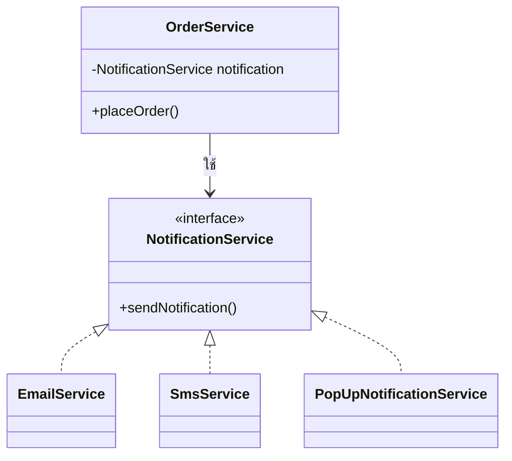
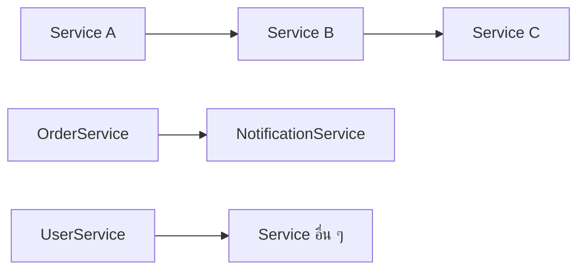
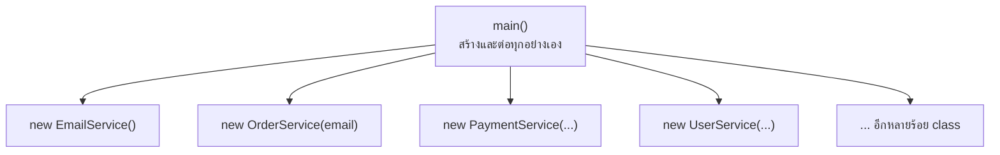
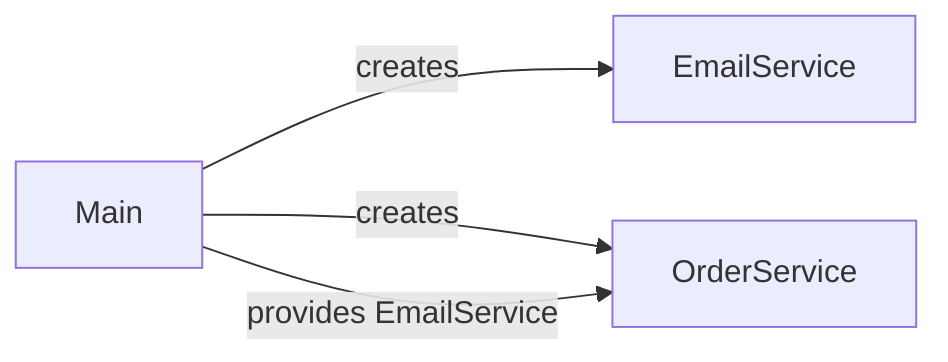
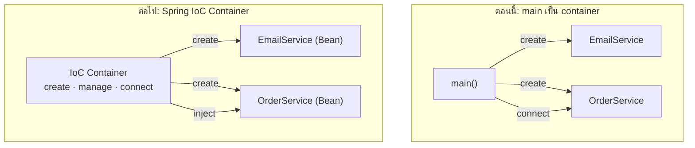
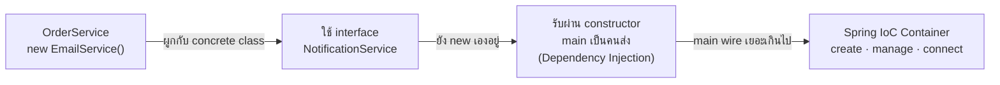

# #4 — Dependency Injection และ Inversion of Control ด้วย Java ล้วน

> **วิดีโอ:** [Dependency Injection & IoC Explained | Loose Coupling in Spring | Spring Boot Full Course #4](https://youtu.be/dT10m_5POfs) — Coder Army, ~39 นาที
> **แหล่งที่ใช้สรุป:** ซับไตเติลภาษาฮินดีที่ YouTube สร้างอัตโนมัติ
> **เวอร์ชันในโค้ด:** Spring Boot 4.1 + Java 21 (ใส่หมายเหตุไว้ทุกจุดที่ Spring Boot 3.x ต่างกัน) โค้ดในวิดีโอเป็น Java ล้วนทั้งหมด

ตอนนี้ตอบคำถามว่า **ทำไม Spring Core ต้องมี Dependency Injection และ Inversion of Control** ผู้สอนตั้งใจไม่ใช้ Spring เลยทั้งตอน เขาเขียน `OrderService` ที่ส่ง notification ด้วย Java ธรรมดา แล้วแก้ไปทีละขั้น จาก tightly coupled ไปเป็น loosely coupled จนได้ Dependency Injection ด้วยมือ จากนั้นอธิบายว่า IoC คืออะไร และ IoC Container ของ Spring จะมารับงานส่วนไหนแทน `main` ส่วนวิธีใช้ Spring จริงจะเริ่มในตอนถัดไป

ส่วนที่ติดป้าย `💡 เพิ่มเติม` คือของที่ผมเติมเอง ไม่ได้อยู่ในวิดีโอ ส่วนที่ติด `⚠️ แก้จากวิดีโอ` คือจุดที่วิดีโอพูดคลาดเคลื่อน

---

## สารบัญ

| เวลา | หัวข้อ |
|---|---|
| [0:00](https://youtu.be/dT10m_5POfs?t=0) | [1. ทำไมต้องรู้แนวคิดของ Spring Core](#1-ทำไมต้องรู้แนวคิดของ-spring-core) |
| [0:58](https://youtu.be/dT10m_5POfs?t=58) | [2. สร้างโปรเจกต์ core-demo](#2-สร้างโปรเจกต์-core-demo) |
| [2:24](https://youtu.be/dT10m_5POfs?t=144) | [3. OrderService ส่ง notification ผ่าน EmailService](#3-orderservice-ส่ง-notification-ผ่าน-emailservice) |
| [5:04](https://youtu.be/dT10m_5POfs?t=304) | [4. Dependency คืออะไร](#4-dependency-คืออะไร) |
| [6:17](https://youtu.be/dT10m_5POfs?t=377) | [5. Tight coupling กับ Loose coupling](#5-tight-coupling-กับ-loose-coupling) |
| [8:21](https://youtu.be/dT10m_5POfs?t=501) | [6. Code to interface ด้วย NotificationService](#6-code-to-interface-ด้วย-notificationservice) |
| [13:14](https://youtu.be/dT10m_5POfs?t=794) | [7. ใช้ interface แล้วก็ยัง tightly coupled](#7-ใช้-interface-แล้วก็ยัง-tightly-coupled) |
| [15:03](https://youtu.be/dT10m_5POfs?t=903) | [8. Dependency เป็นเรื่องปกติ ปัญหาคือใครเป็นคนสร้าง](#8-dependency-เป็นเรื่องปกติ-ปัญหาคือใครเป็นคนสร้าง) |
| [16:27](https://youtu.be/dT10m_5POfs?t=987) | [9. รับ dependency ผ่าน constructor](#9-รับ-dependency-ผ่าน-constructor) |
| [20:36](https://youtu.be/dT10m_5POfs?t=1236) | [10. นี่คือ Dependency Injection](#10-นี่คือ-dependency-injection) |
| [22:08](https://youtu.be/dT10m_5POfs?t=1328) | [11. ประโยชน์ด้าน unit test และ FakeEmailService](#11-ประโยชน์ด้าน-unit-test-และ-fakeemailservice) |
| [26:14](https://youtu.be/dT10m_5POfs?t=1574) | [12. ถ้า main ต้อง wire ทุกอย่างเอง](#12-ถ้า-main-ต้อง-wire-ทุกอย่างเอง) |
| [27:39](https://youtu.be/dT10m_5POfs?t=1659) | [13. ประโยคที่ต้องจำของ Dependency Injection](#13-ประโยคที่ต้องจำของ-dependency-injection) |
| [28:43](https://youtu.be/dT10m_5POfs?t=1723) | [14. ชนิดของ Dependency Injection](#14-ชนิดของ-dependency-injection) |
| [30:45](https://youtu.be/dT10m_5POfs?t=1845) | [15. Inversion of Control](#15-inversion-of-control) |
| [34:23](https://youtu.be/dT10m_5POfs?t=2063) | [16. IoC กับ DI เกี่ยวกันอย่างไร](#16-ioc-กับ-di-เกี่ยวกันอย่างไร) |
| [35:11](https://youtu.be/dT10m_5POfs?t=2111) | [17. Spring IoC Container และ Bean](#17-spring-ioc-container-และ-bean) |
| — | [18. โค้ดตัวอย่าง ให้ Spring เป็นคน wire](#18-โค้ดตัวอย่าง-ให้-spring-เป็นคน-wire) |
| — | [19. สรุปท้ายตอน](#19-สรุปท้ายตอน) |

---

## 1. ทำไมต้องรู้แนวคิดของ Spring Core

[▶ 0:00](https://youtu.be/dT10m_5POfs?t=0)

ผู้สอนเปิดด้วยคำถามที่หลายคนสงสัย: ที่ผ่านมาเราก็เขียนแอป Java ได้โดยไม่ต้องใช้ Spring ใช้ class, object และหลัก OOP ก็เขียนโค้ดได้ค่อนข้างสะอาดอยู่แล้ว แล้วทำไมต้องมีแนวคิดอย่าง **Dependency Injection** และ **Inversion of Control** อีก

เขาย้ำว่าเรื่องที่จะคุยในตอนนี้ไม่เกี่ยวกับ Spring MVC หรือการทำเว็บ แต่เป็น **core technology** ล้วน ๆ ที่ใช้ได้แม้แต่กับ console application ต้องเข้าใจเรื่องนี้ก่อน จึงจะเข้าใจ Spring Framework ได้ดี

---

## 2. สร้างโปรเจกต์ core-demo

[▶ 0:58](https://youtu.be/dT10m_5POfs?t=58)

ผู้สอนสร้างโปรเจกต์ใหม่ใน IntelliJ ชื่อ **core-demo** เพราะจะคุยเรื่องแนวคิดหลักของ Spring Core

- Build system: **Maven**
- JDK: 23
- ติ๊ก "Add sample code"
- groupId: `in.coderarmy` artifactId: `core-demo` version: `1.0-SNAPSHOT`

**ตอนนี้ไม่ใช้ Spring เลย** ผู้สอนบอกว่าตอนนี้จะคุยแค่ **ปัญหา** และคิดหาทางแก้ ส่วนว่า Spring แก้ปัญหาเดียวกันอย่างไรจะอยู่ในวิดีโอถัดไป `pom.xml` จึงว่างเปล่า ไม่มี dependency อะไรเลย

ผู้สอนลบ sample code ที่ IntelliJ สร้างให้ แล้วลองพิมพ์ `hello` แล้วรันดูเพื่อให้แน่ใจว่าโปรเจกต์ใช้ได้

> 💡 **เพิ่มเติม:** ในวิดีโอผู้สอนเลือก JDK 23 ส่วนโค้ดในไฟล์นี้ compile และรันด้วย Java 21 โค้ดของตอนนี้ไม่ได้ใช้ feature ใหม่ของภาษาเลย จึงได้ผลเหมือนกันทุกบรรทัด

โครงสร้างไฟล์ที่ได้ตอนจบวิดีโอ (ผู้สอนย้าย class ของ notification ไปอยู่ใน package `notification` ที่ [10:04](https://youtu.be/dT10m_5POfs?t=604))

```text
core-demo/
├── pom.xml
└── src/main/java/in/coderarmy/
    ├── Main.java
    ├── OrderService.java
    └── notification/
        ├── NotificationService.java      (interface)
        ├── EmailService.java
        ├── SmsService.java
        ├── PopUpNotificationService.java
        └── FakeEmailService.java
```

---

## 3. OrderService ส่ง notification ผ่าน EmailService

[▶ 2:24](https://youtu.be/dT10m_5POfs?t=144)

ระบบที่จะจำลองคือ **order service** วางคำสั่งซื้อได้ และเมื่อวางคำสั่งซื้อแล้วต้องส่ง notification ไปบอกผู้ใช้ ผู้สอนตั้งใจให้ logic ง่ายที่สุด เพราะต้องการให้เห็นแนวคิด ไม่ได้ต้องการให้โค้ดยาว แต่ละ method จึงแค่ print ข้อความ แทน business logic จริง

### `EmailService` — class ที่ส่ง email

[▶ 3:17](https://youtu.be/dT10m_5POfs?t=197)

```java
package in.coderarmy;

public class EmailService {

  public void sendNotification() {
    System.out.println("Email notification sent");
  }
}
```

### `OrderService` — สร้าง `EmailService` เอง

[▶ 3:50](https://youtu.be/dT10m_5POfs?t=230)

ใน `OrderService` ต้องเรียก `sendNotification()` ผู้สอนจึงสร้าง object ของ `EmailService` ด้วย `new` แบบที่เราเขียนกันตามปกติ แล้วเก็บไว้ใน instance variable ชื่อ `notification`

```java
package in.coderarmy;

public class OrderService {

  private EmailService notification = new EmailService();   // สร้าง dependency เอง

  public void placeOrder() {
    System.out.println("Order placed");
    notification.sendNotification();
  }
}
```

### `Main` — เรียก `placeOrder()`

[▶ 4:29](https://youtu.be/dT10m_5POfs?t=269)

```java
package in.coderarmy;

public class Main {

  public static void main(String[] args) {
    OrderService order = new OrderService();
    order.placeOrder();
  }
}
```

ผลที่ได้ ([▶ 4:48](https://youtu.be/dT10m_5POfs?t=288))

```text
Order placed
Email notification sent
```

โค้ดทำงานถูกต้อง มีสาม class คือ `OrderService`, `EmailService` และ `Main` ที่เรียก `OrderService`

---

## 4. Dependency คืออะไร

[▶ 5:04](https://youtu.be/dT10m_5POfs?t=304)

สังเกตว่า `OrderService` สร้าง object ของ `EmailService` แล้วเรียก method ของมัน ถ้าไม่มี `EmailService` ก็เรียก `placeOrder()` ไม่ได้ เพราะ `placeOrder()` ต้อง print ข้อความก่อน แล้วต้องเรียก `sendNotification()` จาก object ของ `EmailService` ต่อ

ผู้สอนจึงพูดได้สองแบบ ซึ่งมีความหมายเดียวกัน

- `OrderService` **depend on** `EmailService`
- `EmailService` เป็น **dependency** ของ `OrderService`

### ต่างจาก dependency ใน `pom.xml` ไหม

[▶ 5:49](https://youtu.be/dT10m_5POfs?t=349)

ผู้สอนบอกว่าคำนี้เป็นคนละบริบทกับ dependency ที่เรียนในตอน Maven (#3) ซึ่งหมายถึงการเพิ่ม jar ของ third-party library ที่โค้ดเราต้องใช้ แต่แนวคิดเป็นเรื่องเดียวกัน: ถ้าโค้ดเราต้องพึ่งของอย่างหนึ่งถึงจะทำงานได้ ของอย่างนั้นก็คือ dependency ในตอนนี้ dependency คือ **object ของ class อื่น** ที่ class ของเราต้องใช้

---

## 5. Tight coupling กับ Loose coupling

[▶ 6:17](https://youtu.be/dT10m_5POfs?t=377)

โค้ดในส่วนที่ 3 ทำงานได้ แต่มีปัญหาใหญ่คือ **tight coupling** ผู้สอนย้ำว่า **ปัญหานี้ไม่เกี่ยวกับ Spring** เป็นปัญหาการออกแบบโค้ด Java ของเราเอง เราไม่ได้ออกแบบให้โค้ด loosely coupled

ปัญหาสรุปได้ในประโยคเดียว: **`OrderService` สร้าง dependency ของตัวเอง** ("it's creating its own dependency")

### เปรียบเทียบกับการเดินทาง

[▶ 6:50](https://youtu.be/dT10m_5POfs?t=410)

ในการเขียนโปรแกรมมีสองแนวคิดคือ **tightly coupled** กับ **loosely coupled** ผู้สอนอธิบายด้วยตัวอย่างการเดินทางจากเดลีไปจัณฑีครห์

- **Tightly coupled:** "ฉันจะไปจัณฑีครห์ด้วยรถบัสคันนี้ ออกกี่โมง คนขับต้องเป็นคนนี้ รถต้องเป็นของบริษัทนี้" ระบุไว้ละเอียดทุกอย่าง จนผูกตัวเองไว้กับรายละเอียดเหล่านั้น
- **Loosely coupled:** ที่จริงแค่อยากไปถึงจัณฑีครห์ ไม่ควรสนว่าไปรถคันไหน คนขับเป็นใคร หรือรถของบริษัทไหน (เวลาอาจยังสำคัญอยู่บ้าง) สนแค่ว่าได้เดินทาง

### กลับมาที่โค้ด: tightly coupled เพราะอะไร

[▶ 7:27](https://youtu.be/dT10m_5POfs?t=447)

สิ่งที่ `OrderService` ต้องการจริง ๆ คือ "ส่ง notification" แต่มันทำเกินไปสองอย่าง

1. **ผูกกับ `EmailService` ซึ่งเป็น concrete class** มันจึงส่ง notification แบบอื่นไม่ได้ ถ้าวันหนึ่งต้องส่ง SMS หรือ pop-up ต้องเข้าไปแก้ `OrderService` เอา `EmailService` ออก แล้วใส่ class ใหม่แทน
2. **สร้าง object ของ dependency เอง** class ที่ตัวเองพึ่งอยู่ ตัวเองก็เป็นคนสร้างด้วย มันจึงรับหน้าที่หลายอย่างเกินไป (ผู้สอนบอกว่าจะกลับมาคุยข้อนี้ทีหลัง)

**Concrete class** คือ class ที่ไม่ได้เป็น abstract และ method ทุกตัวมี implementation ครบ

---

## 6. Code to interface ด้วย NotificationService

[▶ 8:21](https://youtu.be/dT10m_5POfs?t=501)

แนวปฏิบัติทั่วไปใน Java คือ **เขียนโค้ดคุยกับ interface มากกว่า concrete class** ("code for interfaces") ผู้สอนย้ำอีกครั้งว่านี่คือ good design practice ที่ไม่เกี่ยวกับ Spring **แต่แนวคิดทั้งหมดของ Spring ตั้งอยู่บนเรื่องนี้**

### ทำไมการแก้ `OrderService` ถึงเป็นปัญหา: Open/Closed Principle

[▶ 9:04](https://youtu.be/dT10m_5POfs?t=544)

ถ้าต้องการให้ `OrderService` ส่ง SMS แทน email ต้องเข้าไปแก้โค้ดใน `OrderService` ซึ่ง **ละเมิด Open/Closed Principle** (ตัว O ใน SOLID) หลักนี้บอกว่า class ควรเปิดให้ **extend** เพิ่มของใหม่ได้ แต่ไม่ควรต้อง **modify** ของเดิม พูดง่าย ๆ คือไม่ควรออกแบบให้ tightly coupled

### สร้าง interface และ implementation สามตัว

[▶ 9:37](https://youtu.be/dT10m_5POfs?t=577)

ไม่ว่าจะเป็น email, SMS หรือ pop-up ทุกตัวก็คือ notification เหมือนกัน ผู้สอนจึงสร้าง interface ชื่อ `Notification` ก่อน แล้วเปลี่ยนชื่อเป็น `NotificationService` เพื่อให้เข้าใจง่าย

เมื่อมี class เยอะขึ้น ผู้สอนสร้าง package `notification` ([▶ 10:04](https://youtu.be/dT10m_5POfs?t=604)) แล้วย้าย `EmailService`, `NotificationService`, `SmsService` และ `PopUpNotificationService` เข้าไป ส่วน `OrderService` และ `Main` อยู่ที่เดิม

```java
package in.coderarmy.notification;

public interface NotificationService {

  void sendNotification();
}
```

ทั้งสาม class `implements NotificationService` และ override `sendNotification()` ด้วยวิธีของตัวเอง ([▶ 10:48](https://youtu.be/dT10m_5POfs?t=648))

```java
package in.coderarmy.notification;

public class EmailService implements NotificationService {

  @Override
  public void sendNotification() {
    System.out.println("Email notification sent");
  }
}
```

```java
package in.coderarmy.notification;

public class SmsService implements NotificationService {

  @Override
  public void sendNotification() {
    System.out.println("SMS notification sent");
  }
}
```

```java
package in.coderarmy.notification;

public class PopUpNotificationService implements NotificationService {

  @Override
  public void sendNotification() {
    System.out.println("Pop up notification sent");
  }
}
```



`sendNotification()` ใน interface ทำหน้าที่เหมือน abstract method แต่ละ implementation เขียนเนื้อในเอง

### `OrderService` ใช้ type เป็น interface

[▶ 12:00](https://youtu.be/dT10m_5POfs?t=720)

ตอนนี้ใน `OrderService` เปลี่ยน type ของ field เป็น `NotificationService` ได้ แล้วจะใส่ notification แบบไหนก็ได้

```java
package in.coderarmy;

import in.coderarmy.notification.EmailService;
import in.coderarmy.notification.NotificationService;

public class OrderService {

  private NotificationService notification = new EmailService();   // type เป็น interface แต่ยัง new เอง

  public void placeOrder() {
    System.out.println("Order placed");
    notification.sendNotification();
  }
}
```

`Main` เหมือนเดิมทุกอย่าง ผลที่ได้

```text
Order placed
Email notification sent
```

ถ้าเข้าไปแก้ใน `OrderService` เป็น `new SmsService()` (และเปลี่ยน import เป็น `in.coderarmy.notification.SmsService`)

```java
private NotificationService notification = new SmsService();
```

```text
Order placed
SMS notification sent
```

เปลี่ยนเป็น `new PopUpNotificationService()` ก็ได้ บรรทัดที่สองจะเป็น `Pop up notification sent`

นี่คือ Java ธรรมดา: สร้าง object แบบไหนไว้ แล้วเรียก `sendNotification()` ผ่าน reference variable ที่มี type เป็น `NotificationService` ก็จะได้ method ของ object ตัวนั้น ผู้สอนเปลี่ยนกลับเป็น `EmailService` ก่อนไปต่อ

---

## 7. ใช้ interface แล้วก็ยัง tightly coupled

[▶ 13:14](https://youtu.be/dT10m_5POfs?t=794)

**ปัญหายังอยู่ที่เดิม** ที่เปลี่ยนไปมีแค่ type ของ variable ซึ่งเป็น interface แล้ว แต่ **object จริงยังถูกสร้างแบบ concrete อยู่ใน `OrderService`** การจะสลับไปส่ง SMS ก็ยังต้องเข้าไปแก้ `OrderService` อยู่ดี

ผู้สอนแยกให้ชัดก่อนว่า **การสร้าง object ไม่ใช่ปัญหา ปัญหาอยู่ที่ว่าสร้างมันที่ไหน** เราสร้างมันใน `OrderService` ทั้งที่หน้าที่ของ `OrderService` คือจัดการ order ข้างในจึงควรมีแค่ method ที่เกี่ยวกับ order เช่น place order, add order, delete order

### หลักการ SOLID สองข้อที่ล้มเหลว

[▶ 14:10](https://youtu.be/dT10m_5POfs?t=850)

| หลักการ | ทำไมถึงล้มเหลว |
|---|---|
| **S — Single Responsibility Principle** | class ควรมีเหตุผลให้ต้องแก้แค่เรื่องเดียว แต่ `OrderService` ทำสองอย่าง คือจัดการ order และ **สร้าง object ของ notification** ผู้สอนถามว่า "ทำไมมันต้องทำงานของ factory" การสร้าง notification ควรเป็นหน้าที่ของคนอื่น หน้าที่ของ `OrderService` คือ **ใช้** notification เช่นเรียก `sendNotification()` เมื่อวาง order สำเร็จ |
| **O — Open/Closed Principle** | ทุกครั้งที่ต้องส่ง notification แบบใหม่ ต้องเข้าไปแก้โค้ดใน `OrderService` |

แม้จะใช้ interface เป็น type ของ variable แล้ว แต่ข้างในก็ยังสร้าง object แบบ concrete อยู่ดี จึงยังเป็นงานแบบ tightly coupled

---

## 8. Dependency เป็นเรื่องปกติ ปัญหาคือใครเป็นคนสร้าง

[▶ 15:03](https://youtu.be/dT10m_5POfs?t=903)

เป้าหมายหลักคือทำให้การออกแบบ **loosely coupled** แต่ต้องจำไว้ว่า **การมี dependency เป็นเรื่องปกติ** service หนึ่ง depend on อีก service หนึ่งได้ และเกิดขึ้นตลอดเวลาในโค้ดจริง

ตัวอย่างในวิดีโอมีแค่ interface หนึ่งตัวกับ implementation สามตัว, `OrderService` และ `Main` แต่โปรเจกต์จริงมี Java file เป็นร้อย บางโปรเจกต์ใหญ่มีเป็นแสน (ถึงตอนนั้นก็ควรแตกเป็น microservices ซึ่งเป็นอีกหัวข้อหนึ่ง) ไฟล์เหล่านี้ depend on กันเยอะมาก จนจัดการโปรเจกต์ใหญ่ได้ยาก

[▶ 15:57](https://youtu.be/dT10m_5POfs?t=957) dependency อาจต่อกันเป็น **tree** เช่น service A depend on service B และ service B depend on service C



ผู้สอนสรุปว่า **dependency ไม่ใช่ปัญหา** ปัญหามีสองข้อ

1. class ที่ depend on อะไร **สร้าง object ของสิ่งนั้นเองด้วย**
2. `OrderService` เป็น **business logic** ควรจัดการแค่เรื่อง order ส่วน **การสร้าง object ไม่ใช่ business logic**

(ผู้สอนบอกว่าเรื่อง clean coding practice แบบนี้มีใน playlist Low Level Design ของช่อง)

---

## 9. รับ dependency ผ่าน constructor

[▶ 16:27](https://youtu.be/dT10m_5POfs?t=987)

ลองคิดในมุมของ `OrderService`: "ฉันไม่อยากสร้าง object นี้เอง ให้คนอื่นจัดการการสร้างไป ฉันแค่อยากเรียก method ของมัน" แต่ถ้าจะเรียก method ได้ ก็ต้อง **ได้ object ที่สร้างเสร็จแล้ว** มาจากที่ไหนสักแห่ง

ทางที่ดีที่สุดคือ **สร้าง constructor ให้ `OrderService` แล้วรับ object ของ notification เข้ามาทาง constructor** ([▶ 16:54](https://youtu.be/dT10m_5POfs?t=1014)) field `notification` ยังเป็น instance variable เหมือนเดิม แค่ไม่ได้ `new` เองแล้ว

```java
package in.coderarmy;

import in.coderarmy.notification.NotificationService;

public class OrderService {

  private final NotificationService notification;

  public OrderService(NotificationService notification) {   // ขอ dependency ผ่าน constructor
    this.notification = notification;
  }

  public void placeOrder() {
    System.out.println("Order placed");
    notification.sendNotification();
  }
}
```

ความหมายของโค้ดนี้คือ "ฉันไม่สร้าง object เอง ฉันบอกแค่ว่าต้องการมัน ใครก็ได้ส่งมันมาทาง constructor แล้วตอน `placeOrder()` ฉันจะเรียก `sendNotification()` ของ object ที่ส่งมา" field `notification` เป็นแค่ reference ของ interface เรียกใช้เองตรง ๆ ไม่ได้ ต้องมี **concrete object** ส่งเข้ามา

> 💡 **เพิ่มเติม:** ผู้สอนประกาศ field เป็น `NotificationService notification;` เฉย ๆ ในไฟล์นี้ใส่ `private final` เพิ่ม เพราะ dependency ที่รับทาง constructor ควรถูกกำหนดครั้งเดียวแล้วไม่เปลี่ยนอีก compiler จะช่วยบังคับว่าทุก constructor ต้องกำหนดค่าให้ field นี้

### `Main` เป็นคนส่ง dependency

[▶ 18:13](https://youtu.be/dT10m_5POfs?t=1093)

พอเพิ่ม constructor แล้ว `Main` ขึ้น error ทันที เพราะยังเรียก `new OrderService()` แบบไม่มี argument ซึ่งเป็นเรื่องที่คาดไว้แล้ว เมื่อ `OrderService` ไม่สร้างเอง ก็ต้องมีใครสักคนสร้าง ผู้สอนให้ **`main` เป็นคนทำ** เพราะ `main` เป็นคนสร้าง `OrderService` อยู่แล้ว

```java
package in.coderarmy;

import in.coderarmy.notification.EmailService;
import in.coderarmy.notification.NotificationService;

public class Main {

  public static void main(String[] args) {
    NotificationService notification = new EmailService();   // Main เป็นคนสร้าง dependency
    OrderService order = new OrderService(notification);      // แล้ว inject เข้า OrderService
    order.placeOrder();
  }
}
```

```text
Order placed
Email notification sent
```

### สลับ notification โดยไม่แตะ `OrderService`

[▶ 18:48](https://youtu.be/dT10m_5POfs?t=1128)

ถ้าต้องการส่ง SMS แทน **แก้แค่ใน `main`** (และ import ให้ตรง) ผู้สอนลองกับ pop-up ด้วยที่ [▶ 19:46](https://youtu.be/dT10m_5POfs?t=1186)

| บรรทัดใน `main` | บรรทัดที่สองของ output |
|---|---|
| `NotificationService notification = new SmsService();` | `SMS notification sent` |
| `NotificationService notification = new PopUpNotificationService();` | `Pop up notification sent` |

ไม่ต้องแก้ `OrderService` และไม่ต้องแตะ class ของ notification เลย เพราะทุกตัวสร้างไว้บน interface ตัวเดียวกัน

### หลักการที่กลับมาถูกต้อง

[▶ 19:18](https://youtu.be/dT10m_5POfs?t=1158)

- **Open/Closed:** สลับไปใช้ notification แบบใหม่ได้โดยไม่ต้องแก้ `OrderService`
- **Single Responsibility:** `OrderService` เหลือหน้าที่เดียวคือจัดการ order มันไม่ได้จัดการ notification แค่เรียก method ของมัน หรือพูดอีกอย่างคือ **delegate** งานไปให้คนอื่นทำ และไม่ได้สร้าง notification เอง

### `OrderService` ไม่ต้องรู้ว่าเป็น notification แบบไหน

[▶ 19:57](https://youtu.be/dT10m_5POfs?t=1197)

ผลพลอยได้อีกข้อ: เมื่อ `OrderService` ไม่ได้สร้าง object เอง มันก็ **ไม่จำเป็นต้องรู้ด้วยซ้ำว่าได้ notification แบบไหนมา** มันรับ `NotificationService` และ SMS, email, pop-up ต่างก็เป็น notification ทั้งหมด ส่งอะไรมามันก็เรียก `sendNotification()` ของตัวนั้น แล้วงานของมันก็จบ มันสนแค่ logic ของตัวเอง

---

## 10. นี่คือ Dependency Injection

[▶ 20:36](https://youtu.be/dT10m_5POfs?t=1236)

ก่อนหน้านี้ `OrderService` **สร้าง dependency ของตัวเอง** ("it was creating its own dependency") ตอนนี้มัน **ได้ dependency มาจากข้างนอก** คือจาก `Main.java`

[▶ 20:55](https://youtu.be/dT10m_5POfs?t=1255) ในศัพท์ของการเขียนโปรแกรม สิ่งนี้เรียกว่า **Dependency Injection**

- เดิมที `OrderService` สร้าง dependency (`NotificationService`) เองแล้วใช้เอง
- เรา **ดึงหน้าที่นั้นออกมา** เพราะหน้าที่ของมันควรเป็นการจัดการ order
- แล้วบอกมันว่า "ไม่ต้องสร้างเอง ฉันจะ **inject** dependency เข้าไปให้จากที่อื่น"
- `main` สร้าง notification ขึ้นมาหนึ่งตัว เช่น `new PopUpNotificationService()` แล้วส่งเข้า constructor `OrderService` เก็บไว้ใน instance variable แล้วเรียก `sendNotification()` ทุกครั้งที่ `placeOrder()` ถูกเรียก

ผู้สอนบอกว่าคำนี้ไม่ได้ซับซ้อน ความหมายง่าย ๆ คือ **dependency ที่ class ของคุณต้องพึ่ง อย่าให้ class สร้างเอง ให้ส่งเข้าไปจากข้างนอก** "ข้างนอก" จะเป็นที่ไหนก็ได้ ตอนนี้ใช้ `Main.java` เพราะอยากให้ class อื่นทั้งหมดเป็นอิสระต่อกัน แล้วให้ `main` ทำหน้าที่เหมือน **driver** ที่ขับเคลื่อนและจัดการทุกอย่าง

ประโยชน์ข้อแรกเห็นได้ชัดแล้ว: `OrderService` เป็นอิสระ ถ้าจะเปลี่ยน notification ก็ไม่ต้องแก้ข้างใน `OrderService`

---

## 11. ประโยชน์ด้าน unit test และ FakeEmailService

[▶ 22:08](https://youtu.be/dT10m_5POfs?t=1328)

ผู้สอนบอกว่ามีประโยชน์ที่ใหญ่กว่านั้นอีก คือ **unit test โค้ดได้ดีขึ้น** (คอร์สยังไม่ได้สอน unit test ให้เข้าใจไว้ก่อนว่าเป็นการทดสอบเฉพาะไฟล์หรือ class เดียว)

### ปัญหาของโค้ดแบบเดิม

[▶ 22:34](https://youtu.be/dT10m_5POfs?t=1354)

ถ้ากลับไปดูโค้ดแบบเดิมที่ `OrderService` เขียน `new EmailService()` เองและไม่รับค่าทาง constructor

- test case เขียนไว้ใต้ `src/test/java` โดยใช้ folder structure เดียวกับ `src/main/java` เช่นสร้าง `OrderServiceTest` คู่กับ `OrderService` (ตามที่เรียนในตอน Maven)
- จะ test `OrderService` ทีไร ก็ต้องทำงานกับ `EmailService` ตัวจริงด้วยทั้งที่ไม่อยาก เพราะ `OrderService` ทั้ง depend on และสร้าง notification เอง
- แค่จะ test ว่า `placeOrder()` ทำงานถูกไหม **ก็ต้องส่ง notification จริงออกไปทุกครั้ง** เพราะมันผูกตายกับ `EmailService`

ผู้สอนเรียกวิธีนี้ว่าแย่มาก

### สร้าง `FakeEmailService`

[▶ 23:50](https://youtu.be/dT10m_5POfs?t=1430)

พอใช้ Dependency Injection แล้ว `OrderService` ไม่ได้สร้าง dependency เอง แต่รับจากข้างนอก จึงสร้าง class ปลอมไว้ใช้ตอน test ได้ ผู้สอนสร้างไว้ใน package `notification` ไปก่อน

```java
package in.coderarmy.notification;

public class FakeEmailService implements NotificationService {

  @Override
  public void sendNotification() {
    System.out.println("Dummy email sent");
  }
}
```

ไม่ได้ส่ง email จริง เพราะไม่มีเหตุผลที่ต้องเสียเงินส่ง email จริงตอน test จึง print `Dummy email sent` ไว้บอกว่าเป็นตัวปลอม

[▶ 24:56](https://youtu.be/dT10m_5POfs?t=1496) ใน `main` เปลี่ยนแค่ object ที่ส่งเข้าไป ไม่ต้องแก้ `OrderService` เลย

```java
NotificationService notification = new FakeEmailService();
```

```text
Order placed
Dummy email sent
```

ตอนนี้ทุก method แค่ print แต่ในโปรแกรมจริง `placeOrder()` จะมี business logic เยอะ พอวาง order สำเร็จก็ส่ง notification และ `EmailService` จริงก็จะส่ง email ออกไปจริง ๆ ตอน test เราไม่ต้องการแบบนั้น จึงสร้าง `FakeEmailService` ที่ implement `NotificationService` ไว้ส่งเข้าไปแทน

ทั้งหมดนี้ทำได้เพราะ `OrderService` รับ `NotificationService` ซึ่งเป็น interface อะไรที่ implement interface นี้ก็ส่งเข้าไปได้ ตามกฎพื้นฐานของ Java ที่ reference ของ type แม่ (ในที่นี้คือ interface) ชี้ไปที่ object ของ class ลูกได้ ผู้สอนสรุปว่า **Dependency Injection ทำให้เขียน unit test ง่ายขึ้น**

> 💡 **เพิ่มเติม — unit test จริงด้วย JUnit**
> ในวิดีโอรันตัวปลอมผ่าน `main` และวาง `FakeEmailService` ไว้ใน `src/main/java` ในโปรเจกต์จริง class ปลอมควรอยู่ใน `src/test/java` เพื่อไม่ให้ติดไปกับโค้ด production และ test ควร **ตรวจผล** ไม่ใช่แค่ดูข้อความที่ print ออกมา ตัวอย่างนี้ใช้ fake ที่นับว่าถูกเรียกกี่ครั้ง (เพิ่ม `org.junit.jupiter:junit-jupiter` scope `test` ใน `pom.xml` ถ้าใช้ `spring-boot-starter-parent` ไม่ต้องใส่ version)
>
> ```java
> // src/test/java/in/coderarmy/OrderServiceTest.java
> package in.coderarmy;
>
> import static org.junit.jupiter.api.Assertions.assertEquals;
>
> import in.coderarmy.notification.NotificationService;
> import org.junit.jupiter.api.Test;
>
> class OrderServiceTest {
>
>   static class RecordingNotificationService implements NotificationService {
>     int calls = 0;
>
>     @Override
>     public void sendNotification() {
>       calls++;
>     }
>   }
>
>   @Test
>   void placeOrderSendsExactlyOneNotification() {
>     RecordingNotificationService fake = new RecordingNotificationService();
>     OrderService order = new OrderService(fake);
>
>     order.placeOrder();
>
>     assertEquals(1, fake.calls);
>   }
> }
> ```
>
> ผลจาก `mvn test` (เฉพาะบรรทัดที่เกี่ยวข้อง)
>
> ```text
> [INFO] Running in.coderarmy.OrderServiceTest
> Order placed
> [INFO] Tests run: 1, Failures: 0, Errors: 0, Skipped: 0, Time elapsed: 0.019 s -- in in.coderarmy.OrderServiceTest
> [INFO] BUILD SUCCESS
> ```
>
> ถ้า `OrderService` ยังเขียน `new EmailService()` เองเหมือนในส่วนที่ 3 test นี้จะเขียนไม่ได้เลย เพราะไม่มีช่องให้ส่งตัวปลอมเข้าไป ในตอน #40 (Testing) จะใช้ Mockito สร้างตัวปลอมแบบนี้ให้อัตโนมัติ

---

## 12. ถ้า main ต้อง wire ทุกอย่างเอง

[▶ 26:14](https://youtu.be/dT10m_5POfs?t=1574)

ตอนนี้เรารู้แล้วว่าส่ง dependency เข้าไปได้ และทำแบบนี้ได้กับทุก class โดยให้ `main` เป็นคน inject ทั้งหมด ตอนนี้มีแค่ notification กับ `OrderService` แต่ถ้ามี `UserService`, `PaymentService` และ service อื่นอีกเยอะ `main` ก็ inject ให้ทุกตัวได้ แล้ว service ทุกตัวก็จะได้ dependency ไปเรียก method ได้เหมือน `OrderService`

**แต่มีคำถามสำคัญ:** ถ้า inject ทุก dependency ผ่าน `main` แล้ว `main` จะซับซ้อนมาก ต้องมี **wiring** เยอะมาก ต้องต่อ dependency ทีละตัวเองทั้งหมด service ยิ่งเยอะ `main` ก็ยิ่งซับซ้อน



[▶ 27:13](https://youtu.be/dT10m_5POfs?t=1633) **คำตอบคือ Spring Core** ตอนนี้ยังไม่ได้ใช้ Spring แต่ตั้งแต่วิดีโอถัดไป Spring จะเป็นคน **จัดการ dependency และ inject ให้** จนไม่ต้องทำอะไรใน `main` เลย ผู้สอนบอกว่าตอนเห็นโค้ดจะรู้สึกเหมือนเวทมนตร์ที่มันจัดการทุกอย่างเองได้ และนี่คือพื้นฐานของ Spring Core

---

## 13. ประโยคที่ต้องจำของ Dependency Injection

[▶ 27:39](https://youtu.be/dT10m_5POfs?t=1659)

ประโยคดังของ Dependency Injection คือ

> **"Don't create your own dependency, but get your dependency."**

อย่าสร้าง dependency เอง ให้ไปขอมาจากที่อื่น ตอนนี้ขอจาก `main` พอใช้ Spring แล้ว Spring Framework จะเป็นคนจัดการ dependency, inject ให้ และสร้าง object ให้เอง

อีกประโยคที่ถือเป็นหลักพื้นฐาน ([▶ 28:01](https://youtu.be/dT10m_5POfs?t=1681))

> **"A class should ask what it needs, and not build everything itself."**

ถ้า class ต้องการอะไร ให้ขอจากคนอื่น ไม่ใช่สร้างขึ้นมาเอง

### Dependency Injection ไม่ใช่แนวคิดของ Spring

[▶ 28:27](https://youtu.be/dT10m_5POfs?t=1707)

ผู้สอนย้ำให้จำไว้ว่า **Dependency Injection ไม่ได้เป็นแนวคิดของ Spring** Spring แค่ทำให้มันเป็นอัตโนมัติ Dependency Injection มีอยู่ได้เองโดยไม่ต้องพึ่ง framework เห็นได้จากโค้ดทั้งหมดที่เขียนมาในตอนนี้ ซึ่งไม่ได้ใช้ Spring เลย แต่ก็ inject dependency จากข้างนอกได้

---

## 14. ชนิดของ Dependency Injection

[▶ 28:43](https://youtu.be/dT10m_5POfs?t=1723)

ผู้สอนแนะนำสองชนิดก่อน

### 1. Constructor injection

ที่ทำมาตลอดในส่วนที่ 9 คือ `OrderService` รับ `NotificationService` ผ่าน constructor

### 2. Setter injection

[▶ 29:00](https://youtu.be/dT10m_5POfs?t=1740)

อีกวิธีคือ inject ผ่าน **setter** ตอนนี้ `OrderService` มี instance variable ตัวเดียวคือ `notification` ผู้สอนให้ IntelliJ สร้าง setter ให้ (Generate > Setter แล้วเลือก field `notification`) ได้ `setNotification(...)` ที่รับ `NotificationService` แล้ว assign ให้ field

เขาไม่ได้ลบ constructor เดิม แต่ **overload** เพิ่ม constructor เปล่าอีกตัว เพื่อให้สร้าง object เปล่าได้ ([▶ 29:44](https://youtu.be/dT10m_5POfs?t=1784))

```java
package in.coderarmy;

import in.coderarmy.notification.NotificationService;

public class OrderService {

  private NotificationService notification;

  public OrderService() {
  }

  public OrderService(NotificationService notification) {   // constructor injection
    this.notification = notification;
  }

  public void setNotification(NotificationService notification) {   // setter injection
    this.notification = notification;
  }

  public void placeOrder() {
    System.out.println("Order placed");
    notification.sendNotification();
  }
}
```

ใน `main` สร้าง `OrderService` ด้วย constructor เปล่า แล้วส่ง dependency ผ่าน setter ([▶ 29:52](https://youtu.be/dT10m_5POfs?t=1792)) ผู้สอนเปลี่ยนจาก `FakeEmailService` กลับมาใช้ `EmailService` ตัวจริง

```java
package in.coderarmy;

import in.coderarmy.notification.EmailService;

public class Main {

  public static void main(String[] args) {
    OrderService order = new OrderService();
    order.setNotification(new EmailService());
    order.placeOrder();
  }
}
```

```text
Order placed
Email notification sent
```

> 💡 **เพิ่มเติม — constructor หรือ setter ดี**
> ถ้าใช้ setter injection แล้วลืมเรียก setter object ก็ยังถูกสร้างได้ แต่จะพังตอนใช้งาน
>
> ```java
> package in.coderarmy;
>
> public class ForgotSetterDemo {
>
>   public static void main(String[] args) {
>     OrderService order = new OrderService();   // ลืมเรียก setNotification(...)
>     order.placeOrder();
>   }
> }
> ```
>
> ```text
> Order placed
> Exception in thread "main" java.lang.NullPointerException: Cannot invoke "in.coderarmy.notification.NotificationService.sendNotification()" because "this.notification" is null
> 	at in.coderarmy.OrderService.placeOrder(OrderService.java:22)
> 	at in.coderarmy.ForgotSetterDemo.main(ForgotSetterDemo.java:7)
> ```
>
> ส่วน constructor injection ทำให้สร้าง `OrderService` ที่ไม่มี notification ไม่ได้ตั้งแต่แรก และทำให้ field เป็น `final` ได้ เอกสารของ Spring จึงแนะนำให้ใช้ constructor กับ dependency ที่จำเป็น และใช้ setter กับ dependency ที่เป็น optional หรือต้องเปลี่ยนทีหลัง

### 3. Field injection

[▶ 30:26](https://youtu.be/dT10m_5POfs?t=1826)

ยังมีชนิดที่สามคือ **field injection** ผู้สอนบอกว่าจะคุยตอนเรียน Spring Framework เพราะถ้าไม่ใช้ Spring ก็ทำ field injection ไม่ได้ และจะเข้าใจเหตุผลเมื่อได้ใช้ Spring

> ⚠️ **แก้จากวิดีโอ (ความแม่นยำ):** วิดีโอบอกว่าทำ field injection โดยไม่มี Spring ไม่ได้ ที่ถูกคือทำได้ แต่ไม่สะดวก field injection หมายถึงการเขียนค่าลง field ตรง ๆ ไม่ผ่าน constructor และไม่ผ่าน setter ถ้า field ไม่ได้เป็น `private` โค้ดใน package เดียวกันก็ assign ตรง ๆ ได้ ถ้าเป็น `private` ก็ใช้ reflection แบบนี้ ซึ่งเป็นสิ่งที่ Spring ทำให้เมื่อเจอ `@Autowired` บน field
>
> ```java
> package in.coderarmy;
>
> import in.coderarmy.notification.SmsService;
> import java.lang.reflect.Field;
>
> public class FieldInjectionDemo {
>
>   public static void main(String[] args) throws ReflectiveOperationException {
>     OrderService order = new OrderService();
>
>     Field field = OrderService.class.getDeclaredField("notification");
>     field.setAccessible(true);                 // เปิดให้เขียน private field ได้
>     field.set(order, new SmsService());        // inject ตรงเข้า field ไม่ผ่าน constructor หรือ setter
>
>     order.placeOrder();
>   }
> }
> ```
>
> ```text
> Order placed
> SMS notification sent
> ```
>
> ไม่มีใครเขียนแบบนี้ด้วยมือในโค้ดจริง จึงพูดได้ว่า field injection มีประโยชน์ก็ต่อเมื่อมี framework ทำให้

---

## 15. Inversion of Control

[▶ 30:45](https://youtu.be/dT10m_5POfs?t=1845)

หัวข้อถัดจาก Dependency Injection คือ **IoC (Inversion of Control)** ผู้สอนบอกว่าไม่ใช่หัวข้อแยก มันเกี่ยวกับ Dependency Injection มาก ถ้าเข้าใจ DI แล้ว IoC ก็ง่าย หลายคนใช้สองคำนี้แทนกัน **แต่สองคำนี้มีความหมายต่างกัน** แค่เกี่ยวข้องกัน

ก่อนจะเข้าใจ inversion of control ต้องดูก่อนว่า **control** คืออะไร ผู้สอนวาดบนกระดานเทียบสองแบบ

### แบบเดิม (initial design)

[▶ 31:11](https://youtu.be/dT10m_5POfs?t=1871)

`OrderService` ทั้ง depend on และสร้าง `EmailService` เอง control จึง **ไหลจาก `OrderService` ไปยัง `EmailService`** `OrderService` เป็นผู้รับผิดชอบการสร้าง `EmailService` และคนสร้าง `OrderService` ก็คือ `Main`


### หลังใช้ Dependency Injection

[▶ 32:37](https://youtu.be/dT10m_5POfs?t=1957)

`Main` เป็นคนสร้างทุกอย่าง และเป็นคนส่ง dependency

1. `Main` สร้าง `EmailService` (เพราะต้องเป็นคนสร้าง dependency)
2. `Main` สร้าง `OrderService`
3. `Main` ส่ง (provides) `EmailService` ให้ `OrderService`



### control ถูก invert

[▶ 33:28](https://youtu.be/dT10m_5POfs?t=2008)

เทียบทิศทางของ control ทั้งสองแบบ

- **แบบเดิม:** control ในการสร้าง `EmailService` **อยู่ข้างใน** `OrderService` ทิศทางคือจาก `OrderService` ไปหา `EmailService`
- **หลังใช้ DI:** ทิศทางกลับด้าน คือจาก `Main` เข้าหา `OrderService` ตอนนี้ `OrderService` **ไม่มี control** ในการสร้าง object ของ `EmailService` อีกแล้ว มันได้ object มา **จากข้างนอก**

control ที่เคยอยู่ข้างใน `OrderService` ย้ายไปอยู่ข้างนอก และได้มาจากภายนอก **นี่คือ Inversion of Control** คือ control ถูกกลับด้าน

> 💡 **เพิ่มเติม:** IoC มักถูกอธิบายด้วย "Hollywood Principle" คือ "Don't call us, we'll call you" โค้ดของเราไม่ได้เป็นคนคุมว่าจะสร้างอะไรและเรียกอะไรเมื่อไร แต่ถูก framework เรียกใช้ ตัวอย่างที่เคยเห็นมาแล้วในตอน #1 คือ Servlet เราไม่ได้เขียน `main` เพื่อรอ request เอง Tomcat เป็นคนเรียก `doGet()` ให้

---

## 16. IoC กับ DI เกี่ยวกันอย่างไร

[▶ 34:23](https://youtu.be/dT10m_5POfs?t=2063)

คำถามที่ดีคือ Inversion of Control กับ Dependency Injection เกี่ยวกันอย่างไร

| | คืออะไร |
|---|---|
| **IoC** | **แนวคิด** หรือ **principle** ว่าเราต้องการให้ control ถูกกลับด้าน |
| **DI** | **approach** หรือ **technique** ที่ใช้ implement แนวคิดนั้น เพื่อให้ได้ IoC |

ผู้สอนสรุปว่า IoC เป็น principle ส่วน Dependency Injection คือวิธีทำให้ principle นั้นเกิดขึ้นจริง

> ⚠️ **แก้จากวิดีโอ:** ช่วง 34:23–35:09 ผู้สอนพูดคำว่า "**Dependency Inversion**" หลายครั้ง (เช่น "ความสัมพันธ์ระหว่าง Inversion of Control กับ Dependency Inversion" และ "Dependency Inversion คือ technique ที่ใช้ให้ได้ IoC") แต่ประโยคสรุปตรงกลางพูดว่า "Inversion of Control กับ **Dependency Injection** เกี่ยวกันแบบนี้" จากบริบททั้งตอน สิ่งที่หมายถึงคือ **Dependency Injection**
> สองคำนี้เป็นคนละเรื่องกัน **Dependency Inversion Principle** คือตัว D ใน SOLID มีใจความว่า module ระดับสูงไม่ควร depend on module ระดับต่ำโดยตรง ทั้งสองฝั่งควร depend on abstraction ในตอนนี้ขั้นที่ทำตามหลักนี้คือขั้นที่ `OrderService` เปลี่ยนไปใช้ interface `NotificationService` ([ส่วนที่ 6](#6-code-to-interface-ด้วย-notificationservice)) ส่วน Dependency Injection คือวิธี **ส่ง** implementation เข้าไป ([ส่วนที่ 9](#9-รับ-dependency-ผ่าน-constructor)) ในโค้ดจริงสองเรื่องนี้มักใช้คู่กัน แต่ไม่ใช่คำเดียวกัน

> 💡 **เพิ่มเติม:** DI ไม่ใช่วิธีเดียวที่ทำให้เกิด IoC วิธีอื่นเช่น Service Locator (class ไปขอ dependency จาก registry กลางเอง), Template Method และ callback หรือ event ที่ framework เป็นคนเรียกโค้ดของเรา Martin Fowler ตั้งชื่อ "Dependency Injection" ขึ้นในบทความปี 2004 เพื่อแยก IoC แบบที่ container ส่ง dependency เข้ามาให้ ออกจาก IoC แบบอื่น ๆ ที่กว้างกว่า

---

## 17. Spring IoC Container และ Bean

[▶ 35:11](https://youtu.be/dT10m_5POfs?t=2111)

แล้ว Spring Framework อยู่ตรงไหนของเรื่องทั้งหมดนี้

จนถึงตอนนี้ `main` เป็นคน inject dependency ทั้งหมด เป็นคน wire ทุกอย่าง เป็นคนคุมทุกอย่าง หรือพูดอีกอย่างคือ **`main` เป็นคน configure ทุกอย่าง** แม้จะทำให้ `main` ซับซ้อน แต่ก็ยังดีกว่าให้ทุก class อย่าง `OrderService` สร้าง dependency เอง ซึ่งเป็นวิธีที่แย่

**ตรงนี้คือที่ที่ Spring Framework เข้ามา** Spring มี **IoC Container** (Inversion of Control Container) ที่ทำงานทั้งหมดที่ `main` ทำอยู่ตอนนี้ ตอนนี้ `main` ทำหน้าที่เป็น container อยู่ คือจัดการ dependency และ wiring ทั้งหมด เช่นสร้าง dependency ก่อน แล้วส่งเข้า `OrderService` ซึ่งก็คือการ **wire** มันเข้าไป

### IoC Container ทำ 3 อย่าง

[▶ 36:12](https://youtu.be/dT10m_5POfs?t=2172)

| หน้าที่ | ตอนนี้ใครทำ | ต่อไปใครทำ |
|---|---|---|
| **Create objects** สร้าง object | `main` สร้าง object ของ `NotificationService` และ `OrderService` | IoC Container |
| **Manage objects** จัดการ object ว่าจะถูกสร้างเมื่อไรและถูกทำลายเมื่อไร | ในทางหนึ่ง `main` ก็เป็นคนดูแลอยู่ | IoC Container |
| **Connect objects together** ต่อ object เข้าด้วยกัน | `main` wire เอง เช่น `OrderService` ต้องการ `NotificationService` ก็ส่งเข้า setter ให้ | IoC Container |



[▶ 37:22](https://youtu.be/dT10m_5POfs?t=2242) ผู้สอนบอกว่าตอนเขียนโค้ด Spring จะ **แทบไม่เห็นคำว่า `new` เลย** object ส่วนใหญ่จะให้ Spring IoC Container จัดการ ราว 90% ของโค้ดจะไม่ต้องสร้าง object เอง และไม่ต้องจัดการความสัมพันธ์ระหว่าง object เอง Spring ไม่ใช่เวทมนตร์ คอร์สจะค่อย ๆ ดูว่าข้างในมันสร้าง object และดูแลความสัมพันธ์อย่างไร

### Bean

[▶ 37:52](https://youtu.be/dT10m_5POfs?t=2272)

ในโค้ด Java ปกติเราเรียกของพวกนี้ว่า **object** แต่ในมุมของ **Spring IoC Container** object ที่มันจัดการจะถูกเรียกว่า **Bean** ผู้สอนบอกว่าจะคุยเรื่อง Bean อีกเยอะ ตอนนี้ให้เข้าใจว่า Bean ไม่ได้เป็นอะไรพิเศษ ก็คือ object ที่ Spring IoC Container จัดการ

- **Bean ทุกตัวเป็น object**
- **แต่ object ทุกตัวไม่ได้เป็น Bean** object จะเป็น Bean ก็ต่อเมื่อ IoC Container เป็นคนจัดการมัน

### สิ่งที่จะเปลี่ยนในตอนต่อไป

[▶ 38:29](https://youtu.be/dT10m_5POfs?t=2309)

หลังใช้ Dependency Injection แล้ว `main` สร้าง `EmailService` สร้าง `OrderService` และส่ง `EmailService` ให้ `OrderService` ใน diagram ทั้งสามจุดนั้น **`main` จะถูกแทนที่ด้วย IoC Container** และ container จะทำงานทั้งหมดแทน ส่วนจะคุยกับ IoC Container อย่างไรจะอยู่ในตอนต่อไป

ผู้สอนปิดท้ายว่าเป้าหมายของตอนนี้คือให้เข้าใจว่า Dependency Injection คืออะไร IoC Container คืออะไร และ **ศัพท์เหล่านี้เป็นอิสระจาก Spring** ใช้ในโค้ด Java ธรรมดาได้

---

## 18. โค้ดตัวอย่าง ให้ Spring เป็นคน wire

> 💡 **เพิ่มเติมทั้งส่วน:** วิดีโอตอนนี้ไม่ได้เขียนโค้ด Spring เลย ส่วนนี้เอา `OrderService` จากส่วนที่ 9 มาให้ Spring Boot เป็นคน wire เพื่อให้เห็นภาพตามส่วนที่ 17 ว่า "เอา IoC Container มาแทน `main`" หน้าตาเป็นอย่างไร รายละเอียดของ annotation แต่ละตัวอยู่ในตอน #5

`pom.xml` (เฉพาะส่วนสำคัญ) ใช้ `spring-boot-starter` ตัวเดียว ไม่ต้องมีเว็บ

```xml
<parent>
  <groupId>org.springframework.boot</groupId>
  <artifactId>spring-boot-starter-parent</artifactId>
  <version>4.1.1</version>
</parent>

<properties>
  <java.version>21</java.version>
</properties>

<dependencies>
  <dependency>
    <groupId>org.springframework.boot</groupId>
    <artifactId>spring-boot-starter</artifactId>
  </dependency>
</dependencies>
```

`NotificationService` และ `SmsService` เหมือนในส่วนที่ 6 ทุกบรรทัด ที่ต่างคือ `EmailService` มี `@Component` ซึ่งบอก Spring ว่า "ให้สร้าง object ของ class นี้ไว้เป็น Bean"

```java
package in.coderarmy.notification;

import org.springframework.stereotype.Component;

@Component
public class EmailService implements NotificationService {

  @Override
  public void sendNotification() {
    System.out.println("Email notification sent");
  }
}
```

`OrderService` เหมือนส่วนที่ 9 ทุกอย่าง แค่เพิ่ม `@Component` ไม่มี `new` และไม่มี `import` ของ `EmailService`

```java
package in.coderarmy;

import in.coderarmy.notification.NotificationService;
import org.springframework.stereotype.Component;

@Component
public class OrderService {

  private final NotificationService notification;

  public OrderService(NotificationService notification) {   // Spring ส่ง Bean ที่ตรง type มาให้
    this.notification = notification;
  }

  public void placeOrder() {
    System.out.println("Order placed");
    notification.sendNotification();
  }
}
```

`main` ไม่สร้างอะไรเองแล้ว แค่เริ่ม container แล้วขอ `OrderService` ที่ต่อเสร็จแล้วออกมา

```java
package in.coderarmy;

import org.springframework.boot.SpringApplication;
import org.springframework.boot.autoconfigure.SpringBootApplication;
import org.springframework.context.ApplicationContext;

@SpringBootApplication
public class CoreDemoApplication {

  public static void main(String[] args) {
    ApplicationContext context = SpringApplication.run(CoreDemoApplication.class, args);

    OrderService order = context.getBean(OrderService.class);   // ไม่มี new OrderService(...) อีกแล้ว
    order.placeOrder();
  }
}
```

ผลที่ได้ (ตัด banner, timestamp และ path ของ jar ออก)

```text
INFO 14553 --- [main] in.coderarmy.CoreDemoApplication : Starting CoreDemoApplication v1.0-SNAPSHOT using Java 21.0.12.1 with PID 14553 (...)
INFO 14553 --- [main] in.coderarmy.CoreDemoApplication : No active profile set, falling back to 1 default profile: "default"
INFO 14553 --- [main] in.coderarmy.CoreDemoApplication : Started CoreDemoApplication in 0.317 seconds (process running for 0.494)
Order placed
Email notification sent
```

เทียบกับสามหน้าที่ในส่วนที่ 17

- **Create:** Spring สร้าง `EmailService` และ `OrderService` เพราะเจอ `@Component` ตอน scan package
- **Connect:** constructor ของ `OrderService` ต้องการ `NotificationService` Spring จึงหา Bean ที่ตรง type ซึ่งก็คือ `EmailService` แล้วส่งเข้าไปให้ ถ้า class มี constructor ตัวเดียว ไม่ต้องใส่ `@Autowired`
- **Manage:** Bean ทั้งสองตัวอยู่ใน `ApplicationContext` ไปจนแอปปิด

### ถ้ามี Bean ที่ตรง type สองตัว

ถ้าใส่ `@Component` ให้ `SmsService` ด้วย Spring จะเลือกไม่ได้ว่าควรส่งตัวไหนให้ `OrderService` แอปจะสตาร์ทไม่ขึ้น (ตัด path และคำแนะนำเรื่อง `-parameters` ท้ายข้อความออก)

```text
***************************
APPLICATION FAILED TO START
***************************

Description:

Parameter 0 of constructor in in.coderarmy.OrderService required a single bean, but 2 were found:
	- emailService: defined in URL [.../in/coderarmy/notification/EmailService.class]
	- smsService: defined in URL [.../in/coderarmy/notification/SmsService.class]

Action:

Consider marking one of the beans as @Primary, updating the consumer to accept multiple beans, or using @Qualifier to identify the bean that should be consumed
```

การสลับ implementation ใน Spring จึงไม่ได้ทำโดยแก้ `new` ใน `main` แต่ทำผ่าน configuration ของ container เช่น `@Primary`, `@Qualifier` หรือ profile ซึ่งจะมาในตอนต่อ ๆ ไป

> โค้ดส่วนนี้เขียนเหมือนกันทั้ง Spring Boot 3.x และ 4 (`spring-boot-starter`, `@Component`, `@SpringBootApplication` ไม่ได้เปลี่ยน)

---

## 19. สรุปท้ายตอน

### ลำดับความคิดของทั้งตอน



### ประเด็นที่ต้องจำ

1. **Dependency** คือ object ของ class อื่นที่ class ของเราต้องใช้ถึงจะทำงานได้ การมี dependency เป็นเรื่องปกติ
2. ปัญหาไม่ได้อยู่ที่การมี dependency แต่อยู่ที่ **class สร้าง dependency ของตัวเอง** ซึ่งทำให้ **tightly coupled**
3. การ **code to interface** ช่วยได้ครึ่งเดียว ถ้ายัง `new` concrete class อยู่ข้างใน ก็ยัง tightly coupled
4. โค้ดที่สร้าง dependency เองละเมิด **Single Responsibility** (ทำงานของ factory ด้วย) และ **Open/Closed** (สลับ implementation ต้องแก้ class)
5. **Dependency Injection** คือส่ง dependency เข้ามาจากข้างนอก แทนที่จะให้ class สร้างเอง "Don't create your own dependency, get your dependency"
6. DI ทำให้ **unit test ง่าย** เพราะส่ง fake เข้าไปแทนของจริงได้
7. DI มีสามแบบ: **constructor**, **setter** และ **field** (field injection จะคุยตอนใช้ Spring)
8. **Inversion of Control** คือ control ในการสร้าง dependency ย้ายจากข้างใน class ไปอยู่ข้างนอก **IoC เป็น principle, DI เป็น technique** ที่ทำให้ได้ IoC
9. **DI และ IoC ไม่ใช่แนวคิดของ Spring** Spring แค่ทำให้เป็นอัตโนมัติ
10. **Spring IoC Container** ทำงานแทน `main`: create, manage และ connect objects
11. **Bean** คือ object ที่ IoC Container จัดการ Bean ทุกตัวเป็น object แต่ object ทุกตัวไม่ได้เป็น Bean

### คำถามทบทวน

1. ในโค้ดแรกสุด ทำไม `OrderService` ถึงเรียกว่า tightly coupled กับ `EmailService` ให้ตอบสองเหตุผล
2. เปลี่ยน type ของ field เป็น `NotificationService` แล้ว ทำไมผู้สอนยังบอกว่าโค้ดยัง tightly coupled
3. โค้ดที่ `new EmailService()` อยู่ใน `OrderService` ละเมิดหลัก SOLID ข้อไหนบ้าง และละเมิดอย่างไร
4. หลังใช้ constructor injection แล้ว ถ้าจะเปลี่ยนจาก email เป็น SMS ต้องแก้ไฟล์ไหน
5. ทำไม Dependency Injection ถึงทำให้ unit test `OrderService` ได้โดยไม่ต้องส่ง email จริง
6. constructor injection กับ setter injection ต่างกันอย่างไร ถ้าลืมเรียก setter จะเกิดอะไรขึ้น
7. วาด diagram ทิศทางของ control ก่อนและหลังใช้ DI แล้วอธิบายว่าอะไรถูก "invert"
8. IoC กับ DI ต่างกันอย่างไร และ Dependency Inversion Principle เป็นเรื่องเดียวกับ DI หรือไม่
9. IoC Container ทำหน้าที่อะไรบ้าง 3 อย่าง และในโค้ดของตอนนี้ใครทำหน้าที่เหล่านั้นอยู่
10. object ทุกตัวในแอป Spring เป็น Bean หรือไม่ เพราะอะไร

### ตอนถัดไป

[#5 — Spring IoC Container | Beans, @Component, @Autowired, @Bean](./05-spring-ioc-container-and-beans.md) ผู้สอนบอกว่าจะเริ่มให้ Spring เป็นคนจัดการ dependency แทน `main`
