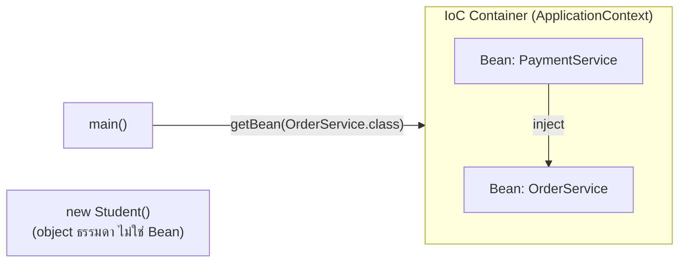
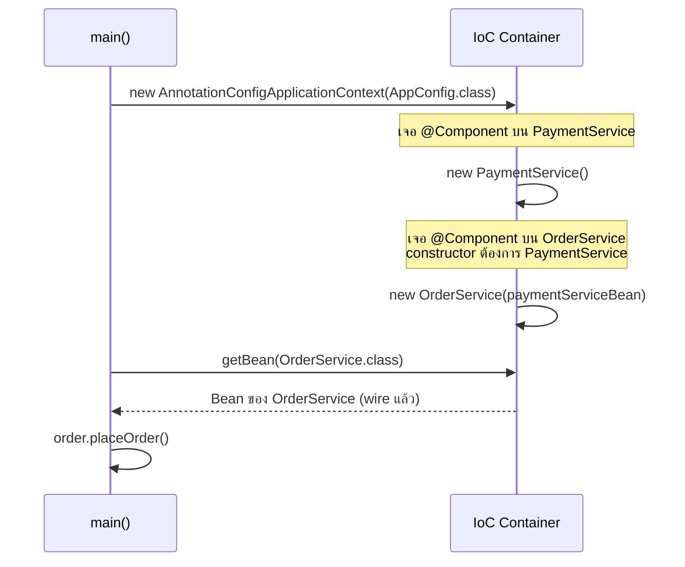
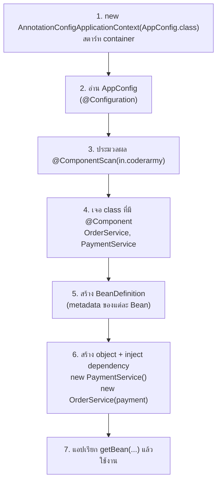
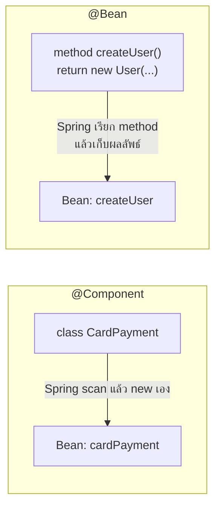
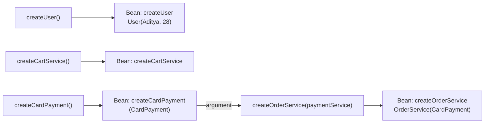
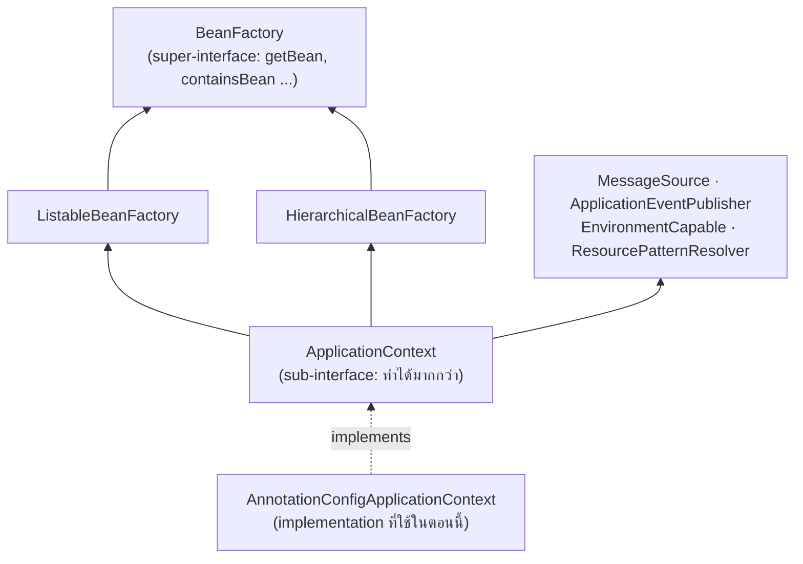
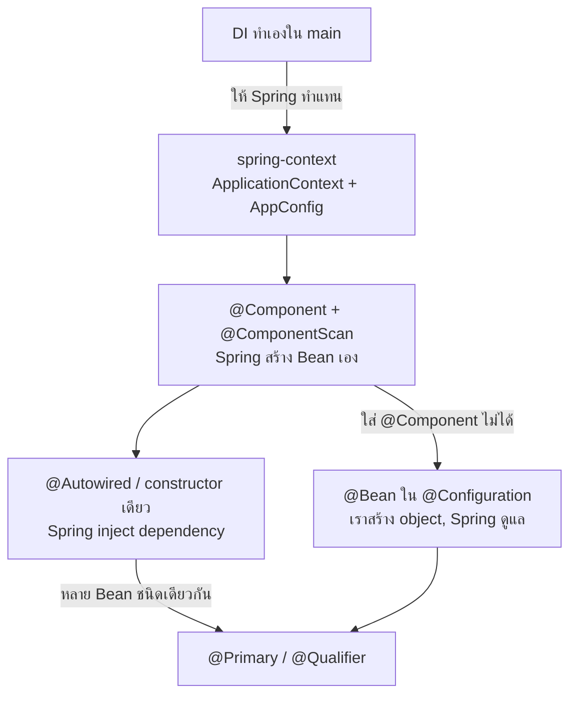

# #5 — Spring IoC Container: Bean, @Component, @Autowired และ @Bean

> **วิดีโอ:** [Spring IOC Container | Beans, @Component, @Autowired & @Bean | Spring Boot Full Course #5](https://youtu.be/Az9tIgCdaRU) — Coder Army, ~1 ชั่วโมง 34 นาที
> **แหล่งที่ใช้สรุป:** ซับไตเติลภาษาฮินดีที่ YouTube สร้างอัตโนมัติ
> **เวอร์ชันในโค้ด:** Spring Boot 4.1 + Java 21 (ใช้ BOM ของ Boot 4.1.1 จึงได้ `spring-context` 7.0.9 ใส่หมายเหตุไว้ทุกจุดที่ Spring Boot 3.x ต่างกัน)

ตอนที่แล้วเราทำ Dependency Injection เองใน `main` ตอนนี้ตอบคำถามต่อว่า **ถ้าให้ Spring ทำงานนั้นแทน ข้างในเกิดอะไรขึ้น** ผู้สอนเริ่มจากโปรเจกต์ Maven เปล่าที่มีแค่ `spring-context` (ยังไม่ใช้ Spring Boot) แล้วไล่ทีละขั้น: บอก Spring ว่า class ไหนเป็น Bean ด้วย `@Component`, เปิด IoC Container ด้วย `ApplicationContext`, ให้ Spring ฉีด dependency ด้วย `@Autowired`, เลือก Bean ด้วย `@Primary`/`@Qualifier` เมื่อมีหลายตัว และใช้ `@Bean` เมื่อใส่ `@Component` ไม่ได้

ส่วนที่ติดป้าย `💡 เพิ่มเติม` คือของที่ผมเติมเอง ไม่ได้อยู่ในวิดีโอ ส่วนที่ติด `⚠️ แก้จากวิดีโอ` คือจุดที่วิดีโอพูดคลาดเคลื่อน

โค้ดทุกชิ้นในไฟล์นี้ compile และรันจริงแล้ว output ที่แสดงคือผลจากการรันจริง กรณีที่ตั้งใจให้ error ก็รันจริงเช่นกัน (stack trace ถูกตัดให้สั้นลง)

---

## สารบัญ

| เวลา | หัวข้อ |
|---|---|
| [0:00](https://youtu.be/Az9tIgCdaRU?t=0) | [1. ภาพรวมตอนและโปรเจกต์ตั้งต้น](#1-ภาพรวมตอนและโปรเจกต์ตั้งต้น) |
| [1:11](https://youtu.be/Az9tIgCdaRU?t=71) | [2. ทบทวน Dependency Injection แบบทำเอง](#2-ทบทวน-dependency-injection-แบบทำเอง) |
| [6:45](https://youtu.be/Az9tIgCdaRU?t=405) | [3. เพิ่ม dependency spring-context](#3-เพิ่ม-dependency-spring-context) |
| [9:29](https://youtu.be/Az9tIgCdaRU?t=569) | [4. IoC Container และ Bean](#4-ioc-container-และ-bean) |
| [10:56](https://youtu.be/Az9tIgCdaRU?t=656) | [5. Reflection API และ class Class](#5-reflection-api-และ-class-class) |
| [15:22](https://youtu.be/Az9tIgCdaRU?t=922) | [6. ประกาศ Bean ด้วย @Component](#6-ประกาศ-bean-ด้วย-component) |
| [16:31](https://youtu.be/Az9tIgCdaRU?t=991) | [7. ApplicationContext และ Configuration Class](#7-applicationcontext-และ-configuration-class) |
| [22:14](https://youtu.be/Az9tIgCdaRU?t=1334) | [8. ดึง Bean ด้วย getBean](#8-ดึง-bean-ด้วย-getbean) |
| [24:52](https://youtu.be/Az9tIgCdaRU?t=1492) | [9. เจาะลึก @ComponentScan](#9-เจาะลึก-componentscan) |
| [27:32](https://youtu.be/Az9tIgCdaRU?t=1652) | [10. ให้ Spring ฉีด dependency ด้วย @Autowired](#10-ให้-spring-ฉีด-dependency-ด้วย-autowired) |
| [31:44](https://youtu.be/Az9tIgCdaRU?t=1904) | [11. Setter injection และ Field injection](#11-setter-injection-และ-field-injection) |
| [35:36](https://youtu.be/Az9tIgCdaRU?t=2136) | [12. ทำไมแนะนำ Constructor injection](#12-ทำไมแนะนำ-constructor-injection) |
| [39:15](https://youtu.be/Az9tIgCdaRU?t=2355) | [13. ขั้นตอนภายในของ ApplicationContext](#13-ขั้นตอนภายในของ-applicationcontext) |
| [48:01](https://youtu.be/Az9tIgCdaRU?t=2881) | [14. เมื่อหา Bean ไม่เจอ](#14-เมื่อหา-bean-ไม่เจอ) |
| [49:24](https://youtu.be/Az9tIgCdaRU?t=2964) | [15. Interface กับหลาย implementation](#15-interface-กับหลาย-implementation) |
| [57:06](https://youtu.be/Az9tIgCdaRU?t=3426) | [16. เลือก Bean ด้วย @Primary](#16-เลือก-bean-ด้วย-primary) |
| [58:15](https://youtu.be/Az9tIgCdaRU?t=3495) | [17. เลือก Bean ด้วย @Qualifier](#17-เลือก-bean-ด้วย-qualifier) |
| [1:00:51](https://youtu.be/Az9tIgCdaRU?t=3651) | [18. ข้อจำกัดที่ 1 constructor ที่ต้องการค่า](#18-ข้อจำกัดที่-1-constructor-ที่ต้องการค่า) |
| [1:03:49](https://youtu.be/Az9tIgCdaRU?t=3829) | [19. ข้อจำกัดที่ 2 class จาก jar ภายนอก](#19-ข้อจำกัดที่-2-class-จาก-jar-ภายนอก) |
| [1:11:06](https://youtu.be/Az9tIgCdaRU?t=4266) | [20. สร้าง Bean เองด้วย @Bean](#20-สร้าง-bean-เองด้วย-bean) |
| [1:16:22](https://youtu.be/Az9tIgCdaRU?t=4582) | [21. ย้ายทุก Bean มาไว้ใน @Bean](#21-ย้ายทุก-bean-มาไว้ใน-bean) |
| [1:22:48](https://youtu.be/Az9tIgCdaRU?t=4968) | [22. @Bean กับ setter injection](#22-bean-กับ-setter-injection) |
| [1:27:14](https://youtu.be/Az9tIgCdaRU?t=5234) | [23. หลาย @Bean ชนิดเดียวกัน](#23-หลาย-bean-ชนิดเดียวกัน) |
| [1:30:33](https://youtu.be/Az9tIgCdaRU?t=5433) | [24. ใส่ทั้ง @Component และ @Bean](#24-ใส่ทั้ง-component-และ-bean) |
| [1:31:46](https://youtu.be/Az9tIgCdaRU?t=5506) | [25. ทำไมต้องแยก AppConfig](#25-ทำไมต้องแยก-appconfig) |
| [1:33:05](https://youtu.be/Az9tIgCdaRU?t=5585) | [26. BeanFactory กับ ApplicationContext](#26-beanfactory-กับ-applicationcontext) |
| — | [27. สรุปท้ายตอน](#27-สรุปท้ายตอน) |

---

## 1. ภาพรวมตอนและโปรเจกต์ตั้งต้น

[▶ 0:00](https://youtu.be/Az9tIgCdaRU?t=0)

ตอนนี้ว่าด้วย **Spring Core**: Dependency Injection, Inversion of Control และ Bean ตอนที่แล้วดูสองเรื่องแรกในฐานะหลักการโดยไม่ใช้ framework ตอนนี้จะดูว่า Spring Core implement มันอย่างไร IoC Container คืออะไร และ Bean คืออะไร ผู้สอนย้ำว่าตอนนี้สำคัญมากสำหรับการเข้าใจสถาปัตยกรรมของ Spring ทั้งหมด เพราะทั้ง framework วางอยู่บน Spring Core

[▶ 0:39](https://youtu.be/Az9tIgCdaRU?t=39) สร้างโปรเจกต์ใหม่ใน IntelliJ

- ชื่อ `spring-core-demo`, build tool เป็น Maven, ในวิดีโอเลือก JDK 23
- package (domain) คือ `in.coderarmy`
- ลบ boilerplate ที่ IDE สร้างให้ออก `pom.xml` ยังว่าง ไม่มี dependency อะไร

> 💡 **เพิ่มเติม:** โค้ดในไฟล์นี้ใช้ Java 21 (LTS) แทน JDK 23 ไม่มีส่วนไหนที่ต้องใช้ฟีเจอร์ของ 23

---

## 2. ทบทวน Dependency Injection แบบทำเอง

[▶ 1:11](https://youtu.be/Az9tIgCdaRU?t=71)

ตัวอย่างคือเว็บ e-commerce ที่ต้องจ่ายเงินก่อนจึงจะสั่งของได้ ตอนที่แล้วใช้ `NotificationService` ตอนนี้เปลี่ยนเป็น `PaymentService`

- `OrderService` มี method `placeOrder()` พิมพ์ `Order placed`
- `PaymentService` มี method `pay()` พิมพ์ `Payment done` (จำลองว่ามีงานจริงเกิดขึ้นข้างใน)
- `Main` เป็นคนเรียก class เหล่านี้

### ปัญหาของการ hardcode

[▶ 3:23](https://youtu.be/Az9tIgCdaRU?t=203)

ถ้าอยากให้จ่ายเงินก่อนสั่งของ `OrderService` ต้องมี field ชนิด `PaymentService` แล้วเรียก `paymentService.pay()` แต่ถ้าไม่ได้ใส่ object ให้ field นั้น ก็เรียก method ไม่ได้

ทางแรกคือสร้างในตัวเลย `private PaymentService paymentService = new PaymentService();` ผลลัพธ์ถูกต้อง แต่ผู้สอนบอกว่ามันผิดหลายกฎ ข้อแรกคือ **Single Responsibility Principle**: งานของ `OrderService` คือจัดการ order อย่างเดียว ไม่ควรเป็นคนสร้าง object ของ `PaymentService`

`OrderService` **depend** on `PaymentService` เพราะ `placeOrder` ทำงานไม่ได้จนกว่าจะเรียก `pay` ได้ dependency นี้ควรถูกส่งมาจากข้างนอก

### ส่ง dependency ผ่าน constructor

[▶ 4:14](https://youtu.be/Az9tIgCdaRU?t=254)

```java
package in.coderarmy;

public class PaymentService {

  public void pay() {
    System.out.println("Payment done");
  }
}
```

```java
package in.coderarmy;

public class OrderService {

  private PaymentService paymentService;

  public OrderService(PaymentService paymentService) {
    this.paymentService = paymentService;
  }

  public void placeOrder() {
    paymentService.pay();
    System.out.println("Order placed");
  }
}
```

```java
package in.coderarmy;

public class Main {

  public static void main(String[] args) {
    PaymentService service = new PaymentService();
    OrderService order = new OrderService(service);
    order.placeOrder();
  }
}
```

```text
Payment done
Order placed
```

นี่คือ Dependency Injection: dependency ของ `OrderService` ถูก **inject** มาจากข้างนอก คือจาก `main`

### อยากให้ Spring ทำงานนี้แทน

[▶ 5:22](https://youtu.be/Az9tIgCdaRU?t=322)

ตอนนี้ `main` ทำสามอย่าง คือสร้าง `PaymentService`, สร้าง `OrderService` และ **wire** object แรกเข้าไปในตัวที่สอง ผู้สอนอยากให้ Spring ทำงานทั้งหมดนี้แทน Spring Core มีคอนเทนเนอร์ชื่อ **IoC Container** (Inversion of Control Container) ที่ดูแล object ทั้งหมด: สร้าง `PaymentService` เอง สร้าง `OrderService` เอง แล้ว wire `PaymentService` เข้าไปใน `OrderService` ให้เอง

---

## 3. เพิ่ม dependency spring-context

[▶ 6:45](https://youtu.be/Az9tIgCdaRU?t=405)

จะให้ Spring ดูแล object ต้องมี dependency อะไรสักตัว ผู้สอนไล่ตัดตัวเลือก

- **Spring Boot?** ไม่ต้อง Boot มีไว้ตั้งค่าอัตโนมัติให้ง่ายขึ้น
- **Spring MVC?** ไม่ต้อง ตอนนี้ไม่ได้ทำเว็บ เป็นแอป console
- **คำตอบ:** ใช้แค่ `spring-context` ซึ่งเป็น dependency พื้นฐานของ Spring Core ที่ให้ IoC Container สำหรับดูแล object

[▶ 7:31](https://youtu.be/Az9tIgCdaRU?t=451) ค้นหา `spring-context` ใน [mvnrepository.com](https://mvnrepository.com)

- [▶ 7:50](https://youtu.be/Az9tIgCdaRU?t=470) ซีรีส์นี้ใช้ Spring Boot 4 ซึ่งทำงานคู่กับ **Spring Framework 7** จึงเลือกเวอร์ชัน 7.x
- ผู้สอนเลือกเวอร์ชันรองล่าสุด (ไม่เอาตัวล่าสุด) โดยให้เหตุผลว่าตัวใหม่สุดอาจมีช่องโหว่ และบอกว่าเป็นแค่ good practice ถ้าแค่ฝึกจะใช้ตัวล่าสุดก็ไม่เสียหาย
- copy `<dependency>` มาวางใน `<dependencies>` ของ `pom.xml` แล้วต้องกด **reload** Maven ก่อน dependency จึงจะถูกดาวน์โหลด

> 💡 **เพิ่มเติม — เรื่องเลือกเวอร์ชัน:** ในทางปฏิบัติ patch release ที่ออกล่าสุดมักเป็นตัวที่ **ปิด** ช่องโหว่ ไม่ได้เพิ่มช่องโหว่ ที่ควรระวังมากกว่าคือ major/minor release ที่เพิ่งออก (`.0`) ถ้าใช้ parent ของ Spring Boot ก็ไม่ต้องเลือกเวอร์ชันเอง ใส่แค่ `groupId`/`artifactId` แล้ว BOM ของ Boot จะเลือกเวอร์ชันที่ทดสอบร่วมกันแล้วให้

`pom.xml` (เฉพาะส่วนสำคัญ) ในวิดีโอใส่ `<version>` ของ `spring-context` ตรง ๆ ส่วนโค้ดในไฟล์นี้ให้ BOM ของ Boot 4.1.1 เลือกเวอร์ชัน

```xml
<parent>
  <groupId>org.springframework.boot</groupId>
  <artifactId>spring-boot-starter-parent</artifactId>
  <version>4.1.1</version>
  <relativePath/>
</parent>

<groupId>in.coderarmy</groupId>
<artifactId>spring-core-demo</artifactId>
<version>1.0-SNAPSHOT</version>

<properties>
  <java.version>21</java.version>
</properties>

<dependencies>
  <dependency>
    <groupId>org.springframework</groupId>
    <artifactId>spring-context</artifactId>
  </dependency>
</dependencies>
```

### Transitive dependencies

[▶ 9:12](https://youtu.be/Az9tIgCdaRU?t=552)

หลัง reload จะเห็น jar โผล่มาหลายตัว (commons-logging, micrometer, jspecify, spring-aop, spring-beans, spring-core ฯลฯ) ทั้งที่ใส่ไปตัวเดียว เพราะ `spring-context` เองต้องใช้ตัวอื่นต่อ เรียกว่า **transitive dependencies** ดูได้ในแท็บ Maven ของ IntelliJ หรือใช้ `mvn dependency:tree`

```text
+- org.springframework:spring-context:jar:7.0.9:compile
|  +- org.springframework:spring-aop:jar:7.0.9:compile
|  +- org.springframework:spring-beans:jar:7.0.9:compile
|  +- org.springframework:spring-core:jar:7.0.9:compile
|  |  +- commons-logging:commons-logging:jar:1.3.6:compile
|  |  \- org.jspecify:jspecify:jar:1.0.1:compile
|  +- org.springframework:spring-expression:jar:7.0.9:compile
|  \- io.micrometer:micrometer-observation:jar:1.17.1:compile
|     \- io.micrometer:micrometer-commons:jar:1.17.1:compile
```

> ⚠️ **Boot 4 vs 3:** Boot 3.x ใช้ Spring Framework 6.x (Boot 3.5 คู่กับ 6.2) ถ้าใส่ `spring-context` เองต้องใช้เวอร์ชัน 6.x และ tree จะต่างไปเล็กน้อย: Spring 6.2 ใช้ `spring-jcl` (Commons Logging ฉบับของ Spring) และไม่มี `jspecify` ส่วน Spring 7 ถอด `spring-jcl` ออกไปใช้ Apache Commons Logging 1.3 ตรง ๆ และใช้ JSpecify กำกับ nullability ของ API (ตรวจจาก pom ของ `spring-core` 6.2.19 กับ 7.0.9)
> ([Spring Framework 7.0 Release Notes](https://github.com/spring-projects/spring-framework/wiki/Spring-Framework-7.0-Release-Notes))

---

## 4. IoC Container และ Bean

[▶ 9:29](https://youtu.be/Az9tIgCdaRU?t=569)

IoC Container ใน Spring จะ **manage** object ของเรา ซึ่งแปลว่า

- **สร้าง** object
- **wire / inject** dependency เข้าไปใน object
- รับผิดชอบ **lifecycle** ทั้งหมดของ object นั้น

### Bean

[▶ 9:46](https://youtu.be/Az9tIgCdaRU?t=586)

ใน Spring เราเรียก object ที่อยู่ใน IoC Container ว่า **Bean**

> "ทุก Bean เป็น object แต่ไม่ใช่ทุก object ที่เป็น Bean"

object ที่เราจัดการเองด้วย `new` ไม่ใช่ Bean ส่วน object ที่ Spring จัดการให้คือ Bean เช่น `PaymentService`, `OrderService` และ service อื่นที่จะสร้างต่อไป



### วิธีบอก Spring ว่าให้ดูแลอะไร มีสองแบบ

[▶ 10:19](https://youtu.be/Az9tIgCdaRU?t=619)

| แบบ | ลักษณะ |
|---|---|
| **Annotation-based** | ใส่ annotation บน class/method โปรแกรมใหม่ส่วนใหญ่ใช้แบบนี้ |
| **XML configuration** | เขียน Bean ไว้ในไฟล์ XML แบบเก่า เจอบ่อยใน legacy code ซับซ้อนกว่า |

ตอนนี้ใช้ annotation-based ทั้งหมด แบบ XML จะดูทีหลัง (ใน playlist คือตอน #8)

---

## 5. Reflection API และ class Class

[▶ 10:56](https://youtu.be/Az9tIgCdaRU?t=656)

ก่อนไปต่อ ผู้สอนแวะเรื่อง **Reflection API** ของ Java เพราะ Spring ใช้มันเยอะมาก (บอกว่าจะทำคลิปเจาะลึกแยกอีกที)

ตัวอย่างคือ class `Student` ที่มีข้อมูล `name`, `age`, constructor เปล่าหนึ่งตัว และ method `getAttendance()` กับ `print()` ที่ยังไม่มีเนื้อหา

- `Student s1 = new Student();` หมายถึง `s1` เป็น reference variable ที่ชี้ไปยัง object ของ `Student`
- [▶ 12:37](https://youtu.be/Az9tIgCdaRU?t=757) Java มี class พิเศษชื่อ `Class` (คล้ายกับที่มี class ชื่อ `Object`) ซึ่งเก็บ **metadata** ของ class ใดก็ได้ และใช้ generics
- `Class<Student> c1 = Student.class;` แปลว่า `c1` **ไม่ใช่** object ของ `Student` เรียก `c1.name` ไม่ได้ แต่ `c1` เก็บ metadata ของ class `Student` ไว้ทั้งหมด ได้แก่ ชื่อ class, field แต่ละตัวพร้อมชนิดข้อมูล, constructor, method, member ไหน private หรือ public และ **annotation** ที่ติดอยู่บน class

ทำไมเรื่องนี้สำคัญ: ถ้า Spring จะสร้างและดูแล object เอง มันต้องรู้ metadata ของ class นั้น และ metadata นั้นได้มาจาก Reflection API

> 💡 **เพิ่มเติม:** ในวิดีโอเขียนแค่ `Class<Student> c1 = Student.class;` แล้วอธิบายด้วยคำพูด โค้ดด้านล่างพิมพ์ metadata ออกมาจริง และสร้าง object จาก metadata โดยไม่ต้องเขียน `new Student()` ในโค้ด ซึ่งเป็นสิ่งที่ Spring ทำกับ class ของเรา

```java
package in.coderarmy;

public class Student {

  private String name;
  private int age;

  public Student() {
  }

  public void getAttendance() {
  }

  public void print() {
  }
}
```

```java
package in.coderarmy;

import java.lang.reflect.Constructor;
import java.lang.reflect.Field;
import java.lang.reflect.Method;

public class Main {

  public static void main(String[] args) throws Exception {
    Student s1 = new Student();          // s1 คือ reference ไปยัง object ของ Student
    Class<Student> c1 = Student.class;   // c1 คือ metadata ของ class Student ไม่ใช่ object ของ Student

    System.out.println("Class: " + c1.getName());
    for (Field f : c1.getDeclaredFields()) {
      System.out.println("Field: " + f.getType().getSimpleName() + " " + f.getName());
    }
    for (Constructor<?> c : c1.getDeclaredConstructors()) {
      System.out.println("Constructor: " + c);
    }
    for (Method m : c1.getDeclaredMethods()) {
      System.out.println("Method: " + m.getName());
    }

    Student s2 = c1.getDeclaredConstructor().newInstance();   // สร้าง object จาก metadata โดยไม่เขียน new Student()
    System.out.println("Created by reflection: " + s2.getClass().getSimpleName()
        + ", same object as s1? " + (s1 == s2));
  }
}
```

```text
Class: in.coderarmy.Student
Field: String name
Field: int age
Constructor: public in.coderarmy.Student()
Method: print
Method: getAttendance
Created by reflection: Student, same object as s1? false
```

ลำดับ method ที่ `getDeclaredMethods()` คืนมาไม่รับประกันว่าจะตรงกับลำดับในไฟล์

---

## 6. ประกาศ Bean ด้วย @Component

[▶ 15:22](https://youtu.be/Az9tIgCdaRU?t=922)

กลับมาที่ `OrderService` กับ `PaymentService` ขั้นแรกต้องบอก Spring ว่าอยากให้ดูแล class ไหน วิธีที่ผู้สอนบอกว่าน่าสนใจที่สุดคือใส่ `@Component` บน class

- [▶ 15:53](https://youtu.be/Az9tIgCdaRU?t=953) `@Component` บอก Spring ว่า "object ของ class นี้ให้คุณดูแล" Spring จะสร้าง object (ซึ่งมันเรียกว่า Bean) และจัดการเอง
- มันทำหน้าที่เป็น **marker** ให้ Spring รู้ว่า class นี้อยู่ในความดูแลของมัน
- ใส่ทั้งบน `OrderService` และ `PaymentService`

แต่แค่นี้ยังไม่พอ ยังต้องเปิด IoC Container ขึ้นมาด้วย

---

## 7. ApplicationContext และ Configuration Class

[▶ 16:31](https://youtu.be/Az9tIgCdaRU?t=991)

ใน Spring เรียก IoC Container ว่า `ApplicationContext`

- `ApplicationContext` เป็น **interface** มี method หลายตัวและ extend interface อื่นต่อ (ตอนนี้ยังไม่ต้องรู้รายละเอียด)
- `new ApplicationContext()` ไม่ได้เพราะเป็น interface ต้องใช้ implementation ตัวใดตัวหนึ่ง IoC Container จึง implement ได้หลายแบบใน Java

[▶ 17:35](https://youtu.be/Az9tIgCdaRU?t=1055) โปรเจกต์นี้ใช้แบบ annotation จึงใช้ `AnnotationConfigApplicationContext` บรรทัดนี้หมายถึง "สตาร์ท Spring container โดยใช้ configuration แบบ annotation"

แต่จะสตาร์ท container ไม่ได้จนกว่าจะบอก **กฎ** ทั้งหมดให้มันรู้ เช่น configure อย่างไร, ต้องดู class ไหน, ดูอย่างไร กฎเหล่านี้เขียนไว้ใน **class แยก** แล้วส่ง reflection (metadata) ของ class นั้นเข้าไปใน constructor ของ `ApplicationContext`

### AppConfig

[▶ 18:19](https://youtu.be/Az9tIgCdaRU?t=1099)

สร้าง class `AppConfig` ไว้เก็บ configuration ว่าจะสร้างและดูแล object อย่างไร ผู้สอนบอกว่าตอนแรกอาจรู้สึกว่าต้องสร้างอะไรเยอะ แต่จะชินไปเอง และพอถึง Spring Boot ก็ไม่ต้องทำเองแล้ว

- `@Configuration` บอก Spring ว่า class นี้เป็น **configuration class** ไม่ใช่ class ธรรมดา
- [▶ 19:35](https://youtu.be/Az9tIgCdaRU?t=1175) `@ComponentScan("in.coderarmy")` บอกว่า "ไปทั่วโปรเจกต์ใน package นี้ ดูว่า class ไหนมี `@Component` แล้ว class เหล่านั้นเป็นของคุณ สร้าง Bean และดูแลมัน"
- ใน class ยังไม่ต้องเขียนอะไร (จะกลับมาเติมใน [ส่วนที่ 20](#20-สร้าง-bean-เองด้วย-bean))

```java
package in.coderarmy;

import org.springframework.context.annotation.ComponentScan;
import org.springframework.context.annotation.Configuration;

@Configuration
@ComponentScan("in.coderarmy")
public class AppConfig {
}
```

[▶ 21:01](https://youtu.be/Az9tIgCdaRU?t=1261) ส่ง `AppConfig.class` เข้าไปใน `ApplicationContext` ทั้งบรรทัดจึงแปลว่า "สตาร์ท IoC Container แบบ annotation โดยอ่านกฎจาก class `AppConfig`" container จะอ่าน metadata ของ `AppConfig` เห็นว่ามี `@Configuration` (เป็น configuration class) และ `@ComponentScan` (ต้อง scan package นี้แล้วดูแลทุก class ที่มี `@Component`)

> 💡 **เพิ่มเติม —** `@Component` **มีพี่น้อง:** Spring มี **stereotype annotation** อีกหลายตัวที่ข้างในติด `@Component` อยู่แล้ว จึงถูก scan เหมือนกัน แต่บอกบทบาทของ class ชัดกว่า
>
> | Annotation | ใช้กับ |
> |---|---|
> | `@Service` | business logic |
> | `@Repository` | data access (Spring แปลง exception ของ database ให้ด้วย) |
> | `@Controller` / `@RestController` | web layer ของ Spring MVC |
>
> ผู้สอนบอกที่ [▶ 25:58](https://youtu.be/Az9tIgCdaRU?t=1558) ว่ามี annotation อื่นนอกจาก `@Component` ที่จะเห็นทีหลัง

> 💡 **เพิ่มเติม — ใน Spring Boot:** `@SpringBootApplication` ที่เห็นในตอน #2 รวม `@Configuration` (ผ่าน `@SpringBootConfiguration`) กับ `@ComponentScan` ไว้แล้ว และ `SpringApplication.run(...)` ก็สร้าง `ApplicationContext` ให้ งานทั้งหมดในส่วนนี้ Boot ทำแทนเราอยู่เบื้องหลัง (รายละเอียดในตอน #9)

---

## 8. ดึง Bean ด้วย getBean

[▶ 22:14](https://youtu.be/Az9tIgCdaRU?t=1334)

เพื่อให้เห็นการสร้าง Bean ชัด ๆ ผู้สอนลบ dependency ระหว่างสอง class ออกก่อนชั่วคราว ให้ `OrderService` อิสระ

```java
package in.coderarmy;

import org.springframework.stereotype.Component;

@Component
public class OrderService {

  public void placeOrder() {
    System.out.println("Order placed");
  }
}
```

```java
package in.coderarmy;

import org.springframework.stereotype.Component;

@Component
public class PaymentService {

  public void pay() {
    System.out.println("Payment done");
  }
}
```

เมื่อบรรทัด `new AnnotationConfigApplicationContext(AppConfig.class)` ทำงานเสร็จ container ก็ขึ้นมาแล้ว อ่านกฎจาก `AppConfig` แล้ว scan เจอสอง class ที่มี `@Component` และสร้าง Bean ของทั้งสองไว้แล้ว

[▶ 23:43](https://youtu.be/Az9tIgCdaRU?t=1423) ถ้าจะใช้ `OrderService` ไม่ต้อง `new` อีก เพราะเราไม่ได้อยากสร้าง แค่อยากใช้ เรียก `context.getBean(OrderService.class)` ซึ่งใช้ reflection อีกเช่นกัน: ส่ง metadata ของ class ไป แล้วขอ Bean ของ class นั้นกลับมา

```java
package in.coderarmy;

import org.springframework.context.ApplicationContext;
import org.springframework.context.annotation.AnnotationConfigApplicationContext;

public class Main {

  public static void main(String[] args) {
    // IoC Container
    ApplicationContext context = new AnnotationConfigApplicationContext(AppConfig.class);

    OrderService order = context.getBean(OrderService.class);
    order.placeOrder();

    PaymentService payment = context.getBean(PaymentService.class);
    payment.pay();
  }
}
```

```text
Order placed
Payment done
```

ทั้งสองบรรทัดพิมพ์ออกมา แปลว่า `ApplicationContext` ขึ้นมาและทำงานถูกต้อง

---

## 9. เจาะลึก @ComponentScan

[▶ 24:52](https://youtu.be/Az9tIgCdaRU?t=1492)

### Scan รวม subpackage ด้วย

[▶ 25:19](https://youtu.be/Az9tIgCdaRU?t=1519)

package ที่ระบุไม่ได้หมายถึง package นั้นอย่างเดียว Spring จะ scan **ทุก subpackage** ข้างในด้วย เช่น ถ้าสร้าง `in.coderarmy.random.random2` ก็อยู่ในขอบเขต scan ไม่ว่าจะซ้อนลึกแค่ไหน

### ไม่มี @Component ก็ไม่มี Bean

[▶ 26:06](https://youtu.be/Az9tIgCdaRU?t=1566)

ลองเอา `@Component` ออกจาก `PaymentService` บรรทัดของ `OrderService` ยังทำงาน แต่ `getBean(PaymentService.class)` พัง เพราะ Spring ไม่ได้รับอนุญาตให้ดูแล class นั้น

```java
package in.coderarmy;

// ไม่มี @Component
public class PaymentService {

  public void pay() {
    System.out.println("Payment done");
  }
}
```

```text
Order placed
Exception in thread "main" org.springframework.beans.factory.NoSuchBeanDefinitionException: No qualifying bean of type 'in.coderarmy.PaymentService' available
	at org.springframework.beans.factory.support.DefaultListableBeanFactory.getBean(DefaultListableBeanFactory.java:386)
	...
	at in.coderarmy.Main.main(Main.java:15)
```

### ไม่ระบุ package ก็ได้

[▶ 26:44](https://youtu.be/Az9tIgCdaRU?t=1604)

เขียน `@ComponentScan` เปล่า ๆ ก็ได้ ไม่ error ถ้าไม่ระบุ package มันจะ scan **package ที่** `AppConfig` **อยู่** ซึ่งในโปรเจกต์นี้ทุกไฟล์อยู่ใน `in.coderarmy` เหมือนกัน ผลจึงเหมือนเดิม

```java
package in.coderarmy;

import org.springframework.context.annotation.ComponentScan;
import org.springframework.context.annotation.Configuration;

@Configuration
@ComponentScan   // ไม่ระบุ package: scan package ของ AppConfig (in.coderarmy) และ subpackage
public class AppConfig {
}
```

```text
Order placed
Payment done
```

[▶ 27:11](https://youtu.be/Az9tIgCdaRU?t=1631) แต่ถ้ามี package ที่อยู่ **นอก** `in.coderarmy` (เช่นสร้าง `random` ไว้ข้างนอก) package นั้นจะไม่ถูก scan ถ้าอยากให้ scan ต้องระบุ package แม่ที่ครอบทั้งสองไว้

---

## 10. ให้ Spring ฉีด dependency ด้วย @Autowired

[▶ 27:32](https://youtu.be/Az9tIgCdaRU?t=1652)

ถึงตอนนี้ container **สร้าง** object ได้แล้ว คำถามต่อไปคือมันจะ **inject** dependency อย่างไร

ใส่ dependency กลับเข้าไปใน `OrderService` ให้รับ `PaymentService` ผ่าน constructor เหมือนเดิม container มี Bean ของทั้งสองอยู่แล้ว และ constructor ของ `OrderService` ต้องการ object ของ `PaymentService` ดังนั้นตอนที่ Spring เรียก constructor นี้ มันก็ส่ง Bean ที่มีอยู่เข้าไปได้ เหมือนที่ `main` เคยทำเอง

[▶ 28:53](https://youtu.be/Az9tIgCdaRU?t=1733) วิธีบอก Spring คือใส่ `@Autowired` ชื่อก็บอกว่า "wire ให้อัตโนมัติ" ในตัวอย่างนี้ใส่บน constructor (ใส่ที่อื่นได้ด้วย ดูส่วนถัดไป)

```java
package in.coderarmy;

import org.springframework.beans.factory.annotation.Autowired;
import org.springframework.stereotype.Component;

@Component
public class OrderService {

  private PaymentService paymentService;

  @Autowired
  public OrderService(PaymentService paymentService) {
    this.paymentService = paymentService;
  }

  public void placeOrder() {
    paymentService.pay();
    System.out.println("Order placed");
  }
}
```

`PaymentService` กลับมามี `@Component` และ `main` ดึงแค่ `OrderService`

```java
package in.coderarmy;

import org.springframework.context.ApplicationContext;
import org.springframework.context.annotation.AnnotationConfigApplicationContext;

public class Main {

  public static void main(String[] args) {
    ApplicationContext context = new AnnotationConfigApplicationContext(AppConfig.class);

    OrderService order = context.getBean(OrderService.class);
    order.placeOrder();
  }
}
```

```text
Payment done
Order placed
```

### Flow ที่เกิดขึ้น

[▶ 29:58](https://youtu.be/Az9tIgCdaRU?t=1798)

constructor ถูกเรียกเมื่อสร้าง object และคนสร้าง object คือ IoC Container ดังนั้นตอนสร้าง `OrderService` container ก็ส่ง `PaymentService` ที่สร้างไว้ก่อนแล้วเข้าไป ผู้สอนให้สมมติไปก่อนว่า `PaymentService` ถูกสร้างก่อน (ทำไมถึงเป็นแบบนั้นจะดูทีหลัง)



---

## 11. Setter injection และ Field injection

[▶ 31:44](https://youtu.be/Az9tIgCdaRU?t=1904)

Dependency Injection มีสามแบบ

| แบบ | inject ผ่าน |
|---|---|
| Constructor injection | constructor (แบบที่เพิ่งทำ) |
| Setter injection | setter method |
| Field injection | field โดยตรง (Java ธรรมดาทำไม่ได้ แต่ Spring ทำได้ ตอนที่แล้วจึงไม่ได้พูดถึง) |

### Setter injection

[▶ 32:19](https://youtu.be/Az9tIgCdaRU?t=1939)

ลบ constructor ออก แล้วสร้าง setter (IntelliJ: Generate → Setter) ใส่ `@Autowired` บน setter

```java
package in.coderarmy;

import org.springframework.beans.factory.annotation.Autowired;
import org.springframework.stereotype.Component;

@Component
public class OrderService {

  private PaymentService paymentService;

  @Autowired
  public void setPaymentService(PaymentService paymentService) {
    this.paymentService = paymentService;
  }

  public void placeOrder() {
    paymentService.pay();
    System.out.println("Order placed");
  }
}
```

```text
Payment done
Order placed
```

ต่างจาก constructor ตรงที่ setter ไม่ได้ถูกเรียกตอนสร้าง object ลำดับคือ สร้าง `PaymentService` และ `OrderService` ให้เสร็จก่อน แล้ว Spring จึงเรียก setter ที่มี `@Autowired` เพื่อเชื่อมสองตัวเข้าด้วยกัน ก่อนที่ `main` จะได้ใช้ setter ก็ถูกเรียกไปแล้ว

### Field injection

[▶ 33:42](https://youtu.be/Az9tIgCdaRU?t=2022)

ไม่ใช้ทั้ง constructor และ setter ใส่ `@Autowired` บน field ตรง ๆ

```java
package in.coderarmy;

import org.springframework.beans.factory.annotation.Autowired;
import org.springframework.stereotype.Component;

@Component
public class OrderService {

  @Autowired
  private PaymentService paymentService;   // IntelliJ เตือน: Field injection is not recommended

  public void placeOrder() {
    paymentService.pay();
    System.out.println("Order placed");
  }
}
```

```text
Payment done
Order placed
```

[▶ 34:01](https://youtu.be/Az9tIgCdaRU?t=2041) ทำงานได้ แต่ IntelliJ ขึ้นคำเตือน **"Field injection is not recommended"** แบบที่แนะนำที่สุดคือ **constructor injection** เหตุผลข้อแรกคือ constructor ถูกเรียกตอนที่ object กำลังถูกสร้าง dependency จึงถูก wire พร้อมกับการสร้าง object ไม่ใช่สร้างเสร็จก่อนแล้วค่อยมาเชื่อม

### Constructor เดียวไม่ต้องใส่ @Autowired

[▶ 34:40](https://youtu.be/Az9tIgCdaRU?t=2080)

ใน Spring สมัยใหม่ ถ้า class มี **constructor ตัวเดียว** ไม่ต้องใส่ `@Autowired` ก็ได้ Spring รู้เองว่าต้องเรียก constructor นั้น และส่ง Bean ที่ constructor ต้องการให้

```java
package in.coderarmy;

import org.springframework.stereotype.Component;

@Component
public class OrderService {

  private final PaymentService paymentService;

  public OrderService(PaymentService paymentService) {
    this.paymentService = paymentService;
  }

  public void placeOrder() {
    paymentService.pay();
    System.out.println("Order placed");
  }
}
```

```text
Payment done
Order placed
```

- ถ้ามี **หลาย constructor** Spring จะสับสนว่าต้องเรียกตัวไหน (ผู้สอนบอกว่าจะดูทีหลัง)
- ถ้าใช้ setter หรือ field injection ผู้สอนบอกว่า **ต้อง** ใส่ `@Autowired` ไม่งั้นจะ error

> ⚠️ **แก้จากวิดีโอ (เล็กน้อย):** ถ้าลืม `@Autowired` บน field หรือ setter Spring **ไม่** error ตอนสตาร์ท มันแค่ไม่ inject อะไร field จึงยังเป็น `null` แล้วจะไปพังเป็น `NullPointerException` ตอนเรียกใช้ ซึ่งหาสาเหตุยากกว่า ทดสอบด้วย field ที่ไม่มีทั้ง `@Autowired` และ constructor (container สตาร์ทได้ปกติ):
>
> ```java
> package in.coderarmy;
>
> import org.springframework.stereotype.Component;
>
> @Component
> public class OrderService {
>
>   private PaymentService paymentService;   // ไม่มี @Autowired และไม่มี constructor
>
>   public void placeOrder() {
>     paymentService.pay();
>     System.out.println("Order placed");
>   }
> }
> ```
>
> ```text
> Exception in thread "main" java.lang.NullPointerException: Cannot invoke "in.coderarmy.PaymentService.pay()" because "this.paymentService" is null
> 	at in.coderarmy.OrderService.placeOrder(OrderService.java:11)
> 	at in.coderarmy.Main.main(Main.java:12)
> ```

---

## 12. ทำไมแนะนำ Constructor injection

[▶ 35:36](https://youtu.be/Az9tIgCdaRU?t=2136)

ผู้สอนสรุปเหตุผลสามข้อ

1. **wire ตอนสร้าง object** dependency ถูกเชื่อมทันทีที่ object ถูกสร้าง
2. [▶ 35:56](https://youtu.be/Az9tIgCdaRU?t=2156) **ใช้** `final` **ได้** ใน Java field ที่เป็น `final` ยัง initialize ใน constructor ได้ จึงประกาศ `private final PaymentService paymentService;` ได้ หลังจากนั้นไม่มีใครเปลี่ยน dependency ได้อีก (โค้ดในส่วนที่ 11 ใช้ `final` แล้ว)
3. [▶ 36:22](https://youtu.be/Az9tIgCdaRU?t=2182) **เขียน unit test ง่าย** สร้าง `OrderService` เองโดยไม่ให้ Spring ดูแล แล้วส่ง `PaymentService` ปลอมเข้าไปทาง constructor ไม่ต้องใช้ตัวจริง (ตอน test เราไม่อยากให้จ่ายเงินจริง)

### เทียบกับ field injection ตอนเขียน test

ถ้าใช้ field injection (`@Autowired` บน field, ไม่มี constructor, ไม่มี setter)

- ใช้ `final` ไม่ได้ เพราะ `@Autowired` หมายถึง inject **ทีหลัง** แต่ field `final` ต้องถูกกำหนดค่าตั้งแต่สร้าง object
- ตอนรันด้วย Spring ทำงานได้ปกติ เพราะ Spring สร้าง object ทั้งคู่แล้วค่อย wire ให้ทีหลัง
- แต่ถ้า unit test โดยไม่มี Spring จะ **ไม่มีทางส่ง** `PaymentService` เข้าไปเลย field เป็น private และไม่มีทั้ง constructor และ setter ถ้า `new OrderService()` แล้วเรียก `placeOrder()` ก็จะได้ `NullPointerException`
- setter injection พอทำได้ แต่ก็ยุ่งกว่า

ผู้สอนบอกว่าจะทำ `PaymentService` ปลอมได้สะดวกถ้าเปลี่ยน `PaymentService` เป็น interface แล้วมี implementation หลายแบบ (UPI, card, fake) เหมือนตอนที่แล้วที่ใช้ `NotificationService`

> 💡 **เพิ่มเติม — test สองแบบเทียบกัน:** ตอนนี้ `PaymentService` ยังเป็น concrete class จึงทำตัวปลอมด้วยการ extend แล้ว override `pay()` ได้ test นี้ไม่ใช้ Spring เลย
>
> ```java
> package in.coderarmy;
>
> import static org.junit.jupiter.api.Assertions.assertTrue;
>
> import org.junit.jupiter.api.Test;
>
> class OrderServiceTest {
>
>   static class FakePaymentService extends PaymentService {
>     boolean called = false;
>
>     @Override
>     public void pay() {
>       called = true;
>       System.out.println("Fake payment (no real money)");
>     }
>   }
>
>   @Test
>   void placeOrderCallsPay() {
>     FakePaymentService fake = new FakePaymentService();
>     OrderService order = new OrderService(fake);   // ไม่ใช้ Spring เลย
>
>     order.placeOrder();
>
>     assertTrue(fake.called);
>   }
> }
> ```
>
> ```text
> Fake payment (no real money)
> [INFO] Tests run: 1, Failures: 0, Errors: 0, Skipped: 0
> ```
>
> ส่วนกับ `OrderService` แบบ field injection ใน [ส่วนที่ 11](#field-injection) ทำได้แค่ยืนยันว่าพัง
>
> ```java
> package in.coderarmy;
>
> import static org.junit.jupiter.api.Assertions.assertThrows;
>
> import org.junit.jupiter.api.Test;
>
> class OrderServiceTest {
>
>   @Test
>   void cannotInjectFakeWithoutSpring() {
>     OrderService order = new OrderService();   // ไม่มี constructor หรือ setter ให้ส่ง fake เข้าไป
>
>     NullPointerException e = assertThrows(NullPointerException.class, order::placeOrder);
>     System.out.println(e.getMessage());
>   }
> }
> ```
>
> ```text
> Cannot invoke "in.coderarmy.PaymentService.pay()" because "this.paymentService" is null
> [INFO] Tests run: 1, Failures: 0, Errors: 0, Skipped: 0
> ```
>
> test ทั้งสองต้องเพิ่ม `org.junit.jupiter:junit-jupiter` (scope `test`) ใน `pom.xml` และรันด้วย `mvn test`

> ⚠️ **Boot 4 vs 3:** BOM ของ Boot 4.1.1 เลือก JUnit **6** (`junit-jupiter` 6.0.3) เพราะ Spring Framework 7 ใช้ JUnit 6 เป็น baseline ส่วน Boot 3.x ใช้ JUnit 5 annotation และ assertion ใน test ข้างบนอยู่ใน package `org.junit.jupiter` เหมือนกันทั้งสองรุ่น จึงใช้ได้ทั้งคู่
> ([Spring Framework 7.0 Release Notes](https://github.com/spring-projects/spring-framework/wiki/Spring-Framework-7.0-Release-Notes))

---

## 13. ขั้นตอนภายในของ ApplicationContext

[▶ 39:15](https://youtu.be/Az9tIgCdaRU?t=2355)

ผู้สอนบอกว่าไม่ต้องรู้ทุก class และทุก method ข้างใน แค่ต้องรู้ **flow** ว่าเบื้องหลังเกิดอะไรขึ้น จะได้มั่นใจตอนเขียนแอปเอง และพอถึง Spring Boot ที่ทำ configuration ให้เกือบหมด ก็จะรู้ว่ามันทำอะไรอยู่

[▶ 40:06](https://youtu.be/Az9tIgCdaRU?t=2406) **Steps for ApplicationContext (IoC Container)**

| Step | เกิดอะไรขึ้น                                                                                                                             |
| ---- | ---------------------------------------------------------------------------------------------------------------------------------------- |
| 1    | เราเขียน `new AnnotationConfigApplicationContext(AppConfig.class)` ทำให้ Spring **สตาร์ท container**                                     |
| 2    | Spring **อ่าน** `AppConfig` ซึ่งเป็น configuration class ที่บอกว่าต้อง scan component ไหนใน package ไหน (และอีกหลายอย่างที่จะเติมทีหลัง) |
| 3    | Spring **ประมวลผล** `@ComponentScan`                                                                                                     |
| 4    | Spring **เจอ class ที่มี** `@Component` เช่น `OrderService`, `PaymentService`                                                            |
| 5    | [▶ 42:13](https://youtu.be/Az9tIgCdaRU?t=2533) Spring **สร้าง BeanDefinition**                                                           |
| 6    | [▶ 44:51](https://youtu.be/Az9tIgCdaRU?t=2691) Spring **เริ่มสร้าง object** และ inject dependency                                        |
| 7    | [▶ 47:17](https://youtu.be/Az9tIgCdaRU?t=2837) **แอปของเราใช้ Bean เหล่านั้น** เช่น `context.getBean(OrderService.class).placeOrder()`   |



### BeanDefinition คืออะไร

[▶ 42:13](https://youtu.be/Az9tIgCdaRU?t=2533)

ถ้าพูดคร่าว ๆ จะบอกว่า Spring เจอ class แล้วสร้าง object เลยก็ได้ แต่จริง ๆ มีขั้นสำคัญคั่นอยู่ ก่อนสร้าง object จริง Spring จะเก็บ **definition** (metadata) ของแต่ละ Bean ไว้ก่อน เช่นของ `PaymentService`

- **ชื่อ Bean** คือ `paymentService` (ตอนนี้เรียกว่าชื่อ Bean ไม่ใช่ชื่อ object ที่มาของชื่อจะอธิบายใน [ส่วนที่ 17](#17-เลือก-bean-ด้วย-qualifier))
- Bean นี้เป็นของ **class** อะไร
- **scope** คืออะไร (จะพูดในตอนถัดไป)
- มี **dependency** ไหม: `PaymentService` ไม่มี ส่วน `OrderService` depend on `PaymentService`
- และข้อมูลอื่นอีกมาก

Spring เก็บ BeanDefinition ของทุก Bean ไว้

[▶ 43:46](https://youtu.be/Az9tIgCdaRU?t=2626) **ทำไมไม่สร้าง object ไปเลย?** สร้างได้ แต่ Spring ไม่ได้แค่สร้าง มันต้อง **manage** ด้วย บางครั้งต้อง wire dependency หลายตัวที่เกี่ยวกันไปมา จึงต้องรู้ข้อมูลของทุก class ให้ครบก่อน เพื่อให้ทำงาน wiring ได้ทุกเมื่อ

`BeanDefinition` เป็น **interface** จริงใน Spring เราแทบไม่เคยเรียก method ของมันเพราะใช้ภายใน แต่ควรรู้ว่ามีอยู่

### สร้าง object (Step 6)

[▶ 44:51](https://youtu.be/Az9tIgCdaRU?t=2691)

- `PaymentService` ไม่มี dependency สร้างได้ทันที เหมือน `new PaymentService()`
- `OrderService` สร้างไม่ได้ง่าย ๆ เพราะ constructor ต้องการ `PaymentService` Spring จึงรู้ว่าต้องมี Bean ของ `PaymentService` ก่อน ซึ่งสร้างไว้แล้ว จากนั้นจึงสร้าง `new OrderService(payment)` dependency ทั้งสองก็เชื่อมกัน

พอจบ Step 6 object ทุกตัวถูกสร้างครบ Step 7 คือการที่ `main` เรียก `getBean` แล้ว `placeOrder()` ซึ่งทำงานได้เพราะ `PaymentService` ถูก inject ไว้แล้ว

> 💡 **เพิ่มเติม — ดู BeanDefinition จริง และลำดับการสร้าง:** โค้ดนี้ใช้ `OrderService`/`PaymentService` แบบ constructor injection แต่เพิ่มบรรทัดพิมพ์ใน constructor เพื่อดูลำดับ
>
> ```java
> package in.coderarmy;
>
> import org.springframework.stereotype.Component;
>
> @Component
> public class PaymentService {
>
>   public PaymentService() {
>     System.out.println("[container] new PaymentService()");
>   }
>
>   public void pay() {
>     System.out.println("Payment done");
>   }
> }
> ```
>
> ```java
> package in.coderarmy;
>
> import org.springframework.stereotype.Component;
>
> @Component
> public class OrderService {
>
>   private final PaymentService paymentService;
>
>   public OrderService(PaymentService paymentService) {
>     System.out.println("[container] new OrderService(" + paymentService.getClass().getSimpleName() + ")");
>     this.paymentService = paymentService;
>   }
>
>   public void placeOrder() {
>     paymentService.pay();
>     System.out.println("Order placed");
>   }
> }
> ```
>
> ```java
> package in.coderarmy;
>
> import java.util.Arrays;
> import org.springframework.beans.factory.BeanFactory;
> import org.springframework.beans.factory.config.BeanDefinition;
> import org.springframework.context.ApplicationContext;
> import org.springframework.context.annotation.AnnotationConfigApplicationContext;
>
> public class Main {
>
>   public static void main(String[] args) {
>     AnnotationConfigApplicationContext context = new AnnotationConfigApplicationContext(AppConfig.class);
>
>     System.out.println("--- bean definitions ---");
>     for (String name : context.getBeanDefinitionNames()) {
>       System.out.println(name);
>     }
>
>     System.out.println("--- BeanDefinition ของ paymentService ---");
>     BeanDefinition def = context.getBeanDefinition("paymentService");
>     System.out.println("class     = " + def.getBeanClassName());
>     System.out.println("scope     = " + def.getScope());
>     System.out.println("singleton = " + def.isSingleton());
>     System.out.println("lazy      = " + def.isLazyInit());
>     System.out.println("source    = " + def.getResourceDescription());
>
>     System.out.println("--- ApplicationContext กับ BeanFactory ---");
>     System.out.println("ApplicationContext extends " + Arrays.toString(ApplicationContext.class.getInterfaces()));
>     System.out.println("context instanceof BeanFactory = " + (context instanceof BeanFactory));
>   }
> }
> ```
>
> ```text
> [container] new PaymentService()
> [container] new OrderService(PaymentService)
> --- bean definitions ---
> org.springframework.context.annotation.internalConfigurationAnnotationProcessor
> org.springframework.context.annotation.internalAutowiredAnnotationProcessor
> org.springframework.context.event.internalEventListenerProcessor
> org.springframework.context.event.internalEventListenerFactory
> appConfig
> orderService
> paymentService
> --- BeanDefinition ของ paymentService ---
> class     = in.coderarmy.PaymentService
> scope     = singleton
> singleton = true
> lazy      = false
> source    = file [.../target/classes/in/coderarmy/PaymentService.class]
> --- ApplicationContext กับ BeanFactory ---
> ApplicationContext extends [interface org.springframework.core.env.EnvironmentCapable, interface org.springframework.beans.factory.ListableBeanFactory, interface org.springframework.beans.factory.HierarchicalBeanFactory, interface org.springframework.context.MessageSource, interface org.springframework.context.ApplicationEventPublisher, interface org.springframework.core.io.support.ResourcePatternResolver]
> context instanceof BeanFactory = true
> ```
>
> สิ่งที่เห็นจาก output
>
> - `orderService` ถูกลงทะเบียน **ก่อน** `paymentService` (ตามลำดับที่ scan เจอ) แต่ `PaymentService` ถูกสร้างก่อน เพราะตอน Spring เริ่มสร้าง `orderService` มันพบว่า constructor ต้องการ `PaymentService` จึงไปสร้าง Bean นั้นก่อนแล้วค่อยกลับมาสร้าง `OrderService` ต่อ ลำดับในไฟล์จึงไม่สำคัญ นี่คือคำตอบของคำถามที่ผู้สอนบอกว่า "จะดูทีหลัง"
> - container มี Bean ภายในของ Spring เอง (`internal...Processor`) และ `appConfig` ก็เป็น Bean ด้วย
> - scope ของ Bean ที่ไม่ได้ระบุคือ `singleton` (เรื่อง scope อยู่ในตอน #6)

---

## 14. เมื่อหา Bean ไม่เจอ

[▶ 48:01](https://youtu.be/Az9tIgCdaRU?t=2881)

กรณีแรก: ไม่มีการ wire เลย (comment constructor ออก และไม่ใส่ `@Autowired` ที่ไหน) ผลคือ `NullPointerException` เพราะเรียก `paymentService.pay()` บน `null` (output เหมือนในกล่อง ⚠️ ของ [ส่วนที่ 11](#constructor-เดียวไม่ต้องใส่-autowired))

กรณีที่สอง: มี constructor injection อยู่ แต่ **ไม่ใส่** `@Component` **บน** `PaymentService` Spring จึงไม่สร้าง Bean ของ `PaymentService` พอจะสร้าง `OrderService` ซึ่ง constructor ต้องการ `PaymentService` ก็ไม่มีให้ [▶ 48:57](https://youtu.be/Az9tIgCdaRU?t=2937) IntelliJ ขึ้น error ก่อนรันด้วยซ้ำว่า "Could not autowire. No beans of 'PaymentService' type found" และถ้ารันก็พังตั้งแต่สตาร์ท container

```java
package in.coderarmy;

// ไม่มี @Component
public class PaymentService {

  public void pay() {
    System.out.println("Payment done");
  }
}
```

(`OrderService` เป็นแบบ constructor injection ใน [ส่วนที่ 11](#constructor-เดียวไม่ต้องใส่-autowired))

```text
Exception in thread "main" org.springframework.beans.factory.UnsatisfiedDependencyException: Error creating bean with name 'orderService' defined in file [.../target/classes/in/coderarmy/OrderService.class]: Unsatisfied dependency expressed through constructor parameter 0: No qualifying bean of type 'in.coderarmy.PaymentService' available: expected at least 1 bean which qualifies as autowire candidate. Dependency annotations: {}
	...
Caused by: org.springframework.beans.factory.NoSuchBeanDefinitionException: No qualifying bean of type 'in.coderarmy.PaymentService' available: expected at least 1 bean which qualifies as autowire candidate. Dependency annotations: {}
```

ข้อความสำคัญคือ **"expected at least 1 bean which qualifies as autowire candidate"** ต้องการอย่างน้อยหนึ่ง Bean แต่ไม่เจอเลย

> 💡 **เพิ่มเติม:** สังเกตความต่างของสองกรณี `NoSuchBeanDefinitionException` ใน [ส่วนที่ 9](#ไม่มี-component-ก็ไม่มี-bean) เกิดตอนเราเรียก `getBean` เอง ส่วน `UnsatisfiedDependencyException` เกิดตั้งแต่ **ตอนสตาร์ท container** เพราะ Spring สร้าง singleton Bean ทั้งหมดล่วงหน้า (eager) นี่คือข้อดีอีกข้อของ constructor injection: ถ้า wiring ผิด แอปจะพังทันทีตอนสตาร์ท ไม่ใช่ไปพังกลางทางเหมือน field ที่ลืม `@Autowired`

---

## 15. Interface กับหลาย implementation

[▶ 49:24](https://youtu.be/Az9tIgCdaRU?t=2964)

คำถามที่น่าสนใจกว่า: ถ้ามี Bean ชนิด `PaymentService` **มากกว่าหนึ่งตัว** Spring จะ inject ตัวไหน

ตอนนี้ `OrderService` ผูกกับ `PaymentService` ที่เป็น concrete class ตรง ๆ คือ **tight coupling** (ตอนที่แล้วคือ `NotificationService`) ผู้สอนอยากให้จ่ายเงินได้หลายแบบ เช่น card หรือ UPI และเปลี่ยนแบบได้โดยไม่ต้องแก้ `OrderService` จึงใช้ interface

### Refactor

[▶ 50:12](https://youtu.be/Az9tIgCdaRU?t=3012)

- สร้าง package ใหม่ `payment` แล้วย้าย `PaymentService` เข้าไป (IntelliJ: Refactor แก้ import ให้ทุกที่) package เต็มกลายเป็น `in.coderarmy.payment`
- เปลี่ยน `PaymentService` เป็น interface มีแค่ `void pay();` (ใน interface ไม่ต้องเขียน `public`)
- สร้าง `CardPayment` และ `UpiPayment` ที่ implement `PaymentService` และ override `pay()`

```java
package in.coderarmy.payment;

public interface PaymentService {

  void pay();
}
```

```java
package in.coderarmy.payment;

public class CardPayment implements PaymentService {

  @Override
  public void pay() {
    System.out.println("Paying via card");
  }
}
```

```java
package in.coderarmy.payment;

public class UpiPayment implements PaymentService {

  @Override
  public void pay() {
    System.out.println("Paying via UPI");
  }
}
```

`OrderService` รับ `PaymentService` (interface) ทาง constructor ไม่มี `@Autowired` เพราะมี constructor เดียว

```java
package in.coderarmy;

import in.coderarmy.payment.PaymentService;
import org.springframework.stereotype.Component;

@Component
public class OrderService {

  private final PaymentService paymentService;

  public OrderService(PaymentService paymentService) {
    this.paymentService = paymentService;
  }

  public void placeOrder() {
    paymentService.pay();
    System.out.println("Order placed");
  }
}
```

### ยังไม่มี implementation ไหนเป็น Bean

[▶ 52:17](https://youtu.be/Az9tIgCdaRU?t=3137)

ตอนนี้ Spring สร้าง `OrderService` ไม่ได้ เพราะต้องการ Bean ชนิด `PaymentService` ตัว interface ยังมี `@Component` ค้างอยู่ (ติดมาจากตอนเป็น class) ซึ่ง **ไม่มีความหมาย** เพราะสร้าง object จาก interface ไม่ได้ ส่วน `CardPayment` และ `UpiPayment` ก็ยังไม่มี `@Component`

```text
Exception in thread "main" org.springframework.beans.factory.UnsatisfiedDependencyException: Error creating bean with name 'orderService' defined in file [.../target/classes/in/coderarmy/OrderService.class]: Unsatisfied dependency expressed through constructor parameter 0: No qualifying bean of type 'in.coderarmy.payment.PaymentService' available: expected at least 1 bean which qualifies as autowire candidate. Dependency annotations: {}
```

(output นี้รันโดยมี `@Component` อยู่บน interface จริง เป็นการยืนยันว่า Spring ข้าม interface ตอน scan)

### มี implementation เดียวเป็น Bean

[▶ 53:27](https://youtu.be/Az9tIgCdaRU?t=3207)

ใส่ `@Component` บน `CardPayment` ตัวเดียว error หายทันที

```java
package in.coderarmy.payment;

import org.springframework.stereotype.Component;

@Component
public class CardPayment implements PaymentService {

  @Override
  public void pay() {
    System.out.println("Paying via card");
  }
}
```

```text
Paying via card
Order placed
```

ตอน scan Spring เจอสอง component คือ `OrderService` กับ `CardPayment` (`UpiPayment` ไม่มี `@Component` จึงไม่ถูกเลือก) มันสร้าง `CardPayment` ซึ่งไม่ depend on อะไร แล้วพอสร้าง `OrderService` ที่ต้องการ `PaymentService` มันรู้ว่า `CardPayment` **is a** `PaymentService` (เพราะ implement interface นั้น) จึง inject ให้ได้ dependency ก็ resolve สำเร็จ (`CardPayment` อยู่ใน subpackage `payment` ก็ถูก scan ตามที่พูดไว้ใน [ส่วนที่ 9](#scan-รวม-subpackage-ด้วย))

ถ้าสลับไปใส่ `@Component` บน `UpiPayment` แทน output ก็จะเป็น `Paying via UPI` ตามด้วย `Order placed` โดยไม่ต้องแก้ `OrderService` เลย

### มีสอง implementation เป็น Bean

[▶ 55:14](https://youtu.be/Az9tIgCdaRU?t=3314)

ใส่ `@Component` บนทั้งคู่ container จะมี Bean สามตัว: `cardPayment`, `upiPayment`, `orderService` พอจะสร้าง `OrderService` Spring เจอ `PaymentService` ถึงสองตัว จะส่งตัวไหนก็ได้ไม่ได้ ต้องรู้แน่ชัด จึงสับสนแล้วโยน error

```java
package in.coderarmy.payment;

import org.springframework.stereotype.Component;

@Component
public class UpiPayment implements PaymentService {

  @Override
  public void pay() {
    System.out.println("Paying via UPI");
  }
}
```

[▶ 56:50](https://youtu.be/Az9tIgCdaRU?t=3410)

```text
Exception in thread "main" org.springframework.beans.factory.UnsatisfiedDependencyException: Error creating bean with name 'orderService' defined in file [.../target/classes/in/coderarmy/OrderService.class]: Unsatisfied dependency expressed through constructor parameter 0: No qualifying bean of type 'in.coderarmy.payment.PaymentService' available: expected single matching bean but found 2: cardPayment,upiPayment
	...
Caused by: org.springframework.beans.factory.NoUniqueBeanDefinitionException: No qualifying bean of type 'in.coderarmy.payment.PaymentService' available: expected single matching bean but found 2: cardPayment,upiPayment
```

**"expected single matching bean but found 2"** ต้องการหนึ่งตัว แต่เจอสอง วิธีแก้คือบอก container ว่าจะ inject ตัวไหน ด้วย annotation สองตัว: `@Primary` และ `@Qualifier`

---

## 16. เลือก Bean ด้วย @Primary

[▶ 57:06](https://youtu.be/Az9tIgCdaRU?t=3426)

[▶ 57:29](https://youtu.be/Az9tIgCdaRU?t=3449) ใส่ `@Primary` บน implementation ตัวใดตัวหนึ่ง แปลว่า "ถ้าสับสนระหว่าง card กับ UPI ให้เลือกตัวนี้ก่อน"

```java
package in.coderarmy.payment;

import org.springframework.context.annotation.Primary;
import org.springframework.stereotype.Component;

@Component
@Primary
public class UpiPayment implements PaymentService {

  @Override
  public void pay() {
    System.out.println("Paying via UPI");
  }
}
```

```text
Paying via UPI
Order placed
```

interface หนึ่งมีได้หลาย implementation แต่ตอนสร้าง object จริงต้องส่งตัวใดตัวหนึ่งเข้าไป `@Primary` คือการบอกว่าตัวไหน ถ้าย้าย `@Primary` ไปไว้บน `CardPayment` มันก็จะส่ง `CardPayment` แทน

---

## 17. เลือก Bean ด้วย @Qualifier

[▶ 58:15](https://youtu.be/Az9tIgCdaRU?t=3495)

อีกวิธีถ้าไม่อยากใช้ `@Primary` คือ `@Qualifier` ผู้สอนอธิบายว่า implementation ทั้งสองต่าง "qualify" ที่จะถูก inject แต่สุดท้ายชนะได้ตัวเดียว เราระบุผู้ชนะด้วย `@Qualifier("ชื่อ")` **ที่จุด inject** ซึ่งในที่นี้คือ parameter ของ constructor

### ชื่อ Bean แบบ default

[▶ 58:57](https://youtu.be/Az9tIgCdaRU?t=3537)

ชื่อที่ใส่ใน `@Qualifier` คือ **ชื่อ Bean** ถ้าไม่ได้ตั้ง ชื่อ Bean ของ `@Component` คือ **ชื่อ class แบบ camelCase** เช่น `CardPayment` กลายเป็น `cardPayment` (ตัวแรกเป็นตัวเล็ก)

```java
package in.coderarmy;

import in.coderarmy.payment.PaymentService;
import org.springframework.beans.factory.annotation.Qualifier;
import org.springframework.stereotype.Component;

@Component
public class OrderService {

  private final PaymentService paymentService;

  public OrderService(@Qualifier("cardPayment") PaymentService paymentService) {
    this.paymentService = paymentService;
  }

  public void placeOrder() {
    paymentService.pay();
    System.out.println("Order placed");
  }
}
```

(`CardPayment` และ `UpiPayment` มีแค่ `@Component` ไม่มี `@Primary`)

```text
Paying via card
Order placed
```

ถ้าใช้ setter injection ก็ใส่ `@Qualifier` ที่ parameter ของ setter ถ้าใช้ field injection ก็ใส่บน field ขึ้นกับว่า inject ทางไหน แต่โดยทั่วไปแนะนำ constructor

> 💡 **เพิ่มเติม:** กฎ camelCase มีข้อยกเว้น ถ้าชื่อ class ขึ้นต้นด้วยตัวใหญ่สองตัว เช่น `URLService` ชื่อ Bean จะเป็น `URLService` ตามเดิม (Spring ใช้กฎ `Introspector.decapitalize` ของ JavaBeans)

### ตั้งชื่อเอง

[▶ 59:49](https://youtu.be/Az9tIgCdaRU?t=3589)

ผู้สอนบอกว่าเปลี่ยน "ชื่อ Bean" ได้ โดยใส่ `@Qualifier("cp")` บน `CardPayment` และ `@Qualifier("up")` บน `UpiPayment` แล้วที่ `OrderService` ใส่ `@Qualifier("up")`

```java
package in.coderarmy.payment;

import org.springframework.beans.factory.annotation.Qualifier;
import org.springframework.stereotype.Component;

@Component
@Qualifier("cp")
public class CardPayment implements PaymentService {

  @Override
  public void pay() {
    System.out.println("Paying via card");
  }
}
```

```java
package in.coderarmy.payment;

import org.springframework.beans.factory.annotation.Qualifier;
import org.springframework.stereotype.Component;

@Component
@Qualifier("up")
public class UpiPayment implements PaymentService {

  @Override
  public void pay() {
    System.out.println("Paying via UPI");
  }
}
```

ใน `OrderService` เปลี่ยนเป็น `public OrderService(@Qualifier("up") PaymentService paymentService)` ส่วน `Main` เพิ่มสองบรรทัดท้ายเพื่อพิสูจน์ชื่อ Bean จริง (💡 ไม่มีในวิดีโอ)

```java
package in.coderarmy;

import in.coderarmy.payment.PaymentService;
import java.util.Arrays;
import org.springframework.context.ApplicationContext;
import org.springframework.context.annotation.AnnotationConfigApplicationContext;

public class Main {

  public static void main(String[] args) {
    ApplicationContext context = new AnnotationConfigApplicationContext(AppConfig.class);

    OrderService order = context.getBean(OrderService.class);
    order.placeOrder();

    // ชื่อ bean จริงของ PaymentService ทุกตัว
    System.out.println(Arrays.toString(context.getBeanNamesForType(PaymentService.class)));
    System.out.println("containsBean(\"cp\") = " + context.containsBean("cp"));
  }
}
```

```text
Paying via UPI
Order placed
[cardPayment, upiPayment]
containsBean("cp") = false
```

> ⚠️ **แก้จากวิดีโอ:** วิดีโอบอกว่า `@Qualifier("cp")` บน class คือการ **เปลี่ยนชื่อ Bean** ที่ถูกคือมันเพิ่ม **qualifier value** ให้ Bean แต่ชื่อ Bean ยังเป็น `cardPayment` เหมือนเดิม (ดู output ด้านบน: ไม่มี Bean ชื่อ `cp`) การ inject ด้วย `@Qualifier("up")` ทำงานได้เพราะ Spring จับคู่ qualifier value ก่อน และถ้าไม่เจอจึงค่อยลองจับคู่กับชื่อ Bean ถ้าต้องการเปลี่ยน **ชื่อ Bean** จริง ๆ ให้ใช้ `@Component("cp")` ซึ่งจะทำให้ `getBean("cp")` ใช้ได้ด้วย

---

## 18. ข้อจำกัดที่ 1 constructor ที่ต้องการค่า

[▶ 1:00:51](https://youtu.be/Az9tIgCdaRU?t=3651)

คำถามต่อมา: ใส่ `@Component` บน class อะไรก็ได้แล้ว Spring จะดูแลให้เลยใช่ไหม ฟังดูดี แต่มีสถานการณ์ที่ใช้ไม่ได้

[▶ 1:01:13](https://youtu.be/Az9tIgCdaRU?t=3673) สร้าง class `User` ใน `in.coderarmy` เป็น POJO (Plain Old Java Object) มี field `name` กับ `age`, constructor ที่รับทั้งสองค่า และ getter/setter (IntelliJ: Generate)

[▶ 1:02:15](https://youtu.be/Az9tIgCdaRU?t=3735) ใส่ `@Component` แล้ว IntelliJ ขึ้น error ทันที

```java
package in.coderarmy;

import org.springframework.stereotype.Component;

@Component
public class User {

  private String name;
  private int age;

  public User(String name, int age) {
    this.name = name;
    this.age = age;
  }

  public String getName() {
    return name;
  }

  public void setName(String name) {
    this.name = name;
  }

  public int getAge() {
    return age;
  }

  public void setAge(int age) {
    this.age = age;
  }
}
```

container จะสร้าง `User` ได้อย่างไร constructor ต้องการ `name` กับ `age` แต่ไม่มีใครบอกว่าจะใส่ค่าอะไร Spring จะสุ่มค่าเองก็ไม่ได้ ก่อนหน้านี้ใส่ `@Component` ได้ทุก class เพราะทุกตัวเรียบง่าย ทุก dependency เป็น Bean ที่ Spring รู้วิธีสร้าง แต่ `User` ต้องการค่า primitive/String ที่ไม่มีใครกำหนด

> 💡 **เพิ่มเติม:** วิดีโอโชว์แค่ error ใน IDE ถ้ารันจริง Spring จะพยายามหา **Bean ชนิด** `String` มาใส่ parameter แรกแล้วหาไม่เจอ
>
> ```text
> Exception in thread "main" org.springframework.beans.factory.UnsatisfiedDependencyException: Error creating bean with name 'user' defined in file [.../target/classes/in/coderarmy/User.class]: Unsatisfied dependency expressed through constructor parameter 0: No qualifying bean of type 'java.lang.String' available: expected at least 1 bean which qualifies as autowire candidate. Dependency annotations: {}
> ```

เอา `@Component` ออก error ก็หาย `User` ยังสร้างเองด้วย `new` ที่ไหนก็ได้ แค่มอบให้ Spring ดูแลอัตโนมัติไม่ได้

---

## 19. ข้อจำกัดที่ 2 class จาก jar ภายนอก

[▶ 1:03:49](https://youtu.be/Az9tIgCdaRU?t=3829)

ถ้าโค้ดไม่ได้เป็นของเรา แต่มาจาก **third-party library** ก็คือเราใช้ไฟล์ `.jar` ของเขา ซึ่งข้างในเป็น `.class` (โค้ดที่ compile แล้ว) ใน External Libraries ของ IntelliJ เห็น class ของ Spring เต็มไปหมด เช่น logger ของ JDK 14 แต่ใส่ `@Component` บน class เหล่านั้นไม่ได้ เพราะเป็นไฟล์ read-only และเป็น bytecode

### สร้าง jar ของเราเองเพื่อทดลอง

[▶ 1:05:07](https://youtu.be/Az9tIgCdaRU?t=3907)

ผู้สอนสร้างโปรเจกต์ที่สอง `spring-core-demo-2` (Maven, groupId `in.strikes`) เป็น Java ธรรมดา **ไม่มี dependency ของ Spring เลย** มี class เดียวคือ `CartService`

```java
package in.strikes;

public class CartService {

  public void addToCart() {
    System.out.println("Added to cart");
  }
}
```

`pom.xml` ของโปรเจกต์นี้แทบว่าง

```xml
<groupId>in.strikes</groupId>
<artifactId>spring-core-demo-2</artifactId>
<version>1.0-SNAPSHOT</version>

<properties>
  <maven.compiler.release>21</maven.compiler.release>
  <project.build.sourceEncoding>UTF-8</project.build.sourceEncoding>
</properties>
```

[▶ 1:06:54](https://youtu.be/Az9tIgCdaRU?t=4014) รัน `install` จากแท็บ Maven (ทบทวนจากตอน #3) phase จะไล่ตั้งแต่ validate, compile (ได้ `.class` ใน `target`), test (ไม่มี test จึงข้าม), package (ได้ `.jar` ใน `target`), verify จนถึง install ซึ่งคัดลอก jar ไปไว้ใน local repository (`~/.m2`)

```text
[INFO] --- jar:3.5.0:jar (default-jar) @ spring-core-demo-2 ---
[INFO] --- install:3.1.4:install (default-install) @ spring-core-demo-2 ---
[INFO] Installing .../spring-core-demo-2/target/spring-core-demo-2-1.0-SNAPSHOT.jar to ~/.m2/repository/in/strikes/spring-core-demo-2/1.0-SNAPSHOT/spring-core-demo-2-1.0-SNAPSHOT.jar
[INFO] BUILD SUCCESS
```

### ใช้ jar นั้นในโปรเจกต์แรก

[▶ 1:08:09](https://youtu.be/Az9tIgCdaRU?t=4089)

เพิ่ม dependency ใน `pom.xml` ของ `spring-core-demo` Maven จะหาใน local repository ก่อน (ถ้าไม่เจอจึงไปหาที่ Maven Central) ซึ่งเจอเพราะเพิ่ง install ไป

```xml
<dependency>
  <groupId>in.strikes</groupId>
  <artifactId>spring-core-demo-2</artifactId>
  <version>1.0-SNAPSHOT</version>
</dependency>
```

หลัง reload จะเห็น `spring-core-demo-2` ใน External Libraries เปิด `CartService.class` ได้ (IDE decompile ให้อ่าน) แต่แก้ไม่ได้เพราะ read-only

[▶ 1:09:45](https://youtu.be/Az9tIgCdaRU?t=4185) ใช้ได้ตามปกติด้วย `CartService cs = new CartService(); cs.addToCart();` ซึ่งพิมพ์ `Added to cart` แต่ถ้าอยากให้ Spring ดูแล `CartService` ก็ทำไม่ได้ เพราะใส่ `@Component` ใน `.class` ไม่ได้

สรุปตอนนี้มีสองกรณีที่ใส่ `@Component` ไม่ได้

1. `User` เพราะ constructor ต้องการค่าที่ Spring ไม่รู้
2. `CartService` เพราะมาจาก library ภายนอก แก้ source ไม่ได้

---

## 20. สร้าง Bean เองด้วย @Bean

[▶ 1:11:06](https://youtu.be/Az9tIgCdaRU?t=4266)

ปัญหาของ Spring มีแค่ขั้นแรก คือ **สร้าง object ไม่ได้** Spring จึงบอกว่า "งั้นคุณสร้างเอง แล้วส่งให้ผม ผมเก็บไว้ใน container และดูแลต่อให้" ที่ที่เราสร้าง object ให้คือ `AppConfig` ซึ่งเป็น configuration class ที่ Spring อ่านกฎอยู่แล้ว (class ที่เคยว่างก็เริ่มมีเนื้อหา)

[▶ 1:12:01](https://youtu.be/Az9tIgCdaRU?t=4321) เขียน method ที่คืน object แล้วใส่ `@Bean` ตอน Spring อ่านกฎใน `AppConfig` มันจะเรียกทุก method ที่มี `@Bean` แล้วเก็บ object ที่คืนมาไว้ใน IoC Container ชื่อ method ตั้งอะไรก็ได้

```java
package in.coderarmy;

import in.strikes.CartService;
import org.springframework.context.annotation.Bean;
import org.springframework.context.annotation.ComponentScan;
import org.springframework.context.annotation.Configuration;

@Configuration
@ComponentScan("in.coderarmy")
public class AppConfig {

  @Bean
  public User createUser() {
    return new User("Aditya", 28);
  }

  @Bean
  public CartService createCartService() {
    return new CartService();
  }
}
```

(`User` คือ class ใน [ส่วนที่ 18](#18-ข้อจำกัดที่-1-constructor-ที่ต้องการค่า) แต่ **ไม่มี** `@Component`)

[▶ 1:13:20](https://youtu.be/Az9tIgCdaRU?t=4400) พิสูจน์ด้วย `getBean` (ในวิดีโอ comment บรรทัดอื่นใน `main` ออกแล้วทดสอบทีละตัว)

```java
package in.coderarmy;

import in.strikes.CartService;
import org.springframework.context.ApplicationContext;
import org.springframework.context.annotation.AnnotationConfigApplicationContext;

public class Main {

  public static void main(String[] args) {
    ApplicationContext context = new AnnotationConfigApplicationContext(AppConfig.class);

    User user = context.getBean(User.class);
    System.out.println(user.getName());

    CartService cart = context.getBean(CartService.class);
    cart.addToCart();
  }
}
```

```text
Aditya
Added to cart
```

[▶ 1:14:02](https://youtu.be/Az9tIgCdaRU?t=4442) `CartService` มี constructor เปล่า จึงไม่ต้องส่งอะไร Spring เรียก method นี้เพราะมี `@Bean` ได้ object แล้วเก็บไว้ใน container

### @Component กับ @Bean

[▶ 1:15:25](https://youtu.be/Az9tIgCdaRU?t=4525)

ใช้ร่วมกันได้ ทั้งสองมีหน้าที่สร้าง Bean เหมือนกัน

| | `@Component` | `@Bean` |
|---|---|---|
| ใส่ที่ | **class** (class-wide) | **method** ใน configuration class (method-wide) |
| ใครสร้าง object | Spring สร้างเอง | เราสร้างเองใน method แล้วคืนให้ Spring |
| ใช้เมื่อ | class เรียบง่าย และเราแก้ source ได้ | ใส่บน class ไม่ได้ (library ภายนอก) หรือการสร้างซับซ้อน (เช่น `User` ที่ต้องกำหนดค่า) |
| ชื่อ Bean แบบ default | ชื่อ class แบบ camelCase | ชื่อ method |



---

## 21. ย้ายทุก Bean มาไว้ใน @Bean

[▶ 1:16:22](https://youtu.be/Az9tIgCdaRU?t=4582)

ผู้สอนลองเอา `@Component` ออกจาก `OrderService`, `CardPayment`, `UpiPayment` ทั้งหมด (และ comment `@Qualifier` ออกด้วย) ตอนนี้ `@ComponentScan` จะไม่เจอ component สักตัว ทางเดียวที่จะมี Bean คือ `@Bean`

- `createCardPayment()` คืนชนิดเป็น `PaymentService` ได้เลย ไม่ต้องเขียน `CardPayment` เพราะ `CardPayment` ก็เป็น `PaymentService`
- [▶ 1:18:02](https://youtu.be/Az9tIgCdaRU?t=4682) `createOrderService()` มีปัญหา เพราะ constructor ของ `OrderService` ต้องการ `PaymentService` แต่ใน method ยังไม่มีให้ ผู้สอนจึงรับ `PaymentService` เป็น **parameter ของ method** แล้วส่งต่อให้ constructor

```java
package in.coderarmy;

import in.coderarmy.payment.CardPayment;
import in.coderarmy.payment.PaymentService;
import in.strikes.CartService;
import org.springframework.context.annotation.Bean;
import org.springframework.context.annotation.ComponentScan;
import org.springframework.context.annotation.Configuration;

@Configuration
@ComponentScan("in.coderarmy")
public class AppConfig {

  @Bean
  public User createUser() {
    return new User("Aditya", 28);
  }

  @Bean
  public CartService createCartService() {
    return new CartService();
  }

  @Bean
  public PaymentService createCardPayment() {
    return new CardPayment();
  }

  @Bean
  public OrderService createOrderService(PaymentService paymentService) {
    return new OrderService(paymentService);
  }
}
```

class ที่เหลือคือของเดิมที่ comment `@Component` ออก เช่น

```java
package in.coderarmy;

import in.coderarmy.payment.PaymentService;

// @Component
public class OrderService {

  private final PaymentService paymentService;

  public OrderService(PaymentService paymentService) {
    this.paymentService = paymentService;
  }

  public void placeOrder() {
    paymentService.pay();
    System.out.println("Order placed");
  }
}
```

(`CardPayment` และ `UpiPayment` ก็ comment `// @Component` เช่นกัน)

### Spring เรียก @Bean method อย่างไร

[▶ 1:18:54](https://youtu.be/Az9tIgCdaRU?t=4734)

1. เรียก `createUser()` ได้ `User("Aditya", 28)` เก็บไว้
2. เรียก `createCartService()` เก็บ `CartService`
3. เรียก `createCardPayment()` ซึ่งไม่มี dependency เก็บ `CardPayment`
4. จะเรียก `createOrderService(...)` ต้องส่ง `PaymentService` เป็น argument Spring รู้ว่ามี `CardPayment` ซึ่งเป็น `PaymentService` อยู่แล้ว จึงส่งเข้าไป ได้ `OrderService` ที่มี `CardPayment` อยู่ข้างใน

[▶ 1:20:31](https://youtu.be/Az9tIgCdaRU?t=4831) ไม่ต้องเขียน `@Autowired` ตรงไหนเลย เพราะเหมือน constructor injection: Spring เห็นว่า method ต้องการ argument อะไร แล้วส่ง Bean ที่ตรงกันให้เอง



[▶ 1:21:25](https://youtu.be/Az9tIgCdaRU?t=4885) `main` ดึง `OrderService` แล้วเรียก `placeOrder()`

```java
package in.coderarmy;

import org.springframework.context.ApplicationContext;
import org.springframework.context.annotation.AnnotationConfigApplicationContext;

public class Main {

  public static void main(String[] args) {
    ApplicationContext context = new AnnotationConfigApplicationContext(AppConfig.class);

    OrderService order = context.getBean(OrderService.class);
    order.placeOrder();
  }
}
```

```text
Paying via card
Order placed
```

ผู้สอนตอบข้อสงสัยว่า "แบบนี้ก็สร้าง object เองนี่" ใช่ เราสร้างเอง แต่ **Spring เป็นคนดูแล** หลังจากนั้น ขอ `getBean(User.class)` เมื่อไรก็ได้ และถ้าที่ไหนต้องการ `User` เป็น dependency Spring ก็ส่งให้เอง การสร้างเองมีเหตุผล: `User` ต้องกำหนดค่า และ `CartService` มาจาก library ภายนอก ส่วน `PaymentService` กับ `OrderService` จริง ๆ ใช้ `@Component` ได้ ที่ย้ายมาก็เพื่อให้เห็นว่าทำแบบนี้ได้

---

## 22. @Bean กับ setter injection

[▶ 1:22:48](https://youtu.be/Az9tIgCdaRU?t=4968)

ตัวอย่างก่อนหน้าใช้ได้เพราะ dependency ส่งผ่าน constructor ถ้า `OrderService` **ไม่มี** constructor ที่รับ `PaymentService` ล่ะ

### Wire เองใน @Bean method

[▶ 1:23:22](https://youtu.be/Az9tIgCdaRU?t=5002)

ทางแรก: ทำเองทั้งหมดใน method ต้องมี setter ก่อน เพราะ field เป็น private และไม่มี constructor ให้ใส่ค่า

```java
package in.coderarmy;

import in.coderarmy.payment.PaymentService;

public class OrderService {

  private PaymentService paymentService;

  public void setPaymentService(PaymentService paymentService) {
    this.paymentService = paymentService;
  }

  public void placeOrder() {
    paymentService.pay();
    System.out.println("Order placed");
  }
}
```

ใน `AppConfig` (method อื่นเหมือน [ส่วนที่ 21](#21-ย้ายทุก-bean-มาไว้ใน-bean))

```java
  @Bean
  public OrderService createOrderService() {
    PaymentService payment = createCardPayment();
    OrderService order = new OrderService();
    order.setPaymentService(payment);
    return order;
  }
```

```text
Paying via card
Order placed
```

ทำได้ แต่ต้อง wire dependency เองทั้งหมดก่อนส่งให้ Spring

> 💡 **เพิ่มเติม —** `createCardPayment()` **ข้างในไม่ได้สร้าง object ใหม่:** ดูเผิน ๆ เหมือนเรียก method ธรรมดาที่ `new CardPayment()` อีกตัว แต่ class ที่มี `@Configuration` ถูก Spring ครอบด้วย CGLIB proxy (class จริงชื่อ `AppConfig$$SpringCGLIB$$0`) การเรียก `@Bean` method จากข้างในจึงได้ **Bean ตัวเดิมใน container** กลับมา ทดสอบแล้วว่า `PaymentService` ใน `OrderService` เป็น instance เดียวกับ `context.getBean(PaymentService.class)` เรื่องนี้จะสำคัญตอนพูดถึง singleton scope ในตอน #6

### ให้ Spring เรียก setter ด้วย @Autowired

[▶ 1:25:02](https://youtu.be/Az9tIgCdaRU?t=5102)

ทางที่สอง: ใส่ `@Autowired` บน setter ของ `OrderService` (ยังไม่มี `@Component` นะ) แปลว่า "object ผมสร้างให้ แต่ wiring คุณทำเอง"

```java
package in.coderarmy;

import in.coderarmy.payment.PaymentService;
import org.springframework.beans.factory.annotation.Autowired;

public class OrderService {

  private PaymentService paymentService;

  @Autowired
  public void setPaymentService(PaymentService paymentService) {
    this.paymentService = paymentService;
  }

  public void placeOrder() {
    paymentService.pay();
    System.out.println("Order placed");
  }
}
```

```java
  @Bean
  public OrderService createOrderService() {
    return new OrderService();   // Spring เรียก setter ที่มี @Autowired ให้หลังจากนี้
  }
```

```text
Paying via card
Order placed
```

Spring เรียก `createOrderService()` ได้ `OrderService` แล้วเห็นว่า setter มี `@Autowired` จึงเรียก `setPaymentService(...)` เอง ส่ง Bean `CardPayment` ที่มีอยู่เข้าไป

ผู้สอนบอกว่าตอน inject มีสามทาง คือ constructor, setter หรือ field และกรณีนี้ทำผ่าน field ไม่ได้ เพราะ field เป็น private ต้องมีทางให้ set ค่า

> ⚠️ **แก้จากวิดีโอ:** ถ้าหมายถึง **เราเอง** wire ใน `@Bean` method ก็จริงที่ใส่ค่าให้ private field ตรง ๆ ไม่ได้ แต่ถ้าหมายถึง **Spring** ทำ field injection ทำได้ แม้ object จะมาจาก `@Bean` method และ field เป็น private Spring ประมวลผล `@Autowired` กับทุก Bean ไม่ว่าจะมาจาก `@Component` หรือ `@Bean` ทดสอบแล้ว:
>
> ```java
> package in.coderarmy;
>
> import in.coderarmy.payment.PaymentService;
> import org.springframework.beans.factory.annotation.Autowired;
>
> public class OrderService {
>
>   @Autowired
>   private PaymentService paymentService;
>
>   public void placeOrder() {
>     paymentService.pay();
>     System.out.println("Order placed");
>   }
> }
> ```
>
> ```java
>   @Bean
>   public OrderService createOrderService() {
>     return new OrderService();   // Spring inject field ที่มี @Autowired ให้หลังจากนี้
>   }
> ```
>
> ```text
> Paying via card
> Order placed
> ```

[▶ 1:26:50](https://youtu.be/Az9tIgCdaRU?t=5210) สุดท้ายผู้สอนกลับไปใช้ constructor ตามเดิมเพราะง่ายกว่า: เอา `@Autowired` ออก และ `createOrderService(PaymentService paymentService)` คืน `new OrderService(paymentService)` เหมือน [ส่วนที่ 21](#21-ย้ายทุก-bean-มาไว้ใน-bean)

---

## 23. หลาย @Bean ชนิดเดียวกัน

[▶ 1:27:14](https://youtu.be/Az9tIgCdaRU?t=5234)

ปัญหาเดียวกับ `@Component`: เพิ่ม `createUpiPayment()` ทำให้มี `PaymentService` สองตัว

```java
package in.coderarmy;

import in.coderarmy.payment.CardPayment;
import in.coderarmy.payment.PaymentService;
import in.coderarmy.payment.UpiPayment;
import in.strikes.CartService;
import org.springframework.context.annotation.Bean;
import org.springframework.context.annotation.ComponentScan;
import org.springframework.context.annotation.Configuration;

@Configuration
@ComponentScan("in.coderarmy")
public class AppConfig {

  @Bean
  public User createUser() {
    return new User("Aditya", 28);
  }

  @Bean
  public CartService createCartService() {
    return new CartService();
  }

  @Bean
  public PaymentService createCardPayment() {
    return new CardPayment();
  }

  @Bean
  public PaymentService createUpiPayment() {
    return new UpiPayment();
  }

  @Bean
  public OrderService createOrderService(PaymentService paymentService) {
    return new OrderService(paymentService);
  }
}
```

ก่อนจะถึง `createOrderService` container มี Bean สี่ตัว (user, cart, card payment, UPI payment) พอจะเรียก `createOrderService(paymentService)` Spring ไม่รู้ว่าจะส่ง `CardPayment` หรือ `UpiPayment` ให้ argument นั้น

```text
Exception in thread "main" org.springframework.beans.factory.UnsatisfiedDependencyException: Error creating bean with name 'createOrderService' defined in in.coderarmy.AppConfig: Unsatisfied dependency expressed through method 'createOrderService' parameter 0: No qualifying bean of type 'in.coderarmy.payment.PaymentService' available: expected single matching bean but found 2: createCardPayment,createUpiPayment
	...
Caused by: org.springframework.beans.factory.NoUniqueBeanDefinitionException: No qualifying bean of type 'in.coderarmy.payment.PaymentService' available: expected single matching bean but found 2: createCardPayment,createUpiPayment
```

สังเกตชื่อ Bean ในข้อความ: `createCardPayment`, `createUpiPayment` คือ **ชื่อ method**

### @Primary บน @Bean method

[▶ 1:29:00](https://youtu.be/Az9tIgCdaRU?t=5340)

ใส่ `@Primary` (import `org.springframework.context.annotation.Primary`) คู่กับ `@Bean` บน method ที่ต้องการ

```java
  @Bean
  @Primary
  public PaymentService createCardPayment() {
    return new CardPayment();
  }
```

```text
Paying via card
Order placed
```

### @Qualifier กับชื่อ method

[▶ 1:29:31](https://youtu.be/Az9tIgCdaRU?t=5371)

ไม่ใช้ `@Primary` (ผู้สอนใส่ `@Qualifier` บน method ทั้งสองด้วย) แล้วระบุ `@Qualifier` ที่ parameter ของ `createOrderService` ชื่อ Bean ของ `@Bean` คือ **ชื่อ method** (ต่างจาก `@Component` ที่ใช้ชื่อ class)

```java
  @Bean
  public OrderService createOrderService(@Qualifier("createUpiPayment") PaymentService paymentService) {
    return new OrderService(paymentService);
  }
```

(import `org.springframework.beans.factory.annotation.Qualifier`)

```text
Paying via UPI
Order placed
```

> 💡 **เพิ่มเติม:** การจับคู่ด้วยชื่อ method ไม่ต้องใส่ `@Qualifier` บน `@Bean` method เลย โค้ดด้านบนรันโดยไม่มี `@Qualifier` บน method ใดก็ได้ผลเหมือนกัน

[▶ 1:30:11](https://youtu.be/Az9tIgCdaRU?t=5411) "เปลี่ยนชื่อ" เป็น `cp` และ `upi` แล้ว inject `upi`

```java
  @Bean
  @Qualifier("cp")
  public PaymentService createCardPayment() {
    return new CardPayment();
  }

  @Bean
  @Qualifier("upi")
  public PaymentService createUpiPayment() {
    return new UpiPayment();
  }

  @Bean
  public OrderService createOrderService(@Qualifier("upi") PaymentService paymentService) {
    return new OrderService(paymentService);
  }
```

```text
Paying via UPI
Order placed
```

> ⚠️ **แก้จากวิดีโอ:** เหมือนกับ [ส่วนที่ 17](#ตั้งชื่อเอง) `@Qualifier("cp")` บน method ไม่ได้เปลี่ยนชื่อ Bean ชื่อยังเป็น `createCardPayment` (เห็นได้ใน output ของส่วนถัดไป) ถ้าอยากตั้งชื่อ Bean จริงให้ใช้ `@Bean("cp")` หรือ `@Bean(name = "cp")`

---

## 24. ใส่ทั้ง @Component และ @Bean

[▶ 1:30:33](https://youtu.be/Az9tIgCdaRU?t=5433)

คำถามสุดท้าย: ถ้า class หนึ่งมีทั้ง `@Component` และมี `@Bean` method ด้วย จะได้ Bean สองตัวไหม ผู้สอนเอา comment ออกจาก `@Component` ของ `CardPayment` (ซึ่งมี `createCardPayment()` อยู่แล้ว) แล้วเปลี่ยน qualifier ที่ `createOrderService` เป็น `cp`

```java
package in.coderarmy.payment;

import org.springframework.stereotype.Component;

@Component
public class CardPayment implements PaymentService {

  @Override
  public void pay() {
    System.out.println("Paying via card");
  }
}
```

```java
  @Bean
  public OrderService createOrderService(@Qualifier("cp") PaymentService paymentService) {
    return new OrderService(paymentService);
  }
```

(`createCardPayment` กับ `createUpiPayment` ยังมี `@Qualifier("cp")`/`@Qualifier("upi")` จากส่วนที่แล้ว)

ผู้สอนบอกว่า **ไม่** ได้สองตัว ได้ `CardPayment` ตัวเดียวที่มาจาก `@Bean` เพราะ `@Bean` มี priority สูงกว่า: `@Component` คือให้ Spring สร้างเอง ส่วน `@Bean` คือเราสร้างให้ และของที่เราสร้างจะมี priority สูงกว่าเสมอ Spring จึง ignore `@Component` แล้วรันได้ไม่ error

`main` เพิ่มบรรทัดท้ายเพื่อนับ Bean ของ `CardPayment` (💡 ไม่มีในวิดีโอ)

```java
package in.coderarmy;

import in.coderarmy.payment.CardPayment;
import java.util.Arrays;
import org.springframework.context.ApplicationContext;
import org.springframework.context.annotation.AnnotationConfigApplicationContext;

public class Main {

  public static void main(String[] args) {
    ApplicationContext context = new AnnotationConfigApplicationContext(AppConfig.class);

    OrderService order = context.getBean(OrderService.class);
    order.placeOrder();

    // CardPayment มีกี่ bean ใน container
    System.out.println(Arrays.toString(context.getBeanNamesForType(CardPayment.class)));
  }
}
```

```text
Paying via card
Order placed
[cardPayment, createCardPayment]
```

> ⚠️ **แก้จากวิดีโอ:** ในสถานการณ์ของวิดีโอ container มี `CardPayment` **สองตัว** คือ `cardPayment` (จาก `@Component`) และ `createCardPayment` (จาก `@Bean`) ไม่ error เพราะ `@Qualifier("cp")` ชี้ไปที่ `createCardPayment` ตัวเดียว ไม่ใช่เพราะ Spring ignore `@Component` ถ้า inject `CardPayment` โดยไม่ระบุ qualifier ก็จะเจอ `NoUniqueBeanDefinitionException` เหมือนเดิม
> Spring ไม่ได้มีกฎว่า `@Bean` ชนะ `@Component` เสมอ จะมี Bean ตัวเดียวก็ต่อเมื่อ **ชื่อ Bean ชนกัน** เท่านั้น ดูกล่องถัดไป

> 💡 **เพิ่มเติม — ถ้าชื่อชนกัน:** ตั้งชื่อ `@Bean` method เป็น `cardPayment` ให้ตรงกับชื่อ Bean ของ `@Component` กรณีนี้ definition จาก `@Bean` จะทับ definition ที่ได้จาก component scan จึงเหลือ Bean ตัวเดียว
>
> ```java
> package in.coderarmy;
>
> import in.coderarmy.payment.CardPayment;
> import in.coderarmy.payment.PaymentService;
> import org.springframework.beans.factory.annotation.Qualifier;
> import org.springframework.context.annotation.Bean;
> import org.springframework.context.annotation.ComponentScan;
> import org.springframework.context.annotation.Configuration;
>
> @Configuration
> @ComponentScan("in.coderarmy")
> public class AppConfig {
>
>   @Bean
>   public PaymentService cardPayment() {   // ชื่อ method ตรงกับชื่อ bean ของ @Component CardPayment
>     return new CardPayment();
>   }
>
>   @Bean
>   public OrderService createOrderService(@Qualifier("cardPayment") PaymentService paymentService) {
>     return new OrderService(paymentService);
>   }
> }
> ```
>
> ```java
> package in.coderarmy;
>
> import in.coderarmy.payment.CardPayment;
> import java.util.Arrays;
> import org.springframework.context.annotation.AnnotationConfigApplicationContext;
>
> public class Main {
>
>   public static void main(String[] args) {
>     AnnotationConfigApplicationContext context = new AnnotationConfigApplicationContext(AppConfig.class);
>
>     context.getBean(OrderService.class).placeOrder();
>
>     System.out.println(Arrays.toString(context.getBeanNamesForType(CardPayment.class)));
>     System.out.println("factory method of 'cardPayment' = "
>         + context.getBeanDefinition("cardPayment").getFactoryMethodName());
>   }
> }
> ```
>
> ```text
> Paying via card
> Order placed
> [cardPayment]
> factory method of 'cardPayment' = cardPayment
> ```
>
> `getFactoryMethodName()` คืน `cardPayment` แปลว่า Bean ที่เหลืออยู่มาจาก `@Bean` method (ถ้ามาจาก `@Component` จะได้ `null`) ในโปรเจกต์จริงไม่ควรพึ่งการทับชื่อแบบนี้ เพราะอ่านแล้วไม่รู้ว่าตัวไหนชนะ

---

## 25. ทำไมต้องแยก AppConfig

[▶ 1:31:46](https://youtu.be/Az9tIgCdaRU?t=5506)

ผู้สอนถามว่าทำไมต้องมี `AppConfig` ทั้งที่เขียน configuration ทั้งหมดใน `main` ก็ได้ ตอนที่แล้วก็ใช้ `main` เป็น driver และ inject dependency เอง ปัญหาคือ `main` ซับซ้อนเกินไป ทั้งที่มันเป็น **entry point** ของโปรแกรมซึ่งควรอ่านง่าย จึงแยก configuration ไปไว้ใน class ต่างหาก

- ชื่อ class ตั้งอะไรก็ได้ ไม่จำเป็นต้องเป็น `AppConfig` แต่ต้องมี `@Configuration` ให้ Spring รู้ว่าเป็น configuration class
- [▶ 1:32:30](https://youtu.be/Az9tIgCdaRU?t=5550) ผู้สอนบอกว่าถ้าเอา `@Configuration` ออก `@ComponentScan` จะไม่ทำงาน แต่ถ้ามี `@Bean` method อยู่ Spring ยังเรียก method เหล่านั้นแล้วเอา object เข้า container

> ⚠️ **แก้จากวิดีโอ:** เอา `@Configuration` ออกแล้ว `@ComponentScan` **ยังทำงาน** เพราะ class ที่ส่งเข้า `new AnnotationConfigApplicationContext(...)` ถูกลงทะเบียนเป็น Bean และ Spring ประมวลผล `@ComponentScan`, `@Import` และ `@Bean` บน class นั้นอยู่ดี ทดสอบกับโค้ดใน [ส่วนที่ 8](#8-ดึง-bean-ด้วย-getbean):
>
> ```java
> package in.coderarmy;
>
> import org.springframework.context.annotation.ComponentScan;
>
> // ลบ @Configuration ออก
> @ComponentScan("in.coderarmy")
> public class AppConfig {
> }
> ```
>
> ```text
> Order placed
> Payment done
> ```
>
> สิ่งที่หายไปจริงเมื่อไม่มี `@Configuration` คือ CGLIB proxy ใน [ส่วนที่ 22](#wire-เองใน-bean-method): `@Bean` method ยังทำงาน (Spring เรียกโหมดนี้ว่า "lite mode") แต่การเรียก `@Bean` method หนึ่งจากอีก method จะกลายเป็นการเรียก Java ธรรมดา ได้ object ใหม่ ไม่ใช่ Bean ใน container ดังนั้นควรใส่ `@Configuration` ไว้เสมอ

[▶ 1:32:48](https://youtu.be/Az9tIgCdaRU?t=5568) ทั้งหมดนี้คือ annotation-based configuration ผู้สอนบอกว่าตอนหน้าจะดู **XML-based configuration** ที่ใช้กันในอดีต ซึ่งซับซ้อนกว่าเพราะต้องดูแลไฟล์ XML ที่มี tag เยอะและยาว (ใน playlist เรื่อง XML อยู่ในตอน #8 ส่วนตอน #6 คือ circular dependency และ bean scope)

---

## 26. BeanFactory กับ ApplicationContext

[▶ 1:33:05](https://youtu.be/Az9tIgCdaRU?t=5585)

เรื่องสุดท้าย: `ApplicationContext` คือ interface ที่ช่วยเปิดและคุยกับ IoC Container

- Spring รุ่นแรก ๆ ใช้ `BeanFactory` (ผู้สอนพูดว่าเป็น class ก่อนแล้วแก้เองว่าเป็น interface) เพื่อเปิดและคุยกับ IoC Container
- ปัจจุบันใช้ `ApplicationContext` ซึ่ง extend `BeanFactory` อยู่ข้างใน ทุกอย่างที่ `BeanFactory` มี `ApplicationContext` ก็มี
- ผู้สอนบอกว่า method หลายตัวของ `BeanFactory` ถูก deprecate แล้ว และบางตัวถูกเอาออก
- ถ้าเข้าไปดู `ApplicationContext` จะเห็น interface หลายตัว เปิด `HierarchicalBeanFactory` ต่อก็จะเจอ `BeanFactory`



> ⚠️ **แก้จากวิดีโอ:** วิดีโอบอกว่า `BeanFactory` เป็น "sub interface" และ `ApplicationContext` เป็น "super interface" ซึ่ง **สลับกัน** ที่ถูกคือ `ApplicationContext` เป็น **sub-interface** ที่ extend `BeanFactory` (ผ่าน `ListableBeanFactory` และ `HierarchicalBeanFactory`) ส่วน `BeanFactory` เป็น **super-interface** สิ่งที่ผู้สอนน่าจะหมายถึงคือ `ApplicationContext` ทำได้ **มากกว่า** (superset ของความสามารถ) output ใน [ส่วนที่ 13](#สร้าง-object-step-6) ยืนยันว่า `ApplicationContext extends [... ListableBeanFactory, HierarchicalBeanFactory ...]` และ `context instanceof BeanFactory = true`
> เรื่อง "method ของ `BeanFactory` ถูก deprecate/เอาออก" ก็ไม่ตรงนัก method หลักของ interface `BeanFactory` อย่าง `getBean` และ `containsBean` ยังอยู่ครบ (เราเรียกมันผ่าน `ApplicationContext` ทั้งตอน) สิ่งที่ถูก deprecate ตั้งแต่ Spring 3.1 แล้วถูกเอาออกคือ **class** `XmlBeanFactory` ซึ่งเป็นวิธีเก่าในการเปิด container จาก XML (ไม่มีใน `spring-beans` 6.2 และ 7.0 แล้ว ตรวจจาก jar)

> 💡 **เพิ่มเติม —** `ApplicationContext` **เพิ่มอะไรจาก** `BeanFactory`**:** ดูจาก interface ที่มัน extend: `MessageSource` (ข้อความหลายภาษา), `ApplicationEventPublisher` (publish/listen event), `EnvironmentCapable` (profile และ properties ที่จะเจอในตอน #10 และ #18) และ `ResourcePatternResolver` (โหลดไฟล์จาก classpath) และยังสร้าง singleton Bean ทั้งหมดตั้งแต่ตอนสตาร์ท ซึ่งทำให้ error ของ wiring โผล่ทันที (ดู [ส่วนที่ 14](#14-เมื่อหา-bean-ไม่เจอ))

---

## 27. สรุปท้ายตอน

### ภาพรวมของทั้งตอน



### ประเด็นที่ต้องจำ

1. **Bean** คือ object ที่อยู่ใน IoC Container ทุก Bean เป็น object แต่ไม่ใช่ทุก object ที่เป็น Bean
2. ไม่ต้องใช้ Spring Boot ก็ใช้ IoC Container ได้ แค่มี `spring-context` ก็พอ
3. Spring ใช้ **Reflection API** อ่าน metadata ของ class (field, constructor, method, annotation) เพื่อสร้างและดูแล object
4. IoC Container ของ Spring คือ `ApplicationContext` (interface) แบบ annotation ใช้ `AnnotationConfigApplicationContext` และรับ **configuration class** ที่มี `@Configuration`
5. `@ComponentScan` scan package ที่ระบุรวมทุก subpackage ถ้าไม่ระบุจะใช้ package ของ configuration class
6. `@Component` บอกให้ Spring สร้าง Bean จาก class นั้น ชื่อ Bean แบบ default คือชื่อ class แบบ camelCase บน interface ไม่มีผล
7. Container สร้าง **BeanDefinition** (metadata ของ Bean) ก่อนสร้าง object จริง และสร้าง dependency ก่อนตัวที่ต้องใช้มันเสมอ ไม่ว่าลำดับในไฟล์จะเป็นอย่างไร
8. Injection มีสามแบบ: constructor, setter, field แนะนำ **constructor** เพราะ wire ตอนสร้าง, ใช้ `final` ได้ และ unit test ได้โดยไม่ต้องมี Spring ถ้ามี constructor เดียว **ไม่ต้องใส่** `@Autowired`
9. ลืม `@Autowired` บน field/setter ไม่ error ตอนสตาร์ท แต่จะได้ `NullPointerException` ตอนใช้
10. หา Bean ไม่เจอได้ "expected at least 1 bean" เจอหลายตัวได้ "expected single matching bean but found 2" (`NoUniqueBeanDefinitionException`) แก้ด้วย `@Primary` (ตัวเลือกหลัก) หรือ `@Qualifier` (ระบุที่จุด inject)
11. `@Bean` ใช้เมื่อใส่ `@Component` ไม่ได้ (class จาก library ภายนอก หรือต้องกำหนดค่าตอนสร้าง) ชื่อ Bean แบบ default คือชื่อ method และ parameter ของ `@Bean` method ถูก inject ให้อัตโนมัติ
12. `@Qualifier("x")` บน class หรือ method **ไม่ได้เปลี่ยนชื่อ Bean** ถ้าจะตั้งชื่อใช้ `@Component("x")` หรือ `@Bean("x")`
13. `ApplicationContext` เป็น sub-interface ของ `BeanFactory` และทำได้มากกว่า

### คำถามทบทวน

1. ทำไม `Class<Student> c1 = Student.class` ถึงสำคัญกับ Spring และ `c1` ต่างจาก `new Student()` อย่างไร
2. ถ้า `AppConfig` อยู่ใน `in.coderarmy.config` แล้วเขียน `@ComponentScan` เปล่า ๆ class ใน `in.coderarmy.payment` จะถูก scan ไหม
3. `NoSuchBeanDefinitionException` จาก `getBean` กับ `UnsatisfiedDependencyException` ตอนสตาร์ทต่างกันอย่างไร อันไหนเจอเร็วกว่า
4. ให้เหตุผลสามข้อที่ constructor injection ดีกว่า field injection
5. ทำไมใส่ `@Component` บน `User(String name, int age)` แล้ว Spring สร้างไม่ได้ และ error บอกว่าหา Bean ชนิดอะไร
6. ถ้ามี `CardPayment` และ `UpiPayment` เป็น Bean ทั้งคู่ และ `UpiPayment` มี `@Primary` แต่จุด inject ใส่ `@Qualifier("cardPayment")` จะได้ตัวไหน
7. Bean ที่สร้างจาก `@Bean public PaymentService createCardPayment()` ชื่ออะไร และ `@Qualifier("cp")` บน method นี้เปลี่ยนชื่อนั้นไหม
8. ใส่ทั้ง `@Component` บน `CardPayment` และมี `@Bean createCardPayment()` จะได้ Bean กี่ตัว ถ้าเปลี่ยนชื่อ method เป็น `cardPayment()` ล่ะ
9. ทำไมการเรียก `createCardPayment()` ข้างใน `@Bean` method อื่นของ class ที่มี `@Configuration` ถึงไม่ได้ object ใหม่
10. ในโปรเจกต์ Spring Boot ใครเป็นคนสร้าง `ApplicationContext` และใครทำหน้าที่ของ `@ComponentScan` แทน `AppConfig`

### ตอนถัดไป

[#6 — Circular Dependency · Bean Scope, Lazy & Eager Beans](./06-circular-dependency-bean-scope-lazy-eager.md)
