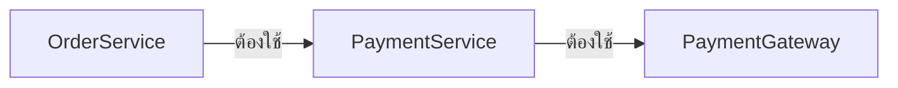
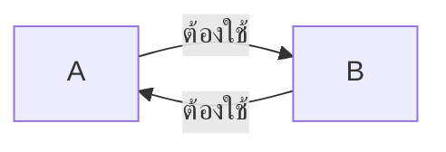
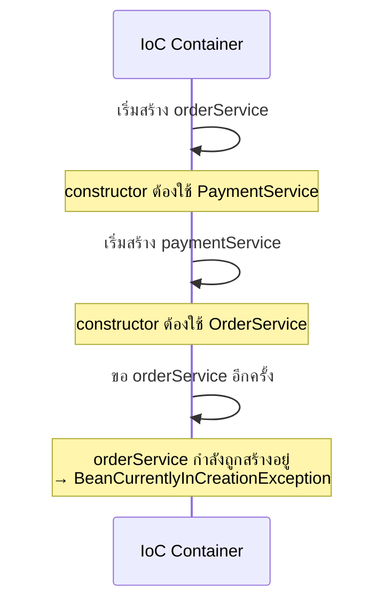
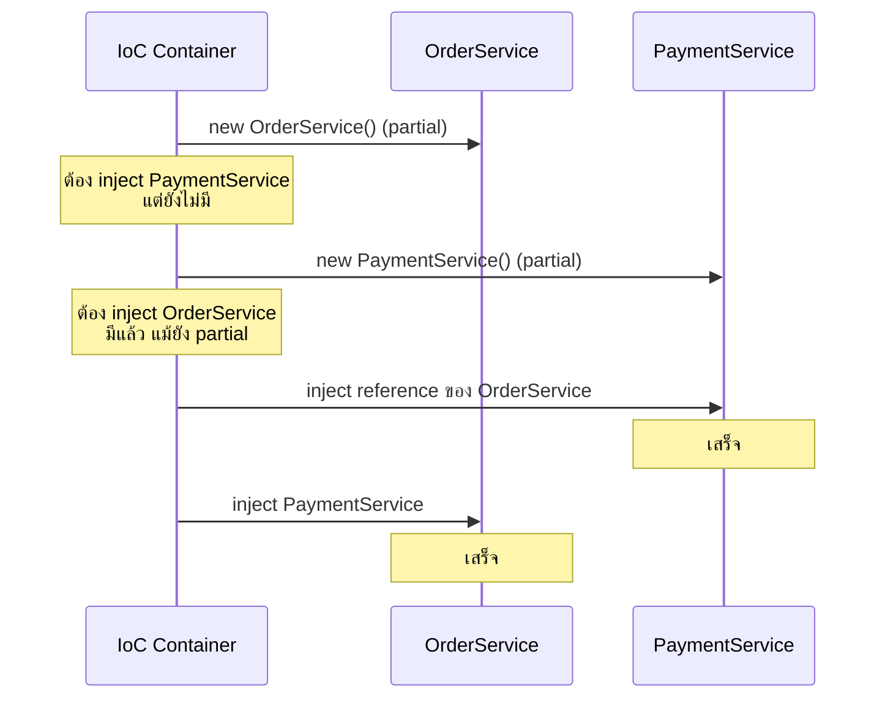
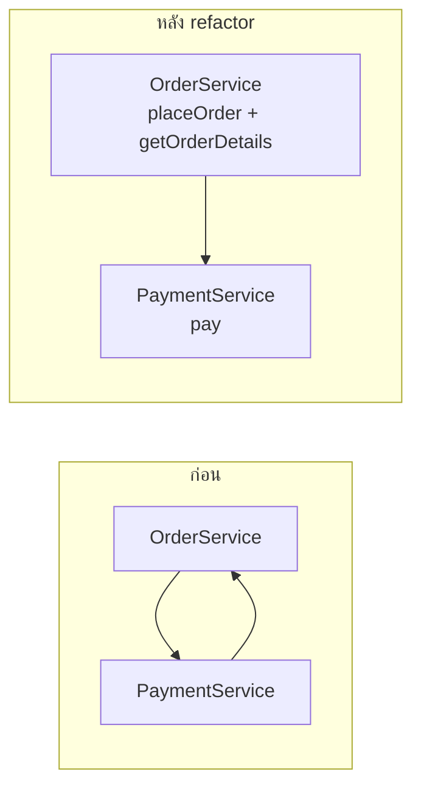
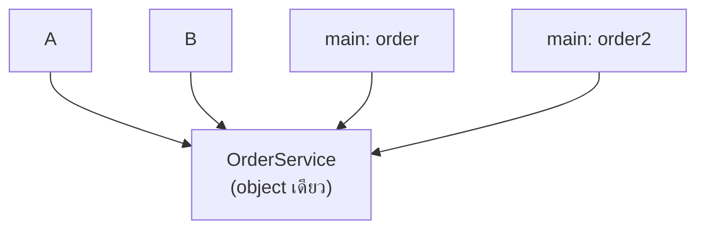
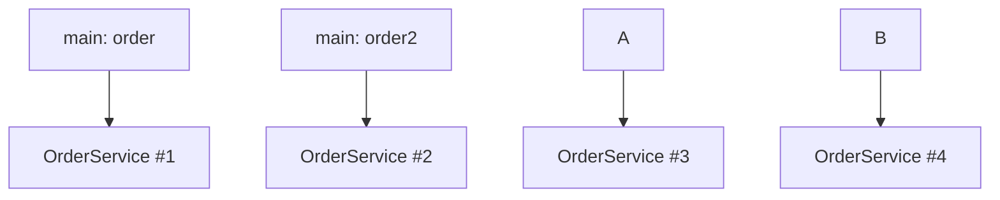
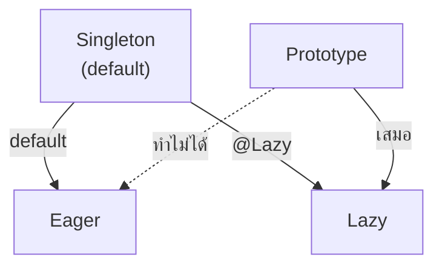
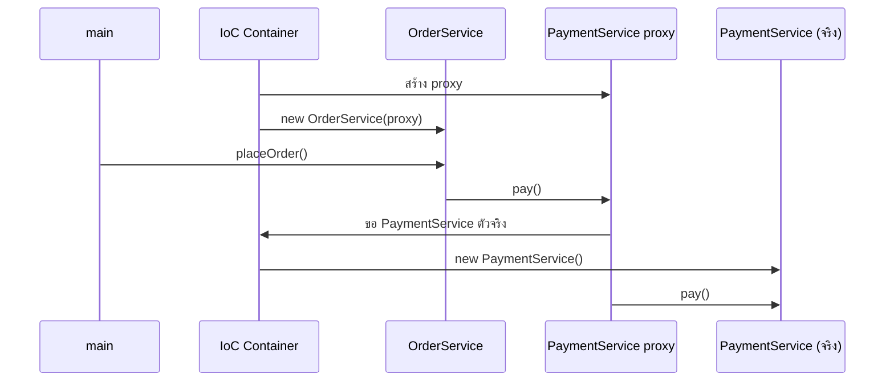
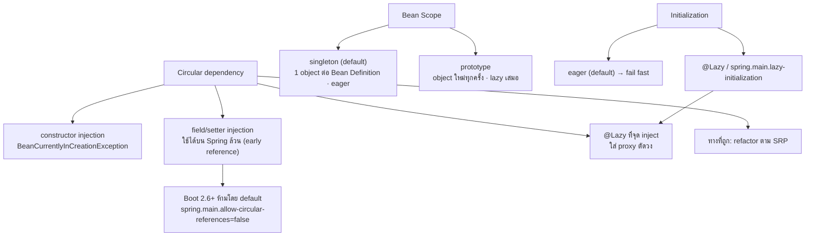

# #6 — Circular Dependency, Bean Scope และ Lazy/Eager Initialization

> **วิดีโอ:** [Circular Dependency in Spring | Bean Scope, Lazy & Eager Beans | Spring Boot Full Course #6](https://youtu.be/ass8cR52Cf8) — Coder Army, ~1 ชั่วโมง 22 นาที
> **แหล่งที่ใช้สรุป:** ซับไตเติลภาษาฮินดีที่ YouTube สร้างอัตโนมัติ
> **เวอร์ชันในโค้ด:** Spring Boot 4.1 + Java 21 (ใส่หมายเหตุไว้ทุกจุดที่ Spring Boot 3.x ต่างกัน)

ตอนนี้ตอบคำถามสามข้อที่ผูกกันอยู่: **ถ้า Bean สองตัวต้องการกันและกัน IoC Container จะสร้างได้ไหม**, **container สร้าง object ของ Bean หนึ่งตัวกี่ชิ้น** (Bean Scope) และ **container สร้าง object ตอนไหน** (Eager/Lazy Initialization) ผู้สอนเริ่มจากปัญหา circular dependency แล้วปิดตอนด้วยการกลับมาแก้ปัญหาเดิมด้วย `@Lazy` ซึ่งเป็นเครื่องมือที่ได้จากสองหัวข้อหลัง

ส่วนที่ติดป้าย `💡 เพิ่มเติม` คือของที่ผมเติมเอง ไม่ได้อยู่ในวิดีโอ ส่วนที่ติด `⚠️ แก้จากวิดีโอ` คือจุดที่วิดีโอพูดคลาดเคลื่อน

---

## สารบัญ

| เวลา | หัวข้อ |
|---|---|
| [0:00](https://youtu.be/ass8cR52Cf8?t=0) | [1. สามหัวข้อของตอนนี้](#1-สามหัวข้อของตอนนี้) |
| [0:46](https://youtu.be/ass8cR52Cf8?t=46) | [2. ทบทวน: dependency เป็นสายตรง](#2-ทบทวน-dependency-เป็นสายตรง) |
| [2:56](https://youtu.be/ass8cR52Cf8?t=176) | [3. Circular Dependency คืออะไร](#3-circular-dependency-คืออะไร) |
| [4:06](https://youtu.be/ass8cR52Cf8?t=246) | [4. เตรียมโปรเจกต์และ AppConfig](#4-เตรียมโปรเจกต์และ-appconfig) |
| [8:57](https://youtu.be/ass8cR52Cf8?t=537) | [5. OrderService กับ PaymentService แบบยังไม่วน](#5-orderservice-กับ-paymentservice-แบบยังไม่วน) |
| [11:43](https://youtu.be/ass8cR52Cf8?t=703) | [6. สร้างวงด้วย constructor injection](#6-สร้างวงด้วย-constructor-injection) |
| [15:17](https://youtu.be/ass8cR52Cf8?t=917) | [7. Circular dependency ไม่ใช่ปัญหาของ Spring](#7-circular-dependency-ไม่ใช่ปัญหาของ-spring) |
| [20:31](https://youtu.be/ass8cR52Cf8?t=1231) | [8. `BeanCurrentlyInCreationException` แปลว่าอะไร](#8-beancurrentlyincreationexception-แปลว่าอะไร) |
| [21:59](https://youtu.be/ass8cR52Cf8?t=1319) | [9. เปลี่ยนเป็น field หรือ setter injection](#9-เปลี่ยนเป็น-field-หรือ-setter-injection) |
| [30:08](https://youtu.be/ass8cR52Cf8?t=1808) | [10. Spring Boot 2.6+ ห้าม circular reference](#10-spring-boot-26-ห้าม-circular-reference) |
| [31:24](https://youtu.be/ass8cR52Cf8?t=1884) | [11. ทางแก้ที่ถูก: refactor ตาม SRP](#11-ทางแก้ที่ถูก-refactor-ตาม-srp) |
| [36:11](https://youtu.be/ass8cR52Cf8?t=2171) | [12. Bean Scope: `getBean` สองครั้งได้ object เดียวกันไหม](#12-bean-scope-getbean-สองครั้งได้-object-เดียวกันไหม) |
| [40:51](https://youtu.be/ass8cR52Cf8?t=2451) | [13. Singleton Scope](#13-singleton-scope) |
| [45:01](https://youtu.be/ass8cR52Cf8?t=2701) | [14. Prototype Scope](#14-prototype-scope) |
| [52:14](https://youtu.be/ass8cR52Cf8?t=3134) | [15. Singleton ของ Spring ไม่ใช่ Singleton Design Pattern](#15-singleton-ของ-spring-ไม่ใช่-singleton-design-pattern) |
| [56:49](https://youtu.be/ass8cR52Cf8?t=3409) | [16. เลือก scope: stateless กับ stateful](#16-เลือก-scope-stateless-กับ-stateful) |
| [59:28](https://youtu.be/ass8cR52Cf8?t=3568) | [17. Scope อื่น: request, session, application](#17-scope-อื่น-request-session-application) |
| [1:00:15](https://youtu.be/ass8cR52Cf8?t=3615) | [18. Eager กับ Lazy Initialization](#18-eager-กับ-lazy-initialization) |
| [1:04:21](https://youtu.be/ass8cR52Cf8?t=3861) | [19. Singleton เปลี่ยนเป็น lazy ได้ Prototype เป็น eager ไม่ได้](#19-singleton-เปลี่ยนเป็น-lazy-ได้-prototype-เป็น-eager-ไม่ได้) |
| [1:07:09](https://youtu.be/ass8cR52Cf8?t=4029) | [20. `@Lazy` เมื่อมี dependency](#20-lazy-เมื่อมี-dependency) |
| [1:10:19](https://youtu.be/ass8cR52Cf8?t=4219) | [21. `@Lazy` ที่จุด inject และ Proxy](#21-lazy-ที่จุด-inject-และ-proxy) |
| [1:14:52](https://youtu.be/ass8cR52Cf8?t=4492) | [22. ทำไม default เป็น eager: fail fast](#22-ทำไม-default-เป็น-eager-fail-fast) |
| [1:16:26](https://youtu.be/ass8cR52Cf8?t=4586) | [23. `spring.main.lazy-initialization` และ `@Lazy(false)`](#23-springmainlazy-initialization-และ-lazyfalse) |
| [1:17:31](https://youtu.be/ass8cR52Cf8?t=4651) | [24. แก้ circular dependency ด้วย `@Lazy`](#24-แก้-circular-dependency-ด้วย-lazy) |
| [1:21:57](https://youtu.be/ass8cR52Cf8?t=4917) | [25. ปิดท้ายและแบบฝึกหัด](#25-ปิดท้ายและแบบฝึกหัด) |
| — | [26. สรุปท้ายตอน](#26-สรุปท้ายตอน) |

---

## 1. สามหัวข้อของตอนนี้

[▶ 0:00](https://youtu.be/ass8cR52Cf8?t=0)

ผู้สอนบอกว่าวันนี้มีสามเรื่องที่เชื่อมกัน

1. **Circular Dependency** ปัญหาที่เกิดจาก Dependency Injection เอง
2. **Bean Scope** ว่า Bean หนึ่งตัวมี object กี่ชิ้น
3. **Bean Initialization** ว่า object ของ Bean ถูกสร้างตอนไหน (eager หรือ lazy)

ทั้งสามเรื่องจะทำให้ความรู้ Spring Core แน่นขึ้น และตอนท้ายจะเห็นว่าสองเรื่องหลังกลับมาช่วยแก้เรื่องแรกได้

---

## 2. ทบทวน: dependency เป็นสายตรง

[▶ 0:46](https://youtu.be/ass8cR52Cf8?t=46)

จาก DI ที่เรียนมาแล้ว ถ้า class หนึ่งต้องใช้ object ของอีก class หนึ่งจึงจะสร้างได้ เราเรียก object นั้นว่า **dependency** ของ class นั้น

ตัวอย่างบนกระดาน: `OrderService` ต้องใช้ `PaymentService` และ `PaymentService` ต้องใช้ `PaymentGateway` (สมมติให้ใช้ field injection ด้วย `@Autowired` และทุก class มี `@Component`)



IoC Container ฉลาดพอจะรู้ว่าต้องสร้างจากปลายสายย้อนกลับมา

1. สร้าง `PaymentGateway` ก่อน เพราะไม่ต้องพึ่งใคร
2. สร้าง `PaymentService` แล้ว inject `PaymentGateway` เข้าไป
3. สร้าง `OrderService` แล้ว inject `PaymentService` เข้าไป

ตราบใดที่ dependency เป็นสายตรง ก็จะมีจุดเริ่มต้นเสมอ

---

## 3. Circular Dependency คืออะไร

[▶ 2:56](https://youtu.be/ass8cR52Cf8?t=176)

สมมติมี class `A` กับ `B` โดย **A ต้องใช้ B และ B ต้องใช้ A** สถานการณ์นี้เรียกว่า **circular dependency**



จะสร้าง A ได้ต้องมี B ก่อน แต่จะสร้าง B ได้ก็ต้องมี A ก่อน container จึง **หาจุดเริ่มต้นไม่ได้** ผู้สอนให้นึกภาพเดียวกันกับ `OrderService` และ `PaymentService` ที่ต่างฝ่ายต่างต้องใช้กัน แล้วไปลองในโค้ดว่า Spring รับมืออย่างไร

---

## 4. เตรียมโปรเจกต์และ AppConfig

[▶ 4:06](https://youtu.be/ass8cR52Cf8?t=246)

ผู้สอนสร้างโปรเจกต์ Maven เปล่าชื่อ `circular-dependency-demo` (ใช้ JDK 23) แล้วเพิ่ม dependency `spring-context` เวอร์ชัน 7.0.7 ที่ค้นจากเว็บ MVN Repository เพราะต้องการ Spring 7 ให้เข้ากับ Spring Boot 4 เมื่อ reload Maven แล้ว จะเห็น transitive dependency ของ `spring-context` ตามมาด้วย

ในโน้ตนี้ใช้ parent ของ Boot 4.1.1 คุมเวอร์ชันแทน ไม่ต้องใส่เลขเวอร์ชันเอง (Boot 4.1.1 คุม Spring Framework ไว้ที่ 7.0.9) และใช้ `spring-boot-starter` ตัวเดียว เพราะครอบ `spring-context` ไว้แล้ว และส่วนที่ 10 ต้องรันแบบ Spring Boot ด้วย

```xml
<parent>
  <groupId>org.springframework.boot</groupId>
  <artifactId>spring-boot-starter-parent</artifactId>
  <version>4.1.1</version>
</parent>

<properties>
  <java.version>21</java.version>
</properties>

<dependencies>
  <dependency>
    <groupId>org.springframework.boot</groupId>
    <artifactId>spring-boot-starter</artifactId>
  </dependency>
</dependencies>
```

> 💡 **เพิ่มเติม:** ถ้าอยากทำให้ตรงกับวิดีโอทุกอย่าง ใช้ `org.springframework:spring-context` (ไม่ต้องใส่ version เมื่อมี parent ของ Boot) แทน `spring-boot-starter` ก็ได้ ตัวอย่างทุกตัวที่ใช้ `AnnotationConfigApplicationContext` ในโน้ตนี้ ผมรันทั้งแบบที่มีแค่ `spring-context` บน classpath และแบบที่มี `spring-boot-starter` ได้ stdout เหมือนกันทุกตัว ต่างกันแค่รูปแบบของบรรทัด log `WARN` ตอนที่ container fail

### เปิด IoC Container

[▶ 6:06](https://youtu.be/ass8cR52Cf8?t=366)

ใน `Main` ผู้สอนเปิด IoC Container แบบ annotation-based เหมือนตอนที่แล้ว และให้อ่าน configuration จาก class `AppConfig`

```java
package com.example.circular.linear;

import org.springframework.context.annotation.ComponentScan;
import org.springframework.context.annotation.Configuration;

@Configuration
@ComponentScan
public class AppConfig {
}
```

- `@Configuration` บอกว่า class นี้เป็น configuration class
- `@ComponentScan` สั่งให้ scan หา class ที่มี `@Component` ถ้าไม่ระบุ package จะ scan package ของ `AppConfig` เอง ผู้สอนจึงไม่ใส่ เพราะ class ทั้งหมดอยู่ package เดียวกัน

### `AppConfig` เองก็เป็น Bean

[▶ 7:09](https://youtu.be/ass8cR52Cf8?t=429)

ประเด็นที่ตอนที่แล้วยังไม่ได้พูด: ถ้าเขียน method `@Bean` เช่น `public User getUser()` ไว้ใน `AppConfig` คนที่เรียก method นั้นคือ Spring แต่ method นี้ไม่ใช่ `static` และเราก็ไม่เคย `new AppConfig()` เลย แล้ว Spring เรียกมันได้อย่างไร

คำตอบคือ **object ของ `AppConfig` ก็เป็น Bean ตัวหนึ่งใน IoC Container** พิสูจน์ได้โดยกดเข้าไปดู source ของ `@Configuration` จะเห็นว่ามี `@Component` ติดอยู่ข้างใน `@Configuration` จึงเป็น component แบบพิเศษ หน้าที่พิเศษของมันคือประกาศ Bean และสั่ง component scan แต่ตัวมันเองก็ยังเป็น component class

---

## 5. OrderService กับ PaymentService แบบยังไม่วน

[▶ 8:57](https://youtu.be/ass8cR52Cf8?t=537)

เริ่มจาก dependency ทางเดียว: `OrderService` รับ `PaymentService` ผ่าน constructor ไม่ต้องเขียน `@Autowired` เพราะมี constructor ตัวเดียว (เรื่องนี้พูดไปแล้วในตอน #4)

```java
package com.example.circular.linear;

import org.springframework.stereotype.Component;

@Component
public class PaymentService {

  public void pay() {
    System.out.println("Payment done");
  }
}
```

```java
package com.example.circular.linear;

import org.springframework.stereotype.Component;

@Component
public class OrderService {

  private final PaymentService paymentService;

  public OrderService(PaymentService paymentService) {
    this.paymentService = paymentService;
  }

  public void placeOrder() {
    paymentService.pay();
    System.out.println("Order placed");
  }
}
```

ใน `Main` ขอ Bean จาก container ด้วย `getBean` โดยส่ง `OrderService.class` เข้าไป ผู้สอนอธิบายว่านี่คือการส่ง metadata (reflection) ของ class ให้ container รู้ว่าต้องการ Bean แบบไหน

```java
package com.example.circular.linear;

import org.springframework.context.annotation.AnnotationConfigApplicationContext;

public class Main {

  public static void main(String[] args) {
    try (var context = new AnnotationConfigApplicationContext(AppConfig.class)) {
      OrderService order = context.getBean(OrderService.class);
      order.placeOrder();

      System.out.println(context.containsBean("appConfig"));
    }
  }
}
```

ผลที่ได้

```text
Payment done
Order placed
true
```

> 💡 **เพิ่มเติม:** บรรทัดสุดท้ายผมเติมเพื่อยืนยันประเด็นในส่วนที่ 4 ว่ามี Bean ชื่อ `appConfig` อยู่ใน container จริง ชื่อนี้ได้มาจากชื่อ class ที่เปลี่ยนตัวแรกเป็นตัวเล็ก

---

## 6. สร้างวงด้วย constructor injection

[▶ 11:43](https://youtu.be/ass8cR52Cf8?t=703)

คราวนี้บังคับให้เกิดวง: `PaymentService` รับ `OrderService` ผ่าน constructor ด้วย และหลังจ่ายเงินเสร็จ `pay()` จะเรียก `orderService.getOrderDetails()` กลับไป

```java
package com.example.circular.constructor;

import org.springframework.stereotype.Component;

@Component
public class OrderService {

  private final PaymentService paymentService;

  public OrderService(PaymentService paymentService) {
    this.paymentService = paymentService;
  }

  public void placeOrder() {
    paymentService.pay();
    System.out.println("Order placed");
  }

  public void getOrderDetails() {
    System.out.println("Order details");
  }
}
```

```java
package com.example.circular.constructor;

import org.springframework.stereotype.Component;

@Component
public class PaymentService {

  private final OrderService orderService;

  public PaymentService(OrderService orderService) {
    this.orderService = orderService;
  }

  public void pay() {
    System.out.println("Payment done");
    orderService.getOrderDetails();
  }
}
```

`AppConfig` และ `Main` เหมือนส่วนที่ 5 ทุกอย่าง (ไม่มีบรรทัด `containsBean`)

### ลำดับที่ควรจะได้ ถ้าสร้าง Bean ได้

[▶ 13:09](https://youtu.be/ass8cR52Cf8?t=789)

`placeOrder()` เรียก `pay()` ซึ่งพิมพ์ `Payment done` แล้วเรียก `getOrderDetails()` ซึ่งพิมพ์ `Order details` จากนั้นทุก method คืนค่ากลับมาที่ `placeOrder()` ซึ่งพิมพ์ `Order placed` ผลที่คาดไว้จึงเป็น

```text
Payment done
Order details
Order placed
```

### แต่สร้าง Bean ไม่ได้ตั้งแต่แรก

[▶ 14:02](https://youtu.be/ass8cR52Cf8?t=842)

ก่อนจะไปถึง `placeOrder()` ต้องสร้าง Bean ให้ได้ก่อน การสร้าง object ต้องเรียก constructor เสมอ constructor ของ `OrderService` ต้องการ `PaymentService` ส่วน constructor ของ `PaymentService` ก็ต้องการ `OrderService` ไม่มีฝ่ายไหนสร้างได้ก่อน



รันจริง [▶ 14:38](https://youtu.be/ass8cR52Cf8?t=878) (ตัด stack trace และย่อ path)

```text
Exception in thread "main" org.springframework.beans.factory.UnsatisfiedDependencyException: Error creating bean with name 'orderService' defined in file [.../OrderService.class]: Unsatisfied dependency expressed through constructor parameter 0: Error creating bean with name 'paymentService' defined in file [.../PaymentService.class]: Unsatisfied dependency expressed through constructor parameter 0: Error creating bean with name 'orderService': Requested bean is currently in creation: Is there an unresolvable circular reference or an asynchronous initialization dependency?
	...
Caused by: org.springframework.beans.factory.BeanCurrentlyInCreationException: Error creating bean with name 'orderService': Requested bean is currently in creation: Is there an unresolvable circular reference or an asynchronous initialization dependency?
```

ผู้สอนชี้ว่า exception ตัวท้ายสุดคือ **`BeanCurrentlyInCreationException`** และข้อความถามเราเองเลยว่า "มี circular reference ที่ resolve ไม่ได้หรือเปล่า"

> 💡 **เพิ่มเติม:** exception ตัวนอกสุดคือ `UnsatisfiedDependencyException` ส่วน `BeanCurrentlyInCreationException` อยู่ใน `Caused by:` บรรทัดท้าย เวลาอ่าน stack trace ของ Spring ให้ไล่ลงไปหา `Caused by:` ตัวสุดท้าย เพราะมักเป็นต้นเหตุจริง

---

## 7. Circular dependency ไม่ใช่ปัญหาของ Spring

[▶ 15:17](https://youtu.be/ass8cR52Cf8?t=917)

ผู้สอนย้ำว่าปัญหานี้ **ไม่ได้เกิดเพราะ Spring** เขียน Java ล้วนก็เกิดได้ ต้นเหตุคือ **การออกแบบโค้ดที่ไม่ดี** (ไม่ใช่ clean code)

เพื่อพิสูจน์ เขาสร้าง class `A` และ `B` ใน package แยก **ไม่ใส่ `@Component`** จึงต้องสร้าง object เองด้วย `new`

### ลองแบบ constructor รับ argument

[▶ 16:11](https://youtu.be/ass8cR52Cf8?t=971)

ถ้าให้ `A(B b)` และ `B(A a)` จะเขียน `new A(new B(...))` ไม่ได้ เพราะ `new B(...)` ก็ต้องการ `A` อีก ต่อกันไม่มีที่สิ้นสุด inject ด้วยมือแบบนี้ไม่ได้

### hack ด้วย default constructor

[▶ 17:51](https://youtu.be/ass8cR52Cf8?t=1071)

ผู้สอนเปลี่ยนให้แต่ละ class สร้างอีกฝ่ายเองใน default constructor และพิมพ์ข้อความทุกครั้งที่ถูกสร้าง

```java
package com.example.circular.plainjava;

public class A {

  private final B b;

  public A() {
    System.out.println("A created");
    this.b = new B();
  }
}
```

```java
package com.example.circular.plainjava;

public class B {

  private final A a;

  public B() {
    System.out.println("B created");
    this.a = new A();
  }
}
```

```java
package com.example.circular.plainjava;

public class Main {

  public static void main(String[] args) {
    A a = new A();
  }
}
```

`new A()` เรียก constructor ของ A ซึ่ง `new B()` ซึ่งเรียก constructor ของ B ซึ่ง `new A()` อีก วนแบบนี้ไปเรื่อย ๆ แต่ละรอบเพิ่ม frame ลงใน stack จนเต็ม

ผู้สอนต้องเอา `@Component` ออกจาก `OrderService` และ `PaymentService` ก่อน [▶ 19:37](https://youtu.be/ass8cR52Cf8?t=1177) เพราะ container ยังพังจากวงในส่วนที่ 6 ก่อนจะรันถึงโค้ดของ A กับ B

รันจริง [▶ 19:56](https://youtu.be/ass8cR52Cf8?t=1196)

```text
A created
B created
A created
B created
...                    (ผมนับได้ 32,648 บรรทัด ตัวเลขนี้ขึ้นกับขนาด stack ของ JVM)
Exception in thread "main" java.lang.StackOverflowError
	at com.example.circular.plainjava.A.<init>(A.java:8)
	at com.example.circular.plainjava.B.<init>(B.java:9)
	at com.example.circular.plainjava.A.<init>(A.java:9)
	...
```

สรุปจากส่วนนี้: circular dependency คิดได้หลายรูปแบบ แต่ทุกแบบเป็นปัญหาของ **bad code design** Java ล้วนก็ทำให้เกิดได้

---

## 8. `BeanCurrentlyInCreationException` แปลว่าอะไร

[▶ 20:31](https://youtu.be/ass8cR52Cf8?t=1231)

ผู้สอนเอา `@Component` กลับมาที่ `OrderService` และ `PaymentService` แล้วอธิบายชื่อ exception

- วงในส่วนที่ 6 เกิดจาก **constructor** เพราะทั้งคู่รับอีกฝ่ายผ่าน constructor จึงไม่มีจุดเริ่มต้น
- container ไม่รู้ว่าจะสร้างใครก่อน สมมติว่ามันเริ่มที่ `OrderService`
- ระหว่างสร้าง `OrderService` ต้อง resolve dependency คือ `PaymentService` จึงไปสร้าง `PaymentService`
- `PaymentService` ต้องการ `OrderService` แต่ `OrderService` **อยู่ในสถานะกำลังถูกสร้าง (currently in creation)** อยู่แล้ว
- container จึงโยน `BeanCurrentlyInCreationException` และบอกเราว่าน่าจะมี circular reference

---

## 9. เปลี่ยนเป็น field หรือ setter injection

[▶ 21:59](https://youtu.be/ass8cR52Cf8?t=1319)

ทางหนึ่งที่ Spring มีให้คือเลิกใช้ constructor injection แล้วเปลี่ยนไปใช้ **field injection** หรือ **setter injection** (DI มีสามแบบตามที่เรียนในตอน #4) เพราะ constructor injection ทำงานต่างจากอีกสองแบบมาก

ผู้สอน comment constructor ทิ้งทั้งสองฝั่ง แล้วใส่ `@Autowired` บน field แทน

```java
package com.example.circular.field;

import org.springframework.beans.factory.annotation.Autowired;
import org.springframework.stereotype.Component;

@Component
public class OrderService {

  @Autowired
  private PaymentService paymentService;

  public void placeOrder() {
    paymentService.pay();
    System.out.println("Order placed");
  }

  public void getOrderDetails() {
    System.out.println("Order details");
  }
}
```

```java
package com.example.circular.field;

import org.springframework.beans.factory.annotation.Autowired;
import org.springframework.stereotype.Component;

@Component
public class PaymentService {

  @Autowired
  private OrderService orderService;

  public void pay() {
    System.out.println("Payment done");
    orderService.getOrderDetails();
  }
}
```

ผู้สอนบอกว่าถ้าทำเป็น setter แล้วใส่ `@Autowired` บน setter ผลก็จะเหมือนกัน

```java
package com.example.circular.setter;

import org.springframework.beans.factory.annotation.Autowired;
import org.springframework.stereotype.Component;

@Component
public class OrderService {

  private PaymentService paymentService;

  @Autowired
  public void setPaymentService(PaymentService paymentService) {
    this.paymentService = paymentService;
  }

  public void placeOrder() {
    paymentService.pay();
    System.out.println("Order placed");
  }

  public void getOrderDetails() {
    System.out.println("Order details");
  }
}
```

```java
package com.example.circular.setter;

import org.springframework.beans.factory.annotation.Autowired;
import org.springframework.stereotype.Component;

@Component
public class PaymentService {

  private OrderService orderService;

  @Autowired
  public void setOrderService(OrderService orderService) {
    this.orderService = orderService;
  }

  public void pay() {
    System.out.println("Payment done");
    orderService.getOrderDetails();
  }
}
```

### Spring inject ค่าเข้า field ที่เป็น `private` ได้อย่างไร

[▶ 22:47](https://youtu.be/ass8cR52Cf8?t=1367)

ผู้สอนให้ลืมเรื่องวงไปก่อน แล้วถามว่า: ต่อให้เป็น dependency ทางเดียว ถ้า field `paymentService` เป็น `private` ไม่มี setter และไม่มี constructor ที่รับค่า Spring เอา object ไปใส่ใน field นั้นได้อย่างไร

คำตอบคือ **Java Reflection** IoC Container ไม่ได้สร้าง object ทันที แต่สร้าง **Bean Definition** ก่อน ทำให้มันเข้าถึง metadata ของทั้ง class ผ่าน reflection และ Reflection API ก็เขียนค่าเข้า private member ได้ ผู้สอนบอกว่าข้อนี้เป็นคำถามสัมภาษณ์ได้ และจะคุยเรื่อง reflection ในวิดีโอแยก

### ทำไมคราวนี้ถึงสร้างได้

[▶ 24:16](https://youtu.be/ass8cR52Cf8?t=1456)

field และ setter injection **แยกการสร้าง object ออกจากการ inject dependency**

- การสร้าง object ต้องเรียก constructor เสมอ ถ้าเราไม่เขียน Java ก็ใช้ default constructor ให้
- constructor ของ `OrderService` ตอนนี้ไม่ต้องการ `PaymentService` แล้ว และ constructor ของ `PaymentService` ก็ไม่ต้องการ `OrderService`
- ทั้งคู่ต้องการกันและกัน **หลังจาก** ถูกสร้างแล้วเท่านั้น

ในทางทฤษฎี container จึงทำแบบนี้ได้: สร้าง `OrderService` เปล่า สร้าง `PaymentService` เปล่า แล้ว inject แต่ละตัวเข้าไปในอีกตัว constructor injection บอกว่า "ตอนสร้างฉัน ต้องมี dependency พร้อมแล้ว" ส่วน field/setter injection บอกว่า "สร้างฉันไปก่อน dependency ค่อยใส่ทีหลัง"

รันจริง [▶ 26:11](https://youtu.be/ass8cR52Cf8?t=1571) (ใช้ `Main` แบบเดียวกับส่วนที่ 5) ทั้งแบบ field และแบบ setter ได้ผลเหมือนกัน

```text
Payment done
Order details
Order placed
```

Spring resolve circular dependency ให้เองได้

### container ทำจริงอย่างไร: partial object

[▶ 26:53](https://youtu.be/ass8cR52Cf8?t=1613)

ผู้สอนบอกว่าความจริงไม่ง่ายแบบ "สร้างเปล่าทั้งคู่แล้วค่อย inject" กฎปกติของ container คือทำให้ Bean หนึ่ง **เสร็จทั้งตัว** ก่อนไปตัวถัดไป: สร้าง A, inject dependency ของ A, แล้วจึงสร้าง B, inject dependency ของ B (รายละเอียดของ Bean Definition และ lifecycle จะอยู่ในตอนถัดไป)

เมื่อมีวง สิ่งที่เกิดขึ้นคือ

1. container เริ่มที่ `OrderService` สร้าง object ขึ้นมาก่อน ตอนนี้เป็น **partial object** เพราะ dependency ยังไม่ครบ
2. จะ inject `PaymentService` ให้ แต่ใน container ยังไม่มี จึงไปสร้าง `PaymentService` (เป็น object เปล่าเหมือนกัน)
3. `PaymentService` ต้องการ `OrderService` container หาเจอว่ามีแล้ว แม้จะเป็นแค่ partial object ก็ inject reference ของมันเข้าไปเลย ผู้สอนเรียกว่า **reference concept**
4. `PaymentService` จึงเสร็จ เพราะชี้ไปที่ object ที่ถูกต้องแล้ว
5. กลับมาที่ `OrderService` inject `PaymentService` ที่เสร็จแล้วเข้าไป `OrderService` ก็เสร็จ



> 💡 **เพิ่มเติม:** สิ่งที่ผู้สอนเรียกว่า "reference concept" ในเอกสาร Spring เรียกว่า **early reference** ของ singleton `DefaultSingletonBeanRegistry` เก็บ Bean ที่ยังสร้างไม่เสร็จไว้ใน cache แยก เพื่อคืน reference ให้ Bean อื่นที่ขอเข้ามากลางทาง กลไกนี้ใช้ได้เฉพาะ singleton และเฉพาะกรณีที่ object ถูกสร้างเสร็จก่อน inject ดังนั้น constructor injection จึงใช้กลไกนี้ไม่ได้เลย เพราะยังไม่มี object ให้อ้างถึงจนกว่า constructor จะทำงานเสร็จ

---

## 10. Spring Boot 2.6+ ห้าม circular reference

[▶ 30:08](https://youtu.be/ass8cR52Cf8?t=1808)

ถ้าแก้ด้วย field/setter injection ได้ ทำไมยังเรียก circular dependency ว่าปัญหา ผู้สอนให้เหตุผลสองข้อ

1. ใช้ได้บน Spring Framework ก็จริง แต่ในทางปฏิบัติ **ไม่ใช่ good coding practice** ควรหลีกเลี่ยง
2. **Spring Boot ตั้งแต่ 2.6 ห้ามเรื่องนี้โดยค่า default** ต่อให้ใช้ setter หรือ field injection ก็รันไม่ผ่าน เพราะ Boot ตั้ง property `spring.main.allow-circular-references` เป็น `false` ไว้ ถ้าอยากให้ทำงานต้องตั้งเป็น `true` เอง ส่วนแอป Spring Core ธรรมดา (แบบที่เราทำอยู่) ยังรองรับอยู่

> ⚠️ **แก้จากวิดีโอ (เล็กน้อย):** ช่วง [▶ 31:04](https://youtu.be/ass8cR52Cf8?t=1864) ผู้สอนพูดว่า "หลัง 2.4" ซึ่งขัดกับที่พูดไว้ก่อนหน้าว่า 2.6 เวอร์ชันที่ถูกคือ **Spring Boot 2.6** ([Spring Boot 2.6 Release Notes — Circular References Prohibited by Default](https://github.com/spring-projects/spring-boot/wiki/Spring-Boot-2.6-Release-Notes#circular-references-prohibited-by-default))

> 💡 **เพิ่มเติม — รันวงเดียวกันบน Spring Boot 4.1.1 จริง**
>
> วิดีโอไม่ได้รันส่วนนี้ ผมเอา `OrderService`/`PaymentService` แบบ field injection จากส่วนที่ 9 มารันผ่าน `SpringApplication` โดยวาง class นี้ไว้ใน package เดียวกัน
>
> ```java
> package com.example.circular.field;
>
> import org.springframework.boot.SpringApplication;
> import org.springframework.boot.autoconfigure.SpringBootApplication;
> import org.springframework.context.ConfigurableApplicationContext;
>
> @SpringBootApplication
> public class CircularBootApplication {
>
>   public static void main(String[] args) {
>     ConfigurableApplicationContext context = SpringApplication.run(CircularBootApplication.class, args);
>     context.getBean(OrderService.class).placeOrder();
>   }
> }
> ```
>
> ผลที่ได้ (ตัด banner และ log บรรทัดอื่น)
>
> ```text
> ***************************
> APPLICATION FAILED TO START
> ***************************
>
> Description:
>
> The dependencies of some of the beans in the application context form a cycle:
>
> ┌─────┐
> |  orderService (field private com.example.circular.field.PaymentService com.example.circular.field.OrderService.paymentService)
> ↑     ↓
> |  paymentService (field private com.example.circular.field.OrderService com.example.circular.field.PaymentService.orderService)
> └─────┘
>
>
> Action:
>
> Relying upon circular references is discouraged and they are prohibited by default. Update your application to remove the dependency cycle between beans. As a last resort, it may be possible to break the cycle automatically by setting spring.main.allow-circular-references to true.
> ```
>
> แบบ setter injection ก็ fail ด้วยข้อความเดียวกัน แต่กล่องวงแสดงแค่ชื่อ `orderService` กับ `paymentService`
>
> รันใหม่โดยเพิ่ม `--spring.main.allow-circular-references=true` (เท่ากับใส่บรรทัดนี้ใน `application.properties`) แอปสตาร์ทผ่าน และพิมพ์ `Payment done`, `Order details`, `Order placed` เหมือนรันบน Spring ล้วน
>
> **constructor injection แบบวงกลม fail เสมอ** ผมรันโค้ดจากส่วนที่ 6 ผ่าน `SpringApplication` โดยตั้ง `allow-circular-references=true` แล้ว ก็ยังขึ้นกล่องวงเดิม แต่ข้อความใน Action เปลี่ยนเป็น
>
> ```text
> Action:
>
> Despite circular references being allowed, the dependency cycle between beans could not be broken. Update your application to remove the dependency cycle.
> ```
>
> property นี้จึงเปิดได้แค่กลไก early reference ในส่วนที่ 9 แต่ช่วยวงที่เกิดจาก constructor ไม่ได้

### ทางแก้อื่นที่ผู้สอนพูดถึง

[▶ 31:24](https://youtu.be/ass8cR52Cf8?t=1884)

นอกจาก field/setter injection แล้ว ยังมีวิธีอื่นอีก ผู้สอนบอกว่าในหัวข้อ scope ที่จะเรียนต่อไปก็แก้ได้ และใน Bean lifecycle (ตอนถัดไป) ก็แก้ได้ด้วย annotation `@PostConstruct` **แต่เป้าหมายจริงไม่ใช่การ resolve วง แต่คือ refactor โค้ดไม่ให้เกิดวงตั้งแต่แรก**

> 💡 **เพิ่มเติม — scope อย่างเดียวแก้วงไม่ได้:** วิธีที่ใช้ได้จริงในตอนนี้คือ `@Lazy` (ส่วนที่ 24) ผมลองเปลี่ยนทั้ง `OrderService` และ `PaymentService` แบบ field injection ให้เป็น `@Scope("prototype")` ผลคือ `getBean(OrderService.class)` fail ด้วย `BeanCurrentlyInCreationException` ทันที แม้จะรันบน Spring ล้วนก็ตาม เพราะ prototype ไม่มี early reference ให้ใช้ ทุกครั้งที่ขอจะได้ object ใหม่ วงจึงไม่มีวันจบ

---

## 11. ทางแก้ที่ถูก: refactor ตาม SRP

[▶ 31:54](https://youtu.be/ass8cR52Cf8?t=1914)

ผู้สอนบอกจากประสบการณ์ว่าในแอประดับ enterprise ที่ต้องสเกล **ไม่ควรมี circular dependency เลย** ไม่ใช่แค่ resolve ได้แล้วจบ เพราะ

- วงทำให้โค้ด **tightly coupled**
- ถ้า `OrderService` กับ `PaymentService` ต้องพึ่งกันไปมา แปลว่าเราแยกหน้าที่ของสอง class ไม่ออก
- แปลว่าเราทำผิด **Single Responsibility Principle (SRP)** ซึ่งเป็นข้อแรกและข้อสำคัญของ SOLID
- เกณฑ์หลักของแอปที่ดีคือทำตาม coding practice, design principle และ design pattern

### หาว่าใครทำเกินหน้าที่

[▶ 33:09](https://youtu.be/ass8cR52Cf8?t=1989)

ต้นเหตุของวง: `placeOrder()` ของ A เรียก `pay()` ของ B แล้ว `pay()` ของ B ก็เรียก method ของ A กลับ

- **`OrderService`** มีหน้าที่จัดการ order การสั่งให้จ่ายเงินก่อนแล้วค่อยวาง order จึงสมเหตุสมผล ในโค้ดจริง `pay()` น่าจะคืนผลกลับมา (เช่น `boolean`) ว่าจ่ายสำเร็จไหม แล้ว `OrderService` ค่อยพิมพ์ `Order placed`
- **`PaymentService`** มีหน้าที่จัดการการจ่ายเงิน ในโค้ดจริงอาจคุยกับ payment gateway แล้ว log ว่าจ่ายเสร็จ แต่จ่ายเสร็จแล้ว **ไปเรียก `getOrderDetails()` ทำไม** การดึงรายละเอียด order ไม่ใช่หน้าที่ของ `PaymentService` (ผู้สอนเขียน comment ไว้ว่า "not its responsibility")

ย้ายการเรียก `getOrderDetails()` ไปไว้ใน `OrderService` หลังจ่ายเงินเสร็จ แล้วลบ dependency ของ `PaymentService` ที่ชี้ไปหา `OrderService` ทิ้ง

```java
package com.example.circular.refactored;

import org.springframework.stereotype.Component;

@Component
public class OrderService {

  private final PaymentService paymentService;

  public OrderService(PaymentService paymentService) {
    this.paymentService = paymentService;
  }

  public void placeOrder() {
    paymentService.pay();
    getOrderDetails();
    System.out.println("Order placed");
  }

  public void getOrderDetails() {
    System.out.println("Order details");
  }
}
```

```java
package com.example.circular.refactored;

import org.springframework.stereotype.Component;

@Component
public class PaymentService {

  public void pay() {
    System.out.println("Payment done");
  }
}
```

รันจริง [▶ 35:54](https://youtu.be/ass8cR52Cf8?t=2154)

```text
Payment done
Order details
Order placed
```

output เหมือนเดิมทุกบรรทัด แต่ตอนนี้ dependency เป็น **เส้นตรงทางเดียว** และกลับมาใช้ constructor injection ได้ ผู้สอนสรุปว่าให้ปรับโค้ดให้ดีขึ้น ดีกว่าพยายามหาวิธี resolve วง



---

## 12. Bean Scope: `getBean` สองครั้งได้ object เดียวกันไหม

[▶ 36:11](https://youtu.be/ass8cR52Cf8?t=2171)

ผู้สอนสร้างโปรเจกต์ใหม่ชื่อ `bean-scope-demo` คัดลอก dependency `spring-context` จากโปรเจกต์เดิม แล้วเขียน boilerplate ชุดเดิม (`AppConfig` ที่มี `@Configuration` + `@ComponentScan` และ `Main` ที่เปิด `AnnotationConfigApplicationContext`) ผู้สอนบอกว่าจะลงทุกโปรเจกต์ไว้บน Git

[▶ 37:31](https://youtu.be/ass8cR52Cf8?t=2251) สร้าง `OrderService` ที่ไม่พึ่งใคร มี `placeOrder()` และพิมพ์ `OrderService created` ใน constructor เพื่อให้เห็นว่า object ถูกสร้างตอนไหน

จากนั้นใน `Main` เรียก `getBean(OrderService.class)` สองครั้ง ได้ `order` กับ `order2` แล้วเทียบด้วย `==` ซึ่งใน Java เป็นการเทียบ reference ถ้าเป็นคนละ object ได้ `false` ถ้าเป็น object เดียวกันได้ `true`

คำถามคือ object จะถูกสร้างสองครั้งหรือเปล่า (โค้ดเต็มอยู่ในส่วนที่ 13)

รันจริง [▶ 39:51](https://youtu.be/ass8cR52Cf8?t=2391)

```text
OrderService created
true
```

`OrderService created` ขึ้น **ครั้งเดียว** และ `==` ได้ `true` แปลว่า container สร้าง `OrderService` ไว้แค่ object เดียว และทุกครั้งที่ `getBean` ก็คืน reference ของ object นั้นตัวเดิม ขอกี่ครั้งก็ได้ตัวเดิม พฤติกรรมนี้เรียกว่า **Bean Scope**

---

## 13. Singleton Scope

[▶ 40:51](https://youtu.be/ass8cR52Cf8?t=2451)

ผู้สอนบอกว่ามี scope หลักสองแบบ คือ **singleton** และ **prototype** ส่วน scope อื่นจะได้ใช้ตอนทำเว็บด้วย Spring Web MVC

> ⚠️ **แก้จากวิดีโอ (เล็กน้อย):** ผู้สอนพูดว่า "ใน Java มี scope หลักสองแบบ" ที่ถูกคือเป็น scope ของ **Spring** ไม่ใช่ของภาษา Java

**Singleton scope:** container สร้าง object **หนึ่งชิ้นต่อหนึ่ง Bean Definition** class `OrderService` หนึ่ง class ที่มี `@Component` ทำให้เกิด Bean Definition หนึ่งตัว และ Bean Definition ถูกสร้างก่อน object เสมอ

### ทั้ง `getBean` และ DI ได้ object เดียวกัน

[▶ 41:46](https://youtu.be/ass8cR52Cf8?t=2506)

ผู้สอนสร้าง class `A` และ `B` ที่เป็น `@Component` ทั้งคู่ และรับ `OrderService` ผ่าน constructor (ไม่ต้องใส่ `@Autowired`)



container สร้าง `A` หรือ `B` ก่อนไม่ได้ เพราะทั้งคู่ต้องใช้ `OrderService` จึงสร้าง `OrderService` ก่อน (ไม่มี dependency) แล้วเก็บไว้ใน container จากนั้นจะเลือกสร้าง A หรือ B ก่อนก็ได้ เนื่องจากเป็น constructor injection dependency จึงถูก resolve พร้อมกับตอนสร้าง และทั้ง A และ B ได้ reference ของ `OrderService` **ตัวเดียวกัน** ที่อยู่ใน container อยู่แล้ว

ผู้สอนสรุปว่าไม่ว่าจะขอผ่าน `getBean` หรือผ่าน DI ข้างในก็คือการขอ Bean จาก container เหมือนกัน ใน singleton scope จึงมี object ของ `OrderService` แค่ชิ้นเดียว

```java
package com.example.scope.singleton;

import org.springframework.context.annotation.Scope;
import org.springframework.stereotype.Component;

@Component
@Scope("singleton")
public class OrderService {

  public OrderService() {
    System.out.println("OrderService created");
  }

  public void placeOrder() {
    System.out.println("Order placed");
  }
}
```

```java
package com.example.scope.singleton;

import org.springframework.stereotype.Component;

@Component
public class A {

  private final OrderService orderService;

  public A(OrderService orderService) {
    this.orderService = orderService;
  }

  public OrderService getOrderService() {
    return orderService;
  }
}
```

`B` เหมือน `A` ทุกอย่าง เปลี่ยนแค่ชื่อ class และชื่อ constructor

```java
package com.example.scope.singleton;

import org.springframework.context.annotation.AnnotationConfigApplicationContext;

public class Main {

  public static void main(String[] args) {
    try (var context = new AnnotationConfigApplicationContext(AppConfig.class)) {
      OrderService order = context.getBean(OrderService.class);
      OrderService order2 = context.getBean(OrderService.class);
      System.out.println(order == order2);

      A a = context.getBean(A.class);
      B b = context.getBean(B.class);
      System.out.println(a.getOrderService() == b.getOrderService());
      System.out.println(a.getOrderService() == order);
    }
  }
}
```

```text
OrderService created
true
true
true
```

> 💡 **เพิ่มเติม:** getter ใน `A`/`B` และสองบรรทัดหลังใน `Main` ผมเติมเอง เพื่อพิสูจน์ด้วยการรันว่า object ที่ inject ให้ A, B และที่ได้จาก `getBean` เป็นตัวเดียวกันจริง ในวิดีโอผู้สอนอธิบายส่วนนี้บนกระดานอย่างเดียว

### Singleton เป็นค่า default

[▶ 45:19](https://youtu.be/ass8cR52Cf8?t=2719)

ถ้าไม่ระบุ scope **ค่า default คือ singleton** การเขียน `@Scope("singleton")` เอง (แบบในโค้ดข้างบน) จึงได้ผลเหมือนไม่เขียน: `OrderService created` ขึ้นครั้งเดียวและได้ `true`

> 💡 **เพิ่มเติม:** แทนที่จะพิมพ์ string เอง ใช้ค่าคงที่ `ConfigurableBeanFactory.SCOPE_SINGLETON` และ `ConfigurableBeanFactory.SCOPE_PROTOTYPE` ได้ เพื่อกันพิมพ์ผิด ถ้าใส่ชื่อ scope ที่ไม่มีอยู่จริง container จะ fail ตอนสร้าง Bean

---

## 14. Prototype Scope

[▶ 45:01](https://youtu.be/ass8cR52Cf8?t=2701)

**Prototype** ตรงข้ามกับ singleton: **ทุกครั้งที่มีคนขอ ไม่ว่าจะผ่าน `getBean` หรือผ่าน DI container จะสร้าง object ใหม่ให้** วิธีเปลี่ยนคือแก้ค่าใน `@Scope` จาก `"singleton"` เป็น `"prototype"`



### container ไม่ได้ดูแล prototype ทั้ง lifecycle

[▶ 46:40](https://youtu.be/ass8cR52Cf8?t=2800)

คำถามสำคัญ: object ทั้งหมดที่ถูกสร้างขึ้นมาเรื่อย ๆ นี้ container ดูแลทั้งหมดหรือเปล่า

- singleton ง่าย มี object เดียว container ดูแลทั้งหมด
- **prototype ไม่ใช่** class ที่มี `@Scope("prototype")` container ไม่ได้ดูแลครบทั้ง lifecycle เพราะทุกครั้งที่ขอก็สร้างใหม่ เหมือนเราเขียน `new` เองทุกครั้ง container ดูแล lifecycle ของ object จำนวนมากขนาดนั้นไม่ได้

ส่วนไหนที่ container ดูแลและส่วนไหนที่ไม่ดูแล จะดูในตอน Bean Lifecycle

> 💡 **เพิ่มเติม:** ส่วนที่ container ไม่ทำให้ prototype คือ **destroy callback** (เช่น `@PreDestroy`) container สร้าง object, inject dependency และเรียก init callback ให้ จากนั้นก็ส่ง object ให้ผู้ขอแล้วไม่จำมันอีก ตอน `context.close()` จึงไม่มีการเรียก destroy ให้ prototype ถ้า prototype ถือ resource อยู่ เช่น connection ผู้ใช้ต้องปิดเอง

### prototype ไม่ถูกสร้างตอน startup

[▶ 47:44](https://youtu.be/ass8cR52Cf8?t=2864)

ถ้า `getBean` สองครั้ง บวก A และ B ขออีกสองครั้ง จะมี object รวมกี่ชิ้น ผู้สอนถามว่ามี object ที่ container สร้างไว้ตอน startup อีกหนึ่งชิ้นด้วยหรือเปล่า และตอบว่า **ไม่มี** prototype สัญญาว่าทุกครั้งที่ขอจะได้ object ใหม่ ถ้าอย่างนั้นมันจะสร้าง object ไว้ล่วงหน้าทำไม

[▶ 48:13](https://youtu.be/ass8cR52Cf8?t=2893) เพื่อพิสูจน์ ผู้สอน comment โค้ดทุกบรรทัดใน `Main` ให้เหลือแค่การเปิด container และตัด dependency จาก A และ B ออก `OrderService` จึงไม่มีใครขอเลย

- ถ้า scope เป็น **singleton** รันแล้วจะเห็น `OrderService created` ทันที แม้ไม่มีใครขอ
- ถ้า scope เป็น **prototype** รันแล้ว **ไม่มีอะไรพิมพ์ออกมา** แม้ container จะเปิดขึ้นมาแล้วก็ตาม แปลว่า constructor ยังไม่ถูกเรียก

[▶ 49:31](https://youtu.be/ass8cR52Cf8?t=2971) ผู้สอนบอกว่าเราจึงเรียก prototype ว่าทำ **lazy initialization** และ singleton ทำ **eager initialization** (เป็นค่า default) รายละเอียดอยู่ในส่วนที่ 18 และเขาแก้ภาพบนกระดานโดยลบ object ที่วาดไว้ใน container ทิ้ง เพราะสำหรับ prototype ภาพนั้นไม่ถูก

ผมรวมสองกรณีไว้ในรันเดียว โดยใช้ class สองตัวที่ต่างกันแค่ scope

```java
package com.example.scope.startup;

import org.springframework.stereotype.Component;

@Component
public class SingletonOrderService {

  public SingletonOrderService() {
    System.out.println("SingletonOrderService created");
  }
}
```

```java
package com.example.scope.startup;

import org.springframework.context.annotation.Scope;
import org.springframework.stereotype.Component;

@Component
@Scope("prototype")
public class PrototypeOrderService {

  public PrototypeOrderService() {
    System.out.println("PrototypeOrderService created");
  }
}
```

```java
package com.example.scope.startup;

import org.springframework.context.annotation.AnnotationConfigApplicationContext;

public class Main {

  public static void main(String[] args) {
    try (var context = new AnnotationConfigApplicationContext(AppConfig.class)) {
      System.out.println("Context started");
    }
  }
}
```

```text
SingletonOrderService created
Context started
```

### รันแบบเต็ม: ได้ 4 object

[▶ 51:46](https://youtu.be/ass8cR52Cf8?t=3106)

ใช้โค้ดชุดเดียวกับส่วนที่ 13 (`A`, `B`, `Main` เหมือนเดิม) เปลี่ยนแค่ scope ของ `OrderService`

```java
package com.example.scope.prototype;

import org.springframework.context.annotation.Scope;
import org.springframework.stereotype.Component;

@Component
@Scope("prototype")
public class OrderService {

  public OrderService() {
    System.out.println("OrderService created");
  }

  public void placeOrder() {
    System.out.println("Order placed");
  }
}
```

`Main` ของ package นี้มีแค่สองการเทียบแรก (`order == order2` และ `a.getOrderService() == b.getOrderService()`)

```text
OrderService created
OrderService created
OrderService created
OrderService created
false
false
```

`OrderService created` ขึ้น **4 ครั้ง** (สองครั้งตอน container สร้าง A และ B ที่ startup และอีกสองครั้งจาก `getBean`) และ `==` ได้ `false` ตรงกับที่วาดไว้บนกระดาน

---

## 15. Singleton ของ Spring ไม่ใช่ Singleton Design Pattern

[▶ 52:14](https://youtu.be/ass8cR52Cf8?t=3134)

ผู้สอนเปลี่ยน `OrderService` กลับเป็น singleton แล้วถามว่า singleton ในที่นี้หมายถึงอะไรกันแน่

| | Singleton Design Pattern (LLD) | Singleton Scope ของ Spring |
|---|---|---|
| ความหมาย | class หนึ่งมี object ได้แค่ชิ้นเดียว **ตลอด** | **หนึ่ง object ต่อหนึ่ง Bean Definition** |
| ความเข้มงวด | เข้มงวดมาก | ถ้ามีหลาย Bean Definition ก็มีหลาย object |
| `new` เองได้ไหม | ไม่ได้ (constructor เป็น private) | ได้เสมอ object ที่ `new` เองไม่อยู่ใน container |

### ข้อ 1: `new` เองได้

[▶ 52:50](https://youtu.be/ass8cR52Cf8?t=3170)

`OrderService order3 = new OrderService();` ทำได้ปกติ และได้ object ใหม่ที่ไม่ใช่ตัวเดียวกับใน container จะ `new` อีกกี่ชิ้นก็ได้ Spring แค่สร้างและดูแลของมันเองชิ้นเดียว

### ข้อ 2: Bean Definition หลายตัว = Bean หลายตัว

[▶ 53:15](https://youtu.be/ass8cR52Cf8?t=3195)

ผู้สอนเอา `@Component` ออกจาก `OrderService` ให้ container ไม่สร้างเอง ตัด dependency จาก A และ B ออก แล้วประกาศ Bean ใน `AppConfig` ด้วย method `@Bean` สองตัวที่คืน `OrderService` ทั้งคู่

```java
package com.example.scope.beandefs;

public class OrderService {

  public OrderService() {
    System.out.println("OrderService created");
  }
}
```

```java
package com.example.scope.beandefs;

import org.springframework.context.annotation.Bean;
import org.springframework.context.annotation.Configuration;

@Configuration
public class AppConfig {

  @Bean
  public OrderService getOrder() {
    return new OrderService();
  }

  @Bean
  public OrderService getOrder2() {
    return new OrderService();
  }
}
```

method สองตัวคือ **Bean Definition สองตัว** container เรียกทั้งสอง method จึงได้ Bean ของ `OrderService` สองตัว

รันจริง [▶ 54:55](https://youtu.be/ass8cR52Cf8?t=3295): `OrderService created` ขึ้น **2 ครั้ง** ตอน startup แม้ทั้งสองตัวจะเป็น singleton ผู้สอนอธิบายว่า **Bean แต่ละตัวยังเป็น singleton ในตัวเอง** ขอตัวไหนกี่ครั้งก็ได้ object เดิมของตัวนั้น แต่มีได้สองตัวเพราะมี Bean Definition สองตัว

ผู้สอนย้ำว่าจุดนี้หลายคนสับสน และคนสอนเรื่อง singleton scope มักข้ามไป: **singleton ไม่ได้แปลว่าใน IoC Container มี object ของ class นั้นชิ้นเดียว แต่แปลว่ามีชิ้นเดียวต่อ Bean Definition**

### ขอด้วย type แล้วเจอสองตัว

[▶ 55:44](https://youtu.be/ass8cR52Cf8?t=3344)

ที่ต้องตัด dependency จาก A และ B ออกก่อน เพราะถ้า A และ B ยังรับ `OrderService` อยู่ ใน container จะมี `OrderService` สองตัว Spring ไม่รู้ว่าจะให้ A และ B ตัวไหน และถ้าใน `Main` ขอด้วย `getBean(OrderService.class)` ก็ไม่รู้เหมือนกัน รันแล้วได้ **`NoUniqueBeanDefinitionException`** ซึ่งบอกว่าคาดว่าจะเจอตัวเดียว แต่เจอสองตัวคือ `getOrder` กับ `getOrder2`

ทางแก้เรียนไปแล้วในตอนก่อน คือใส่ `@Primary` หรือใช้ `@Qualifier` ระบุตัวที่ต้องการ

โค้ดตรวจทั้งสามข้อในส่วนนี้

```java
package com.example.scope.beandefs;

import org.springframework.beans.factory.NoUniqueBeanDefinitionException;
import org.springframework.context.annotation.AnnotationConfigApplicationContext;

public class Main {

  public static void main(String[] args) {
    try (var context = new AnnotationConfigApplicationContext(AppConfig.class)) {
      OrderService first = context.getBean("getOrder", OrderService.class);
      OrderService firstAgain = context.getBean("getOrder", OrderService.class);
      OrderService second = context.getBean("getOrder2", OrderService.class);
      System.out.println(first == firstAgain);
      System.out.println(first == second);

      OrderService order3 = new OrderService();
      System.out.println(order3 == first);

      try {
        context.getBean(OrderService.class);
      } catch (NoUniqueBeanDefinitionException e) {
        System.out.println(e.getClass().getSimpleName() + ": " + e.getMessage());
      }
    }
  }
}
```

```text
OrderService created
OrderService created
true
false
OrderService created
false
NoUniqueBeanDefinitionException: No qualifying bean of type 'com.example.scope.beandefs.OrderService' available: expected single matching bean but found 2: getOrder,getOrder2
```

- สองบรรทัดแรกมาจาก container เรียก `getOrder()` และ `getOrder2()` ตอน startup
- `true`: ขอ Bean ชื่อ `getOrder` สองครั้งได้ตัวเดิม
- `false`: `getOrder` กับ `getOrder2` เป็นคนละ object
- `OrderService created` บรรทัดที่สามมาจาก `new OrderService()` ที่เราเขียนเอง และได้ object ที่ไม่ใช่ตัวใน container

> 💡 **เพิ่มเติม:** ชื่อของ Bean ที่ประกาศด้วย `@Bean` คือชื่อ method จึงขอด้วย `getBean("getOrder", OrderService.class)` ได้ ใน `getBean` ทั้งสามบรรทัดแรกผมระบุชื่อ เพื่อเลี่ยง `NoUniqueBeanDefinitionException`

> 💡 **เพิ่มเติม — `@Scope` บน class ไม่มีผลกับ Bean ที่มาจาก `@Bean`:** ในวิดีโอ [▶ 55:01](https://youtu.be/ass8cR52Cf8?t=3301) ผู้สอนพูดว่า "ทั้งที่เขียน singleton ไว้บน `OrderService`" แต่เมื่อเอา `@Component` ออกแล้ว `@Scope` ที่ class จะไม่ถูกอ่าน scope ของ Bean ที่ประกาศด้วย `@Bean` ต้องใส่ `@Scope` ที่ **method** ผมลองใส่ `@Scope("prototype")` ไว้บน class แล้วประกาศผ่าน `@Bean` ผลคือ Bean ถูกสร้างตอน startup และ `getBean` สองครั้งได้ `true` เท่ากับว่ายังเป็น singleton อยู่ ในวิดีโอผลไม่ผิด เพราะ default ก็คือ singleton อยู่แล้ว

---

## 16. เลือก scope: stateless กับ stateful

[▶ 56:49](https://youtu.be/ass8cR52Cf8?t=3409)

ความรู้เชิงปฏิบัติ: เมื่อไหร่ควรใช้ singleton เมื่อไหร่ควรใช้ prototype

ผู้สอนยกตัวอย่าง class `User` ที่มี `name` และ `age` field พวกนี้คือ **state** ของ user แต่ละคน

- ควรทำ `User` เป็น singleton ไหม? **ไม่** ถ้ามี object เดียวที่ตั้งชื่อไว้ว่า Aditya อายุ 28 ทุกครั้งที่ `getBean` ก็จะได้ Aditya คนเดิม แต่แอปต้องการ user หลายคน
- class ที่มี state เรียกว่า **stateful** ให้ใช้ **prototype**
- class ที่ไม่มี state ของตัวเอง เรียกว่า **stateless** ให้ใช้ **singleton**
- ตัวอย่างที่ดีที่สุดของ stateless คือ **service class** และ **manager class** (`OrderService`, `OrderManager`, `PaymentManager`) `OrderService` จัดการ order จำนวนมาก แต่ตัวมันเองไม่มี state มีแค่ method

| Scope | เหมาะกับ | ตัวอย่าง |
|---|---|---|
| Singleton | stateless class | `OrderService`, `PaymentManager` |
| Prototype | stateful class ที่ต้องมีหลาย object | `User` ที่มี `name`, `age` |

> 💡 **เพิ่มเติม:** โค้ดตัวอย่างของ `User` แบบ prototype ที่ผมเติมเอง ให้เห็นว่าแต่ละ object มี state แยกกัน
>
> ```java
> package com.example.scope.stateful;
>
> import org.springframework.context.annotation.Scope;
> import org.springframework.stereotype.Component;
>
> @Component
> @Scope("prototype")
> public class User {
>
>   private String name;
>   private int age;
>
>   public String getName() {
>     return name;
>   }
>
>   public void setName(String name) {
>     this.name = name;
>   }
>
>   public int getAge() {
>     return age;
>   }
>
>   public void setAge(int age) {
>     this.age = age;
>   }
> }
> ```
>
> ```java
> package com.example.scope.stateful;
>
> import org.springframework.context.annotation.AnnotationConfigApplicationContext;
>
> public class Main {
>
>   public static void main(String[] args) {
>     try (var context = new AnnotationConfigApplicationContext(AppConfig.class)) {
>       User aditya = context.getBean(User.class);
>       aditya.setName("Aditya");
>       aditya.setAge(28);
>
>       User another = context.getBean(User.class);
>       System.out.println(aditya.getName() + ", " + aditya.getAge());
>       System.out.println(another.getName() + ", " + another.getAge());
>     }
>   }
> }
> ```
>
> ```text
> Aditya, 28
> null, 0
> ```
>
> ในงานจริง object ที่เป็นข้อมูล เช่น user จาก database (entity) หรือ DTO จาก request มักไม่ได้เป็น Bean เลย สร้างด้วย `new` หรือให้ JPA/Jackson สร้างให้ prototype Bean เหมาะกับ object ที่มี state และ **ต้องการให้ container inject dependency ให้ด้วย** ข้อควรระวังคือ singleton ที่ถือ field ที่แก้ค่าได้ จะถูกทุก request ใช้ร่วมกันข้าม thread ซึ่งเป็นที่มาของบั๊ก concurrency ที่เจอบ่อย

---

## 17. Scope อื่น: request, session, application

[▶ 59:28](https://youtu.be/ass8cR52Cf8?t=3568)

นอกจาก singleton และ prototype ยังมี scope อื่นที่ใช้ตอนทำเว็บแอปด้วย Spring Framework หรือ Spring Boot เท่านั้น

| Scope | ความหมายตามวิดีโอ |
|---|---|
| `request` | สร้าง object ใหม่ทุกครั้งที่มี HTTP request ใหม่ |
| `session` | สร้าง object ใหม่ทุกครั้งที่มี user session ใหม่ |
| `application` | มี object เดียวตลอดที่เว็บแอปยังรันอยู่ (ทั้ง application context) |

ผู้สอนบอกว่า `application` อาจดูคล้าย singleton มาก และจะลงรายละเอียดภายหลัง ตอนนี้ต้องเข้าใจ singleton กับ prototype ให้ดีก่อน เพราะสองตัวนี้ไม่ขึ้นกับเว็บ

> 💡 **เพิ่มเติม:** Spring ยังมี scope `websocket` (หนึ่ง object ต่อ WebSocket session) ด้วย ส่วน `application` ต่างจาก singleton ตรงที่ผูกกับ `ServletContext` ถ้ามีหลาย `ApplicationContext` ใน `ServletContext` เดียวกัน object ของ `application` scope จะถูกใช้ร่วมกันข้าม context ส่วน singleton มีหนึ่งตัวต่อหนึ่ง context

---

## 18. Eager กับ Lazy Initialization

[▶ 1:00:15](https://youtu.be/ass8cR52Cf8?t=3615)

Bean ถูก initialize ได้สองแบบ

- **Eager:** สร้าง Bean ทันทีที่เปิด application context (IoC Container)
- **Lazy:** สร้าง Bean เมื่อมีคนขอหรือมีคนต้องใช้

### Eager เป็นค่า default

[▶ 1:00:40](https://youtu.be/ass8cR52Cf8?t=3640)

ผู้สอนสร้างโปรเจกต์ใหม่ `bean-initialization-demo` (boilerplate ชุดเดิม) แล้วสร้าง `OrderService` และ `PaymentService` เป็น `@Component` ทั้งคู่ พิมพ์ข้อความใน constructor และใน `Main` ไม่เขียนอะไรนอกจากเปิด container

```java
package com.example.init.eager;

import org.springframework.stereotype.Component;

@Component
public class OrderService {

  public OrderService() {
    System.out.println("OrderService created");
  }
}
```

```java
package com.example.init.eager;

import org.springframework.stereotype.Component;

@Component
public class PaymentService {

  public PaymentService() {
    System.out.println("PaymentService created");
  }
}
```

```java
package com.example.init.eager;

import org.springframework.context.annotation.AnnotationConfigApplicationContext;

public class Main {

  public static void main(String[] args) {
    try (var context = new AnnotationConfigApplicationContext(AppConfig.class)) {
      System.out.println("Context started");
    }
  }
}
```

รันจริง [▶ 1:02:23](https://youtu.be/ass8cR52Cf8?t=3743)

```text
OrderService created
PaymentService created
Context started
```

ทั้งสองตัวถูกสร้างทันทีที่ container เปิด ทั้งที่ไม่มีใครขอ นี่คือ **eager initialization** ค่า default คือ scope เป็น singleton และ initialization เป็น eager

> 💡 **เพิ่มเติม:** บรรทัด `Context started` ผมเติมเองทุกตัวอย่างในส่วนนี้ เพื่อให้เห็นว่า Bean ไหนถูกสร้าง **ก่อน** container เปิดเสร็จ และ Bean ไหนถูกสร้างทีหลัง

### เปลี่ยนเป็น lazy ด้วย `@Lazy`

[▶ 1:03:01](https://youtu.be/ass8cR52Cf8?t=3781)

ใส่ `@Lazy` บนทั้งสอง class เพื่อบอกว่าอย่าเพิ่งสร้าง ให้สร้างเมื่อมีคนขอ

```java
package com.example.init.lazy;

import org.springframework.context.annotation.Lazy;
import org.springframework.stereotype.Component;

@Lazy
@Component
public class OrderService {

  public OrderService() {
    System.out.println("OrderService created");
  }
}
```

`PaymentService` ใส่ `@Lazy` แบบเดียวกัน ถ้ารันแค่เปิด container จะไม่มีอะไรพิมพ์ออกมาเลย container ว่างเปล่า

[▶ 1:03:38](https://youtu.be/ass8cR52Cf8?t=3818) object จะถูกสร้างเมื่อเราขอ

```java
package com.example.init.lazy;

import org.springframework.context.annotation.AnnotationConfigApplicationContext;

public class Main {

  public static void main(String[] args) {
    try (var context = new AnnotationConfigApplicationContext(AppConfig.class)) {
      System.out.println("Context started");
      OrderService order = context.getBean(OrderService.class);
      PaymentService paymentService = context.getBean(PaymentService.class);
    }
  }
}
```

```text
Context started
OrderService created
PaymentService created
```

ข้อความของทั้งสอง Bean ขึ้น **หลัง** `Context started` คือตอนที่ `getBean` ถูกเรียก

---

## 19. Singleton เปลี่ยนเป็น lazy ได้ Prototype เป็น eager ไม่ได้

[▶ 1:04:21](https://youtu.be/ass8cR52Cf8?t=3861)

ผู้สอนเคลียร์ความสับสนจากส่วนที่ 14

- scope default คือ **singleton** และ singleton เป็น **eager** โดย default
- singleton **เปลี่ยนเป็น lazy ได้** ด้วย `@Lazy`
- **prototype เป็น lazy เสมอ** และ **เปลี่ยนเป็น eager ไม่ได้**

[▶ 1:05:14](https://youtu.be/ass8cR52Cf8?t=3914) ถ้าไม่ใส่ `@Lazy` แต่เปลี่ยน scope ของ `OrderService` และ `PaymentService` เป็น prototype แทน รันแล้วก็ไม่มีอะไรพิมพ์ออกมาเหมือนกัน แค่เปลี่ยน scope เป็น prototype initialization ก็เป็น lazy ทันที

### ทำไม

[▶ 1:05:38](https://youtu.be/ass8cR52Cf8?t=3938)

- prototype สัญญาว่าทุกครั้งที่ขอจะได้ object ใหม่ ถ้าอย่างนั้นสร้างไว้ล่วงหน้าหนึ่งชิ้นจะเอาไปทำอะไร ไม่มีใครได้ใช้
- singleton สัญญาว่าจะคืน reference เดียวกันทุกครั้ง (ต่อหนึ่ง Bean Definition) แนวคิดของ container จึงเป็น "สร้างไว้ก่อนเลยชิ้นเดียว แล้วคืนตัวนั้นให้ทุกคน"

สรุปสั้น ๆ: `@Lazy` คือการทำให้ **singleton** เป็น lazy ส่วน prototype ไม่ต้องเขียน `@Lazy` เพราะเป็น lazy อยู่แล้ว และทำให้เป็น eager ไม่ได้



> 💡 **เพิ่มเติม — ลองบังคับ prototype ให้ eager:** ผมใส่ `@Scope("prototype")` คู่กับ `@Lazy(false)` บน class เดียวกัน แล้วรันแค่เปิด container ผลคือพิมพ์แค่ `Context started` constructor ไม่ถูกเรียก ตรงกับที่ผู้สอนบอก `@Lazy(false)` ไม่มีผลกับ prototype

---

## 20. `@Lazy` เมื่อมี dependency

[▶ 1:07:09](https://youtu.be/ass8cR52Cf8?t=4029)

ผู้สอนเอา `@Lazy` ออกทั้งหมด แล้วให้ `OrderService` รับ `PaymentService` ผ่าน constructor ส่วน `PaymentService` ไม่พึ่งใคร

```java
package com.example.init.dependency;

import org.springframework.stereotype.Component;

@Component
public class OrderService {

  private final PaymentService paymentService;

  public OrderService(PaymentService paymentService) {
    this.paymentService = paymentService;
    System.out.println("OrderService created");
  }
}
```

```java
package com.example.init.dependency;

import org.springframework.stereotype.Component;

@Component
public class PaymentService {

  public PaymentService() {
    System.out.println("PaymentService created");
  }
}
```

`Main` แค่เปิด container (เหมือนส่วนที่ 18)

### กรณี 1: ไม่มี `@Lazy` เลย

[▶ 1:07:57](https://youtu.be/ass8cR52Cf8?t=4077)

```text
PaymentService created
OrderService created
Context started
```

`PaymentService` ขึ้นก่อน เพราะต้องมี `PaymentService` ก่อนจึงจะสร้าง `OrderService` ได้

### กรณี 2: `@Lazy` ที่ `OrderService`

[▶ 1:08:16](https://youtu.be/ass8cR52Cf8?t=4096)

คิดจาก first principles: เราบอก container ว่า `OrderService` เป็น lazy ให้สร้างเมื่อมีคนขอ ตอนนี้มีใครขอไหม? ไม่มี จึงไม่สร้าง แต่ `PaymentService` เป็น eager จึงยังถูกสร้าง

```java
@Lazy
@Component
public class OrderService {
  // เหมือนเดิม
}
```

```text
PaymentService created
Context started
```

ถ้าใส่ `@Lazy` ทั้งสองตัว ก็จะไม่มีตัวไหนถูกสร้างเลย

### กรณี 3: `@Lazy` ที่ `PaymentService` อย่างเดียว

[▶ 1:09:14](https://youtu.be/ass8cR52Cf8?t=4154)

ผู้สอนบอกว่าข้อนี้น่าสนใจ: `PaymentService` เป็น lazy แต่ `OrderService` เป็น eager container จึงเริ่มสร้าง `OrderService` ตอน startup แต่ constructor ต้องการ `PaymentService` ความหมายของ lazy คือ "อย่าสร้างจนกว่าจะมีคนต้องใช้" และตอนนี้มีคนต้องใช้แล้ว จึงต้องสร้าง `PaymentService` ด้วย

```java
@Lazy
@Component
public class PaymentService {
  // เหมือนเดิม
}
```

```text
PaymentService created
OrderService created
Context started
```

ทั้งคู่ถูกสร้างตอน startup ทั้งที่ `PaymentService` มี `@Lazy` เพราะ Bean ที่เป็น eager ต้องใช้มัน

---

## 21. `@Lazy` ที่จุด inject และ Proxy

[▶ 1:10:19](https://youtu.be/ass8cR52Cf8?t=4219)

`@Lazy` ไม่จำเป็นต้องอยู่ที่ระดับ class ใส่ที่ **จุดที่ autowire** ได้ด้วย ในตำแหน่งเดียวกับที่เคยใส่ `@Qualifier`

```java
public OrderService(@Lazy PaymentService paymentService) { ... }
```

ความหมายคือ: สร้าง `OrderService` ได้เลย แต่ **dependency ของมันยังไม่ต้องสร้าง** ตรงนี้คือที่มาของแนวคิด **Proxy**

- container จะสร้าง `OrderService` และรู้ว่าต้องใช้ `PaymentService`
- แต่จุดนั้นมี `@Lazy` container จึงใส่ **proxy object** ของ `PaymentService` เข้าไปแทน object จริง
- **Proxy** เป็น design pattern คือ object ที่ทำตัวเหมือน `PaymentService` แต่ไม่ใช่ตัวจริง ผู้สอนเปรียบว่าเป็น "PaymentService ปลอม"
- `OrderService` จึงสร้างเสร็จได้ทั้งตัว มันคิดว่าได้ `PaymentService` แล้ว แต่ที่ได้จริงคือ class หน้าตาเหมือน `PaymentService` ที่เรียกว่า proxy
- object จริงจะถูกใช้เมื่อเรียก method ของ `PaymentService` เป็นครั้งแรก

ผู้สอนเพิ่ม `placeOrder()` ใน `OrderService` และ `pay()` ใน `PaymentService`

### กรณี 1: `@Lazy` ที่จุด inject ทั้งสอง class เป็น eager

[▶ 1:12:40](https://youtu.be/ass8cR52Cf8?t=4360)

```java
package com.example.init.proxyeager;

import org.springframework.context.annotation.Lazy;
import org.springframework.stereotype.Component;

@Component
public class OrderService {

  private final PaymentService paymentService;

  public OrderService(@Lazy PaymentService paymentService) {
    this.paymentService = paymentService;
    System.out.println("OrderService created");
  }

  public void placeOrder() {
    paymentService.pay();
    System.out.println("Order placed");
  }
}
```

```java
package com.example.init.proxyeager;

import org.springframework.stereotype.Component;

@Component
public class PaymentService {

  public PaymentService() {
    System.out.println("PaymentService created");
  }

  public void pay() {
    System.out.println("Payment successful");
  }
}
```

ผู้สอนบอกว่าทั้งคู่เป็น eager จึงถูกสร้างตอน startup แต่ยังไม่ถูกเชื่อมกัน (wiring) จนกว่าจะเรียก `placeOrder()`

```text
OrderService created
PaymentService created
Context started
```

### กรณี 2: `@Lazy` ทั้งที่จุด inject และที่ class `PaymentService`

[▶ 1:13:00](https://youtu.be/ass8cR52Cf8?t=4380)

เพิ่ม `@Lazy` บน class `PaymentService` ด้วย ต่างจากกรณี 3 ในส่วนที่ 20 ซึ่ง `PaymentService` ยังถูกสร้าง เพราะคราวนี้จุด inject ก็เป็น lazy ด้วย container จึงไม่มีเหตุผลต้องสร้าง `PaymentService` เลย

```java
package com.example.init.proxy;

import org.springframework.context.annotation.Lazy;
import org.springframework.stereotype.Component;

@Lazy
@Component
public class PaymentService {

  public PaymentService() {
    System.out.println("PaymentService created");
  }

  public void pay() {
    System.out.println("Payment successful");
  }
}
```

`OrderService` เหมือนกรณี 1 (มี `@Lazy` ที่ parameter ของ constructor)

[▶ 1:13:28](https://youtu.be/ass8cR52Cf8?t=4408) รันแค่เปิด container จะเห็นแค่ `OrderService created` ไม่มี `PaymentService created`

[▶ 1:13:34](https://youtu.be/ass8cR52Cf8?t=4414) วิธีง่ายที่สุดที่จะทำให้ `PaymentService` ถูกสร้าง คือ `getBean` ของ `OrderService` แล้วเรียก `placeOrder()` ซึ่งจะเรียก `pay()` ผ่าน proxy container จะรู้ว่าถึงเวลาต้อง instantiate แล้ว เช็กว่าเคยสร้าง `PaymentService` หรือยัง ยังไม่เคยเพราะเป็น lazy จึงสร้างตอนนั้น ผู้สอนพิมพ์ข้อความคั่นไว้เพื่อให้เห็นลำดับ

```java
package com.example.init.proxy;

import org.springframework.context.annotation.AnnotationConfigApplicationContext;

public class Main {

  public static void main(String[] args) {
    try (var context = new AnnotationConfigApplicationContext(AppConfig.class)) {
      OrderService order = context.getBean(OrderService.class);
      System.out.println("PaymentService not started yet");
      order.placeOrder();
    }
  }
}
```

รันจริง [▶ 1:14:36](https://youtu.be/ass8cR52Cf8?t=4476)

```text
OrderService created
PaymentService not started yet
PaymentService created
Payment successful
Order placed
```



---

## 22. ทำไม default เป็น eager: fail fast

[▶ 1:14:52](https://youtu.be/ass8cR52Cf8?t=4492)

ฟังดูขัดกับสามัญสำนึก: ถ้าสร้างทุก object ตอน startup แอปก็จะเริ่มช้าและหนัก ซึ่งก็จริง แต่ Spring เลือกให้ default เป็นแบบนี้ เพราะหลัก **fail fast**

- ถ้าโค้ดมีปัญหาเรื่อง wiring เช่น class เดียวกันมีหลาย Bean จน resolve dependency ไม่ได้ error ทั้งหมดจะโผล่ **ตอนแอปสตาร์ท** บั๊กทุกตัวจะเห็นตั้งแต่ตอนนั้น
- ถ้าใส่ `@Lazy` ไว้ Bean หลายตัวจะยังไม่ถูกสร้าง และจะถูกสร้างตอนที่มีคนต้องใช้ ซึ่งอาจ fail ตอนนั้น แอป **อาจพังกลาง production**

Spring จึงส่งเสริม eager initialization มากกว่า แต่ถ้ามี class ที่หนักมาก และมั่นใจว่ามันถูกต้องแน่ ๆ ไม่อยากให้สร้างตอนแอปเริ่ม ก็ทำเป็น lazy ได้ ทั้งนี้ lazy และ eager ใช้กับ singleton เท่านั้น prototype เป็น lazy เสมอ

> 💡 **เพิ่มเติม:** ตัวอย่างใกล้ตัวที่สุดของ fail fast อยู่ในตอนนี้เอง ผมรันแอป Boot ที่มีวง field injection จากส่วนที่ 10 อีกครั้ง โดยเพิ่ม `--spring.main.lazy-initialization=true` ผลคือ log ขึ้น `Started CircularBootApplication` ตามปกติ แล้วจึงพังด้วย `BeanCurrentlyInCreationException` ตอน `getBean(OrderService.class)` บรรทัดถัดมา ในแอปจริง จุดที่พังจะกลายเป็น request แรกที่ต้องใช้ Bean นั้นแทน

---

## 23. `spring.main.lazy-initialization` และ `@Lazy(false)`

[▶ 1:16:26](https://youtu.be/ass8cR52Cf8?t=4586)

มี property หนึ่งตัวที่ตั้งใน `application.properties` ได้

```properties
spring.main.lazy-initialization=true
```

- ตั้งเป็น `true` คือทำให้ **ทุก Bean เป็น lazy ทั้งแอป** container จะไม่สร้าง Bean ตัวไหนเลยตอน startup จะสร้างเมื่อมีคนใช้
- ค่า default คือ `false`
- ถ้าตั้งเป็น lazy ทั้งแอปแล้ว แต่อยากให้บาง class ยังเป็น eager ให้ใส่ `@Lazy(false)` (คือ `value = false`) บน class นั้น
- `@Lazy(false)` มีประโยชน์ **เฉพาะตอนที่ตั้ง lazy ทั้งแอปไว้** ถ้าไม่ได้ตั้ง การเขียนก็ไม่มีความหมาย เพราะ default เป็น eager อยู่แล้ว

> ⚠️ **แก้จากวิดีโอ:** ผู้สอนพูดว่านี่คือ property "ใน Spring Framework" แต่ `spring.main.lazy-initialization` เป็น property ของ **Spring Boot** (มีตั้งแต่ Boot 2.2) และ `SpringApplication` เป็นตัวอ่านค่านี้ แอปที่เปิด container เองด้วย `new AnnotationConfigApplicationContext(...)` แบบในวิดีโอไม่ได้อ่าน `application.properties` เลย ใส่ไว้ก็ไม่มีผล ถ้าจะทำให้ทุก component ที่ scan เจอเป็น lazy ใน Spring ล้วน ใช้ `@ComponentScan(lazyInit = true)` แทน (ผมรันแล้ว constructor ถูกเรียกตอน `getBean` ไม่ใช่ตอนเปิด container) ส่วน `@Lazy` บน `@Configuration` class มีผลแค่กับ method `@Bean` ใน class นั้น ([Spring Boot 2.2 Release Notes — Lazy initialization](https://github.com/spring-projects/spring-boot/wiki/Spring-Boot-2.2-Release-Notes#lazy-initialization))

> 💡 **เพิ่มเติม — รันจริงบน Boot 4.1.1:** แอป Boot ที่มี `OrderService` ธรรมดา และ `PaymentService` ที่ใส่ `@Lazy(false)` ทั้งสองตัวพิมพ์ข้อความใน constructor
>
> ```java
> package com.example.init.global;
>
> import org.springframework.boot.SpringApplication;
> import org.springframework.boot.autoconfigure.SpringBootApplication;
>
> @SpringBootApplication
> public class LazyInitApplication {
>
>   public static void main(String[] args) {
>     SpringApplication.run(LazyInitApplication.class, args);
>     System.out.println("Context started");
>   }
> }
> ```
>
> ```java
> package com.example.init.global;
>
> import org.springframework.context.annotation.Lazy;
> import org.springframework.stereotype.Component;
>
> @Lazy(false)
> @Component
> public class PaymentService {
>
>   public PaymentService() {
>     System.out.println("PaymentService created");
>   }
> }
> ```
>
> `OrderService` เป็น `@Component` ธรรมดา พิมพ์ `OrderService created` ใน constructor
>
> ถ้าไม่มี `application.properties` (ตัด log ของ Boot ออก)
>
> ```text
> OrderService created
> PaymentService created
> Context started
> ```
>
> ถ้ามี `application.properties` ที่ตั้ง `spring.main.lazy-initialization=true`
>
> ```text
> PaymentService created
> Context started
> ```
>
> เหลือแค่ Bean ที่ใส่ `@Lazy(false)` ที่ถูกสร้างตอน startup

---

## 24. แก้ circular dependency ด้วย `@Lazy`

[▶ 1:17:31](https://youtu.be/ass8cR52Cf8?t=4651)

ทุกอย่างมาเชื่อมกันตรงนี้: **ปัญหา circular dependency จากต้นตอนแก้ได้ด้วย `@Lazy`**

ผู้สอนเอา `@Lazy` ออกทุกที่ แล้วสร้างวงด้วย constructor injection อีกครั้ง: `OrderService` รับ `PaymentService` และ `PaymentService` รับ `OrderService` หลัง `pay()` พิมพ์ `Payment successful` แล้วจะเรียก `orderService.getOrderDetails()` เหมือนส่วนที่ 6 ถ้ารันตอนนี้ก็จะได้ `BeanCurrentlyInCreationException` ตามเดิม

### ใส่ `@Lazy` ที่ class `PaymentService` อย่างเดียวไม่พอ

[▶ 1:19:28](https://youtu.be/ass8cR52Cf8?t=4768)

ถ้าทำ `PaymentService` เป็น lazy container จะไม่สร้างมันตอน startup แต่ยังสร้าง `OrderService` อยู่ และ `OrderService` ต้องใช้ `PaymentService` จึงต้องสร้าง `PaymentService` ซึ่งก็ต้องใช้ `OrderService` อีก วงเดิมกลับมา

ผมรันกรณีนี้จริง ได้ `BeanCurrentlyInCreationException` ข้อความเดียวกับส่วนที่ 6 ทุกตัวอักษร

### ใส่ `@Lazy` ที่จุด inject ด้วย

[▶ 1:19:52](https://youtu.be/ass8cR52Cf8?t=4792)

ใส่ `@Lazy` ที่ parameter ของ constructor ของ `OrderService` ด้วย เท่ากับบอก container ว่า: ไม่ต้องสร้าง `PaymentService` และตอนสร้าง `OrderService` ไม่ต้อง autowire `PaymentService` จริง ใส่ proxy ไปก่อน แค่สร้าง `OrderService` ให้เสร็จก็พอ

```java
package com.example.circular.lazyfix;

import org.springframework.context.annotation.Lazy;
import org.springframework.stereotype.Component;

@Component
public class OrderService {

  private final PaymentService paymentService;

  public OrderService(@Lazy PaymentService paymentService) {
    this.paymentService = paymentService;
  }

  public void placeOrder() {
    paymentService.pay();
    System.out.println("Order placed");
  }

  public void getOrderDetails() {
    System.out.println("Order details");
  }

  public String paymentServiceType() {
    return paymentService.getClass().getName();
  }
}
```

```java
package com.example.circular.lazyfix;

import org.springframework.context.annotation.Lazy;
import org.springframework.stereotype.Component;

@Lazy
@Component
public class PaymentService {

  private final OrderService orderService;

  public PaymentService(OrderService orderService) {
    this.orderService = orderService;
  }

  public void pay() {
    System.out.println("Payment successful");
    orderService.getOrderDetails();
  }
}
```

ลำดับที่ผู้สอนอธิบาย

1. container สร้าง `OrderService` โดยใส่ proxy แทน `PaymentService` `OrderService` จึงเสร็จ
2. เรียก `placeOrder()` ซึ่งเรียก `pay()` ผ่าน proxy ตอนนี้ container จึงสร้าง `PaymentService` ตัวจริง
3. `PaymentService` ต้องใช้ `OrderService` ซึ่งตอนนี้สร้างเสร็จแล้ว จึง inject ได้ทันที

รันจริง [▶ 1:21:10](https://youtu.be/ass8cR52Cf8?t=4870)

```text
Payment successful
Order details
Order placed
```

ผู้สอนย้ำปิดท้ายว่านี่เป็นอีกวิธีที่ resolve วงได้ **แต่เราไม่ควรแก้วงด้วยวิธีนี้ ควรลบวงทิ้งด้วยการ refactor** (ส่วนที่ 11)

> ⚠️ **แก้จากวิดีโอ:** ผู้สอนอธิบายว่าเมื่อ `PaymentService` ถูกสร้างแล้ว container จะ "เอา proxy ออก แล้วใส่ object จริงเข้าไปใน `OrderService` แทน" ที่ถูกคือ **proxy อยู่ใน field ตลอดอายุของ `OrderService` ไม่ถูกแทนที่** Spring ไม่มีขั้นตอนไหนกลับมาเขียนทับ field นี้ (ในโค้ดนี้ field เป็น `final` ด้วย) proxy ทำหน้าที่ส่งต่อทุกการเรียก method ไปที่ `PaymentService` ตัวจริงที่ container สร้างขึ้นเมื่อมีการเรียกครั้งแรก ตรวจได้ด้วย method `paymentServiceType()` ที่ผมเติมไว้
>
> ```java
> OrderService order = context.getBean(OrderService.class);
> System.out.println("before: " + order.paymentServiceType());
> order.placeOrder();
> System.out.println("after:  " + order.paymentServiceType());
> ```
>
> ```text
> before: com.example.circular.lazyfix.PaymentService$$SpringCGLIB$$0
> Payment successful
> Order details
> Order placed
> after:  com.example.circular.lazyfix.PaymentService$$SpringCGLIB$$0
> ```
>
> ทั้งก่อนและหลังเป็น class `$$SpringCGLIB$$0` ซึ่งเป็น subclass ที่ Spring สร้างด้วย CGLIB ไม่ใช่ `PaymentService` ตัวจริง ผลอีกข้อคือ `PaymentService` ต้องไม่เป็น `final` class และ method ที่เรียกผ่าน proxy ต้องไม่เป็น `final` เพราะ CGLIB ต้อง subclass ได้

> 💡 **เพิ่มเติม — `@Lazy` ที่จุด inject อย่างเดียวก็พอ:** ผมลองเอา `@Lazy` ออกจาก class `PaymentService` เหลือแค่ที่ parameter ของ `OrderService` ผลคือแอปสตาร์ทผ่าน และ `PaymentService` ถูกสร้างตอน startup ตามปกติ เพราะตอนนั้น `OrderService` เสร็จแล้ว
>
> ```text
> OrderService created
> PaymentService created
> Payment successful
> Order details
> Order placed
> ```
>
> (เวอร์ชันนี้ผมเติม `println` ใน constructor ของทั้งสองตัวเพื่อดูลำดับ) ตัวที่ตัดวงจริงคือ `@Lazy` ที่จุด inject ส่วน `@Lazy` ที่ class แค่เลื่อนเวลาสร้าง `PaymentService` ออกไป

> 💡 **เพิ่มเติม — `@Lazy` ใช้ได้แม้บน Spring Boot ที่ห้าม circular reference:** ผมรันโค้ดชุดนี้ผ่าน `SpringApplication.run(...)` บน Boot 4.1.1 โดยไม่ตั้ง `allow-circular-references` แอปสตาร์ทผ่านและพิมพ์ `Payment successful`, `Order details`, `Order placed` ครบ เพราะระหว่างสร้าง Bean ไม่มีวงเกิดขึ้นจริง proxy ตัดวงไว้แล้ว ตรงข้ามกับ field/setter injection ในส่วนที่ 10 ที่ Boot ไม่ยอม

---

## 25. ปิดท้ายและแบบฝึกหัด

[▶ 1:21:57](https://youtu.be/ass8cR52Cf8?t=4917)

ผู้สอนบอกว่าตอนนี้ยาวมาก และจะให้โจทย์ฝึกที่มีหลาย class ผสม `@Lazy`, singleton และ prototype ให้ลองทายผลลัพธ์ด้วยตัวเองก่อน แล้วค่อยรันเพื่อตรวจ

---

## 26. สรุปท้ายตอน

### ภาพรวมทั้งตอน



### ประเด็นที่ต้องจำ

1. **Circular dependency** คือ A ต้องใช้ B และ B ต้องใช้ A เป็นปัญหาของการออกแบบ ไม่ใช่ของ Spring Java ล้วนก็เกิดได้ (จบที่ `StackOverflowError`)
2. วงที่เกิดจาก **constructor injection** resolve ไม่ได้เลย Spring โยน `BeanCurrentlyInCreationException` เพราะ Bean ที่ขอ "กำลังถูกสร้างอยู่"
3. **Field/setter injection** แยกการสร้าง object ออกจากการ inject Spring ล้วนจึงใช้ partial object (early reference) resolve วงให้ได้ ส่วน field ที่เป็น `private` ถูก inject ได้ด้วย reflection
4. **Spring Boot 2.6+** ตั้ง `spring.main.allow-circular-references=false` ไว้ วง field/setter จึง fail พร้อมข้อความ "The dependencies of some of the beans in the application context form a cycle" ส่วนวง constructor fail แม้จะตั้งเป็น `true`
5. ทางแก้ที่ถูกคือ **refactor ตาม SRP** ให้ dependency เป็นเส้นตรง
6. **`@Configuration` เป็น `@Component`** object ของ config class จึงเป็น Bean ด้วย
7. **Singleton scope** (default) = หนึ่ง object **ต่อหนึ่ง Bean Definition** ไม่ใช่หนึ่ง object ต่อ class มีหลาย `@Bean` ก็มีหลาย object และ `new` เองได้เสมอ
8. **Prototype scope** = object ใหม่ทุกครั้งที่ขอ ทั้งผ่าน `getBean` และ DI container ไม่ดูแล lifecycle ครบ
9. stateless (service, manager) ใช้ singleton ส่วน stateful (`User` ที่มี name/age) ใช้ prototype
10. singleton เป็น **eager** โดย default และเปลี่ยนเป็น lazy ได้ด้วย `@Lazy` ส่วน prototype เป็น **lazy เสมอ** และเปลี่ยนเป็น eager ไม่ได้
11. Bean ที่มี `@Lazy` จะถูกสร้างทันทีถ้า Bean ที่เป็น eager ต้องใช้มันใน constructor
12. **`@Lazy` ที่จุด inject** ทำให้ได้ **proxy** แทน object จริง proxy อยู่ตลอดและส่งต่อการเรียกไปที่ตัวจริง ซึ่งถูกสร้างตอนเรียกครั้งแรก นี่คือวิธีที่ตัดวง constructor ได้
13. default เป็น eager เพราะ **fail fast** ถ้าเปิด `spring.main.lazy-initialization=true` (property ของ Boot) ทุก Bean จะเป็น lazy และใช้ `@Lazy(false)` ยกเว้นบาง class ได้

### คำถามทบทวน

1. ทำไมวงที่เกิดจาก constructor injection ถึง resolve ไม่ได้ แต่วงที่เกิดจาก field injection resolve ได้บน Spring ล้วน
2. `BeanCurrentlyInCreationException` บอกอะไรเกี่ยวกับสถานะของ Bean ตอนที่ error เกิด
3. แอป Spring Boot 4 ที่มีวง setter injection ระหว่าง Bean สองตัว ตอนสตาร์ทจะเกิดอะไรขึ้น และถ้าตั้ง `spring.main.allow-circular-references=true` แล้ว ผลต่างจากวง constructor injection อย่างไร
4. ใน `AppConfig` มี `@Bean` สองตัวที่คืน `OrderService` ใน container มี object ของ `OrderService` กี่ชิ้น และ `getBean(OrderService.class)` ได้ผลอะไร
5. ถ้า `OrderService` เป็น prototype และมี singleton สองตัวที่ inject มันผ่าน constructor ตอนเปิด container จะเห็น `OrderService created` กี่ครั้ง
6. ทำไม prototype ถึงเป็น eager ไม่ได้
7. `OrderService` (eager) รับ `PaymentService` (มี `@Lazy` ที่ class) ผ่าน constructor ตอน startup Bean ไหนถูกสร้างบ้าง ถ้าย้าย `@Lazy` ไปไว้ที่ parameter ของ constructor แทน ผลต่างกันอย่างไร
8. หลังเรียก method ผ่าน dependency ที่มี `@Lazy` ที่จุด inject แล้ว field นั้นเก็บ object อะไร
9. ทำไม Spring ถึงเลือก eager เป็นค่า default ทั้งที่ทำให้แอปสตาร์ทช้าลง
10. `spring.main.lazy-initialization=true` ใช้กับแอปที่เปิด container ด้วย `new AnnotationConfigApplicationContext(...)` ได้ไหม เพราะอะไร

### ตอนถัดไป

[#7 — Spring Bean Life Cycle](./07-bean-lifecycle.md) ผู้สอนบอกหลายครั้งในตอนนี้ว่าจะลงรายละเอียดของ Bean Definition, ส่วนของ lifecycle ที่ container ดูแลให้ prototype และ `@PostConstruct` ในตอนนั้น
