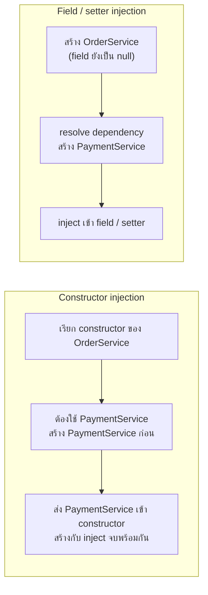
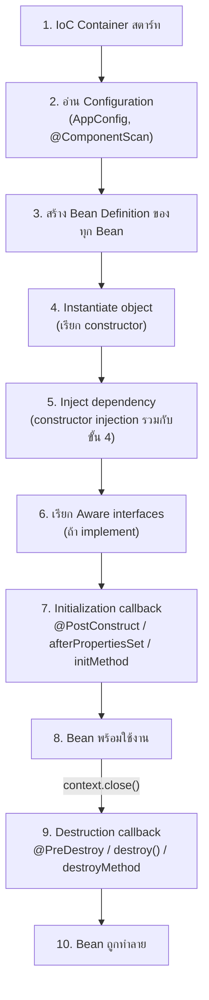
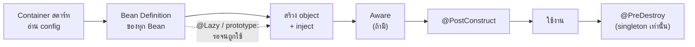

# #7 — Bean Lifecycle: ตั้งแต่ Container สตาร์ทจน Bean ถูกทำลาย

> **วิดีโอ:** [Bean Lifecycle Explained | @PostConstruct, @PreDestroy, Scopes & @Lazy | Spring Boot Full Course #7](https://youtu.be/WXg3uyZPqYI) — Coder Army, ~1 ชั่วโมง 27 นาที
> **แหล่งที่ใช้สรุป:** ซับไตเติลภาษาฮินดีที่ YouTube สร้างอัตโนมัติ
> **เวอร์ชันในโค้ด:** Spring Boot 4.1 + Java 21 (ใส่หมายเหตุไว้ทุกจุดที่ Spring Boot 3.x ต่างกัน)

ตอนนี้ตอบคำถามเดียว: **ตั้งแต่ IoC Container สตาร์ทจนปิดลง Bean หนึ่งตัวผ่านขั้นอะไรบ้าง และเราแทรกโค้ดของเราเข้าไปได้ตรงไหน** ผู้สอนไล่ทีละขั้นกับ singleton bean แบบ eager ก่อน (Bean definition, การสร้าง object, Dependency Injection, Aware interfaces, initialization callback และ destruction callback) แล้วจึงดูว่า singleton ที่เป็น `@Lazy` กับ prototype ต่างไปอย่างไร ท้ายตอนมีเทคนิคแก้ circular dependency ด้วย `@PostConstruct`

ส่วนที่ติดป้าย `💡 เพิ่มเติม` คือของที่ผมเติมเอง ไม่ได้อยู่ในวิดีโอ ส่วนที่ติด `⚠️ แก้จากวิดีโอ` คือจุดที่วิดีโอพูดคลาดเคลื่อน

---

## สารบัญ

| เวลา | หัวข้อ |
|---|---|
| [0:00](https://youtu.be/WXg3uyZPqYI?t=0) | [1. Bean Lifecycle คืออะไร และแผนของตอน](#1-bean-lifecycle-คืออะไร-และแผนของตอน) |
| [3:30](https://youtu.be/WXg3uyZPqYI?t=210) | [2. เตรียมโปรเจกต์: spring-context และ AppConfig](#2-เตรียมโปรเจกต์-spring-context-และ-appconfig) |
| [6:53](https://youtu.be/WXg3uyZPqYI?t=413) | [3. OrderService กับ PaymentService](#3-orderservice-กับ-paymentservice) |
| [9:24](https://youtu.be/WXg3uyZPqYI?t=564) | [4. ขั้นที่ 1 และ 2: Container สตาร์ทและอ่าน Configuration](#4-ขั้นที่-1-และ-2-container-สตาร์ทและอ่าน-configuration) |
| [15:48](https://youtu.be/WXg3uyZPqYI?t=948) | [5. ขั้นที่ 3: อ่าน Bean Definition](#5-ขั้นที่-3-อ่าน-bean-definition) |
| [20:09](https://youtu.be/WXg3uyZPqYI?t=1209) | [6. ขั้นที่ 4 และ 5: สร้าง Object และ Inject Dependency](#6-ขั้นที่-4-และ-5-สร้าง-object-และ-inject-dependency) |
| [25:34](https://youtu.be/WXg3uyZPqYI?t=1534) | [7. ขั้นที่ 6: Aware Interfaces](#7-ขั้นที่-6-aware-interfaces) |
| [40:56](https://youtu.be/WXg3uyZPqYI?t=2456) | [8. ขั้นที่ 7: Initialization Callbacks](#8-ขั้นที่-7-initialization-callbacks) |
| [1:01:05](https://youtu.be/WXg3uyZPqYI?t=3665) | [9. ทำไมไม่ทำทุกอย่างใน Constructor](#9-ทำไมไม่ทำทุกอย่างใน-constructor) |
| [1:03:53](https://youtu.be/WXg3uyZPqYI?t=3833) | [10. ขั้นที่ 8: Bean พร้อมใช้งาน](#10-ขั้นที่-8-bean-พร้อมใช้งาน) |
| [1:04:40](https://youtu.be/WXg3uyZPqYI?t=3880) | [11. ขั้นที่ 9 และ 10: Destruction Callbacks และ Bean ถูกทำลาย](#11-ขั้นที่-9-และ-10-destruction-callbacks-และ-bean-ถูกทำลาย) |
| [1:13:54](https://youtu.be/WXg3uyZPqYI?t=4434) | [12. ภาพรวม Lifecycle ของ Singleton Bean](#12-ภาพรวม-lifecycle-ของ-singleton-bean) |
| [1:14:21](https://youtu.be/WXg3uyZPqYI?t=4461) | [13. Singleton ที่เป็น @Lazy](#13-singleton-ที่เป็น-lazy) |
| [1:16:13](https://youtu.be/WXg3uyZPqYI?t=4573) | [14. Prototype Bean: Spring ไม่เรียก Destroy](#14-prototype-bean-spring-ไม่เรียก-destroy) |
| [1:22:13](https://youtu.be/WXg3uyZPqYI?t=4933) | [15. แก้ Circular Dependency ด้วย @PostConstruct](#15-แก้-circular-dependency-ด้วย-postconstruct) |
| — | [16. ลำดับเต็มเมื่อใช้ทุกกลไกพร้อมกัน และ BeanPostProcessor](#16-ลำดับเต็มเมื่อใช้ทุกกลไกพร้อมกัน-และ-beanpostprocessor) |
| — | [17. สรุปท้ายตอน](#17-สรุปท้ายตอน) |

---

## 1. Bean Lifecycle คืออะไร และแผนของตอน

[▶ 0:00](https://youtu.be/WXg3uyZPqYI?t=0)

ผู้สอนบอกว่า lifecycle ของ Bean เป็นหัวข้อที่สำคัญมากใน Spring Framework โดยเฉพาะในมุมของการสัมภาษณ์งาน เพราะมันอธิบายว่า Bean ที่ IoC Container ดูแลให้เรานั้น ข้างในผ่านกระบวนการอะไรบ้าง

ทบทวนสิ่งที่รู้แล้ว: **IoC Container** รับผิดชอบดูแล Bean ทั้งหมด และ inject dependency ให้ (ที่เรียกว่า autowiring) ถ้าคิดแบบพื้นฐานที่สุด ชีวิตของ Bean มีสามช่วง

1. **Create** — Bean ถูกสร้าง
2. **Manage** — Bean ถูกดูแลและใช้งาน
3. **Destroy** — Bean ถูกทำลาย

### เทียบกับ object ใน Java ปกติ

[▶ 1:35](https://youtu.be/WXg3uyZPqYI?t=95)

ถ้าไม่ใช้ Spring เราสร้าง object เอง ใช้เอง ส่วนการทำลายเป็นหน้าที่ของ **garbage collection** เราไม่ต้องเรียก GC เองใน Java แค่เลิกอ้างอิง object นั้น GC จะสแกนหา object ที่ไม่มีใครอ้างถึงแล้วเคลียร์ออกจาก memory ให้

เมื่อใช้ Spring ทั้งสามช่วงกลายเป็นหน้าที่ของ Spring และคำว่า "destroy" ในที่นี้หมายถึง **เอา Bean ออกจาก IoC Container**

ตอนก่อน ๆ พูดถึงการสร้าง Bean หลายครั้ง และพูดเรื่อง management ไปบ้าง (เช่น autowiring) แต่ยังไม่เคยพูดเรื่อง destroy เลย ทั้งที่มันเป็นส่วนหนึ่งของ lifecycle เหมือนกัน

### แผนของตอน

[▶ 2:41](https://youtu.be/WXg3uyZPqYI?t=161)

- ไล่ทีละ phase แบบลึก แล้วสรุปรวมทุก phase ตอนท้าย
- ดู lifecycle ของ **singleton bean** ก่อน เพราะเป็นค่า default และเป็น **eager initialization** คือถูกสร้างทันทีที่ IoC Container ขึ้น และ class หนึ่งมี Bean เดียว
- จากนั้นดูว่า **prototype** และ **singleton ที่เป็น lazy** ต่างไปอย่างไร ผู้สอนบอกว่าต่างกันนิดเดียว ถ้าเข้าใจ singleton แล้วสองแบบนี้จะง่ายมาก

---

## 2. เตรียมโปรเจกต์: spring-context และ AppConfig

[▶ 3:30](https://youtu.be/WXg3uyZPqYI?t=210)

ผู้สอนสร้างโปรเจกต์ Maven เปล่าชื่อ `bean-lifecycle-demo` ลบโค้ด boilerplate ใน `Main.java` ออก แล้วเพิ่ม dependency **`spring-context`** จาก mvnrepository (เขาเลือกเวอร์ชัน 7.0.7) แค่ตัวนี้ก็เริ่มทำ Dependency Injection และ IoC ได้แล้ว

```xml
<dependencies>
  <dependency>
    <groupId>org.springframework</groupId>
    <artifactId>spring-context</artifactId>
    <!-- วิดีโอใส่ <version>7.0.7</version> เอง; โปรเจกต์ตรวจโค้ดให้ Boot parent 4.1.1 เลือกให้ ได้ 7.0.9 -->
  </dependency>
</dependencies>
```

> 💡 **เพิ่มเติม — โปรเจกต์ที่ใช้ตรวจโค้ดในโน้ตนี้:** ใช้ parent `spring-boot-starter-parent:4.1.1` เพื่อให้ Boot จัดการเวอร์ชัน (ได้ `spring-context` 7.0.9 และ `jakarta.annotation-api` 3.0.0) แต่ไม่ได้ใช้ Spring Boot ตอนรัน ตรงกับวิดีโอที่ใช้ Spring Core อย่างเดียว ทุกตัวอย่างแยก package และมี `main` ของตัวเอง รันแบบนี้
>
> ```bash
> mvn -q -DskipTests package
> mvn -q dependency:build-classpath -Dmdep.outputFile=cp.txt
> java -cp "target/classes:$(cat cp.txt)" com.example.lifecycle.basic.BasicMain
> ```

### สร้าง IoC Container

[▶ 4:39](https://youtu.be/WXg3uyZPqYI?t=279)

ขั้นแรกคือสร้าง object ของ **`ApplicationContext`** ซึ่งก็คือ IoC Container ใช้ `AnnotationConfigApplicationContext` เพราะจะตั้งค่าแบบ annotation-based และ container ต้องการ **configuration class** อีกหนึ่งตัว ผู้สอนตั้งชื่อว่า `AppConfig` ใส่ annotation สองตัว

- `@Configuration` บอกว่าเป็น configuration class
- `@ComponentScan` สั่งให้ scan หา component ถ้าไม่ระบุ package จะ scan **package เดียวกับที่ `AppConfig` อยู่** ซึ่งผู้สอนต้องการแบบนั้นพอดี

```java
package com.example.lifecycle.basic;

import org.springframework.context.annotation.ComponentScan;
import org.springframework.context.annotation.Configuration;

@Configuration
@ComponentScan
public class AppConfig {

  public void demo() {
    System.out.println("demo");
  }
}
```

(method `demo()` ผู้สอนเพิ่มทีหลังในส่วนที่ 4)

### ส่ง metadata ไม่ใช่ object

[▶ 5:46](https://youtu.be/WXg3uyZPqYI?t=346)

ผู้สอนชี้ว่าเราไม่ได้ส่ง **object** ของ `AppConfig` ให้ container แต่ส่ง **`AppConfig.class`** ซึ่งคือ **metadata** ของ class แล้ว container อ่านข้อมูลผ่าน **Reflection API** ของ Java

Reflection บอกทุกอย่างเกี่ยวกับ class ได้ เช่น มี constructor กี่ตัว มี member แบบ private และ public อะไรบ้าง มี method อะไร และมี annotation อะไรติดอยู่ ผู้สอนบอกว่าจะทำวิดีโอเรื่อง Reflection แยกต่างหาก ตอนนี้รู้แค่ว่า **`.class` คือการส่ง metadata ของ class** ก็พอ

---

## 3. OrderService กับ PaymentService

[▶ 6:53](https://youtu.be/WXg3uyZPqYI?t=413)

ผู้สอนสร้าง Bean สองตัวตามตัวอย่างเดิมของคอร์ส ต้องมีสองตัวเพราะอยากให้ตัวหนึ่ง depend on อีกตัว คือ `OrderService` ขึ้นกับ `PaymentService` ทั้งคู่ติด `@Component`

```java
package com.example.lifecycle.basic;

import org.springframework.stereotype.Component;

@Component
public class PaymentService {

  public void pay() {
    System.out.println("Payment done");
  }
}
```

```java
package com.example.lifecycle.basic;

import org.springframework.stereotype.Component;

@Component
public class OrderService {

  private final PaymentService paymentService;

  public OrderService(PaymentService paymentService) {   // constructor injection
    this.paymentService = paymentService;
  }

  public void placeOrder() {
    System.out.println("Order placed");
    paymentService.pay();
  }
}
```

- ใช้ **constructor injection** และเพราะมี constructor ตัวเดียว **ไม่ต้องเขียน `@Autowired`** Spring จัดการเอง
- `placeOrder()` พิมพ์ `Order placed` แล้วเรียก `pay()` ของ `PaymentService` ซึ่งพิมพ์ `Payment done`
- ใน `main` เราไม่ `new OrderService(...)` เอง แต่ขอจาก context ด้วย `context.getBean(OrderService.class)` ซึ่งก็คือส่ง metadata อีกครั้ง

[▶ 9:08](https://youtu.be/WXg3uyZPqYI?t=548) ผลที่ได้คือ `Order placed` ตามด้วย `Payment done` (โค้ด `main` ฉบับเต็มอยู่ท้ายส่วนที่ 4)

---

## 4. ขั้นที่ 1 และ 2: Container สตาร์ทและอ่าน Configuration

[▶ 9:24](https://youtu.be/WXg3uyZPqYI?t=564)

ผู้สอนเปิด Excalidraw แล้วเริ่มวาด lifecycle ทีละขั้น

### ขั้นที่ 1: IoC Container สตาร์ท

ขั้นแรกสุด (จะเรียกขั้นที่ 0 หรือ 1 ก็ได้) คือ **IoC Container สตาร์ท** ถ้า container ยังไม่ขึ้นก็ดูแล Bean ไม่ได้ ในโค้ดคือบรรทัด `new AnnotationConfigApplicationContext(AppConfig.class)`

### ขั้นที่ 2: อ่าน Configuration

[▶ 10:03](https://youtu.be/WXg3uyZPqYI?t=603)

พอ container ขึ้นแล้ว มันต้องการข้อมูลว่าต้องดูแล Bean ตัวไหน และต้อง scan package ไหน ข้อมูลนี้มาจาก configuration class ซึ่งในตัวอย่างคือ `AppConfig` ขั้นที่ 2 จึงเป็น **Read configuration**

### AppConfig เองก็เป็น Bean

[▶ 11:01](https://youtu.be/WXg3uyZPqYI?t=661)

`@Configuration` ข้างในใช้ `@Component` อยู่แล้ว ดังนั้น `AppConfig` เองก็เป็น component และ **IoC Container ดูแล Bean ของ `AppConfig` ด้วย**

จาก metadata ของ `AppConfig` container รู้ว่า

- มี `@ComponentScan` ไหม และให้ scan package ไหน
- มี `@Configuration` ไหม (เป็น configuration class ซึ่งเป็น component ด้วย)
- มี method ที่ติด `@Bean` ไหม ถ้ามีก็ต้องสร้าง Bean จาก method เหล่านั้นด้วย

[▶ 11:52](https://youtu.be/WXg3uyZPqYI?t=712) ผู้สอนยกตัวอย่างว่าถ้าเขียน method ติด `@Bean` ไว้ใน `AppConfig` แล้ว return object ของ `OrderService` ออกมา container ต้องเรียก method นั้นเพื่อเอา object มาเก็บ แต่การเรียก method ต้องมี **object ของ `AppConfig`** ก่อน เรียกตรง ๆ ไม่ได้ ซึ่ง container มีอยู่แล้ว เพราะ `AppConfig` เป็น component ที่มันดูแลเอง

### พิสูจน์ว่า AppConfig เป็น Bean

[▶ 13:39](https://youtu.be/WXg3uyZPqYI?t=819)

ผู้สอนเพิ่ม method ธรรมดา `demo()` ใน `AppConfig` (ไม่ใช่ `@Bean`) แล้วขอ Bean ของ `AppConfig` จาก context มาเรียก ถ้า container ไม่ได้ดูแล `AppConfig` บรรทัดนี้จะ error

```java
package com.example.lifecycle.basic;

import org.springframework.context.ApplicationContext;
import org.springframework.context.annotation.AnnotationConfigApplicationContext;

public class BasicMain {

  public static void main(String[] args) {
    ApplicationContext context = new AnnotationConfigApplicationContext(AppConfig.class);

    OrderService order = context.getBean(OrderService.class);
    order.placeOrder();

    AppConfig config = context.getBean(AppConfig.class);
    config.demo();
  }
}
```

ผลที่ได้

```text
Order placed
Payment done
demo
```

ไม่มี error และพิมพ์ `demo` ออกมา แปลว่า **lifecycle ที่กำลังจะดูนี้ใช้กับ `AppConfig` ด้วย**

### Component scan

[▶ 14:56](https://youtu.be/WXg3uyZPqYI?t=896)

เพราะมี `@ComponentScan` และไม่ได้ระบุ package container จึง scan package ของ `AppConfig` ทีละ class (`AppConfig`, `Main`, `OrderService`, `PaymentService`) ผ่าน Reflection แล้วดูว่า class ไหนติด `@Component` ผลคือได้ `OrderService` กับ `PaymentService` มาเป็น class ที่ต้องดูแลและสร้าง Bean

---

## 5. ขั้นที่ 3: อ่าน Bean Definition

[▶ 15:48](https://youtu.be/WXg3uyZPqYI?t=948)

ขั้นที่ 3 ยัง **ไม่ใช่** การสร้าง object ก่อนสร้าง container ต้องมี **Bean Definition** ก่อน

ผู้สอนให้คิดว่า container สร้าง `OrderService` กับ `PaymentService` ตรง ๆ เลยก็ได้ แต่จะดีกว่ามากถ้ามันรู้ metadata ของแต่ละ Bean ก่อน เช่น scope คืออะไร (default คือ singleton) initialization เป็นแบบไหน (singleton default คือ eager) และมี dependency อะไร พอรู้ข้อมูลพวกนี้ container จะ inject dependency และจัดการ Bean ร่วมกันได้ดีขึ้น ขั้นนี้คือ **Read Bean Definition**

### Bean Definition มีอะไรบ้าง

[▶ 17:02](https://youtu.be/WXg3uyZPqYI?t=1022)

| ข้อมูล | ค่าของ `OrderService` |
|---|---|
| Bean name | `orderService` (default คือชื่อ class ที่ตัวแรกเป็นตัวเล็ก) |
| Class | `OrderService` |
| Scope | `singleton` |
| Lazy | `false` |
| Dependency | `paymentService` (ตามวิดีโอ ดูหมายเหตุด้านล่าง) |

ชื่อ Bean เปลี่ยนได้ด้วยการส่งค่าให้ `@Component` เช่น `@Component("orderBean")` ชื่อจะกลายเป็น `orderBean`

container สร้าง Bean Definition ให้ทั้ง `OrderService` และ `PaymentService` เพราะติด `@Component` ทั้งคู่

### สร้าง definition ทั้งหมดก่อน แล้วค่อยสร้าง object

[▶ 18:36](https://youtu.be/WXg3uyZPqYI?t=1116)

คำถาม: container สร้าง definition ของ Bean หนึ่งตัว แล้วสร้าง object ของมันเลย แล้วค่อยไปตัวถัดไป หรือสร้าง definition ของทุกตัวก่อน?

คำตอบคือ **สร้าง Bean Definition ของทุกตัวให้ครบก่อน** จากนั้นจึงสร้าง object ที่ต้องสร้าง แล้ว inject dependency ต่อ

[▶ 19:09](https://youtu.be/WXg3uyZPqYI?t=1149) เหตุผลคือ definition บอกว่า Bean ตัวไหนเป็น prototype หรือเป็น lazy

- singleton มี lazy เป็น `false` โดย default แต่ตั้งเป็น `true` ได้
- prototype เป็น lazy เสมอ
- Bean ที่เป็น prototype หรือ lazy ไม่ต้องสร้างทันที container จะสร้างเมื่อมีการใช้ เช่น เรียก method ของมัน หรือ `getBean`

ถ้า container รู้ล่วงหน้าว่าต้องสร้างตัวไหน งานก็ง่ายขึ้น ตอนสตาร์ทมันจะสร้างเฉพาะ **singleton ที่ lazy เป็น `false`**

> ⚠️ **แก้จากวิดีโอ (ความแม่นยำ):** วิดีโอบอกว่า Bean Definition เก็บข้อมูลว่า `orderService` ขึ้นกับ `paymentService` ด้วย ที่ถูกคือ Bean Definition ของ class ที่มาจาก component scan เก็บแค่ข้อมูลอย่าง class, scope, lazy และ dependency ที่ประกาศไว้ชัด ๆ เท่านั้น (เช่น `@DependsOn` หรือ `<constructor-arg>` ใน XML) ส่วน dependency ที่มาจาก constructor หรือ `@Autowired` Spring จะหาด้วย Reflection **ตอนกำลังสร้าง Bean** และบันทึกความสัมพันธ์ไว้หลัง inject เสร็จ ดูได้จากโค้ดนี้
>
> ```java
> package com.example.lifecycle.basic;
>
> import java.util.Arrays;
> import org.springframework.beans.factory.config.BeanDefinition;
> import org.springframework.beans.factory.config.ConfigurableListableBeanFactory;
> import org.springframework.context.annotation.AnnotationConfigApplicationContext;
>
> public class BeanDefinitionMain {
>
>   public static void main(String[] args) {
>     AnnotationConfigApplicationContext context = new AnnotationConfigApplicationContext(AppConfig.class);
>     ConfigurableListableBeanFactory factory = context.getBeanFactory();
>
>     BeanDefinition def = factory.getBeanDefinition("orderService");
>     System.out.println("class      = " + def.getBeanClassName());
>     System.out.println("scope      = " + def.getScope());
>     System.out.println("lazyInit   = " + def.isLazyInit());
>     System.out.println("dependsOn  = " + Arrays.toString(def.getDependsOn()));
>     System.out.println("ctor args  = " + def.getConstructorArgumentValues().getArgumentCount());
>
>     System.out.println("injected   = " + Arrays.toString(factory.getDependenciesForBean("orderService")));
>   }
> }
> ```
>
> ```text
> class      = com.example.lifecycle.basic.OrderService
> scope      = singleton
> lazyInit   = false
> dependsOn  = null
> ctor args  = 0
> injected   = [paymentService]
> ```
>
> ใน definition ไม่มีข้อมูลของ `paymentService` เลย (`dependsOn = null` และไม่มี constructor argument) ความสัมพันธ์ `[paymentService]` มาจากสิ่งที่ Spring บันทึกไว้ตอนสร้าง Bean เสร็จแล้ว

---

## 6. ขั้นที่ 4 และ 5: สร้าง Object และ Inject Dependency

### ขั้นที่ 4: Instantiate objects

[▶ 20:09](https://youtu.be/WXg3uyZPqYI?t=1209)

ถึงเวลาสร้าง object จริง ผู้สอนเรียกว่า **instantiate** (จะเรียกว่า create ก็ความหมายเดียวกัน)

[▶ 20:42](https://youtu.be/WXg3uyZPqYI?t=1242) Spring **ไม่ได้สร้าง object แบบสุ่ม** IoC Container ฉลาดและ **dependency-aware** ลำดับขึ้นกับว่าตอน scan เจอ class ไหนก่อน

- ถ้าเจอ `PaymentService` ก่อน: ไม่มี dependency สร้างได้ทันที
- ถ้าเจอ `OrderService` ก่อน: การสร้าง object ต้องเรียก constructor พอเห็นว่า constructor ต้องการ `PaymentService` container ก็รู้ว่าต้องสร้าง `PaymentService` ก่อน จึงไปสร้าง `PaymentService` ให้เสร็จ แล้วค่อยกลับมาสร้าง `OrderService` และเชื่อม dependency

### ขั้นที่ 5: Dependencies are injected

[▶ 22:46](https://youtu.be/WXg3uyZPqYI?t=1366)

ขั้นต่อมาคือ resolve dependency ผู้สอนชี้จุดที่น่าสนใจ

- **Constructor injection:** การสร้าง object กับการ inject dependency **เกิดพร้อมกัน** เพราะ `OrderService` สร้างไม่ได้ถ้ายังไม่มี `PaymentService` ต้องส่ง `PaymentService` เข้า constructor เลย ขั้นที่ 4 กับ 5 จึงรวมเป็นขั้นเดียว
- **Setter หรือ field injection:** [▶ 23:51](https://youtu.be/WXg3uyZPqYI?t=1431) object ถูกสร้างก่อน แล้ว dependency ถูก inject **ทีหลัง** สองขั้นจึงแยกกันจริง

[▶ 24:09](https://youtu.be/WXg3uyZPqYI?t=1449) ผู้สอนลองเปลี่ยนเป็น `@Autowired` บน field แบบ private (ทำได้เพราะ Spring ใช้ Reflection) ในกรณีนี้ container เห็นว่า `OrderService` ขึ้นกับ `PaymentService` แต่ **ไม่ต้องใช้ตอนสร้าง** จึงสร้าง `OrderService` ก่อนได้เลย พอถึงตอน resolve dependency ถึงพบว่ายังไม่ได้สร้าง `PaymentService` แล้วค่อยไปสร้าง



> 💡 **เพิ่มเติม:** ผมลอง register `OrderService` ก่อน `PaymentService` แล้วพิมพ์จาก constructor ทั้งสองแบบ ผลตรงกับที่ผู้สอนอธิบาย แบบ constructor injection ได้ `PaymentService constructor called` ขึ้นก่อน แบบ field injection ได้ constructor ของ `OrderService` ขึ้นก่อนโดยที่ field ยังเป็น `null` ตัวอย่างโค้ดที่เห็น field เป็น `null` ใน constructor อยู่ใน [ส่วนที่ 9](#9-ทำไมไม่ทำทุกอย่างใน-constructor)

[▶ 25:03](https://youtu.be/WXg3uyZPqYI?t=1503) ถึงตรงนี้ใน IoC Container มี object สามตัวคือ `AppConfig`, `OrderService`, `PaymentService` และความสัมพันธ์ว่า `OrderService` ขึ้นกับ `PaymentService` ก็ถูก resolve แล้ว

---

## 7. ขั้นที่ 6: Aware Interfaces

[▶ 25:34](https://youtu.be/WXg3uyZPqYI?t=1534)

object ถูกสร้างและ dependency ถูก resolve แล้ว เริ่มใช้ Bean ได้เลยไหม? ผู้สอนบอกว่าถูกต้อง แต่ยังมี **ขั้นกลาง** ที่น่าสนใจ และเป็นสิ่งที่แยกคนที่เรียน Spring แบบผิว ๆ ออกจากคนที่เข้าใจลึก หลายแหล่งบอกว่าพอ instantiate และ resolve dependency เสร็จก็ใช้ได้เลย อาจพูดถึง `@PostConstruct` เพิ่มนิดหน่อย แต่จริง ๆ ยังมี **Aware interfaces**

[▶ 26:21](https://youtu.be/WXg3uyZPqYI?t=1581) Aware interfaces เป็น interface พิเศษใน Spring ส่วนใหญ่เราจะไม่ได้ใช้ เพราะไม่เกี่ยวกับ business logic ขั้นที่ 6 คือ **Aware interfaces are called** ซึ่งเกิดหลังขั้น inject dependency

### Aware interface คืออะไร

[▶ 26:49](https://youtu.be/WXg3uyZPqYI?t=1609)

บางครั้ง Bean ต้องการข้อมูลเกี่ยวกับตัวเอง เช่น ชื่อ Bean ของตัวเองคืออะไร หรือตัวเองอยู่ใน IoC Container ตัวไหน Spring จึงเตรียม method พิเศษไว้ ถ้าเรา implement interface ที่เกี่ยวข้อง Spring จะส่งข้อมูลนั้นมาให้

### ตัวอย่าง: UserService กับ BeanNameAware

[▶ 27:28](https://youtu.be/WXg3uyZPqYI?t=1648)

ผู้สอนไม่แตะ `OrderService` กับ `PaymentService` แต่สร้าง class ใหม่ `UserService` ติด `@Component` แล้วเขียน constructor พิมพ์ `UserService constructor called`

[▶ 28:08](https://youtu.be/WXg3uyZPqYI?t=1688) รันโดยไม่ทำอะไรใน `main` เลย ก็เห็น `UserService constructor called` เพราะ container ขึ้น, scan เจอ `UserService`, สร้าง Bean Definition, แล้วสร้าง object ทันทีเพราะเป็น singleton แบบ eager ไม่มี dependency ให้ resolve และ constructor ถูกเรียกตอนสร้าง object

[▶ 28:41](https://youtu.be/WXg3uyZPqYI?t=1721) ต่อมาให้ `UserService` implement **`BeanNameAware`** ทันทีที่ implement จะ compile error เพราะต้อง override method ทั้งหมดของ interface `BeanNameAware` มี method เดียวคือ **`setBeanName(String name)`**

> เคล็ดลับ IntelliJ จากวิดีโอ: เอาเมาส์ไปชี้ตรง error จะขึ้นว่า class ต้องเป็น abstract หรือ implement abstract method ให้กด **Implement methods** แล้ว IDE จะสร้าง signature ให้

ใน `setBeanName` ผู้สอนพิมพ์ `Bean name is <name>` โดย **ไม่ได้เรียก method นี้ที่ไหนเลย** แล้วรันอีกครั้ง ได้ `Bean name is userService` (u ตัวเล็ก) [▶ 30:47](https://youtu.be/WXg3uyZPqYI?t=1847) พอเปลี่ยนเป็น `@Component("userBean")` ผลก็เปลี่ยนเป็น `Bean name is userBean`

### Callback method

[▶ 31:15](https://youtu.be/WXg3uyZPqYI?t=1875)

method ที่ **Spring เป็นคนเรียก** ไม่ใช่เรา เรียกว่า **callback method** เพราะการเรียกมาจากฝั่ง Spring เราแค่รันโปรแกรม แล้ว lifecycle ของ Bean ก็เดินไปเอง: สร้าง object, inject dependency แล้วเรียก Aware interfaces

[▶ 32:02](https://youtu.be/WXg3uyZPqYI?t=1922) ถ้าไม่ implement interface นี้ Spring ก็ไม่มี method ให้เรียก ขั้นนี้ถูกข้ามไป แต่พอเรา implement `BeanNameAware` Spring รู้ว่าต้องเรียก `setBeanName` ให้

### ทำไมชื่อ setBeanName ไม่ใช่ getBeanName

[▶ 32:28](https://youtu.be/WXg3uyZPqYI?t=1948)

เราใช้ method นี้เพื่อ "รู้" ชื่อ Bean แล้วทำไมไม่ชื่อ `getBeanName`? ผู้สอนอธิบายว่า ถ้าเป็น `get...` นั่นคือ method ธรรมดาที่ **เราเรียก** แล้วได้ค่ากลับมา เช่น getter ที่เราเขียนเองซึ่ง return ชื่อ Bean ให้คนที่เรียก แต่ method นี้ **Spring เรียก** ในช่วงที่ Bean สร้างเสร็จและ resolve dependency แล้ว และ Spring **set ชื่อ Bean ให้เรา** ผ่าน parameter เราจึงเก็บไว้ใช้ทีหลังได้ ชื่อจึงเป็น `set...`

### เรียก setBeanName เองไม่ได้เปลี่ยนชื่อ Bean

[▶ 34:25](https://youtu.be/WXg3uyZPqYI?t=2065)

ถ้าขอ Bean มาแล้วเรียก `userService.setBeanName("userBean2")` เอง ชื่อ Bean จะเปลี่ยนไหม? **ไม่เปลี่ยน** เราแค่เรียก method ธรรมดาที่พิมพ์ `Bean name is userBean2` ออกมา ชื่อ Bean ใน IoC Container ยังเป็น `userBean` เหมือนเดิม ถ้าจะเปลี่ยนต้องแก้ที่ `@Component` **การเรียก callback method เองเปลี่ยนอะไรใน Spring ไม่ได้** อย่างมากก็พิมพ์อะไรออก console

### ApplicationContextAware

[▶ 36:20](https://youtu.be/WXg3uyZPqYI?t=2180)

Aware interface อีกตัวคือ **`ApplicationContextAware`** มี method **`setApplicationContext(ApplicationContext)`** (ประกาศว่า throw `BeansException` ได้ แต่ไม่ต้องสนใจ) Spring จะเรียกเพื่อบอกว่า Bean นี้อยู่ใน ApplicationContext ตัวไหน ผู้สอนพิมพ์ชื่อ class ของ context ออกมา ได้ `AnnotationConfigApplicationContext` ซึ่งตรงกับ object ที่สร้างไว้ใน `main` ถ้าใช้ XML-based configuration ก็จะได้ class ของ context อีกแบบ (เรื่อง XML อยู่ตอนถัดไป)

```java
package com.example.lifecycle.aware;

import org.springframework.beans.BeansException;
import org.springframework.beans.factory.BeanNameAware;
import org.springframework.context.ApplicationContext;
import org.springframework.context.ApplicationContextAware;
import org.springframework.stereotype.Component;

@Component("userBean")
public class UserService implements BeanNameAware, ApplicationContextAware {

  private String beanName;

  public UserService() {
    System.out.println("UserService constructor called");
  }

  @Override
  public void setBeanName(String name) {
    this.beanName = name;
    System.out.println("Bean name is " + name);
  }

  @Override
  public void setApplicationContext(ApplicationContext applicationContext) throws BeansException {
    System.out.println("Application context name is " + applicationContext.getClass().getName());
  }

  public String getBeanName() {   // method ธรรมดาที่เราเรียกเอง
    return beanName;
  }
}
```

`AwareConfig` เป็น `@Configuration @ComponentScan` เปล่า ๆ แบบเดียวกับ `AppConfig`

```java
package com.example.lifecycle.aware;

import java.util.Arrays;
import org.springframework.context.ApplicationContext;
import org.springframework.context.annotation.AnnotationConfigApplicationContext;

public class AwareMain {

  public static void main(String[] args) {
    ApplicationContext context = new AnnotationConfigApplicationContext(AwareConfig.class);

    UserService userService = context.getBean(UserService.class);
    userService.setBeanName("userBean2");

    System.out.println("Name in container: "
        + Arrays.toString(context.getBeanNamesForType(UserService.class)));
  }
}
```

```text
UserService constructor called
Bean name is userBean
Application context name is org.springframework.context.annotation.AnnotationConfigApplicationContext
Bean name is userBean2
Name in container: [userBean]
```

สามบรรทัดแรกเกิดตอน container สตาร์ท บรรทัดที่สี่มาจากการเรียกเอง และบรรทัดสุดท้าย (💡 ผมเพิ่มเพื่อยืนยัน) แสดงว่าชื่อใน container ยังเป็น `userBean`

[▶ 37:54](https://youtu.be/WXg3uyZPqYI?t=2274) ผู้สอนบอกว่าไม่ต้องจำชื่อ method พวกนี้ แค่รู้ว่ามี Aware interfaces อยู่ ถ้าต้องใช้ก็ implement แล้ว override method ของมัน แต่ละตัวมี method เดียว พิมพ์หรือ log parameter ที่ได้มาดูก็พอ

### Aware interfaces มีไว้ทำอะไร

[▶ 38:20](https://youtu.be/WXg3uyZPqYI?t=2300)

ชื่อ Bean ก็อ่านจากโค้ดได้ context ก็ดูจาก `main` ได้ แล้วจะรู้ไปทำไม? ผู้สอนยอมรับว่า **99% ของ business logic ไม่ได้ใช้** กรณีที่ใช้คือ

- **Logging:** แอประดับ enterprise มี log หลายระดับ (info, error) เก็บลงไฟล์ หรือส่งไปบริการ log ภายนอก ถ้าอยากให้ทุกบรรทัดของ log มีชื่อ Bean ติดไปด้วย จะได้รู้ว่า log มาจาก Bean ไหน ก็ใช้ `setBeanName`
- **หลาย container:** [▶ 39:20](https://youtu.be/WXg3uyZPqYI?t=2360) ปกติแอปหนึ่งมี container เดียว แต่ถ้าใช้ทั้ง XML-based และ annotation-based configuration พร้อมกัน (ไม่ค่อยเกิด) ให้ Bean บางตัวอยู่ใน container หนึ่ง บางตัวอยู่อีกตัว เวลา debug ก็ควรรู้ว่า Bean มาจาก container ไหน จะได้ debug เฉพาะตัวนั้น

> 💡 **เพิ่มเติม:** Aware interfaces ยังมีอีกหลายตัว เช่น `BeanFactoryAware`, `BeanClassLoaderAware`, `EnvironmentAware`, `ResourceLoaderAware`, `ApplicationEventPublisherAware` ทุกตัวสืบจาก marker interface `Aware` ซึ่งไม่มี method เลย ในโค้ดสมัยนี้ถ้าแค่อยากได้ `ApplicationContext` หรือ `Environment` มักรับเข้ามาทาง constructor เหมือน dependency ทั่วไปได้เลย ไม่ต้อง implement Aware

---

## 8. ขั้นที่ 7: Initialization Callbacks

[▶ 40:15](https://youtu.be/WXg3uyZPqYI?t=2415)

ทบทวน: container สตาร์ท, อ่าน configuration, scan component, สร้าง Bean Definition, สร้าง object, inject dependency และเรียก Aware interfaces แล้ว ใช้ Bean ได้หรือยัง? **ยังเหลืออีกขั้น**

[▶ 41:02](https://youtu.be/WXg3uyZPqYI?t=2462) ขั้นที่ 7 คือ **Initialization callbacks** เป็น callback method ที่ Spring เรียกให้เมื่อเรา implement interface หรือประกาศไว้ ผู้สอนบอกว่า Aware interfaces อาจไม่จำเป็นต้องใช้ แต่ขั้นนี้ **ใช้บ่อยมาก**

### ใช้ทำอะไร

[▶ 42:31](https://youtu.be/WXg3uyZPqYI?t=2551)

Spring บอกว่าระหว่าง "inject dependency เสร็จ" กับ "เริ่มใช้ Bean" ควรมีช่วงหนึ่งให้ **initialize** Bean

ผู้สอนสร้าง class `CartService` (ไม่มี use case จริง แค่ใช้อธิบาย) ติด `@Component` มี method `addToCart()` พิมพ์ `Added to cart` (ไม่รับ item เพราะไม่ได้ลง business logic) และมี `Map<Integer, String>` ที่ประกาศไว้แล้วสร้างใน constructor ซึ่งพิมพ์ `CartService constructor called`

[▶ 44:36](https://youtu.be/WXg3uyZPqYI?t=2676) งานที่อยากทำก่อนเรียก method อย่าง `addToCart()`

- ใส่ค่าเริ่มต้นลงใน map
- **flush** map ด้วย `map.clear()` สมมติว่า map ถูก inject มาเป็น dependency และอาจมีข้อมูลค้างมา แต่อยากให้ `CartService` เริ่มด้วย map ว่าง
- เคลียร์หรือ invalidate cache ก่อนเริ่มทำงาน
- เตรียม resource ที่แพง เช่น ไฟล์ขนาดใหญ่ อยากโหลดไว้ล่วงหน้า ไม่ใช่รอโหลดตอน method ถูกเรียก

Spring บอกว่าให้เขียน method พิเศษไว้ แล้ว Spring จะเรียกเป็น callback **ก่อนที่เราจะทำงานใด ๆ กับ Bean**

### สามวิธี

[▶ 46:16](https://youtu.be/WXg3uyZPqYI?t=2776)

| วิธี | ลักษณะ | สถานะตามวิดีโอ |
|---|---|---|
| `InitializingBean` | interface, override `afterPropertiesSet()` | เก่าแล้ว ถูก `@PostConstruct` แทนที่ |
| `initMethod` | ระบุชื่อ method ใน `@Bean` | ยังใช้อยู่ มี use case เฉพาะ |
| `@PostConstruct` | annotation บน method | ใช้มากที่สุดในปัจจุบัน เรียบง่าย |

### วิธีที่ 1: InitializingBean

[▶ 46:58](https://youtu.be/WXg3uyZPqYI?t=2818)

(ผู้สอนพิมพ์ผิดเป็น `InitializationBean` ก่อนแล้วแก้เป็น **`InitializingBean`**) เป็น interface ที่มี method เดียวคือ **`afterPropertiesSet()`** Spring จะเรียก method นี้ **หลังสร้าง object และก่อนที่เราจะเรียก method อื่นได้**

[▶ 47:46](https://youtu.be/WXg3uyZPqYI?t=2866) ไล่ขั้นของ `CartService`: สร้าง object, ไม่มี dependency ข้ามไป, ไม่มี Aware interface ข้ามไป, แล้วถึง initialization callback คือ `afterPropertiesSet()`

ผู้สอนใส่ค่า `1 → Aditya` และ `2 → Rohit` ลง map แล้วพิมพ์ข้อความ (ตอนแรกพิมพ์ `Initialization callback` แล้วเปลี่ยนเป็น `Bean is ready` เพราะหลังขั้นนี้ Bean พร้อมใช้งาน) และเอา `@Component` ออกจาก `UserService` เพื่อให้ output ไม่รก

[▶ 49:51](https://youtu.be/WXg3uyZPqYI?t=2991) เพิ่ม `getValue(Integer key)` คืนค่าจาก map (จะใช้ `getOrDefault` ก็ได้แต่ไม่ได้ทำ) แล้วใน `main` ขอ Bean มาเรียก `getValue(1)` ครั้งแรกลืม `System.out.println` เลยไม่เห็นอะไร พอใส่แล้วก็เห็นค่า

```java
package com.example.lifecycle.initbean;

import java.util.HashMap;
import java.util.Map;
import org.springframework.beans.factory.InitializingBean;
import org.springframework.stereotype.Component;

@Component
public class CartService implements InitializingBean {

  private final Map<Integer, String> items;

  public CartService() {
    items = new HashMap<>();
    System.out.println("CartService constructor called");
  }

  @Override
  public void afterPropertiesSet() {
    System.out.println("Bean is ready");
    items.put(1, "Aditya");
    items.put(2, "Rohit");
  }

  public void addToCart() {
    System.out.println("Added to cart");
  }

  public String getValue(Integer key) {
    return items.get(key);
  }
}
```

```java
package com.example.lifecycle.initbean;

import org.springframework.context.ApplicationContext;
import org.springframework.context.annotation.AnnotationConfigApplicationContext;

public class InitBeanMain {

  public static void main(String[] args) {
    ApplicationContext context = new AnnotationConfigApplicationContext(InitBeanConfig.class);

    CartService cart = context.getBean(CartService.class);
    System.out.println(cart.getValue(1));
  }
}
```

```text
CartService constructor called
Bean is ready
Aditya
```

`Aditya` ออกมาได้เพราะ `afterPropertiesSet()` ถูกเรียกก่อนที่ `main` จะได้ Bean ไปใช้

### วิธีที่ 2: initMethod ใน @Bean

[▶ 52:32](https://youtu.be/WXg3uyZPqYI?t=3152)

ถ้า `CartService` ไม่ได้ติด `@Component` แต่สร้าง Bean จาก method `@Bean` ใน `AppConfig` แทน เราเป็นคน `new` object เองแล้วส่งให้ container จะให้ Spring เรียก method ของเราในขั้น initialization ได้อย่างไร?

ผู้สอน comment `implements InitializingBean` และ `@Component` ออก ถ้าไม่มี callback map จะว่าง `getValue(1)` จึงได้ `null`

[▶ 54:12](https://youtu.be/WXg3uyZPqYI?t=3252) วิธีแก้คือส่ง **`initMethod`** ให้ `@Bean` แล้วเขียน method ชื่ออะไรก็ได้ของเราเอง ผู้สอนตั้งชื่อว่า `start()` ไม่ต้อง implement interface ใด ๆ

`CartService` เหมือนเวอร์ชัน `InitializingBean` ด้านบน ต่างกันแค่ไม่มี `@Component` ไม่ implement interface และเปลี่ยน `afterPropertiesSet()` เป็น method ธรรมดาชื่อ `start()`

```java
public class CartService {
  // ... field, constructor, addToCart, getValue เหมือนเดิม ...

  public void start() {
    System.out.println("Bean is ready");
    items.put(1, "Aditya");
    items.put(2, "Rohit");
  }
}
```

```java
package com.example.lifecycle.initmethod;

import org.springframework.context.annotation.Bean;
import org.springframework.context.annotation.Configuration;

@Configuration
public class InitMethodConfig {

  @Bean(initMethod = "start")
  public CartService getCartBean() {
    return new CartService();
  }
}
```

`NoInitMethodConfig` เหมือนกันทุกอย่างแต่ใช้ `@Bean` เฉย ๆ ไม่มี `initMethod` แล้วใน `main` รันทั้งสองแบบต่อกัน (💡 ผมรวมไว้ใน `main` เดียวเพื่อให้เห็นความต่าง)

```java
package com.example.lifecycle.initmethod;

import org.springframework.context.ApplicationContext;
import org.springframework.context.annotation.AnnotationConfigApplicationContext;

public class InitMethodMain {

  public static void main(String[] args) {
    System.out.println("== @Bean without initMethod ==");
    ApplicationContext withoutInit = new AnnotationConfigApplicationContext(NoInitMethodConfig.class);
    System.out.println(withoutInit.getBean(CartService.class).getValue(1));

    System.out.println("== @Bean(initMethod = \"start\") ==");
    ApplicationContext withInit = new AnnotationConfigApplicationContext(InitMethodConfig.class);
    System.out.println(withInit.getBean(CartService.class).getValue(1));
  }
}
```

```text
== @Bean without initMethod ==
CartService constructor called
null
== @Bean(initMethod = "start") ==
CartService constructor called
Bean is ready
Aditya
```

[▶ 54:58](https://youtu.be/WXg3uyZPqYI?t=3298) สรุปของผู้สอน: ถ้าใช้ `@Component` ก็ใช้ `InitializingBean` ได้ ถ้าประกาศ Bean ด้วย `@Bean` ใน `AppConfig` ก็บอก `initMethod` เอง โดยใช้ method อะไรก็ได้ของเรา

### วิธีที่ 3: @PostConstruct

[▶ 55:15](https://youtu.be/WXg3uyZPqYI?t=3315)

วิธีที่ใช้มากที่สุดคือ **`@PostConstruct`** เป็นแบบ annotation-based ไม่ต้อง implement interface ไม่ต้อง override method แค่ติด `@PostConstruct` บน method ของเราเอง method นั้นก็กลายเป็น callback

ผู้สอนสร้าง method ใหม่ (ในวิดีโอชื่อ `start2`) เอา `initMethod` และ `@Bean` ออก แล้วให้ `CartService` กลับไปเป็น `@Component` ถ้ายังไม่ติด annotation จะไม่มีใครเรียก method นี้ และ `getValue(1)` ได้ `null` เหมือนเดิม พอติด `@PostConstruct` Spring ก็รู้ว่านี่คือ initialization method

ผู้สอนเสริมว่า `initMethod` ยังจำเป็นตอนประกาศ Bean ด้วย `@Bean` แต่เมื่อสร้างเป็น component ก็ใช้ `@PostConstruct`

### ต้องเพิ่ม jakarta.annotation-api

[▶ 57:23](https://youtu.be/WXg3uyZPqYI?t=3443)

พอติด `@PostConstruct` แล้ว IDE ขึ้น error เพราะ **`spring-context` ไม่มี `@PostConstruct`** annotation นี้อยู่ในไลบรารี **Jakarta Annotations** ต้องเพิ่มเป็น dependency แยก ผู้สอนอธิบายว่าที่ต้องเพิ่มเพราะตอนนี้ใช้แค่ `spring-context` ซึ่งให้แค่ core ขั้นต่ำ ถ้าสร้างแอป Spring Boot ไลบรารีนี้มาให้แล้ว ไม่ต้องเพิ่มเอง

ผู้สอนค้น "jakarta annotation" ใน mvnrepository ได้ **Jakarta Annotations API** เลือกเวอร์ชัน 3 (ออกปี 2024) แล้วเพิ่มลง `pom.xml`

```xml
<dependency>
  <groupId>jakarta.annotation</groupId>
  <artifactId>jakarta.annotation-api</artifactId>
  <!-- Boot parent 4.1.1 เลือกให้เป็น 3.0.0 -->
</dependency>
```

> ⚠️ **Boot 4 vs 3:** โค้ดเหมือนกันทุกบรรทัด ทั้งคู่ import จาก `jakarta.annotation.PostConstruct` / `jakarta.annotation.PreDestroy` และ `spring-boot-starter` ของทั้งสองเวอร์ชันดึง `jakarta.annotation-api` มาให้แล้ว ต่างกันแค่เวอร์ชัน: Boot 4.1.1 ได้ API 3.0.0 คู่กับ Spring Framework 7.0.9 ส่วน Boot 3.5.x ได้ API 2.1.1 คู่กับ Spring Framework 6.2.x ถ้าเจอบทเรียนที่ใช้ `javax.annotation.PostConstruct` นั่นคือยุคก่อน Boot 3
> (ตรวจจาก `spring-boot-dependencies` และ `spring-boot-starter` POM เวอร์ชัน 4.1.1 และ 3.5.16)

### รวม Aware กับ @PostConstruct

[▶ 59:09](https://youtu.be/WXg3uyZPqYI?t=3549)

ผู้สอนคัดลอก `BeanNameAware` และ `ApplicationContextAware` จาก `UserService` มาใส่ใน `CartService` แล้วเรียง method ในไฟล์ตามลำดับที่จะถูกเรียก: constructor, `setBeanName`, `setApplicationContext`, `@PostConstruct` จากนั้นค่อยเป็น method ที่เราเรียกเอง (`addToCart`, `getValue`)

```java
package com.example.lifecycle.postconstruct;

import jakarta.annotation.PostConstruct;
import java.util.HashMap;
import java.util.Map;
import org.springframework.beans.BeansException;
import org.springframework.beans.factory.BeanNameAware;
import org.springframework.context.ApplicationContext;
import org.springframework.context.ApplicationContextAware;
import org.springframework.stereotype.Component;

@Component
public class CartService implements BeanNameAware, ApplicationContextAware {

  private final Map<Integer, String> items;

  public CartService() {
    items = new HashMap<>();
    System.out.println("CartService constructor called");
  }

  @Override
  public void setBeanName(String name) {
    System.out.println("Bean name is " + name);
  }

  @Override
  public void setApplicationContext(ApplicationContext applicationContext) throws BeansException {
    System.out.println("Application context name is " + applicationContext.getClass().getName());
  }

  @PostConstruct
  public void init() {
    System.out.println("Bean is ready");
    items.put(1, "Aditya");
    items.put(2, "Rohit");
  }

  public void addToCart() {
    System.out.println("Added to cart");
  }

  public String getValue(Integer key) {
    return items.get(key);
  }
}
```

`PostConstructMain` เหมือน `InitBeanMain` ทุกอย่าง แค่ใช้ `PostConstructConfig`

```text
CartService constructor called
Bean name is cartService
Application context name is org.springframework.context.annotation.AnnotationConfigApplicationContext
Bean is ready
Aditya
```

> 💡 **เพิ่มเติม:** method ที่ติด `@PostConstruct` ต้องไม่มี parameter, return `void` และไม่เป็น `static` จะเป็น `private` ก็ได้ และ class หนึ่งควรมีแค่ method เดียว

---

## 9. ทำไมไม่ทำทุกอย่างใน Constructor

[▶ 1:01:05](https://youtu.be/WXg3uyZPqYI?t=3665)

ผู้สอนบอกว่านี่คือ **คำถามสัมภาษณ์** ที่น่าสนใจ: งานที่ใส่ใน `@PostConstruct`, `InitializingBean` หรือ `initMethod` ใส่ใน constructor ก็ได้ไม่ใช่หรือ?

เขาลองย้าย `items.put(...)` สองบรรทัดไปไว้ใน constructor แล้วลบ `@PostConstruct` ออก รันแล้วก็ยังได้ `Aditya` (มี bean name และชื่อ context ออกมา แต่ไม่มี `Bean is ready`) แล้วจะมี `@PostConstruct` ไว้ทำไม?

[▶ 1:02:02](https://youtu.be/WXg3uyZPqYI?t=3722) คำตอบมีสองข้อ

1. **constructor ถูกเรียกเร็วเกินไป** มันถูกเรียกตอน instantiate ซึ่งเป็นช่วงที่ยังไม่รู้อะไรหลายอย่าง dependency ที่มาทาง constructor มีครบ แต่ถ้าใช้ field injection หรือ setter injection ตอนนั้น dependency พวกนั้นยัง **ไม่ถูก inject** ถ้างาน initialize ต้องใช้ dependency เหล่านั้นก็ทำใน constructor ไม่ได้ ส่วน `@PostConstruct` ถูกเรียกหลัง inject dependency และหลัง Aware interfaces ตอนที่ object พร้อมเต็มที่แล้ว
2. **งานบางอย่างหนัก** [▶ 1:03:09](https://youtu.be/WXg3uyZPqYI?t=3789) เช่น โหลดไฟล์ที่แพง ผู้สอนบอกว่าไม่อยากให้การสร้าง object ช้า แนวปฏิบัติที่ดีคือให้ constructor เบา ปล่อยให้ object ถูกสร้างอย่างสะอาดก่อน แล้วค่อยทำงานหนักใน method อื่น อย่างเช่น `@PostConstruct`

> ⚠️ **แก้จากวิดีโอ (ความแม่นยำ):** เหตุผลข้อ 2 ฟังเหมือนว่าย้ายงานหนักไป `@PostConstruct` แล้วจะเร็วขึ้น ที่ถูกคือ `@PostConstruct` ของ singleton แบบ eager ยังรันใน thread เดียวกันระหว่างที่ container สตาร์ท container จะสตาร์ทไม่เสร็จจนกว่า `@PostConstruct` ของทุก Bean จะจบ เวลาสตาร์ทรวมจึงเท่าเดิม ข้อดีจริงของการแยกคือ ตอนนั้น dependency ทุกแบบถูก inject แล้ว (ข้อ 1) และ constructor ที่ทำแค่รับ dependency ทดสอบง่ายกว่า ถ้าอยากให้แอปสตาร์ทเร็วขึ้นจริงต้องใช้ `@Lazy` หรือย้ายงานไปทำแบบ async

> 💡 **เพิ่มเติม — เห็นข้อ 1 กับตาตัวเอง:** `PriceCache` ใช้ field injection ตอน constructor ทำงาน `repository` ยังเป็น `null` แต่ใน `@PostConstruct` ใช้ได้แล้ว (`PriceRepository` เป็น `@Component` ที่มี `loadAll()` คืน `Map.of("book", 300, "pen", 20)` และ `main` ขอ `PriceCache` มาเรียก `price("book")`)
>
> ```java
> package com.example.lifecycle.whyinit;
>
> import jakarta.annotation.PostConstruct;
> import java.util.HashMap;
> import java.util.Map;
> import org.springframework.beans.factory.annotation.Autowired;
> import org.springframework.stereotype.Component;
>
> @Component
> public class PriceCache {
>
>   @Autowired
>   private PriceRepository repository;
>
>   private final Map<String, Integer> cache = new HashMap<>();
>
>   public PriceCache() {
>     System.out.println("constructor:    repository = " + repository);
>   }
>
>   @PostConstruct
>   public void warmUp() {
>     System.out.println("@PostConstruct: repository = " + repository.getClass().getSimpleName());
>     cache.putAll(repository.loadAll());
>   }
>
>   public Integer price(String item) {
>     return cache.get(item);
>   }
> }
> ```
>
> ```text
> constructor:    repository = null
> @PostConstruct: repository = PriceRepository
> book = 300
> ```
>
> ถ้าย้าย `cache.putAll(repository.loadAll())` ไปไว้ใน constructor จะได้ `NullPointerException` ทันที

---

## 10. ขั้นที่ 8: Bean พร้อมใช้งาน

[▶ 1:03:53](https://youtu.be/WXg3uyZPqYI?t=3833)

หลังผ่านทุกขั้นแล้ว ขั้นที่ 8 คือ **Bean is ready to use** นี่คือช่วงที่เราเรียก method ของ Bean ในโค้ด เช่น `getValue()` หรือ `addToCart()` และใช้ต่อไปได้นานเท่าที่ต้องการ

---

## 11. ขั้นที่ 9 และ 10: Destruction Callbacks และ Bean ถูกทำลาย

[▶ 1:04:40](https://youtu.be/WXg3uyZPqYI?t=3880)

ใช้ Bean เสร็จแล้ว ถึงเวลา **destruction** คือทำลาย Bean แต่ Spring ไม่ได้ทำลายทันที มันให้ callback อีกตัว เหมือนที่ให้ `@PostConstruct` หลังสร้าง ก่อนทำลาย Spring จะบอกว่า "จะทำลาย Bean นี้แล้ว ถ้ามีอะไรต้องทำก็ทำซะ" ขั้นนี้เรียกว่า **Destruction callbacks**

### สามวิธี คู่กับฝั่ง initialization

[▶ 1:05:29](https://youtu.be/WXg3uyZPqYI?t=3929)

| Initialization | Destruction | ลักษณะ |
|---|---|---|
| `InitializingBean.afterPropertiesSet()` | `DisposableBean.destroy()` | interface |
| `@Bean(initMethod = ...)` | `@Bean(destroyMethod = ...)` | ระบุชื่อ method |
| `@PostConstruct` | `@PreDestroy` | annotation |

ปัจจุบันใช้ `@PreDestroy` แทน `DisposableBean` แบบเดียวกับที่ใช้ `@PostConstruct` แทน `InitializingBean`

### ใช้ทำอะไร

[▶ 1:06:19](https://youtu.be/WXg3uyZPqYI?t=3979)

**ทำกลับกันกับตอน initialize** ถ้าตอนนั้นเติมค่าลง map ก็ล้าง map ถ้าเคย validate cache ก็เคลียร์หรือ invalidate cache ถ้าเปิด resource ที่แพงไว้ก็ปิดมัน ทุกอย่างที่อยากทำก่อน Bean จบชีวิตก็ทำตรงนี้

### วิธีที่ 1: DisposableBean

[▶ 1:07:09](https://youtu.be/WXg3uyZPqYI?t=4029)

ผู้สอนใช้ `CartService` ตัวเดิมเพื่อให้เห็นทุกขั้นในที่เดียว ให้ implement **`DisposableBean`** ซึ่งมี method **`destroy()`** ข้างในล้าง map ด้วย `clear()` แล้วพิมพ์ `Bean is getting destroyed`

ส่วนอื่นเหมือน `CartService` เวอร์ชัน `@PostConstruct` ในส่วนที่ 8 ทุกบรรทัด

```java
import org.springframework.beans.factory.DisposableBean;

@Component
public class CartService implements BeanNameAware, ApplicationContextAware, DisposableBean {
  // ... constructor, setBeanName, setApplicationContext, @PostConstruct init(), getValue เหมือนส่วนที่ 8 ...

  @Override
  public void destroy() {
    items.clear();
    System.out.println("Bean is getting destroyed");
  }
}
```

### ทำให้ destroy เกิดขึ้นด้วย context.close()

[▶ 1:07:40](https://youtu.be/WXg3uyZPqYI?t=4060)

ที่ผ่านมาทุกครั้งที่รัน โปรแกรมจบด้วย `Process finished with exit code 0` แอปปิดไปเลย ไม่เคยเห็น Bean ถูกทำลาย วิธีจำลองง่าย ๆ คือ **ปิด context เอง** ด้วย `context.close()`

[▶ 1:08:15](https://youtu.be/WXg3uyZPqYI?t=4095) แต่จะ compile error เพราะตัวแปร `context` มี type เป็น `ApplicationContext` ซึ่ง **ไม่มี method `close()`** method นี้อยู่ใน interface ลูกชื่อ **`ConfigurableApplicationContext`** (ซึ่ง extend `ApplicationContext`) ที่ผ่านมาใช้ interface ระดับบนสุดเพราะไม่ต้องปิดเอง พอต้องปิดเองจึงเปลี่ยน type เป็น `ConfigurableApplicationContext`

```java
package com.example.lifecycle.disposable;

import org.springframework.context.ConfigurableApplicationContext;
import org.springframework.context.annotation.AnnotationConfigApplicationContext;

public class DisposableMain {

  public static void main(String[] args) {
    ConfigurableApplicationContext context = new AnnotationConfigApplicationContext(DisposableConfig.class);

    CartService cart = context.getBean(CartService.class);
    System.out.println(cart.getValue(1));

    context.close();
  }
}
```

[▶ 1:09:31](https://youtu.be/WXg3uyZPqYI?t=4171) ทันทีที่ถึงบรรทัด `context.close()` ก่อนจะปิดจริง Spring จะเรียก destruction callback ให้

```text
CartService constructor called
Bean name is cartService
Application context name is org.springframework.context.annotation.AnnotationConfigApplicationContext
Bean is ready
Aditya
Bean is getting destroyed
```

> 💡 **เพิ่มเติม — ในแอปจริงไม่มีใครเรียก close() เอง:** Spring Boot ลงทะเบียน JVM shutdown hook ให้โดย default เมื่อ process ได้ `SIGTERM` (เช่น Kubernetes สั่งหยุด pod) หรือกด Ctrl+C, context จะถูก close และ `@PreDestroy` ทุกตัวจะถูกเรียก ถ้าใช้ Spring เปล่า ๆ แบบในวิดีโอ เรียก `context.registerShutdownHook()` เพื่อให้ได้พฤติกรรมเดียวกัน ส่วน `kill -9` จะฆ่า process ทันที ไม่มี callback ใดถูกเรียก

### วิธีที่ 2: destroyMethod ใน @Bean

[▶ 1:09:56](https://youtu.be/WXg3uyZPqYI?t=4196)

ถ้าไม่อยาก implement `DisposableBean` ผู้สอน comment interface ออก เอา `@Component` ออก แล้วให้ `AppConfig` ดูแล Bean แทน โดยระบุ `destroyMethod = "stop"` คู่กับ `initMethod = "start"` ที่มีอยู่แล้ว method `stop()` ทำงานเดียวกับ `destroy()` เดิม ไม่ต้องมี annotation ไม่ต้อง implement อะไร

`CartService` คือเวอร์ชัน `initMethod` ในส่วนที่ 8 แล้วเพิ่ม `stop()`

```java
public class CartService {
  // ... field, constructor, start(), getValue เหมือนเวอร์ชัน initMethod ...

  public void stop() {
    items.clear();
    System.out.println("Bean is getting destroyed");
  }
}
```

```java
package com.example.lifecycle.destroymethod;

import org.springframework.context.annotation.Bean;
import org.springframework.context.annotation.Configuration;

@Configuration
public class DestroyMethodConfig {

  @Bean(initMethod = "start", destroyMethod = "stop")
  public CartService getCartBean() {
    return new CartService();
  }
}
```

`DestroyMethodMain` เหมือน `DisposableMain` แค่ใช้ `DestroyMethodConfig`

```text
CartService constructor called
Bean is ready
Aditya
Bean is getting destroyed
```

[▶ 1:11:11](https://youtu.be/WXg3uyZPqYI?t=4271) ตอนรันในวิดีโอ `Bean is ready` ออกมาสองครั้ง เพราะใน class ยังมี method `@PostConstruct` ค้างอยู่พร้อมกับ `initMethod = "start"` ผู้สอน comment `@PostConstruct` ออกแล้วผลก็กลับเป็นปกติ (ลำดับที่กลไกทั้งสองถูกเรียกดูได้ใน [ส่วนที่ 16](#16-ลำดับเต็มเมื่อใช้ทุกกลไกพร้อมกัน-และ-beanpostprocessor))

> 💡 **เพิ่มเติม — destroyMethod ที่ถูกเดาให้:** ค่า default ของ `destroyMethod` ใน `@Bean` คือ "inferred" ถ้า class มี method `close()` หรือ `shutdown()` แบบ public ที่ไม่มี parameter Spring จะเรียกให้อัตโนมัติตอนปิด context แม้ไม่ได้เขียน `destroyMethod` ไว้ (มีประโยชน์กับ `DataSource` หรือ client ต่าง ๆ) ถ้าไม่ต้องการให้ใส่ `destroyMethod = ""`

### วิธีที่ 3: @PreDestroy

[▶ 1:11:29](https://youtu.be/WXg3uyZPqYI?t=4289)

ผู้สอน comment Bean ใน `AppConfig` ออก ให้ `CartService` กลับไปเป็น `@Component` เปิด `@PostConstruct` กลับมา แล้วติด **`@PreDestroy`** บน method `stop()` ผลเหมือนเดิมทุกอย่าง

`CartService` ฉบับสมบูรณ์นี้คือเวอร์ชัน `@PostConstruct` ในส่วนที่ 8 บวก method ด้านล่าง (ส่วนที่ 13 และ 14 ใช้ class นี้ต่อ) ส่วน `PreDestroyMain` เหมือน `DisposableMain` ทุกบรรทัด

```java
import jakarta.annotation.PreDestroy;

@Component
public class CartService implements BeanNameAware, ApplicationContextAware {
  // ... constructor, setBeanName, setApplicationContext, @PostConstruct init(), getValue เหมือนส่วนที่ 8 ...

  @PreDestroy
  public void stop() {
    items.clear();
    System.out.println("Bean is getting destroyed");
  }
}
```

```text
CartService constructor called
Bean name is cartService
Application context name is org.springframework.context.annotation.AnnotationConfigApplicationContext
Bean is ready
Aditya
Bean is getting destroyed
```

### ใช้อะไรดี

[▶ 1:12:42](https://youtu.be/WXg3uyZPqYI?t=4362)

ส่วนใหญ่ใช้ **`@PostConstruct` กับ `@PreDestroy`** อีกสองแบบเป็นวิธีเก่า ผู้สอนบอกว่าแม้จะสร้าง Bean ด้วย `@Bean` ก็ยังใส่ `@PostConstruct` และ `@PreDestroy` ไว้ใน `CartService` ได้ และมันจะถูกเรียกเองเมื่อถึงเวลา จึงแทบไม่ต้องใช้ `initMethod`/`destroyMethod` ด้วยซ้ำ แต่ควรรู้ว่ามันมีอยู่

> 💡 **เพิ่มเติม — use case เฉพาะของ initMethod/destroyMethod:** ใช้เมื่อ **แก้ source ของ class ไม่ได้** เช่น class จากไลบรารีภายนอกที่มี method `start()`/`stop()` อยู่แล้ว เราใส่ annotation ลงไปไม่ได้ แต่บอกชื่อ method ผ่าน `@Bean` ได้ อีกเหตุผลคือ `InitializingBean`/`DisposableBean` ผูกโค้ดเราไว้กับ interface ของ Spring ส่วน `@PostConstruct`/`@PreDestroy` เป็นมาตรฐานของ Jakarta

### ขั้นที่ 10: Bean is destroyed

[▶ 1:13:34](https://youtu.be/WXg3uyZPqYI?t=4414)

หลัง destruction callback เหลืองานเดียวคือ **Bean ถูกทำลาย** ใน `main` เราปิด context แล้ว Bean ก็จบชีวิต

---

## 12. ภาพรวม Lifecycle ของ Singleton Bean

[▶ 1:13:54](https://youtu.be/WXg3uyZPqYI?t=4434)

ผู้สอนบอกว่าดูเหมือนมีหลายขั้น แต่พอเข้าใจแล้วไม่ได้เยอะ: หลังสร้าง object ก็มี callback ฝั่ง initialization และ callback ฝั่ง destruction ส่วน Aware interfaces จะมีก็ต่อเมื่อเรา implement ไว้



| ขั้น | เกิดอะไร | จุดที่เราแทรกโค้ดได้ |
|---|---|---|
| 1–3 | container ขึ้น อ่าน config สร้าง Bean Definition | — |
| 4 | สร้าง object | constructor |
| 5 | inject dependency | constructor / setter / field |
| 6 | Aware interfaces | `setBeanName`, `setApplicationContext` |
| 7 | initialization | `@PostConstruct`, `afterPropertiesSet`, `initMethod` |
| 8 | ใช้งาน | method ทั่วไป |
| 9 | ก่อนทำลาย | `@PreDestroy`, `destroy`, `destroyMethod` |
| 10 | ทำลาย | — |

---

## 13. Singleton ที่เป็น @Lazy

[▶ 1:14:21](https://youtu.be/WXg3uyZPqYI?t=4461)

ที่ดูมาทั้งหมดคือ singleton แบบ eager ถ้ายังเป็น singleton แต่ทำให้เป็น **lazy** จะต่างแค่นิดเดียว

- container สตาร์ท อ่าน configuration และสร้าง Bean Definition เหมือนเดิม
- แต่ **ไม่ instantiate object** และไม่มีขั้นอื่นต่อเลย จนกว่าจะมีการเรียกใช้ Bean นั้น

[▶ 1:15:08](https://youtu.be/WXg3uyZPqYI?t=4508) ผู้สอนติด `@Lazy` บน `CartService` แล้ว comment ทั้ง `getBean` และ `context.close()` ออก ผลคือ **ไม่มีอะไรพิมพ์ออกมาเลย** แม้แต่ `CartService constructor called` เพราะ lifecycle หยุดอยู่ที่ขั้นอ่าน Bean Definition ยังไม่ได้สร้าง object ยังไม่ inject ยังไม่เรียก Aware ยังไม่มี initialization callback

[▶ 1:15:49](https://youtu.be/WXg3uyZPqYI?t=4549) พอเปิด `getBean` และ `close()` กลับมา lifecycle ก็เดินต่อตามปกติ lifecycle จะขยับเลยขั้น Bean Definition เมื่อ **เรา `getBean`** หรือ **Bean อื่นใช้มันเป็น dependency**

`CartService` ในตัวอย่างนี้เหมือนฉบับ `@PreDestroy` ในส่วนที่ 11 ทุกบรรทัด ต่างแค่ส่วนหัว

```java
@Lazy          // org.springframework.context.annotation.Lazy
@Component
public class CartService implements BeanNameAware, ApplicationContextAware {
  // ... เหมือนส่วนที่ 11 ...
}
```

`main` ด้านล่างพิมพ์ marker คั่นไว้ (💡 ผมเพิ่ม) จะได้เห็นว่า constructor ถูกเรียกหลัง container ขึ้นแล้ว

```java
package com.example.lifecycle.lazy;

import org.springframework.context.ConfigurableApplicationContext;
import org.springframework.context.annotation.AnnotationConfigApplicationContext;

public class LazyMain {

  public static void main(String[] args) {
    ConfigurableApplicationContext context = new AnnotationConfigApplicationContext(LazyConfig.class);
    System.out.println("--- container is up, CartService not requested yet ---");
    System.out.println("definition exists = " + context.containsBeanDefinition("cartService"));

    CartService cart = context.getBean(CartService.class);
    System.out.println(cart.getValue(1));

    context.close();
  }
}
```

```text
--- container is up, CartService not requested yet ---
definition exists = true
CartService constructor called
Bean name is cartService
Application context name is org.springframework.context.annotation.AnnotationConfigApplicationContext
Bean is ready
Aditya
Bean is getting destroyed
```

ก่อน `getBean` มีแค่ Bean Definition อยู่ใน container หลังจากนั้นทุกขั้นเกิดครบ รวมถึง `@PreDestroy` ตอนปิด เพราะ lazy singleton ก็ยังเป็น singleton ที่ container ดูแลจนจบ

> 💡 **เพิ่มเติม:** ถ้า singleton แบบ eager ตัวอื่น inject Bean ที่เป็น `@Lazy` ตรง ๆ Bean นั้นจะถูกสร้างตั้งแต่ตอนสตาร์ทอยู่ดี เพราะ Bean ตัวแรกต้องใช้มันตอนสร้าง ถ้าอยากให้ยัง lazy อยู่ต้องติด `@Lazy` ที่จุด inject ด้วย ซึ่ง Spring จะ inject proxy เข้าไปแทน (เรื่อง `@Lazy` กับ proxy อยู่ในตอน #6)

---

## 14. Prototype Bean: Spring ไม่เรียก Destroy

[▶ 1:16:13](https://youtu.be/WXg3uyZPqYI?t=4573)

ต่อมาคือ **prototype bean** ที่รู้แล้วคือ prototype เป็น **lazy โดย default** และ **ไม่มีวิธีทำให้เป็น eager** ขั้นที่ 1–3 จึงเหมือนเดิม ส่วนการ instantiate และขั้นต่อจากนั้นเกิดเมื่อเราใช้มันเท่านั้น

อีกเรื่องคือ prototype ให้ **object ใหม่ทุกครั้ง** ที่ `getBean` หรือที่ถูกเรียกใช้ ผู้สอนจึงบอกว่า **Spring container ไม่ได้ดูแล prototype ตั้งแต่ต้นจนจบ** แบบที่ดูแล singleton

### ส่งต่อให้ client

[▶ 1:17:00](https://youtu.be/WXg3uyZPqYI?t=4620)

ขั้นตั้งแต่ instantiate, inject dependency, Aware interfaces จนถึง initialization callback **เหมือน singleton ทุกอย่าง** จากนั้นแทนที่จะเป็น "Bean พร้อมใช้งาน" กลายเป็น **Bean is handed over to client** คือส่งให้คนที่ขอ (นักพัฒนาที่เรียก `getBean`)

ผู้สอนบอกว่าหลังจากนั้นควรเรียกว่า "object" มากกว่า "Bean" เพราะมันเป็น Bean เฉพาะตอนที่ Spring ดูแลอยู่ พอส่งให้เราแล้ว Spring ไม่ดูแลอีก ความรับผิดชอบเป็นของเรา ขั้นที่เหลือหลัง "พร้อมใช้งาน" คือ destruction callback และการทำลาย **Spring ไม่ทำทั้งคู่** ดังนั้น **prototype ไม่มี `@PreDestroy`**

> ⚠️ **แก้จากวิดีโอ (ความแม่นยำ):** วิดีโอพูดว่า Spring "เอา prototype ออกจาก IoC Container" หลังส่งให้เรา ที่ถูกคือ Spring **ไม่เคยเก็บ object ของ prototype ไว้ใน container เลย** มันเก็บแค่ Bean Definition ทุกครั้งที่ขอ Spring จะสร้าง object ใหม่ ทำขั้น inject, Aware และ initialization ให้ แล้วคืนให้เราโดยไม่จำไว้ ผลลัพธ์จึงเหมือนที่ผู้สอนอธิบาย คือ Spring ไม่มี reference ไปถึงมันจึงทำลายให้ไม่ได้

### พิสูจน์

[▶ 1:18:29](https://youtu.be/WXg3uyZPqYI?t=4709)

ผู้สอนเปลี่ยน `@Lazy` เป็น `@Scope("prototype")` รันแล้วได้ `Aditya` แต่ **ไม่มี `Bean is getting destroyed`** แม้จะเรียก `context.close()`

```java
@Scope(ConfigurableBeanFactory.SCOPE_PROTOTYPE)   // เท่ากับ @Scope("prototype")
@Component
public class CartService implements BeanNameAware, ApplicationContextAware {
  // ... เหมือนส่วนที่ 11 ...
}
```

```java
package com.example.lifecycle.prototype;

import org.springframework.context.ConfigurableApplicationContext;
import org.springframework.context.annotation.AnnotationConfigApplicationContext;

public class PrototypeMain {

  public static void main(String[] args) {
    ConfigurableApplicationContext context = new AnnotationConfigApplicationContext(PrototypeConfig.class);
    System.out.println("--- container is up ---");

    CartService first = context.getBean(CartService.class);
    System.out.println(first.getValue(1));

    CartService second = context.getBean(CartService.class);
    System.out.println("same object? " + (first == second));

    context.close();
    System.out.println("--- context closed ---");
  }
}
```

```text
--- container is up ---
CartService constructor called
Bean name is cartService
Application context name is org.springframework.context.annotation.AnnotationConfigApplicationContext
Bean is ready
Aditya
CartService constructor called
Bean name is cartService
Application context name is org.springframework.context.annotation.AnnotationConfigApplicationContext
Bean is ready
same object? false
--- context closed ---
```

(💡 ผมเพิ่ม `getBean` ครั้งที่สองและ marker) จะเห็นว่าไม่มีอะไรถูกสร้างก่อน `getBean` ทุกครั้งที่ `getBean` ได้ object ใหม่ที่ผ่านขั้น Aware และ `@PostConstruct` ใหม่หมด และหลัง `context.close()` ไม่มี `Bean is getting destroyed` เลย ตรงกับที่ผู้สอนอธิบายไว้ [▶ 1:19:18](https://youtu.be/WXg3uyZPqYI?t=4758)

### ทำไม Spring ไม่ดูแล prototype

[▶ 1:19:30](https://youtu.be/WXg3uyZPqYI?t=4770)

**เพื่อกัน memory leak** prototype ให้ object ใหม่ทุกครั้ง ถ้า container เก็บ reference ไว้ทุกตัว container จะเต็มไปเรื่อย ๆ และ GC จะเก็บ object พวกนั้นไม่ได้ เพราะยังมี Spring อ้างอิงอยู่ ยิ่ง `getBean` ซ้ำ ๆ object เก่าก็ไม่ถูกทำลาย จน heap memory เต็ม (ผู้สอนแนะนำวิดีโอ Java เรื่อง garbage collection และ heap memory ของช่องถ้าอยากเข้าใจลึก)

### แล้ว prototype ถูกทำลายเมื่อไร

[▶ 1:20:31](https://youtu.be/WXg3uyZPqYI?t=4831)

ถูกทำลายแบบเดียวกับ object Java ทั่วไป คือด้วย **garbage collection** เมื่อไม่มีใครอ้างอิงแล้ว GC จะเคลียร์ให้เอง `@PreDestroy` ไม่ถูกเรียก

[▶ 1:21:01](https://youtu.be/WXg3uyZPqYI?t=4861) **`context.close()` ไม่ได้ทำลาย prototype** มันแค่ปิด container การทำลาย prototype เป็นงานของ GC ล้วน ๆ

[▶ 1:21:19](https://youtu.be/WXg3uyZPqYI?t=4879) ผลที่ตามมา: ถ้า prototype ถือ **resource ที่แพง** (ไฟล์, connection) ต้อง **ปิดเอง** GC เคลียร์ object ให้ แต่ไม่ปิด resource ให้ ต้องใช้แนวปฏิบัติของ Java อย่าง **try-with-resources** หรือปิดใน `finally`

| | Singleton (eager) | Singleton + `@Lazy` | Prototype |
|---|---|---|---|
| สร้างเมื่อไร | ตอน container สตาร์ท | ครั้งแรกที่ถูกใช้ | ทุกครั้งที่ถูกขอ |
| จำนวน object | 1 | 1 | ใหม่ทุกครั้ง |
| Aware + `@PostConstruct` | เรียก | เรียก | เรียกทุกครั้งที่สร้าง |
| `@PreDestroy` ตอน `close()` | เรียก | เรียก (ถ้าถูกสร้างแล้ว) | **ไม่เรียก** |
| ใครทำลาย | Spring | Spring | GC |

> 💡 **เพิ่มเติม — สั่งให้ Spring เรียก destroy callback ของ prototype เอง:** ถ้าจำเป็นจริง ๆ ส่ง object กลับไปให้ BeanFactory ทำลายได้ ผมลองเพิ่มบรรทัดนี้ก่อน `context.close()` แล้ว `Bean is getting destroyed` ก็ออกมาจริง
>
> ```java
> context.getBeanFactory().destroyBean("cartService", cart);
> ```
>
> แต่ทางที่อ่านง่ายกว่ามักเป็นการให้ class นั้น implement `AutoCloseable` แล้วใช้ try-with-resources ตามที่ผู้สอนแนะนำ

---

## 15. แก้ Circular Dependency ด้วย @PostConstruct

[▶ 1:22:13](https://youtu.be/WXg3uyZPqYI?t=4933)

ผู้สอนบอกว่าจบตอนตรงนี้ได้แล้ว แต่นึกเรื่องน่าสนใจขึ้นมาอีกเรื่อง ทบทวนจากตอน #6: ถ้าสอง service depend on กันและกัน IoC Container จะ **fail เมื่อใช้ constructor injection** ตอนนั้นผู้สอนบอกว่าไม่ควรให้เกิดตั้งแต่แรก เป็นปัญหาของการออกแบบเรา วิธีแก้ทุกแบบถือเป็น hack แต่ก็ได้เห็นแล้วว่า `@Lazy` แก้ได้ คำถามหลอกอีกข้อคือ **`@PostConstruct` ก็แก้ได้**

### สร้างปัญหาก่อน

[▶ 1:23:05](https://youtu.be/WXg3uyZPqYI?t=4985)

สร้าง class `A` กับ `B` (ตั้งชื่อง่าย ๆ เพราะแค่จะสาธิต) ติด `@Component` ทั้งคู่ ต่างฝ่ายต่างรับอีกฝ่ายทาง constructor ไม่ต้องใส่ `@Autowired` เพราะมี constructor เดียว

```java
package com.example.lifecycle.circular.broken;

import org.springframework.stereotype.Component;

@Component
public class A {

  private final B b;

  public A(B b) {
    this.b = b;
  }
}
```

```java
package com.example.lifecycle.circular.broken;

import org.springframework.stereotype.Component;

@Component
public class B {

  private final A a;

  public B(A a) {
    this.a = a;
  }
}
```

[▶ 1:24:16](https://youtu.be/WXg3uyZPqYI?t=5056) แค่สตาร์ท container (`new AnnotationConfigApplicationContext(BrokenConfig.class)`) ก็ error ทันที ผลจริง (ตัด path ของไฟล์ให้สั้นลง)

```text
WARNING: Exception encountered during context initialization - cancelling refresh attempt: org.springframework.beans.factory.UnsatisfiedDependencyException: Error creating bean with name 'a' defined in file [.../circular/broken/A.class]: Unsatisfied dependency expressed through constructor parameter 0: Error creating bean with name 'b' defined in file [.../circular/broken/B.class]: Unsatisfied dependency expressed through constructor parameter 0: Error creating bean with name 'a': Requested bean is currently in creation: Is there an unresolvable circular reference or an asynchronous initialization dependency?
...
Caused by: org.springframework.beans.factory.BeanCurrentlyInCreationException: Error creating bean with name 'a': Requested bean is currently in creation: Is there an unresolvable circular reference or an asynchronous initialization dependency?
```

ต้นเหตุคือ **`BeanCurrentlyInCreationException`** และ Spring ถามกลับมาเองว่ามี circular reference ที่ resolve ไม่ได้หรือเปล่า

### แก้ด้วย setter + @PostConstruct

[▶ 1:24:33](https://youtu.be/WXg3uyZPqYI?t=5073)

1. ใน `B` **ไม่ inject `A` ทาง constructor** แต่เก็บ reference ไว้ใน field แล้วเขียน setter `setA(A a)` (ไม่ติด `@Autowired` ทั้ง field และ setter)
2. ตอนนี้ circular ขาดแล้ว: เมื่อ Spring จะสร้าง `A` ก็เห็นว่าต้องใช้ `B` จึงไปสร้าง `B` ซึ่งไม่ต้องใช้ `A` ตอนสร้าง จึงสร้างเสร็จได้ แล้วส่ง `B` เข้า constructor ของ `A`
3. [▶ 1:25:32](https://youtu.be/WXg3uyZPqYI?t=5132) ใน `A` เขียน method `@PostConstruct` ที่เรียก `b.setA(this)` ส่ง reference ของตัวเองให้ `B` ตอนนี้ `A` สร้างเสร็จแล้วจึงส่ง `this` ได้

```java
package com.example.lifecycle.circular.fixed;

import jakarta.annotation.PostConstruct;
import org.springframework.stereotype.Component;

@Component
public class A {

  private final B b;

  public A(B b) {
    this.b = b;
  }

  @PostConstruct
  public void linkBack() {
    b.setA(this);
  }

  public B getB() {
    return b;
  }
}
```

```java
package com.example.lifecycle.circular.fixed;

import org.springframework.stereotype.Component;

@Component
public class B {

  private A a;

  public void setA(A a) {
    this.a = a;
  }

  public A getA() {
    return a;
  }
}
```

ใน `main` (💡 ผมเพิ่ม getter และการเปรียบเทียบเพื่อพิสูจน์ ในวิดีโอแค่รันแล้วดูว่าไม่ error) ขอ `A` กับ `B` จาก context แล้วเทียบ reference

```java
A a = context.getBean(A.class);
B b = context.getBean(B.class);
System.out.println("a.getB() == b : " + (a.getB() == b));
System.out.println("b.getA() == a : " + (b.getA() == a));
```

```text
a.getB() == b : true
b.getA() == a : true
```

ไม่มี error และทั้งสองตัวอ้างอิงกันได้

### ข้อสรุปของผู้สอน

[▶ 1:26:19](https://youtu.be/WXg3uyZPqYI?t=5179)

- นี่ก็เป็น **วิธี hack** อีกแบบ
- ใน Spring Core เปล่า ๆ field injection ก็แก้ circular dependency ได้อยู่แล้ว แต่ใน **Spring Boot ใช้ field injection ก็ไม่รอด** ที่นั่นจึงต้องใช้ `@PostConstruct` แบบนี้ หรือ `@Lazy` ตามที่เห็นในตอนก่อน
- สิ่งที่ถูกต้องจริง ๆ คือ **refactor โค้ดไม่ให้มี circular dependency** ไม่ใช่หาทางแก้มัน

> 💡 **เพิ่มเติม:** เหตุที่ Spring Boot ไม่ยอมแม้แต่ field injection คือตั้งแต่ Boot 2.6 ค่า `spring.main.allow-circular-references` เป็น `false` โดย default ตั้งเป็น `true` ได้ แต่นั่นคือการปิดสัญญาณเตือนของปัญหาการออกแบบ วิธีแก้ด้วย `@PostConstruct` ในตัวอย่างนี้ผ่านได้เพราะ Spring ไม่ได้เห็น cycle เลย `B` ไม่ได้ขอ `A` จาก container แต่ `A` ส่งตัวเองให้ `B` ด้วยมือ

---

## 16. ลำดับเต็มเมื่อใช้ทุกกลไกพร้อมกัน และ BeanPostProcessor

> 💡 **เพิ่มเติมทั้งส่วน:** วิดีโอสอนกลไกทีละตัว และบอกสั้น ๆ ว่าถ้ามีทั้ง `@PostConstruct` และ `initMethod` จะได้ `Bean is ready` สองครั้ง ส่วนนี้ใส่ทุกกลไกลงใน Bean เดียว รวมถึง **`BeanPostProcessor`** ที่วิดีโอไม่ได้พูดถึงแต่เป็นชิ้นสำคัญของ lifecycle เพื่อดูลำดับที่ Spring 7 เรียกจริง

**`BeanPostProcessor`** คือ Bean พิเศษที่ Spring เรียก **กับ Bean ทุกตัว** สองครั้ง ครั้งแรกก่อน initialization callback (`postProcessBeforeInitialization`) และอีกครั้งหลัง (`postProcessAfterInitialization`) สิ่งที่มัน return ออกมาคือสิ่งที่จะถูกเก็บใน container จึงเปลี่ยนเป็นตัวอื่นได้ เช่น proxy ของ AOP และ `@Transactional` ถูกสร้างตรงนี้ (ตอน #22–25) ตัว `@PostConstruct` เองก็ถูกเรียกโดย BeanPostProcessor ของ Spring ชื่อ `CommonAnnotationBeanPostProcessor`

`Dependency` เป็น class เปล่า ๆ ที่มีไว้ให้ inject ผ่าน setter

```java
package com.example.lifecycle.order;

import jakarta.annotation.PostConstruct;
import jakarta.annotation.PreDestroy;
import org.springframework.beans.factory.BeanNameAware;
import org.springframework.beans.factory.DisposableBean;
import org.springframework.beans.factory.InitializingBean;
import org.springframework.beans.factory.annotation.Autowired;
import org.springframework.context.ApplicationContext;
import org.springframework.context.ApplicationContextAware;

public class LifecycleProbe
    implements BeanNameAware, ApplicationContextAware, InitializingBean, DisposableBean {

  public LifecycleProbe() {
    System.out.println("constructor");
  }

  @Autowired
  public void setDependency(Dependency dependency) {
    System.out.println("setter injection (@Autowired)");
  }

  @Override
  public void setBeanName(String name) {
    System.out.println("BeanNameAware.setBeanName");
  }

  @Override
  public void setApplicationContext(ApplicationContext applicationContext) {
    System.out.println("ApplicationContextAware.setApplicationContext");
  }

  @PostConstruct
  public void postConstruct() {
    System.out.println("@PostConstruct");
  }

  @Override
  public void afterPropertiesSet() {
    System.out.println("InitializingBean.afterPropertiesSet");
  }

  public void customInit() {
    System.out.println("@Bean(initMethod)");
  }

  public void work() {
    System.out.println("--- bean in use ---");
  }

  @PreDestroy
  public void preDestroy() {
    System.out.println("@PreDestroy");
  }

  @Override
  public void destroy() {
    System.out.println("DisposableBean.destroy");
  }

  public void customDestroy() {
    System.out.println("@Bean(destroyMethod)");
  }
}
```

```java
package com.example.lifecycle.order;

import org.springframework.beans.factory.config.BeanPostProcessor;

public class TracingBeanPostProcessor implements BeanPostProcessor {

  @Override
  public Object postProcessBeforeInitialization(Object bean, String beanName) {
    if (bean instanceof LifecycleProbe) {
      System.out.println("BeanPostProcessor.postProcessBeforeInitialization");
    }
    return bean;
  }

  @Override
  public Object postProcessAfterInitialization(Object bean, String beanName) {
    if (bean instanceof LifecycleProbe) {
      System.out.println("BeanPostProcessor.postProcessAfterInitialization");
    }
    return bean;
  }
}
```

```java
package com.example.lifecycle.order;

import org.springframework.context.annotation.Bean;
import org.springframework.context.annotation.Configuration;

@Configuration
public class OrderConfig {

  @Bean
  public static TracingBeanPostProcessor tracingBeanPostProcessor() {   // static: ต้องพร้อมก่อน Bean อื่น
    return new TracingBeanPostProcessor();
  }

  @Bean
  public Dependency dependency() {
    return new Dependency();
  }

  @Bean(initMethod = "customInit", destroyMethod = "customDestroy")
  public LifecycleProbe lifecycleProbe() {
    return new LifecycleProbe();
  }
}
```

`OrderMain` สร้าง context จาก `OrderConfig`, เรียก `work()` แล้ว `close()`

```text
constructor
setter injection (@Autowired)
BeanNameAware.setBeanName
ApplicationContextAware.setApplicationContext
BeanPostProcessor.postProcessBeforeInitialization
@PostConstruct
InitializingBean.afterPropertiesSet
@Bean(initMethod)
BeanPostProcessor.postProcessAfterInitialization
--- bean in use ---
@PreDestroy
DisposableBean.destroy
@Bean(destroyMethod)
```

สิ่งที่อ่านได้จาก output จริง

- **ฝั่ง initialization:** `@PostConstruct` มาก่อน `afterPropertiesSet()` แล้วจึงเป็น `initMethod` ในวิดีโอที่ `Bean is ready` ออกมาสองครั้ง ครั้งแรกจึงมาจาก `@PostConstruct` และครั้งที่สองมาจาก `start()`
- **ฝั่ง destruction:** ลำดับเดียวกัน คือ `@PreDestroy` ตามด้วย `destroy()` แล้วจึงเป็น `destroyMethod`
- **BeanPostProcessor ห่อขั้นที่ 7 ไว้:** `before` ทำงานก่อน initialization callback ทั้งสามแบบ และ `after` ทำงานหลังทั้งหมด ใน output นี้ `before` ของเรามาก่อน `@PostConstruct` เพราะ Spring จัดให้ BeanPostProcessor ภายในอย่าง `CommonAnnotationBeanPostProcessor` ทำงานหลังตัวที่เราเขียนเอง
- **Aware สองตัวมาก่อน BeanPostProcessor ของเรา:** `setApplicationContext` จริง ๆ ถูกเรียกโดย BeanPostProcessor ภายในอีกตัวที่ Spring ลงทะเบียนไว้ลำดับแรก จึงยังอยู่ในตำแหน่ง "ขั้นที่ 6" ตามแผนภาพของผู้สอน
- **`@PostConstruct` ใช้กับ Bean ที่สร้างจาก `@Bean` ได้** ตรงกับที่ผู้สอนบอกในส่วนที่ 11

method ที่สร้าง `BeanPostProcessor` ควรเป็น `static` เพราะ Spring ต้องสร้าง BeanPostProcessor ก่อน Bean ทั่วไป ถ้าไม่ static Spring ต้องสร้าง `OrderConfig` ก่อนเวลาเพื่อเรียก method นั้น ซึ่งทำให้ `OrderConfig` พลาดการถูก BeanPostProcessor บางตัวประมวลผล

---

## 17. สรุปท้ายตอน

### ลำดับความคิดของทั้งตอน



### ประเด็นที่ต้องจำ

1. Spring รับผิดชอบทั้ง **สร้าง ดูแล และทำลาย** Bean ส่วน object ธรรมดาใน Java เราสร้างเองและ GC เป็นคนเก็บ
2. `@Configuration` ข้างในเป็น `@Component` ดังนั้น **`AppConfig` เองก็เป็น Bean** และผ่าน lifecycle เดียวกัน
3. container **สร้าง Bean Definition ของทุก Bean ก่อน** แล้วค่อยสร้าง object เพื่อรู้ว่าตัวไหนต้องสร้างทันที (singleton ที่ไม่ lazy)
4. การสร้าง object เป็นแบบ **dependency-aware** ไม่สุ่ม ถ้าใช้ **constructor injection** การสร้างกับการ inject เกิดพร้อมกัน ถ้าใช้ field/setter injection object ถูกสร้างก่อนแล้วค่อย inject
5. **Aware interfaces** (`BeanNameAware`, `ApplicationContextAware`) ให้ Bean รู้ชื่อตัวเองและ context ที่อยู่ เป็น callback ที่ Spring เรียก เรียกเองแล้วไม่ได้เปลี่ยนอะไรใน container ใช้น้อยมาก (เช่น logging)
6. **Initialization callback** มีสามแบบ: `@PostConstruct` (ใช้มากสุด), `InitializingBean.afterPropertiesSet()`, `@Bean(initMethod)` ถ้ามีหลายแบบพร้อมกันจะถูกเรียกตามลำดับนี้
7. ใช้ `@PostConstruct` แทน constructor เพราะตอนนั้น **dependency ทุกแบบถูก inject แล้ว** ส่วน constructor ควรเบา
8. `@PostConstruct`/`@PreDestroy` อยู่ใน **`jakarta.annotation-api`** ใช้ Spring เปล่าต้องเพิ่มเอง Spring Boot มีให้แล้ว
9. **Destruction callback** มีสามแบบคู่กัน: `@PreDestroy`, `DisposableBean.destroy()`, `@Bean(destroyMethod)` เกิดตอน `context.close()` ซึ่งต้องใช้ type `ConfigurableApplicationContext`
10. **Singleton + `@Lazy`** หยุดอยู่ที่ Bean Definition จนกว่าจะถูกใช้ จากนั้นเดินครบทุกขั้นรวมถึง destroy
11. **Prototype** ผ่านขั้นจนถึง initialization แล้วถูก **ส่งให้ client** Spring ไม่เรียก `@PreDestroy` และ `context.close()` ไม่ทำลายมัน GC เป็นคนเก็บ resource ต้องปิดเอง เหตุผลคือกัน memory leak
12. `@PostConstruct` ใช้หลบ circular dependency ได้ แต่เป็น **hack** ทางที่ถูกคือ refactor

### คำถามทบทวน

1. ทำไม container ต้องสร้าง Bean Definition ของทุก Bean ให้ครบก่อนสร้าง object ตัวแรก
2. ถ้า `OrderService` ใช้ field injection และถูก scan เจอก่อน `PaymentService` ลำดับการเรียก constructor จะเป็นอย่างไร ถ้าเปลี่ยนเป็น constructor injection จะต่างไปไหม
3. ถ้าเรียก `setBeanName("x")` ของ Bean เองหลังได้มาจาก `getBean` ชื่อ Bean ใน container เปลี่ยนไหม เพราะอะไร
4. ถ้า Bean มีทั้ง `@PostConstruct`, `afterPropertiesSet()` และ `initMethod` ลำดับการเรียกเป็นอย่างไร
5. ยกตัวอย่างงานที่ทำใน constructor ไม่ได้ แต่ทำใน `@PostConstruct` ได้
6. ทำไม `context.close()` ใช้กับตัวแปร type `ApplicationContext` ไม่ได้
7. ถ้า prototype bean เปิด connection ไว้ใน `@PostConstruct` ใครจะเป็นคนปิด และควรปิดอย่างไร
8. Singleton ที่ติด `@Lazy` แต่ไม่เคยถูก `getBean` และไม่มีใคร inject จะเห็นข้อความจาก constructor หรือ `@PreDestroy` ไหม
9. ทำไม Spring Boot จึง fail กับ circular dependency แม้จะใช้ field injection และทำไมวิธี `@PostConstruct` ในส่วนที่ 15 ถึงผ่าน
10. `BeanPostProcessor` ถูกเรียกตอนไหนเทียบกับ `@PostConstruct` และทำไมมันจึงเป็นจุดที่ Spring สร้าง proxy

### ตอนถัดไป

[#8 — Spring XML Configuration Explained | Beans, DI, Scopes & Lifecycle](./08-spring-xml-configuration.md) ผู้สอนบอกว่าจะพูดเรื่อง XML-based configuration ซึ่งเป็นอีกวิธีของสิ่งที่ทำด้วย annotation มาตลอด
