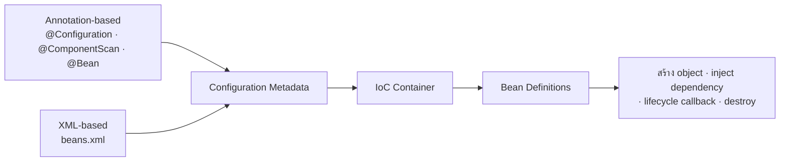
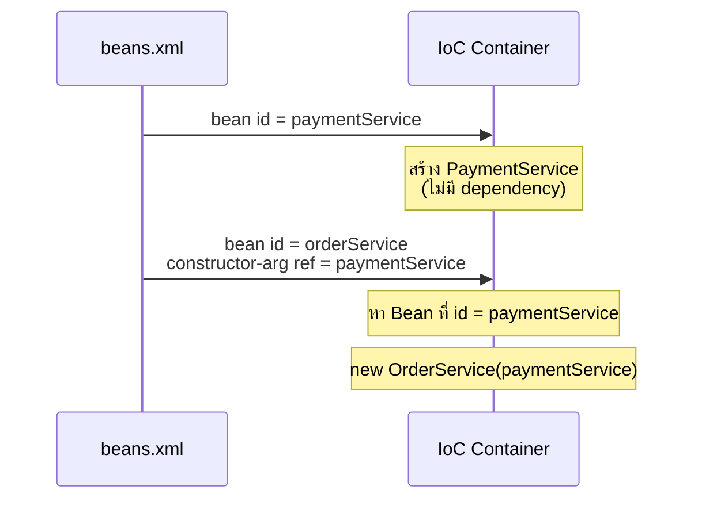
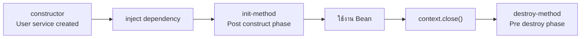
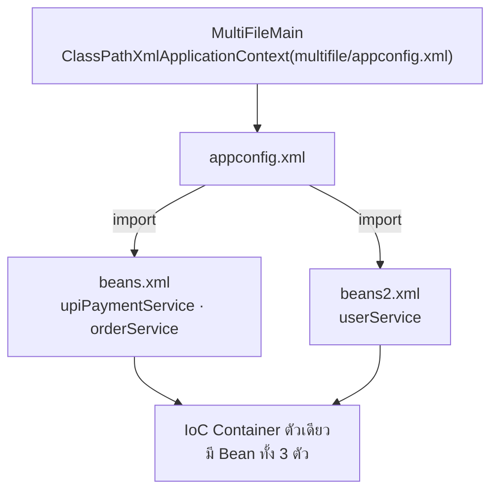

# #8 — Spring XML Configuration: สร้าง Bean, Dependency Injection, Scope และ Lifecycle ด้วย XML

> **วิดีโอ:** [Spring XML Configuration Explained | Beans, DI, Scopes & Lifecycle | Spring Boot Full Course #8](https://youtu.be/HqBh9hV7rik) — Coder Army, ~1 ชั่วโมง 11 นาที
> **แหล่งที่ใช้สรุป:** ซับไตเติลภาษาฮินดีที่ YouTube สร้างอัตโนมัติ
> **เวอร์ชันในโค้ด:** Spring Framework 7.0.9 (`spring-context` เวอร์ชันที่ Spring Boot 4.1.1 จัดการให้) + Java 21 (ใส่หมายเหตุไว้ทุกจุดที่ Spring Boot 3.x / Spring Framework 6 ต่างกัน)

ตอนนี้ตอบคำถามว่า **ถ้าไม่ใช้ annotation เลย จะบอก IoC Container ได้อย่างไรว่าต้องสร้างและจัดการ Bean อะไรบ้าง** คำตอบคือเขียน configuration เป็นไฟล์ XML ผู้สอนเอาทุกอย่างที่เคยทำด้วย annotation ในตอน #5–#7 มาทำใหม่ด้วย XML ทีละเรื่อง ได้แก่ การสร้าง Bean, การดึง Bean, Constructor/Setter Injection, การเลือก Bean เมื่อมีหลายตัวที่ type เดียวกัน, Scope, collection, Lifecycle callback และการแยกไฟล์ เป้าหมายคือให้อ่านโค้ด legacy ออก และเห็นว่า container ทำงานเหมือนเดิมไม่ว่า configuration จะมาจากไหน

ส่วนที่ติดป้าย `💡 เพิ่มเติม` คือของที่ผมเติมเอง ไม่ได้อยู่ในวิดีโอ ส่วนที่ติด `⚠️ แก้จากวิดีโอ` คือจุดที่วิดีโอพูดคลาดเคลื่อน

---

## สารบัญ

| เวลา | หัวข้อ |
|---|---|
| [0:00](https://youtu.be/HqBh9hV7rik?t=0) | [1. ทำไมยังต้องรู้จัก XML Configuration](#1-ทำไมยังต้องรู้จัก-xml-configuration) |
| [3:39](https://youtu.be/HqBh9hV7rik?t=219) | [2. IoC Container ต้องการแค่ Configuration Metadata](#2-ioc-container-ต้องการแค่-configuration-metadata) |
| [5:33](https://youtu.be/HqBh9hV7rik?t=333) | [3. สร้างโปรเจกต์ที่มีแค่ `spring-context`](#3-สร้างโปรเจกต์ที่มีแค่-spring-context) |
| [6:55](https://youtu.be/HqBh9hV7rik?t=415) | [4. ทบทวน annotation-based configuration](#4-ทบทวน-annotation-based-configuration) |
| [10:09](https://youtu.be/HqBh9hV7rik?t=609) | [5. เปลี่ยนเป็น XML: `ClassPathXmlApplicationContext` และ `beans.xml`](#5-เปลี่ยนเป็น-xml-classpathxmlapplicationcontext-และ-beansxml) |
| [13:31](https://youtu.be/HqBh9hV7rik?t=811) | [6. Header ของไฟล์ XML และแท็ก `<bean>`](#6-header-ของไฟล์-xml-และแท็ก-bean) |
| [18:02](https://youtu.be/HqBh9hV7rik?t=1082) | [7. Bean ถูกสร้างทันทีตอน container เริ่ม](#7-bean-ถูกสร้างทันทีตอน-container-เริ่ม) |
| [20:13](https://youtu.be/HqBh9hV7rik?t=1213) | [8. ดึง Bean ออกมา 3 วิธี](#8-ดึง-bean-ออกมา-3-วิธี) |
| [25:42](https://youtu.be/HqBh9hV7rik?t=1542) | [9. `id` บังคับไหม และซ้ำกันได้ไหม](#9-id-บังคับไหม-และซ้ำกันได้ไหม) |
| [27:37](https://youtu.be/HqBh9hV7rik?t=1657) | [10. Bean ตัวที่สอง และ `name` (alias)](#10-bean-ตัวที่สอง-และ-name-alias) |
| [31:50](https://youtu.be/HqBh9hV7rik?t=1910) | [11. Constructor Injection ด้วย `<constructor-arg ref>`](#11-constructor-injection-ด้วย-constructor-arg-ref) |
| [37:24](https://youtu.be/HqBh9hV7rik?t=2244) | [12. ส่งค่าเข้า constructor: `value`, `index`, `name`](#12-ส่งค่าเข้า-constructor-value-index-name) |
| [42:51](https://youtu.be/HqBh9hV7rik?t=2571) | [13. Setter Injection ด้วย `<property>`](#13-setter-injection-ด้วย-property) |
| [47:13](https://youtu.be/HqBh9hV7rik?t=2833) | [14. แทน `@Primary` / `@Qualifier` ด้วย `ref`](#14-แทน-primary--qualifier-ด้วย-ref) |
| [55:23](https://youtu.be/HqBh9hV7rik?t=3323) | [15. Scope: singleton และ prototype](#15-scope-singleton-และ-prototype) |
| [57:51](https://youtu.be/HqBh9hV7rik?t=3471) | [16. ส่ง List, Set, Map ผ่าน XML](#16-ส่ง-list-set-map-ผ่าน-xml) |
| [1:02:55](https://youtu.be/HqBh9hV7rik?t=3775) | [17. Lifecycle: `init-method` และ `destroy-method`](#17-lifecycle-init-method-และ-destroy-method) |
| [1:06:57](https://youtu.be/HqBh9hV7rik?t=4017) | [18. แยก XML หลายไฟล์ด้วย `<import>`](#18-แยก-xml-หลายไฟล์ด้วย-import) |
| [1:09:21](https://youtu.be/HqBh9hV7rik?t=4161) | [19. Hybrid: XML กับ annotation ใน container เดียว](#19-hybrid-xml-กับ-annotation-ใน-container-เดียว) |
| — | [20. Spring Framework 7 ยังรองรับ XML แบบในวิดีโอครบไหม](#20-spring-framework-7-ยังรองรับ-xml-แบบในวิดีโอครบไหม) |
| — | [21. สรุปท้ายตอน](#21-สรุปท้ายตอน) |

---

## 1. ทำไมยังต้องรู้จัก XML Configuration

[▶ 0:00](https://youtu.be/HqBh9hV7rik?t=0)

ที่ผ่านมาในซีรีส์ การสร้าง Bean และจัดการ dependency ทำผ่าน **annotation-based configuration** ทั้งหมด คือใช้ `@Component`, `@Bean` และ `@ComponentScan` ตอนนี้จะดูอีกวิธีหนึ่งคือ **XML-based configuration**

- โค้ด legacy ใช้ XML configuration เยอะมาก ปัจจุบันใช้น้อยลงเพราะ annotation-based เข้ามาแทน
- [▶ 2:24](https://youtu.be/HqBh9hV7rik?t=144) **ไม่ได้บังคับ** ข้ามตอนนี้ไปก็ดูซีรีส์ต่อได้ เพราะหลังจากนี้จะใช้แต่ annotation และใน Spring Boot ก็ใช้แต่ annotation
- แต่ถ้าต้องทำงานกับระบบ legacy หรือระบบ **hybrid** ที่ใช้ทั้ง XML และ annotation ปนกัน หรืออยากรู้ว่า Spring เคยทำงานกับ XML อย่างไร ตอนนี้จะช่วยได้

ผู้สอนบอกว่าตัวเองไม่ได้ชอบ XML และรู้ว่ามันซับซ้อนได้ แต่สิ่งที่น่าสนใจคือ **จัดการ Bean ได้โดยไม่ต้องเขียนโค้ด Java สำหรับ configuration เลย** และถ้าเข้าใจของเก่าว่าเคยต้องตั้งค่าเยอะแค่ไหนเพื่อเขียน REST API ง่าย ๆ ตัวหนึ่ง ก็จะเห็นคุณค่าของ Spring Boot ที่ auto-configure ให้ทั้งหมด

ผู้สอนบอกว่าพื้นฐานที่ต้องมีก่อนคือวิดีโอที่สอนแบบ annotation (ในคอร์สนี้คือตอน #5–#7) โดยเฉพาะ Bean Lifecycle (ตอน #7)

---

## 2. IoC Container ต้องการแค่ Configuration Metadata

[▶ 3:39](https://youtu.be/HqBh9hV7rik?t=219)

IoC Container มีหน้าที่จัดการ Bean คือสร้าง object, inject dependency, จัดการ lifecycle และทำลาย object สิ่งเดียวที่มันต้องการเพื่อทำงานนี้คือ **configuration metadata** หมายถึงกฎว่าต้องจัดการ Bean ตัวไหน และแต่ละตัวต้องสร้างอย่างไร

ในแบบ annotation เราให้ metadata ผ่าน class ที่มี `@Configuration`

- ใส่ `@ComponentScan` เพื่อบอกให้ค้นทั้ง package แล้วสร้าง Bean จากทุก class ที่มี `@Component`
- เขียน method ที่มี `@Bean` ใน class configuration (เช่น `AppConfig`) เพื่อบอกให้ container จัดการ object ที่ method นั้นคืนมา

[▶ 5:05](https://youtu.be/HqBh9hV7rik?t=305) metadata มาได้สองทาง คือ annotation-based กับ XML-based **มาทางไหนก็ตาม สุดท้าย container ก็เอาไปสร้าง Bean Definition แล้วจัดการ Bean แบบเดียวกัน** ผู้สอนบอกว่านี่คือประเด็นที่น่าสนใจที่สุดของตอน



---

## 3. สร้างโปรเจกต์ที่มีแค่ `spring-context`

[▶ 5:33](https://youtu.be/HqBh9hV7rik?t=333)

ผู้สอนสร้างโปรเจกต์ใหม่ชื่อ `xml-based-config-demo` ใช้ Maven, JDK 23 และเปิด sample code ไว้ จากนั้นเพิ่ม dependency ตัวเดียวคือ **`spring-context`** เพราะจะใช้แค่พื้นฐานของ Spring Core โดยไปคัด Maven snippet มาจากเว็บ MVN Repository เลือกเวอร์ชัน 7.0.7 แล้วกด reload ให้ Maven โหลด

`pom.xml`

```xml
<?xml version="1.0" encoding="UTF-8"?>
<project xmlns="http://maven.apache.org/POM/4.0.0"
         xmlns:xsi="http://www.w3.org/2001/XMLSchema-instance"
         xsi:schemaLocation="http://maven.apache.org/POM/4.0.0 https://maven.apache.org/xsd/maven-4.0.0.xsd">
  <modelVersion>4.0.0</modelVersion>

  <parent>
    <groupId>org.springframework.boot</groupId>
    <artifactId>spring-boot-starter-parent</artifactId>
    <version>4.1.1</version>
  </parent>

  <groupId>com.example</groupId>
  <artifactId>xml-based-config-demo</artifactId>
  <version>0.0.1</version>

  <properties>
    <java.version>21</java.version>
  </properties>

  <dependencies>
    <dependency>
      <groupId>org.springframework</groupId>
      <artifactId>spring-context</artifactId>
    </dependency>
  </dependencies>
</project>
```

> 💡 **เพิ่มเติม — เรื่องเวอร์ชัน:** ในวิดีโอใส่ `<version>7.0.7</version>` ให้ `spring-context` เองโดยไม่มี parent ส่วนในไฟล์นี้ใช้ `spring-boot-starter-parent:4.1.1` เป็น parent เพื่อคุมเวอร์ชันอย่างเดียว ได้ `spring-context` **7.0.9** ซึ่งเป็น Spring Framework 7.0.x สายเดียวกับในวิดีโอ โปรเจกต์นี้ไม่ได้ใช้ Spring Boot เลย ไม่มี `@SpringBootApplication` และไม่มี auto-configuration parent ยังตั้ง compiler flag `-parameters` ให้ด้วย ซึ่งมีผลกับ `<constructor-arg name>` ในส่วนที่ 12 ส่วน JDK ผมใช้ 21 แทน 23 โค้ดตอนนี้ไม่ได้ใช้ feature ใหม่ของภาษา จึงได้ผลเหมือนกัน
>
> `spring-context` ตัวเดียวดึง `spring-core`, `spring-beans`, `spring-aop`, `spring-expression`, `commons-logging` 1.3.6, `jspecify` และ `micrometer-observation` มาให้ (จาก `mvn dependency:build-classpath`) ตัวอ่าน XML อยู่ใน `spring-beans` ส่วน `ClassPathXmlApplicationContext` อยู่ใน `spring-context`

> ⚠️ **Boot 4 vs 3:** ใน Spring Framework 7 module `spring-jcl` ถูกถอดออก แล้วใช้ Apache Commons Logging 1.3 แทน จึงเห็น `commons-logging-1.3.6.jar` ใน classpath ข้างบน ใน Spring Framework 6 (Boot 3.x) จะเห็น `spring-jcl` แทน โค้ดที่เรียก logging API ไม่ต้องแก้
> ([Spring Framework 7.0 Release Notes](https://github.com/spring-projects/spring-framework/wiki/Spring-Framework-7.0-Release-Notes))

> 💡 **เพิ่มเติม — โครงโปรเจกต์ที่ใช้ตรวจโค้ดในไฟล์นี้:** ในวิดีโอผู้สอนแก้ `beans.xml` ไฟล์เดียวไปเรื่อย ๆ แล้ว comment ของเก่าทิ้ง ในไฟล์นี้แยกแต่ละขั้นเป็น XML คนละไฟล์ใน `src/main/resources` และแยก package ตามหัวข้อ (`annotation`, `basic`, `constructor`, `setter`, `shop`, `scope`, `collections`, `lifecycle`, `multifile`, `hybrid`) แต่ละ package มี `main` ของตัวเอง เพื่อให้รันได้ทุกขั้น ซับไม่ได้บอกชื่อ package ที่ผู้สอนใช้ชัดเจน จึงใช้ `com.example.xmlconfig` เป็น root แทน build และรันแต่ละ `main` ด้วย
>
> ```bash
> mvn -q -DskipTests package
> mvn -q dependency:build-classpath -Dmdep.outputFile=cp.txt
> java -cp "target/classes:$(cat cp.txt)" com.example.xmlconfig.basic.BasicMain
> ```

---

## 4. ทบทวน annotation-based configuration

[▶ 6:55](https://youtu.be/HqBh9hV7rik?t=415)

ก่อนเปลี่ยนเป็น XML ผู้สอนเขียนแบบที่ทำมาตลอดให้ดูอีกครั้ง ตัวอย่างสมมติว่าเป็นแอปสั่งของ มี class `OrderService` ที่มี method `placeOrder()` พิมพ์ว่า `Order placed` (ตั้งใจไม่ใส่ business logic ให้ซับซ้อน)

`annotation/OrderService.java`

```java
package com.example.xmlconfig.annotation;

import org.springframework.stereotype.Component;

@Component
public class OrderService {

  public void placeOrder() {
    System.out.println("Order placed");
  }
}
```

ใส่ `@Component` เพื่อบอกว่า Spring ต้องจัดการ class นี้ จากนั้นสร้าง class configuration ชื่อ `AppConfig` ที่มีสอง annotation

- `@Configuration` บอกว่าเป็น class configuration
- `@ComponentScan` บอกให้สแกนหา `@Component` ถ้าไม่ระบุ package จะสแกน package ที่ `AppConfig` อยู่ เมื่อเจอ `OrderService` ก็สร้าง Bean ให้

`annotation/AppConfig.java`

```java
package com.example.xmlconfig.annotation;

import org.springframework.context.annotation.ComponentScan;
import org.springframework.context.annotation.Configuration;

@Configuration
@ComponentScan
public class AppConfig {
}
```

ใน `main` สร้าง container ด้วย `AnnotationConfigApplicationContext` แล้วส่ง `AppConfig.class` เข้าไป เพื่อให้ Spring อ่าน metadata และกฎทั้งหมดจาก class นี้ผ่าน reflection Bean ถูกสร้างทันทีเพราะ default เป็น eager จากนั้นขอ Bean ด้วย `getBean(OrderService.class)`

`annotation/AnnotationMain.java`

```java
package com.example.xmlconfig.annotation;

import org.springframework.context.ApplicationContext;
import org.springframework.context.annotation.AnnotationConfigApplicationContext;

public class AnnotationMain {

  public static void main(String[] args) {
    ApplicationContext context = new AnnotationConfigApplicationContext(AppConfig.class);

    OrderService order = context.getBean(OrderService.class);
    order.placeOrder();
  }
}
```

ผลที่ได้

```text
Order placed
```

[▶ 9:42](https://youtu.be/HqBh9hV7rik?t=582) เบื้องหลังคือ container ได้ configuration มาจาก `AppConfig` รู้ว่าต้องสแกน component สแกนแล้วเจอ `OrderService` จึงสร้าง Bean ชื่อ `orderService` แล้วเริ่มจัดการมัน คำถามต่อไปคือถ้าจะบอกกฎชุดเดียวกันนี้ด้วย XML แทน annotation ต้องแก้อะไรบ้าง

---

## 5. เปลี่ยนเป็น XML: `ClassPathXmlApplicationContext` และ `beans.xml`

[▶ 10:09](https://youtu.be/HqBh9hV7rik?t=609)

ขั้นแรกคือเอาทุกอย่างที่เป็น annotation ออก

1. ลบ `@Component` และ import ของมันออกจาก `OrderService` ตอนนี้ `OrderService` เป็น Java class ธรรมดา
2. ลบ `AppConfig` ทิ้ง เพราะจะไม่ใช้ class configuration แล้ว
3. ลบโค้ดใน `main` ที่อ้างถึง `AppConfig`

ถึงตรงนี้ยังไม่ได้ใช้อะไรของ Spring Core เลย จะสตาร์ท container ก็ยังไม่มีกฎให้มัน

### เลือก implementation ของ `ApplicationContext`

[▶ 11:13](https://youtu.be/HqBh9hV7rik?t=673)

`ApplicationContext` เป็น interface ตอนใช้ annotation เราเลือก implementation เป็น `AnnotationConfigApplicationContext` ซึ่งเท่ากับบอก Spring ว่า configuration ที่จะให้เป็นแบบ annotation ถ้า configuration เป็น XML ต้องใช้ **`ClassPathXmlApplicationContext`** ชื่อบอกอยู่แล้วว่าอ่าน XML จาก classpath

### ไฟล์ XML อยู่ที่ไหน

[▶ 12:16](https://youtu.be/HqBh9hV7rik?t=736)

แทนที่จะส่ง class configuration ก็ส่ง **ชื่อไฟล์ XML** ผู้สอนตั้งชื่อว่า `beans.xml` (ตั้งชื่ออะไรก็ได้ เลือกชื่อนี้เพราะในไฟล์จะสร้าง Bean)

`ClassPathXmlApplicationContext` หาไฟล์นี้ใน **classpath** ในโปรเจกต์ Maven ทุกไฟล์ที่วางใน `src/main/resources` จะเข้าไปอยู่ใน classpath จึงสร้างไฟล์ไว้ที่ `src/main/resources/beans.xml` แล้ว container จะหยิบไปเอง

สรุปการเปลี่ยนจนถึงตรงนี้: เดิมเราสร้าง class configuration ตอนนี้สร้างไฟล์ XML แทน

> 💡 **เพิ่มเติม — classpath ในโปรเจกต์ Maven:** ตอน build Maven คัดลอกทุกอย่างใน `src/main/resources` ไปไว้ที่ `target/classes` ซึ่งเป็น root ของ classpath ชื่อ `"beans.xml"` จึงหมายถึงไฟล์ที่ root ส่วน `"multifile/appconfig.xml"` (ส่วนที่ 18) หมายถึงไฟล์ในโฟลเดอร์ย่อย ถ้า XML อยู่บน filesystem นอก classpath ให้ใช้ `FileSystemXmlApplicationContext` แทน หรือใช้ `GenericXmlApplicationContext` ที่รับ prefix `classpath:` หรือ `file:` ได้ทั้งคู่

---

## 6. Header ของไฟล์ XML และแท็ก `<bean>`

[▶ 13:31](https://youtu.be/HqBh9hV7rik?t=811)

### Header ไม่ต้องจำ

ก่อนเขียนแท็กใด ๆ ต้องใส่ metadata ของไฟล์ XML ก่อน ซึ่งยาวราวสามสี่บรรทัด ผู้สอนบอกว่า **ไม่ต้องจำ** เพราะเป็นของ legacy และไม่มีใครเขียนเอง [▶ 14:03](https://youtu.be/HqBh9hV7rik?t=843) เขาค้นใน Google ว่า "XML metadata for Spring 7" แล้วคัดลอกจากเอกสารทางการของ Spring มาวาง ตรงที่เขียนว่า "bean definitions here" คือที่สำหรับเขียน Bean

ส่วนประกอบของ header

- บรรทัดแรกบอกเวอร์ชันของ XML และ encoding เป็น UTF-8
- ที่เหลือบอก **schema** ของไฟล์ schema ของ XML คือกฎว่าเขียนแท็กไหนได้ แท็กไหนเขียนไม่ได้

### แท็ก `<bean>`

[▶ 14:45](https://youtu.be/HqBh9hV7rik?t=885)

จะให้ container จัดการ `OrderService` ต้องประกาศ Bean ของมันในไฟล์นี้ด้วยแท็ก **`<bean>`** ซึ่งต้องบอกสองอย่าง

| attribute | ความหมาย |
|---|---|
| `id` | ชื่อที่ไม่ซ้ำ ใช้ระบุ Bean ตั้งอะไรก็ได้ เช่น `orderDemo`, `orderServiceBean` แต่ convention คือใช้ชื่อ class แบบ camelCase จึงได้ `orderService` |
| `class` | ชื่อ class แบบเต็ม (fully qualified) คือ package ตามด้วยชื่อ class ไม่ใช่แค่ `OrderService.java` |

แค่นี้ก็พอ ไม่ต้องมีอะไรข้างใน จึงปิดแท็กในตัวด้วย `/>` ได้ ไม่ต้องมีแท็กปิดแยก

`src/main/resources/beans.xml`

```xml
<?xml version="1.0" encoding="UTF-8"?>
<beans xmlns="http://www.springframework.org/schema/beans"
       xmlns:xsi="http://www.w3.org/2001/XMLSchema-instance"
       xsi:schemaLocation="http://www.springframework.org/schema/beans
           https://www.springframework.org/schema/beans/spring-beans.xsd">

  <bean id="orderService" class="com.example.xmlconfig.basic.OrderService"/>

</beans>
```

> 💡 **เพิ่มเติม — รูปแบบของ XML ในไฟล์นี้:** ทุกไฟล์ XML หลังจากนี้ใช้ header และ `</beans>` ปิดท้ายชุดเดียวกับข้างบน (ยกเว้น `hybrid.xml` ในส่วนที่ 19 ที่เพิ่ม namespace `context` จึงแสดงเต็ม) เพื่อไม่ให้ยาวเกินไป จะแสดงเฉพาะสิ่งที่อยู่ข้างใน `<beans>`

> 💡 **เพิ่มเติม:** header ข้างบนตรงกับตัวอย่างใน [เอกสาร Spring Framework หัวข้อ Container Overview](https://docs.spring.io/spring-framework/reference/core/beans/basics.html) URL ของ schema ไม่มีเลขเวอร์ชัน (`spring-beans.xsd`) Spring ไม่ได้โหลด XSD จากอินเทอร์เน็ตตอนรัน แต่ map URL นี้ไปหาไฟล์ XSD ที่อยู่ใน `spring-beans.jar` ผ่านไฟล์ `META-INF/spring.schemas` จึงรันแบบ offline ได้

### `<bean>` เทียบกับ `@Bean`

[▶ 16:35](https://youtu.be/HqBh9hV7rik?t=995)

บรรทัด `<bean>` นี้ทำงานเหมือนการสร้าง Bean ด้วย method `@Bean` ใน class configuration ผู้สอนสร้าง `AppConfig` ขึ้นมาใหม่เพื่อเทียบ (ไม่ได้ใช้จริงใน `main` ตัว XML)

`basic/AppConfig.java`

```java
package com.example.xmlconfig.basic;

import org.springframework.context.annotation.Bean;
import org.springframework.context.annotation.Configuration;

@Configuration
public class AppConfig {

  @Bean
  public OrderService orderServiceBean() {
    return new OrderService();
  }
}
```

| `@Bean` ใน Java | `<bean>` ใน XML |
|---|---|
| annotation `@Bean` | แท็ก `<bean>` |
| ไม่มี `id` | มี `id` ระบุ Bean |
| ไม่ต้องบอก class เพราะ Java รู้ type และ package จาก return type อยู่แล้ว | ต้องบอก `class` แบบเต็ม |

ทั้งสองแบบบอก Spring ว่า "เมื่ออ่าน configuration แล้ว ให้สร้าง Bean ของ class นี้"

> 💡 **เพิ่มเติม:** ถึงจะไม่มี `id` แต่ Bean ที่มาจาก `@Bean` ก็มีชื่อ คือชื่อ method (ผู้สอนพูดถึงเรื่องนี้ในส่วนที่ 9) ในโปรเจกต์ตรวจโค้ด สร้าง `new AnnotationConfigApplicationContext(AppConfig.class)` แล้วเรียก `getBean("orderServiceBean", OrderService.class).placeOrder()` ได้ `Order service created` ตามด้วย `Order placed`

---

## 7. Bean ถูกสร้างทันทีตอน container เริ่ม

[▶ 18:02](https://youtu.be/HqBh9hV7rik?t=1082)

แค่เขียน `<bean>` ไว้ Bean ก็ถูกสร้างทันทีที่ container เริ่ม เพราะ Bean ใน Spring **เป็น singleton และ eager โดย default** eager แปลว่าสร้างตั้งแต่ตอน container ขึ้น

เพื่อพิสูจน์ ผู้สอนเพิ่ม constructor ที่พิมพ์ข้อความให้ `OrderService` ถ้าข้อความขึ้น แปลว่า constructor ถูกเรียก และ object ถูกสร้างแล้ว

`basic/OrderService.java`

```java
package com.example.xmlconfig.basic;

public class OrderService {

  public OrderService() {
    System.out.println("Order service created");
  }

  public void placeOrder() {
    System.out.println("Order placed");
  }
}
```

### Error แรก: ชื่อไฟล์ไม่ตรง

[▶ 18:57](https://youtu.be/HqBh9hV7rik?t=1137)

รันครั้งแรกเจอ error ว่าหาไฟล์ไม่เจอ เพราะไฟล์ชื่อ `beans.xml` แต่ใน `main` พิมพ์ `"bean.xml"` ผลจากการรันจริง (`LookupErrorsMain` กรณีที่ 1 ดูคำอธิบายท้ายส่วนที่ 8)

```text
--- 1) ชื่อไฟล์ผิด: bean.xml ---
BeanDefinitionStoreException: IOException parsing XML document from class path resource [bean.xml]
  caused by FileNotFoundException: class path resource [bean.xml] cannot be opened because it does not exist
```

แก้ชื่อเป็น `"beans.xml"` แล้วรันใหม่ ได้ `Order service created` แปลว่า container ขึ้นแล้วและสร้าง Bean ของ `OrderService` แล้ว

### ขั้นตอนข้างในเหมือนเดิมทุกอย่าง

[▶ 19:26](https://youtu.be/HqBh9hV7rik?t=1166)

ไม่ว่า configuration จะเป็น annotation หรือ XML ขั้นตอนข้างในเหมือนกันหมด container จะหาว่าต้องอ่าน configuration จากไหน (ครั้งนี้คือ `beans.xml`) แล้วอ่านกฎในนั้น container เข้าใจทั้งกฎแบบ XML และแบบ annotation เพราะมี class แยกกันสำหรับแต่ละแบบ ส่วน Bean Lifecycle ทุกขั้นที่เรียนในตอน #7 ก็ยังเหมือนเดิม


---

## 8. ดึง Bean ออกมา 3 วิธี

[▶ 20:13](https://youtu.be/HqBh9hV7rik?t=1213)

`basic/BasicMain.java`

```java
package com.example.xmlconfig.basic;

import org.springframework.context.ApplicationContext;
import org.springframework.context.support.ClassPathXmlApplicationContext;

public class BasicMain {

  public static void main(String[] args) {
    ApplicationContext context = new ClassPathXmlApplicationContext("beans.xml");

    // 1) by type
    OrderService byType = context.getBean(OrderService.class);
    byType.placeOrder();

    // 2) by id (name): คืน Object ต้อง cast เอง
    OrderService byId = (OrderService) context.getBean("orderService");
    byId.placeOrder();

    // 3) by id + type
    OrderService byIdAndType = context.getBean("orderService", OrderService.class);
    byIdAndType.placeOrder();

    System.out.println("same instance? " + (byType == byId && byId == byIdAndType));
  }
}
```

```text
Order service created
Order placed
Order placed
Order placed
same instance? true
```

> 💡 **เพิ่มเติม:** บรรทัด `same instance?` ผมเพิ่มเอง เพื่อให้เห็นว่าทั้งสามวิธีได้ object ตัวเดียวกัน เพราะเป็น singleton และ `Order service created` ขึ้นครั้งเดียว

### วิธีที่ 1: by type

[▶ 20:13](https://youtu.be/HqBh9hV7rik?t=1213)

แบบที่ใช้มาตลอด ส่ง `OrderService.class` เข้าไป ได้ Bean ของ type นั้นกลับมา

### วิธีที่ 2: by id (หรือ by name)

[▶ 20:49](https://youtu.be/HqBh9hV7rik?t=1249)

ส่ง `id` ที่ตั้งไว้ใน XML เข้าไป แต่ `getBean(String)` มี return type เป็น `Object` จึงต้อง cast เป็น `OrderService` เอง (IDE ใส่ cast ให้ได้) เรียกวิธีนี้ว่า "get bean by name" หรือ "by id" ก็ได้ เพราะเป็นการบอก container ว่า "เอา Bean ที่มี id นี้มาให้"

ถ้าเปลี่ยน `id` ใน XML เป็น `orderService2` ก็ต้องเปลี่ยนชื่อที่ส่งใน `main` ตาม ถ้าส่ง id ที่ไม่มีอยู่ จะได้ `NoSuchBeanDefinitionException` [▶ 21:51](https://youtu.be/HqBh9hV7rik?t=1311)

```text
--- 2) id ผิด ---
Order service created
NoSuchBeanDefinitionException: No bean named 'orderService2' available
```

### by type ใช้ไม่ได้เมื่อมี Bean class เดียวกันสองตัว

[▶ 22:39](https://youtu.be/HqBh9hV7rik?t=1359)

by type ใช้ได้เฉพาะเมื่อในไฟล์มี Bean ของ type นั้น **ตัวเดียว** ผู้สอนคัดลอก `<bean>` เพิ่มอีกตัว เปลี่ยน `id` เป็น `orderService2` แต่ใช้ `class` เดิม

`two-order-services.xml`

```xml
<bean id="orderService" class="com.example.xmlconfig.basic.OrderService"/>
<bean id="orderService2" class="com.example.xmlconfig.basic.OrderService"/>
```

[▶ 23:14](https://youtu.be/HqBh9hV7rik?t=1394) เทียบกับ annotation ก็คือการเขียน method `@Bean` สองตัวใน `AppConfig` ที่คืน `OrderService` ทั้งคู่ (เช่น `getOrderServiceBean()` กับ `getOrderServiceBean2()`) Spring จะสร้าง object สองตัวและจัดการ Bean สองตัว **ไม่ได้ผิดหลัก singleton** (เรื่องนี้อยู่ในตอน #6) `id` ต้องต่างกันเพราะต้องไม่ซ้ำ แต่ class เหมือนกันได้

ตอนนี้ถ้าขอด้วย type จะพัง เพราะ container ไม่รู้ว่าจะคืนตัวไหน

```text
--- 3) สอง bean class เดียวกัน แล้วขอด้วย type ---
Order service created
Order service created
NoUniqueBeanDefinitionException: No qualifying bean of type 'com.example.xmlconfig.basic.OrderService' available: expected single matching bean but found 2: orderService,orderService2
```

### วิธีที่ 3: by id + type

[▶ 24:18](https://youtu.be/HqBh9hV7rik?t=1458)

ส่งทั้ง `id` และ type คือ `getBean("orderService", OrderService.class)` ได้ Bean ตัวแรกกลับมาถูกตัว

```text
--- 4) สอง bean class เดียวกัน แล้วขอด้วย id + type ---
Order service created
Order service created
Order placed
```

constructor ถูกเรียกสองครั้ง เพราะมี Bean ของ `OrderService` สองตัว ถึงจะใช้แค่ตัวเดียวก็ถูกสร้างทั้งสองตัว

[▶ 25:12](https://youtu.be/HqBh9hV7rik?t=1512) ผู้สอนบอกว่าวิธีนี้ **ดีที่สุด** เพราะไม่ต้อง cast เหมือนวิธี by id และไม่เสี่ยง error ตอนมีหลาย Bean ที่ type เดียวกันเหมือนวิธี by type

> 💡 **เพิ่มเติม:** output ของ error ทุกกรณีในส่วนที่ 7–9 มาจาก `basic/LookupErrorsMain` ในโปรเจกต์ตรวจโค้ด ซึ่งรันแต่ละกรณี (ชื่อไฟล์ผิด, id ผิด, Bean ซ้ำ type, ไม่มี id, id ซ้ำ) ใน `try`/`catch` แล้วพิมพ์ชื่อ exception กับ message ส่วนบรรทัด `caused by` คือ `getCause()` ของ exception นั้น

---

## 9. `id` บังคับไหม และซ้ำกันได้ไหม

[▶ 25:42](https://youtu.be/HqBh9hV7rik?t=1542)

### ลบ `id` ออก

ผู้สอนลบ `id` ออกจาก `<bean>` แล้วลองขอด้วย `"orderService"` ได้ `NoSuchBeanDefinitionException`

`no-id.xml`

```xml
<bean class="com.example.xmlconfig.basic.OrderService"/>
```

```text
--- 5) bean ไม่มี id แล้วขอด้วย "orderService" ---
Order service created
NoSuchBeanDefinitionException: No bean named 'orderService' available
```

[▶ 26:06](https://youtu.be/HqBh9hV7rik?t=1566) ผู้สอนเทียบกับแบบ annotation

- `@Component` บน `OrderService` ได้ชื่อ Bean เป็นชื่อ class แบบ camelCase คือ `orderService`
- `@Bean` ได้ชื่อ Bean เป็นชื่อ method

แต่ใน XML ถ้าไม่ใส่ `id` ก็ขอด้วยชื่อแบบนั้นไม่ได้ เหลือวิธีเดียวคือ by type ซึ่งยังใช้ได้เพราะมี Bean ของ `OrderService` ตัวเดียว

```text
--- 6) bean ไม่มี id แล้วขอด้วย type ---
Order service created
Order placed
bean names = [com.example.xmlconfig.basic.OrderService#0]
aliases    = [com.example.xmlconfig.basic.OrderService]
```

> ⚠️ **แก้จากวิดีโอ:** วิดีโอบอกว่าถ้าไม่ใส่ `id` "Spring จะไม่สร้าง id ให้เลย" ที่ถูกคือ Spring **สร้างชื่อให้อัตโนมัติ** เพียงแต่ไม่ใช่ `orderService` ชื่อที่ได้คือชื่อ class แบบเต็มตามด้วย `#0` (`com.example.xmlconfig.basic.OrderService#0`) และ Bean ตัวแรกของ class นั้นได้ alias เป็นชื่อ class แบบเต็มด้วย ตามที่เห็นใน output ข้างบน จึงยังเรียก `getBean("com.example.xmlconfig.basic.OrderService")` ได้ ข้อสรุปของผู้สอนยังใช้ได้ คือขอด้วย `"orderService"` ไม่ได้ และควรใส่ `id` เสมอ

[▶ 26:54](https://youtu.be/HqBh9hV7rik?t=1614) สรุปว่า **`id` ไม่บังคับ แต่ใส่ไว้มีแต่ได้** ไม่มีวันเกิด error เพราะมัน ผู้สอนจึงใส่ `id="orderService"` กลับไป

### `id` ซ้ำกันได้ไหม

[▶ 27:05](https://youtu.be/HqBh9hV7rik?t=1625)

ไม่ได้ `id` แปลว่าต้องไม่ซ้ำ ถ้าใส่ซ้ำ IDE จะเตือนทันทีว่า bean name duplicated และถ้ารันก็ error (ผู้สอนอ่านชื่อ `FailFastProblemReporter` จาก stack trace ซึ่งเป็นตัวที่โยน error นี้)

`duplicate-id.xml`

```xml
<bean id="orderService" class="com.example.xmlconfig.basic.OrderService"/>
<bean id="orderService" class="com.example.xmlconfig.basic.OrderService"/>
```

```text
--- 7) id ซ้ำกัน ---
BeanDefinitionParsingException: Configuration problem: Bean name 'orderService' is already used in this <beans> element
Offending resource: class path resource [duplicate-id.xml]
```

> 💡 **เพิ่มเติม:** สังเกตว่าไม่มี `Order service created` เลย error นี้เกิดตั้งแต่ตอน **parse** ไฟล์ XML ก่อนจะสร้าง Bean Definition ครบ จึงยังไม่มี object ไหนถูกสร้าง ต่างจากกรณีที่ 2–5 ที่ container ขึ้นสำเร็จแล้วค่อยพังตอน `getBean`

---

## 10. Bean ตัวที่สอง และ `name` (alias)

[▶ 27:37](https://youtu.be/HqBh9hV7rik?t=1657)

### เพิ่ม `PaymentService`

ผู้สอนสร้าง class ที่สอง `PaymentService` มี method `pay()` พิมพ์ `Payment done` แล้วประกาศ Bean ของมันใน XML แบบเดียวกัน (`id` เป็นชื่อ class แบบ camelCase, `class` เป็นชื่อเต็ม) ตอนนี้ container จัดการทั้งสอง Bean

`basic/PaymentService.java`

```java
package com.example.xmlconfig.basic;

public class PaymentService {

  public void pay() {
    System.out.println("Payment done");
  }
}
```

ใน `main` ขอทั้งสอง Bean ด้วย id + type (ขอด้วย type อย่างเดียวก็ได้ แต่ผู้สอนบอกว่าส่งทั้งคู่เป็น good practice) เรียก `pay()` ก่อนแล้วค่อย `placeOrder()` ได้ `Payment done` ตามด้วย `Order placed`

### attribute `name`

[▶ 29:10](https://youtu.be/HqBh9hV7rik?t=1750)

นอกจาก `id` ยังมี attribute **`name`** ผู้สอนตั้ง `name="orderServiceBean"` แล้วขอ Bean ด้วยชื่อนี้ก็ได้ `OrderService` ตัวเดิม จะขอด้วย `id` หรือ `name` ก็ได้

[▶ 29:55](https://youtu.be/HqBh9hV7rik?t=1795) แล้ว `id` กับ `name` ต่างกันตรงไหน

- **`id`** ไม่ซ้ำ Bean หนึ่งมี id ได้ค่าเดียว
- **`name`** ใส่ได้หลายชื่อ เรียกว่า **alias** คือ Bean ตัวเดียวถูกเรียกได้หลายชื่อ

ผู้สอนใส่ชื่อให้ Bean เดียวหลายชื่อ คือ `orderServiceBean`, `orderServiceBean2`, `o` และ `orderServiceBean3` ใช้ชื่อไหนขอก็ได้ Bean ตัวเดียวกัน

`aliases.xml`

```xml
<bean id="orderService"
      name="orderServiceBean, orderServiceBean2, o, orderServiceBean3"
      class="com.example.xmlconfig.basic.OrderService"/>

<bean id="paymentService" class="com.example.xmlconfig.basic.PaymentService"/>
```

`basic/AliasMain.java`

```java
package com.example.xmlconfig.basic;

import java.util.Arrays;
import org.springframework.context.ApplicationContext;
import org.springframework.context.support.ClassPathXmlApplicationContext;

public class AliasMain {

  public static void main(String[] args) {
    ApplicationContext context = new ClassPathXmlApplicationContext("aliases.xml");

    PaymentService paymentService = context.getBean("paymentService", PaymentService.class);
    OrderService orderService = context.getBean("orderServiceBean", OrderService.class);

    paymentService.pay();
    orderService.placeOrder();

    System.out.println("aliases of orderService = "
        + Arrays.toString(context.getAliases("orderService")));
    System.out.println("same bean via \"o\"? "
        + (orderService == context.getBean("o", OrderService.class)));
  }
}
```

```text
Order service created
Payment done
Order placed
aliases of orderService = [orderServiceBean, o, orderServiceBean3, orderServiceBean2]
same bean via "o"? true
```

> 💡 **เพิ่มเติม:** ใน `name` คั่นหลายชื่อด้วย comma, semicolon หรือช่องว่างก็ได้ ชื่อทั้งหมด (ทั้ง `id` และทุก `name`) อยู่ใน namespace เดียวกันของ container จึงต้องไม่ชนกับชื่อของ Bean ตัวอื่น ลำดับของ alias ที่ `getAliases()` คืนมาไม่รับประกันว่าตรงกับที่เขียน ตามที่เห็นใน output

### ไม่ต้องจำ syntax

[▶ 30:46](https://youtu.be/HqBh9hV7rik?t=1846)

ผู้สอนย้ำว่า syntax พวกนี้ไม่ต้องจำ เพราะแทบไม่ได้ใช้ และถ้าต้องใช้จริงก็หาในเน็ตได้ ไม่มีใครเขียน header เอง ทุกคนคัดลอก schema มา สิ่งที่ต้องเข้าใจคือ

- IoC Container ทำงานได้ทั้งจาก configuration แบบ annotation และแบบ XML
- XML configuration หน้าตาเป็นอย่างไร สร้างไว้ที่ไหน และ flow เป็นอย่างไร
- รู้แท็กพื้นฐานอย่าง `<bean>`, `id`, `name`

เป้าหมายคือ ถ้าเจอโค้ดที่ใช้ XML configuration จะไม่ตกใจ และอ่านออกทุกบรรทัด

---

## 11. Constructor Injection ด้วย `<constructor-arg ref>`

[▶ 31:50](https://youtu.be/HqBh9hV7rik?t=1910)

### ในแบบ annotation ทำอย่างไร

ให้ `OrderService` ใช้ `PaymentService` เป็น dependency

- `OrderService` มี field `private PaymentService paymentService`
- รับ `PaymentService` ผ่าน constructor แล้วเก็บด้วย `this.paymentService = paymentService`
- `placeOrder()` เรียก `paymentService.pay()` ก่อน แล้วค่อยพิมพ์ `Order placed`

`OrderService` จึง depend on `PaymentService` และต้องการให้คนที่สร้างมันส่ง dependency นี้มาจากข้างนอก ในแบบ annotation จะใส่ `@Component` ทั้งสอง class และจะใส่ `@Autowired` ที่ constructor หรือไม่ก็ได้ เพราะมี constructor ตัวเดียว

[▶ 33:24](https://youtu.be/HqBh9hV7rik?t=2004) ตอนนี้ใน `main` เรียกแค่ `orderService.placeOrder()` ก็ได้ทั้ง `Payment done` และ `Order placed` แต่ต้องมีคนส่ง dependency เข้าไปใน `OrderService` ซึ่งก็คือ IoC Container และกฎว่าจะส่งอย่างไรต้องเขียนไว้ใน configuration

`constructor/OrderService.java`

```java
package com.example.xmlconfig.constructor;

public class OrderService {

  private final PaymentService paymentService;

  public OrderService(PaymentService paymentService) {
    this.paymentService = paymentService;
  }

  public void placeOrder() {
    paymentService.pay();
    System.out.println("Order placed");
  }
}
```

### XML ทำได้แค่ constructor กับ setter

[▶ 33:58](https://youtu.be/HqBh9hV7rik?t=2038)

Dependency Injection มีสามแบบ คือผ่าน constructor, setter และ field แต่ใน XML configuration ทำได้ **แค่ constructor injection กับ setter injection** ทำ field injection ไม่ได้ ผู้สอนให้เหตุผลว่าเพราะ field เป็น `private` เข้าถึงจาก `beans.xml` ไม่ได้

> ⚠️ **แก้จากวิดีโอ (เหตุผล):** ข้อสรุปถูก XML ไม่มีแท็กสำหรับ field injection แต่เหตุผลไม่ใช่เพราะ field เป็น `private` เพราะ `@Autowired` บน field ที่เป็น `private` Spring ก็เขียนค่าลงไปได้ผ่าน reflection (ตอน #4 และ #5) ที่ XML ทำไม่ได้เพราะ schema ของ `<beans>` มีแค่ `<constructor-arg>` (เรียก constructor) กับ `<property>` (เรียก setter ตามแบบ JavaBeans) ไม่มีแท็กที่หมายถึง "เขียนค่าลง field ตรง ๆ" ถ้าโปรเจกต์ XML อยากได้ field injection ต้องเปิด annotation ด้วย `<context:annotation-config/>` หรือ `<context:component-scan>` แล้วใช้ `@Autowired` บน field ซึ่งก็คือกลับไปใช้ annotation

### `<constructor-arg ref>`

[▶ 34:40](https://youtu.be/HqBh9hV7rik?t=2080)

ต้องบอก container ว่า "ตอนสร้าง Bean ของ `OrderService` ให้ส่ง Bean ของ `PaymentService` เข้า constructor" วิธีคือ

1. เปลี่ยน `<bean>` ของ `orderService` จากแท็กปิดในตัวเป็นแท็กเปิด/ปิด
2. ใส่แท็ก **`<constructor-arg>`** ข้างใน
3. ใส่ attribute **`ref`** (reference) เป็น `id` ของ Bean ที่จะส่งเข้าไป คือ `paymentService`

```xml
<bean id="orderService" class="com.example.xmlconfig.constructor.OrderService">
  <constructor-arg ref="paymentService"/>
</bean>
```

(ไฟล์เต็มอยู่ในส่วนที่ 12)

### container ทำอะไรบ้าง

[▶ 35:33](https://youtu.be/HqBh9hV7rik?t=2133)

ผู้สอนย้าย `<bean>` ของ `paymentService` ขึ้นไปไว้ข้างบนเพื่อให้อธิบายง่าย

1. container อ่านเจอ `paymentService` ก่อน สร้าง Bean ได้ทันทีเพราะไม่ depend on อะไร
2. อ่านเจอ `orderService` เห็นว่าต้องส่ง argument หนึ่งตัวเข้า constructor และต้องเอาค่ามาจาก Bean ที่มี id `paymentService` จึงสร้าง `OrderService` ตรง ๆ ไม่ได้
3. container ทำสิ่งที่เทียบเท่ากับเขียน `new OrderService(paymentService)` เอง โดยหา Bean ที่มี id `paymentService` เจอแล้ว จึงส่งตัวนั้นเข้าไป



> 💡 **เพิ่มเติม:** ลำดับของ `<bean>` ในไฟล์ไม่มีผลกับความถูกต้อง ถึง `orderService` จะเขียนไว้ก่อน `paymentService` container ก็จะเห็นว่า `orderService` ต้องใช้ `paymentService` แล้วสร้าง `paymentService` ให้ก่อนเอง ผู้สอนย้ายแค่เพื่อให้อธิบายง่าย

[▶ 37:01](https://youtu.be/HqBh9hV7rik?t=2221) รันครั้งแรกพังเพราะ `main` ยังขอ Bean ด้วยชื่อ `orderServiceBean2` ซึ่งลบ `name` ไปแล้ว แก้เป็น `"orderService"` แล้วรันได้ `Payment done` และ `Order placed` ผู้สอนบอกว่า "dependency ถูก inject และเกิด autowiring แล้ว"

> ⚠️ **แก้จากวิดีโอ (ศัพท์):** สิ่งที่เกิดตรงนี้คือ **explicit wiring** เราบอก container เองว่าจะส่ง Bean ตัวไหนผ่าน `ref` ไม่ใช่ **autowiring** ใน XML autowiring เป็นอีก feature หนึ่ง คือใส่ `autowire="constructor"` หรือ `autowire="byType"` / `"byName"` ที่ `<bean>` แล้วให้ container หา Bean มาใส่เองโดยไม่ต้องมี `ref` (ตัวอย่างอยู่ในส่วนที่ 14)

---

## 12. ส่งค่าเข้า constructor: `value`, `index`, `name`

[▶ 37:24](https://youtu.be/HqBh9hV7rik?t=2244)

### ส่งค่าธรรมดาด้วย `value`

ถ้า constructor ของ `PaymentService` รับค่าด้วย ผู้สอนเพิ่ม field `private String type` (ชนิดของการจ่ายเงิน) และ constructor ที่รับ `type` ตอนนี้ container ต้องส่ง `type` ให้ เพราะการสร้าง object ทุกตัวต้องเรียก constructor

วิธีคือใส่ `<constructor-arg>` ใน `<bean>` ของ `paymentService` แต่ใช้ **`value`** แทน `ref` ผู้สอนส่ง `"UPI"` แปลว่าตอนสร้าง `PaymentService` ให้ใส่ `UPI` เป็นค่าของ `type`

[▶ 38:52](https://youtu.be/HqBh9hV7rik?t=2332) IntelliJ จะขึ้นเตือนว่า "Could not autowire. No beans of 'String' type found" ผู้สอนบอกว่า **ไม่ใช่ error** แค่ IDE งงเพราะไม่ได้อ่าน XML แล้วเข้าใจว่าไม่มีใครส่ง `String` มา รันได้ปกติ และพิมพ์ `Type of payment is UPI`

### สอง argument

[▶ 39:38](https://youtu.be/HqBh9hV7rik?t=2378)

เพิ่ม `retryCount` (จำนวนครั้งที่ retry การจ่าย) เป็นจำนวนเต็มอีกตัว ถ้ารันตอนนี้จะพัง เพราะ constructor รับสองค่าแต่ XML ส่งมาค่าเดียว จึงเพิ่ม `<constructor-arg value="3"/>` อีกตัว ค่าจะถูกส่งตามลำดับที่เขียน

`constructor/PaymentService.java`

```java
package com.example.xmlconfig.constructor;

public class PaymentService {

  private final String type;
  private final int retryCount;

  public PaymentService(String type, int retryCount) {
    this.type = type;
    this.retryCount = retryCount;
  }

  public void pay() {
    System.out.println("Payment done. Type of payment is " + type
        + " with " + retryCount + " retry counts");
  }
}
```

`constructor-by-order.xml`

```xml
<bean id="paymentService" class="com.example.xmlconfig.constructor.PaymentService">
  <constructor-arg value="UPI"/>
  <constructor-arg value="3"/>
</bean>

<bean id="orderService" class="com.example.xmlconfig.constructor.OrderService">
  <constructor-arg ref="paymentService"/>
</bean>
```

> 💡 **เพิ่มเติม:** ใน XML ทุก `value` เป็น string Spring แปลง `"3"` เป็น `int` ให้เอง โดยดูจาก type ของ parameter ใน constructor

### ระบุตำแหน่งด้วย `index`

[▶ 40:48](https://youtu.be/HqBh9hV7rik?t=2448)

ถ้ามี parameter เยอะ การต้องเรียงลำดับให้ตรงเป็นภาระ ใช้ attribute **`index`** บอกตำแหน่งแทน (เริ่มที่ 0) `index="0"` คือ `type` และ `index="1"` คือ `retryCount` เมื่อระบุ index แล้ว จะเขียนแท็กไหนก่อนก็ได้ ประโยชน์คือกันไม่ให้ส่ง `int` ไปลง `String` หรือส่ง `String` ไปลง `int` โดยไม่ตั้งใจ

`constructor-by-index.xml`

```xml
<bean id="paymentService" class="com.example.xmlconfig.constructor.PaymentService">
  <constructor-arg index="1" value="3"/>
  <constructor-arg index="0" value="UPI"/>
</bean>

<bean id="orderService" class="com.example.xmlconfig.constructor.OrderService">
  <constructor-arg ref="paymentService"/>
</bean>
```

### ระบุชื่อด้วย `name`

[▶ 41:51](https://youtu.be/HqBh9hV7rik?t=2511)

อีกทางคือใช้ attribute **`name`** แล้ว container จะ map ค่าตามชื่อ `name="type"` ได้ `UPI` และ `name="retryCount"` ได้ `3` (ในวิดีโอผู้สอนใส่ค่าสลับกันก่อน แล้วแก้ให้ถูก)

`constructor-by-name.xml`

```xml
<bean id="paymentService" class="com.example.xmlconfig.constructor.PaymentService">
  <constructor-arg name="retryCount" value="3"/>
  <constructor-arg name="type" value="UPI"/>
</bean>

<bean id="orderService" class="com.example.xmlconfig.constructor.OrderService">
  <constructor-arg ref="paymentService"/>
</bean>
```

> ⚠️ **แก้จากวิดีโอ:** วิดีโอบอกว่า `name` คือ "ชื่อของ field" ที่ถูกคือ **ชื่อของ parameter ใน constructor** ในตัวอย่างนี้ชื่อ field กับชื่อ parameter ตรงกันพอดี (`type`, `retryCount`) จึงดูเหมือนเป็นชื่อ field ถ้าเปลี่ยนชื่อ parameter เป็น `PaymentService(String paymentType, int retries)` ก็ต้องเขียน `name="paymentType"` ทั้งที่ field ยังชื่อ `type`

`constructor/ConstructorMain.java` (รันทั้งสามไฟล์)

```java
package com.example.xmlconfig.constructor;

import org.springframework.context.ApplicationContext;
import org.springframework.context.support.ClassPathXmlApplicationContext;

public class ConstructorMain {

  public static void main(String[] args) {
    for (String file : new String[] {
        "constructor-by-order.xml", "constructor-by-index.xml", "constructor-by-name.xml"}) {
      System.out.println("--- " + file + " ---");
      ApplicationContext context = new ClassPathXmlApplicationContext(file);
      OrderService orderService = context.getBean("orderService", OrderService.class);
      orderService.placeOrder();
    }
  }
}
```

```text
--- constructor-by-order.xml ---
Payment done. Type of payment is UPI with 3 retry counts
Order placed
--- constructor-by-index.xml ---
Payment done. Type of payment is UPI with 3 retry counts
Order placed
--- constructor-by-name.xml ---
Payment done. Type of payment is UPI with 3 retry counts
Order placed
```

ทั้งสามแบบได้ผลเหมือนกัน ผู้สอนบอกว่า syntax พวกนี้ไม่ต้องจำ ขอแค่เข้าใจว่าทุกอย่างที่ทำด้วย annotation ได้ ก็ทำใน XML ได้

> 💡 **เพิ่มเติม — `name` ต้องการ compiler flag `-parameters`:** Spring อ่านชื่อ parameter ของ constructor จาก bytecode ได้ก็ต่อเมื่อ compile ด้วย `-parameters` ตั้งแต่ Spring Framework 6.1 ไม่มีทางอื่นแล้ว (เวอร์ชันก่อนหน้ายังอ่านจาก debug info ได้) `spring-boot-starter-parent` เปิด flag นี้ให้ใน `maven-compiler-plugin` (`<parameters>true</parameters>`) แต่โปรเจกต์ Maven เปล่าแบบในวิดีโอไม่ได้เปิด
>
> ผลที่น่ากลัวคือถ้าไม่มี flag นี้ Spring **ไม่ error ว่าหาชื่อไม่เจอ** แต่จะจับคู่ตามลำดับที่เขียนแทนแบบเงียบ ๆ ในวิดีโอผู้สอนเขียน `type` ก่อน `retryCount` ตรงกับลำดับใน constructor พอดีจึงรันผ่าน ผมลอง compile คลาสใน package `constructor` ด้วย `javac` โดยไม่ใส่ `-parameters` แล้วรัน `constructor-by-name.xml` ที่สลับลำดับไว้ ได้ผลนี้
>
> ```text
> WARNING: Exception encountered during context initialization - cancelling refresh attempt: org.springframework.beans.factory.UnsatisfiedDependencyException: Error creating bean with name 'paymentService' defined in class path resource [constructor-by-name.xml]: Unsatisfied dependency expressed through constructor parameter 1: Could not convert argument value of type [java.lang.String] to required type [int]: Failed to convert value of type 'java.lang.String' to required type 'int'; For input string: "UPI"
> ```
>
> ค่า `"UPI"` ถูกส่งไปที่ parameter ตัวที่สอง (`int`) ตามลำดับที่เขียน ถ้า parameter สองตัวเป็น `String` ทั้งคู่ จะไม่มี error เลย แต่ค่าจะสลับกัน (ลองกับ class ที่รับ `(String first, String second)` แล้ว ได้ `first=B, second=A` ทั้งที่ XML เขียน `name="first" value="A"`) โปรเจกต์ XML แบบ legacy ที่ไม่ได้ใช้ Boot parent จึงควรตั้ง `<parameters>true</parameters>` เอง หรือใช้ `index` แทน `name`

---

## 13. Setter Injection ด้วย `<property>`

[▶ 42:51](https://youtu.be/HqBh9hV7rik?t=2571)

ถ้า `OrderService` รับ `PaymentService` ผ่าน setter แทน constructor ผู้สอนใช้เมนู Generate ของ IntelliJ สร้าง setter `setPaymentService()` ในแบบ annotation จะใส่ `@Autowired` ที่ setter แต่ครั้งนี้จัดการด้วย XML คนที่ต้องเรียก setter ก็คือ IoC Container setter injection ทำงานแบบ **สร้าง Bean ก่อน แล้วค่อย resolve dependency**

ผู้สอนคัดลอกเวอร์ชัน constructor ไว้แล้ว comment ทิ้งเพื่อเก็บเป็นโน้ต จากนั้นลบ constructor ของทั้งสอง class ออก

`setter/PaymentService.java`

```java
package com.example.xmlconfig.setter;

public class PaymentService {

  public void pay() {
    System.out.println("Payment done");
  }
}
```

`setter/OrderService.java`

```java
package com.example.xmlconfig.setter;

public class OrderService {

  private PaymentService paymentService;

  public void setPaymentService(PaymentService paymentService) {
    System.out.println("setPaymentService() called");
    this.paymentService = paymentService;
  }

  public void placeOrder() {
    paymentService.pay();
    System.out.println("Order placed");
  }
}
```

> 💡 **เพิ่มเติม:** บรรทัด `setPaymentService() called` ผมเพิ่มเองเพื่อให้เห็นใน output ว่า container เรียก setter จริง

### แท็ก `<property>`

[▶ 44:07](https://youtu.be/HqBh9hV7rik?t=2647)

ใช้แท็ก **`<property>`** ที่มีสอง attribute

- **`ref`** คือ Bean ที่จะ inject แบบเดียวกับใน constructor injection คือ id `paymentService`
- **`name`** คือชื่อ **property** ที่จะ set container จะหา setter จากชื่อนี้เอง

`setter-injection.xml`

```xml
<bean id="paymentService" class="com.example.xmlconfig.setter.PaymentService"/>

<bean id="orderService" class="com.example.xmlconfig.setter.OrderService">
  <property name="paymentService" ref="paymentService"/>
</bean>
```

[▶ 45:32](https://youtu.be/HqBh9hV7rik?t=2732) เมื่อเขียน `name="paymentService"` container จะถือตาม convention ว่า setter ชื่อ `set` ตามด้วยชื่อ property ที่ขึ้นต้นตัวใหญ่ คือ `setPaymentService` แล้วเรียก setter นั้น

### พิสูจน์ว่า `name` คือชื่อ property ไม่ใช่ชื่อ field

[▶ 46:12](https://youtu.be/HqBh9hV7rik?t=2772)

ผู้สอนเปลี่ยนชื่อ setter เป็น `setPaymentServiceBean` IDE ขึ้น error ทันที ต้องเปลี่ยน XML เป็น `name="paymentServiceBean"` (container เติม `set` ให้เอง) แล้วรันได้เหมือนเดิม ทั้งที่ field ยังชื่อ `paymentService` อยู่

ส่วน `ref` เป็นแค่ id ของ Bean ที่อ้างถึง ถ้า Bean ชื่อ `paymentService2` ก็ต้องเขียน `ref="paymentService2"`

`setter/SetterMain.java`

```java
package com.example.xmlconfig.setter;

import org.springframework.context.ApplicationContext;
import org.springframework.context.support.ClassPathXmlApplicationContext;

public class SetterMain {

  public static void main(String[] args) {
    ApplicationContext context = new ClassPathXmlApplicationContext("setter-injection.xml");
    OrderService orderService = context.getBean("orderService", OrderService.class);
    orderService.placeOrder();

    System.out.println("--- property name ไม่ตรงกับ setter ---");
    try {
      new ClassPathXmlApplicationContext("setter-wrong-name.xml");
    } catch (RuntimeException e) {
      System.out.println(e.getClass().getSimpleName() + ": " + e.getMessage());
    }
  }
}
```

> 💡 **เพิ่มเติม:** ในวิดีโอผู้สอนแก้ทั้ง setter และ XML ให้ตรงกัน ส่วนในไฟล์นี้ทดลองกลับด้าน คือคง `setPaymentService` ไว้แล้วเขียน `name="paymentServiceBean"` ใน XML เพื่อดู error ที่ IDE เตือน

`setter-wrong-name.xml`

```xml
<bean id="paymentService" class="com.example.xmlconfig.setter.PaymentService"/>

<bean id="orderService" class="com.example.xmlconfig.setter.OrderService">
  <property name="paymentServiceBean" ref="paymentService"/>
</bean>
```

```text
setPaymentService() called
Payment done
Order placed
--- property name ไม่ตรงกับ setter ---
Oct 16, 2026 7:22:30 AM org.springframework.context.support.ClassPathXmlApplicationContext refresh
WARNING: Exception encountered during context initialization - cancelling refresh attempt: org.springframework.beans.factory.BeanCreationException: Error creating bean with name 'orderService' defined in class path resource [setter-wrong-name.xml]: Invalid property 'paymentServiceBean' of bean class [com.example.xmlconfig.setter.OrderService]: Bean property 'paymentServiceBean' is not writable or has an invalid setter method. Does the parameter type of the setter match the return type of the getter?
BeanCreationException: Error creating bean with name 'orderService' defined in class path resource [setter-wrong-name.xml]: Invalid property 'paymentServiceBean' of bean class [com.example.xmlconfig.setter.OrderService]: Bean property 'paymentServiceBean' is not writable or has an invalid setter method. Does the parameter type of the setter match the return type of the getter?
```

> 💡 **เพิ่มเติม:** สองบรรทัด `Oct 16, 2026 ...` และ `WARNING: ...` คือ log ของ Spring ที่ออกทาง `java.util.logging` (ไม่มี SLF4J ใน classpath) ส่วนบรรทัดสุดท้ายคือที่ `catch` พิมพ์เอง

### ทำไม XML ทำ field injection ไม่ได้

[▶ 46:54](https://youtu.be/HqBh9hV7rik?t=2814)

ผู้สอนสรุปว่า container ทำได้แค่เรียก constructor หรือเรียก setter ที่เป็น `public` method ไม่มีทางไหนใน XML ที่เข้าถึง member ที่เป็น `private` จึงทำ field injection ด้วย XML ไม่ได้ (เหตุผลที่ถูกต้องกว่าอยู่ในกล่องแก้จากวิดีโอในส่วนที่ 11)

---

## 14. แทน `@Primary` / `@Qualifier` ด้วย `ref`

[▶ 47:13](https://youtu.be/HqBh9hV7rik?t=2833)

ในแบบ annotation ถ้ามี Bean หลายตัวที่ type เดียวกัน container จะสับสนว่าต้องใส่ตัวไหน จึงต้องใช้ `@Primary` หรือ `@Qualifier` ผู้สอนจะหาสิ่งที่ทำหน้าที่แทนใน XML

### ทำ `PaymentService` เป็น interface

ผู้สอนแก้ `PaymentService` เป็น interface ลบ field และ constructor ออก เหลือแค่ประกาศ method `pay()` ไม่มี body และไม่ต้องใส่ `public` เพราะ method ใน interface เป็น public อยู่แล้ว แล้วย้ายไปไว้ใน package `payment` จากนั้นสร้าง implementation สองตัวใน package เดียวกัน

`shop/payment/PaymentService.java`

```java
package com.example.xmlconfig.shop.payment;

public interface PaymentService {

  void pay();
}
```

`shop/payment/UpiPaymentService.java`

```java
package com.example.xmlconfig.shop.payment;

public class UpiPaymentService implements PaymentService {

  @Override
  public void pay() {
    System.out.println("Paying via UPI");
  }
}
```

`shop/payment/CardPaymentService.java`

```java
package com.example.xmlconfig.shop.payment;

public class CardPaymentService implements PaymentService {

  @Override
  public void pay() {
    System.out.println("Paying via Card");
  }
}
```

[▶ 49:42](https://youtu.be/HqBh9hV7rik?t=2982) `OrderService` depend on interface `PaymentService` ผู้สอนลบ setter ออกแล้วกลับไปใช้ constructor injection เพราะง่ายกว่าและ **ควรใช้ constructor injection เป็นหลักเสมอ** constructor รับ `PaymentService` จึงส่ง `UpiPaymentService` หรือ `CardPaymentService` เข้าไปก็ได้ เพราะเป็น `PaymentService` ทั้งคู่

`shop/OrderService.java`

```java
package com.example.xmlconfig.shop;

import com.example.xmlconfig.shop.payment.PaymentService;

public class OrderService {

  private final PaymentService paymentService;

  public OrderService(PaymentService paymentService) {
    this.paymentService = paymentService;
  }

  public void placeOrder() {
    paymentService.pay();
    System.out.println("Order placed");
  }
}
```

### เขียน XML ใหม่ตั้งแต่ต้น

[▶ 50:08](https://youtu.be/HqBh9hV7rik?t=3008)

ผู้สอน comment ทุกอย่างใน `beans.xml` แล้วเริ่มใหม่ ไม่มี class ไหนมี annotation เลย interface ไม่ต้องสร้าง Bean จึงเหลือสาม class ที่ต้องประกาศ คือ `UpiPaymentService`, `CardPaymentService` และ `OrderService` (สังเกตว่า `class` ของ payment ต้องมี `.payment.` ใน path ด้วย)

`shop.xml`

```xml
<bean id="upiPaymentService" class="com.example.xmlconfig.shop.payment.UpiPaymentService"/>
<bean id="cardPaymentService" class="com.example.xmlconfig.shop.payment.CardPaymentService"/>

<bean id="orderService" class="com.example.xmlconfig.shop.OrderService">
  <constructor-arg ref="cardPaymentService"/>
</bean>
```

### ใน XML ไม่มีความสับสน ถ้าระบุ `ref`

[▶ 52:38](https://youtu.be/HqBh9hV7rik?t=3158)

ถ้าเป็น annotation จะมี Bean สองตัวคือ UPI กับ Card ทั้งคู่มี `@Component` ตอนสร้าง `OrderService` container ต้องหา `PaymentService` หนึ่งตัวใส่ constructor แต่มีสองตัว จึง autowire ไม่ได้ ต้องใส่ `@Primary` ที่ตัวใดตัวหนึ่ง หรือใส่ `@Qualifier` ทั้งสองตัวแล้วระบุ qualifier ใน `OrderService`

[▶ 53:45](https://youtu.be/HqBh9hV7rik?t=3225) ใน XML ทำง่ายกว่านั้น คือใส่ `id` ของตัวที่ต้องการใน `ref` ตรง ๆ ใส่ `cardPaymentService` ได้ `Paying via Card` เปลี่ยนเป็น `upiPaymentService` ได้ `Paying via UPI` ผู้สอนบอกว่านี่เป็นข้อดีอีกข้อของ XML ความสับสนแบบนี้เกิดใน annotation configuration

### `primary="true"` และ autowire candidate

[▶ 54:29](https://youtu.be/HqBh9hV7rik?t=3269)

XML ก็มี attribute **`primary="true"`** ที่ `<bean>` หมายถึงให้ใช้ Bean ตัวนี้เมื่อมีคนต้องการ type นี้ แต่ไม่จำเป็นเมื่อระบุ `ref` อยู่แล้ว และใช้กับ setter injection ได้แบบเดียวกัน คือเปลี่ยน `<constructor-arg>` เป็น `<property>` ที่มี `ref` ผู้สอนยังพูดถึงการตั้ง "autowire candidate" อีกวิธี แต่ไม่ได้สอน เพราะไม่จำเป็นต้องรู้ syntax ลึกขนาดนั้น ให้จำแค่ว่าจะอ้างถึง Bean ไหนก็ใส่ id ของมัน

`shop/ShopMain.java`

```java
package com.example.xmlconfig.shop;

import org.springframework.context.ApplicationContext;
import org.springframework.context.support.ClassPathXmlApplicationContext;

public class ShopMain {

  public static void main(String[] args) {
    for (String file : new String[] {
        "shop.xml", "shop-autowire.xml", "shop-autowire-ambiguous.xml"}) {
      System.out.println("--- " + file + " ---");
      try {
        ApplicationContext context = new ClassPathXmlApplicationContext(file);
        context.getBean("orderService", OrderService.class).placeOrder();
      } catch (RuntimeException e) {
        System.out.println(e.getClass().getSimpleName() + ": " + e.getMessage());
      }
    }
  }
}
```

> 💡 **เพิ่มเติม — ความสับสนเกิดใน XML ได้ด้วย ถ้าใช้ autowiring:** ที่ผู้สอนบอกว่า XML ไม่มีความสับสน เป็นเพราะใช้ `ref` ระบุตรง ๆ ถ้าใช้ `autowire="constructor"` ให้ container หาเองตาม type ก็จะเจอปัญหาเดียวกับ annotation และตรงนี้แหละที่ `primary="true"` มีประโยชน์ สองไฟล์นี้ใช้ทดสอบ
>
> `shop-autowire.xml`
>
> ```xml
> <bean id="upiPaymentService" class="com.example.xmlconfig.shop.payment.UpiPaymentService"
>       primary="true"/>
> <bean id="cardPaymentService" class="com.example.xmlconfig.shop.payment.CardPaymentService"/>
>
> <!-- ไม่มี ref ให้ Spring หาเองตาม type ของ constructor parameter -->
> <bean id="orderService" class="com.example.xmlconfig.shop.OrderService"
>       autowire="constructor"/>
> ```
>
> `shop-autowire-ambiguous.xml` เหมือนกันทุกอย่าง แต่ไม่มี `primary="true"`
>
> "autowire candidate" ที่ผู้สอนพูดถึงคือ attribute `autowire-candidate="false"` ที่ `<bean>` ใช้ตัด Bean ตัวนั้นออกจากการหาตอน autowire

ผลของ `ShopMain` รวมสองไฟล์ 💡 ข้างบน (บรรทัด `Oct 16 ...` / `WARNING:` เป็น log ของ Spring)
```text
--- shop.xml ---
Paying via Card
Order placed
--- shop-autowire.xml ---
Paying via UPI
Order placed
--- shop-autowire-ambiguous.xml ---
Oct 16, 2026 7:22:31 AM org.springframework.context.support.ClassPathXmlApplicationContext refresh
WARNING: Exception encountered during context initialization - cancelling refresh attempt: org.springframework.beans.factory.UnsatisfiedDependencyException: Error creating bean with name 'orderService' defined in class path resource [shop-autowire-ambiguous.xml]: Unsatisfied dependency expressed through constructor parameter 0: No qualifying bean of type 'com.example.xmlconfig.shop.payment.PaymentService' available: expected single matching bean but found 2: upiPaymentService,cardPaymentService
UnsatisfiedDependencyException: Error creating bean with name 'orderService' defined in class path resource [shop-autowire-ambiguous.xml]: Unsatisfied dependency expressed through constructor parameter 0: No qualifying bean of type 'com.example.xmlconfig.shop.payment.PaymentService' available: expected single matching bean but found 2: upiPaymentService,cardPaymentService
```

---

## 15. Scope: singleton และ prototype

[▶ 55:23](https://youtu.be/HqBh9hV7rik?t=3323)

Bean มีสอง scope ที่ผู้สอนพูดถึง คือ **singleton** กับ **prototype** ที่ผ่านมาทุกตัวเป็น singleton เพราะเป็น default ผู้สอนสร้าง class ใหม่ `UserService` ที่มีแค่ constructor พิมพ์ `User service created` เพื่อใช้อธิบาย prototype

`scope/UserService.java`

```java
package com.example.xmlconfig.scope;

public class UserService {

  public UserService() {
    System.out.println("User service created");
  }
}
```

ประกาศ Bean ด้วย `id="userService"` แล้วรันโดยไม่ทำอะไรใน `main` เลย ก็ได้ `User service created` เพราะเป็น eager initialization

[▶ 56:41](https://youtu.be/HqBh9hV7rik?t=3401) ถ้าต้องการ prototype ในแบบ annotation ผู้สอนบอกว่าใส่ "`@Prototype`" ไว้บน class ส่วนใน XML ใส่ attribute **`scope="prototype"`** ที่ `<bean>`

> ⚠️ **แก้จากวิดีโอ:** Spring ไม่มี annotation ชื่อ `@Prototype` ที่ถูกคือ **`@Scope("prototype")`** (หรือ `@Scope(ConfigurableBeanFactory.SCOPE_PROTOTYPE)`) วางคู่กับ `@Component` หรือ `@Bean`

`scope.xml`

```xml
<bean id="userService" class="com.example.xmlconfig.scope.UserService" scope="prototype"/>
```

ตอนนี้รันแล้ว object จะไม่ถูกสร้างตอน container ขึ้น แต่ถูกสร้างตอนเรียก `getBean(UserService.class)` (ขอด้วย type ได้เพราะมีตัวเดียว)

`scope/ScopeMain.java`

```java
package com.example.xmlconfig.scope;

import org.springframework.context.ApplicationContext;
import org.springframework.context.support.ClassPathXmlApplicationContext;

public class ScopeMain {

  public static void main(String[] args) {
    ApplicationContext context = new ClassPathXmlApplicationContext("scope.xml");
    System.out.println("Container is up");

    UserService user = context.getBean(UserService.class);
    UserService another = context.getBean(UserService.class);
    System.out.println("same instance? " + (user == another));
  }
}
```

```text
Container is up
User service created
User service created
same instance? false
```

> 💡 **เพิ่มเติม:** ในวิดีโอเรียก `getBean` ครั้งเดียว ผมเพิ่มบรรทัด `Container is up` และ `getBean` ครั้งที่สอง เพื่อให้เห็นว่า object ถูกสร้างหลัง container ขึ้น และได้ object ใหม่ทุกครั้งที่ขอ

[▶ 57:30](https://youtu.be/HqBh9hV7rik?t=3450) ปัญหาอื่นของ scope ก็เหมือนที่เรียนในแบบ annotation (ตอน #6) เช่น ถ้า Bean แบบ singleton depend on Bean แบบ prototype ตัว prototype จะถูกสร้างตั้งแต่ตอน container ขึ้น ผู้สอนแนะนำให้ลองสลับ singleton/prototype ใน XML แล้วฝึกโจทย์แบบนั้นเอง

> 💡 **เพิ่มเติม:** attribute อื่นที่คู่กับเรื่องในตอน #6 คือ `lazy-init="true"` (เทียบเท่า `@Lazy`) ทำให้ Bean แบบ singleton ถูกสร้างตอนถูกขอครั้งแรกแทนตอน container ขึ้น และ `<beans default-lazy-init="true">` ตั้งให้ทุก Bean ในไฟล์

---

## 16. ส่ง List, Set, Map ผ่าน XML

[▶ 57:51](https://youtu.be/HqBh9hV7rik?t=3471)

### เริ่มจาก `String` ตัวเดียว

ผู้สอนให้ `UserService` มี field `private String username` และ constructor ที่รับ `username` แล้วเปลี่ยน Bean กลับเป็น singleton ใน XML ใส่ `<constructor-arg value="Aditya"/>` แล้วเพิ่ม getter `getUsername()` เมื่อพิมพ์ค่าใน `main` ได้ `Aditya` เพราะ XML ส่งค่านี้เข้า constructor ตอนสร้าง Bean (แบบเดียวกับ `value` ในส่วนที่ 12)

### เปลี่ยนเป็น `List<String>`

[▶ 59:54](https://youtu.be/HqBh9hV7rik?t=3594)

ถ้า `UserService` จัดการผู้ใช้หลายคน คือรับ `List<String> usernames` ผู้สอนบอกว่าใน XML ส่ง list ได้ และไม่ใช่แค่ list ส่ง set หรือ map ก็ได้ เพราะ Java มี Collections Framework ก็ต้องมีวิธีส่งค่าพวกนี้จาก XML เข้า constructor ได้

`value="Aditya"` ใช้ไม่ได้แล้วเพราะเป็น string เดียว วิธีคือ

1. ใส่ `name="usernames"` เพื่อบอกว่าจะเติม parameter ตัวไหน
2. เปลี่ยน `<constructor-arg>` เป็นแท็กเปิด/ปิด
3. ใส่แท็ก **`<list>`** แล้วใส่ `<value>` ทีละค่า: Aditya, Rohit, Rohan

`collections/UserService.java`

```java
package com.example.xmlconfig.collections;

import java.util.List;

public class UserService {

  private final List<String> usernames;

  public UserService(List<String> usernames) {
    this.usernames = usernames;
  }

  public List<String> getUsernames() {
    return usernames;
  }
}
```

[▶ 1:01:52](https://youtu.be/HqBh9hV7rik?t=3712) รันครั้งแรก error เพราะลืมเปลี่ยน return type ของ getter จาก `String` เป็น `List<String>` แก้แล้วรันได้ list ทั้งก้อน เพราะ `List` implement `toString()` อยู่แล้ว

### `<set>` และ `<map>`

[▶ 1:02:10](https://youtu.be/HqBh9hV7rik?t=3730)

- เปลี่ยน `<list>` เป็น **`<set>`** ก็ได้ `Set` แต่ class ต้องรับ `Set` ด้วย
- **`<map>`** ใช้แท็ก **`<entry>`** เพราะ map เก็บเป็นคู่ key–value (ใน Java เรียกแต่ละคู่ว่า entry) `<entry>` มีสอง attribute คือ `key` และ `value` และไม่ต้องมีแท็กปิด ใส่กี่ entry ก็ได้

ในวิดีโอ IDE ขึ้น error ตอนเขียน `<map>` เพราะ `UserService` รับ `List` ไม่ใช่ `Map` ถ้าเปลี่ยน class ให้รับ `Map` ก็ใช้ได้

> 💡 **เพิ่มเติม:** ในวิดีโอไม่ได้รัน `<set>` กับ `<map>` จริง ผมจึงเพิ่ม class `UserRegistry` ที่รับทั้ง `Set` และ `Map` เพื่อให้เห็นผลจริง

`collections/UserRegistry.java`

```java
package com.example.xmlconfig.collections;

import java.util.Map;
import java.util.Set;

public class UserRegistry {

  private final Set<String> roles;
  private final Map<String, Integer> ages;

  public UserRegistry(Set<String> roles, Map<String, Integer> ages) {
    this.roles = roles;
    this.ages = ages;
  }

  public Set<String> getRoles() {
    return roles;
  }

  public Map<String, Integer> getAges() {
    return ages;
  }
}
```

`collections.xml`

```xml
<bean id="userService" class="com.example.xmlconfig.collections.UserService">
  <constructor-arg name="usernames">
    <list>
      <value>Aditya</value>
      <value>Rohit</value>
      <value>Rohan</value>
    </list>
  </constructor-arg>
</bean>

<bean id="userRegistry" class="com.example.xmlconfig.collections.UserRegistry">
  <constructor-arg name="roles">
    <set>
      <value>ADMIN</value>
      <value>USER</value>
      <value>ADMIN</value>
    </set>
  </constructor-arg>
  <constructor-arg name="ages">
    <map>
      <entry key="Aditya" value="25"/>
      <entry key="Rohit" value="30"/>
    </map>
  </constructor-arg>
</bean>
```

`collections/CollectionsMain.java`

```java
package com.example.xmlconfig.collections;

import org.springframework.context.ApplicationContext;
import org.springframework.context.support.ClassPathXmlApplicationContext;

public class CollectionsMain {

  public static void main(String[] args) {
    ApplicationContext context = new ClassPathXmlApplicationContext("collections.xml");

    UserService user = context.getBean("userService", UserService.class);
    System.out.println(user.getUsernames());

    UserRegistry registry = context.getBean("userRegistry", UserRegistry.class);
    System.out.println(registry.getRoles() + " " + registry.getRoles().getClass().getSimpleName());
    System.out.println(registry.getAges() + " " + registry.getAges().getClass().getSimpleName());
    System.out.println("age is Integer? " + (registry.getAges().get("Aditya") instanceof Integer));
  }
}
```

```text
[Aditya, Rohit, Rohan]
[ADMIN, USER] LinkedHashSet
{Aditya=25, Rohit=30} LinkedHashMap
age is Integer? true
```

> 💡 **เพิ่มเติม:** จาก output จะเห็นสามเรื่อง `<set>` ตัด `ADMIN` ที่ซ้ำออก Spring ใช้ `LinkedHashSet` และ `LinkedHashMap` จึงรักษาลำดับตามที่เขียนใน XML และค่า `"25"` ถูกแปลงเป็น `Integer` ตาม generic type ของ parameter (`Map<String, Integer>`) นอกจากนี้ยังมีแท็ก `<array>`, `<props>` (สำหรับ `java.util.Properties`) และ `<null/>` สำหรับส่งค่า `null`

---

## 17. Lifecycle: `init-method` และ `destroy-method`

[▶ 1:02:55](https://youtu.be/HqBh9hV7rik?t=3775)

ใน Bean Lifecycle ของแบบ annotation มีช่วง post construct และ pre destroy (ตอน #7) ถ้าจะได้ callback ทั้งสองผ่าน XML โดยไม่ใส่ annotation ทำอย่างไร

ผู้สอนล้าง `UserService` ใหม่ให้มีแค่ constructor ว่างที่พิมพ์ `User service created` แล้วเพิ่มสอง method ซึ่ง **ตั้งชื่ออะไรก็ได้** เพราะจะไปบอกใน XML เองว่าตัวไหนเป็นของช่วงไหน

- `init()` สำหรับช่วง post construct พิมพ์ `Post construct phase` ผู้สอนบอกว่าทำงาน "ก่อน Bean ถูกสร้างนิดเดียว"
- `cleanUp()` สำหรับช่วง pre destroy พิมพ์ `Pre destroy phase`

> ⚠️ **แก้จากวิดีโอ:** วิดีโอบอกว่า init method ทำงาน "ก่อน Bean ถูกสร้างนิดเดียว" ที่ถูกคือทำงาน **หลัง** object ถูกสร้างและ inject dependency ครบแล้ว แต่ก่อน Bean ถูกส่งไปให้ใครใช้ (ตรงกับคำว่า *post* construct) output ข้างล่างก็ยืนยัน คือ `User service created` ขึ้นก่อน `Post construct phase` เสมอ

ในแบบ annotation แค่ใส่ `@PostConstruct` กับ `@PreDestroy` ที่สอง method นี้ แต่ใน XML ใช้ attribute **`init-method`** และ **`destroy-method`** ที่ `<bean>` บอกชื่อ method แล้ว Spring จัดการที่เหลือเอง

`lifecycle/UserService.java`

```java
package com.example.xmlconfig.lifecycle;

public class UserService {

  public UserService() {
    System.out.println("User service created");
  }

  public void init() {
    System.out.println("Post construct phase");
  }

  public void cleanUp() {
    System.out.println("Pre destroy phase");
  }
}
```

`lifecycle.xml`

```xml
<bean id="userService"
      class="com.example.xmlconfig.lifecycle.UserService"
      init-method="init"
      destroy-method="cleanUp"/>
```



### pre destroy ไม่ถูกเรียก ถ้าไม่ปิด container

[▶ 1:05:58](https://youtu.be/HqBh9hV7rik?t=3958)

รันครั้งแรกได้แค่ `User service created` กับ `Post construct phase` ไม่มี pre destroy เพราะไม่ได้ปิด container ต้องเรียก `context.close()` แต่ตัวแปร `context` มี type เป็น `ApplicationContext` ซึ่ง **ไม่มี method `close()`** ผู้สอนจึงเปลี่ยน type ของตัวแปรเป็น `ClassPathXmlApplicationContext` ตรง ๆ แทน parent interface เพราะ class นี้มี `close()`

ถ้าเขียน `close()` บนตัวแปร type `ApplicationContext` จะ compile ไม่ผ่าน (ทดสอบจริงด้วย `javac`)

```text
CloseDemo.java:7: error: cannot find symbol
    context.close();
           ^
  symbol:   method close()
  location: variable context of type ApplicationContext
1 error
```

`lifecycle/LifecycleMain.java`

```java
package com.example.xmlconfig.lifecycle;

import org.springframework.context.support.ClassPathXmlApplicationContext;

public class LifecycleMain {

  public static void main(String[] args) {
    System.out.println("--- singleton, ไม่ได้ close ---");
    ClassPathXmlApplicationContext notClosed = new ClassPathXmlApplicationContext("lifecycle.xml");
    notClosed.getBean(UserService.class);

    System.out.println("--- singleton, close() ---");
    ClassPathXmlApplicationContext context = new ClassPathXmlApplicationContext("lifecycle.xml");
    context.getBean(UserService.class);
    context.close();

    System.out.println("--- prototype, close() ---");
    ClassPathXmlApplicationContext prototype =
        new ClassPathXmlApplicationContext("lifecycle-prototype.xml");
    prototype.getBean(UserService.class);
    prototype.close();
  }
}
```

### Bean แบบ prototype ไม่ได้ pre destroy

[▶ 1:06:32](https://youtu.be/HqBh9hV7rik?t=3992)

ถ้า `UserService` เป็น prototype ช่วง clean up จะไม่ถูกเรียก ได้แค่ created กับ post construct เพราะอย่างที่เรียนใน Bean Lifecycle หลังสร้าง Bean แบบ prototype เสร็จแล้ว container ก็ไม่ได้จัดการมันอีก

`lifecycle-prototype.xml`

```xml
<bean id="userService"
      class="com.example.xmlconfig.lifecycle.UserService"
      scope="prototype"
      init-method="init"
      destroy-method="cleanUp"/>
```

ผลของ `LifecycleMain` ครบทั้งสามกรณี

```text
--- singleton, ไม่ได้ close ---
User service created
Post construct phase
--- singleton, close() ---
User service created
Post construct phase
Pre destroy phase
--- prototype, close() ---
User service created
Post construct phase
```

> 💡 **เพิ่มเติม:** interface ที่มี `close()` คือ `ConfigurableApplicationContext` (`ClassPathXmlApplicationContext` implement มัน) จึงประกาศตัวแปรเป็น type นี้แทน class ตรง ๆ ได้ และเพราะมันเป็น `AutoCloseable` จึงใช้ try-with-resources ให้ปิดเองได้ อีกทางคือเรียก `context.registerShutdownHook()` ให้ JVM ปิด container ตอนโปรแกรมจบ ข้อดีของ `init-method`/`destroy-method` คือ class ไม่ต้อง import อะไรของ Spring หรือ Jakarta เลย จึงเหมาะกับ class ของ library ที่เราแก้โค้ดไม่ได้

> ⚠️ **Boot 4 vs 3:** ถ้าย้ายโปรเจกต์ legacy จาก XML มาใช้ annotation ระวังเรื่อง package ของ `@PostConstruct` และ `@PreDestroy` Spring Framework 7 ไม่รองรับ annotation ใน package `javax.annotation` และ `javax.inject` แล้ว ต้องใช้ `jakarta.annotation.PostConstruct` / `jakarta.annotation.PreDestroy` เท่านั้น ถ้าใช้ตัว `javax` อยู่ Spring 7 จะไม่เรียก method นั้นโดยไม่มี error ใด ๆ ส่วน `init-method`/`destroy-method` ใน XML ไม่ผูกกับ package ใด จึงไม่โดนผลกระทบนี้
> ([Spring Framework 7.0 Release Notes — Removed support for `javax.annotation` and `javax.inject` annotations](https://github.com/spring-projects/spring-framework/wiki/Spring-Framework-7.0-Release-Notes))

---

## 18. แยก XML หลายไฟล์ด้วย `<import>`

[▶ 1:06:57](https://youtu.be/HqBh9hV7rik?t=4017)

ผู้สอนบอกว่าเห็นแล้วว่า XML ซับซ้อนแค่ไหน และไฟล์จะใหญ่มากในโปรเจกต์จริง ทางแก้คือแยกเป็นหลายไฟล์ เช่นมี `beans.xml` อยู่แล้วก็สร้าง `beans2.xml` เพิ่ม ให้แต่ละไฟล์ดูแลคนละกลุ่ม class แล้วสร้างไฟล์แม่อีกไฟล์ชื่อ `appconfig.xml` สำหรับรวมสองไฟล์นั้น

- ทุกไฟล์ต้องมี header แบบเดียวกับ `beans.xml`
- `beans.xml` ดูแลเรื่อง payment และ order ผู้สอนเก็บ Bean ของ `UpiPaymentService` ไว้ที่นี่
- `beans2.xml` ดูแลเรื่อง user ย้าย Bean ของ `UserService` มาไว้ที่นี่

[▶ 1:08:22](https://youtu.be/HqBh9hV7rik?t=4102) ใน `appconfig.xml` ใช้แท็ก **`<import>`** ที่มี attribute `resource` ชี้ไปที่แต่ละไฟล์ แล้วใน `main` เปลี่ยนชื่อไฟล์ที่ส่งให้ `ClassPathXmlApplicationContext` จาก `beans.xml` เป็น `appconfig.xml` รันแล้วได้ผลเหมือนเดิม Bean ของ `UserService` มาจาก `beans2.xml` และ Bean ของ UPI มาจาก `beans.xml`

> 💡 **เพิ่มเติม:** ในโปรเจกต์ตรวจโค้ด root ของ resources มี `beans.xml` ของส่วนที่ 6 อยู่แล้ว จึงเก็บสามไฟล์นี้ไว้ในโฟลเดอร์ `multifile/` และใส่ `OrderService` ที่ใช้ UPI ไว้ใน `beans.xml` ด้วย เพื่อให้มีอะไรเรียกใน `main`

`multifile/beans.xml`

```xml
<bean id="upiPaymentService" class="com.example.xmlconfig.shop.payment.UpiPaymentService"/>

<bean id="orderService" class="com.example.xmlconfig.shop.OrderService">
  <constructor-arg ref="upiPaymentService"/>
</bean>
```

`multifile/beans2.xml`

```xml
<bean id="userService" class="com.example.xmlconfig.scope.UserService"/>
```

`multifile/appconfig.xml`

```xml
<import resource="beans.xml"/>
<import resource="beans2.xml"/>
```

`multifile/MultiFileMain.java`

```java
package com.example.xmlconfig.multifile;

import com.example.xmlconfig.shop.OrderService;
import java.util.Arrays;
import org.springframework.context.ApplicationContext;
import org.springframework.context.support.ClassPathXmlApplicationContext;

public class MultiFileMain {

  public static void main(String[] args) {
    ApplicationContext context = new ClassPathXmlApplicationContext("multifile/appconfig.xml");

    context.getBean("orderService", OrderService.class).placeOrder();
    System.out.println("beans = " + Arrays.toString(context.getBeanDefinitionNames()));
  }
}
```

```text
User service created
Paying via UPI
Order placed
beans = [upiPaymentService, orderService, userService]
```



[▶ 1:09:01](https://youtu.be/HqBh9hV7rik?t=4141) โค้ด legacy ต้องแยกไฟล์แบบนี้ เพราะถ้าเก็บไว้ไฟล์เดียวจะใหญ่เกินไป ผู้สอนทิ้งโค้ดทั้งหมดไว้แบบ comment ให้ลอง uncomment เล่นเอง และบอกว่าไม่ต้องเสียเวลากับเรื่องนี้มาก เพราะจะใช้ annotation เป็นหลัก

> 💡 **เพิ่มเติม:** path ใน `<import resource>` นับจากตำแหน่งของไฟล์ที่ import (ในที่นี้คือโฟลเดอร์ `multifile/`) อีกวิธีที่ไม่ต้องมีไฟล์แม่คือส่งหลายไฟล์ให้ constructor ตรง ๆ เช่น `new ClassPathXmlApplicationContext("services.xml", "daos.xml")` ตามตัวอย่างใน[เอกสาร Spring](https://docs.spring.io/spring-framework/reference/core/beans/basics.html)

---

## 19. Hybrid: XML กับ annotation ใน container เดียว

[▶ 1:09:21](https://youtu.be/HqBh9hV7rik?t=4161)

เวลาเข้าไปทำงานในบริษัทที่โปรเจกต์เก่ามาก มักใช้ XML configuration แทน annotation และเวลา migrate ก็ไม่ได้เปลี่ยน XML ทั้งหมดเป็น annotation ในครั้งเดียว แต่ค่อย ๆ ย้าย จึงอาจเจอแบบ **hybrid** ที่มีทั้ง XML และ annotation ปนกัน

ผู้สอนย้ำว่าแบบ hybrid **ไม่ได้มีสอง context** (ตัวหนึ่งเป็น XML อีกตัวเป็น annotation) แต่มี **container ตัวเดียว** คือ `ClassPathXmlApplicationContext` และใน `beans.xml` มีแท็กที่ทำหน้าที่เหมือน `@ComponentScan` เมื่อใส่แท็กนี้ container จะสร้าง Bean ทั้งจากที่เขียนไว้ใน XML และจาก class ที่มี `@Component` แล้วเก็บไว้ใน container เดียวกัน โค้ดจะดูซับซ้อนขึ้น แต่แนวคิดข้างในเหมือนเดิม

[▶ 1:10:23](https://youtu.be/HqBh9hV7rik?t=4223) container ไม่สนว่า configuration เป็น XML หรือ annotation มันสนแค่ Bean Definition และการจัดการ object ให้ไฟล์ XML ก็สร้าง Bean จาก XML ให้ class ที่มี `@Configuration` ก็สร้าง Bean จาก class นั้น บริษัทจึงค่อย ๆ ย้าย class จาก XML ไปเป็น annotation ทีละส่วน จนลบ XML ทิ้งได้หมด

> 💡 **เพิ่มเติม — ตัวอย่าง hybrid ที่รันได้:** ในวิดีโอพูดถึงแท็กนี้แต่ไม่ได้เขียนให้ดู แท็กนั้นคือ `<context:component-scan>` ซึ่งอยู่ใน namespace `context` จึงต้องเพิ่ม namespace นี้ใน header ด้วย ตัวอย่างนี้มี `AuditService` ที่มาจาก `@Component` และ `ReportService` ที่ประกาศใน XML แล้ว `ref` ไปหา `auditService` ที่ได้จากการ scan

`hybrid/AuditService.java`

```java
package com.example.xmlconfig.hybrid;

import org.springframework.stereotype.Component;

@Component
public class AuditService {

  public void log(String message) {
    System.out.println("[audit] " + message);
  }
}
```

`hybrid/ReportService.java`

```java
package com.example.xmlconfig.hybrid;

public class ReportService {

  private final AuditService auditService;

  public ReportService(AuditService auditService) {
    this.auditService = auditService;
  }

  public void generate() {
    auditService.log("report generated");
  }
}
```

`hybrid.xml`

```xml
<?xml version="1.0" encoding="UTF-8"?>
<beans xmlns="http://www.springframework.org/schema/beans"
       xmlns:xsi="http://www.w3.org/2001/XMLSchema-instance"
       xmlns:context="http://www.springframework.org/schema/context"
       xsi:schemaLocation="http://www.springframework.org/schema/beans
           https://www.springframework.org/schema/beans/spring-beans.xsd
           http://www.springframework.org/schema/context
           https://www.springframework.org/schema/context/spring-context.xsd">

  <context:component-scan base-package="com.example.xmlconfig.hybrid"/>

  <bean id="reportService" class="com.example.xmlconfig.hybrid.ReportService">
    <constructor-arg ref="auditService"/>
  </bean>

</beans>
```

`hybrid/HybridMain.java`

```java
package com.example.xmlconfig.hybrid;

import org.springframework.context.ApplicationContext;
import org.springframework.context.support.ClassPathXmlApplicationContext;

public class HybridMain {

  public static void main(String[] args) {
    ApplicationContext context = new ClassPathXmlApplicationContext("hybrid.xml");
    context.getBean("reportService", ReportService.class).generate();
  }
}
```

```text
[audit] report generated
```

> 💡 **เพิ่มเติม — XML ใน Spring Boot:** ถ้าต้องย้ายแอป legacy ที่มี XML configuration มาเป็น Spring Boot โดยยังไม่พร้อมแปลง XML ทั้งหมด ใส่ `@ImportResource("classpath:beans.xml")` บน class ที่มี `@Configuration` (หรือบน class `@SpringBootApplication`) แล้ว Bean ใน XML จะเข้าไปอยู่ใน container เดียวกับ Bean ของ Boot

### ข้อดีและข้อเสียของ XML

[▶ 1:10:57](https://youtu.be/HqBh9hV7rik?t=4257)

ผู้สอนบอกว่า XML ไม่ได้มีข้อดีมากนัก ถ้าจะนับก็มีข้อเดียว

- **ข้อดี:** โค้ด Java ที่เหลือสะอาด เห็นแต่โค้ด Java ไม่มี annotation อย่าง `@Autowired`, `@Component` และอีกหลายตัวที่จะเจอในอนาคต ทุกอย่างถูกจัดการจากไฟล์ XML ไฟล์เดียว
- **ข้อเสีย:** ข้อดีข้อนั้นเองก็เป็นข้อเสีย เพราะไฟล์เดียวจะใหญ่มากจนต้องแยกไฟล์ และโค้ด XML ดูซับซ้อน

---

## 20. Spring Framework 7 ยังรองรับ XML แบบในวิดีโอครบไหม

> 💡 **เพิ่มเติมทั้งส่วน:** วิดีโอไม่ได้พูดถึงเรื่องนี้ ส่วนนี้คือผลการตรวจว่าทุกอย่างในวิดีโอยังใช้ได้กับ Spring Framework 7.0.9 (เวอร์ชันที่ Boot 4.1.1 ใช้) หรือไม่

**คำตอบคือรองรับครบทุกอย่างที่วิดีโอสอน** และไม่มีอะไรที่ใช้ในวิดีโอถูก deprecate

| สิ่งที่ใช้ในวิดีโอ | ผลบน Spring 7.0.9 | ตรวจในส่วนที่ |
|---|---|---|
| `ClassPathXmlApplicationContext` | ใช้ได้ | 5–19 |
| `<bean id class>`, `name` (alias) | ใช้ได้ | 6, 10 |
| `<constructor-arg>` กับ `ref`, `value`, `index`, `name` | ใช้ได้ (`name` ต้อง compile ด้วย `-parameters`) | 11–12 |
| `<property name ref>` | ใช้ได้ | 13 |
| `primary="true"` | ใช้ได้ | 14 |
| `scope="prototype"` | ใช้ได้ | 15 |
| `<list>`, `<set>`, `<map>`/`<entry>` | ใช้ได้ | 16 |
| `init-method`, `destroy-method` | ใช้ได้ | 17 |
| `<import resource>` | ใช้ได้ | 18 |
| `<context:component-scan>` | ใช้ได้ | 19 |

หลักฐาน

- ทุก XML และ `main` ในไฟล์นี้รันบน `spring-context` 7.0.9 ได้ output ตามที่แสดง
- compile โค้ดทั้งโปรเจกต์ด้วย `javac -Xlint:deprecation` แล้ว **ไม่มี deprecation warning เลย**
- [Spring Framework 7.0 Release Notes](https://github.com/spring-projects/spring-framework/wiki/Spring-Framework-7.0-Release-Notes) หัวข้อ Deprecations เขียนชัดว่า namespace อื่นอย่าง `<beans:*>` **ไม่ได้ถูก deprecate**

สิ่งที่ถูก deprecate ใน Spring 7.0 ที่เกี่ยวกับ XML (ไม่ได้อยู่ในวิดีโอ)

> ⚠️ **Boot 4 vs 3:** Spring Framework 7.0 deprecate XML namespace สองตัว
> - **`<mvc:*>`** (เช่น `<mvc:annotation-driven/>`) ให้ใช้ Java configuration (`@EnableWebMvc` / `WebMvcConfigurer`) แทน ยังไม่มีแผนลบทิ้ง แต่จะไม่อัปเดตให้ตาม Java configuration อีก ([#34063](https://github.com/spring-projects/spring-framework/issues/34063)) โปรเจกต์ Spring MVC แบบ legacy ที่ตั้งค่าด้วย XML จึงเป็นส่วนแรกที่ควรย้าย
> - **`<lang:*>`** (Bean ที่เขียนด้วยภาษา script เช่น Groovy, BeanShell) เพราะไม่มีคนดูแลแล้ว ([#35719](https://github.com/spring-projects/spring-framework/issues/35719))
>
> ใน Spring Framework 6 (Boot 3.x) ทั้งสอง namespace ยังไม่ถูก deprecate
> ([Spring Framework 7.0 Release Notes](https://github.com/spring-projects/spring-framework/wiki/Spring-Framework-7.0-Release-Notes))

เรื่องอื่นที่ควรรู้เมื่อเจอ XML ของโปรเจกต์ legacy

- **header ที่มีเลขเวอร์ชันยังใช้ได้** ไฟล์เก่ามักเขียน `spring-beans-3.0.xsd` หรือ `spring-context-4.0.xsd` ใน `META-INF/spring.schemas` ของ `spring-beans-7.0.9.jar` ยัง map URL แบบมีเลขเวอร์ชันตั้งแต่ 2.0 ถึง 4.3 ไปที่ schema ปัจจุบันในเครื่อง จึงไม่ต้องแก้ header ก่อนอัปเกรด
- **`<constructor-arg name>` ต้องใช้ `-parameters`** มาตั้งแต่ Spring Framework 6.1 (ดูส่วนที่ 12) เรื่องนี้กระทบ Boot 3.2 ขึ้นไปด้วย จึงไม่ใช่ความต่างระหว่าง Boot 4 กับ Boot 3
- **`@javax.annotation.PostConstruct` ใช้ไม่ได้แล้ว** ใน Spring 7 (ดูส่วนที่ 17)

---

## 21. สรุปท้ายตอน

### Annotation กับ XML เทียบกันทีละเรื่อง

| เรื่อง | Annotation-based | XML-based |
|---|---|---|
| สร้าง container | `new AnnotationConfigApplicationContext(AppConfig.class)` | `new ClassPathXmlApplicationContext("beans.xml")` |
| configuration อยู่ที่ | class ที่มี `@Configuration` | ไฟล์ XML ใน `src/main/resources` |
| ประกาศ Bean | `@Component` หรือ method `@Bean` | `<bean id="..." class="..."/>` |
| ชื่อ Bean ถ้าไม่ระบุ | ชื่อ class แบบ camelCase / ชื่อ method | ชื่อ class แบบเต็ม + `#0` |
| หลายชื่อ | `@Bean({"a", "b"})` 💡 | `name="a, b"` |
| สแกน component | `@ComponentScan` | `<context:component-scan>` |
| Constructor Injection | constructor (+ `@Autowired` ถ้ามีหลาย constructor) | `<constructor-arg ref="..."/>` |
| ค่าธรรมดา | `@Value` 💡 | `<constructor-arg value="..."/>` |
| Setter Injection | `@Autowired` ที่ setter | `<property name="..." ref="..."/>` |
| Field Injection | `@Autowired` ที่ field | ไม่มี |
| เลือก Bean ตัวไหน | `@Primary`, `@Qualifier` | ระบุ `ref` ตรง ๆ หรือ `primary="true"` |
| Scope | `@Scope("prototype")` | `scope="prototype"` |
| Lazy | `@Lazy` 💡 | `lazy-init="true"` 💡 |
| Lifecycle | `@PostConstruct`, `@PreDestroy` | `init-method`, `destroy-method` |
| แยก configuration | `@Import` 💡 | `<import resource="..."/>` |

(แถวที่มี 💡 ไม่ได้อยู่ในวิดีโอ)

### ประเด็นที่ต้องจำ

1. IoC Container ต้องการแค่ **configuration metadata** จะมาจาก annotation หรือ XML ก็ได้ ข้างในทำงานเหมือนกัน รวมถึง Bean Lifecycle ทุกขั้น
2. XML configuration ใช้ **`ClassPathXmlApplicationContext`** ซึ่งหาไฟล์ใน classpath คือ `src/main/resources` ในโปรเจกต์ Maven
3. header ของไฟล์ XML ไม่ต้องจำ คัดลอกจากเอกสารทางการ
4. `<bean>` ต้องมี `class` แบบเต็ม ส่วน `id` ไม่บังคับแต่ควรใส่เสมอ ถ้าไม่ใส่ Spring ตั้งชื่อเป็น `ชื่อclassเต็ม#0` ซึ่งไม่ใช่ชื่อแบบ camelCase
5. `getBean` มีสามแบบ: by type (พังถ้ามีหลายตัว), by id (ต้อง cast), **by id + type (ดีที่สุด)**
6. `id` มีได้ค่าเดียวและห้ามซ้ำ `name` ใส่ได้หลายชื่อเป็น alias
7. XML ทำได้แค่ **constructor injection (`<constructor-arg>`)** กับ **setter injection (`<property>`)** ไม่มี field injection
8. `ref` อ้าง Bean ด้วย id ส่วน `value` ส่งค่าธรรมดา `index` และ `name` ใช้ระบุ parameter ของ constructor และ `name` ต้อง compile ด้วย `-parameters`
9. `name` ของ `<property>` คือชื่อ property ซึ่ง Spring เอาไปแปลงเป็นชื่อ setter (`set` + ชื่อที่ขึ้นต้นตัวใหญ่)
10. ใช้ `ref` ระบุ Bean ตรง ๆ ก็ไม่มีปัญหา Bean ซ้ำ type `primary="true"` มีประโยชน์เมื่อใช้ `autowire`
11. `scope="prototype"` ทำให้ Bean ถูกสร้างตอนขอ และไม่ได้ `destroy-method`
12. `destroy-method` ทำงานตอน `close()` ซึ่งไม่มีใน interface `ApplicationContext`
13. แยกไฟล์ด้วย `<import>` และระบบ hybrid ใช้ container ตัวเดียวที่อ่านทั้ง XML และ `@Component`
14. Spring Framework 7 ยังรองรับ XML ใน namespace `beans` และ `context` ครบ ที่ถูก deprecate คือ `<mvc:*>` และ `<lang:*>`

### คำถามทบทวน

1. ถ้า configuration มาจาก XML แทน annotation ขั้นตอนใน Bean Lifecycle เปลี่ยนไปตรงไหนบ้าง
2. ทำไม `getBean(OrderService.class)` ถึงพังเมื่อมี `<bean>` ของ `OrderService` สองตัว และควรขอ Bean แบบไหนแทน
3. `<bean class="...OrderService"/>` ที่ไม่มี `id` จะได้ชื่ออะไร และขอด้วย `"orderService"` ได้ไหม
4. `id` กับ `name` ของ `<bean>` ต่างกันอย่างไร
5. ทำไม XML ถึงทำ field injection ไม่ได้ ทั้งที่ Spring เขียนค่าลง field ที่เป็น `private` ได้เมื่อใช้ `@Autowired`
6. `<property name="paymentServiceBean" .../>` จะทำให้ Spring เรียก method ชื่ออะไร
7. `<constructor-arg name="type">` อ้างถึงชื่อ field หรือชื่อ parameter และถ้า compile โดยไม่มี `-parameters` จะเกิดอะไรขึ้น
8. ทำไม `primary="true"` ถึงไม่มีผลเลยในไฟล์ `shop.xml` ที่ใช้ `ref`
9. ถ้า `destroy-method` ไม่ถูกเรียก ต้องตรวจอะไรบ้าง (มีอย่างน้อยสองสาเหตุในตอนนี้)
10. โปรเจกต์ Spring MVC แบบ legacy ที่ใช้ `<mvc:annotation-driven/>` จะเจออะไรเมื่ออัปเกรดเป็น Spring Framework 7

### ตอนถัดไป

[#9 — Spring Boot Core | @SpringBootApplication, Auto Configurations](./09-spring-boot-core-auto-configuration.md) ตามชื่อตอน จะเข้าสู่ Spring Boot โดยดู `@SpringBootApplication` และ auto-configuration ซึ่งผู้สอนพูดถึงตั้งแต่ต้นตอนนี้ว่าเป็นสิ่งที่มาแทนการตั้งค่าเองทั้งหมด
