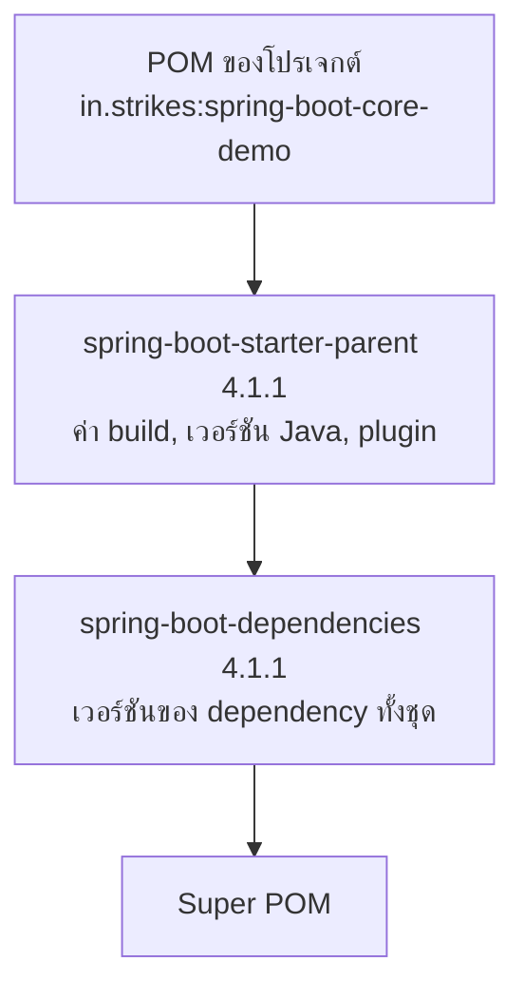
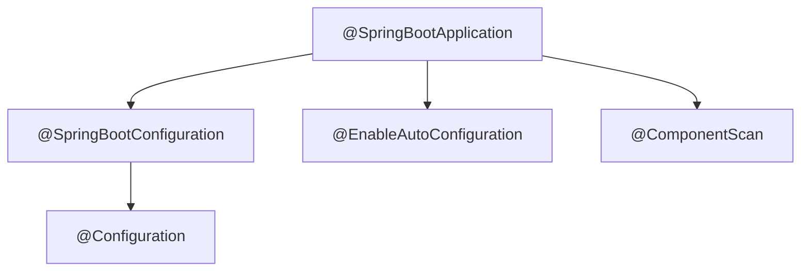
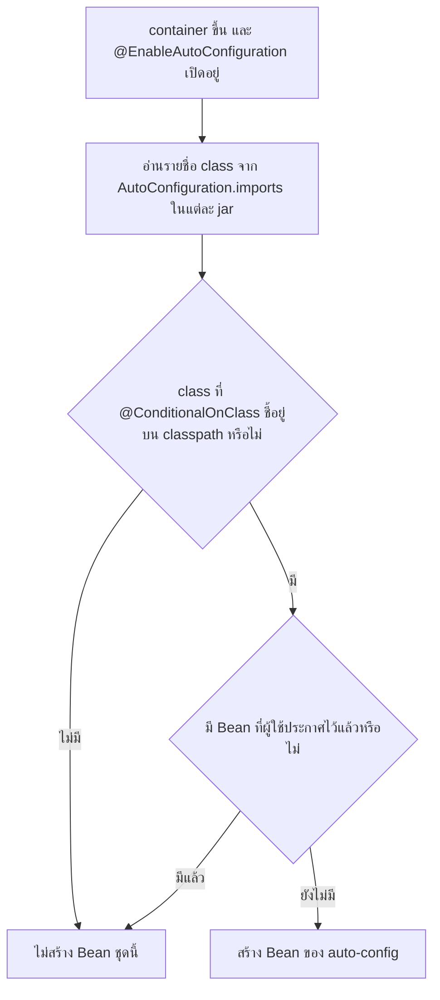

# #9 — `@SpringBootApplication` และ Auto-configuration

> **วิดีโอ:** [Spring Boot Core | @SpringBootApplication, Auto Configurations | Spring Boot full course #9](https://youtu.be/a06KMY209AA) — Coder Army, ~60 นาที
> **แหล่งที่ใช้สรุป:** ซับไตเติลภาษาฮินดีที่ YouTube สร้างอัตโนมัติ
> **เวอร์ชันในโค้ด:** Spring Boot 4.1 + Java 21 (ใส่หมายเหตุไว้ทุกจุดที่ Spring Boot 3.x ต่างกัน)

ตอนนี้ตอบคำถามเดียว: **Spring Boot ยก IoC Container ขึ้นมาให้เอง และสร้าง Bean จาก class ที่เราเขียน โดยที่เราไม่ต้อง new `ApplicationContext` ไม่ต้องเขียน `@Configuration` และไม่ต้องเขียน `@ComponentScan` ได้อย่างไร** ผู้สอนเริ่มจากตัวอย่าง `OrderService` / `PaymentService` แบบ Spring Core ที่ทำมาทั้งชุด แล้วสร้างโปรเจกต์ Boot ชุดเดียวกันให้เห็นว่างาน manual หายไปตรงไหน จากนั้นเปิด `@SpringBootApplication` ทีละชั้น

ส่วนที่ติดป้าย `💡 เพิ่มเติม` คือของที่ผมเติมเอง ไม่ได้อยู่ในวิดีโอ ส่วนที่ติด `⚠️ แก้จากวิดีโอ` คือจุดที่วิดีโอพูดคลาดเคลื่อน

---

## สารบัญ

| เวลา | หัวข้อ |
|---|---|
| [0:00](https://youtu.be/a06KMY209AA?t=0) | [1. เป้าหมายของตอน](#1-เป้าหมายของตอน) |
| [2:10](https://youtu.be/a06KMY209AA?t=130) | [2. Spring Core ต้องตั้งค่าอะไรเองบ้าง](#2-spring-core-ต้องตั้งค่าอะไรเองบ้าง) |
| [6:39](https://youtu.be/a06KMY209AA?t=399) | [3. งานที่ทำซ้ำทุกโปรเจกต์ และ Boot ไม่ได้แปลว่าเว็บ](#3-งานที่ทำซ้ำทุกโปรเจกต์-และ-boot-ไม่ได้แปลว่าเว็บ) |
| [10:08](https://youtu.be/a06KMY209AA?t=608) | [4. สร้างโปรเจกต์แล้วใส่ `spring-boot-starter`](#4-สร้างโปรเจกต์แล้วใส่-spring-boot-starter) |
| [12:43](https://youtu.be/a06KMY209AA?t=763) | [5. Starter คือกลุ่มของ transitive dependency](#5-starter-คือกลุ่มของ-transitive-dependency) |
| [13:41](https://youtu.be/a06KMY209AA?t=821) | [6. อีกทางคือ Spring Initializr](#6-อีกทางคือ-spring-initializr) |
| [15:51](https://youtu.be/a06KMY209AA?t=951) | [7. ทำไม dependency ไม่ต้องใส่ version](#7-ทำไม-dependency-ไม่ต้องใส่-version) |
| [20:38](https://youtu.be/a06KMY209AA?t=1238) | [8. `SpringApplication.run` สร้าง container ให้](#8-springapplicationrun-สร้าง-container-ให้) |
| [22:28](https://youtu.be/a06KMY209AA?t=1348) | [9. รัน service เดิมโดยไม่เขียน `AppConfig`](#9-รัน-service-เดิมโดยไม่เขียน-appconfig) |
| [25:14](https://youtu.be/a06KMY209AA?t=1514) | [10. ใน Boot ไม่ดึง Bean ออกจาก container เอง](#10-ใน-boot-ไม่ดึง-bean-ออกจาก-container-เอง) |
| [26:25](https://youtu.be/a06KMY209AA?t=1585) | [11. `@SpringBootApplication` คือสาม annotation](#11-springbootapplication-คือสาม-annotation) |
| [28:59](https://youtu.be/a06KMY209AA?t=1739) | [12. `@SpringBootConfiguration` และ `@Bean` ใน main class](#12-springbootconfiguration-และ-bean-ใน-main-class) |
| [32:46](https://youtu.be/a06KMY209AA?t=1966) | [13. `@ComponentScan` ตาม package ของ main](#13-componentscan-ตาม-package-ของ-main) |
| [35:29](https://youtu.be/a06KMY209AA?t=2129) | [14. ไม่เอา convention ก็ใส่ `scanBasePackages`](#14-ไม่เอา-convention-ก็ใส่-scanbasepackages) |
| [37:00](https://youtu.be/a06KMY209AA?t=2220) | [15. `@EnableAutoConfiguration` สร้าง Bean ที่ Boot คิดว่าจำเป็น](#15-enableautoconfiguration-สร้าง-bean-ที่-boot-คิดว่าจำเป็น) |
| [38:52](https://youtu.be/a06KMY209AA?t=2332) | [16. ทางที่สาม: `@AutoConfiguration`](#16-ทางที่สาม-autoconfiguration) |
| [43:25](https://youtu.be/a06KMY209AA?t=2605) | [17. class ใน jar ใส่ `@Component` ไม่ได้](#17-class-ใน-jar-ใส่-component-ไม่ได้) |
| [47:47](https://youtu.be/a06KMY209AA?t=2867) | [18. ใส่ dependency เว็บ แล้ว Tomcat ขึ้นเอง](#18-ใส่-dependency-เว็บ-แล้ว-tomcat-ขึ้นเอง) |
| [53:31](https://youtu.be/a06KMY209AA?t=3211) | [19. library ภายนอกส่ง auto-config มาได้](#19-library-ภายนอกส่ง-auto-config-มาได้) |
| [54:40](https://youtu.be/a06KMY209AA?t=3280) | [20. `@ConditionalOnClass` กับ `@ConditionalOnMissingBean`](#20-conditionalonclass-กับ-conditionalonmissingbean) |
| [57:23](https://youtu.be/a06KMY209AA?t=3443) | [21. จากตรงนี้ใช้ Boot เป็นหลัก](#21-จากตรงนี้ใช้-boot-เป็นหลัก) |
| — | [22. โค้ดที่รันและผลจริง](#22-โค้ดที่รันและผลจริง) |
| — | [23. สรุปท้ายตอน](#23-สรุปท้ายตอน) |

---

## 1. เป้าหมายของตอน

[▶ 0:00](https://youtu.be/a06KMY209AA?t=0)

ผู้สอนบอกว่าก่อนดูตอนนี้ต้องรู้ Spring Core มาก่อน เพราะของที่ Boot ทำให้อยู่บนกลไกเดียวกัน

ในตอนก่อนหน้า IoC Container จัดการ Bean ให้ได้ก็ต่อเมื่อเราเขียน configuration เอง ทั้งแบบ annotation (`@Component`, `@Bean`, `@Configuration`) และแบบ XML ตอนนี้ยังไม่ได้ใช้ Boot จึงยังไม่มี **auto-configuration**

วันนี้จะย้ายจาก configuration ที่เขียนเอง ไปเป็น configuration ของ Spring Boot annotation ที่ใช้ยังเป็นชุดเดิม แต่ปริมาณงาน manual น้อยลงมาก ถ้าเข้าใจ configuration กับ Bean Lifecycle ของ Spring Core อยู่แล้ว พฤติกรรมเบื้องหลังของ Boot ไม่ได้เป็นคนละระบบ งานที่เคยเขียนเองส่วนใหญ่ถูกทำให้เสร็จไว้ก่อน เราจึงไปโฟกัสที่ business logic ได้

ผู้สอนจะทำสองโปรเจกต์คู่กัน โปรเจกต์ Spring Core แบบที่ทำมาทั้งชุด แล้วสร้างโปรเจกต์ Boot ใหม่ด้วยตัวอย่างเดียวกัน เพื่อเทียบว่าอะไรที่ไม่ต้องเขียนแล้ว

---

## 2. Spring Core ต้องตั้งค่าอะไรเองบ้าง

[▶ 2:10](https://youtu.be/a06KMY209AA?t=130)

ผู้สอนเปิด IntelliJ แล้วสร้างโปรเจกต์ Maven เปล่าชื่อ Spring Core Demo ใน `pom.xml` มี dependency ตัวเดียวคือ `spring-context` ซึ่งไปคัดลอกจาก Maven Repository แล้ว reload โครงนี้ทำมาหลายตอนแล้ว

จากนั้นสร้างสอง class ที่ใช้ซ้ำทั้งคอร์ส `OrderService` ขึ้นกับ `PaymentService`

[▶ 2:53](https://youtu.be/a06KMY209AA?t=173)

`OrderService` มี field `PaymentService` และ constructor ที่รับ object นั้น method `placeOrder` เรียก `pay()` ก่อน แล้วค่อยพิมพ์ว่าสั่งซื้อแล้ว

`PaymentService` มี method `pay` ที่พิมพ์ว่าจ่ายเงินแล้ว

ผู้สอนอยากให้ IoC Container สร้าง Bean ของทั้งคู่และ inject ให้เอง constructor มีตัวเดียว จึงไม่ต้องใส่ `@Autowired` Spring รู้จัก constructor เดียวและ inject ให้ได้

[▶ 4:26](https://youtu.be/a06KMY209AA?t=266)

ขั้นตอนที่ต้องเขียนเองมีดังนี้

1. ใส่ `@Component` ที่ `OrderService` และ `PaymentService` เพื่อบอกว่าอยากให้ Spring จัดการ
2. ใน `main` สร้าง container เอง: `ApplicationContext context = new AnnotationConfigApplicationContext(...)`
3. สร้าง class `AppConfig` ใส่ `@Configuration` เพื่อบอกว่านี่คือ configuration class
4. ใส่ `@ComponentScan` แล้วระบุ package เพื่อให้ Spring หา class ที่ติด `@Component` ใน package นั้นแล้วสร้าง Bean
5. ตอนสร้าง `OrderService` Spring เห็นว่า constructor ต้องการ `PaymentService` จึง inject ให้
6. ดึง Bean ออกมาด้วย `context.getBean(OrderService.class)` แล้วเรียก `placeOrder()`

[▶ 6:06](https://youtu.be/a06KMY209AA?t=366) รอบแรกผู้สอนลืมส่ง `AppConfig.class` เข้า constructor ของ container เขาหยุดแล้วใส่ให้ จากนั้นรันได้ข้อความ `Payment done` แล้ว `Order Placed`

> 💡 **เพิ่มเติม — package และโปรเจกต์ที่ใช้ตรวจโค้ด:** ซับพูดชื่อ package เป็น `in.strikes` โน้ตนี้ใช้ `in.strikes.springcoredemo` สำหรับฝั่ง Core และ `in.strikes.springbootcoredemo` สำหรับฝั่ง Boot ทั้งสอง main อยู่ใน Maven project เดียวกันที่ parent เป็น `spring-boot-starter-parent:4.1.1` จึงได้ `spring-context` **7.0.9** ผ่าน transitive dependency ของ `spring-boot-starter` ฝั่ง Core ไม่ได้เรียก `SpringApplication.run` การสร้าง container ยังเป็น `new AnnotationConfigApplicationContext(AppConfig.class)` ตรงกับวิดีโอ

```java
package in.strikes.springcoredemo;

import org.springframework.stereotype.Component;

@Component
public class PaymentService {

    public void pay() {
        System.out.println("Payment done");
    }
}
```

```java
package in.strikes.springcoredemo;

import org.springframework.stereotype.Component;

@Component
public class OrderService {

    private final PaymentService paymentService;

    public OrderService(PaymentService paymentService) {
        this.paymentService = paymentService;
    }

    public void placeOrder() {
        paymentService.pay();
        System.out.println("Order Placed");
    }
}
```

[▶ 8:51](https://youtu.be/a06KMY209AA?t=531) ผู้สอนวาดต่อว่าใน configuration ยังเขียน `@Bean` ได้ เขาเพิ่ม class `UserService` เปล่า ๆ แล้วเขียน method ที่คืน `new UserService()` นี่เป็นแค่ภาพให้เห็นว่า container จะจัดการ Bean ที่ประกาศใน configuration ด้วย ไม่ได้ถูกเรียกจาก `placeOrder`

```java
package in.strikes.springcoredemo;

public class UserService {
}
```

```java
package in.strikes.springcoredemo;

import org.springframework.context.annotation.Bean;
import org.springframework.context.annotation.ComponentScan;
import org.springframework.context.annotation.Configuration;

@Configuration
@ComponentScan("in.strikes.springcoredemo")
public class AppConfig {

    @Bean
    public UserService getUserService() {
        return new UserService();
    }
}
```

```java
package in.strikes.springcoredemo;

import org.springframework.context.ApplicationContext;
import org.springframework.context.annotation.AnnotationConfigApplicationContext;

public class SpringCoreDemo {

    public static void main(String[] args) {
        ApplicationContext context = new AnnotationConfigApplicationContext(AppConfig.class);
        OrderService orderService = context.getBean(OrderService.class);
        orderService.placeOrder();
    }
}
```

ผลรันจริงของ `SpringCoreDemo`

```text
Payment done
Order Placed
```

[▶ 9:37](https://youtu.be/a06KMY209AA?t=577) ผู้สอนสรุปภาพใน container หลังสตาร์ทเองว่ามี Bean `OrderService`, `PaymentService` และ `UserService` และ dependency ระหว่าง order กับ payment ถูกเชื่อมให้แล้ว

```mermaid
flowchart TD
    main["main สร้าง AnnotationConfigApplicationContext พร้อม AppConfig"]
    cfg["AppConfig มี @Configuration และ @ComponentScan"]
    scan["สแกน package หา @Component"]
    beans["สร้าง Bean: OrderService, PaymentService, UserService"]
    wire["inject PaymentService เข้า constructor ของ OrderService"]
    call["getBean แล้วเรียก placeOrder"]
    main --> cfg --> scan --> beans --> wire --> call
```

---

## 3. งานที่ทำซ้ำทุกโปรเจกต์ และ Boot ไม่ได้แปลว่าเว็บ

[▶ 6:39](https://youtu.be/a06KMY209AA?t=399)

ผู้สอนชวนดูว่าขั้นตอนพวกนี้ถูกเขียนใหม่ทุกโปรเจกต์

- new IoC Container เอง แล้วเก็บในตัวแปร `context`
- ใส่ `@Component` ที่ทุก class ที่อยากให้ Spring จัดการ
- สร้าง configuration class แล้วใส่ `@ComponentScan` พร้อมชื่อ package
- `getBean` เอง แล้วค่อยเรียก method ธุรกิจ

ตอนนี้ดูสั้นเพราะใช้แค่ Spring Core ถ้าวันหน้าทำเว็บด้วย Spring MVC ซึ่งยังใช้ Servlet อยู่ข้างใต้ และจะมีตอนแยกให้ ปริมาณ configuration จะมากขึ้นอีก Boot ตั้งใจจะทำให้ configuration พวกนั้นเกิดเองเช่นกัน

[▶ 7:57](https://youtu.be/a06KMY209AA?t=477)

ประเด็นที่ผู้สอนย้ำเพราะคนสับสนบ่อย: **Spring Boot ไม่ได้แปลว่าเว็บแอป** เว็บแอปสร้างด้วย Boot ได้เมื่อใส่ dependency ฝั่งเว็บ และ Boot วางบน Spring MVC ได้ แต่ Boot ไม่ได้ผูกกับ Spring MVC หน้าที่ของมันคือทำให้ configuration ของ Spring Framework ที่ใช้อยู่เกิดเอง

โปรเจกต์วันนี้จึงเป็น Spring Boot แบบ core รันในเทอร์มินัล ไม่มี endpoint ใช้ตัวอย่าง order / payment เดิม เพื่อดูว่างาน manual ลดลงจริง

[▶ 8:32](https://youtu.be/a06KMY209AA?t=512) แนวคิดที่เขาปูไว้ก่อนลงมือคือ ถ้า framework รู้แล้วว่ามี `@Component` มันควรสร้าง Bean ให้เอง ถ้ามี configuration มันควรอ่านกฎจากนั้น ถ้ามี `@ComponentScan` มันควรไปหาใน package นั้น ถ้ามี `@Bean` มันควรเรียก method นั้น งานพวกนี้ผู้ใช้ไม่ควรต้องสั่งซ้ำ

---

## 4. สร้างโปรเจกต์แล้วใส่ `spring-boot-starter`

[▶ 10:08](https://youtu.be/a06KMY209AA?t=608)

ผู้สอนบอกว่าสร้างโปรเจกต์ Boot ได้สองทาง ทางแรกคือโปรเจกต์ Maven ใหม่ใน IntelliJ เขาตั้งชื่อแนว Spring Boot Core Demo เลือก Maven แล้วลบโค้ด boilerplate ทิ้ง ตอนนี้มีสองโปรเจกต์เปิดคู่กัน คือ Spring Core Demo เดิม กับโปรเจกต์ Boot ใหม่

[▶ 11:01](https://youtu.be/a06KMY209AA?t=661) ถ้าใช้แค่ Spring Core จะใส่ `spring-context` ใน `pom.xml` โปรเจกต์ Boot ไม่ใส่ dependency ตัวนั้นอย่างเดียว เพราะต้องการ dependency ของ Boot ชื่อ **`spring-boot-starter`**

เขาเปิด Maven Repository ค้นคำว่า Spring Boot Starter แล้วข้ามตัวที่เป็น web กับตัวที่เป็น test จนเจอ `spring-boot-starter` ตัวเปล่า

[▶ 11:49](https://youtu.be/a06KMY209AA?t=709) เขาอยากใช้สาย Spring Boot 4 จึงเลือก **4.0.5** เพราะหน้าระบุว่ามีคนใช้ราว 724 คน คัดลอก dependency มาวาง ลบ comment แล้ว reload

IDE ขึ้นคำเตือนว่าเวอร์ชันนี้มี vulnerability เขาบอกว่าตอนนี้ยังไม่ deploy จึงกดข้ามคำเตือนได้

> 💡 **เพิ่มเติม:** โค้ดในโน้ตไม่ได้ใช้ 4.0.5 ใช้ parent `spring-boot-starter-parent:4.1.1` ซึ่งเป็นสาย Boot 4 เดียวกัน แต่เป็น patch ที่ใหม่กว่า และไม่ต้องเลือกเวอร์ชันของ starter เอง ดู[ส่วนที่ 7](#7-ทำไม-dependency-ไม่ต้องใส่-version)

---

## 5. Starter คือกลุ่มของ transitive dependency

[▶ 12:43](https://youtu.be/a06KMY209AA?t=763)

หลัง reload เขาเปิดต้นไม้ dependency ใน Maven ผู้ใช้ประกาศแค่ `spring-boot-starter` แต่ข้างในมี dependency อื่นที่ถูกดึงมาให้อีกชั้น เขาเรียกชั้นนั้นว่า transitive dependency และชี้ให้เห็นอย่างน้อยสองกิ่ง

- `spring-boot-starter-logging`
- กิ่ง auto-config ซึ่งมี dependency ซ้อนลงไปอีก

เขาบอกว่าถ้าไม่มี starter เราต้องไปดาวน์โหลดทุกตัวเอง ต้นไม้ทั้งกิ่งมาพร้อมกับเวอร์ชัน 4.0.5 ที่เขาเลือก

> ⚠️ **แก้จากวิดีโอ:** ในต้นไม้เขาเรียกกิ่ง auto-config ว่า "Spring Boot Starter Auto Config" artifact จริงของ Boot 4.1.1 คือ **`spring-boot-autoconfigure`** ไม่มีคำว่า `starter` ในชื่อ ส่วนกิ่ง logging ชื่อ `spring-boot-starter-logging` จริง

ต้นไม้จริงของ `spring-boot-starter:4.1.1` (ตัดกิ่งของ `spring-boot-starter-test` ออก)

```text
org.springframework.boot:spring-boot-starter:jar:4.1.1:compile
+- org.springframework.boot:spring-boot-starter-logging:jar:4.1.1:compile
|  +- ch.qos.logback:logback-classic:jar:1.5.38:compile
|  +- org.apache.logging.log4j:log4j-to-slf4j:jar:2.25.5:compile
|  \- org.slf4j:jul-to-slf4j:jar:2.0.18:compile
+- org.springframework.boot:spring-boot-autoconfigure:jar:4.1.1:compile
|  \- org.springframework.boot:spring-boot:jar:4.1.1:compile
|     \- org.springframework:spring-context:jar:7.0.9:compile
+- jakarta.annotation:jakarta.annotation-api:jar:3.0.0:compile
\- org.yaml:snakeyaml:jar:2.6:compile
```

`spring-context` จึงเข้าโปรเจกต์มาเอง ไม่ต้องประกาศซ้ำกับตอนที่ใช้ Spring Core ตรง ๆ

[▶ 13:32](https://youtu.be/a06KMY209AA?t=812) โครงสร้างโฟลเดอร์ของโปรเจกต์ยังเป็นแบบ Maven เหมือนเดิม เขาบอกว่าจะยังไม่เขียน business code ทางนี้ต่อ เพราะมีอีกทางที่เคยใช้ตอนสร้าง Hello World

---

## 6. อีกทางคือ Spring Initializr

[▶ 13:41](https://youtu.be/a06KMY209AA?t=821)

ทางที่สองคือเว็บ Spring Initializr ที่ใช้ในตอน #2 เขาตั้งค่าบนหน้าเว็บดังนี้

| ช่อง | ที่เขาเลือก |
|---|---|
| Project | Maven |
| Language | Java |
| Spring Boot | 4.1.0 |
| Artifact | Spring Boot Core Demo |
| Packaging | Jar |
| Configuration | Properties |
| Java | 21 |
| Dependencies | ไม่ใส่ เพราะไม่ได้ทำเว็บ |

จากนั้น Generate ได้ไฟล์ zip แตกแล้วเปิดใน IntelliJ เป็นหน้าต่างใหม่ ชื่อโปรเจกต์ในคลิปเป็น demo ตัวที่สอง

โครงที่ได้เหมือนโปรเจกต์ Maven ทั่วไป มี `src/main` กับ `src/test` ใน `java` มี package จาก groupId กับ artifactId และมี class ของ `main` เขาบอกว่าจะดูโค้ดใน class นี้ทีหลัง แล้วเปิด `pom.xml` ก่อน

[▶ 15:12](https://youtu.be/a06KMY209AA?t=912) ไฟล์ POM จาก Initializr ยาวกว่าโปรเจกต์ที่เขาประกอบเอง สิ่งที่เขาอยากเทียบคือ dependency

โปรเจกต์ที่ประกอบเองมี dependency เดียวคือ `spring-boot-starter` โปรเจกต์จาก Initializr มีสองตัว

1. `spring-boot-starter` ตัวเดียวกับที่เขาใส่เอง
2. `spring-boot-starter-test` สำหรับเขียน test

เขาบอกว่าตอนนี้ไม่ได้เขียน test การมีหรือไม่มีตัวที่สองจึงไม่เปลี่ยนเนื้อหาของตอน Initializr ใส่มาให้ก็ได้

> 💡 **เพิ่มเติม:** Initializr ใส่ `spring-boot-starter-test` ด้วย `<scope>test</scope>` จึงไม่ได้อยู่บน classpath ตอนรันแอป อยู่ใน classpath ตอนรัน test เท่านั้น เรื่อง scope อยู่ในตอน #3

---

## 7. ทำไม dependency ไม่ต้องใส่ version

[▶ 15:51](https://youtu.be/a06KMY209AA?t=951)

ผู้สอนชี้ความต่างของ POM สองไฟล์

โปรเจกต์ที่คัดลอกจาก Maven Repository เองมีสี่ช่องที่เคยเห็นในตอน Maven คือ `groupId`, `artifactId`, `version` และ `scope` โดย `scope` ไม่บังคับ และเขาใส่ version **4.0.5** เอง

โปรเจกต์จาก Initializr มีแค่ `groupId` กับ `artifactId` ไม่มี `version` ทั้งที่ dependency เป็นตัวเดียวกัน

เหตุผลอยู่ที่แท็ก `<parent>` ซึ่งโปรเจกต์ที่ประกอบเองไม่มี เขาคลิกเข้าไปใน parent แล้วไล่ชั้น

1. POM ของโปรเจกต์มี parent ชื่อ **`spring-boot-starter-parent`**
2. parent ตัวนั้นมี parent อีกชั้นชื่อ **`spring-boot-dependencies`**
3. ชั้นนั้นไม่มี parent แล้ว จึงไปจบที่ Super POM

เรื่องลำดับชั้นของ POM เขาถือว่าอธิบายไปแล้วในตอน Maven สิ่งที่อยากรู้วันนี้คือทำไม template ถึงใส่ parent นี้มาให้

[▶ 17:00](https://youtu.be/a06KMY209AA?t=1020) โปรเจกต์ Boot จริงมี dependency หลายตัวพร้อมกัน วันนี้มีแค่ starter พื้นฐาน วันหน้าจะมีตัวของเว็บ ตัวของฐานข้อมูลอย่าง MySQL ตัวของ Hibernate หรือตัวที่ใช้กับ Kubernetes แต่ละตัวมีเวอร์ชันของตัวเอง และใช้ร่วมกันได้เฉพาะบางคู่

เขายกตัวอย่างว่า `spring-boot-starter` 4.0.5 ใช้กับ Spring JDBC ได้เฉพาะบางเวอร์ชัน ถ้าไปโหลดคนละเวอร์ชันมาใส่เอง โปรเจกต์จะใช้ร่วมกันไม่ได้ ตอนที่ dependency มีแค่หนึ่งหรือสองตัว ปัญหายังไม่ชัด พอมีสิบกว่าตัว การตามหาคู่ที่เข้ากันกลายเป็นงานที่ต้องค้นแล้วย้อนกลับมาแก้บ่อย

Boot แก้ด้วย parent ชื่อ `spring-boot-starter-parent` ของที่โปรเจกต์ไม่ได้ระบุจะถูกดึงจาก parent และ parent รู้ว่าเวอร์ชันไหนเข้ากับเวอร์ชันไหน เวลาเพิ่ม `spring-boot-starter` ของเว็บ หรือของ JDBC หรือของ Hibernate จึงไม่ต้องเขียน `<version>` หน้าที่จับคู่เป็นของ parent

เขาบอกว่านี่คือวิธีที่ควรใช้ ถ้าโหลดโปรเจกต์จาก Initializr จะได้ parent มาให้แล้ว ถ้าประกอบโปรเจกต์ Maven เองก็ใส่ parent นี้เพิ่มได้ เขาปิดโปรเจกต์ที่ประกอบเอง แล้วทำงานต่อบนโปรเจกต์จาก Initializr ส่วนโปรเจกต์ Spring Core Demo ยังเปิดค้างไว้เพื่อเทียบ



> 💡 **เพิ่มเติม — เวอร์ชันอยู่ชั้นไหน:** คลิปไล่ครบทั้งสามชั้นแล้วพูดรวบว่าเวอร์ชันถูกดึงจาก parent รายการเวอร์ชันที่จับคู่กันอยู่ที่ `spring-boot-dependencies` ซึ่งเป็น parent ของ `spring-boot-starter-parent` อีกที ส่วน `spring-boot-starter-parent` ส่งต่อรายการนั้นและใส่ค่า build ให้ เช่น `java.version` กับ `spring-boot-maven-plugin` รายละเอียดชั้น POM อยู่ในตอน #3
>
> ตรวจจาก POM ใน `~/.m2` ของ 4.1.1: `spring-boot-starter-parent` มี `<parent>` เป็น `spring-boot-dependencies` และ `<packaging>pom</packaging>`

> ⚠️ **แก้จากวิดีโอ:** เขาเรียก `spring-boot-starter-parent` ว่า parent jar ที่ถูกคือไฟล์นี้เป็น **POM** (`<packaging>pom</packaging>`) ไม่มี class ให้รัน มันเป็น parent ในสายของ Maven ไม่ใช่ library ที่ถูกโหลดเข้า classpath ตอนรัน

POM ที่ใช้รันโค้ดในโน้ตนี้ (เวอร์ชันเป็น 4.1.1 แทน 4.1.0 ที่เขาเลือกบน Initializr)

```xml
<parent>
  <groupId>org.springframework.boot</groupId>
  <artifactId>spring-boot-starter-parent</artifactId>
  <version>4.1.1</version>
</parent>

<groupId>in.strikes</groupId>
<artifactId>spring-boot-core-demo</artifactId>
<version>0.0.1</version>

<properties>
  <java.version>21</java.version>
</properties>

<dependencies>
  <dependency>
    <groupId>org.springframework.boot</groupId>
    <artifactId>spring-boot-starter</artifactId>
  </dependency>
  <dependency>
    <groupId>org.springframework.boot</groupId>
    <artifactId>spring-boot-starter-test</artifactId>
    <scope>test</scope>
  </dependency>
</dependencies>
```

ไม่มี `<version>` ใน dependency ทั้งสองตัว

---

## 8. `SpringApplication.run` สร้าง container ให้

[▶ 20:38](https://youtu.be/a06KMY209AA?t=1238)

ใน class หลักของโปรเจกต์จาก Initializr มี `main` บรรทัดเดียวที่เรียก `SpringApplication.run` โดยส่ง class ของแอปเข้าไปพร้อม `args` และมี annotation `@SpringBootApplication` นอกนั้นโปรเจกต์ว่าง ผู้สอนบอกว่าจะยังไม่แตก annotation นี้ แล้วตั้งคำถามว่า container อยู่ตรงไหน

ใน Spring Core ต้องเขียน `new AnnotationConfigApplicationContext` เอง ใน Boot ไม่ต้อง เพราะบรรทัด `SpringApplication.run` คือจุดที่ container ถูกยกขึ้น

[▶ 21:25](https://youtu.be/a06KMY209AA?t=1285) เขาเปิด method `run` แล้วเห็นว่าค่าที่คืนเป็น **`ConfigurableApplicationContext`** interface นี้ extends `ApplicationContext` จึงรับค่าใส่ตัวแปรชนิด `ApplicationContext` ได้

เขาไม่ต้องเลือกว่า container จะเป็นแบบ annotation หรือแบบ XML และไม่ต้องส่งไฟล์ configuration เข้าไป ถ้าอยากถือ reference ของ container ไว้ก็รับค่าคืนมาได้

> 💡 **เพิ่มเติม:** การส่ง `SpringBootCoreDemoApplication.class` ไม่ได้ "ดึง Bean ผ่าน reflection" เป็นประโยคที่ซับใช้ ตัว class นี้คือแหล่งตั้งต้น Boot อ่าน `@SpringBootApplication` บน class นี้เพื่อรู้ว่าจะสแกน package ไหนและจะเปิด auto-configuration หรือไม่ การอ่าน annotation ใช้ reflection ข้างใน แต่หน้าที่ของอาร์กิวเมนต์คือชี้ว่า class ไหนเป็นแอป

---

## 9. รัน service เดิมโดยไม่เขียน `AppConfig`

[▶ 22:28](https://youtu.be/a06KMY209AA?t=1348)

ผู้สอนคัดลอก `OrderService` กับ `PaymentService` จากโปรเจกต์ Core มาวางในโปรเจกต์ Boot IDE ปรับ package ให้เอง method ยังเหมือนเดิม `pay` พิมพ์ `Payment done` และ `placeOrder` เรียก `pay` ก่อนแล้วพิมพ์ `Order Placed` ทั้งคู่ยังติด `@Component` เขาบอกว่า annotation ชุดนี้ไม่เปลี่ยน

เขาไม่ได้สร้าง `AppConfig` คำถามคือ Boot จะรู้ได้อย่างไรว่าต้องสร้าง Bean ของสอง class นี้ เขาบอกว่าเดี๋ยวจะดูกลไก ตอนนี้เรียกได้เลย

```java
OrderService orderService = context.getBean(OrderService.class);
orderService.placeOrder();
```

[▶ 24:35](https://youtu.be/a06KMY209AA?t=1475) รันแล้วได้ `Payment done` กับ `Order Placed` ทั้งที่ไม่มีไฟล์ configuration และไม่มี `@ComponentScan` ที่เราเขียนเอง

สิ่งที่เกิดขึ้นแล้วโดยที่ไม่ได้สั่งทีละขั้น

- constructor injection ทำงานเอง เพราะเป็น constructor ตัวเดียว ไม่ต้องเขียน `@Autowired`
- container ถูกยกขึ้นโดย `SpringApplication.run` เราแค่รับ reference
- `getBean` แล้วเรียก `placeOrder` ได้

ผลรันจริงของแอป Boot ที่ยังไม่มี dependency เว็บ ตัด banner กับ timestamp ออก

```text
... INFO ... i.s.s.SpringBootCoreDemoApplication : Starting SpringBootCoreDemoApplication using Java 21.0.12.1 with PID 50790
... INFO ... i.s.s.SpringBootCoreDemoApplication : No active profile set, falling back to 1 default profile: "default"
... INFO ... i.s.s.SpringBootCoreDemoApplication : Started SpringBootCoreDemoApplication in 0.221 seconds (process running for 0.308)
Payment done
Order Placed
userService bean type: UserService
```

ไม่มีบรรทัดของ Tomcat ใน log นี้ ผู้สอนชี้จังหวะเดียวกันนี้ทีหลังว่า log มีแต่การสตาร์ทแอปกับ active profile แล้วจบ ไม่มี server

> 💡 **เพิ่มเติม:** บรรทัด `userService bean type` ไม่ได้อยู่ในรอบที่เขาให้ดูบนจอ เขาเพิ่ม `@Bean` ของ `UserService` ใน[ส่วนที่ 12](#12-springbootconfiguration-และ-bean-ใน-main-class) แล้วบอกว่าจะลบออกก่อนอธิบายต่อ โน้ตนี้คง method ไว้แล้วพิมพ์ชนิดของ Bean เพื่อให้ผลรันพิสูจน์ว่า method นั้นถูกลงทะเบียน จังหวะที่เขาให้ดูมีแค่สองบรรทัด `Payment done` กับ `Order Placed`

---

## 10. ใน Boot ไม่ดึง Bean ออกจาก container เอง

[▶ 25:14](https://youtu.be/a06KMY209AA?t=1514)

ผู้สอนบอกว่าวิธีที่เพิ่งรันเป็นวิธีของ Spring Core ในแอป Boot เขาไม่ถือ reference ของ container แล้ว `getBean` เอง

ถ้าโปรเจกต์นี้เป็นเว็บ `placeOrder` จะถูกเรียกเมื่อมี request มาที่ endpoint เช่น `/order` รูปแบบเดียวกับตอน #2 แต่โปรเจกต์นี้ไม่ใช่เว็บ ถ้าจะเรียก `placeOrder` ตอนแอปสตาร์ทโดยไม่ `getBean` เอง ต้องมีอีกวิธี เขาบอกว่าจะดูในตอนถัดไป

ตอนนี้เขาจะไล่ว่า annotation บน class หลักทำให้ขั้นตอนที่เหลือเกิดเองได้อย่างไร

---

## 11. `@SpringBootApplication` คือสาม annotation

[▶ 26:25](https://youtu.be/a06KMY209AA?t=1585)

`@SpringBootApplication` ถูกใส่มาให้ตั้งแต่โหลด template ถ้าประกอบโปรเจกต์ Maven เองต้องเขียน class `main` กับ annotation นี้เอง

เขาคลิกเข้าไปในประกาศของ annotation แล้วเห็น annotation อื่นติดอยู่ข้างใน ตัวที่เขาหยิบมาอธิบายมีสามตัว

| annotation ที่ติดอยู่บน `@SpringBootApplication` | หน้าที่ตามที่เขาอธิบาย |
|---|---|
| `@SpringBootConfiguration` | class นี้คือ configuration หลัก |
| `@EnableAutoConfiguration` | เปิด auto-configuration |
| `@ComponentScan` | สแกน `@Component` แล้วสร้าง Bean |

เหนือสามตัวนั้นเขายังเห็น `@Inherited`, `@Documented`, `@Retention` และ `@Target` เขาบอกว่าสี่ตัวนี้ยังไม่ใช้ในตอนนี้ จะกลับมาตอนทำเว็บแอป พารามิเตอร์ข้างใน `@ComponentScan` ก็ยังไม่ดู

ข้อสรุปของเขาคือ เขียน `@SpringBootApplication` ตัวเดียว หรือเขียนสามตัวนั้นเอง ผลเท่ากัน Boot รวมให้เป็น annotation เดียวเพื่อไม่ให้เราต้องเขียนครบทุกครั้ง เขาเรียกมันว่า parent annotation



> ⚠️ **แก้จากวิดีโอ:** สาม annotation ที่เขียนเองไม่ได้ให้ผลเท่ากับ `@SpringBootApplication` ทุกกรณี ของจริงบน Boot 4.1.1 ติด `@ComponentScan` พร้อม `excludeFilters` สองตัวคือ `TypeExcludeFilter` และ `AutoConfigurationExcludeFilter` ตัวหลังกันไม่ให้ class ที่ติด `@AutoConfiguration` ถูก component scan หยิบซ้ำ เพราะ `@AutoConfiguration` เองก็เป็น `@Configuration` โปรเจกต์นี้สแกนแค่ `in.strikes.springbootcoredemo` ซึ่งไม่มี class auto-config ของ Boot อยู่ จึงยังเห็นผลเหมือนกัน แต่พอขยาย `scanBasePackages` ให้คลุม package ของ Boot หรือเขียน auto-config เองไว้ใน package ที่ถูกสแกน ตัวกรองนี้เริ่มมีผล
>
> ตรวจจาก `javap -v` ของ `org.springframework.boot.autoconfigure.SpringBootApplication` ใน `spring-boot-autoconfigure-4.1.1.jar`

> 💡 **เพิ่มเติม:** สี่ annotation ที่เขาให้ข้ามเป็น meta-annotation ของภาษา Java กำหนดว่า `@SpringBootApplication` ใช้ได้บน type, อยู่ถึงตอนรัน, โผล่ในเอกสาร และ subclass สืบทอดได้ ไม่ได้สร้าง Bean

---

## 12. `@SpringBootConfiguration` และ `@Bean` ใน main class

[▶ 28:59](https://youtu.be/a06KMY209AA?t=1739)

เขากลับไปที่โปรเจกต์ Core ก่อน ในนั้นมีไฟล์ `AppConfig` แยก ติด `@Configuration` กับ `@ComponentScan` และส่ง class นี้เข้า container ไฟล์นี้คือที่รวบกฎการสร้าง Bean เขาเตือนว่า `@Configuration` ข้างในเป็น `@Component` ด้วย configuration class จึงเป็น Bean ใน container เช่นกัน

Boot ให้ annotation คนละชื่อคือ `@SpringBootConfiguration` เขาเปิดดูแล้วสรุปว่ามันคือ configuration file เทียบได้กับ `@Configuration` ของ Spring Core แต่เป็น syntax เฉพาะเพื่อให้ Boot รู้ว่านี่คือ configuration **หลัก** configuration อื่นยังสร้างเพิ่มได้ถ้าอยากให้ Boot จัดการ Bean บางส่วนเอง แต่ไฟล์หลักควรมีหนึ่ง และนั่นคือ class ที่ติด `@SpringBootConfiguration`

เพราะ `@SpringBootApplication` ติดอยู่บน class หลัก annotation ข้างในจึงมีผลกับ class นี้ด้วย class หลักจึงเป็น configuration

[▶ 31:02](https://youtu.be/a06KMY209AA?t=1862) เขาพิสูจน์ด้วยการเขียน `@Bean` ใน class หลักเลย ไม่ได้สร้าง `AppConfig.java`

`UserService` เป็น class เปล่า และตั้งใจไม่ใส่ `@Component` เพราะจะสร้างผ่าน `@Bean`

```java
package in.strikes.springbootcoredemo;

public class UserService {
}
```

```java
@Bean
public UserService getUserService() {
    return new UserService();
}
```

เขาบอกว่าแบบนี้ถูกกฎ ไม่ต้องมีไฟล์ configuration แยกแบบโปรเจกต์ Core จากนั้นเขาบอกว่าจะสมมติว่าเอา method นี้ออกก่อน แล้วไปดูว่า component ถูกสแกนได้อย่างไรทั้งที่ยังไม่เห็น `@ComponentScan` ที่เราเขียน

> ⚠️ **แก้จากวิดีโอ:** เขาบอกว่า `@SpringBootConfiguration` เทียบเท่า `@Configuration` ทุกอย่าง ที่ถูกคือมันถูก meta-annotate ด้วย `@Configuration` จึงเขียน `@Bean` ใน class นั้นได้จริง และติด `@Indexed` อีกตัว บทบาทที่เพิ่มมาคือเครื่องหมายว่านี่เป็น configuration หลักของแอป แอปควรมี `@SpringBootConfiguration` แค่ class เดียว `@SpringBootTest` ใช้เครื่องหมายนี้หา class ของแอป ตรวจจาก `org.springframework.boot.SpringBootConfiguration` ใน `spring-boot-4.1.1.jar`

---

## 13. `@ComponentScan` ตาม package ของ main

[▶ 32:46](https://youtu.be/a06KMY209AA?t=1966)

`@ComponentScan` บอกให้ Spring เข้าไปใน package ที่กำหนด แล้วสร้าง Bean ให้ทุก class ที่ติด `@Component`

ใน Boot เราไม่ได้เขียน `@ComponentScan` เอง เพราะมันติดอยู่ข้างใน `@SpringBootApplication` ซึ่งอยู่บน class หลัก ผู้สอนชี้ว่าในคลิปไม่ได้ส่งชื่อ package เข้าไป Boot ใช้ convention ของตัวเอง

convention คือ สแกน package ที่ไฟล์ `main` อยู่ ในคลิป package ของ class หลักเป็น package ใต้ `in.strikes` และเขาเอา `OrderService` กับ `PaymentService` ไว้ใน package เดียวกัน จึงถูกสร้างเป็น Bean

[▶ 34:18](https://youtu.be/a06KMY209AA?t=2058) เขาลองสร้าง package ใหม่ที่เป็นคนละกิ่ง แล้วบอกว่า class ที่วางใน package นั้นจะไม่ถูกจัดการ แม้จะติด `@Component` จากนั้นเขาลบ package ทิ้ง

เขาโยงกลับไปที่ Spring Core ว่าเคยบอกให้วาง component ไว้ package เดียวกับ `AppConfig` แม้ไม่เขียนชื่อ package ใน `@ComponentScan` ก็ยังหาใน package ของ class ที่ติด annotation นั้นได้ โปรเจกต์ Boot ใช้ convention เดียวกัน

[▶ 35:06](https://youtu.be/a06KMY209AA?t=2106) เขาเรียก Boot ว่า **opinionated framework** มีความเห็นของตัวเองชุดหนึ่ง ถ้าทำตามจะได้พฤติกรรมสำเร็จรูป เช่น วาง class ไว้ใน package ของ `main` แล้ว Boot จัดการให้ ถ้าไม่เห็นด้วยก็ยังสั่งตรง ๆ ได้ ซึ่งเป็นหัวข้อถัดไป

> 💡 **เพิ่มเติม — package ย่อยถูกสแกนด้วย:** `@ComponentScan` สแกน package ที่ระบุและ package ลูกทั้งหมด ไม่ได้หยุดที่ package ชั้นเดียว กรณีที่เขาทำให้ดูคือ package คนละกิ่ง ซึ่งหลุดจากการสแกนจริง ถ้าสร้าง `in.strikes.springbootcoredemo.order.OrderService` ซึ่งเป็น package ลูก class นั้นยังถูกเจอ ตอน #2 ใช้กฎเดียวกันนี้กับ `HelloController`

---

## 14. ไม่เอา convention ก็ใส่ `scanBasePackages`

[▶ 35:29](https://youtu.be/a06KMY209AA?t=2129)

ถ้าอยากให้ Boot หาใน package อื่นด้วย เขาบอกว่าต้องมี package แม่แล้วใส่ชื่อ package นั้นใน component scan ไม่จำเป็นต้องทำ ถ้าโครงสร้างเดิมพออยู่แล้ว

วิธีสั่งคือใส่อาร์กิวเมนต์บน `@SpringBootApplication` ชื่อที่เขาพูดบนจอคือ scan base packages แล้วใส่ชื่อ package แม่ เช่น `in.strikes` ผลคือให้ไปหาใน `in.strikes` แทนที่จะหาแค่ package ยาวของ class หลัก

เขาบอกว่าจะยังไม่ใส่ เพราะถ้ายอมรับ convention ก็ไม่ต้องแก้อะไร ถ้าไม่ยอมรับค่อยใส่ key นี้เพื่อให้ Boot ทำตามเรา

```java
@SpringBootApplication(scanBasePackages = "in.strikes")
```

> 💡 **เพิ่มเติม:** ชื่อแอตทริบิวต์จริงคือ `scanBasePackages` เป็น `@AliasFor` ไปที่ `basePackages` ของ `@ComponentScan` ตรวจจาก class ของ `@SpringBootApplication` ใน Boot 4.1.1 การใส่ค่านี้ใช้แทน package ของ class หลัก ไม่ได้บวกเพิ่ม ถ้า package ของ `main` ไม่ได้อยู่ใต้สตริงที่ใส่ class ใน package เดิมจะหลุดจากการสแกน เขาอธิบายจังหวะนี้ตรงกับพฤติกรรมนั้น โค้ดที่รันในโน้ตไม่ได้ใส่แอตทริบิวต์นี้ เพราะเขาเองก็เอาออก

ถึงตรงนี้เขาสรุปภาพที่รันได้โดยที่เราไม่ได้ส่ง `AppConfig` เข้า container

- class หลักคือ configuration เพราะมี `@SpringBootConfiguration` ผ่าน `@SpringBootApplication`
- `@ComponentScan` อยู่ตรงนั้นเช่นกัน จึงรู้ว่าต้องหา `OrderService` กับ `PaymentService`
- dependency ถูก inject ที่ constructor โดยไม่ต้อง `@Autowired`
- เรียก `placeOrder` แล้วโค้ดธุรกิจรัน

เขาบอกว่าปริมาณงานที่เหลือใน Boot คือสร้าง component แล้วรัน ไม่ต้องเขียน configuration และไม่ต้องสั่ง component scan เอง การถือ container แล้ว `getBean` ก็ไม่ใช่วิธีที่เขาอยากให้ใช้

---

## 15. `@EnableAutoConfiguration` สร้าง Bean ที่ Boot คิดว่าจำเป็น

[▶ 37:00](https://youtu.be/a06KMY209AA?t=2220)

annotation ที่สามคือ `@EnableAutoConfiguration` เขาอธิบายเป็นประโยคเดียวว่า มันบอกให้ Boot **ดูโปรเจกต์นี้ แล้วสร้าง Bean ที่คิดว่าจำเป็น**

เขาเขียนประโยคนี้ลงโน้ตบนจออีกรอบ แล้วเทียบกับ Spring Core

ใน Core เราเป็นคนบอกเองว่า object ไหนควรเป็น Bean มีสองทาง

| ทาง | แปะที่ไหน | ผลถ้าไม่แปะ |
|---|---|---|
| `@Component` | ที่ class | container ไม่จัดการ class นั้น |
| `@Bean` | ที่ method ใน configuration | container ไม่เรียก method นั้น |

ทั้งสองทางคือการที่เราชี้ว่าอยากได้อะไร Boot บอกว่าควรมีทางที่สาม นอกเหนือจากที่เราชี้เอง

---

## 16. ทางที่สาม: `@AutoConfiguration`

[▶ 39:55](https://youtu.be/a06KMY209AA?t=2395)

ทางที่สามคือ `@AutoConfiguration` เขาบอกว่าโดยมากเราไม่ใช้เอง มันถูกใช้ข้างใน Boot เราใช้แค่ `@Component` กับ `@Bean`

`@Component` แปะบน class และ `@AutoConfiguration` ก็แปะบน class เช่นกัน เขาวาด class สมมติสองตัว

class ที่เราเขียนเองติด `@Configuration` แล้วมี `@Bean` ที่คืน object ของเรา

class ที่ Boot เขียนไว้แล้วติด `@AutoConfiguration` แล้วมี `@Bean` ของมันเอง เราไม่ได้เขียน class นี้ Boot มี class แบบนี้ติดมากับเฟรมเวิร์ก พอ container ขึ้น Boot สร้าง Bean ใน class พวกนั้นให้

เขานิยาม `@AutoConfiguration` ว่าเป็น configuration ที่ Boot ทำให้เอง และจะทำงานเมื่อมี `@EnableAutoConfiguration` ซึ่ง `@SpringBootApplication` เปิดไว้แล้วตั้งแต่ต้น ดังนั้น auto-configuration จึงเปิดอยู่โดยค่าเริ่มต้น

คำถามถัดไปของเขาคือ ทำไม Boot ต้องสร้าง Bean ที่เราไม่ได้ขอ

> 💡 **เพิ่มเติม — Boot หา class พวกนี้จากไฟล์ ไม่ได้สแกนทั้ง classpath:** `@EnableAutoConfiguration` ติด `@Import(AutoConfigurationImportSelector.class)` ตัว selector อ่านรายชื่อ class จากไฟล์ `META-INF/spring/org.springframework.boot.autoconfigure.AutoConfiguration.imports` ใน jar ที่อยู่บน classpath ใน `spring-boot-autoconfigure-4.1.1.jar` ไฟล์นี้มี 12 บรรทัด เช่น `AopAutoConfiguration` กับ `TaskExecutionAutoConfiguration` class ของ Tomcat กับ MVC ไม่อยู่ในไฟล์นี้ของ jar ตัวนั้น ดู[ส่วนที่ 18](#18-ใส่-dependency-เว็บ-แล้ว-tomcat-ขึ้นเอง)

---

## 17. class ใน jar ใส่ `@Component` ไม่ได้

[▶ 43:25](https://youtu.be/a06KMY209AA?t=2605)

เขาเปิด `pom.xml` ของโปรเจกต์ Initializr ซึ่งตอนนั้นมี `spring-boot-starter` กับ `spring-boot-starter-test` แล้วเปิด External Libraries ให้เห็นว่า dependency สองตัวดึง library อื่นมาอีกจำนวนมาก ในนั้นเขาเปิด interface ของ JSON parser ซึ่งเป็นไฟล์ `.class` IDE ถอด bytecode ให้ดูเป็นซอร์ส แต่ไฟล์นั้นอ่านอย่างเดียว

เขาอยากให้ container ถือ object ของ implementation ตัวใดตัวหนึ่ง แต่แปะ `@Component` ลงไปไม่ได้เพราะแก้ไฟล์ใน jar ไม่ได้ ทางที่ยังทำได้คือเขียน `@Bean` ใน configuration ของเราเอง ซึ่งใน Boot ก็คือ class หลัก

บนจอเขาเห็น type ในลำดับชั้นสี่ตัว แล้วลองไปที่ตัว abstract ก่อน สร้าง object จากตัวนั้นไม่ได้ จึงเปลี่ยนไปที่ **`BasicJsonParser`** แล้วเขียน `@Bean` ที่คืน `new BasicJsonParser()` ถ้าทำแบบนี้ container จะมี Bean ของ parser นี้

เขาอธิบายว่าเรามักทำแบบนี้กับ class ที่จะใช้จริง ไม่ได้ทำกับทุก class ใน jar จากนั้นยกตัวอย่างโปรเจกต์เก่าที่แพ็กเป็น jar แล้วนำไปเป็น dependency ของโปรเจกต์ที่สอง โปรเจกต์ที่สองเรียก method ของโปรเจกต์แรกได้ แต่ class ที่มาจาก library ภายนอกไม่ได้กลายเป็น Bean เอง ถ้าต้องการก็ต้องสร้างเอง

[▶ 47:12](https://youtu.be/a06KMY209AA?t=2832) เขา comment ตัวอย่าง parser ทิ้ง บอกว่าแค่ทำให้เห็นว่าทำได้

> 💡 **เพิ่มเติม — ชื่อจริงใน Boot 4.1.1:** interface คือ `org.springframework.boot.json.JsonParser` สี่ type ที่โผล่ในลำดับชั้นคือ `AbstractJsonParser` (abstract), `BasicJsonParser`, `JacksonJsonParser` และ `GsonJsonParser` เขาเลือก `BasicJsonParser` เพราะตัว abstract สร้างตรง ๆ ไม่ได้ โน้ตย้าย `@Bean` ที่เขา comment ทิ้งไปไว้ที่ `in.strikes.manual.JsonParserConfig` ซึ่งอยู่นอก package ที่ Boot สแกน จึงไม่ไปปนกับแอป order แล้วมี `JsonParserDemo` ไว้รันให้เห็นผล

```java
package in.strikes.manual;

import org.springframework.boot.json.BasicJsonParser;
import org.springframework.boot.json.JsonParser;
import org.springframework.context.annotation.Bean;
import org.springframework.context.annotation.Configuration;

@Configuration
public class JsonParserConfig {

    @Bean
    public JsonParser basicJsonParser() {
        return new BasicJsonParser();
    }
}
```

ผลรัน `JsonParserDemo` ซึ่งโหลด config นี้ด้วย `AnnotationConfigApplicationContext`

```text
org.springframework.boot.json.BasicJsonParser
{status=ok}
```

> ⚠️ **Boot 4 vs 3:** `JacksonJsonParser` ซึ่งเป็น implementation อีกตัวในลำดับชั้นเดียวกัน เปลี่ยน constructor ตามการย้ายไป Jackson 3 ใน Boot 4.1.1 รับ `tools.jackson.databind.json.JsonMapper` ใน Boot 3.5.16 รับ `com.fasterxml.jackson.databind.ObjectMapper` ตัว `BasicJsonParser` ที่เขาใช้ในคลิปไม่มี constructor แบบนั้น จึงยัง `new BasicJsonParser()` ได้ทั้งสองรุ่น ตรวจด้วย `javap` ของ `spring-boot-4.1.1.jar` กับ `spring-boot-3.5.16.jar` และหัวข้อ Upgrading Jackson ใน [Spring Boot 4.0 Migration Guide](https://github.com/spring-projects/spring-boot/wiki/Spring-Boot-4.0-Migration-Guide)

---

## 18. ใส่ dependency เว็บ แล้ว Tomcat ขึ้นเอง

[▶ 47:47](https://youtu.be/a06KMY209AA?t=2867)

เขาต่อว่าวันหน้าจะใส่ dependency เว็บเพิ่ม dependency นั้นนำ class มาอีกชุด เขาเรียกสมมติว่า WebClass A กับ WebClass B ถ้าจะทำเว็บ เราต้องมี Bean ของ class พวกนี้เพื่อเรียก method และให้ container จัดการ

ถ้าใช้ Spring MVC โดยไม่มี Boot ต้องเขียน configuration เพื่อสร้าง Bean พวกนั้นเอง Boot บอกว่า dependency มาตรฐานไม่ต้องทำเอง ไม่ว่าจะเป็น starter เว็บ, Spring Data ที่ใช้กับ JDBC, หรือ Hibernate ทีม Boot เตรียม class ที่ประกาศ Bean ของ dependency เหล่านั้นไว้แล้ว พอ container ขึ้น มันหา class ที่เป็น auto-configuration แล้วสร้าง Bean ให้

ผลที่เขาอยากให้เห็นคือ พอใส่ starter เว็บ server ของ Tomcat ขึ้นเองโดยเราไม่ได้ไปสตาร์ทเอง นั่นคือ auto-configuration มีไฟล์หลายไฟล์ แต่ละไฟล์มี Bean ของ library ที่จะใช้ต่อ เช่น Web MVC, data, Jackson, Mockito เราใช้ Bean เหล่านั้นได้เลย หรือเฟรมเวิร์กใช้ข้างในเอง โดยเราไม่ต้องเขียน configuration

[▶ 51:05](https://youtu.be/a06KMY209AA?t=3065) เขารันโปรเจกต์ที่ยังไม่มี dependency เว็บอีกครั้ง ได้ `Payment done` กับ `Order Placed` แล้วชี้ที่ log ว่าไม่มี Tomcat เพราะ Boot รู้ว่าไม่ได้ใส่ dependency เว็บ จึงไม่ต้องสร้าง Bean ของฝั่งนั้น

จากนั้นเขาเพิ่ม dependency ชื่อ **Spring Boot Starter Web** โดยไม่เขียน version และไม่เขียน scope แล้ว reload ในต้นไม้โผล่ starter เว็บ พร้อมกิ่งของ Jackson กับ Tomcat class ของ server มาอยู่ที่ External Libraries

เขาไม่ได้เขียนโค้ดเพิ่ม นอกจากบรรทัด dependency แล้วรันใหม่ log มี **Tomcat started on port 8080** เขาอ่านว่าต้องมีงานเบื้องหลังเกิดขึ้น container สร้าง Bean ให้ และ configuration ถูกทำให้เพราะ `@EnableAutoConfiguration` เปิดอยู่ class ที่ติด `@AutoConfiguration` จึงทำงาน

> ⚠️ **Boot 4 vs 3 — ชื่อ starter:** ในคลิปใส่ `spring-boot-starter-web` แล้ว Tomcat ขึ้นที่พอร์ต 8080 ใน Boot 4 starter ชื่อนี้ถูก deprecate ตัวแทนคือ **`spring-boot-starter-webmvc`** ของเดิมยังอยู่และจะถูกถอดในรุ่นถัดไป โค้ดที่รันในโน้ตใช้ชื่อใหม่ แล้วได้ Tomcat เหมือนที่เขาทำให้ดู
>
> แหล่ง: ตาราง Deprecated Starters ใน [Spring Boot 4.0 Migration Guide](https://github.com/spring-projects/spring-boot/wiki/Spring-Boot-4.0-Migration-Guide) และ `pom` ของ `spring-boot-starter-webmvc:4.1.1` ซึ่งดึง `spring-boot-starter-tomcat` กับ `spring-boot-starter-jackson`

> ⚠️ **Boot 4 vs 3 — class ของ auto-config ย้าย module:** ใน Boot 3.5.16 class พวกนี้อยู่รวมใน `spring-boot-autoconfigure` เช่น `org.springframework.boot.autoconfigure.web.servlet.DispatcherServletAutoConfiguration` และ `org.springframework.boot.autoconfigure.web.servlet.ServletWebServerFactoryAutoConfiguration` ไฟล์ `AutoConfiguration.imports` ของ jar นั้นมี 156 บรรทัด ใน Boot 4.1.1 jar `spring-boot-autoconfigure` เหลือ 12 บรรทัด ส่วน MVC ไปอยู่ที่ `org.springframework.boot.webmvc.autoconfigure.DispatcherServletAutoConfiguration` ใน jar `spring-boot-webmvc` และ Tomcat ไปอยู่ที่ `org.springframework.boot.tomcat.autoconfigure.servlet.TomcatServletWebServerAutoConfiguration` ใน jar `spring-boot-tomcat` บรรทัด log ของ server จึงมาจาก `o.s.boot.tomcat.TomcatWebServer` ไม่ใช่ `o.s.b.w.embedded.tomcat.TomcatWebServer` แบบ Boot 3
>
> ตรวจจาก jar 3.5.16 กับ 4.1.1 ใน `~/.m2` และหัวข้อ Package Organization ใน Migration Guide เดียวกัน

ต้นไม้จริงหลังเปิดโปรไฟล์ที่มี `spring-boot-starter-webmvc` (เฉพาะกิ่งเว็บ)

```text
org.springframework.boot:spring-boot-starter-webmvc:jar:4.1.1:compile
+- org.springframework.boot:spring-boot-starter-jackson:jar:4.1.1:compile
|  \- org.springframework.boot:spring-boot-jackson:jar:4.1.1:compile
|     \- tools.jackson.core:jackson-databind:jar:3.1.5:compile
+- org.springframework.boot:spring-boot-starter-tomcat:jar:4.1.1:compile
|  +- org.apache.tomcat.embed:tomcat-embed-core:jar:11.0.24:compile
|  \- org.springframework.boot:spring-boot-tomcat:jar:4.1.1:compile
\- org.springframework.boot:spring-boot-webmvc:jar:4.1.1:compile
   \- org.springframework:spring-webmvc:jar:7.0.9:compile
```

> 💡 **เพิ่มเติม — พอร์ตในโน้ตคือ 9009:** คลิปใช้พอร์ต default 8080 โปรเจกต์นี้ใส่ `server.port=9009` ใน `application.properties` เพื่อไม่ให้ชนกับโปรเจกต์อื่น ไฟล์ properties เป็นเรื่องของตอนถัดไป ใส่ไว้แค่เปลี่ยนพอร์ตตอนตรวจ log แอปที่ยังไม่มี starter เว็บไม่เปิดพอร์ตนี้

ผลรันจริงหลังใส่ `spring-boot-starter-webmvc` แล้วหยุดโปรเซสหลังเห็น log

```text
... INFO ... i.s.s.SpringBootCoreDemoApplication : No active profile set, falling back to 1 default profile: "default"
... INFO ... o.s.boot.tomcat.TomcatWebServer     : Tomcat initialized with port 9009 (http)
... INFO ... o.apache.catalina.core.StandardService : Starting service [Tomcat]
... INFO ... o.apache.catalina.core.StandardEngine  : Starting Servlet engine: [Apache Tomcat/11.0.24]
... INFO ... b.w.c.s.WebApplicationContextInitializer : Root WebApplicationContext: initialization completed in 211 ms
... INFO ... o.s.boot.tomcat.TomcatWebServer     : Tomcat started on port 9009 (http) with context path '/'
... INFO ... i.s.s.SpringBootCoreDemoApplication : Started SpringBootCoreDemoApplication in 0.468 seconds
Payment done
Order Placed
userService bean type: UserService
```

โค้ด Java ไม่ได้เปลี่ยนจากรอบที่ไม่มีเว็บ สิ่งที่เพิ่มคือ dependency แล้ว Tomcat 11.0.24 ขึ้นที่พอร์ต 9009 เอง บรรทัดธุรกิจยังพิมพ์เหมือนเดิม

> 💡 **เพิ่มเติม:** แอปที่ไม่มีเว็บจบกระบวนการเองเมื่อ `main` คืนค่า เพราะไม่มีเธรดค้างไว้ แอปที่มี Tomcat ยังรันต่อหลัง `main` จบ ผู้สอนจึงเห็น log ค้างอยู่บนจอ โน้ตนี้หยุดโปรเซสหลังอ่าน log แล้ว

---

## 19. library ภายนอกส่ง auto-config มาได้

[▶ 53:31](https://youtu.be/a06KMY209AA?t=3211)

เขาถามว่า class ที่ติด `@AutoConfiguration` ถูกเขียนไว้ใน Spring Boot หรือไม่ คำตอบของเขาคือใช่ สำหรับ dependency มาตรฐานอย่างเว็บ, data และ Hibernate

และไม่ใช่แค่ Boot บาง library ภายนอกก็ใส่ class แบบนี้มาใน jar ของตัวเองได้ เขายกตัวอย่างว่าถ้าเขาเขียน library ของ payment gateway เอง เขาจะใส่ `@AutoConfiguration` ใน library นั้น เพื่อให้แอป Boot ที่เอา jar ไปใช้รู้จักไฟล์นี้แล้วสร้าง Bean ให้ผู้ใช้ใช้ได้เลยโดยไม่ต้องไปประกาศเอง

สรุปของเขาจึงมีสองแหล่ง

- Boot เขียน auto-config ให้ library มาตรฐาน
- คนทำ library เขียน `@AutoConfiguration` เอง ถ้าอยากให้ผู้ใช้ได้ Bean โดยไม่ต้องตั้งค่า

เขาย้ำว่าตอนเขียนแอปเราแทบไม่ได้เขียน annotation นี้เอง แต่ควรรู้ว่าข้างในทำงานอย่างไร เพราะเป็นคำถามสัมภาษณ์เรื่องที่ว่า Boot ตั้งค่าทุกอย่างเองได้อย่างไร

---

## 20. `@ConditionalOnClass` กับ `@ConditionalOnMissingBean`

[▶ 54:40](https://youtu.be/a06KMY209AA?t=3280)

บนภาพ class auto-config เขามี annotation อีกสองตัวนอกจาก `@AutoConfiguration` กับ `@Bean`

### `@ConditionalOnClass`

สร้าง Bean ในไฟล์ auto-config นี้ก็ต่อเมื่อ class ที่ระบุมีอยู่ใน dependency ของโปรเจกต์

เขาผูกกับตัวอย่างเว็บว่า จะสร้าง Bean ที่เกี่ยวกับ WebClass A ก็ต่อเมื่อ class นั้นมีอยู่ ซึ่งในทางปฏิบัติคือต่อเมื่อใส่ starter เว็บแล้ว class ไฟล์โผล่ใน external libraries ถ้าไม่มี ก็ไม่สร้าง นี่คือเงื่อนไข ไม่ใช่การสร้างทุกครั้งที่ container ขึ้น

### `@ConditionalOnMissingBean`

สร้าง Bean นี้ก็ต่อเมื่อยังไม่มี Bean แบบเดียวกันอยู่ใน container

ถ้าผู้ใช้เขียน `@Bean` ของ type นั้นเองใน configuration แบบที่เขาเพิ่งทำให้ดูกับ parser แล้ว Boot ยังสร้างซ้ำ จะชนกัน annotation นี้ทำให้ Bean ของ Boot เกิดก็ต่อเมื่อผู้ใช้ยังไม่ได้ประกาศไว้

[▶ 56:22](https://youtu.be/a06KMY209AA?t=3382) เขาทวนสี่ตัวที่ใช้ด้วยกัน

| annotation | ความหมายที่เขาทวน |
|---|---|
| `@AutoConfiguration` | Boot สร้าง Bean ใน class นี้ให้เอง |
| `@ConditionalOnClass` | สร้างก็ต่อเมื่อ class ที่ระบุอยู่ใน dependency |
| `@Bean` | ประกาศ Bean หนึ่งตัว |
| `@ConditionalOnMissingBean` | สร้างก็ต่อเมื่อยังไม่มี Bean นี้ |

เขาบอกว่าชุดนี้คือเหตุผลที่ auto-configuration ทำงานแทนเราได้ Bean จำนวนมากถูกสร้างเบื้องหลัง เราไม่ต้องตั้งค่าเอง และจะเห็นความต่างชัดตอนเทียบการทำเว็บด้วย Spring MVC ซึ่งไม่มี auto-configuration กับการทำเว็บด้วย Boot ที่ทำไปแล้วในตอน #2



> 💡 **เพิ่มเติม — ของจริงที่ทำให้ Tomcat ขึ้น:** `TomcatServletWebServerAutoConfiguration` ใน Boot 4.1.1 ติด `@AutoConfiguration` ที่ระดับ class พร้อม `@ConditionalOnClass` ที่ตรวจ `jakarta.servlet.ServletRequest`, `org.apache.catalina.startup.Tomcat`, `org.apache.coyote.UpgradeProtocol` และ `TomcatServletWebServerFactory` และติด `@ConditionalOnWebApplication(type = SERVLET)` method ที่สร้าง factory มี `@ConditionalOnMissingBean` แปลว่าถ้าไม่ใส่ starter ที่ดึง Tomcat มา เงื่อนไข class ไม่ผ่าน จึงไม่มี server ซึ่งตรงกับรอบที่เขารันแล้วยังไม่เห็นพอร์ต ถ้าผู้ใช้ประกาศ `ServletWebServerFactory` เอง Bean ของ Boot จะงดสร้างตาม `@ConditionalOnMissingBean`

---

## 21. จากตรงนี้ใช้ Boot เป็นหลัก

[▶ 57:23](https://youtu.be/a06KMY209AA?t=3443)

เขาสรุปทางที่บอก container ว่าจะจัดการ object ไหน

ทางที่เราใช้มีสองทาง คือ `@Component` บน class หรือ `@Bean` ใน configuration นอกนั้นมี Bean ที่ container สร้างเองจาก class ที่ติด `@AutoConfiguration` Bean ใน class นั้นถูกสร้างแล้วเก็บใน container โดยเราไม่ต้องเขียน ไฟล์พวกนี้อยู่ใน Boot แล้ว และมีเงื่อนไข `@ConditionalOnClass` กับ `@ConditionalOnMissingBean` กำกับว่าจะสร้างเมื่อไร

เขาบอกว่าส่วนที่เมื่อกี้เป็นจุดที่ซับซ้อนที่สุดของตอน ที่เหลือง่ายขึ้น เพราะไม่ต้องสร้างไฟล์ configuration เอง เหลือ service อย่าง `OrderService` กับ `PaymentService` แล้วเรียกใช้ annotation ที่เรียนไปแล้วอย่าง `@Qualifier` กับ `@Primary` ยังใช้ได้เหมือนเดิม

จากตรงนี้เขาจะให้น้ำหนักกับ Boot มากกว่า เพราะ Spring Core ผ่านมาแล้ว ลำดับถัดไปคือเรียน Spring MVC เพื่อรู้ว่าเว็บเฟรมเวิร์กทำงานอย่างไร แล้วค่อยดูของเดียวกันบน Boot อีกที เป้าหมายคือรู้ข้างในก่อน แล้วจึงเข้าใจว่า Boot ประกอบสิ่งนั้นให้อัตโนมัติอย่างไร

[▶ 59:27](https://youtu.be/a06KMY209AA?t=3567) ตอนถัดไปเขาจะดู `application.properties` ซึ่งยังไม่ได้เปิด และจะดูวิธีรันโค้ดโดยไม่ถือ context แล้ว `getBean` แบบที่ทำในตอนนี้

---

## 22. โค้ดที่รันและผลจริง

โค้ดฝั่ง Boot ที่รันทั้งสองรอบ class หลักรับ `ApplicationContext` จาก `SpringApplication.run` แล้ว `getBean` ตามที่เขาทำให้ดูก่อนจะบอกว่าไม่ใช่วิธีที่อยากให้ใช้ยาว ๆ

```java
package in.strikes.springbootcoredemo;

import org.springframework.boot.SpringApplication;
import org.springframework.boot.autoconfigure.SpringBootApplication;
import org.springframework.context.ApplicationContext;
import org.springframework.context.annotation.Bean;

@SpringBootApplication
public class SpringBootCoreDemoApplication {

    @Bean
    public UserService getUserService() {
        return new UserService();
    }

    public static void main(String[] args) {
        ApplicationContext context = SpringApplication.run(SpringBootCoreDemoApplication.class, args);
        OrderService orderService = context.getBean(OrderService.class);
        orderService.placeOrder();
        System.out.println("userService bean type: " + context.getBean(UserService.class).getClass().getSimpleName());
    }
}
```

`OrderService` กับ `PaymentService` ฝั่ง Boot เป็นโค้ดเดียวกับฝั่ง Core เปลี่ยนแค่ package เป็น `in.strikes.springbootcoredemo` และยังติด `@Component`

รันสามคำสั่งนี้จากโปรเจกต์ `spring-boot-core-demo` หลัง `mvn -q -DskipTests package` ผ่าน

```bash
mvn -q -DskipTests spring-boot:run -Dspring-boot.run.main-class=in.strikes.springcoredemo.SpringCoreDemo
mvn -q -DskipTests spring-boot:run -Dspring-boot.run.main-class=in.strikes.springbootcoredemo.SpringBootCoreDemoApplication
mvn -q -DskipTests spring-boot:run -Pweb -Dspring-boot.run.main-class=in.strikes.springbootcoredemo.SpringBootCoreDemoApplication
```

โปรไฟล์ `web` คือจุดที่เพิ่ม `spring-boot-starter-webmvc` เทียบกับจังหวะที่เขาใส่ starter เว็บในคลิป คำสั่งที่สามเปิด Tomcat ที่พอร์ต 9009 แล้วกระบวนการไม่จบเอง ต้องหยุดหลังอ่าน log

| รอบ | dependency เว็บ | สิ่งที่โผล่ใน output |
|---|---|---|
| `SpringCoreDemo` | ไม่เกี่ยวกับรอบนี้ | `Payment done` แล้ว `Order Placed` ไม่มี banner ของ Boot |
| Boot ไม่มีโปรไฟล์ `web` | ไม่มี | banner, `No active profile set`, `Started ...` แล้วสองบรรทัดธุรกิจ ไม่มี Tomcat |
| Boot โปรไฟล์ `web` | `spring-boot-starter-webmvc` | เพิ่ม `Tomcat started on port 9009` และ `Apache Tomcat/11.0.24` บรรทัดธุรกิจยังเหมือนเดิม |

---

## 23. สรุปท้ายตอน

### ประเด็นที่ต้องจำ

1. Spring Boot ใช้ IoC Container, `@Component`, `@Bean` และ constructor injection ชุดเดียวกับ Spring Core งานที่หายไปคือการ new container, เขียน `@Configuration` และเขียน `@ComponentScan` เอง
2. Boot ไม่ได้หมายถึงเว็บแอป เว็บเกิดเมื่อใส่ starter ฝั่งเว็บ
3. dependency ที่ใส่ในแอป Boot คือ starter ไม่ใช่ `spring-context` ตรง ๆ `spring-boot-starter` ดึง logging, `spring-boot-autoconfigure` และ `spring-context` มาให้
4. โปรเจกต์จาก Initializr มี parent `spring-boot-starter-parent` จึงไม่ต้องเขียน `<version>` ของ dependency ในสาย Boot เวอร์ชันที่จับคู่กันอยู่ที่ `spring-boot-dependencies`
5. `SpringApplication.run` คืน `ConfigurableApplicationContext` ซึ่งเป็น `ApplicationContext` นี่คือ container ที่ถูกสร้างให้
6. `@SpringBootApplication` รวม `@SpringBootConfiguration`, `@EnableAutoConfiguration` และ `@ComponentScan` ไว้บน class หลัก และตัว `@ComponentScan` ของจริงมีตัวกรองที่ไม่ให้ auto-config ถูกสแกนซ้ำ
7. class หลักเป็น configuration จึงเขียน `@Bean` ใน class นั้นได้
8. ถ้าไม่ใส่ `scanBasePackages` Boot สแกน package ของ class หลักและ package ลูก class ที่อยู่คนละกิ่งไม่ถูกสร้างเป็น Bean
9. `@EnableAutoConfiguration` ให้ Boot สร้าง Bean จาก class ที่ติด `@AutoConfiguration` เมื่อเงื่อนไขผ่าน เราไม่ต้องแปะ `@Component` ลง jar ของคนอื่น
10. `@ConditionalOnClass` ดูว่า class อยู่บน classpath หรือยัง `@ConditionalOnMissingBean` เปิดทางให้ Bean ที่ผู้ใช้ประกาศเองชนะของ Boot
11. ยังไม่มี starter เว็บ จะไม่มี log ของ Tomcat มีแล้ว server ขึ้นโดยไม่ต้องเขียนโค้ดสตาร์ทเอง
12. การ `getBean` จาก `main` ยังทำได้ แต่เขาไม่ให้ใช้เป็นวิธีเรียกธุรกิจในแอป Boot วิธีเรียกตอนสตาร์ทโดยไม่ถือ container อยู่ในตอนถัดไป

### คำถามทบทวน

1. ทำไมโปรเจกต์ Boot ไม่ประกาศ `spring-context` ใน `pom.xml` เอง แล้ว `ApplicationContext` ยังใช้ได้
2. ทำไม dependency ที่ได้จาก Initializr ไม่มี `<version>` ทั้งที่ตอนคัดลอกจาก Maven Repository เองต้องใส่
3. `spring-boot-starter-parent` กับ `spring-boot-dependencies` อยู่คนละชั้นกันอย่างไร
4. `SpringApplication.run` คืน type อะไร และทำไมรับใส่ตัวแปร `ApplicationContext` ได้
5. `@SpringBootApplication` รวม annotation อะไรไว้สามตัว แต่ละตัวรับหน้าที่ที่เคยเขียนเองใน Spring Core
6. ทำไมเขียน `@Bean` ใน class ที่มี `main` ได้ โดยไม่ต้องมี `AppConfig`
7. ถ้าย้าย `OrderService` ไปไว้ใน package คนละกิ่งกับ class หลัก จะเกิดอะไร และ `scanBasePackages` เปลี่ยนพฤติกรรมนั้นอย่างไร
8. ทำไมแปะ `@Component` บน `BasicJsonParser` ใน External Libraries ไม่ได้ และ `@Bean` แก้จังหวะนั้นได้อย่างไร
9. ทำไมรอบที่ยังไม่มี starter เว็บถึงไม่มี Tomcat และ `@ConditionalOnClass` กับ `@ConditionalOnMissingBean` เกี่ยวกับพฤติกรรมนี้อย่างไร
10. ถ้าจะเขียน `@SpringBootConfiguration`, `@EnableAutoConfiguration` และ `@ComponentScan` เองแทน `@SpringBootApplication` ต้องระวังตัวกรองอะไรที่วิดีโอบอกว่าผลเท่ากัน

### ตอนถัดไป

[#10 — application properties, @Value & Runner Interface](./10-application-properties-value-runners.md) ตามที่ผู้สอนปิดตอนไว้ จะได้รู้ว่า `application.properties` ทำอะไร และจะเรียก `placeOrder` ตอนแอปสตาร์ทโดยไม่ถือ `ApplicationContext` แล้ว `getBean` เองได้อย่างไร
