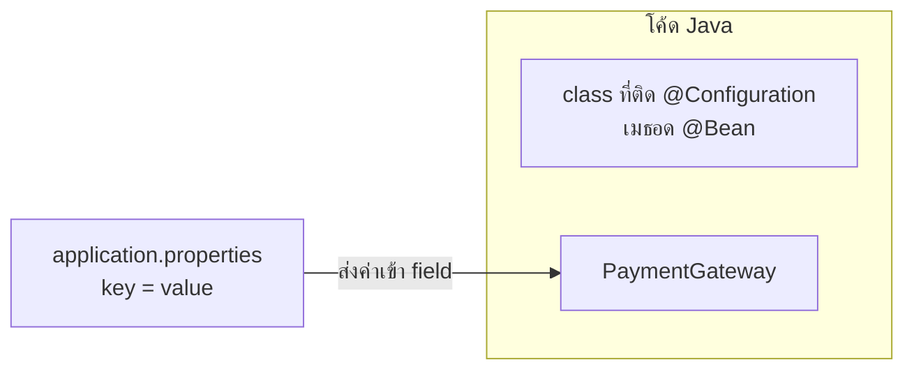
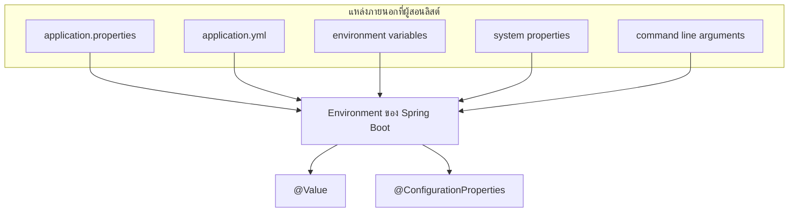
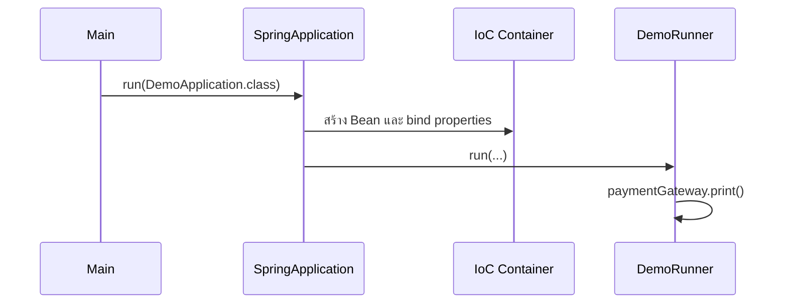

# #10 — application.properties, @Value และ Runner

> **วิดีโอ:** [Spring Boot application properties, @Value & Runner Interface | Spring Boot Full Course #10](https://youtu.be/4naCY3vCSfk) — Coder Army, ~36 นาที
> **แหล่งที่ใช้สรุป:** ซับไตเติลภาษาฮินดีที่ YouTube สร้างอัตโนมัติ
> **เวอร์ชันในโค้ด:** Spring Boot 4.1 + Java 21 (ใส่หมายเหตุไว้ทุกจุดที่ Spring Boot 3.x ต่างกัน)

ตอนนี้ตอบสองคำถามที่ต่อจาก auto-configuration: ค่าอย่างชนิดของ payment gateway จะออกจากโค้ด Java ไปอยู่ในไฟล์ configuration ได้อย่างไร และจะให้เมธอดของเราทำงานตอนแอปสตาร์ทโดยไม่ต้อง `getBean` จาก IoC Container ใน `main` ได้อย่างไร

ส่วนที่ติดป้าย `💡 เพิ่มเติม` คือของที่ผมเติมเอง ไม่ได้อยู่ในวิดีโอ ส่วนที่ติด `⚠️ แก้จากวิดีโอ` คือจุดที่วิดีโอพูดคลาดเคลื่อน

---

## สารบัญ

| เวลา | หัวข้อ |
|---|---|
| [0:00](https://youtu.be/4naCY3vCSfk?t=0) | [1. ต่อจาก auto-configuration](#1-ต่อจาก-auto-configuration) |
| [1:19](https://youtu.be/4naCY3vCSfk?t=79) | [2. โปรเจกต์เปล่าและ Hello World](#2-โปรเจกต์เปล่าและ-hello-world) |
| [2:44](https://youtu.be/4naCY3vCSfk?t=164) | [3. Hardcode ค่าใน PaymentGateway](#3-hardcode-ค่าใน-paymentgateway) |
| [5:38](https://youtu.be/4naCY3vCSfk?t=338) | [4. application.properties คือ configuration file](#4-applicationproperties-คือ-configuration-file) |
| [7:00](https://youtu.be/4naCY3vCSfk?t=420) | [5. ทำไมค่าต้องมาจากข้างนอก](#5-ทำไมค่าต้องมาจากข้างนอก) |
| [8:36](https://youtu.be/4naCY3vCSfk?t=516) | [6. แหล่ง config อื่น](#6-แหล่ง-config-อื่น) |
| [9:44](https://youtu.be/4naCY3vCSfk?t=584) | [7. อ่านค่าด้วย @Value](#7-อ่านค่าด้วย-value) |
| [13:07](https://youtu.be/4naCY3vCSfk?t=787) | [8. วาง @Value ที่ field และค่า default](#8-วาง-value-ที่-field-และค่า-default) |
| [16:21](https://youtu.be/4naCY3vCSfk?t=981) | [9. @ConfigurationProperties](#9-configurationproperties) |
| [21:37](https://youtu.be/4naCY3vCSfk?t=1297) | [10. prefix ต้องเป็น canonical form](#10-prefix-ต้องเป็น-canonical-form) |
| [23:00](https://youtu.be/4naCY3vCSfk?t=1380) | [11. แยก properties class ออกจาก gateway](#11-แยก-properties-class-ออกจาก-gateway) |
| [26:49](https://youtu.be/4naCY3vCSfk?t=1609) | [12. Relaxed binding](#12-relaxed-binding) |
| [27:37](https://youtu.be/4naCY3vCSfk?t=1657) | [13. ไม่ดึง Bean จาก main](#13-ไม่ดึง-bean-จาก-main) |
| [30:32](https://youtu.be/4naCY3vCSfk?t=1832) | [14. ApplicationRunner](#14-applicationrunner) |
| [33:47](https://youtu.be/4naCY3vCSfk?t=2027) | [15. CommandLineRunner](#15-commandlinerunner) |
| [35:26](https://youtu.be/4naCY3vCSfk?t=2126) | [16. รันจากเทอร์มินัลด้วย Maven](#16-รันจากเทอร์มินัลด้วย-maven) |
| — | [สรุปท้ายตอน](#สรุปท้ายตอน) |

---

## 1. ต่อจาก auto-configuration

[▶ 0:00](https://youtu.be/4naCY3vCSfk?t=0)

ตอนที่แล้วทำให้โค้ด Spring Core ที่จัดการ Dependency Injection และ IoC Container เขียนบน Spring Boot ได้สั้นลงมาก ลำดับที่เดินมาคือ annotation-based configuration, ตามด้วย XML configuration, แล้วมาลงที่ foundation ของ Spring Boot ตอนนี้เป็นตอนต่อจากนั้น ผู้สอนบอกว่าถ้ายังไม่ได้ดูตอนที่แล้วให้กลับไปดูก่อน เขาจะแปะลิงก์ไว้ที่ปุ่มข้อมูลของวิดีโอ

วันนี้มีสองเรื่อง

1. ไฟล์ `application.properties`
2. วิธีสั่งให้โค้ดของเราทำงานตอนแอปสตาร์ท โดยไม่ไปคุยกับ IoC Container ตรง ๆ

ประเด็นที่สองคนมักคิดว่าทำไปแล้ว เพราะเคย `getBean` แล้วเรียกเมธอด ผู้สอนย้ำสิ่งที่คุยไว้ก่อนหน้าว่าในแอป Spring Boot การไปดึง Bean จาก container เองไม่ใช่แนวที่ Boot อยากให้ใช้. Boot ทำให้หลายอย่างเป็น black box อยากให้เล่นกับ annotation และได้ของที่ auto-configured มาแล้ว จึงต้องมีทางให้โค้ดของเราถูกรันเอง

---

## 2. โปรเจกต์เปล่าและ Hello World

[▶ 1:19](https://youtu.be/4naCY3vCSfk?t=79)

ผู้สอนเปิดโปรเจกต์เปล่าที่ generate จาก [Spring Initializr](https://start.spring.io) ตัวเลือกที่เขาบอกคือ

- ภาษา Java, build ด้วย Maven
- เวอร์ชันในวิดีโอคือ **4.1.0**
- กรอก group, artifact id และ package name
- รูปแบบ configuration เป็น **properties** (ไม่เลือก YAML)
- Java **21**
- ไม่ใส่ dependency เพิ่ม

> 💡 **เพิ่มเติม:** โน้ตนี้รันด้วย Spring Boot **4.1.1** ตามมาตรฐานของคอร์ส ซับบอก package ว่า `in.strix.demo` จึงใช้ group `in.strix` และ artifact `demo` ให้ตรงกับ class `DemoApplication` และค่า `spring.application.name=demo`

`pom.xml` มี dependency สองตัวตามที่เขาเปิดให้ดู: `spring-boot-starter` กับ `spring-boot-starter-test`

```xml
<parent>
  <groupId>org.springframework.boot</groupId>
  <artifactId>spring-boot-starter-parent</artifactId>
  <version>4.1.1</version>
</parent>

<groupId>in.strix</groupId>
<artifactId>demo</artifactId>
<version>0.0.1-SNAPSHOT</version>

<properties>
  <java.version>21</java.version>
</properties>

<dependencies>
  <dependency>
    <groupId>org.springframework.boot</groupId>
    <artifactId>spring-boot-starter</artifactId>
  </dependency>
  <dependency>
    <groupId>org.springframework.boot</groupId>
    <artifactId>spring-boot-starter-test</artifactId>
    <scope>test</scope>
  </dependency>
</dependencies>
```

โปรเจกต์นี้ไม่มี starter ของเว็บ จึงไม่มี Tomcat และไม่มี port

[▶ 1:57](https://youtu.be/4naCY3vCSfk?t=117) ไฟล์หลักคือ `DemoApplication.java` ไฟล์ `application.properties` อยู่ในโฟลเดอร์ `resources` ตอน generate มาในไฟล์มีบรรทัดเดียว

```properties
spring.application.name=demo
```

เขาบอกว่าเปลี่ยนชื่อได้ แต่ตอนนี้ไม่จำเป็น

จากนั้นพิมพ์ `Hello World` แล้วสตาร์ทแอป เพื่อตรวจว่าโปรเจกต์รันได้

```java
package in.strix.demo;

import org.springframework.boot.SpringApplication;
import org.springframework.boot.autoconfigure.SpringBootApplication;

@SpringBootApplication
public class DemoApplication {

  public static void main(String[] args) {
    SpringApplication.run(DemoApplication.class, args);
    System.out.println("Hello World");
  }
}
```

ผลที่รันได้ (ตัด ASCII banner)

```text
:: Spring Boot ::                (v4.1.1)

2026-10-16T07:48:44.838+07:00  INFO 50239 --- [demo] [           main] in.strix.demo.DemoApplication            : Starting DemoApplication using Java 21.0.12.1 with PID 50239 (/private/tmp/sbc/ep10/target/classes started by wachayathorn in /private/tmp/sbc/ep10)
2026-10-16T07:48:44.838+07:00  INFO 50239 --- [demo] [           main] in.strix.demo.DemoApplication            : No active profile set, falling back to 1 default profile: "default"
2026-10-16T07:48:44.945+07:00  INFO 50239 --- [demo] [           main] in.strix.demo.DemoApplication            : Started DemoApplication in 0.207 seconds (process running for 0.293)
Hello World
```

> 💡 **เพิ่มเติม:** คำว่า `[demo]` ใน log คือค่า `spring.application.name` แอปนี้ไม่มี web server หลัง `SpringApplication.run` คืนค่า JVM จึงไปต่อที่ `println` แล้วจบ ถ้าเป็นแอปเว็บ `run` จะไม่คืนค่าจนกว่าจะสั่งปิด

---

## 3. Hardcode ค่าใน PaymentGateway

[▶ 2:44](https://youtu.be/4naCY3vCSfk?t=164)

เขาลบ `Hello World` แล้วสร้าง class `PaymentGateway` ใน package เดียวกัน ตัวอย่าง payment gateway ที่พูดถึงคือ Razorpay กับ Paytm

field มีสองตัว

- `type` เป็น `String` ว่าเป็น gateway แบบไหน
- `retryCount` เป็น `int` ว่าจะ retry การจ่ายเงินกี่ครั้ง

จากนั้น generate getter กับ setter ทั้งคู่ ติด `@Component` เพื่อให้ component scan เก็บเป็น Bean

```java
package in.strix.demo;

import org.springframework.stereotype.Component;

@Component
public class PaymentGateway {

  private String type;
  private int retryCount;

  public String getType() {
    return type;
  }

  public void setType(String type) {
    this.type = type;
  }

  public int getRetryCount() {
    return retryCount;
  }

  public void setRetryCount(int retryCount) {
    this.retryCount = retryCount;
  }
}
```

[▶ 4:00](https://youtu.be/4naCY3vCSfk?t=240) ตอนนี้ยังต้องรับ `ApplicationContext` ที่ `SpringApplication.run` คืนมา แล้ว `getBean` เขาบอกตรง ๆ ว่านี่ยังไม่ใช่วิธีที่ดี วิธีที่ดีกว่าอยู่ถัดไปในตอนนี้ แต่ระหว่างสอน `@Value` ยังใช้วิธีนี้ต่อ

มี Bean ของ `PaymentGateway` ตัวเดียว จึงขอด้วย class ได้ จากนั้น `setType("Paytm")`, `setRetryCount(5)` แล้วพิมพ์ค่ากลับ

```java
package in.strix.demo;

import org.springframework.boot.SpringApplication;
import org.springframework.boot.autoconfigure.SpringBootApplication;
import org.springframework.context.ApplicationContext;

@SpringBootApplication
public class DemoApplication {

  public static void main(String[] args) {
    ApplicationContext context = SpringApplication.run(DemoApplication.class, args);
    PaymentGateway paymentGateway = context.getBean(PaymentGateway.class);
    paymentGateway.setType("Paytm");
    paymentGateway.setRetryCount(5);
    System.out.println(paymentGateway.getType());
    System.out.println(paymentGateway.getRetryCount());
  }
}
```

```text
Paytm
5
```

นี่คือ set แล้ว get ในโค้ด Java ล้วน ๆ

---

## 4. application.properties คือ configuration file

[▶ 5:38](https://youtu.be/4naCY3vCSfk?t=338)

โจทย์ต่อมาคืออยากให้ `type` กับ `retryCount` ถูกเซ็ตจาก `application.properties` ใน `resources` ไม่ใช่จาก Java

`application.properties` เป็นไฟล์ที่ไม่ได้ลงท้าย `.java` ข้างในเป็นคู่ `key=value` โครงสร้างเดียวกับ `Map`

เขาเรียกไฟล์แบบนี้ว่า **configuration file** และบอกว่าใน Java มี configuration file ได้หลายแบบ

[▶ 6:33](https://youtu.be/4naCY3vCSfk?t=393) ไฟล์นี้ไม่ใช่ class ที่ติด `@Configuration`

- `@Configuration` อยู่บน **class Java** ที่เขียนเมธอด `@Bean` ได้ ตามที่ทำในตอน Spring Core
- configuration file ที่กำลังพูดถึงเป็น **ไฟล์ที่ไม่ใช่ Java** หน้าที่ของมันคือส่งค่าจากข้างนอกเข้ามาในโค้ด



---

## 5. ทำไมค่าต้องมาจากข้างนอก

[▶ 7:00](https://youtu.be/4naCY3vCSfk?t=420)

สมมติ hardcode `Paytm` กับ `5` แล้ว compile, merge เข้า main, push และของขึ้น production ไปแล้ว วันหลังต้องเปลี่ยน gateway จาก Paytm เป็น Razorpay ถ้าค่ายังอยู่ใน Java ต้องแก้ source แล้ว compile ใหม่

เขาไม่อยาก hardcode อยากได้ค่าที่ configurable แก้ในไฟล์แล้วค่าที่แอปใช้เปลี่ยนตาม ตัวอย่าง key ที่เขาเขียนคือ `payment.gateway.type=Paytm` แล้วภายหลังเปลี่ยนเป็น Razorpay

ไฟล์นี้ไม่ใช่ส่วนของ source Java Spring Boot โหลดมันให้

> ⚠️ **แก้จากวิดีโอ:** วิดีโอบอกว่าพอแก้ไฟล์ มันถูกโหลดอัตโนมัติตอนที่โค้ดถูก compile ที่ถูกคือ Spring Boot อ่าน `application.properties` ตอน **startup** จาก classpath การเปลี่ยนค่าไม่ต้องแก้หรือ compile source Java แต่ต้อง **รีสตาร์ท** แอป ค่าใหม่ถึงมีผล Maven ก็อปปี้ไฟล์จาก `src/main/resources` ไป `target/classes` ในเฟส `process-resources` ซึ่งเป็นคนละขั้นกับ `javac`

สิ่งที่เขาต้องการยังถูกทาง: ค่า Paytm หรือ Razorpay อยู่ในไฟล์ โค้ด Java ไม่มี literal ของชื่อ gateway

---

## 6. แหล่ง config อื่น

[▶ 8:36](https://youtu.be/4naCY3vCSfk?t=516)

ไม่ได้มีแค่ `application.properties` ตอน generate โปรเจกต์ Initializr ให้เลือกสองแบบคือ `.properties` หรือ YAML เขาบอกว่า YAML ไว้ดูก่อนได้ แบบที่เจอบ่อยและเป็นค่า default คือ `application.properties`

นอกจากสองไฟล์นั้น เขายังลิสต์แหล่งภายนอกอีกสามอย่าง

- environment variables
- command line arguments
- system properties

ทั้งหมดนี้อยู่นอก source Java และส่งค่าจริงเข้ามาในแอปได้ ช่วงนี้เขายังไม่สาธิตทีละแหล่ง โฟกัสที่ `application.properties` ก่อน



> 💡 **เพิ่มเติม — ใครทับใคร** เอกสาร [Externalized Configuration](https://docs.spring.io/spring-boot/reference/features/external-config.html) เรียงแหล่งจากต่ำไปสูง แหล่งที่อยู่ถัดไปทับแหล่งก่อนหน้า ในกลุ่มที่วิดีโอเอ่ย ลำดับคือ config data (`application.properties` / YAML) แล้วตามด้วย environment variables, Java system properties และ command line arguments
>
> รันกับคลาสสุดท้ายของตอนนี้แล้วได้จริงแบบนี้
>
> | สิ่งที่ใส่ | ผลของ `type` |
> |---|---|
> | มีแค่ `payment-property.type=Paytm` ในไฟล์ | `Paytm` |
> | เพิ่ม env `PAYMENT_PROPERTY_TYPE=Cashfree` | `Cashfree` |
> | เพิ่ม argument `--payment-property.type=PhonePe` ทับ env ด้านบน | `PhonePe` |
>
> ไฟล์ YAML ก้อนนี้ให้ผลสี่บรรทัดเดียวกันกับ properties (`Paytm`, `5`, `true`, `3000`) เมื่อใช้แทนไฟล์ properties
>
> ```yaml
> spring:
>   application:
>     name: demo
> payment-property:
>   type: Paytm
>   retry-count: 5
>   enabled: true
>   timeout: 3000
> ```
>
> ถ้ามีทั้ง `.properties` และ YAML ในที่เดียวกัน เอกสารบอกว่า `.properties` ชนะ โปรเจกต์ของตอนนี้จึงใช้ไฟล์ properties อย่างเดียว

---

## 7. อ่านค่าด้วย @Value

[▶ 9:44](https://youtu.be/4naCY3vCSfk?t=584) เขาเขียน key ลงไฟล์ในรูปเดียวกับ `spring.application.name`

```properties
spring.application.name=demo
payment.gateway.type=Paytm
payment.gateway.retry-count=5
```

[▶ 10:27](https://youtu.be/4naCY3vCSfk?t=627) annotation ที่ดึงค่าทีละตัวชื่อ `@Value` เขาสร้าง constructor ที่รับ `type` กับ `retryCount` แล้วติด `@Value` ที่พารามิเตอร์ จะได้ไม่ต้องส่งค่าเองตอน `new`

ครั้งแรกรันแล้วพัง เขาบอกว่าใส่เครื่องหมายวงเล็บผิด ต้องเป็น curly brace ไม่ใช่วงเล็บธรรมดา

แบบที่พัง

```java
package in.strix.demo;

import org.springframework.beans.factory.annotation.Value;
import org.springframework.stereotype.Component;

@Component
public class PaymentGateway {

  private final String type;
  private final int retryCount;

  public PaymentGateway(
      @Value("$(payment.gateway.type)") String type,
      @Value("$(payment.gateway.retry-count)") int retryCount) {
    this.type = type;
    this.retryCount = retryCount;
  }

  public String getType() {
    return type;
  }

  public int getRetryCount() {
    return retryCount;
  }
}
```

`$(...)` ไม่ใช่ placeholder Spring จึงส่งสตริง `$(payment.gateway.retry-count)` เข้าพารามิเตอร์ `int` ตรง ๆ แล้วแปลงไม่สำเร็จ exception ที่รันได้ตรงกับที่เขาไล่ชื่อไว้: `NumberFormatException`, `TypeMismatchException`, `UnsatisfiedDependencyException` และสร้าง Bean `paymentGateway` ไม่ได้

```text
org.springframework.beans.factory.UnsatisfiedDependencyException: Error creating bean with name 'paymentGateway' defined in file [/private/tmp/sbc/ep10/target/classes/in/strix/demo/PaymentGateway.class]: Unsatisfied dependency expressed through constructor parameter 1: Failed to convert value of type 'java.lang.String' to required type 'int'; For input string: "$(payment.gateway.retry-count)"
Caused by: org.springframework.beans.TypeMismatchException: Failed to convert value of type 'java.lang.String' to required type 'int'; For input string: "$(payment.gateway.retry-count)"
Caused by: java.lang.NumberFormatException: For input string: "$(payment.gateway.retry-count)"
```

เขาบอกว่า syntax error แบบนี้เจอบ่อย ไม่ต้องจำให้หมด exception มีไว้ให้เรียนรู้จากมัน

[▶ 12:49](https://youtu.be/4naCY3vCSfk?t=769) แก้เป็น `${...}` แล้ว warning หาย รันอีกครั้งได้ `Paytm` กับ `5` โดยไม่เรียก setter

```java
public PaymentGateway(
    @Value("${payment.gateway.type}") String type,
    @Value("${payment.gateway.retry-count}") int retryCount) {
  this.type = type;
  this.retryCount = retryCount;
}
```

```text
Paytm
5
```

constructor ตัวเดียวไม่ต้องเขียน `@Autowired` Spring เรียก constructor นี้ให้เอง แล้วเติม argument จาก `@Value`

---

## 8. วาง @Value ที่ field และค่า default

[▶ 13:07](https://youtu.be/4naCY3vCSfk?t=787)

`@Value` ไม่จำเป็นต้องอยู่ที่ constructor เขาย้ายไปไว้บน field แล้ว comment constructor ทิ้ง เปรียบกับ `@Autowired` ที่วางบน field ได้เหมือนกัน เขาเรียกแบบนี้ว่า property injection: อยากให้ค่าจาก `application.properties` ถูก inject เข้า field

```java
package in.strix.demo;

import org.springframework.beans.factory.annotation.Value;
import org.springframework.stereotype.Component;

@Component
public class PaymentGateway {

  @Value("${payment.gateway.type}")
  private String type;

  @Value("${payment.gateway.retry-count}")
  private int retryCount;

  public String getType() {
    return type;
  }

  public int getRetryCount() {
    return retryCount;
  }
}
```

`main` เหลือแค่ `getBean` แล้วพิมพ์ getter ผลยังเป็น

```text
Paytm
5
```

เขาอธิบายว่านี่ทำงานแบบ dependency injection Bean `PaymentGateway` ต้องการสองค่านี้ แต่เราไม่ส่งเอง ไฟล์ `application.properties` เป็นคนส่ง ตอนรันไฟล์นี้อยู่บน classpath และ Spring Boot map key เข้า field

[▶ 14:08](https://youtu.be/4naCY3vCSfk?t=848) ถ้าไม่มี key `payment.gateway.type` แอปสร้าง Bean ไม่ได้ ข้อความที่เขาอ่านจาก error คือสร้าง `PaymentGateway` ไม่สำเร็จ เพราะ **injection of autowired dependency failed** เขาใช้ข้อความนี้ชี้ว่ากลไกข้างในคือการ inject แบบเดียวกับ autowire

ปกติ `@Autowired` ใช้กับ dependency ที่เป็น object เช่นถ้า field เป็น `OrderService` ก็ให้ container หา Bean มาใส่ ที่นี่ค่าเป็น `String` กับ `int` เขาบอกเองว่า `String` ไม่ใช่ primitive ของ Java แต่ให้มองว่าเป็นค่าธรรมดา ไม่ใช่ Bean ค่าเหล่านี้มาจากการสแกน `application.properties` หาไม่เจอก็ถือว่าไม่มีคนส่งค่า จึงสร้าง Bean ไม่ได้

รันโดยลบ key ทิ้ง ได้ข้อความนี้

```text
org.springframework.beans.factory.BeanCreationException: Error creating bean with name 'paymentGateway': Injection of autowired dependencies failed
Caused by: org.springframework.util.PlaceholderResolutionException: Could not resolve placeholder 'payment.gateway.type' in value "${payment.gateway.type}"
```

> 💡 **เพิ่มเติม:** stack จริงเข้า `AutowiredAnnotationBeanPostProcessor` ทั้งที่ในโค้ดมีแต่ `@Value` post-processor ตัวนี้ประมวลผลทั้ง `@Autowired` และ `@Value` จึงขึ้นคำว่า autowired dependencies

### ค่า default ด้วยโคลอน

[▶ 15:13](https://youtu.be/4naCY3vCSfk?t=913)

ถ้าไม่มีคนส่งค่า ใส่ default หลังโคลอนได้ เขาใช้ Razorpay เป็น default ของ `type` และ `3` เป็น default ของ `retryCount`

```java
@Value("${payment.gateway.type:Razorpay}")
private String type;

@Value("${payment.gateway.retry-count:3}")
private int retryCount;
```

ไม่มี key ในไฟล์ รันแล้วได้ default

```text
Razorpay
3
```

ใส่ key `payment.gateway.type=Paytm` กับ `payment.gateway.retry-count=5` กลับเข้าไป default ไม่ถูกใช้

```text
Paytm
5
```

เขาบอกว่า default ใช้ได้ทั้งบน field, constructor และ setter

setter ที่รันผ่านแล้วได้ `Paytm` / `5` เช่นกัน

```java
package in.strix.demo;

import org.springframework.beans.factory.annotation.Value;
import org.springframework.stereotype.Component;

@Component
public class PaymentGateway {

  private String type;
  private int retryCount;

  @Value("${payment.gateway.type}")
  public void setType(String type) {
    this.type = type;
  }

  @Value("${payment.gateway.retry-count}")
  public void setRetryCount(int retryCount) {
    this.retryCount = retryCount;
  }

  public String getType() {
    return type;
  }

  public int getRetryCount() {
    return retryCount;
  }
}
```

[▶ 16:03](https://youtu.be/4naCY3vCSfk?t=963) `@Value` ไม่ได้อ่านได้แค่ properties มันยกค่าจาก YAML และ environment variable ได้ด้วย เขาจะไม่ลงรายละเอียดตอนนี้

| จุดที่วาง `@Value` | รันในโน้ตนี้ |
|---|---|
| พารามิเตอร์ของ constructor | ได้ `Paytm` / `5` |
| field | ได้ `Paytm` / `5` |
| setter | ได้ `Paytm` / `5` |
| รูปแบบ `${key:default}` เมื่อไม่มี key | ได้ `Razorpay` / `3` |
| รูปแบบ `${key:default}` เมื่อมี key | ได้ค่าในไฟล์ ไม่ใช้ default |

---

## 9. @ConfigurationProperties

[▶ 16:21](https://youtu.be/4naCY3vCSfk?t=981)

class อย่าง `PaymentGateway` ในงานจริงมี configuration มากกว่าสองค่า เขาสมมติเพิ่มอีกสองอย่าง

- เปิดหรือปิด gateway (`enabled`)
- timeout ว่าถ้ารอนานเท่าไรให้ถือว่า timeout เขาตั้งเป็น `3000` มิลลิวินาที หรือ 3 วินาที

ค่าพวกนี้ใส่ใน class เดียวแล้วดึงจาก `application.properties` ได้ จะได้ไม่ต้องแก้ Java ทุกครั้งที่เปลี่ยนค่า

ถ้ามีหลายสิบค่าแล้วเขียน `@Value` ทีละ field จะสับสนและพลาดได้ง่าย อาจ map key ผิด field ในไฟล์ configuration จริงมี property จำนวนมาก การติด `@Value` ทีละตัวจึงเป็นปัญหา

ทางออกคือ annotation `@ConfigurationProperties` วางบน class แล้ว class นั้น map field ทั้งชุดจาก property file ในที่นี้คือ `application.properties`

[▶ 18:25](https://youtu.be/4naCY3vCSfk?t=1105) เขาสร้าง `PaymentProperties.java` ให้แยกจาก `application.properties` ชัดเจน ไฟล์หนึ่งเป็น Java อีกไฟล์ไม่ใช่ ในแอปองค์กรจะเห็น class แบบนี้บ่อย: class ฝั่ง Java ไปหยิบค่าจากไฟล์ที่ไม่ใช่ Java

ติดสอง annotation

- `@Component` เพื่อให้ Spring Boot ดูแล class นี้
- `@ConfigurationProperties` เพื่อบอกว่านี่เป็น class พิเศษที่หยิบค่า field จาก property file

field สี่ตัว: `type`, `retryCount`, `enabled`, `timeout` generate getter กับ setter แล้วเขียน key ในไฟล์ เขาไม่เซ็ตค่าใน Java เอง

```properties
payment-property.type=Paytm
payment-property.retry-count=5
payment-property.enabled=true
payment-property.timeout=3000
```

ไม่ติด `@Value` ทีละ field แทนที่จะบอกชื่อ key ครบทุกตัว เขาบอกแค่ **prefix** ว่าเวลาอ่านไฟล์ให้หาคำขึ้นต้น `payment-property` แล้ว map ทุก key ใต้ prefix นั้นเข้า field

---

## 10. prefix ต้องเป็น canonical form

[▶ 21:37](https://youtu.be/4naCY3vCSfk?t=1297)

ตอนแรกเขาเขียน prefix แบบ camelCase แล้วเจอ error เขาอ่านว่า **prefix must be in canonical form** แปลว่าเขียน `paymentProperty` ไม่ได้ ต้องเป็น kebab-case คั่นด้วยขีด: `payment-property`

รันบน Boot 4.1.1 ด้วย prefix `paymentProperty` แอปไม่ขึ้น ข้อความที่ Boot พิมพ์คือกฎเดียวกับที่เขาอ่านจาก IDE

```text
APPLICATION FAILED TO START
***************************

Description:

Configuration property name 'paymentProperty' is not valid:

    Invalid characters: 'P'
    Bean: paymentGateway
    Reason: Canonical names should be kebab-case ('-' separated), lowercase alpha-numeric characters and must start with a letter

Action:

Modify 'paymentProperty' so that it conforms to the canonical names requirements.
```

บรรทัด WARN ก่อนหน้าระบุที่มาชัดกว่า: `Could not bind properties to 'PaymentProperties' : prefix=paymentProperty` ตัว `P` ตัวใหญ่ทำให้ชื่อไม่เป็น canonical

[▶ 22:14](https://youtu.be/4naCY3vCSfk?t=1334) เขาเจอปัญหาต่อที่ชื่อ `isEnabled` ที่เขียนเป็น camelCase ทั้งในไฟล์และใน field เขาเปลี่ยน key เป็น `enabled` และเปลี่ยนชื่อ field เป็น `enabled` แล้ว generate getter/setter ใหม่ getter ของ boolean ตาม convention คือ `isEnabled()` ทั้งที่ field ชื่อ `enabled`

class ที่ผ่านหลังแก้ prefix และชื่อ boolean

```java
package in.strix.demo;

import org.springframework.boot.context.properties.ConfigurationProperties;
import org.springframework.stereotype.Component;

@Component
@ConfigurationProperties(prefix = "payment-property")
public class PaymentProperties {

  private String type;
  private int retryCount;
  private boolean enabled;
  private int timeout;

  public String getType() {
    return type;
  }

  public void setType(String type) {
    this.type = type;
  }

  public int getRetryCount() {
    return retryCount;
  }

  public void setRetryCount(int retryCount) {
    this.retryCount = retryCount;
  }

  public boolean isEnabled() {
    return enabled;
  }

  public void setEnabled(boolean enabled) {
    this.enabled = enabled;
  }

  public int getTimeout() {
    return timeout;
  }

  public void setTimeout(int timeout) {
    this.timeout = timeout;
  }
}
```

> 💡 **เพิ่มเติม — ทำไมต้องมี setter** javadoc ของ `@ConfigurationProperties` ใน Boot 4.1.1 บอกว่า binding เกิดจากการเรียก setter หรือจาก constructor ถ้าใช้ `@ConstructorBinding` ถอด setter ออกแล้วเหลือแต่ getter แอปไม่ขึ้น
>
> ```text
> Failed to bind properties under 'payment-property' to in.strix.demo.PaymentProperties:
>
>     Property: payment-property.enabled
>     Value: "true"
>     Origin: class path resource [application.properties] - 4:26
>     Reason: java.lang.IllegalStateException: No setter found for property: enabled
> ```
>
> ถ้าไม่ติด `@Component` และไม่ได้ลงทะเบียนด้วยวิธีอื่น `PaymentGateway` ที่รับ `PaymentProperties` ใน constructor จะหา Bean ไม่เจอ
>
> ```text
> Parameter 0 of constructor in in.strix.demo.PaymentGateway required a bean of type 'in.strix.demo.PaymentProperties' that could not be found.
> ```
>
> javadoc เดียวกันยังชี้ไปที่ `@EnableConfigurationProperties` กับ `@ConfigurationPropertiesScan` เป็นทางลงทะเบียนอื่น ทางที่วิดีโอใช้และที่รันในโน้ตนี้คือ `@Component`
>
> `@Value` ประเมิน SpEL ได้ แต่ `@ConfigurationProperties` ไม่ประเมิน SpEL เพราะค่าถูก externalize ออกไปนอกโค้ด

---

## 11. แยก properties class ออกจาก gateway

[▶ 23:00](https://youtu.be/4naCY3vCSfk?t=1380)

เขาเอา `@Value` และ constructor เดิมของ `PaymentGateway` ออก แล้วให้ class นั้นรับ `PaymentProperties` แทน โครงสร้างนี้เขาบอกว่าจะเจอบ่อย: มี class ที่อ่าน configuration (`PaymentProperties`) แล้ว dependency inject เข้า class ที่ใช้งานจริง (`PaymentGateway`)

constructor injection เกิดเอง ไม่ต้องเขียน `@Autowired`

เขาเลื่อนโค้ด `@Value` เดิมลงไปเพื่อไม่ให้มากวน แต่ของที่ใช้ต่อคือแบบที่รับ `PaymentProperties`

บน `PaymentGateway` เขาเขียนแต่ getter ที่ส่งต่อไปที่ `PaymentProperties` ไม่เขียน setter เพราะการเซ็ตค่าเกิดในไฟล์ properties

เหตุผลที่ไม่อ่านค่าจาก `PaymentProperties` ตรง ๆ ใน `main`: โดยทั่วไปไม่ดึงค่าจาก properties class ตรงไปใช้ ดึงผ่าน class ปกติอย่าง gateway ที่ inject properties เข้ามา นี่คือ pattern ที่เขาอยากให้ทำตาม

```java
package in.strix.demo;

import org.springframework.stereotype.Component;

@Component
public class PaymentGateway {

  private final PaymentProperties paymentProperties;

  public PaymentGateway(PaymentProperties paymentProperties) {
    this.paymentProperties = paymentProperties;
  }

  public String getType() {
    return paymentProperties.getType();
  }

  public int getRetryCount() {
    return paymentProperties.getRetryCount();
  }

  public boolean isEnabled() {
    return paymentProperties.isEnabled();
  }

  public int getTimeout() {
    return paymentProperties.getTimeout();
  }

  public void print() {
    System.out.println(getType());
    System.out.println(getRetryCount());
    System.out.println(isEnabled());
    System.out.println(getTimeout());
  }
}
```

เมธอด `print()` เขายังไม่ได้เพิ่มตรงนี้ทันที เพิ่มในหัวข้อถัดไปตอนจะให้ runner เรียก เนื้อในคือการพิมพ์สี่ค่าเดิมที่เคยพิมพ์ใน `main`


มีสอง `@Component`

- `PaymentProperties` อ่าน prefix `payment-property` Spring Boot map `payment-property.type` เข้า `type`, `payment-property.retry-count` เข้า `retryCount` และที่เหลือตามชื่อ
- `PaymentGateway` คือ class ที่จะไปผูกกับ business logic มีแต่ getter ที่เรียกต่อ

[▶ 25:52](https://youtu.be/4naCY3vCSfk?t=1552) ใน `DemoApplication` เขา comment โค้ดเก่า แล้ว `getBean(PaymentGateway.class)` จากนั้นพิมพ์ `getType()`, `getRetryCount()`, `isEnabled()` และ `getTimeout()`

[▶ 26:16](https://youtu.be/4naCY3vCSfk?t=1576) ผลคือ `Paytm`, `5`, `true`, `3000`

เขาบอกว่าไฟล์นี้จะได้ใช้หนักตอนสร้างโปรเจกต์ และตอนทำเว็บแอปก็จะมาเซ็ตค่าที่นี่อีก จำไว้ว่าใช้เซ็ตค่าได้สองทาง: `@ConfigurationProperties` ทั้งก้อน หรือ `@Value` ทีละค่า

---

## 12. Relaxed binding

[▶ 26:49](https://youtu.be/4naCY3vCSfk?t=1609)

ใน Java field ชื่อ `retryCount` เป็น camelCase ตาม convention ของตัวแปร Java ใน `application.properties` เขาเขียน `retry-count` Spring Boot แปลง canonical form นั้นเข้า camelCase แล้ว map ให้เอง เขาเลยสรุปว่าใน Java เขียน camelCase ในไฟล์ properties เขียน canonical form และถ้าชื่อ `type` ต้องมีขีดก็ใส่ได้

> ⚠️ **แก้จากวิดีโอ:** วิดีโอบอกว่าใน `application.properties` เขียน camelCase ไม่ได้ ต้องเป็น `retry-count` เท่านั้น ที่ถูกคือรูปแบบที่แนะนำคือ kebab-case แต่ `@ConfigurationProperties` ทำ relaxed binding รันบน Boot 4.1.1 แล้ว field `retryCount` รับได้ทั้งสามแบบนี้
>
> | key ในไฟล์ | ค่าที่พิมพ์ |
> |---|---|
> | `payment-property.retry-count=5` | `5` |
> | `payment-property.retryCount=7` | `7` |
> | `payment-property.retry_count=9` | `9` |
>
> ข้อที่บังคับจริงคือค่า `prefix` ของ annotation ต้องเป็น canonical form อยู่แล้ว ถ้าเป็น `paymentProperty` แอปสตาร์ทไม่ผ่านตาม [หัวข้อ 10](#10-prefix-ต้องเป็น-canonical-form)

> 💡 **เพิ่มเติม — `@Value` กับทิศของชื่อ** เอกสารชุดเดียวกันบอกให้เขียนชื่อใน placeholder เป็น canonical form (kebab-case ตัวเล็ก) จะได้ใช้ logic เดียวกับ relaxed binding ของ `@ConfigurationProperties` รันแล้วเป็นแบบนี้
>
> | placeholder | key ในไฟล์ | ผล |
> |---|---|---|
> | `${payment.gateway.retry-count}` | `payment.gateway.retryCount=5` | ได้ `5` |
> | `${payment.gateway.retryCount}` | `payment.gateway.retry-count=5` | สตาร์ทไม่ผ่าน: `Could not resolve placeholder 'payment.gateway.retryCount'` |
>
> placeholder แบบ kebab-case จึงเห็นทั้ง key แบบ kebab และ camel ส่วน placeholder แบบ camelCase ไม่เห็น key แบบ kebab

environment variable ใช้ขีดไม่ได้ เอกสารให้ใช้ขีดล่าง รัน `PAYMENT_PROPERTY_TYPE=Cashfree` แล้ว `type` เป็น `Cashfree` ตามที่ใส่ในตารางของ [หัวข้อ 6](#6-แหล่ง-config-อื่น)

---

## 13. ไม่ดึง Bean จาก main

[▶ 27:37](https://youtu.be/4naCY3vCSfk?t=1657)

ถึงตรงนี้การสตาร์ทยังเป็นแบบเดิม: `SpringApplication.run` คืน IoC Container, เก็บใน `ApplicationContext`, `getBean` เอา `PaymentGateway` แล้วพิมพ์ค่า นั่นคือการคุยกับ container ตรง ๆ ซึ่งเขาไม่อยากทำ

เขาอยากเรียก `SpringApplication.run` อย่างเดียว แล้วโค้ดที่พิมพ์ค่าทำงานเอง `PaymentGateway` ควรมีเมธอดที่ถูกรันตอนแอปสตาร์ท

[▶ 28:36](https://youtu.be/4naCY3vCSfk?t=1716) เขาเพิ่ม `print()` ที่พิมพ์สี่ค่าเดิม ไม่ต้องรับ argument เพราะเป็นเมธอดของ instance นั้น ใน `main` จึงเหลือ `paymentGateway.print()` แทนการพิมพ์ทีละ getter โค้ดสั้นลง แต่ยัง `getBean` เองอยู่ ผลยังเป็น `Paytm`, `5`, `true`, `3000`

สิ่งที่เขาอยากได้คือไม่เก็บ context ไม่ `getBean` และไม่เรียก `print()` จาก `main` พอสตาร์ทแอป เมธอด `print` ควรถูกเรียกเอง

[▶ 29:44](https://youtu.be/4naCY3vCSfk?t=1784) เขาเทียบกับแอปเว็บ: ถ้าใช้ Spring ฝั่งเว็บ เขาจะ map `print` เข้า endpoint เช่น `/print` พอเปิด URL นั้นเมธอดก็ทำงาน อย่างที่เห็นในวิดีโอที่สอง ตรงนี้ไม่ได้ทำเว็บ ทำแอปแบบ console อยากให้ `print` ทำงานตอนรัน `DemoApplication`

> ⚠️ **แก้จากวิดีโอ:** วิดีโอพูดว่า URL ตัวอย่างอยู่ที่ localhost พอร์ต `880` ที่ถูกคือพอร์ต default ของ Spring Boot คือ **8080** และตอน #2 ก็ใช้ 8080 โปรเจกต์ตอนนี้ไม่ได้ใส่ starter ของเว็บ จึงไม่มี process ฟังพอร์ต

---

## 14. ApplicationRunner

[▶ 30:32](https://youtu.be/4naCY3vCSfk?t=1832)

Java ฝั่ง Spring Boot มี interface ชื่อ `ApplicationRunner` สร้าง class แล้ว implement มัน พอแอปสตาร์ท เมธอดที่ override จะถูกรันเอง

เขาตั้งชื่อ class ว่า `DemoRunner` ติด `@Component` เพื่อให้ Spring ดูแล แล้ว `implements ApplicationRunner`

เปิด interface ดูมีเมธอดเดียวชื่อ `run` เขาจึงบอกว่านี่เป็น functional interface จากนั้นให้ IDE สร้างเมธอด override

signature คือ `run(ApplicationArguments args)`

[▶ 31:32](https://youtu.be/4naCY3vCSfk?t=1892) `ApplicationArguments` คือ command line arguments ถ้าไม่กดปุ่ม Run สีเขียว แต่รันจาก command line แล้วอยากส่ง argument เข้าไป ค่าพวกนั้นถูกเก็บใน object นี้ เทียบกับ `main(String[] args)` ที่รับ argument ได้แต่ปกติไม่ค่อยได้ใช้

เขากล่าวถึงเมธอด `getOptionNames` กับ `containsOption` แล้วบอกว่าไม่ต้องลงรายละเอียด เพราะหลังจากนี้จะรันแอปแบบเว็บมากกว่า จะใช้ argument พวกนี้ไม่มาก ตอนนี้มีหน้าที่ override `run` อย่างเดียว

ใน `DemoRunner` ต้องมี `PaymentGateway` เขาประกาศ field แล้วรับผ่าน constructor ไม่เขียน `@Autowired` เพราะเป็น constructor injection ใน `run` เรียก `paymentGateway.print()`

`main` ไม่ต้อง `getBean` ไม่ต้องเรียก `print` และไม่ต้องเก็บ context เหลือแค่สตาร์ทแอป

```java
package in.strix.demo;

import org.springframework.boot.SpringApplication;
import org.springframework.boot.autoconfigure.SpringBootApplication;

@SpringBootApplication
public class DemoApplication {

  public static void main(String[] args) {
    SpringApplication.run(DemoApplication.class, args);
  }
}
```

```java
package in.strix.demo;

import org.springframework.boot.ApplicationArguments;
import org.springframework.boot.ApplicationRunner;
import org.springframework.stereotype.Component;

@Component
public class DemoRunner implements ApplicationRunner {

  private final PaymentGateway paymentGateway;

  public DemoRunner(PaymentGateway paymentGateway) {
    this.paymentGateway = paymentGateway;
  }

  @Override
  public void run(ApplicationArguments args) {
    paymentGateway.print();
  }
}
```

[▶ 33:39](https://youtu.be/4naCY3vCSfk?t=2019) กดรันอย่างเดียว แล้ว `print` ทำงานเอง

```text
Paytm
5
true
3000
```

นี่คือประโยชน์ของ `ApplicationRunner`: หลัง container สร้าง Bean ครบ Spring เรียก `run` ให้



---

## 15. CommandLineRunner

[▶ 33:47](https://youtu.be/4naCY3vCSfk?t=2027)

มี interface อีกตัวที่คล้ายกันชื่อ `CommandLineRunner` เขา comment `ApplicationRunner` แล้วเปลี่ยนมาใช้ตัวนี้

เมธอดยังชื่อ `run` แต่รับ `String... args` เป็น varargs ใน Java `String... args` อ่าน argument ได้ศูนย์ตัว หนึ่งตัว หรือหลายตัวด้วยเครื่องหมาย `...` เขาบอกว่านี่เป็น syntax ของ Java ไปเปิดดูเพิ่มได้

เขา implement เมธอดแล้วทำงานเดิม ไม่ใช้ argument เพราะแค่ต้องการให้เมธอดถูกรัน

แบบที่เหลืออยู่ในโปรเจกต์ตอนจบวิดีโอ

```java
package in.strix.demo;

import org.springframework.boot.CommandLineRunner;
import org.springframework.stereotype.Component;

@Component
public class DemoRunner implements CommandLineRunner {

  private final PaymentGateway paymentGateway;

  public DemoRunner(PaymentGateway paymentGateway) {
    this.paymentGateway = paymentGateway;
  }

  @Override
  public void run(String... args) {
    paymentGateway.print();
  }
}
```

รันอีกครั้งได้ค่าเดิม

```text
Paytm
5
true
3000
```

เขาสรุปว่าใช้ `CommandLineRunner` หรือ `ApplicationRunner` ก็ได้ ทั้งคู่ทำแบบเดียวกัน พอรันโค้ด เมธอด `run` ถูกเรียก สิ่งที่ต่างคือชนิดของ argument ถ้าจะรันจากเทอร์มินัลแล้วส่ง argument เข้าไปใช้ในโค้ด ค่าพวกนั้นมาถึงตรง `String...` หรือ `ApplicationArguments` ตอนนี้เขาแค่เรียก `print` จึงไม่ได้ใช้ argument

> 💡 **เพิ่มเติม:** ถ้าปล่อยให้ทั้งสอง interface เป็น Bean พร้อมกัน โดยไม่ comment ทิ้งอีกตัว เมธอด `run` ของทั้งคู่ถูกเรียก ในการรันทดสอบ ข้อความของ `CommandLineRunner` ออกก่อน แล้วตามด้วย `ApplicationRunner` แต่ละตัวพิมพ์ `Paytm`, `5`, `true`, `3000` ของตัวเอง วิดีโอจึง comment ตัวหนึ่งทิ้ง เพื่อให้เหลือทางเดียว

---

## 16. รันจากเทอร์มินัลด้วย Maven

[▶ 35:26](https://youtu.be/4naCY3vCSfk?t=2126)

ถ้าไม่อยากกดปุ่ม Run ใน IDE ให้รันจากเทอร์มินัลด้วย

```bash
mvn spring-boot:run
```

เขาทำให้ดูบนจอ แอปขึ้น, build สำเร็จ และได้ `Paytm 5 true 3000` ตัวอักษรบนจอเล็กแต่ค่าเหมือนตอนกดรันใน IDE ถ้ายังไม่มี Maven ให้ติดตั้งแล้วใช้คำสั่งนี้

ผลจากโปรเจกต์ของโน้ตนี้ (`mvn -q -DskipTests spring-boot:run`)

```text
:: Spring Boot ::                (v4.1.1)

2026-10-16T07:55:19.793+07:00  INFO 56180 --- [demo] [           main] in.strix.demo.DemoApplication            : Starting DemoApplication using Java 21.0.12.1 with PID 56180 (/private/tmp/sbc/ep10/target/classes started by wachayathorn in /private/tmp/sbc/ep10)
2026-10-16T07:55:19.794+07:00  INFO 56180 --- [demo] [           main] in.strix.demo.DemoApplication            : No active profile set, falling back to 1 default profile: "default"
2026-10-16T07:55:19.903+07:00  INFO 56180 --- [demo] [           main] in.strix.demo.DemoApplication            : Started DemoApplication in 0.206 seconds (process running for 0.291)
Paytm
5
true
3000
```

`mvn -DskipTests package` จบด้วย `BUILD SUCCESS` และได้ `target/demo-0.0.1-SNAPSHOT.jar`

ไฟล์สุดท้ายที่แอปอ่าน

```properties
spring.application.name=demo
payment-property.type=Paytm
payment-property.retry-count=5
payment-property.enabled=true
payment-property.timeout=3000
```

[▶ 36:03](https://youtu.be/4naCY3vCSfk?t=2163) เขาปิดตอนว่า foundation ที่เหลือของ Spring Boot ครบแล้ว วิดีโอหน้าจะเริ่มเว็บแอปและสร้างแอป CRUD ซึ่งจะเป็นภาคปฏิบัติ

---

## สรุปท้ายตอน

### ลำดับของตอนนี้


### ประเด็นที่ต้องจำ

1. `application.properties` เป็น configuration file แบบ `key=value` ไม่ใช่ class ที่ติด `@Configuration`
2. เปลี่ยนค่าในไฟล์ได้โดยไม่แก้ source Java แต่ค่าถูกอ่านตอน **startup** ต้องรีสตาร์ทแอป
3. `@Value("${key}")` วางได้ที่ constructor, field หรือ setter ถ้า key ไม่มีและไม่มี default แอปสร้าง Bean ไม่ได้
4. ค่า default เขียน `${key:default}` โคลอนคั่น ถ้ามี key จริง default ไม่ถูกใช้
5. หลายค่าที่ prefix เดียวกันใช้ `@ConfigurationProperties(prefix = "...")` บน class ที่มี setter prefix ต้องเป็น kebab-case
6. pattern ที่เขาให้ทำตามคือ class properties อ่านไฟล์ แล้ว inject เข้า class ที่ใช้งาน ไม่ไปอ่าน properties class จาก `main`
7. field Java เป็น camelCase ได้ key ในไฟล์ใช้ kebab-case เป็นรูปแบบมาตรฐาน และ relaxed binding รับ camelCase กับ snake_case ด้วย
8. ไม่ควร `getBean` จาก `main` ให้ Bean implement `ApplicationRunner` หรือ `CommandLineRunner` แล้ว Spring เรียก `run` หลังสตาร์ท
9. ทั้งสอง interface ทำงานจังหวะเดียวกัน สิ่งที่ต่างคือ `ApplicationArguments` กับ `String... args`
10. จากเทอร์มินัลใช้ `mvn spring-boot:run` command line argument และ environment variable ทับค่าในไฟล์ได้

### คำถามทบทวน

1. class ที่ติด `@Configuration` กับไฟล์ `application.properties` ต่างกันอย่างไร
2. เปลี่ยน `Paytm` เป็น `Razorpay` ในไฟล์ properties แล้วทำไมไม่ต้อง compile Java แต่ยังต้องรีสตาร์ท
3. `@Value` วางได้ที่จุดไหนบ้าง และ syntax ของค่า default เป็นอย่างไร
4. เขียน `@Value("$(payment.gateway.retry-count)")` บนพารามิเตอร์ `int` แล้วสตาร์ทไม่ผ่าน เพราะ exception ชั้นในสุดคืออะไร
5. `@ConfigurationProperties(prefix = "paymentProperty")` เกิดอะไรขึ้น และรูปแบบ prefix ที่ถูกคืออะไร
6. ทำไมเขาแยก `PaymentProperties` ออกจาก `PaymentGateway` แทนที่จะติด `@Value` บน gateway ต่อไป
7. ถอด setter ของ `PaymentProperties` ออก ข้อความ `No setter found` บอกอะไรเกี่ยวกับวิธี bind
8. `ApplicationRunner` กับ `CommandLineRunner` เหมือนกันตรงไหน และ signature ของ `run` ต่างกันอย่างไร
9. คำสั่ง Maven ที่รันแอปจากเทอร์มินัลคืออะไร และทำไมโปรเจกต์นี้รันเสร็จแล้ว process ถึงจบ
10. ถ้าไฟล์บอก `type=Paytm` แต่สั่ง `--payment-property.type=PhonePe` ค่าที่พิมพ์คืออะไร

### ตอนถัดไป

[#11 — Spring Boot CRUD Project from Scratch | Create API & Architecture](./11-crud-create-api-architecture.md) ผู้สอนบอกว่าจะเริ่ม Spring Boot web application และสร้างแอป CRUD
