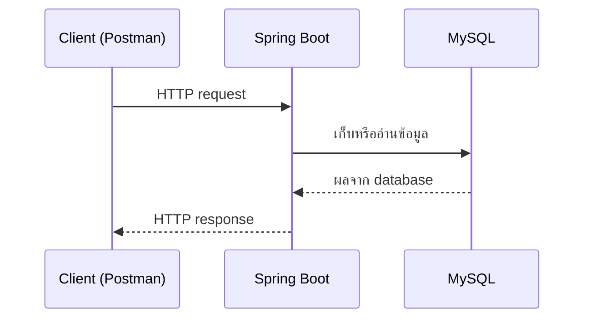
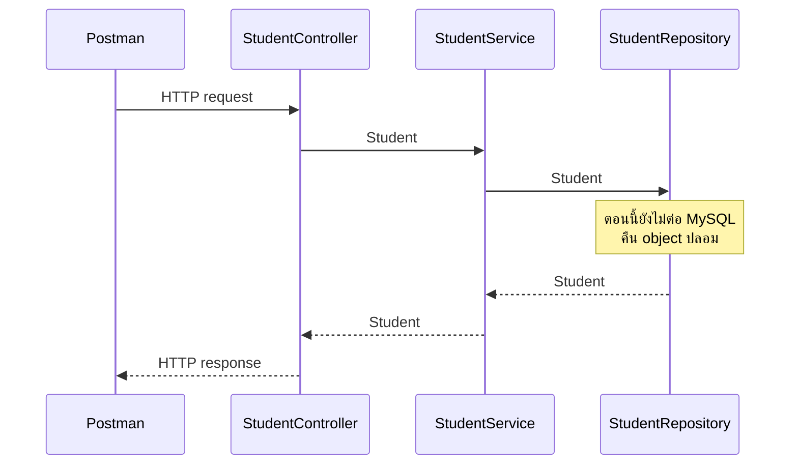
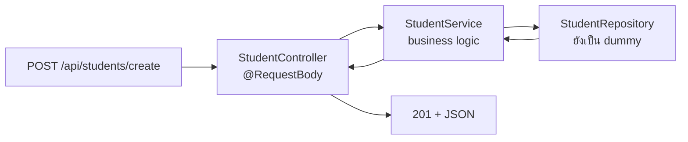

# #11 — CRUD: สร้าง API และสถาปัตยกรรม Controller–Service–Repository

> **วิดีโอ:** [Spring Boot CRUD Project from Scratch | Create API & Architecture | Spring Boot Full Course #11](https://youtu.be/6kCCIdLLGRs) — Coder Army, ~97 นาที
> **แหล่งที่ใช้สรุป:** ซับไตเติลภาษาอังกฤษที่ YouTube สร้างอัตโนมัติ (วิดีโอนี้มีซับ `en-US` สคริปต์ดึงมาเป็นภาษานี้)
> **เวอร์ชันในโค้ด:** Spring Boot 4.1 + Java 21 (ใส่หมายเหตุไว้ทุกจุดที่ Spring Boot 3.x ต่างกัน)

ตอนนี้ยังไม่ต่อ database จริง ผู้สอนใช้ทั้งตอนตอบคำถามว่า **แอป CRUD ใน Spring Boot แบ่งชั้นอย่างไร และ request สร้างข้อมูลเดินจาก Postman ไปถึง method ได้อย่างไร** เขาเปิดด้วยเดโมของโปรเจกต์ที่ทำจบแล้ว แล้วค่อยย้อนมาสร้างโปรเจกต์ใหม่ แยก Controller, Service, Repository และ Entity และทำให้ endpoint `POST /api/students/create` ตอบ `201` ได้ โดย repository ยังคืน object ปลอม

ส่วนที่ติดป้าย `💡 เพิ่มเติม` คือของที่ผมเติมเอง ไม่ได้อยู่ในวิดีโอ ส่วนที่ติด `⚠️ แก้จากวิดีโอ` คือจุดที่วิดีโอพูดคลาดเคลื่อน

---

## สารบัญ

| เวลา | หัวข้อ |
|---|---|
| [0:00](https://youtu.be/6kCCIdLLGRs?t=0) | [1. เดโม CRUD ที่ทำจบแล้ว](#1-เดโม-crud-ที่ทำจบแล้ว) |
| [8:34](https://youtu.be/6kCCIdLLGRs?t=514) | [2. Client, Server และ Database](#2-client-server-และ-database) |
| [10:39](https://youtu.be/6kCCIdLLGRs?t=639) | [3. Postman คือ client ของโปรเจกต์นี้](#3-postman-คือ-client-ของโปรเจกต์นี้) |
| [13:16](https://youtu.be/6kCCIdLLGRs?t=796) | [4. โครงของ request ที่จะยิง](#4-โครงของ-request-ที่จะยิง) |
| [18:59](https://youtu.be/6kCCIdLLGRs?t=1139) | [5. สิ่งที่ต้องติดตั้ง](#5-สิ่งที่ต้องติดตั้ง) |
| [22:13](https://youtu.be/6kCCIdLLGRs?t=1333) | [6. สร้างโปรเจกต์บน Spring Initializr](#6-สร้างโปรเจกต์บน-spring-initializr) |
| [25:28](https://youtu.be/6kCCIdLLGRs?t=1528) | [7. สตาร์ทไม่ผ่านเพราะยังไม่มี DataSource](#7-สตาร์ทไม่ผ่านเพราะยังไม่มี-datasource) |
| [28:10](https://youtu.be/6kCCIdLLGRs?t=1690) | [8. exclude แล้ว Tomcat ขึ้น](#8-exclude-แล้ว-tomcat-ขึ้น) |
| [29:18](https://youtu.be/6kCCIdLLGRs?t=1758) | [9. อย่าใส่ทุกงานไว้ใน class เดียว](#9-อย่าใส่ทุกงานไว้ใน-class-เดียว) |
| [33:33](https://youtu.be/6kCCIdLLGRs?t=2013) | [10. Controller–Service–Repository](#10-controllerservicerepository) |
| [37:26](https://youtu.be/6kCCIdLLGRs?t=2246) | [11. Entity, POJO และ Jackson](#11-entity-pojo-และ-jackson) |
| [43:00](https://youtu.be/6kCCIdLLGRs?t=2580) | [12. แยก package](#12-แยก-package) |
| [45:02](https://youtu.be/6kCCIdLLGRs?t=2702) | [13. field ของ Student](#13-field-ของ-student) |
| [49:38](https://youtu.be/6kCCIdLLGRs?t=2978) | [14. จาก class สู่ตาราง](#14-จาก-class-สู่ตาราง) |
| [54:22](https://youtu.be/6kCCIdLLGRs?t=3262) | [15. ORM](#15-orm) |
| [55:34](https://youtu.be/6kCCIdLLGRs?t=3334) | [16. @Entity และ @Id](#16-entity-และ-id) |
| [1:00:56](https://youtu.be/6kCCIdLLGRs?t=3656) | [17. @RestController](#17-restcontroller) |
| [1:03:12](https://youtu.be/6kCCIdLLGRs?t=3792) | [18. ออกแบบ endpoint ของ CRUD](#18-ออกแบบ-endpoint-ของ-crud) |
| [1:08:38](https://youtu.be/6kCCIdLLGRs?t=4118) | [19. @RequestMapping กับ @PostMapping](#19-requestmapping-กับ-postmapping) |
| [1:13:55](https://youtu.be/6kCCIdLLGRs?t=4435) | [20. @RequestBody](#20-requestbody) |
| [1:17:56](https://youtu.be/6kCCIdLLGRs?t=4676) | [21. ส่งงานต่อด้วย constructor injection](#21-ส่งงานต่อด้วย-constructor-injection) |
| [1:20:39](https://youtu.be/6kCCIdLLGRs?t=4839) | [22. Service กับ Repository ที่ยังไม่แตะ database](#22-service-กับ-repository-ที่ยังไม่แตะ-database) |
| [1:26:40](https://youtu.be/6kCCIdLLGRs?t=5200) | [23. ไล่ลำดับการเรียก](#23-ไล่ลำดับการเรียก) |
| [1:31:51](https://youtu.be/6kCCIdLLGRs?t=5511) | [24. ResponseEntity และ 201 Created](#24-responseentity-และ-201-created) |
| [1:36:19](https://youtu.be/6kCCIdLLGRs?t=5779) | [25. สิ่งที่ตอนนี้ยังไม่ทำ](#25-สิ่งที่ตอนนี้ยังไม่ทำ) |
| — | [26. สรุปท้ายตอน](#26-สรุปท้ายตอน) |

---

## 1. เดโม CRUD ที่ทำจบแล้ว

[▶ 0:00](https://youtu.be/6kCCIdLLGRs?t=0)

ผู้สอนบอกว่าวันนี้จะทำมินิโปรเจกต์ที่ต่อ Spring Boot เข้ากับ database แล้วทำ **CRUD** คือ create, read, update และ delete เขาบอกว่าโปรเจกต์แบบนี้ฟังดูง่าย แต่เป็นฐานของ backend ทุกตัว แอปอย่าง Instagram หรือ YouTube ก็สร้างเนื้อหา อ่านเนื้อหา (เช่น เปิดดู Reels) แก้ไข และลบ ไม่ต่างจากชุด operation นี้ ถ้าทำ CRUD ใน Spring Boot ได้คล่อง การใส่ business logic ที่ซับซ้อนกว่านี้จะต่อได้

เดโมต้นตอนคือโปรเจกต์ที่ทำเสร็จแล้ว ไม่ใช่โค้ดที่จะเขียนในตอนนี้ เขาเปิด Postman ยิง `POST` ไปที่ `localhost:8080/api/students` พร้อม body ที่เป็นข้อมูลนักเรียน: ชื่อ Aditya, อีเมล `aditya@gmail.com`, roll number, อายุ และ subject ฝั่ง database ใน DBeaver เป็นฐานชื่อที่เขาเรียกว่า `student.db` มีตาราง `student` ว่างอยู่ กด Send แล้วได้ `200 OK` พอ refresh ตาราง มีแถวแรก จากนั้นเขาเปลี่ยนชื่อเป็น Rohit, อีเมลเป็น `Rohit@gmail.com`, roll number `102`, อายุ `29` แล้วส่งอีกครั้ง ได้แถวที่สอง

> 💡 **เพิ่มเติม:** ซับตอนเปลี่ยน subject ของ Rohit ได้ยินเป็นคำว่า "Murn" สะกดบนจอไม่ชัด อย่ายึดค่า field นั้นจากประโยคนี้

จากนั้นเขาแสดง operation ที่เหลือของเดโม

| สิ่งที่เขาทำ | Method และ path | สิ่งที่เห็น |
|---|---|---|
| อ่านคนเดียว | `GET /api/students/1` | `200 OK` และ JSON ของนักเรียน id 1 |
| อ่านทั้งหมด | `GET /api/students` | JSON เป็น list สองคน คือ Aditya กับ Rohit |
| แก้ไข | `PUT /api/students/1` | เปลี่ยนอายุของ Aditya จาก 28 เป็น 29 แล้วได้ `200 OK` พอ refresh ตารางอายุเป็น 29 |
| ลบจริง | `DELETE /api/students/1` | ข้อความ `Student Deleted Permanently` แถวนั้นหายจากตาราง |
| soft delete | `PATCH` ไปที่ path ที่มีคำว่า soft delete ของนักเรียนคนที่ 2 | ครั้งแรก URL ผิด ได้ `Method Not Allowed` พอแก้ path แล้วได้ JSON `true` และคอลัมน์ `is_deleted` จาก 0 เป็น 1 |

เขาบอกว่าตอน `DELETE` ไม่ต้องส่ง body และตอน soft delete ก็ไม่ส่ง body เช่นกัน

**Hard delete** คือลบแถวออกจากตารางจริง **Soft delete** คือไม่ลบแถว แค่ทำเครื่องหมายว่าลบแล้ว เวลาใครขอดูรายการทั้งหมด แถวของ Rohit จะไม่ถูกส่งกลับ เพราะถูกมาร์คว่าลบ

ใน IntelliJ เซิร์ฟเวอร์กำลังรัน และทุก operation มี SQL วิ่งใน log ทั้ง insert, update และ select เขาถามว่าเราต้องเขียน query เหล่านี้เองไหม คำตอบคือไม่ นี่คือจุดที่ **Spring Data JPA** เข้ามา แต่เขาตั้งใจให้ตอนนี้มองแบบภาพรวมก่อน ว่าเว็บแอปต่อ database แล้วตอบ client อย่างไร รายละเอียดว่า query เกิดได้อย่างไรจะไปอยู่ตอน JDBC และ Hibernate ส่วนเหตุผลที่ต้องมีหลายชั้น (controller, entity, repository, service) จะชัดตอนลง Spring MVC ลึก ๆ

เขาบอกว่าอย่าเพิ่งท้อที่หลายอย่างดูเหมือนเวทมนตร์ จะค่อย ๆ ทำ และทฤษฎีสำคัญเพราะตอนสัมภาษณ์คนถามว่าโปรเจกต์ทำงานข้างในอย่างไร ไม่ได้ถามแค่ให้โชว์โปรเจกต์ที่สร้างจากเครื่องมือช่วยเขียนโค้ด

---

## 2. Client, Server และ Database

[▶ 8:34](https://youtu.be/6kCCIdLLGRs?t=514)

เขาวาดภาพที่คุ้นจากตอนแรก ๆ client ส่ง **HTTP request** ไปที่ server และ server ตอบด้วย **HTTP response**

ถัดจาก server มี database ในโปรเจกต์นี้คือ MySQL ทั้งสามส่วนคุยกันเพื่อ create, read, update และ delete



### Method กับ operation ไม่ใช่ชื่อเดียวกัน

[▶ 9:11](https://youtu.be/6kCCIdLLGRs?t=551)

เขาแยกสองคำที่คนมักปนกัน

| HTTP method | operation ที่ต้องการทำ |
|---|---|
| `POST` | create ข้อมูลใหม่ |
| `GET` | read |
| `PUT` | update ของที่มีอยู่แล้ว |
| `DELETE` | delete |

`POST`, `GET`, `PUT`, `DELETE` เป็นชื่อ method ส่วน create, read, update, delete เป็นชื่องาน เขายก `PATCH` ไว้กับ soft delete ในเดโม และบอกว่าใน Postman ยังมี `HEAD` กับ `OPTIONS` แต่จะคุยทีหลัง วันนี้โฟกัสห้าตัวคือ `GET`, `POST`, `PUT`, `PATCH` และ `DELETE`

---

## 3. Postman คือ client ของโปรเจกต์นี้

[▶ 10:39](https://youtu.be/6kCCIdLLGRs?t=639)

client คือใครก็ได้ที่ส่ง request มาที่ server จะเป็นแอป React, vanilla JavaScript, browser หรือแอปมือถือก็ได้ โปรเจกต์นี้ไม่ทำ frontend จึงใช้ **Postman** ให้มันสวมบท client

Postman เลือก method ได้ ใส่ URL ได้ และจะใช้ทั้งซีรีส์ ตอนเปิดใหม่ให้กดเครื่องหมายบวกเพื่อสร้าง request

URL ตอนพัฒนาคือ `localhost:8080` เพราะ embedded Tomcat ของ Spring Boot ฟัง port 8080 และทั้ง Postman กับแอปอยู่บนเครื่องเดียวกัน ถ้า deploy จริงค่อยเปลี่ยน host เป็นโดเมนที่ซื้อมา เขายกตัวอย่างโดเมนของช่องเองคือ coderarmy.in และ strikes.in แอปนี้เล็ก จึงไม่ deploy

> 💡 **เพิ่มเติม:** โค้ดตัวอย่างด้านล่างรันที่ port `9011` เพื่อไม่ชนกับตอนอื่นในเครื่องเดียวกัน วิดีโอใช้ค่า default `8080` สั่งรันด้วย `--server.port=9011` ไม่ได้เขียน port ลงใน `application.properties`

---

## 4. โครงของ request ที่จะยิง

[▶ 13:16](https://youtu.be/6kCCIdLLGRs?t=796)

เขายก `POST` ที่จะสร้างนักเรียนเป็นตัวอย่าง request มีส่วนเหล่านี้

| ส่วน | ในตัวอย่าง |
|---|---|
| Method | `POST` |
| Host | `localhost:8080` ส่วนนี้ซ้ำทุก endpoint ของแอป |
| Endpoint | `/api/students` |
| Body | JSON ของนักเรียน |
| Headers | คู่ key–value |

**Endpoint** ในความหมายที่เขาใช้ตอนนี้คือ path ที่ map ไปยัง method หนึ่งในแอป ถ้ายิง `/api/teachers` ทั้งที่ยังไม่ได้เขียน method ไว้ จะได้ error เขาบอกว่าความหมายที่ละเอียดกว่านี้จะมาอีกตอนตอนลง REST API

เขาสาธิตสร้าง Aditya อีกรอบหลังแถวนั้นถูกลบในเดโม body มีชื่อ Aditya, roll number `1001`, subject เป็น Spring Framework และเขาบอกว่า id จะถูกเติมให้เอง ไม่ต้องส่ง กด Send ได้ `200 OK` แล้ว refresh ตารางเห็นแถว

[▶ 17:01](https://youtu.be/6kCCIdLLGRs?t=1021)

header ที่เขาเปิดให้ดูมีสองตัว

- `Accept: application/json` แปลว่า client รับ response เป็น JSON
- `Content-Type: application/json` เขาอธิบายว่าตอนส่ง body จะส่งเป็น JSON

เขาบอกว่าสองตัวนี้ใส่เองหรือไม่ใส่ก็ได้ เพราะ Postman ใสให้เมื่อเลือก body แบบ JSON และแอปง่าย ๆ นี้ใช้แค่สอง header นี้

> ⚠️ **แก้จากวิดีโอ:** เขาพูดว่า `Content-Type: application/json` หมายถึงตอนส่ง body แล้ว "จะได้กลับมาเป็น JSON ด้วย" ที่ถูกคือ `Content-Type` บอกชนิดของ **body ที่แนบมากับข้อความนั้น** ใน request มันบอกว่า body ที่ส่งไปเป็น JSON ส่วนชนิดของ response เป็นหน้าที่ของ `Accept` ฝั่ง client และ `Content-Type` ที่ server ใส่กลับมาใน response คนละข้อความกัน

---

## 5. สิ่งที่ต้องติดตั้ง

[▶ 18:59](https://youtu.be/6kCCIdLLGRs?t=1139)

ก่อนลงมือเขาให้เตรียมสามอย่าง ขั้นตอนติดตั้งละเอียดเขาใส่ไว้ในโน้ตของคอร์ส ไม่ได้อธิบายในวิดีโอ เพราะจะยาวและน่าเบื่อ เขาบอกว่าถ้าไม่มีโน้ตก็หาวิธีติดตั้งเองได้

1. **Postman** มีทั้ง Windows และ Mac
2. **MySQL Server** เขาเลือก relational database ไม่ใช่ non-relational ตัวเลือกมี MySQL, PostgreSQL และ Oracle เขาบอกว่า PostgreSQL ตามมาตรฐานมากกว่าและใช้ได้ แต่เดโมนี้เอาให้ง่าย จึงใช้ MySQL โปรเจกต์ถัด ๆ ไปจะใช้ PostgreSQL และ H2 ด้วย
3. **GUI ของ database** เพราะคุยกับ MySQL ผ่าน terminal หรือ command prompt อย่างเดียวจะไม่เห็นตาราง เขาแนะนำ **DBeaver** เพราะใช้ได้ทั้ง Windows และ Mac และเป็น open source **MySQL Workbench** เป็น GUI ทางการแต่เขาว่าซับซ้อนไป **Sequel Ace** UI สวยแต่เป็นของ Mac เขาจึงใช้ DBeaver

ใน DBeaver ให้ต่อเข้า MySQL แล้วตั้งรหัสผ่านของเซิร์ฟเวอร์ตามโน้ต เขายังไม่ให้สร้าง database เอง และลบ database ของเดโมทิ้ง จนเหลือแต่ schema ของระบบ ถ้าจะทำไปพร้อมวิดีโอให้หยุดตรงนี้เพื่อติดตั้งก่อน

---

## 6. สร้างโปรเจกต์บน Spring Initializr

[▶ 22:13](https://youtu.be/6kCCIdLLGRs?t=1333)

แอปนี้ไม่ใช่แอป console แบบตอนก่อน ๆ เป็นเว็บแอป เขาเปิด [start.spring.io](https://start.spring.io) แล้วเลือก

- Java, Maven, Spring Boot **4.1.0**
- group ที่เขาพูดว่าเป็น `in.strikes`
- ชื่อโปรเจกต์ **Crud Spring Boot Demo** package ตาม group
- ไฟล์ config เป็น `application.properties`
- Java 21

dependency สามตัวที่ต้องมี

| ในหน้า Initializr | artifact | เอาไว้ทำอะไร |
|---|---|---|
| Spring Web | `spring-boot-starter-webmvc` | เว็บและ embedded Tomcat |
| Spring Data JPA | `spring-boot-starter-data-jpa` | คุยกับ database โดยไม่เขียน SQL เอง |
| MySQL Driver | `mysql-connector-j` | driver ต่อ MySQL |

เขาบอกว่า JPA ย่อมาจาก **Jakarta Persistence API** และกลไกข้างในจะอธิบายทีหลัง จากนั้นกด Generate ได้ zip มาแตกแล้วเปิดใน IntelliJ

> 💡 **เพิ่มเติม:** ซับได้ยิน group เป็น "dot strikes" และ package เป็น `in.strikes.crudspringbootdemo` โค้ดด้านล่างใช้ชื่อนี้ ถ้าบนจอสะกดต่างออกไป โครง package ยังเป็นแบบเดียวกัน เวอร์ชันที่คอมไพล์ด้านล่างเป็น **4.1.1** ตามที่ใช้ทั้งคอร์ส วิดีโอเลือก 4.1.0

> ⚠️ **Boot 4 vs 3 — ชื่อ starter:** ใน Boot 3 ช่อง Spring Web คือ `spring-boot-starter-web` Boot 4 เปลี่ยนเป็น `spring-boot-starter-webmvc` ชื่อเดิมยังใช้ได้แต่ถูก deprecate ในวิดีโอเขาอ่าน pom ว่าเป็น Starter Web MVC ซึ่งตรงกับ Boot 4 อยู่แล้ว
> ([Spring Boot 4.0 Migration Guide](https://github.com/spring-projects/spring-boot/wiki/Spring-Boot-4.0-Migration-Guide) ตาราง Deprecated Starters)

class หลักชื่อ `CrudSpringBootDemoApplication` มี `main` ที่เรียก `SpringApplication.run` เขาบอกว่านี่คือการตั้ง IoC Container และไม่ลงรายละเอียดซ้ำ

[▶ 24:14](https://youtu.be/6kCCIdLLGRs?t=1454)

ใน `pom.xml` เขาส่อง parent, เวอร์ชันของ model, GAV แล้วข้าม tag ว่างไปที่ dependencies ตัวที่ใช้จริงคือ Data JPA, Web MVC และ Connector/J อีกสองตัวเป็น test ของ JPA และของ Web MVC เขาบอกว่าตอนนี้ไม่เขียน test สองตัวนั้นจึงยังไม่สำคัญ

> ⚠️ **Boot 4 vs 3 — test starter แยกโมดูล:** Initializr ของ Boot 4 ใส่ `spring-boot-starter-data-jpa-test` กับ `spring-boot-starter-webmvc-test` ตามที่เขาอ่านบนจอ ใน Boot 3 โปรเจกต์เว็บทั่วไปได้ `spring-boot-starter-test` ก้อนเดียว แล้ว test slice อยู่ในนั้น
> ([Spring Boot 4.0 Migration Guide](https://github.com/spring-projects/spring-boot/wiki/Spring-Boot-4.0-Migration-Guide) ตาราง starter กับ test starter)

`pom.xml` ที่รันได้

```xml
<parent>
  <groupId>org.springframework.boot</groupId>
  <artifactId>spring-boot-starter-parent</artifactId>
  <version>4.1.1</version>
</parent>

<groupId>in.strikes</groupId>
<artifactId>crud-spring-boot-demo</artifactId>
<version>0.0.1-SNAPSHOT</version>

<properties>
  <java.version>21</java.version>
</properties>

<dependencies>
  <dependency>
    <groupId>org.springframework.boot</groupId>
    <artifactId>spring-boot-starter-data-jpa</artifactId>
  </dependency>
  <dependency>
    <groupId>org.springframework.boot</groupId>
    <artifactId>spring-boot-starter-webmvc</artifactId>
  </dependency>
  <dependency>
    <groupId>com.mysql</groupId>
    <artifactId>mysql-connector-j</artifactId>
    <scope>runtime</scope>
  </dependency>
  <dependency>
    <groupId>org.springframework.boot</groupId>
    <artifactId>spring-boot-starter-data-jpa-test</artifactId>
    <scope>test</scope>
  </dependency>
  <dependency>
    <groupId>org.springframework.boot</groupId>
    <artifactId>spring-boot-starter-webmvc-test</artifactId>
    <scope>test</scope>
  </dependency>
</dependencies>
```

---

## 7. สตาร์ทไม่ผ่านเพราะยังไม่มี DataSource

[▶ 25:28](https://youtu.be/6kCCIdLLGRs?t=1528)

เขาพิมพ์ `Hello World` ใน `main` แล้วรันทันที แอปจบด้วยข้อความว่าสตาร์ทไม่สำเร็จ ทั้งที่เพิ่งโหลดโปรเจกต์มา ข้อความที่เขาอ่านคือตั้งค่า data source ไม่ได้ เพราะไม่ได้ระบุ URL และไม่มี embedded data source ให้ใช้

สาเหตุคือพอ classpath มี Data JPA กับ MySQL driver, Spring Boot เห็นว่าแอปจะคุยกับ database แล้ว **auto-configuration** จึงพยายามสร้าง Bean ที่ต้องใช้ รวมถึง **DataSource** DataSource ต้องการ URL และยังมี username กับ password ซึ่งยังไม่ได้ใส่

เขาเปิด external libraries และหน้าต่าง Maven ให้เห็นว่า dependency ตรง ๆ มีห้าตัว แต่ละตัวดึง **transitive dependency** มาอีกเยอะ ค่าที่ยังขาดจะไปอยู่ที่ `application.properties` ซึ่งเป็นไฟล์ key–value ที่ไม่ใช่ Java ไฟล์นั้นยังว่างอยู่

`@SpringBootApplication` มี `@EnableAutoConfiguration` อยู่ข้างใน เขาอ้างถึงตอนที่คุย auto-configuration ไว้แล้วว่า Boot สร้าง Bean ให้พร้อมใช้ แต่ครั้งนี้การสร้าง DataSource ล้ม เพราะไม่มี URL

ผลรันจริงบน Boot 4.1.1 ก่อนใส่ `exclude` ขึ้นแบบนี้ และ `Hello World` ไม่ถูกพิมพ์ เพราะ `SpringApplication.run` โยน exception ก่อนถึงบรรทัดนั้น Tomcat เริ่มเปิด port แล้วถูกสั่งหยุดระหว่าง context พัง

```text
APPLICATION FAILED TO START

Description:

Failed to configure a DataSource: 'url' attribute is not specified and no embedded datasource could be configured.

Reason: Failed to determine a suitable driver class

Action:

Consider the following:
	If you want an embedded database (H2, HSQL or Derby), please put it on the classpath.
	If you have database settings to be loaded from a particular profile you may need to activate it (no profiles are currently active).
```

---

## 8. exclude แล้ว Tomcat ขึ้น

[▶ 28:10](https://youtu.be/6kCCIdLLGRs?t=1690)

ทางออกชั่วคราวของเขาคือบอก Boot ว่าอย่า auto-configure DataSource เขาใส่ `exclude` ที่ `@SpringBootApplication` ชี้ไปที่ `DataSourceAutoConfiguration` พอรันใหม่ `Hello World` ถูกพิมพ์ และ log บอกว่า Tomcat เริ่มที่ port 8080 นี่คือตัวที่ฟัง port

เปิด browser ไปที่ `localhost:8080` เจอหน้า error เพราะยังไม่ได้ map endpoint ใด ๆ เขาเรียกหน้านี้ว่า error page สีขาว ซึ่งคือ **Whitelabel Error Page** จากนั้นเขาหยุดเซิร์ฟเวอร์ไว้ก่อน จะรันอีกทีตอนเริ่มยิง API

```java
package in.strikes.crudspringbootdemo;

import org.springframework.boot.SpringApplication;
import org.springframework.boot.autoconfigure.SpringBootApplication;
import org.springframework.boot.jdbc.autoconfigure.DataSourceAutoConfiguration;

@SpringBootApplication(exclude = DataSourceAutoConfiguration.class)
public class CrudSpringBootDemoApplication {

  public static void main(String[] args) {
    SpringApplication.run(CrudSpringBootDemoApplication.class, args);
    System.out.println("Hello World");
  }
}
```

> ⚠️ **Boot 4 vs 3 — package ของคลาสนี้ย้าย:** Boot 3 ใช้ `org.springframework.boot.autoconfigure.jdbc.DataSourceAutoConfiguration` Boot 4 ย้ายไป `org.springframework.boot.jdbc.autoconfigure.DataSourceAutoConfiguration` ตามที่โมดูล JDBC แยกออกมา ถ้า copy import เดิมจากบทเรียน Boot 3 โค้ดนี้จะคอมไพล์ไม่ผ่าน
> ([Spring Boot 4.0 Migration Guide](https://github.com/spring-projects/spring-boot/wiki/Spring-Boot-4.0-Migration-Guide) หัวข้อ Package Organization และคลาสใน `spring-boot-jdbc` 4.1.1 เทียบกับ `spring-boot-autoconfigure` 3.5.16)

รันด้วย `--server.port=9011` ได้ log ช่วงท้ายแบบนี้

```text
Tomcat initialized with port 9011 (http)
Starting service [Tomcat]
Starting Servlet engine: [Apache Tomcat/11.0.24]
Tomcat started on port 9011 (http) with context path '/'
Started CrudSpringBootDemoApplication in 0.916 seconds
Hello World
```

เปิด `/` ด้วย browser (request ที่รับ HTML) ได้หน้านี้

```html
<html><body><h1>Whitelabel Error Page</h1><p>This application has no explicit mapping for /error, so you are seeing this as a fallback.</p><div>There was an unexpected error (type=Not Found, status=404).</div></body></html>
```

> 💡 **เพิ่มเติม:** `curl` ที่ไม่ส่ง `Accept: text/html` ได้ JSON `404` แทนหน้า HTML เช่น `{"status":404,"error":"Not Found","path":"/"}` หน้า Whitelabel เป็นของ client ที่ขอ HTML อย่าง browser ในวิดีโอ

`application.properties` ยังว่าง ทั้ง URL, username และ password ยังไม่ถูกใส่ `exclude` คือเหตุที่แอปขึ้นได้ทั้งที่ยังไม่ต่อ MySQL

---

## 9. อย่าใส่ทุกงานไว้ใน class เดียว

[▶ 29:18](https://youtu.be/6kCCIdLLGRs?t=1758)

`main` รันครั้งเดียวเพื่อตั้ง IoC Container งานของฟีเจอร์ให้อยู่ใน class ใหม่ เขาลองนึกถึง `StudentService` แบบ `OrderService` กับ `PaymentService` ในตอนก่อน ๆ แล้วใส่ `@Component` เพื่อให้เป็น Bean

งานที่ request หนึ่งครั้งต้องทำมีสี่อย่าง

1. ฟัง endpoint เช่น `POST /api/students` แล้วรับข้อมูลที่จะเก็บ
2. ทำ business logic กับข้อมูลนั้น
3. คุยกับ database เพื่อเก็บหรืออ่าน
4. ส่ง response กลับไปที่ client ซึ่งตอนนี้คือ Postman

เขาบอกว่าใส่ทั้งสี่อย่างไว้ใน `StudentService` ตัวเดียวก็ได้ แต่สถาปัตยกรรมที่ Spring ใช้แยกความรับผิดชอบ class หนึ่งทำหน้าที่เดียว ถ้าต้องทำงานอย่างอื่นให้ inject dependency เข้ามา ไม่ใช่ทำให้เองหมด นี่คือเรื่องที่คุยไว้ใน Spring Core

---

## 10. Controller–Service–Repository

[▶ 33:33](https://youtu.be/6kCCIdLLGRs?t=2013)

เขาแบ่งเป็นสาม class

| Class | หน้าที่ |
|---|---|
| `StudentController` | รับ HTTP request จาก Postman อ่าน path, method และ body แล้วเรียก method ที่ตรงกับ endpoint |
| `StudentService` | business logic เช่น ก่อนเก็บต้องตรวจอะไรหรือไม่ |
| `StudentRepository` | คุยกับ database แล้วส่งผลกลับ |

ทางไปคือ Postman ถึง controller ถึง service ถึง repository ทางกลับคือ repository ถึง service ถึง controller แล้ว controller ประกอบ HTTP response ส่งให้ Postman เขาเรียกแบบนี้ว่า **Controller–Service–Repository** และบอกว่าแอป Spring Boot หลังจากนี้จะเดินเส้นนี้

เขาเตือนว่าข้างในจริง ๆ controller ไม่ใช่จุดแรกที่ request แตะ มีของอีกหลายอย่างก่อนถึง method ของเรา จะดูในตอน MVC ตอนนี้ให้สมมติว่า request เข้า controller ก่อน



ความรู้เรื่อง Dependency Injection และ Bean จากตอนก่อนจะถูกใช้ตรงนี้ controller ถือ service และ service ถือ repository

ช่วงท้ายของภาพนี้เขาพูดเรื่องการเรียนด้วย ว่า CRUD เองง่าย แต่เป็นกระดูกสันหลังของโปรเจกต์ถัดไป หลายคนคอมเมนต์ว่าทฤษฎีพอได้แล้ว เขาตอบว่าทฤษฎีคือฐาน และโปรเจกต์ที่อธิบายข้างในไม่ได้จะไม่มีประโยชน์ตอนสัมภาษณ์ ก้าวจากศูนย์ไปหนึ่งยากที่สุด หลังเข้าใจชั้นเหล่านี้ โปรเจกต์ถัดไปจะซ้ำรูปแบบเดิม

---

## 11. Entity, POJO และ Jackson

[▶ 37:26](https://youtu.be/6kCCIdLLGRs?t=2246)

สิ่งที่เก็บคือข้อมูลนักเรียน จึงต้องมี `Student.java` เขาเรียกมันว่า **POJO** คือ plain old Java object class เรียบ ๆ ที่ถือข้อมูลอย่างชื่อ อายุ และ roll number พร้อม getter กับ setter

Postman ส่ง **JSON** แต่โค้ด Java หลัง controller เข้าใจแค่ class ดังนั้นงานแรกของ controller คือแปลง JSON ที่เข้ามาเป็น `Student` เขาบอกว่าทำเองทีละ field ไม่ต้อง มีไลบรารี **Jackson** แปลงให้ และจะเห็นในโค้ดว่ามันเกิดขึ้นเอง

object `Student` นี้ถูกส่งต่อจาก controller ไป service ไป repository แล้วถูกเก็บลง database แต่ database ไม่ได้เก็บ class มันเก็บ **ตาราง** ดังนั้นตรงไหนสักจุด class ต้องถูกแปลงเป็นตาราง

class ที่ต้องการให้ถูกเก็บลง database เขาเรียกว่า **entity** นอกจาก controller, service และ repository แล้วของชิ้นที่สี่คือ entity รวมสี่อย่าง เขาบอกว่าตอนหลังจะมี **DTO** (Data Transfer Object) แยกจาก entity ตอนนี้ตั้งใจไม่ใส่ เพื่อให้เหลือแค่สี่ชิ้นนี้

> 💡 **เพิ่มเติม:** `@RestController` ใน Spring Framework 7 ประกอบด้วย `@Controller` และ `@ResponseBody` จุดที่ทำให้ค่าที่ return กลายเป็น body คือ `@ResponseBody` ไม่ใช่ชื่อ Rest เอง และตัวที่แปลง JSON คือ Jackson ที่ Boot ติดมาให้

> ⚠️ **Boot 4 vs 3 — Jackson:** Boot 4 ใช้ Jackson 3 เป็นค่า default package ของ mapper คือ `tools.jackson` Boot 3 ใช้ Jackson 2 package `com.fasterxml.jackson` โค้ดตอนนี้ไม่ได้ import Jackson เอง จึงยังเรียกผ่าน `@RequestBody` กับค่าที่ return ได้เหมือนเดิม ถ้าโปรเจกต์เก่าสร้าง `ObjectMapper` เอง ตอนย้ายมา Boot 4 ต้องใช้ `JsonMapper`
> ([Spring Boot 4.0 Migration Guide](https://github.com/spring-projects/spring-boot/wiki/Spring-Boot-4.0-Migration-Guide) หัวข้อ Upgrading Jackson)

---

## 12. แยก package

[▶ 43:00](https://youtu.be/6kCCIdLLGRs?t=2580)

ที่ผ่านมาเขาใส่ class ทั้งหมดไว้ใน package หลัก เขาบอกว่าแบบนั้นไม่ดีเมื่อแอปมีหลายชนิดของข้อมูล เช่น ทั้งนักเรียนและครู เขาจึงสร้าง package แยก

- package ของ controller เขาเรียกว่า Controllers
- package ของ service เขาเรียกว่า Service
- package ของ repository เขาเรียกว่า Repository
- package ของ entity เขาเรียกว่า Entity และบอกว่าบางคนเรียก Model ชื่อเรียกเปลี่ยนได้ แต่เขาจะใช้ชุดนี้

`CrudSpringBootDemoApplication` อยู่ที่ package หลัก นอกนั้นแยกไปตามชั้น เขาย้าย `StudentService` เข้า package ของ service แล้วลบคอมเมนต์ที่ทดไว้ตอนแรกทิ้ง

> 💡 **เพิ่มเติม:** ชื่อ package ใน Java นิยมเป็นตัวพิมพ์เล็ก โค้ดด้านล่างจึงใช้ `controller`, `service`, `repository` และ `entity` วิดีโอออกเสียงเป็น Controllers, Service, Repository และ Entity

โครงที่รัน

```text
in.strikes.crudspringbootdemo
├── CrudSpringBootDemoApplication
├── controller/StudentController
├── service/StudentService
├── repository/StudentRepository
└── entity/Student
```

---

## 13. field ของ Student

[▶ 45:02](https://youtu.be/6kCCIdLLGRs?t=2702)

เขากลับไปที่ Postman แล้วกำหนด body ของ `POST /api/students` ว่าจะเก็บห้าอย่างนี้

| field | ชนิดที่เขาใช้ | ตัวอย่าง |
|---|---|---|
| `name` | `String` | Aditya |
| `email` | `String` | `aditya@gmail.com` |
| `age` | ตัวเลข ไม่ใช่ string | `28` |
| `rollNumber` | `int` | `1001` |
| `subject` | `String` | Spring Framework |

POJO ต้องมี field ชื่อเดียวกัน เพื่อให้ JSON ถูก map เข้ามา เขาให้ IntelliJ generate getter และ setter ของทุก field หลังจุดนี้โค้ด Java ไม่คุยกับ JSON โดยตรงอีก JSON ถูกแตะที่ controller ครั้งเดียว ที่เหลือส่ง `Student` ต่อกัน

เขาอธิบายความหมายของไฟล์นี้ว่ามันคือรายการข้อมูลนักเรียนที่อยากเก็บใน database ดังนั้นที่ไหนสักแห่ง class นี้ต้องกลายเป็นตาราง `student`

---

## 14. จาก class สู่ตาราง

[▶ 49:38](https://youtu.be/6kCCIdLLGRs?t=2978)

เขาสร้าง database ใหม่ใน DBeaver ชื่อที่ซับได้ยินเป็น `StudentCred_DB` แล้วเปิดตัวเขียน SQL เขาสร้างตาราง `student` ให้มี field ชุดเดียวกับ class และกับ JSON คือ name, age, email, roll number และ subject รัน query แล้ว refresh จะเห็นตารางว่าง มีคอลัมน์ id ที่เขาบอกว่า MySQL สร้างให้อัตโนมัติ ตามด้วยคอลัมน์ที่เหลือ

เขาบอกว่าคนที่ไม่เขียน SQL อยู่แล้วไม่ต้องกังวล เพราะตอนนี้แทบไม่ได้เขียน query เอง

จากนั้นเขาเขียน `INSERT` มือ เพื่อให้เห็นว่าแถวเกิดได้อย่างไร ค่าที่เขาอ่านออกมาคือ id `1`, ชื่อ Aditya, อายุ `28`, อีเมล `adi@gmail.com`, roll number `1001`, subject เป็น Spring Framework รันแล้ว refresh เห็นหนึ่งแถว

> 💡 **เพิ่มเติม:** เขาไม่ได้บรรยายชนิดคอลัมน์และความยาวครบทุกตัว SQL ด้านล่างเป็นรูปที่ประกอบจากสิ่งที่เขาพูด คือมี primary key แบบ auto increment, สตริงเป็น `VARCHAR` และตัวเลขเป็น `INT` ไม่ได้รับประกันว่าตรงกับตัวอักษรบนจอทุกตัว

```sql
CREATE TABLE student (
  id INT AUTO_INCREMENT PRIMARY KEY,
  name VARCHAR(255),
  age INT,
  email VARCHAR(255),
  roll_number INT,
  subject VARCHAR(255)
);

INSERT INTO student (id, name, age, email, roll_number, subject)
VALUES (1, 'Aditya', 28, 'adi@gmail.com', 1001, 'Spring Framework');
```

ประเด็นของเขาคือค่าใน `INSERT` ถูก hardcode ทั้งที่ค่าจริงมาจาก field ของ `Student` ดังนั้น repository น่าจะต้องมี method ที่แปลง object เป็น `INSERT INTO student ...` เขาตอบว่าข้างในเป็นแบบนั้นจริง แต่เราจะไม่เขียน `INSERT` เอง

ตอนที่ Spring Data เข้ามา แนวคิดคือนักพัฒนา Spring Boot ไม่จำเป็นต้องเขียน SQL ทุกคน เขาย้ำว่าเราควรรู้ SQL แต่มันไม่บังคับ เฟรมเวิร์กจะมี method ให้เรียก แล้ว query วิ่งข้างใน การแปลง `Student` เป็น SQL จะไปดูตอน Hibernate, JDBC และ ORM

> ⚠️ **แก้จากวิดีโอ:** เขาเรียกชั้นนี้ว่า "Spring JPA" สลับกับ Spring Data ชื่อของโมดูลคือ **Spring Data JPA** ส่วน **JPA** เป็น specification คนที่สร้าง SQL จาก entity คือ **Hibernate** ซึ่งเป็น implementation ที่ Boot ใช้เป็นค่า default ไม่ใช่ตัวชื่อ Spring JPA

> ⚠️ **แก้จากวิดีโอ:** เขาบอกว่าพอมี class นี้ แล้วรันแอป Spring จะออก `CREATE TABLE` ให้เอง จากค่า default ของ Boot 4.1.1 (และ Boot 3 ก็เป็นแบบนี้) `ddl-auto` เป็น `create-drop` เฉพาะเมื่อ DataSource เป็น embedded database เช่น H2 ถ้าเป็น MySQL ค่า default คือ `none` จึงไม่สร้างตารางให้ จนกว่าจะตั้ง `spring.jpa.hibernate.ddl-auto` เอง ในตอนนี้ยิ่งไม่เกิด เพราะ DataSource ถูก exclude ไว้ คลาสที่ตัดสินใจคือ `HibernateDefaultDdlAutoProvider` ใน `spring-boot-hibernate` 4.1.1

---

## 15. ORM

[▶ 54:22](https://youtu.be/6kCCIdLLGRs?t=3262)

เขาอธิบายว่าทำไมถึงเรียกสิ่งนี้ว่า ORM เขียน `Student s1 = new Student()` แล้ว s1 มีชื่อ อายุ อีเมล roll number และ subject ของตัวเอง object นั้นตรงกับหนึ่งแถวในตาราง `student` สร้าง object ที่สอง ชื่อ Rohit อายุ 29 ก็ตรงกับแถวที่สอง object ที่สามตรงกับแถวที่สาม การ map object หนึ่งตัวไปยังหนึ่งแถวคือความหมายที่เขาต้องการ

วันนี้เขาจะดู JPA แบบกล่องดำ ข้างในของ Hibernate, JDBC และ JPA ไว้ตอนหลัง

> ⚠️ **แก้จากวิดีโอ:** เขาขยาย ORM ว่า "object-relational model" คำที่ถูกคือ **Object-Relational Mapping** คือการ map object กับแถว ไม่ใช่ชื่อของโมเดลข้อมูลอีกชนิดหนึ่ง

---

## 16. @Entity และ @Id

[▶ 55:34](https://youtu.be/6kCCIdLLGRs?t=3334)

เขาใส่ `@Entity` บน `Student` เพื่อบอกว่า class นี้เป็น entity และต้องการให้ถูก map ไปยัง database พอใส่ปุ๊บ IDE ฟ้องว่า persistent entity ต้องมี primary key เขาบอกว่านั่นสมเหตุสมผล เพราะตอนดึงแถวต้องมีคีย์ที่ไม่ซ้ำ

เขาไล่ field ที่มีอยู่ว่าอันไหนเป็น primary key ได้

- ชื่อไม่ได้ เพราะคนละคนชื่อซ้ำได้
- อีเมลได้ เพราะเขาถือว่าไม่ซ้ำ
- roll number ได้ถ้านับในวิทยาลัยเดียวกัน แต่คนละวิชาอาจซ้ำ
- subject ไม่ได้ เพราะซ้ำได้

แนวปฏิบัติที่เขาเลือกคือไม่ใช้ field ธุรกิจเป็นคีย์ แต่สร้าง field `id` แยก และใช้ `Long` ไม่ใช่ `int` เพราะ id มีโอกาสใหญ่เมื่อแถวเยอะ เขาใส่ `@Id` บน field นี้ แล้ว error หาย จากนั้น generate getter และ setter ของ id ด้วย

เขาเล่าว่า `@Entity` ข้างในมี `@Retention`, `@Target` และ `@Documented` ซึ่งจะเจอบน annotation อื่น ๆ อีก และจะอธิบายความหมายทีหลัง สิ่งที่เขาให้สังเกตคือ **ไม่มี `@Component`** จึงไม่ได้บอกให้ IoC Container จัดการ `Student` เป็น Bean เขาบอกว่าตัวที่จัดการคือ JPA ของ Spring ไม่ใช่ IoC Container

> 💡 **เพิ่มเติม:** "จัดการ" ในประโยคนั้นหมายถึง persistence context ของ JPA ติดตาม instance ของ entity ตอนอ่านและเขียน ไม่ได้หมายความว่ามี Bean ชื่อ `Student` หนึ่งตัวใน container การ `new Student()` ใน repository ด้านล่างจึงถูกต้อง และเขาทำแบบนั้นตรง ๆ

```java
package in.strikes.crudspringbootdemo.entity;

import jakarta.persistence.Entity;
import jakarta.persistence.Id;

@Entity
public class Student {

  @Id
  private Long id;
  private String name;
  private String email;
  private int age;
  private int rollNumber;
  private String subject;

  public Long getId() {
    return id;
  }

  public void setId(Long id) {
    this.id = id;
  }

  public String getName() {
    return name;
  }

  public void setName(String name) {
    this.name = name;
  }

  public String getEmail() {
    return email;
  }

  public void setEmail(String email) {
    this.email = email;
  }

  public int getAge() {
    return age;
  }

  public void setAge(int age) {
    this.age = age;
  }

  public int getRollNumber() {
    return rollNumber;
  }

  public void setRollNumber(int rollNumber) {
    this.rollNumber = rollNumber;
  }

  public String getSubject() {
    return subject;
  }

  public void setSubject(String subject) {
    this.subject = subject;
  }
}
```

เขายังไม่ได้ใส่ `@GeneratedValue` id ในเดโมสร้างตารางถูกให้ auto increment แต่ใน class ตอนนี้ `@Id` อย่างเดียว ตอนยิง API เขายังใส่ `"id": 1` ใน JSON ด้วย เพื่อให้ map เข้า field นี้ได้

---

## 17. @RestController

[▶ 1:00:56](https://youtu.be/6kCCIdLLGRs?t=3656)

ใน `StudentController` เขาเริ่มจาก method `createStudent` ที่อยากให้ถูกเรียกเมื่อมียิง `POST /api/students`

`@Component` ใช้ได้ และแปลว่าให้สร้าง Bean ใส่ IoC Container แต่มันกว้างไป สำหรับชั้น controller, service และ repository เขาบอกว่า Spring มี annotation ที่เฉพาะกว่า สำหรับ controller เขาใส่ `@RestController`

ความหมายที่เขาให้คือ class นี้รับ REST API แล้วตอบเป็น JSON หรือรูปแบบอื่นที่กำหนดได้ บางครั้งจะเห็น `@Controller` แทน เขาบอกว่าไว้ดูทีหลัง

เขาเปิด annotation ให้ดู `@RestController` มี `@Controller` อยู่ข้างใน และ `@Controller` มี `@Component` อยู่ข้างใน ดังนั้นเขียน `@RestController` ก็ยังได้ Bean ที่ IoC Container จัดการ เหมือนเขียน `@Component` แต่บอกบทบาทเพิ่ม

> 💡 **เพิ่มเติม:** ใน Spring Framework 7 ของ Boot 4.1.1 `@RestController` มี meta-annotation สองตัวคือ `@Controller` และ `@ResponseBody` เขาเปิดให้เห็น `@Controller` แต่ยังไม่ได้พูดชื่อ `@ResponseBody`

---

## 18. ออกแบบ endpoint ของ CRUD

[▶ 1:03:12](https://youtu.be/6kCCIdLLGRs?t=3792)

เขาวางห้า method ไว้ใน controller คือ create, read หนึ่งแถว, read ทั้งหมด, update และ delete ส่วน soft delete ไว้ทีหลัง เขาย้ำว่า CRUD อ่านว่า create, read, update, delete

path `/api/students` ซ้ำกันได้ ถ้า HTTP method ต่างกัน สิ่งที่ซ้ำไม่ได้คือคู่ของ method กับ path ทั้งคู่เหมือนกัน ไม่งั้น Java ไม่รู้ว่าจะเรียก method ไหน

| งาน | Method | Path | Body |
|---|---|---|---|
| create | `POST` | `/api/students` | JSON ของนักเรียนใหม่ |
| read หนึ่งคน | `GET` | `/api/students/1` เลขท้ายคือ id จะเป็น 2 หรือ 3 ก็ได้ | ไม่มี |
| read ทั้งหมด | `GET` | `/api/students` | ไม่มี เขาบอกว่าไม่ส่ง list ของ id มาใน path |
| update | `PUT` | `/api/students/1` | JSON ทั้งก้อนของค่าใหม่ |
| delete | `DELETE` | `/api/students/1` | ไม่มี |

`GET` ไม่มี body ใช้ดึงอย่างเดียว เลขใน path บอกว่าจะเอาแถวไหน

ตอน update เขาไม่แยก endpoint เป็น update ชื่อ, update อีเมล, update roll number เพราะวันหลังเพิ่ม field ต้องเพิ่ม API อีก เขาจึงมี update เดียว ระบุว่าจะแก้แถวไหนด้วย id ใน path แล้วส่ง body ทั้งก้อนของค่าที่อยากให้เป็น เขาเปิด Postman ให้เห็น `PUT /api/students/1` พร้อม body ชุดเดียวกับตอน create

`GET /api/students` กับ `POST /api/students` path เหมือนกัน แต่คนละ method จึงไม่ชนกัน เช่นเดียวกับ `GET`, `PUT` และ `DELETE` ของ `/api/students/1`

### อีกแบบที่เขาเขียนให้ดู แล้วบอกว่าไม่ใช้เป็นหลัก

[▶ 1:11:03](https://youtu.be/6kCCIdLLGRs?t=4263)

เขาแสดงอีกสไตล์ที่ทำให้ทุก path ไม่ซ้ำกันเลย เช่น `/api/students/create`, `/api/students/get/{id}`, `/api/students/get-all`, `/api/students/update` และ `/api/students/delete/{id}` แบบนี้ก็ทำงานได้ และอ่านแล้วรู้ทันทีว่า method นั้นทำอะไร

เขาชอบแบบแรกมากกว่า คือให้ path ซ้ำได้แต่คู่ของ path กับ method ต้องไม่ซ้ำ เพราะตรง convention กว่าและ URL สั้นกว่า แล้วเขาบอกว่าเดี๋ยวค่อยจัดรูปให้เป็นแบบนั้น โค้ดที่เขาลงมือรันในตอนนี้ยังเป็นแบบมี `/create` ต่อท้าย จะเห็นตอนยิง Postman ว่า URL คือ `localhost:8080/api/students/create`

---

## 19. @RequestMapping กับ @PostMapping

[▶ 1:08:38](https://youtu.be/6kCCIdLLGRs?t=4118)

เพราะ `/api/students` อยู่หน้าทุก method เขาใส่ครั้งเดียวที่ระดับ class

```java
@RestController
@RequestMapping("/api/students")
public class StudentController {
```

`@RequestMapping` ตรงนี้แปลว่า request ที่ path ขึ้นต้นแบบนี้ให้เข้า class นี้

บน `createStudent` เขาใส่ `@PostMapping("/create")` คู่ที่เหลือคือ `POST` บวก `/api/students/create` ไม่มี method อื่นใน class ที่เป็น `POST` path นี้ เขาบอกว่า annotation เหล่านี้ทำให้ method ถูกเรียกเอง กลไกข้างในไว้ดูทีหลัง

ถ้าใช้สไตล์ path ไม่ซ้ำ `@PostMapping` จะรับ path ส่วนที่เพิ่มจากของ class เช่น `"/create"` แล้ว URL เต็มคือ `/api/students/create` เขาปล่อยโค้ดไว้แบบนี้ก่อน

---

## 20. @RequestBody

[▶ 1:13:55](https://youtu.be/6kCCIdLLGRs?t=4435)

สิ่งที่เดินทางมาถึง controller คือชื่อ method (`POST`), URL เต็ม, body และ header สองตัวที่ Postman ใส่ให้เมื่อเลือก JSON คือ `Accept` กับ `Content-Type`

body เป็น JSON ที่มี id, name, email, age, roll number และ subject ซึ่งเป็น field ชุดเดียวกับ `Student` เขาไม่ map ทีละ field เอง เขาประกาศพารามิเตอร์เป็น `Student` แล้วใส่ `@RequestBody`

`@RequestBody` บอกว่า object นี้มาจาก body ของ request Spring map ให้โดยใช้ Jackson แปลง JSON เป็น class

เขายังให้ method เป็น `void` แล้วพิมพ์ `getName()` กับ `getEmail()` ลง console เพื่อพิสูจน์ว่ารันแอป ยิง `POST /api/students/create` ด้วย body ของ Aditya แล้ว console โชว์ชื่อและอีเมล Postman ไม่มี body ตอบกลับ เพราะยังไม่ได้ return อะไร เขาเลยปิดแอป แล้วสรุปว่าทั้ง path และ JSON map ถูกแล้ว หน้าที่ที่เหลือของ controller คือรับของแล้วส่งต่อ ไม่ใช่ไปเก็บ database เอง

> 💡 **เพิ่มเติม:** ค่าปลอมใน repository ด้านล่างใช้ชื่อ Aditya, อายุ 28, อีเมล `aditya@gmail.com`, roll number 1001 และ subject Spring Framework เขาอ่านออกเสียงชัดแค่ `setName("Aditya")` ที่เหลือเขาบอกว่าใส่ age, email, roll number และ subject โดยไม่ได้อ่านตัวเลขทีละตัว ชุดนี้คือชุดเดียวกับ body ตัวอย่างในวิดีโอ

---

## 21. ส่งงานต่อด้วย constructor injection

[▶ 1:17:56](https://youtu.be/6kCCIdLLGRs?t=4676)

controller พึ่ง `StudentService` เพราะมันส่ง request ต่อให้ service ทำ เขาประกาศ field `private StudentService studentService` ชื่อตัวแปรย่อ s นำหน้าตาม convention ที่เขาใช้

เขาบอกว่า field injection ด้วย `@Autowired` ทำได้ แต่เขาไม่ใช้ เขาใช้ constructor injection สร้าง constructor ที่รับ `StudentService` แล้วกำหนดให้ field และบอกว่าไม่ต้องใส่ annotation อะไรเพิ่ม การ wire เกิดเองเพราะมี constructor ตัวเดียว

จากนั้นใน `createStudent` เขาเรียก `studentService.createStudent(student)` รับ `Student` ที่ service คืนมา ตั้งชื่อว่า `createdStudent` เขาบอกว่าตอนนี้สอง object จะเป็นตัวเดียวกัน เพราะนั่นคือสิ่งที่เก็บลง database แล้วอยากตอบกลับไปว่าสร้างแล้ว แบบที่ง่ายสุดคือ return สตริง `"Student created"` แต่ยังทำไม่ได้เพราะ service ยังไม่มี method นี้

---

## 22. Service กับ Repository ที่ยังไม่แตะ database

[▶ 1:20:39](https://youtu.be/6kCCIdLLGRs?t=4839)

`StudentService.createStudent` รับ `Student` ที่เขาตั้งชื่อพารามิเตอร์ว่า `studentRequest` เพราะมันมาจาก request และ return `Student`

เขาถามว่า business logic ของการสร้างนักเรียนมีอะไร คำตอบคือในเคสง่าย ๆ นี้ไม่มี จะเก็บตรง ๆ ก็ได้ แล้วเขาตอบคำถามที่คนจะสงสัยทันทีว่าถ้า service ไม่ทำอะไร ทำไมไม่ให้ controller เรียก repository เอง เขาบอกว่าเคสนี้มันง่าย จึงส่งต่อทันที แต่ถ้าต้องตรวจว่า subject เป็นวิชาคอมพิวเตอร์ ไม่ใช่ประวัติศาสตร์หรือภูมิศาสตร์ หรือต้องตรวจว่า roll number อยู่ในช่วงที่อนุญาต การตรวจพวกนั้นอยู่ที่ service เขายกช่วง roll number ที่ซับได้ยินเป็น 1001 ถึง 199

> 💡 **เพิ่มเติม:** ช่วง "1001 ถึง 199" ที่ซับได้ยินใช้เป็นเงื่อนไขไม่ได้ เพราะ 199 น้อยกว่า 1001 น่าจะเป็นตัวอย่างที่พูดผ่าน ๆ หรือซับฟังเพี้ยน ไม่ใช่กฎที่เขาเขียนลงโค้ด

หลังตรวจแล้ว service ส่งต่องานเก็บให้ repository เขาจึง inject `StudentRepository` ผ่าน constructor แบบเดียวกัน IDE ฟ้องว่า autowire ไม่ได้ เพราะยังหา Bean ของ `StudentRepository` ไม่เจอ เขายังไม่ได้ใส่ `@Component` พอใส่แล้วคำเตือนหาย

> 💡 **เพิ่มเติม:** ข้อความที่เขาอ่านเป็นคำเตือนของ IntelliJ ถ้าสตาร์ทแอปทั้งที่ repository ยังไม่เป็น Bean จริง ๆ การสร้าง `StudentService` จะล้มเพราะ container หา dependency ไม่เจอ เขายังไม่ได้รันถึงจุดนั้น

บน service เขาเปลี่ยนจาก `@Component` เป็น `@Service` เปิดเข้าไปแล้วเห็นว่า `@Service` ใช้ `@Component` ข้างใน ผลกับการเป็น Bean เหมือนกัน แต่ `@Service` บอกคนอ่านโค้ดว่า class นี้คือ business logic และถูกเรียกจาก controller เขาเลยใช้ตัวที่เฉพาะกว่า

ใน repository เขาสร้าง `saveStudent` ที่รับ `Student` แล้วตั้งใจจะเก็บลง database แต่ยังไม่มีโค้ดต่อ database เขา `return null` ก่อน เพื่อให้คอมไพล์ผ่าน service ได้ null แล้วส่งต่อ controller ก็ไม่ได้ใช้ค่านั้น มัน return สตริง `"Student created"` ทุกครั้งที่ยิง

เขารันแล้ว Postman ได้ข้อความ `Student created` เขาบอกว่ามันเป็นสตริง ไม่ใช่ JSON ช่องแสดงผลแบบ JSON ของ Postman จึงดูไม่สวย พอสลับไปมุมมอง JavaScript อ่านออก และ console พิมพ์ตามลำดับการเข้าและออกของแต่ละชั้น

จากนั้นเขาไม่คืน null แล้ว เขาสร้าง `Student` ด้วย `new` เพราะ entity ไม่มี `@Component` Spring ไม่ได้สร้างให้ ใส่ค่าปลอมด้วย setter ไม่ใส่ id เพราะเขาถือว่า id เป็นเรื่องภายใน แล้ว `return` object นั้น เขาบอกว่าของจริงจะต้องเก็บลง database แล้วคืน object ที่เก็บจริง ซึ่งโดยนิสัยของ `POST` ควรเป็น object เดียวกับที่รับมา ภายหลัง request กับ response อาจไม่ใช่ class เดียวกัน เพราะ entity กับ DTO คนละตัว ตอนนี้ยังใช้ class เดียว

และที่ controller เขาเลิกคืนสตริง เปลี่ยนเป็นคืน `Student` ที่ได้มา Jackson แปลง object เป็น JSON ให้เอง แบบเดียวกับที่ตอนรับมันแปลง JSON เป็น object ไม่ต้องเขียนโค้ดแปลงเอง

---

## 23. ไล่ลำดับการเรียก

[▶ 1:26:40](https://youtu.be/6kCCIdLLGRs?t=5200)

เขาวาง `System.out.println` ไว้ต้นและท้ายของแต่ละชั้น เพื่อให้เห็นทางไปและทางกลับ

- เข้า controller แล้วพิมพ์ชื่อกับอีเมลจาก body
- เข้า service
- เข้า repository แล้วออกจาก repository
- ออกจาก service
- ออกจาก controller

โค้ดสามชั้นที่รันได้เป็นแบบนี้

```java
package in.strikes.crudspringbootdemo.controller;

import in.strikes.crudspringbootdemo.entity.Student;
import in.strikes.crudspringbootdemo.service.StudentService;
import org.springframework.http.HttpStatus;
import org.springframework.http.ResponseEntity;
import org.springframework.web.bind.annotation.PostMapping;
import org.springframework.web.bind.annotation.RequestBody;
import org.springframework.web.bind.annotation.RequestMapping;
import org.springframework.web.bind.annotation.RestController;

@RestController
@RequestMapping("/api/students")
public class StudentController {

  private final StudentService studentService;

  public StudentController(StudentService studentService) {
    this.studentService = studentService;
  }

  @PostMapping("/create")
  public ResponseEntity<Student> createStudent(@RequestBody Student student) {
    System.out.println("inside StudentController");
    System.out.println(student.getName());
    System.out.println(student.getEmail());
    Student createdStudent = studentService.createStudent(student);
    System.out.println("Exiting Student Controller");
    return ResponseEntity.status(HttpStatus.CREATED).body(createdStudent);
  }
}
```

```java
package in.strikes.crudspringbootdemo.service;

import in.strikes.crudspringbootdemo.entity.Student;
import in.strikes.crudspringbootdemo.repository.StudentRepository;
import org.springframework.stereotype.Service;

@Service
public class StudentService {

  private final StudentRepository studentRepository;

  public StudentService(StudentRepository studentRepository) {
    this.studentRepository = studentRepository;
  }

  public Student createStudent(Student studentRequest) {
    System.out.println("inside StudentService");
    Student studentResponse = studentRepository.saveStudent(studentRequest);
    System.out.println("Exiting Student Service");
    return studentResponse;
  }
}
```

```java
package in.strikes.crudspringbootdemo.repository;

import in.strikes.crudspringbootdemo.entity.Student;
import org.springframework.stereotype.Component;

@Component
public class StudentRepository {

  public Student saveStudent(Student studentRequest) {
    System.out.println("inside StudentRepository");
    Student s1 = new Student();
    s1.setName("Aditya");
    s1.setAge(28);
    s1.setEmail("aditya@gmail.com");
    s1.setRollNumber(1001);
    s1.setSubject("Spring Framework");
    System.out.println("Exiting Student Repository");
    return s1;
  }
}
```

`studentRequest` ใน repository ยังไม่ถูกใช้ เพราะเขายัง hardcode ค่าปลอมอยู่ เขายังไม่ได้ใส่ `@Repository` เขาใส่ `@Component` เพื่อให้เป็น Bean

ยิงแบบนี้

```bash
curl -i -X POST http://localhost:9011/api/students/create \
  -H 'Content-Type: application/json' \
  -H 'Accept: application/json' \
  -d '{"id":1,"name":"Aditya","email":"aditya@gmail.com","age":28,"rollNumber":1001,"subject":"Spring Framework"}'
```

console ได้ลำดับนี้

```text
inside StudentController
Aditya
aditya@gmail.com
inside StudentService
inside StudentRepository
Exiting Student Repository
Exiting Student Service
Exiting Student Controller
```

response ที่ได้จริง

```http
HTTP/1.1 201
Content-Type: application/json

{"age":28,"email":"aditya@gmail.com","id":null,"name":"Aditya","rollNumber":1001,"subject":"Spring Framework"}
```

`id` เป็น null เพราะ dummy ไม่ได้เรียก `setId` ที่เหลือเป็นค่าที่ repository ใส่ไว้ ไม่ใช่ค่าจาก body ถ้าเปลี่ยนชื่อใน body console จะพิมพ์ชื่อใหม่ แต่ JSON ที่ตอบกลับยังเป็น Aditya จนกว่า repository จะเลิก hardcode

> 💡 **เพิ่มเติม:** key ใน JSON เรียงตามตัวอักษรในรันนี้ และ status line เป็น `HTTP/1.1 201` โดยไม่มีคำว่า `Created` ต่อท้าย Tomcat ไม่ได้ใส่ reason phrase

`GET /api/students` ยังไม่มี method รองรับ จึงได้ `404` แบบเดียวกับหน้าแรก

---

## 24. ResponseEntity และ 201 Created

[▶ 1:31:51](https://youtu.be/6kCCIdLLGRs?t=5511)

ก่อนถึง `ResponseEntity` เขาคืน `Student` ตรง ๆ แล้วสังเกตว่า Postman ได้ `200 OK` ทั้งที่เขาไม่ได้ส่ง status เอง เขาอธิบายว่า controller มีค่า default เป็น `200` เมื่อตอบ JSON กลับไป

เขาอยากเลือก status เอง จึงไม่คืน `Student` ตรง ๆ แต่คืน `ResponseEntity<Student>` เขาเปิดคลาสให้ดูว่ามันมี field ของ HTTP status และยกตัวอย่างรหัสที่รู้จัก `200` คือทุกอย่างเรียบร้อย และรหัสสร้าง resource ใหม่ซึ่งเขาอยากใช้กับ `POST` นี้ เพราะถือว่าสร้างค่าใน database แล้ว

เขาลอง `ResponseEntity.ok(createdStudent)` ก่อน ซึ่งเขาบอกว่า `ok` คือ `200` แล้วยิงซ้ำก็ยังได้ `200` เขาเดินเข้าไปในเมธอดจนถึง enum `HttpStatus` แล้วเห็นว่าค่าที่ต้องการคือ `CREATED` ไม่ใช่ `OK`

`ResponseEntity.created(...)` ใช้ตรง ๆ กับ `Student` ไม่ได้ เขาเปิดเมธอดแล้วเห็นว่ามันต้องการ URI เขาจึงใช้แบบนี้แทน

```java
return ResponseEntity
    .status(HttpStatus.CREATED)
    .body(createdStudent);
```

เขาบอกว่าเขียนคนละบรรทัดแบบนี้เป็นแนวปฏิบัติ และถ้าจำรหัสไม่ได้ให้ใช้ enum `HttpStatus.CREATED` เขาอ่านรหัสใน enum ต่อว่า `ACCEPTED` คือ `202`, `OK` คือ `200`, `NOT_FOUND` ใช้เมื่อหาค่าไม่เจอ, และ `UNAUTHORIZED` คือ `401` ส่วนการส่ง `CREATED` ผ่าน `status` เขายิงแล้วเห็นสถานะ Created

> ⚠️ **แก้จากวิดีโอ:** เขาเรียกรหัส Created ว่า `2001` ซ้ำหลายครั้ง รวมถึงตอน Postman ตอบกลับ ที่ถูกคือ **`201 Created`** ผลรันด้านบนคือ `HTTP/1.1 201` ไม่มีรหัส 2001 ในกลุ่ม status ของ HTTP

> ⚠️ **แก้จากวิดีโอ:** ตอนไล่ enum เขาพูด `404` แล้วตามด้วยคำว่า Unauthorized ในวงเล็บ `404` คือ **Not Found** ส่วน **Unauthorized คือ `401`** ซึ่งเขาพูดถูกในประโยคถัดไป

`ResponseEntity.ok` ยังใช้ได้เมื่ออยากได้ `200` เขายกให้ดูเป็นทางลัด แล้วบอกว่าตอนนี้จะคง `CREATED` ไว้

เดโมต้นตอนของโปรเจกต์ที่ทำจบแล้วยิง `POST /api/students` แล้วเขาอ่านว่าได้ `200 OK` ส่วนโค้ดที่เขียนในตอนนี้ตั้งใจตอบ `201` สำหรับการสร้าง และ path ยังเป็น `/api/students/create` ไม่ใช่ `/api/students` ของเดโม

---

## 25. สิ่งที่ตอนนี้ยังไม่ทำ

[▶ 1:36:19](https://youtu.be/6kCCIdLLGRs?t=5779)

เขาปิดตอนด้วยรายการที่ตั้งใจเลื่อนไปวิดีโอหน้า เพราะไม่อยากยัดทุกอย่างไว้ในตอนที่ยาวอยู่แล้ว

- repository ยังคืน object ปลอม ไม่ได้ต่อ MySQL
- ยังไม่มี endpoint ของ read, update และ delete
- soft delete ยังอยู่แค่ในเดโมต้นตอน
- ยังไม่ได้ทดสอบครบทุก operation กับ database

เขาบอกว่าถ้าตอนนี้ดูหนัก ให้ทำตามช้า ๆ ได้ และให้ถามในคอมเมนต์

---

## 26. สรุปท้ายตอน

### ลำดับของ request ในโค้ดตอนนี้



### ประเด็นที่ต้องจำ

1. **CRUD** คือ create, read, update, delete และจับคู่กับ `POST`, `GET`, `PUT`, `DELETE` ส่วน soft delete ในเดโมใช้ `PATCH` และไม่ลบแถว แค่ทำเครื่องหมาย
2. โปรเจกต์นี้มีสามส่วนคือ **Postman, Spring Boot และ MySQL** วันนี้ยังต่อถึง MySQL ไม่สำเร็จ
3. ชั้นที่ใช้ซ้ำคือ **Controller รับ HTTP, Service ทำ business logic, Repository คุย database** และ **Entity** คือ class ที่จะถูก map ลงตาราง
4. พอมี Data JPA กับ driver แต่ยังไม่ใส่ URL แอปสตาร์ทไม่ขึ้น เพราะ auto-configuration สร้าง **DataSource** ไม่ได้ ทางชั่วคราวคือ `exclude` ของ `DataSourceAutoConfiguration`
5. **`@Entity` ไม่ได้ทำให้ class เป็น Bean** ไม่มี `@Component` การสร้าง `Student` ใช้ `new`
6. **`@RestController` และ `@Service` เป็น `@Component` เฉพาะทาง** จึงยังถูกใส่ใน IoC Container และ constructor ตัวเดียวถูก inject โดยไม่ต้องใส่ `@Autowired`
7. คู่ของ **HTTP method กับ path** ต้องไม่ซ้ำ path เดียวกันคนละ method ได้ โค้ดที่รันในตอนนี้คือ `POST /api/students/create` แม้เขาจะชอบแบบไม่มี `/create` มากกว่า และบอกว่าจะจัดทีหลัง
8. **`@RequestBody` ให้ Jackson แปลง JSON เป็น object** และค่าที่ return เป็น object ก็ถูกแปลงกลับเป็น JSON
9. คืน object ตรง ๆ ได้ status **`200`** การสร้าง resource ควรตอบ **`201`** ผ่าน `ResponseEntity.status(HttpStatus.CREATED).body(...)`
10. `ResponseEntity.created` รับ **URI** ไม่ได้รับ body ตรง ๆ

### คำถามทบทวน

1. hard delete กับ soft delete ในเดโมต้นตอนต่างกันที่อะไรในตาราง
2. ทำไมใส่ `spring-boot-starter-data-jpa` แล้วแอปสตาร์ทไม่ขึ้นทั้งที่ยังไม่ได้เขียน query
3. `exclude = DataSourceAutoConfiguration.class` แก้อะไร และทำไมถึงเป็นทางชั่วคราว
4. ทำไม `Student` ที่ติด `@Entity` ถึง `new` ได้ ในขณะที่ `StudentService` ต้องให้ container สร้าง
5. `GET /api/students` กับ `POST /api/students` path เหมือนกัน ทำไมไม่ชนกัน
6. ทำไมเขาไม่ทำ endpoint แยกสำหรับแก้แค่ชื่อ หรือแก้แค่อีเมล
7. service ที่ไม่ได้ตรวจอะไรเลยในตอนนี้ ยังมีหน้าที่อะไรอยู่
8. ทำไม `ResponseEntity.ok(student)` กับ `ResponseEntity.status(HttpStatus.CREATED).body(student)` ถึงไม่เท่ากัน
9. ทำไม `id` ใน JSON ที่ตอบกลับเป็น null ทั้งที่ request ส่ง `"id": 1` มา

### ตอนถัดไป

[#12 — Spring Boot CRUD Project with MySQL | Spring JPA Methods](./12-crud-mysql-spring-jpa.md) ต่อ database จริง แล้วทำ read, update และ delete ที่ตอนนี้ยังค้างไว้
