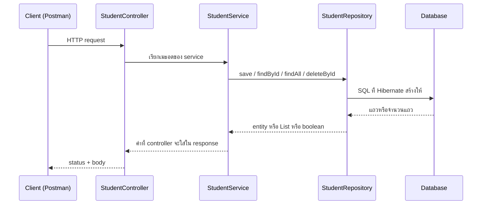
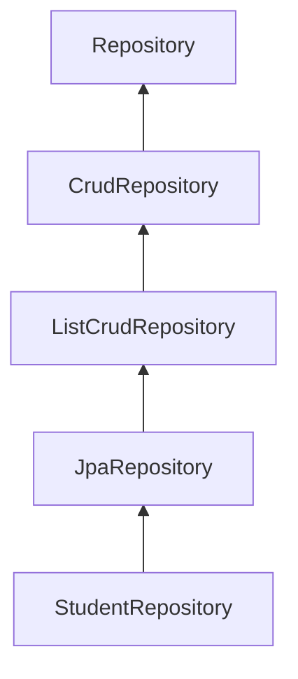
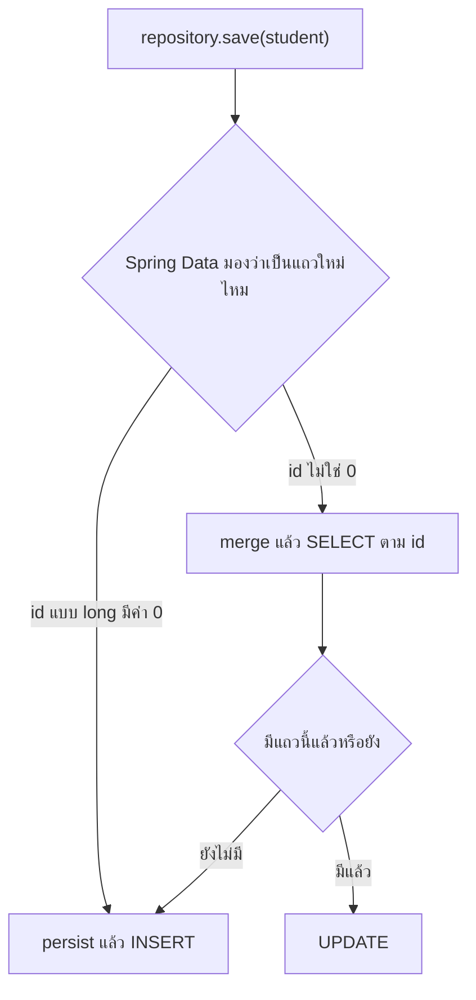
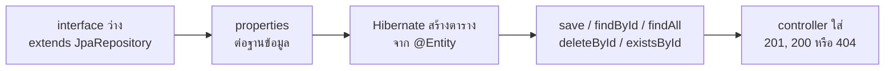

# #12 — CRUD ลงฐานข้อมูลด้วย Spring Data JPA

> **วิดีโอ:** [Spring Boot CRUD Project with MySQL | Spring JPA Methods | Spring Boot Full Course #12](https://youtu.be/uRr8_0x_HYw) — Coder Army, ~59 นาที
> **แหล่งที่ใช้สรุป:** ซับภาษาอังกฤษที่ YouTube สร้างอัตโนมัติ (en-US)
> **เวอร์ชันในโค้ด:** Spring Boot 4.1 + Java 21 (ใส่หมายเหตุไว้ทุกจุดที่ Spring Boot 3.x ต่างกัน)

ตอนที่แล้วทำโครงโปรเจกต์นักศึกษา (ผู้สอนเรียกว่า Cred) ไว้แล้ว มี controller, service, repository และ entity แต่ตอนสร้างยังไม่ได้เขียนลงฐานข้อมูล ตอนนี้ตอบคำถามต่อจากนั้น: **จะทำ read, update, delete ให้ครบ และให้ `save` เขียนลงฐานข้อมูลจริงได้อย่างไร โดยไม่ต้องเขียน SQL เอง**

ส่วนที่ติดป้าย `💡 เพิ่มเติม` คือของที่ผมเติมเอง ไม่ได้อยู่ในวิดีโอ ส่วนที่ติด `⚠️ แก้จากวิดีโอ` คือจุดที่วิดีโอพูดคลาดเคลื่อน

> 💡 **เพิ่มเติม — วิดีโอใช้ MySQL โน้ตนี้ใช้ H2:** ผู้สอนติดตั้ง **MySQL** จริง ให้เซิร์ฟเวอร์ฟังพอร์ต **3306** สร้าง database ผ่าน DBeaver แล้วต่อด้วย `jdbc:mysql://localhost:3306/...` โค้ดที่รันในโน้ตนี้เปลี่ยนมาใช้ **H2 in-memory** แทน เพื่อให้รันได้โดยไม่ต้องติดตั้ง MySQL ข้อมูลอยู่ในหน่วยความจำและหายเมื่อปิดแอป SQL ใน log จึงเป็นสำเนียงของ H2 ไม่ใช่ MySQL พฤติกรรมของ `save`, `findById`, `findAll`, `deleteById` และ `existsById` ยังเป็นของ Hibernate ชุดเดียวกัน

---

## สารบัญ

| เวลา | หัวข้อ |
|---|---|
| [0:00](https://youtu.be/uRr8_0x_HYw?t=0) | [1. ต่อจากโปรเจกต์เดิม](#1-ต่อจากโปรเจกต์เดิม) |
| [1:51](https://youtu.be/uRr8_0x_HYw?t=111) | [2. method ที่ใช้แทนการเขียน SQL](#2-method-ที่ใช้แทนการเขียน-sql) |
| [5:48](https://youtu.be/uRr8_0x_HYw?t=348) | [3. Repository เป็น interface](#3-repository-เป็น-interface) |
| [9:34](https://youtu.be/uRr8_0x_HYw?t=574) | [4. implementation ถูกสร้างตอน runtime](#4-implementation-ถูกสร้างตอน-runtime) |
| [12:01](https://youtu.be/uRr8_0x_HYw?t=721) | [5. `@Repository` บน interface นี้](#5-repository-บน-interface-นี้) |
| [14:26](https://youtu.be/uRr8_0x_HYw?t=866) | [6. ฐานข้อมูลในวิดีโอเป็น MySQL](#6-ฐานข้อมูลในวิดีโอเป็น-mysql) |
| [15:20](https://youtu.be/uRr8_0x_HYw?t=920) | [7. เอา exclude ออก แล้วตั้ง properties](#7-เอา-exclude-ออก-แล้วตั้ง-properties) |
| [22:27](https://youtu.be/uRr8_0x_HYw?t=1347) | [8. `ddl-auto=update` สร้างตารางจาก Entity](#8-ddl-autoupdate-สร้างตารางจาก-entity) |
| [25:55](https://youtu.be/uRr8_0x_HYw?t=1555) | [9. เปิด `show-sql` กับ `format_sql`](#9-เปิด-show-sql-กับ-format_sql) |
| [28:37](https://youtu.be/uRr8_0x_HYw?t=1717) | [10. Create: `POST` แล้ว `save`](#10-create-post-แล้ว-save) |
| [31:07](https://youtu.be/uRr8_0x_HYw?t=1867) | [11. Read ทีละแถว](#11-read-ทีละแถว) |
| [42:03](https://youtu.be/uRr8_0x_HYw?t=2523) | [12. Read ทั้งหมดด้วย `findAll`](#12-read-ทั้งหมดด้วย-findall) |
| [45:05](https://youtu.be/uRr8_0x_HYw?t=2705) | [13. Update: `PUT` แล้ว `save` อีกครั้ง](#13-update-put-แล้ว-save-อีกครั้ง) |
| [52:23](https://youtu.be/uRr8_0x_HYw?t=3143) | [14. Delete: `existsById` กับ `deleteById`](#14-delete-existsbyid-กับ-deletebyid) |
| [56:47](https://youtu.be/uRr8_0x_HYw?t=3407) | [15. ปูทาง Soft Delete](#15-ปูทาง-soft-delete) |
| — | [16. สรุปท้ายตอน](#16-สรุปท้ายตอน) |

---

## 1. ต่อจากโปรเจกต์เดิม

[▶ 0:00](https://youtu.be/uRr8_0x_HYw?t=0)

ผู้สอนบอกให้ดูตอนที่แล้วก่อน ตอนนั้นเดินทั้งเส้นทางสร้างข้อมูลแล้ว: request เข้า controller, ลง service, ถึง repository, entity คืออะไร และ JSON ถูกแปลงเป็น object อย่างไร แต่ยังไม่ได้เก็บลงฐานข้อมูล

วันนี้จะทำให้โปรเจกต์นั้นจบเป็น CRUD คือเพิ่ม endpoint สำหรับอ่าน แก้ไข และลบ แล้วให้ข้อมูลลงฐานข้อมูลจริง

โครงที่มีอยู่แล้วมีห้าส่วน

| ส่วน | บทบาทในโปรเจกต์นี้ |
|---|---|
| `Cred` main class | จุดสตาร์ทแอป ตอนที่แล้วพิมพ์ Hello World |
| `StudentController` | เปิด endpoint ของนักศึกษา prefix คือ `/api/students` |
| `Student` | entity แถวหนึ่งแถวในตาราง |
| `StudentRepository` | ชั้นที่คุยกับฐานข้อมูล |
| `StudentService` | ชั้นกลางที่ controller เรียก แล้วค่อยเรียก repository |

endpoint เดียวที่มีคือ `POST /api/students/create` และตอนที่แล้วยังไม่เรียกฐานข้อมูล

เขาลบ `System.out.println` ที่ใช้สาธิตทิ้ง เพราะไม่ใช่ส่วนของงานจริง แล้วให้ `create` คืน `null` ชั่วคราวเพื่อให้โค้ดคอมไพล์ได้ ก่อนจะเปลี่ยนไปเรียก `save`

ทิศทางของ request ทั้งตอนเป็นแบบนี้



---

## 2. method ที่ใช้แทนการเขียน SQL

[▶ 1:51](https://youtu.be/uRr8_0x_HYw?t=111)

repository คือชั้นที่เก็บและดึงข้อมูลจากฐานข้อมูล ผู้สอนย้ำว่าในชั้นนี้ไม่ควรเขียน SQL เอง ให้เรียก method ที่ framework มีให้

เขาเรียกชุดนี้ว่า Spring JPA และบอกว่า JPA ย่อมาจาก **Jakarta Persistence API** โค้ดเก่าของ Spring Boot จะเห็นคำว่า Java ใน import (`javax`) ปัจจุบันเปลี่ยนเป็น `jakarta` แล้ว

> 💡 **เพิ่มเติม:** การเปลี่ยน `javax.persistence` เป็น `jakarta.persistence` เกิดตอนขึ้น **Spring Boot 3** (Spring Framework 6) ทั้ง Boot 3 และ Boot 4 ใช้ `jakarta` เหมือนกัน จุดนี้ไม่ใช่ความต่างของ Boot 4 กับ Boot 3

> ⚠️ **แก้จากวิดีโอ:** method `save`, `findAll`, `findById`, `deleteById` และ `existsById` **ไม่ได้มาจาก Jakarta Persistence API** พวกมันเป็น method ของ **Spring Data** บน `CrudRepository` / `JpaRepository` ส่วน JPA คือ specification ของการ map object กับตาราง และ API อย่าง `EntityManager` Hibernate คือ implementation ของ JPA ที่ Boot ใช้เป็นค่า default ชื่อที่ตรงกับ module คือ **Spring Data JPA** ไม่ใช่ "Spring JPA"

method ที่เขาวาดบนกระดานมีหกตัว

| สิ่งที่อยากทำ | method | SQL ที่เขาเล่าว่าเกิดข้างใน |
|---|---|---|
| สร้างแถว | `save` | `INSERT INTO student ...` |
| อ่านทุกแถว | `findAll` | `SELECT * FROM student` |
| อ่านแถวเดียว | เขาเขียนว่า `find` | `SELECT * FROM student WHERE id = ...` |
| ลบตาม id | `deleteById` | ลบแถวที่ตรง id |
| แก้แถว | `save` ตัวเดิม | `UPDATE` ถ้าแถวนั้นมีอยู่แล้ว |
| ถามว่ามีแถวนี้ไหม | `existsById` | คืน `boolean` |

> ⚠️ **แก้จากวิดีโอ:** method สำหรับอ่านแถวเดียวไม่ชื่อ `find` ชื่อจริงคือ **`findById`** และมันไม่คืน `Student` ตรง ๆ แต่คืน `Optional<Student>` เขาใช้ชื่อ `findById` ถูกต้องตอนลงมือเขียนโค้ดช่วงหลังของคลิป

`save` ตัวเดียวรับทั้งการสร้างและการแก้ ไม่มี method ชื่อ update แยก เขาบอกว่าถ้าต้องสร้างแถวใหม่ JPA จะรัน `INSERT` ถ้าแถวนั้นมีอยู่แล้วจะรัน `UPDATE` และตัวที่ชี้ว่าเป็นแถวไหนคือ **id ซึ่งเป็น primary key** รายละเอียดว่า Hibernate ตัดสินอย่างไรเขาเลื่อนไปตอนที่คุยภายในของ Hibernate

`existsById` รับ id แล้วคืน `true` หรือ `false` ว่ามีแถวนั้นหรือไม่

นอกจากห้าตัวนี้ ตอนเขาเปิด `save` ใน IDE ยังเห็น `saveAll` กับ `saveAndFlush` เขาบอกว่า `saveAll` คือการบันทึกหลายแถวในครั้งเดียว (bulk) แล้วจะอธิบายทีหลัง ตอนนี้ใช้ `save` ตัวเดียว

---

## 3. Repository เป็น interface

[▶ 5:48](https://youtu.be/uRr8_0x_HYw?t=348)

เขาลบ method ที่เคยเขียนเองใน repository ทิ้ง แล้วเปลี่ยน class เป็น **interface** ที่ `extends JpaRepository`

type parameter ตัวแรกคือ entity ที่ repository นี้ดูแล คือ `Student` ตัวที่สองคือชนิดของ primary key เขาเปิด `Student.java` ให้ดูว่า id เป็น `long` จึงใส่ `Long`

```java
package com.example.cred.repository;

import com.example.cred.entity.Student;
import org.springframework.data.jpa.repository.JpaRepository;

public interface StudentRepository extends JpaRepository<Student, Long> {
}
```

> 💡 **เพิ่มเติม:** package `com.example.cred` เป็นของโน้ตนี้ ผู้สอนไม่ได้สะกด package บนจอออกเสียง type parameter ตัวที่สองต้องเป็น `Long` (คลาส) เพราะ generic ของ Java ใส่ primitive `long` ไม่ได้ ฟิลด์ใน entity ยังเป็น `long` ได้

ทำไมต้องเป็น interface เขาเทียบกับทางที่ไม่อยากเดิน ถ้าเขียนเป็น class แล้วมี method อย่าง `saveStudent` เขาต้องเขียน `INSERT` เองใน method นั้น เหมือนที่เขาต้องพิมพ์ `INSERT` ใน DBeaver เพื่อยัดแถวเข้าตาราง พอเปลี่ยนมา `extends JpaRepository` service จึงเลิกเรียก `saveStudent` แล้วเรียก `save(student)` แทน error ใน service หายไป เพราะ `save` มีอยู่บน interface ที่ extend มาแล้ว

ค่าที่ `save` คืนคือ entity ที่ถูกบันทึก เขาคืนค่านั้นกลับไปที่ controller

### ลำดับชั้นที่ `save` เดินขึ้นมา

[▶ 8:36](https://youtu.be/uRr8_0x_HYw?t=516)

เขาเจาะเข้าไปใน `save` แล้วไล่ interface

`JpaRepository` extends `ListCrudRepository` และ `ListCrudRepository` extends `CrudRepository` method `save` ประกาศไว้ที่ `CrudRepository` แล้วถูกสืบทอดมาจนถึง `StudentRepository` ดังนั้น service เรียก `studentRepository.save(...)` ได้โดยไม่ต้องประกาศ `save` ซ้ำใน interface ของเรา



> 💡 **เพิ่มเติม:** ใน Spring Data JPA 4.1.1 `JpaRepository` ยัง extends `ListPagingAndSortingRepository` และ `QueryByExampleExecutor` อีกสองตัว ผู้สอนไม่ได้เปิดสองตัวนี้ `ListCrudRepository` คือเหตุที่ `findAll` คืน `List<Student>` ไม่ใช่ `Iterable` แบบบน `CrudRepository`

---

## 4. implementation ถูกสร้างตอน runtime

[▶ 9:34](https://youtu.be/uRr8_0x_HYw?t=574)

ปกติถ้าเขียน interface ต้องมี class ที่ override method ให้ครบ `JpaRepository` มี `flush`, `saveAndFlush` และ method อีกหลายตัวที่ประกาศไว้แต่ไม่มีตัวทำงาน เขาไม่ได้ override สักตัว แต่แอปยังรันได้

คำอธิบายของเขาคือ Spring Data JPA สร้าง implementation ให้ตอน **runtime** เราแค่บอกว่าดูแล class ไหน และ primary key เป็นชนิดอะไร repository ของเขาจึงว่างเปล่า แต่ `studentRepository.save(...)` ยังบันทึกลงฐานข้อมูลได้โดยที่เราไม่ได้เขียน SQL และไม่ได้เขียนตัว method เอง เขาเรียกสิ่งนี้ว่าความมหัศจรรย์ของ Spring Data JPA

เขาเขียนตัวอย่างให้ดูว่าปกติคนจะทำอย่างไร แล้วบอกว่าไม่ต้องทำแบบนั้น

```java
public class StudentRepositoryImpl implements StudentRepository {
  @Override
  public Student save(Student student) {
    // เขียน INSERT เอง — โปรเจกต์นี้ไม่เดินทางนี้
    return null;
  }
}
```

class แบบนี้ Spring จะสร้างเป็น Bean แล้วเก็บใน IoC Container ได้ แต่ในโปรเจกต์นี้เราไม่เขียน `StudentRepositoryImpl` Spring Data JPA สร้างตัวทำงานให้ และจัดการ Bean ให้เอง

> 💡 **เพิ่มเติม:** ตัวที่อยู่ใน container ไม่ใช่ตัว interface (สร้าง instance จาก interface ตรง ๆ ไม่ได้) Spring Data สร้าง **JDK dynamic proxy** ที่ implement `StudentRepository` แล้วฝากงานให้คลาส `SimpleJpaRepository` ตอนสตาร์ท Boot จะสแกนเจอ interface นี้เอง log ของแอปในโน้ตนี้ขึ้นว่า `Found 1 JPA repository interface` ทั้งที่ไฟล์ไม่มี annotation

---

## 5. `@Repository` บน interface นี้

[▶ 12:01](https://youtu.be/uRr8_0x_HYw?t=721)

บน repository เดิมเขามี `@Component` เขาเปิด stereotype `@Repository` ให้ดู แล้วบอกว่าข้างในมันใช้ `@Component` อยู่ดี จะใส่ `@Component` หรือ `@Repository` ก็ได้ แต่ `@Repository` สื่อกับ Spring และกับคนอ่านโค้ดได้ชัดกว่าว่านี่คือชั้น repository เขาทำแบบเดียวกันกับ service และ controller ไปแล้ว (ใส่ stereotype ของชั้นนั้น)

บน interface นี้เขาบอกว่า **ไม่ต้องใส่ annotation ใด ๆ** แม้ใส่ `@Repository` ไว้ด้านบนก็ไม่เปลี่ยนอะไร เพราะ container ไม่ได้สร้าง object จากตัว interface

`@Repository` จะมีประโยชน์ตอนที่เราเขียน repository class ของเราเอง ซึ่งจะเกิดเมื่อ query ซับซ้อนจนไม่มี method ให้เรียก เช่นต้อง join หลายตาราง เขาเลื่อนเรื่องนั้นไปตอนหลัง

อีกประโยคหนึ่งเขาบอกว่า method ที่ยังไม่มีในชุดมาตรฐาน ไม่ได้แปลว่าต้องเขียน SQL ทุกตัว เราประกาศ method ของเราเองบน interface นี้ได้ แล้วจะทำให้ดู แต่ในคลิปนี้เขายังไม่ได้ประกาศ method เพิ่ม สิ่งนั้นไปอยู่ตอนหน้าซึ่งเกี่ยวกับ custom method

> 💡 **เพิ่มเติม:** `@Repository` บน **class** ที่เราเขียนเองยังมีผลเรื่องแปล exception ของฐานข้อมูลให้เป็น exception ของ Spring (`DataAccessException`) บน interface ของ Spring Data ตัวสแกน repository เป็นคนลงทะเบียน Bean การใส่หรือไม่ใส่ `@Repository` จึงไม่ใช่สิ่งที่ทำให้ `save` ใช้ได้

---

## 6. ฐานข้อมูลในวิดีโอเป็น MySQL

[▶ 14:26](https://youtu.be/uRr8_0x_HYw?t=866)

ก่อนยิง create เขาต้องต่อแอปกับฐานข้อมูล เขาลบตาราง `student` เก่าทิ้ง เพราะอยากให้ตารางถูกสร้างเองตอนสตาร์ทแอป ไม่ได้สร้างด้วยมือ

จากนั้นเขาทำสองชั้น ชั้นแรกคือตัวเซิร์ฟเวอร์ MySQL ชั้นที่สองคือ database (schema) ที่แอปจะต่อเข้าไป

### MySQL ฟังพอร์ต 3306

[▶ 16:31](https://youtu.be/uRr8_0x_HYw?t=991)

เขาเปิด DBeaver แล้วเลือก New Database Connection เป็น MySQL หน้าจอถาม host, ชื่อ database, username และ password พอร์ต default ของ MySQL คือ **3306** เทียบกับแอป Spring Boot ที่เขาบอกว่าฟัง **8080** ช่อง URL ใน DBeaver คือ JDBC URL ทั้งก้อน คัดลอกไปใส่ใน properties ได้

ในเทอร์มินัลเขาตรวจว่าติดตั้งแล้วด้วยการดูเวอร์ชัน แล้วต่อด้วย user `root` และรหัสผ่าน

```bash
mysql --version
mysql -u root -p
```

`-p` แปลว่าให้ถามรหัสผ่าน เขาพิมพ์รหัสของเครื่องตัวเองแล้วเข้าได้ จากนั้นรัน

```sql
SHOW DATABASES;
USE student_cred_db;
SHOW TABLES;
```

`SHOW TABLES` ว่าง เพราะเขาลบตารางเก่าไปแล้ว เขาออกจากไคลเอนต์เพราะอยากดูตารางผ่าน DBeaver ไม่ใช่พิมพ์ SQL ในเทอร์มินัล

รหัสที่เขาใช้บนเครื่องตัวเองคือ `123456` เขาบอกเองว่าใช้รหัสง่ายได้เพราะเป็น localhost ถ้านำขึ้น production จะไม่ใช้แบบนี้ ก่อนกด Finish ใน DBeaver เขาให้กด Test Connection ให้ขึ้นว่าต่อได้

> 💡 **เพิ่มเติม:** ซับอ่านชื่อ database ได้หลายแบบ (`StudentCredDB`, `student_crd_db`, `StudentCorrectDB`) โปรเจกต์ชื่อ Cred และมีจังหวะที่เขาพูดว่ามีขีดล่างคั่น โน้ตนี้ใช้ชื่อ **`student_cred_db`**

### สร้าง database เอง สร้างตารางไม่ต้อง

[▶ 19:13](https://youtu.be/uRr8_0x_HYw?t=1153)

ใน DBeaver เขาเปิดหน้าต่าง SQL แล้วรัน

```sql
CREATE DATABASE student_cred_db;
```

จากนั้น refresh ชื่อ database โผล่ขึ้นมา ข้างในมีโหนด Tables แต่ว่าง เขาถามว่าต้องเขียน `CREATE TABLE` เองไหม แล้วตอบว่าไม่ต้อง JPA จะสร้างตารางให้ สิ่งที่คนต้องสร้างเองมีแค่ database

> 💡 **เพิ่มเติม — H2 ไม่ต้องมีขั้นตอนนี้:** H2 แบบ `jdbc:h2:mem:student_cred_db` สร้าง database ในหน่วยความจำให้เองตอนแอปสตาร์ท ไม่มีพอร์ต 3306 ไม่มี user `root` และไม่มีคำสั่ง `CREATE DATABASE` ในโค้ดด้านล่างจึงไม่มีบล็อกนี้

---

## 7. เอา exclude ออก แล้วตั้ง properties

[▶ 15:20](https://youtu.be/uRr8_0x_HYw?t=920)

ใน main class เขาลบ Hello World ทิ้ง และเอา `exclude` ออกจาก `@SpringBootApplication`

ตอนที่แล้วยังไม่มี properties ของฐานข้อมูล ถ้าไม่ exclude การตั้งค่า datasource อัตโนมัติ แอปจะสตาร์ทไม่ขึ้น วันนี้เขาต้องการให้ Boot สร้าง datasource จึงเหลือแค่

```java
package com.example.cred;

import org.springframework.boot.SpringApplication;
import org.springframework.boot.autoconfigure.SpringBootApplication;

@SpringBootApplication
public class CredApplication {

  public static void main(String[] args) {
    SpringApplication.run(CredApplication.class, args);
  }
}
```

> ⚠️ **Boot 4 vs 3:** class ที่ตอนก่อนหน้าถูก exclude คือ `DataSourceAutoConfiguration` ใน Boot 4 มันอยู่ที่ `org.springframework.boot.jdbc.autoconfigure.DataSourceAutoConfiguration` (jar `spring-boot-jdbc-4.1.1`) ใน Boot 3.5 อยู่ที่ `org.springframework.boot.autoconfigure.jdbc.DataSourceAutoConfiguration` (jar `spring-boot-autoconfigure-3.5.4`) ถ้าคัดลอก `exclude` จากบทเรียน Boot 3 มาใส่ Boot 4 ต้องเปลี่ยน package เป็นผลจาก modularization ที่ root package ของแต่ละ module เป็น `org.springframework.boot.<module>` ([Spring Boot 4.0 Migration Guide](https://github.com/spring-projects/spring-boot/wiki/Spring-Boot-4.0-Migration-Guide))

### สี่ค่าที่เขาบอกว่าขาดไม่ได้

[▶ 20:22](https://youtu.be/uRr8_0x_HYw?t=1222)

ค่าพวกนี้อยู่ใน `application.properties` เป็นคู่ key กับ value เขาอธิบายว่าตอน Boot สร้าง datasource (สิ่งที่ตอนที่แล้วตั้งใจ exclude ไว้) มันต้องรู้ URL เพื่อต่อเข้าไป

สิ่งที่เขาพิมพ์ในวิดีโอมีสี่บรรทัดนี้

```properties
spring.datasource.url=jdbc:mysql://localhost:3306/student_cred_db
spring.datasource.username=root
spring.datasource.password=123456
spring.jpa.hibernate.ddl-auto=update
```

URL บอกว่าต่อผ่าน JDBC ไปที่ MySQL บน `localhost` พอร์ต `3306` แล้วเข้า database `student_cred_db` ถ้าเซิร์ฟเวอร์ไม่อยู่ที่เครื่องตัวเอง ให้เปลี่ยน host username คือ `root` ตามที่ติดตั้ง MySQL สร้างให้ รหัสผ่านคือค่าที่ตั้งตอนติดตั้ง

> 💡 **เพิ่มเติม — บล็อกด้านบนคือของในวิดีโอ ไม่ใช่โค้ดที่โน้ตนี้รัน** วิดีโอใช้ MySQL ตาม URL `jdbc:mysql://...` โปรเจกต์ตัวอย่างของโน้ตนี้ใช้ H2 และฟังพอร์ต **9012** ไม่ใช่ 8080 ของวิดีโอ เพื่อไม่ให้ชนกับตัวอย่างตอนอื่น

`application.properties` ที่รันจริง

```properties
server.port=9012

spring.datasource.url=jdbc:h2:mem:student_cred_db
spring.datasource.driver-class-name=org.h2.Driver
spring.datasource.username=sa
spring.datasource.password=

spring.jpa.hibernate.ddl-auto=update
spring.jpa.show-sql=true
spring.jpa.properties.hibernate.format_sql=true
```

H2 ที่ Boot 4.1.1 จัดการให้คือเวอร์ชัน 2.4.240 user ค่า default ของ H2 คือ `sa` และรหัสว่าง dependency ที่ทำให้มีทั้งเว็บ, JPA และ H2 คือ

```xml
<parent>
  <groupId>org.springframework.boot</groupId>
  <artifactId>spring-boot-starter-parent</artifactId>
  <version>4.1.1</version>
</parent>

<properties>
  <java.version>21</java.version>
</properties>

<dependencies>
  <dependency>
    <groupId>org.springframework.boot</groupId>
    <artifactId>spring-boot-starter-webmvc</artifactId>
  </dependency>
  <dependency>
    <groupId>org.springframework.boot</groupId>
    <artifactId>spring-boot-starter-data-jpa</artifactId>
  </dependency>
  <dependency>
    <groupId>com.h2database</groupId>
    <artifactId>h2</artifactId>
    <scope>runtime</scope>
  </dependency>
</dependencies>
```

> ⚠️ **Boot 4 vs 3:** starter ของเว็บใน Boot 4 คือ `spring-boot-starter-webmvc` ชื่อเดิม `spring-boot-starter-web` ยังใช้ได้แต่ถูก deprecate แล้ว ใน Boot 3.x ใช้ `spring-boot-starter-web` ส่วน `spring-boot-starter-data-jpa` **ชื่อเดิม** ทั้ง Boot 3 และ Boot 4 ([Spring Boot 4.0 Migration Guide](https://github.com/spring-projects/spring-boot/wiki/Spring-Boot-4.0-Migration-Guide) ตาราง starter)

> 💡 **เพิ่มเติม:** วิดีโอใช้ MySQL จึงต้องมี driver `com.mysql:mysql-connector-j` บน classpath โน้ตนี้ใส่ `com.h2database:h2` แทน ไม่ได้ใส่ connector ของ MySQL

---

## 8. `ddl-auto=update` สร้างตารางจาก Entity

[▶ 22:27](https://youtu.be/uRr8_0x_HYw?t=1347)

ค่าที่สี่คือ `spring.jpa.hibernate.ddl-auto=update` เขาบอกว่านี่คือการสั่ง Hibernate ซึ่งเป็นตัวที่ทำ JPA ให้ข้างใน ให้สร้างตารางจาก entity

> ⚠️ **แก้จากวิดีโอ:** ทิศทางเป็น **Hibernate implement JPA** ไม่ใช่ JPA implement Hibernate ประโยคในคลิปที่ว่า "JPA implements Hibernate internally" สลับด้าน specification กับ implementation

entity `Student` ที่เขาบอกว่าไม่ได้แก้ในตอนนี้ มีฟิลด์ id, name, age, email, roll number และ subject ชื่อ class กลายเป็นชื่อตาราง แต่ละฟิลด์กลายเป็นคอลัมน์ `@Id` บน id แปลว่าคอลัมน์นั้นเป็น primary key

> ⚠️ **แก้จากวิดีโอ:** เขาอ่าน type ของคอลัมน์ id จาก log ว่า `integer` ฟิลด์ Java ที่เขาบอกว่าเป็น `long` ถูก Hibernate map เป็น **`bigint`** ไม่ใช่ integer log ของ H2 ด้านล่างยืนยันว่าเป็น `bigint not null`

> ⚠️ **แก้จากวิดีโอ:** เขาอธิบาย `update` ว่า "โครงสร้างเปลี่ยนเมื่อไร ก็สร้างตารางใหม่ให้" ความหมายนั้นไม่ตรงกับค่านี้ `update` สร้างตารางที่ยังไม่มี และเติมคอลัมน์ที่ entity มีแต่ตารางยังไม่มี มันไม่ drop ตารางเดิมทิ้งแล้วสร้างใหม่ และไม่ลบคอลัมน์ที่เอาออกจาก entity แล้ว คลิปนี้เองก็สาธิตด้านที่ถูกทีหลัง พอตารางมีอยู่แล้ว การสตาร์ทซ้ำไม่ยิง `CREATE TABLE` อีก ค่าอื่นที่เขาเอ่ยชื่อคือ `none` กับ `create` แล้วบอกว่าจะอธิบายให้ครบตอนเรียน Hibernate

entity ที่รันในโน้ตนี้ ไม่มี `@GeneratedValue` เพราะในคลิป client เป็นคนส่ง id มาเอง และ `INSERT` ใส่ค่า id ลงไปด้วย

> 💡 **เพิ่มเติม:** ชนิดของ `age` กับ `rollNumber` และสตริงของ email ไม่ถูกอ่านออกเสียง โน้ตนี้ใช้ `int` สำหรับอายุกับเลขประจำตัว และ `String` สำหรับชื่อ อีเมล และวิชา ตัวเข้าถึง `get`/`set` ต้องมี เพราะตอน update เขาเรียก `setName`, `setAge`, `setEmail`, `setRollNumber`, `setSubject`

```java
package com.example.cred.entity;

import jakarta.persistence.Entity;
import jakarta.persistence.Id;

@Entity
public class Student {

  @Id
  private long id;

  private String name;

  private int age;

  private String email;

  private int rollNumber;

  private String subject;

  public long getId() {
    return id;
  }

  public void setId(long id) {
    this.id = id;
  }

  public String getName() {
    return name;
  }

  public void setName(String name) {
    this.name = name;
  }

  public int getAge() {
    return age;
  }

  public void setAge(int age) {
    this.age = age;
  }

  public String getEmail() {
    return email;
  }

  public void setEmail(String email) {
    this.email = email;
  }

  public int getRollNumber() {
    return rollNumber;
  }

  public void setRollNumber(int rollNumber) {
    this.rollNumber = rollNumber;
  }

  public String getSubject() {
    return subject;
  }

  public void setSubject(String subject) {
    this.subject = subject;
  }
}
```

พอสตาร์ทแอป ตารางถูกสร้างก่อนที่ Tomcat จะรับ request log ส่วนที่เกี่ยวกับฐานข้อมูลของโน้ตนี้เป็นแบบนี้

```text
Database JDBC URL [jdbc:h2:mem:student_cred_db]
Database driver: H2 JDBC Driver
Database dialect: H2Dialect
Database version: 2.4.240

Hibernate:
    create table student (
        id bigint not null,
        age integer not null,
        email varchar(255),
        name varchar(255),
        roll_number integer not null,
        subject varchar(255),
        primary key (id)
    )

Tomcat started on port 9012 (http) with context path '/'
Started CredApplication in 1.887 seconds
```

ในวิดีโอ บรรทัด driver กับ dialect เป็น MySQL Connector และ MySQL dialect เขาบอกว่าเป็นรายละเอียดภายใน จะคุยทีหลัง แล้ว Tomcat สตาร์ท (เขาพูดพอร์ตเพี้ยนเป็น 880 ในประโยคหนึ่ง ก่อนหน้านี้เขาบอกว่าแอปฟัง 8080) พอ refresh ใน DBeaver ตารางโผล่มาเอง คอลัมน์ครบ และยังไม่มีแถว

> 💡 **เพิ่มเติม:** ชื่อตารางใน log เป็น `student` และคอลัมน์เลขประจำตัวเป็น `roll_number` เพราะ Spring Boot ใส่ naming strategy ที่แปลง camelCase เป็น snake_case แล้วทำให้เป็นตัวพิมพ์เล็ก เขาออกเสียงชื่อตารางว่า Student และคอลัมน์ว่า Roll Number ซึ่งคือชื่อที่คนอ่าน ไม่ใช่ตัวพิมพ์ใน SQL ทุกตัว

> ⚠️ **Boot 4 vs 3:** log นี้เป็น Hibernate ORM **7.4.5.Final** และ Tomcat **11.0.24** ตาม BOM ของ Boot 4.1.1 (`hibernate.version` และ `tomcat.version` ใน `spring-boot-dependencies-4.1.1.pom`) Boot 3.5.16 ใช้ Hibernate **6.6.53.Final** และ Tomcat **10.1.55** บรรทัด Tomcat ใน Boot 4 มาจาก `org.springframework.boot.tomcat.TomcatWebServer`

> 💡 **เพิ่มเติม:** log ยังมีคำเตือนว่า `spring.jpa.open-in-view` เปิดอยู่เป็นค่า default วิดีโอไม่ได้พูดถึงค่านี้ มันทำให้ persistence context ยังไม่ปิดจน request จบ จึงยิง query ระหว่างเรนเดอร์ view ได้ ถ้าอยากปิดคำเตือนให้ตั้ง `spring.jpa.open-in-view=false`

ช่วงที่เขาเล่าเส้นทางของ `POST /api/students/create` ก่อนกดรัน เขาลำดับไว้แบบนี้ controller เรียก `createStudent` ของ service, service เรียก `save` ของ repository, `save` เป็น method บน interface ที่ JPA ทำให้มีตัวทำงานตอน runtime, ค่าที่คืนเป็น `Student`, controller ใส่ status **Created** (201) และใส่ student เป็น body แล้ว **Jackson** แปลง object เป็น JSON

> ⚠️ **Boot 4 vs 3 — Jackson:** Boot 4 ใช้ **Jackson 3** เป็นค่า default (package `tools.jackson`) ส่วน Boot 3 ใช้ Jackson 2 (`com.fasterxml.jackson`) annotation อย่าง `@JsonProperty` ยังอยู่ที่ `com.fasterxml.jackson.annotation` โค้ดตอนนี้ไม่ได้ import `ObjectMapper` เอง จึงไม่ต้องแก้ แต่ถ้าจะสร้าง mapper เอง Boot 4 ใช้ `JsonMapper` ([Spring Boot 4.0 Migration Guide](https://github.com/spring-projects/spring-boot/wiki/Spring-Boot-4.0-Migration-Guide) หัวข้อ Upgrading Jackson)

---

## 9. เปิด `show-sql` กับ `format_sql`

[▶ 25:55](https://youtu.be/uRr8_0x_HYw?t=1555)

ตารางถูกสร้างแล้ว แต่เขาไม่เห็น SQL ใน log จึงเพิ่ม

```properties
spring.jpa.show-sql=true
```

ค่า default คือ `false` เขาหยุดแอปแล้วรันใหม่ และยังไม่เห็น `CREATE TABLE` เพราะตารางมีอยู่แล้ว เขาจึงลบตารางทิ้งแล้วรันอีกรอบ คราวนี้ log มี `CREATE TABLE` ทั้งก้อน รวม primary key ของ id

จากนั้นเขาอยากให้ SQL อ่านง่าย จึงเพิ่มคีย์ที่ชื่อยาว

```properties
spring.jpa.properties.hibernate.format_sql=true
```

เขาบอกว่าไม่ต้องท่องคีย์พวกนี้ รู้แค่ทำอะไรได้ แล้วคัดลอกมาใช้ เขาลบตารางอีกรอบ รันใหม่ แล้วอ่าน SQL ที่จัดบรรทัดแล้ว ข้อมูลใน SQL นั้นมาจาก `Student.java` ฟิลด์ที่มี `@Id` เป็น primary key ฟิลด์ที่เหลือเป็นคอลัมน์

> 💡 **เพิ่มเติม:** กับ H2 in-memory ทุกครั้งที่สตาร์ทคือ database ใหม่ จึงเห็น `CREATE TABLE` ทุกรอบ ไม่ต้องลบตารางเองแบบที่เขาทำกับ MySQL สอง property นี้เปิดไว้ในไฟล์ properties ของโน้ตแล้ว SQL ในหัวข้อถัดไปคือผลจากสองค่านี้นั่นเอง

---

## 10. Create: `POST` แล้ว `save`

[▶ 28:37](https://youtu.be/uRr8_0x_HYw?t=1717)

เขากลับไปที่ Postman แล้วยิงแถวแรก ชื่อ Aditya มีอีเมล อายุ เลขประจำตัว และวิชา Spring Framework พอกดส่ง ได้ **201 Created** และ body คือ object ที่เพิ่งเก็บลงฐานข้อมูล

service มีแค่การส่งต่อให้ `save`

```java
public Student createStudent(Student student) {
  return studentRepository.save(student);
}
```

controller ใส่ status 201

```java
@PostMapping("/create")
public ResponseEntity<Student> createStudent(@RequestBody Student student) {
  Student saved = studentService.createStudent(student);
  return ResponseEntity.status(HttpStatus.CREATED).body(saved);
}
```

ใน log เขาเห็น **`SELECT` ก่อน แล้วค่อย `INSERT`** เขาอธิบายว่า `SELECT` มีไว้ดูว่า id ที่ส่งมายังมีอยู่หรือไม่ ถ้ายังไม่มีจึง `INSERT` เครื่องหมาย `?` คือพารามิเตอร์ ค่าจริงถูกใส่จากฟิลด์ของ object `Student` ที่ Jackson สร้างจาก JSON

แถวที่สองเขาเปลี่ยนเป็น Rohit อายุ 29 เลขประจำตัว 102 วิชาที่เขาออกเสียงใกล้กับ MERN แล้วได้แถวที่สองในตาราง log เป็น `SELECT` แล้ว `INSERT` อีกครั้ง เขาใช้จังหวะนี้ย้ำว่า `save` ทำได้ทั้ง insert และ update ถ้าแถวนั้นมีอยู่แล้วมันจะไม่ insert ซ้ำ แต่จะ update และทางดูคืออ่าน log

ผลจากโน้ตนี้ ยิงสองครั้งไปที่ `http://localhost:9012`

```http
POST /api/students/create HTTP/1.1
Content-Type: application/json

{"id":1,"name":"Aditya","email":"aditya@example.com","age":21,"rollNumber":101,"subject":"Spring Framework"}
```

```http
HTTP/1.1 201
Content-Type: application/json

{"age":21,"email":"aditya@example.com","id":1,"name":"Aditya","rollNumber":101,"subject":"Spring Framework"}
```

แถวของ Rohit ได้ 201 เช่นกัน body คือ `{"age":29,"email":"rohit@example.com","id":2,"name":"Rohit","rollNumber":102,"subject":"MERN"}`

> 💡 **เพิ่มเติม:** อีเมลทั้งสองแถวและอายุของ Aditya ไม่ถูกอ่านออกเสียง ตัวเลข 21, 101 และอีเมล `@example.com` เป็นข้อมูลประกอบของโน้ต อายุ 29 เลข 102 และวิชาของ Rohit กับวิชา Spring Framework ของ Aditya มาตรงกับที่เขาพูด

SQL ของแถวแรกใน log จริง

```text
Hibernate:
    select
        s1_0.id,
        s1_0.age,
        s1_0.email,
        s1_0.name,
        s1_0.roll_number,
        s1_0.subject
    from
        student s1_0
    where
        s1_0.id=?
Hibernate:
    insert
    into
        student
        (age, email, name, roll_number, subject, id)
    values
        (?, ?, ?, ?, ?, ?)
```



> 💡 **เพิ่มเติม:** กิ่ง `id == 0` ไม่ได้ถูกทดลองในคลิป มันมาจาก `SimpleJpaRepository.save` ใน Spring Data JPA 4.1.1 ถ้า `isNew` เป็นจริงจะเรียก `EntityManager.persist` ถ้าไม่จริงจะเรียก `merge` สำหรับ id ที่เป็น primitive ตัวเลข ค่า `0` ถือว่าใหม่ นอกนั้นถือว่าไม่ใหม่ คลิปส่ง id เป็น 1 กับ 2 จึงเดินกิ่ง `merge` ทุกครั้ง และเลยเห็น `SELECT` ก่อน `INSERT` เสมอ เขาบอกไว้แล้วว่ากลไกนี้จะอธิบายละเอียดตอนเรียน Hibernate

---

## 11. Read ทีละแถว

[▶ 31:07](https://youtu.be/uRr8_0x_HYw?t=1867)

endpoint ที่เขาออกแบบไว้สำหรับอ่านแถวเดียวคือ `/api/students/get/{id}` method คือ `GET` คืน `ResponseEntity<Student>` และรับ id เข้ามา

เขาเริ่มจาก `@GetMapping` แล้วเตือนว่าห้ามเขียน id ตายตัวใน path ไม่งั้นจะอ่านได้แถวเดียวตลอดไป

### Path variable กับ query parameter

[▶ 32:54](https://youtu.be/uRr8_0x_HYw?t=1974)

มีสองทางที่จะส่ง id มาใน `GET`

| แบบ | หน้าตาใน URL | ในคลิป |
|---|---|---|
| Path variable | `/api/students/get/1` | ใช้ทางนี้ |
| Query parameter | `/api/students/get?id=1&name=Aditya` | เปิดให้ดูใน Postman แล้วบอกว่าจะลงลึกทีหลัง |

ใน Postman ช่อง Params จะเติม `id=1` ให้เองเมื่อพิมพ์ query string และใส่ได้หลายค่า เช่น `name=Aditya` request แบบ `GET` ไม่มี body มีแค่ URL, method และ header

ทางที่เขาลงมือคือ path variable path ใน annotation ต้องมี `{id}` และพารามิเตอร์ต้องมี `@PathVariable`

```java
@GetMapping("/get/{id}")
public ResponseEntity<Student> getStudent(@PathVariable long id) {
  Student studentResponse = studentService.getStudent(id);
  if (studentResponse == null) {
    return ResponseEntity.notFound().build();
  }
  return ResponseEntity.ok(studentResponse);
}
```

`{id}` กับชื่อพารามิเตอร์ `id` ตรงกัน Spring จึงดึงช่วงนั้นของ path มาใส่ใน `long` รูปแบบสั้นของ response สำเร็จที่เขาพูดถึงคือ `ResponseEntity.ok(...)` ซึ่งเท่ากับ status 200 พร้อม body รูปแบบยาวคือ `ResponseEntity.status(HttpStatus.OK).body(...)`

### `findById` คืน `Optional`

[▶ 36:15](https://youtu.be/uRr8_0x_HYw?t=2175)

ใน service เขาเรียก `findById` แล้วคอมไพเลอร์ฟ้อง เพราะเขาพยายามรับเป็น `Student` ทั้งที่ method คืนอย่างอื่น

`findById` มีสองกรณี แถวมีอยู่ หรือไม่มี ตอนนั้นในฐานข้อมูลมีแค่ Aditya กับ Rohit ที่ id 1 กับ 2 ถ้าขอ id 3 จะไม่เจอ เพื่อไม่ให้คนเรียกได้ `null` แล้วไปเกิด `NullPointerException` method นี้จึงคืน **`Optional<Student>`** เขาอธิบายว่า Optional คือกล่องที่อาจมีค่าหรืออาจไม่มี ไม่ได้คืน `null` ตรง ๆ

```java
public Student getStudent(long id) {
  Optional<Student> studentResponse = studentRepository.findById(id);
  if (studentResponse.isPresent()) {
    return studentResponse.get();
  }
  return null;
}
```

`isPresent` บอกว่าในกล่องมีค่าไหม `get` ดึง `Student` ออกจากกล่อง ถ้าไม่มีเขาคืน `null` ให้ controller ไปตัดสินใจต่อ

### 404 มีสองความหมายในคลิปนี้

[▶ 38:56](https://youtu.be/uRr8_0x_HYw?t=2336)

รอบแรกเขายิง `GET /api/students/get/1` แล้วได้ **404** เพราะบน `@GetMapping` ยังเป็น `/get` ไม่มี `{id}` path `/get/1` จึงไม่ตรง mapping ใดเลย เขาใส่ปีกกาให้เป็น `/get/{id}` แล้วสตาร์ทใหม่

รอบสอง `GET /get/1` ได้ทั้งก้อนของ Aditya และ `GET /get/2` ได้ Rohit log เป็น `SELECT ... WHERE id = ?`

[▶ 40:17](https://youtu.be/uRr8_0x_HYw?t=2417)

`GET /get/3` ยังได้ **200** ทั้งที่ไม่มีแถว เพราะ service คืน `null` แล้ว controller ยังใส่ null นั้นเป็น body ของ 200 เขาบอกว่าแบบนี้ผิด ควรเป็น **404 Not Found**

เขาเขียนเช็ก `studentResponse == null` แล้วคืน `ResponseEntity.status(HttpStatus.NOT_FOUND).body(null)` จากนั้นเปลี่ยนเป็นแบบที่สั้นกว่า และได้ผลเดียวกัน

```java
return ResponseEntity.notFound().build();
```

หลังรีสตาร์ท id 3 ได้ 404 และไม่มี body ถ้าเจอแถวได้ 200

ผลจากโน้ตนี้

```http
HTTP/1.1 200
Content-Type: application/json

{"age":21,"email":"aditya@example.com","id":1,"name":"Aditya","rollNumber":101,"subject":"Spring Framework"}
```

```http
HTTP/1.1 404
Content-Length: 0
```

`GET /api/students/get` โดยไม่มี id ได้ 404 อีกแบบหนึ่ง เป็น JSON error ของ Boot (`"path":"/api/students/get"`) เพราะไม่มี mapping ที่ตรง ไม่ใช่ 404 ที่ `notFound().build()` สร้าง

---

## 12. Read ทั้งหมดด้วย `findAll`

[▶ 42:03](https://youtu.be/uRr8_0x_HYw?t=2523)

endpoint คือ `GET /api/students/getAll` ไม่มี path variable และไม่มี body เพราะต้องการทุกแถว ค่าที่คืนไม่ใช่ `Student` ตัวเดียว แต่เป็น `List<Student>`

เขาเช็กใน controller ว่า list ว่างหรือไม่ ถ้าว่างคืน 404 ถ้ามีข้อมูลคืนทั้ง list ด้วย 200

```java
@GetMapping("/getAll")
public ResponseEntity<List<Student>> getAllStudents() {
  List<Student> students = studentService.getAllStudents();
  if (students.isEmpty()) {
    return ResponseEntity.notFound().build();
  }
  return ResponseEntity.ok(students);
}
```

```java
public List<Student> getAllStudents() {
  return studentRepository.findAll();
}
```

ใน Postman เขากดส่งแล้วได้ทั้ง Aditya และ Rohit

ผลตอนมีสองแถว

```http
HTTP/1.1 200
Content-Type: application/json

[{"age":21,"email":"aditya@example.com","id":1,"name":"Aditya","rollNumber":101,"subject":"Spring Framework"},{"age":29,"email":"rohit@example.com","id":2,"name":"Rohit","rollNumber":102,"subject":"MERN"}]
```

SQL คือ `select ... from student s1_0` โดยไม่มี `WHERE`

หลังลบทุกแถวแล้วเรียก endpoint เดิม โน้ตนี้ได้

```http
HTTP/1.1 404
Content-Length: 0
```

> 💡 **เพิ่มเติม:** การตอบ 404 เมื่อ list ว่างเป็นทางที่เขาเลือกในคลิป API จำนวนมากตอบ 200 พร้อม `[ ]` แทน เพราะการค้นทั้งชุดสำเร็จ เพียงแต่ยังไม่มีสมาชิก

---

## 13. Update: `PUT` แล้ว `save` อีกครั้ง

[▶ 45:05](https://youtu.be/uRr8_0x_HYw?t=2705)

URL คือ `/api/students/update/{id}` เขาคัดลอกเมธอด get มาแก้ `@GetMapping` เป็น `@PutMapping` และ path จาก `/get/{id}` เป็น `/update/{id}` id ยังเป็น path variable สิ่งที่คืนคือ student หลังแก้ ถ้า service คืน `null` ให้ตอบ 404

`PUT` มี body เขาเปลี่ยนตัวอย่างของ Rohit จากอายุ 29 เป็น 28 และเลขประจำตัวจาก 102 เป็น 105 client จึงต้องส่ง JSON มาด้วย อ่าน body ด้วย `@RequestBody Student`

ใน service เขา `findById` ก่อน ถ้า `Optional` ว่าง (`isEmpty` ซึ่งเช็กว่าค่าข้างในเป็น `null`) ให้คืน `null` เพื่อให้ controller ตอบ 404 เขาบอกว่าเมธอด `findById` ตัวนี้ถูกใช้ทั้งตอน get และตอน put และทางที่สะอาดกว่าคือส่ง `Optional` กลับไปให้ controller เช็กเอง จะได้ไม่ต้องคืน `null` แล้วเช็กซ้ำ แต่ตอนนี้เขาตั้งใจเขียนให้ง่าย แล้วค่อยปรับทีหลัง

ถ้ามีแถว เขาดึง entity ออกมา เรียกว่า `studentToSave` แล้วก็อปห้าฟิลด์จาก request ทับลงไป คือ name, roll number, subject, email และ age **เขาไม่ set id** เพราะ id ควรคงค่าเดิมหลังสร้างแล้ว เขาถือว่านี่เป็นแนวปฏิบัติที่ดี จากนั้นเรียก `save` แล้วคืนค่าที่ `save` ให้กลับไปที่ controller

รอบแรกเขากดส่งแล้วได้ 404 เพราะสะกด path ของ update ผิด พอแก้แล้วส่งใหม่ DBeaver แสดงอายุ 28 กับเลข 105 และ log มียิง `UPDATE`

ผลจากโน้ตนี้

```http
PUT /api/students/update/2 HTTP/1.1
Content-Type: application/json

{"name":"Rohit","email":"rohit@example.com","age":28,"rollNumber":105,"subject":"MERN"}
```

```http
HTTP/1.1 200
Content-Type: application/json

{"age":28,"email":"rohit@example.com","id":2,"name":"Rohit","rollNumber":105,"subject":"MERN"}
```

```text
Hibernate:
    update
        student
    set
        age=?,
        email=?,
        name=?,
        roll_number=?,
        subject=?
    where
        id=?
```

`PUT /api/students/update/3` ได้ `HTTP/1.1 404` และ `Content-Length: 0`

> 💡 **เพิ่มเติม:** เมธอดนี้ก็อปทุกฟิลด์จาก body ทับของเดิม ถ้า client ไม่ส่งฟิลด์สตริงมา Jackson จะได้ `null` และถ้าไม่ส่ง `age` หรือ `rollNumber` ซึ่งเป็น `int` จะได้ `0` แล้ว `save` จะเขียนค่านั้นลงแถว การทดลองในคลิปส่งฟิลด์ครบ จึงไม่เห็นอาการนี้

---

## 14. Delete: `existsById` กับ `deleteById`

[▶ 52:23](https://youtu.be/uRr8_0x_HYw?t=3143)

path คือ `/api/students/delete/{id}` annotation คือ `@DeleteMapping` เขาวางไว้ก่อนว่าจะคืน `boolean` ว่าลบสำเร็จหรือไม่ แล้วเปลี่ยนใจให้ body เป็นสตริง `recordDeleted` จะได้อ่านง่ายกว่า true/false

service ยังคืน `boolean` ชื่อ `isDeleted` ถ้าเป็น `false` controller ตอบ `ResponseEntity.notFound().build()` ถ้าเป็น `true` ตอบ `ResponseEntity.ok("recordDeleted")` ชนิดของ `ResponseEntity` จึงเป็น `ResponseEntity<String>` ไม่ใช่ `ResponseEntity<Boolean>`

ใน service เขาไม่ลบทันที เขาเรียก `existsById` ก่อน ถ้าไม่มีแถวคืน `false` ซึ่งกลายเป็น 404 ที่ controller ถ้ามี เขาเรียก `deleteById(id)` method นี้คืน `void` เขาจึงไม่รับค่า แล้วคืน `true`

เขาลองลบ id 3 ซึ่งไม่มี ได้ 404 และไม่มี body จากนั้นลบ id 2 ซึ่งเป็น Rohit ได้ข้อความว่าลบแล้ว พอ refresh ฐานข้อมูลแถวของ Rohit หาย

ผลจากโน้ตนี้

```http
HTTP/1.1 404
Content-Length: 0
```

สำหรับ `DELETE /api/students/delete/3` และสำหรับแถวที่มีอยู่

```http
HTTP/1.1 200
Content-Type: text/plain;charset=UTF-8

recordDeleted
```

`existsById` ไม่ได้โหลดทั้งแถว log เป็น

```text
Hibernate:
    select
        count(*)
    from
        student s1_0
    where
        s1_0.id=?
```

> 💡 **เพิ่มเติม:** `deleteById` ใน `SimpleJpaRepository` เรียก `findById` แล้วค่อย `delete` เพื่อให้ lifecycle ของ entity ทำงาน log จริงของโน้ตนี้จึงมี `SELECT` ทั้งแถวตามหลัง `count(*)` อีกหนึ่งครั้ง แล้วค่อย `DELETE FROM student WHERE id = ?` เขาไม่ได้ไล่ SQL ของ delete ในคลิป เขาเช็กที่ตารางว่าแถวหาย สตริงที่คืนออกมาเป็น `text/plain` เพราะ Spring ใช้ `StringHttpMessageConverter` กับค่าที่เป็น `String` ไม่ได้หุ้มด้วยเครื่องหมายคำพูดแบบ JSON

เขาปิดท้ายว่า CRUD ครบแล้ว create, อ่านทีละแถว, อ่านทั้งหมด, แก้ทีละแถว, ลบทีละแถว ลบทั้งหมดทำได้ในทำนองเดียวกับ `findAll` แต่เขาไม่ทำให้ และบอกว่า update หลายแถวหรือลบหลายแถวก็เติมทีหลังได้

### ไฟล์ service และ controller ที่รัน

> 💡 **เพิ่มเติม:** ฟิลด์ `studentService` กับ `studentRepository` มีอยู่แล้วตั้งแต่ตอนที่แล้ว คลิปนี้ไม่ได้แสดงว่า inject อย่างไร โน้ตนี้ใช้ constructor injection

```java
package com.example.cred.service;

import com.example.cred.entity.Student;
import com.example.cred.repository.StudentRepository;
import java.util.List;
import java.util.Optional;
import org.springframework.stereotype.Service;

@Service
public class StudentService {

  private final StudentRepository studentRepository;

  public StudentService(StudentRepository studentRepository) {
    this.studentRepository = studentRepository;
  }

  public Student createStudent(Student student) {
    return studentRepository.save(student);
  }

  public Student getStudent(long id) {
    Optional<Student> studentResponse = studentRepository.findById(id);
    if (studentResponse.isPresent()) {
      return studentResponse.get();
    }
    return null;
  }

  public List<Student> getAllStudents() {
    return studentRepository.findAll();
  }

  public Student updateStudent(long id, Student studentRequest) {
    Optional<Student> existingStudent = studentRepository.findById(id);
    if (existingStudent.isEmpty()) {
      return null;
    }
    Student studentToSave = existingStudent.get();
    studentToSave.setName(studentRequest.getName());
    studentToSave.setRollNumber(studentRequest.getRollNumber());
    studentToSave.setSubject(studentRequest.getSubject());
    studentToSave.setEmail(studentRequest.getEmail());
    studentToSave.setAge(studentRequest.getAge());
    return studentRepository.save(studentToSave);
  }

  public boolean deleteStudent(long id) {
    boolean isStudent = studentRepository.existsById(id);
    if (!isStudent) {
      return false;
    }
    studentRepository.deleteById(id);
    return true;
  }
}
```

```java
package com.example.cred.controller;

import com.example.cred.entity.Student;
import com.example.cred.service.StudentService;
import java.util.List;
import org.springframework.http.HttpStatus;
import org.springframework.http.ResponseEntity;
import org.springframework.web.bind.annotation.DeleteMapping;
import org.springframework.web.bind.annotation.GetMapping;
import org.springframework.web.bind.annotation.PathVariable;
import org.springframework.web.bind.annotation.PostMapping;
import org.springframework.web.bind.annotation.PutMapping;
import org.springframework.web.bind.annotation.RequestBody;
import org.springframework.web.bind.annotation.RequestMapping;
import org.springframework.web.bind.annotation.RestController;

@RestController
@RequestMapping("/api/students")
public class StudentController {

  private final StudentService studentService;

  public StudentController(StudentService studentService) {
    this.studentService = studentService;
  }

  @PostMapping("/create")
  public ResponseEntity<Student> createStudent(@RequestBody Student student) {
    Student saved = studentService.createStudent(student);
    return ResponseEntity.status(HttpStatus.CREATED).body(saved);
  }

  @GetMapping("/get/{id}")
  public ResponseEntity<Student> getStudent(@PathVariable long id) {
    Student studentResponse = studentService.getStudent(id);
    if (studentResponse == null) {
      return ResponseEntity.notFound().build();
    }
    return ResponseEntity.ok(studentResponse);
  }

  @GetMapping("/getAll")
  public ResponseEntity<List<Student>> getAllStudents() {
    List<Student> students = studentService.getAllStudents();
    if (students.isEmpty()) {
      return ResponseEntity.notFound().build();
    }
    return ResponseEntity.ok(students);
  }

  @PutMapping("/update/{id}")
  public ResponseEntity<Student> updateStudent(
      @PathVariable long id, @RequestBody Student studentRequest) {
    Student updated = studentService.updateStudent(id, studentRequest);
    if (updated == null) {
      return ResponseEntity.notFound().build();
    }
    return ResponseEntity.ok(updated);
  }

  @DeleteMapping("/delete/{id}")
  public ResponseEntity<String> deleteStudent(@PathVariable long id) {
    boolean isDeleted = studentService.deleteStudent(id);
    if (!isDeleted) {
      return ResponseEntity.notFound().build();
    }
    return ResponseEntity.ok("recordDeleted");
  }
}
```

---

## 15. ปูทาง Soft Delete

[▶ 56:47](https://youtu.be/uRr8_0x_HYw?t=3407)

เขาทบทวนว่าชั้นต่อกันอย่างไร controller เรียก service, service เรียก repository, repository ถึงฐานข้อมูล และงาน CRUD ทั้งชุดเกิดจากการเรียก method โดยที่เราไม่ได้เขียน SQL สักบรรทัด method ที่ใช้จริงคือ `save`, `findById`, `findAll`, `save` อีกรอบ และ `existsById` คู่กับ `deleteById`

จากนั้นเขาบอกว่าการลบแบบนี้ยังไม่ใช่แนวที่แอปจริงใช้กัน `deleteById` คือการลบแถวออกจากตารางไปเลย เขาเรียกแนวที่ควรใช้ว่า **soft delete**

soft delete ไม่ได้ลบแถว มีคอลัมน์อย่าง `isDeleted` แล้วเปลี่ยนจาก 0 เป็น 1 เพื่อทำเครื่องหมายว่าถูกลบ แถวยังอยู่ในฐานข้อมูล ตอนมีคนขออ่านหรือแก้ไข เราตรวจแฟล็กนั้น ถ้าถูกทำเครื่องหมายแล้วให้ถือว่าไม่มีแถวนี้ ไม่ให้แก้ และไม่ให้คนอื่นเข้าถึง

เหตุผลที่เขาให้ไว้คือวันหลังอาจต้องตรวจสอบย้อนหลัง อาจต้องนับว่าเคยมีผู้ใช้กี่คน และอาจต้องกู้ข้อมูลกลับมา ถ้าลบแถวทิ้งไปแล้วทำไม่ได้

พอมีแฟล็กนี้ method มาตรฐานจะใช้ตรง ๆ ไม่ได้อีกต่อไป `findById` ธรรมดาจะยังเจอแถวที่ถูกทำเครื่องหมายว่าลบ และ `save` ก็ยังแก้แถวนั้นได้ ตอนหน้าเขาจะเปลี่ยนวิธีดึงและวิธีแก้ และจะได้เห็นการเขียน query ของเราเอง

---

## 16. สรุปท้ายตอน

### ลำดับของทั้งตอน



### ประเด็นที่ต้องจำ

1. ชั้น repository คุยกับฐานข้อมูล ในโปรเจกต์นี้ไม่เขียน SQL เอง แต่เรียก method ของ Spring Data JPA
2. method ที่ใช้คือ `save`, `findById`, `findAll`, `deleteById` และ `existsById` ไม่มี method ชื่อ update
3. `save` สร้างแถวด้วย `INSERT` และแก้แถวด้วย `UPDATE` โดยดูที่ primary key
4. `StudentRepository` เป็น interface ที่ `extends JpaRepository<Student, Long>` ไม่มีตัว method ในไฟล์
5. ลำดับที่เขาไล่คือ `StudentRepository` ได้ method มาจาก `JpaRepository` แล้ว `ListCrudRepository` แล้ว `CrudRepository`
6. Spring Data JPA สร้างตัวทำงานตอน runtime แล้วเก็บ Bean ไว้ใน IoC Container เราไม่เขียน class ที่ `implements` เอง
7. บน interface แบบนี้ไม่ต้องใส่ `@Repository` annotation นั้นจะมีบทบาทตอนเขียน repository class เองสำหรับ query ที่ซับซ้อน
8. คนสร้าง **database** เอง Hibernate สร้าง **ตาราง** จาก entity เมื่อ `spring.jpa.hibernate.ddl-auto=update`
9. `@Id` คือ primary key ฟิลด์ที่เหลือเป็นคอลัมน์ `show-sql` กับ `format_sql` ใช้ดู SQL ใน log
10. ตอน create ด้วย id ที่ไม่ใช่ 0 log จะมี `SELECT` ก่อน แล้วจึง `INSERT` ถ้ายังไม่มีแถวนั้น
11. อ่านทีละแถวใช้ `GET /api/students/get/{id}` และ `@PathVariable` `findById` คืน `Optional`
12. ไม่เจอแถวต้องตอบ 404 `ResponseEntity.notFound().build()` ไม่ใช่ 200 ที่ body ว่าง
13. `findAll` คืน `List` เขาให้ list ว่างตอบ 404
14. update คือ `PUT /api/students/update/{id}` พร้อม body ก็อปฟิลด์ลง entity เดิมโดยไม่เปลี่ยน id แล้ว `save`
15. delete เรียก `existsById` ก่อน ถ้าไม่มีตอบ 404 ถ้ามีเรียก `deleteById` แล้วตอบข้อความ `recordDeleted`
16. ตอนหน้าจะเปลี่ยนการลบจริงเป็นการทำเครื่องหมาย soft delete และจะต้องเขียน method ของ repository เอง

### คำถามทบทวน

1. ทำไม `StudentRepository` ถึงเป็น interface ที่ไม่มี method ในไฟล์ แล้ว `save` ยังเรียกได้
2. `save` ตัดสินใจระหว่าง `INSERT` กับ `UPDATE` จากอะไร และทำไม log ตอนสร้างแถว id 1 ถึงมี `SELECT` ก่อน
3. ทำไม `findById` ถึงคืน `Optional<Student>` ไม่คืน `Student` หรือ `null`
4. ถ้า `@GetMapping` เป็น `/get` แต่ client เรียก `/api/students/get/1` จะเกิดอะไร และต่างจากกรณีที่มี `{id}` แต่ไม่มีแถวนั้นอย่างไร
5. ทำไมการคืน 200 พร้อม body ว่างเมื่อหาแถวไม่เจอถึงเป็นปัญหา
6. ตอนลบ เขาใช้ `existsById` กับ `deleteById` คนละหน้าที่กันอย่างไร
7. `ddl-auto=update` ทำอะไรกับตารางที่มีอยู่แล้ว และมันไม่ทำอะไร
8. ใส่ `@Repository` บน interface ที่ `extends JpaRepository` แล้ว Bean ถึงถูกสร้างหรือไม่
9. วิดีโอต่อฐานข้อมูลด้วย properties ชุดไหน และโค้ดในโน้ตนี้เปลี่ยนตรงไหนเพื่อไม่ต้องติดตั้ง MySQL
10. soft delete ที่เขาปูไว้ต่างจาก `deleteById` อย่างไร และทำไม `findById` มาตรฐานถึงใช้ต่อไม่ได้ตรง ๆ

### ตอนถัดไป

[#13 — Spring Boot CRUD Project with Soft Delete | Spring JPA custom Methods](./13-crud-soft-delete-custom-jpa.md) ผู้สอนจะเปลี่ยนการลบแถวจริงเป็นการทำเครื่องหมายว่าลบ แล้วปรับ method ที่ใช้ดึงและแก้ไข
