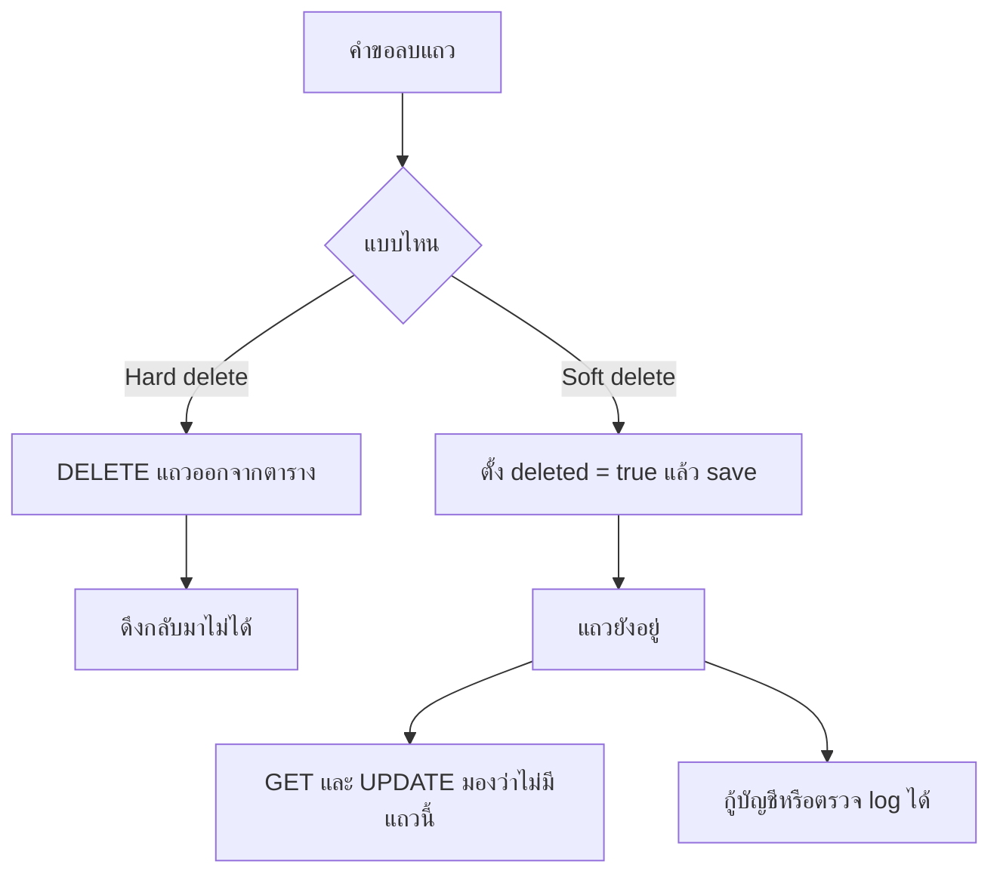
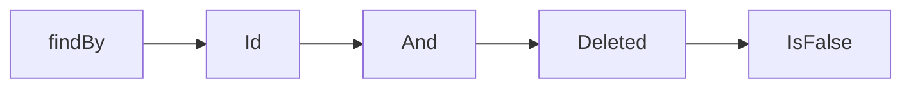
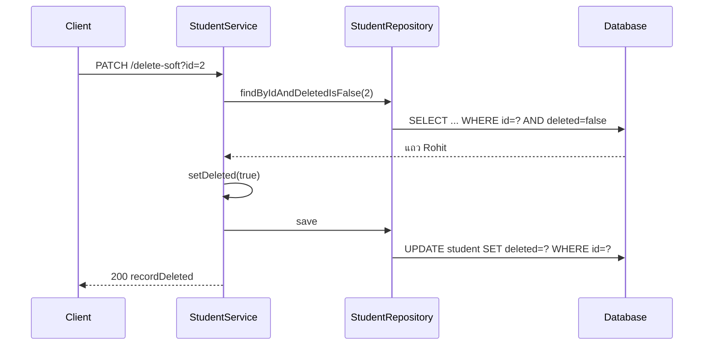
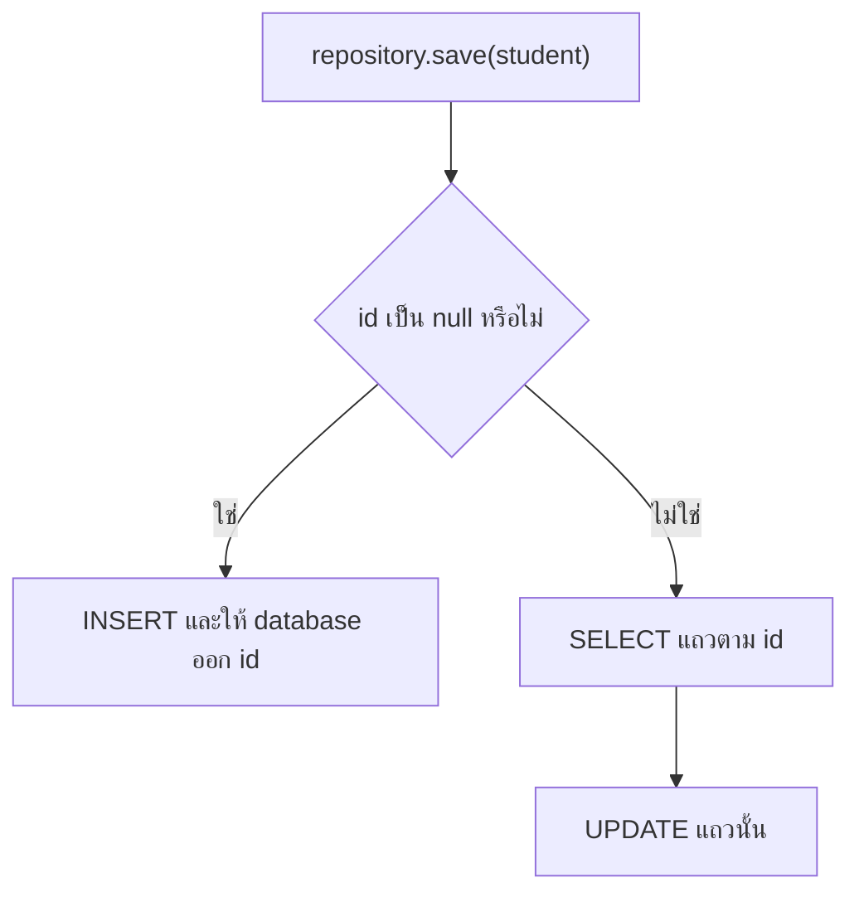

# #13 — Soft Delete กับ Derived Query

> **วิดีโอ:** [Spring Boot CRUD Project with Soft Delete | Spring JPA custom Methods | Spring Boot Full Course #13](https://youtu.be/1lUBVZkDANg) — Coder Army, ~46 นาที
> **แหล่งที่ใช้สรุป:** ซับไตเติลภาษาอังกฤษที่ YouTube สร้างอัตโนมัติ
> **เวอร์ชันในโค้ด:** Spring Boot 4.1 + Java 21 (ใส่หมายเหตุไว้ทุกจุดที่ Spring Boot 3.x ต่างกัน)

ตอนนี้ผู้สอนเอาโปรเจกต์ CRUD ของนักเรียนจากสองตอนก่อนมาทำให้ลบข้อมูลแบบที่งานจริงใช้ เขาเพิ่มฟิลด์ `deleted` แล้วเปลี่ยนการอ่านและการอัปเดตให้ข้ามแถวที่ถูกมาร์กว่าลบ จากนั้นให้ Spring Data JPA สร้าง query จากชื่อ method และปิดท้ายด้วยการย้าย id จาก path variable ไปเป็น request parameter

ส่วนที่ติดป้าย `💡 เพิ่มเติม` คือของที่ผมเติมเอง ไม่ได้อยู่ในวิดีโอ ส่วนที่ติด `⚠️ แก้จากวิดีโอ` คือจุดที่วิดีโอพูดคลาดเคลื่อน

> 💡 **เพิ่มเติม — วิดีโอใช้ MySQL:** ผู้สอนเปิด DBeaver ต่อ MySQL ที่ `localhost:3306` แล้วให้ Hibernate สร้างตาราง `student` ในฐานนั้น โน้ตนี้รันโปรเจกต์เดียวกันบน **H2 in-memory** ที่พอร์ต `9013` เพื่อไม่ต้องติดตั้ง MySQL SQL และชนิดคอลัมน์ด้านล่างเป็นผลจาก H2 ที่รันจริง บน MySQL ในวิดีโอคอลัมน์ boolean เป็น `BIT` และ id แบบ identity เป็น `AUTO_INCREMENT`

---

## สารบัญ

| เวลา | หัวข้อ |
|---|---|
| [0:00](https://youtu.be/1lUBVZkDANg?t=0) | [1. เป้าหมายของตอน](#1-เป้าหมายของตอน) |
| [0:48](https://youtu.be/1lUBVZkDANg?t=48) | [2. Hard delete กับ Soft delete](#2-hard-delete-กับ-soft-delete) |
| [4:44](https://youtu.be/1lUBVZkDANg?t=284) | [3. โปรเจกต์ CRUD ที่เอามาต่อ](#3-โปรเจกต์-crud-ที่เอามาต่อ) |
| [5:51](https://youtu.be/1lUBVZkDANg?t=351) | [4. เพิ่มฟิลด์ deleted](#4-เพิ่มฟิลด์-deleted) |
| [7:07](https://youtu.be/1lUBVZkDANg?t=427) | [5. Soft delete ใช้ PATCH](#5-soft-delete-ใช้-patch) |
| [10:39](https://youtu.be/1lUBVZkDANg?t=639) | [6. ให้ Hibernate สร้างคอลัมน์](#6-ให้-hibernate-สร้างคอลัมน์) |
| [12:08](https://youtu.be/1lUBVZkDANg?t=728) | [7. CRUD เดิมใช้กับ soft delete ไม่ได้](#7-crud-เดิมใช้กับ-soft-delete-ไม่ได้) |
| [15:27](https://youtu.be/1lUBVZkDANg?t=927) | [8. Create ต้องไม่เชื่อค่า deleted จาก client](#8-create-ต้องไม่เชื่อค่า-deleted-จาก-client) |
| [19:06](https://youtu.be/1lUBVZkDANg?t=1146) | [9. Derived query method](#9-derived-query-method) |
| [24:03](https://youtu.be/1lUBVZkDANg?t=1443) | [10. getAll กับชื่อ method ที่สตาร์ทไม่ขึ้น](#10-getall-กับชื่อ-method-ที่สตาร์ทไม่ขึ้น) |
| [25:01](https://youtu.be/1lUBVZkDANg?t=1501) | [11. Update ล็อก deleted ไว้ที่ false](#11-update-ล็อก-deleted-ไว้ที่-false) |
| [25:48](https://youtu.be/1lUBVZkDANg?t=1548) | [12. Hard delete ลบได้แม้แถวถูก soft delete แล้ว](#12-hard-delete-ลบได้แม้แถวถูก-soft-delete-แล้ว) |
| [27:37](https://youtu.be/1lUBVZkDANg?t=1657) | [13. Soft delete สามขั้น และผลที่ยิงจริง](#13-soft-delete-สามขั้น-และผลที่ยิงจริง) |
| [36:41](https://youtu.be/1lUBVZkDANg?t=2201) | [14. @GeneratedValue กับช่องโหว่ของ save](#14-generatedvalue-กับช่องโหว่ของ-save) |
| [41:13](https://youtu.be/1lUBVZkDANg?t=2473) | [15. Request parameter](#15-request-parameter) |
| [44:43](https://youtu.be/1lUBVZkDANg?t=2683) | [16. แบบฝึกหัดก่อนจบ](#16-แบบฝึกหัดก่อนจบ) |
| — | [17. สรุปท้ายตอน](#17-สรุปท้ายตอน) |

---

## 1. เป้าหมายของตอน

[▶ 0:00](https://youtu.be/1lUBVZkDANg?t=0)

ผู้สอนบอกว่าวันนี้มีสองเรื่อง: **request parameter** กับ **hard delete / soft delete** เขาจะใช้โปรเจกต์ CRUD ของนักเรียนจากสองตอนก่อน ถ้ายังไม่ดูและยังไม่รู้จัก CRUD ให้ดาวน์โหลดโปรเจกต์จากลิงก์ใน description แล้วเดินต่อจากวิดีโอนี้ได้

เขาบอกว่า soft delete เป็นเรื่องที่หลายคอร์สไม่พูด แต่เป็นวิธีที่ใช้กันทั่วไปในงานจริง และจะกลับมาใช้อีกบ่อยในคอร์สนี้

---

## 2. Hard delete กับ Soft delete

[▶ 0:48](https://youtu.be/1lUBVZkDANg?t=48)

สมมติในตารางมีนักเรียนคนหนึ่ง id เป็น `1` ชื่อ Aditya เลขประจำตัว `1001` ถ้าจะลบคนนี้ วิธีตรง ๆ คือบอก JPA ให้ลบตาม id แปลว่าเอาแถวนั้นออกจาก database

ปัญหาคือวันถัดไปถ้าย้อนดูผู้ใช้ที่เคยอยู่บนแพลตฟอร์ม จะดึงแถวนี้กลับมาไม่ได้ งาน enterprise ต้องเก็บประวัติ ต้องอ่าน log และบางทีต้องกู้บัญชีเก่า การลบแถวทิ้งแบบนี้เรียกว่า **hard delete** คือลบออกจาก database จริง

**Soft delete** ไม่ได้ลบแถว แค่ทำเครื่องหมายว่าลบแล้ว ผู้สอนเพิ่มฟิลด์ `isDeleted` ค่าเริ่มต้นเป็น `0`

| id | name | roll number | isDeleted | ความหมายในวิดีโอ |
|---|---|---|---|---|
| 1 | Aditya | 1001 | 0 | ยังใช้งานอยู่ |
| 2 | Rohit | 102 | 1 | มองว่าลบแล้ว |

เมื่อฟิลด์นี้เป็น `1` แถวยังอยู่ในตาราง แต่ API ต้องทำเหมือนไม่มีแถวนั้น

- `GET` ตาม id `2` ตอบว่าไม่พบ
- `UPDATE` id `2` ตอบว่าไม่มีแถวนี้
- `GET` ทั้งหมดไม่ส่งแถวนี้กลับไป

แถวจึงยังเอากลับมาใช้ได้ ถ้าต้องดึงทั้งแถวที่ลบและไม่ลบ ถ้าต้องล็อกบัญชี หรือถ้าต้องกู้บัญชี Hard delete ยังมีที่ทาง เมื่อรู้ว่าแถวนั้นไม่มีวันมีประโยชน์อีก

ผู้สอนสรุปว่าในโปรเจกต์ระดับองค์กร พื้นที่ใน database ไม่ใช่ข้อจำกัดหลักอีกต่อไป ข้อมูลผู้ใช้มีค่ากว่าพื้นที่ แม้แถวจะถูกมาร์กว่าลบ ก็ยังเอาไปใช้เรื่องอื่นได้



> 💡 **เพิ่มเติม:** ในโค้ดเขาตั้งชื่อฟิลด์ Java ว่า `deleted` ไม่ใช่ `isDeleted` คำว่า isDeleted ในวิดีโอคือชื่อคอลัมน์ที่เขาอธิบายบนกระดาน getter ของ `boolean` จะชื่อ `isDeleted()` อยู่ดี ส่วนค่า `0` กับ `1` คือสิ่งที่ MySQL เก็บในคอลัมน์ `BIT` ใน Java ค่านี้เป็น `false` กับ `true`

---

## 3. โปรเจกต์ CRUD ที่เอามาต่อ

[▶ 4:44](https://youtu.be/1lUBVZkDANg?t=284)

โครงที่เขามีอยู่แล้วมีสี่ชั้น

| ชั้น | คลาส | หน้าที่ |
|---|---|---|
| Controller | `StudentController` | รับ HTTP แล้วส่งต่อให้ service |
| Service | `StudentService` | business logic |
| Repository | `StudentRepository` | คุยกับ database ผ่าน Spring Data JPA |
| Entity | `Student` | แถวในตาราง |

ฟิลด์ของ `Student` ก่อนตอนนี้มี `id`, `name`, `age`, `email`, `rollNumber`, `subject` ยังไม่มีฟิลด์ที่มาร์กว่าลบ

Endpoint ร่วมคือ `/api/students` และมีห้า operation จากตอนก่อน

| HTTP | Path ตอนต้นวิดีโอ | งาน |
|---|---|---|
| `POST` | `/api/students/create` | สร้าง |
| `GET` | `/api/students/get/{id}` | อ่านคนเดียว |
| `GET` | `/api/students/getAll` | อ่านทั้งหมด |
| `PUT` | `/api/students/update/{id}` | แทนที่ทั้งแถว |
| `DELETE` | `/api/students/delete/{id}` | hard delete |

ช่วงท้ายของตอนนี้ path ที่มี `{id}` จะถูกเปลี่ยนเป็น request parameter รายละเอียดอยู่ใน [ส่วนที่ 15](#15-request-parameter)

แอปต่อ MySQL ไว้แล้วใน `application.properties` ทั้ง URL, username และ password ในตารางมีข้อมูลอยู่หนึ่งแถว

> 💡 **เพิ่มเติม — ชื่อ package:** ซับของตอนที่สร้างโปรเจกต์พูดประมาณ "in dot strikes dot curd Spring Boot Demo" โค้ดในโน้ตใช้ `in.strike.crudspringbootdemo` และแยก package เป็น `controller`, `entity`, `repository`, `service` ตามที่เขาจัดโฟลเดอร์ ตัวสะกดบนจออาจเป็น `in.strikes`

---

## 4. เพิ่มฟิลด์ deleted

[▶ 5:51](https://youtu.be/1lUBVZkDANg?t=351)

ใน `Student` เขาเพิ่มฟิลด์นี้ แล้วให้ IDE สร้าง getter กับ setter

```java
private boolean deleted;
```

Getter ของ `boolean` คือ `isDeleted()` และ setter คือ `setDeleted(boolean)`

จากนั้นเขากลับไปที่ create ใน service ก่อน save เขาเรียก `setDeleted(false)` ทุกแถวใหม่ต้องเริ่มที่ยังไม่ถูกลบ จะเป็น `true` ได้ก็ต่อเมื่อมี use case ที่ตั้งใจ เช่น ยิง API soft delete

Entity ทั้งคลาสหลังจบตอนนี้ รวม `@GeneratedValue` ที่เขาเพิ่งใส่ตอนท้าย มีหน้าตาดังนี้

```java
package in.strike.crudspringbootdemo.entity;

import jakarta.persistence.Entity;
import jakarta.persistence.GeneratedValue;
import jakarta.persistence.GenerationType;
import jakarta.persistence.Id;

@Entity
public class Student {

  @Id
  @GeneratedValue(strategy = GenerationType.IDENTITY)
  private Long id;

  private String name;
  private String email;
  private int age;
  private int rollNumber;
  private String subject;
  private boolean deleted;

  public Long getId() {
    return id;
  }

  public void setId(Long id) {
    this.id = id;
  }

  public String getName() {
    return name;
  }

  public void setName(String name) {
    this.name = name;
  }

  public String getEmail() {
    return email;
  }

  public void setEmail(String email) {
    this.email = email;
  }

  public int getAge() {
    return age;
  }

  public void setAge(int age) {
    this.age = age;
  }

  public int getRollNumber() {
    return rollNumber;
  }

  public void setRollNumber(int rollNumber) {
    this.rollNumber = rollNumber;
  }

  public String getSubject() {
    return subject;
  }

  public void setSubject(String subject) {
    this.subject = subject;
  }

  public boolean isDeleted() {
    return deleted;
  }

  public void setDeleted(boolean deleted) {
    this.deleted = deleted;
  }
}
```

`boolean` แบบ primitive มีค่าเริ่มต้นเป็น `false` อยู่แล้ว แต่ถ้า client ส่ง `"deleted": true` ใน JSON ตัว Jackson จะเรียก `setDeleted(true)` ทับค่าเริ่มต้นก่อนที่แถวจะถึง `save` การเรียก `setDeleted(false)` ใน service จึงจำเป็น รายละเอียดอยู่ใน [ส่วนที่ 8](#8-create-ต้องไม่เชื่อค่า-deleted-จาก-client)

---

## 5. Soft delete ใช้ PATCH

[▶ 7:07](https://youtu.be/1lUBVZkDANg?t=427)

เขาสร้าง endpoint ใหม่คู่กับ hard delete ชื่อ method คือ `deleteStudentSoftly` รับ id แล้วคืน `boolean` ว่าลบได้หรือไม่ Controller ตอบแบบเดียวกับ hard delete ของตอนก่อน ถ้าลบไม่ได้ตอบ `404` ถ้าลบได้ตอบข้อความ `recordDeleted`

เขาทบทวน method ที่ใช้มาแล้ว

| งาน | HTTP method |
|---|---|
| สร้าง | `POST` |
| อ่าน | `GET` |
| แทนที่ทั้งก้อน | `PUT` |
| ลบจริง | `DELETE` |

Soft delete ก็เป็นการ "ลบ" จึงใช้ `DELETE` ได้ เขาบอกว่าไม่ผิด แต่ครั้งนี้ไม่ได้ลบแถว แค่เปลี่ยนฟิลด์เดียวจาก `0` เป็น `1` เขาจึงเลือก **`PATCH`**

คำอธิบายของเขาคือ `PATCH` ใช้เมื่อมีแถวครบอยู่แล้ว และต้องการเปลี่ยนฟิลด์ใดฟิลด์หนึ่ง เช่น เปลี่ยนเลขประจำตัวหรือชื่อ Soft delete ก็คือการเปลี่ยน `deleted` จากศูนย์เป็นหนึ่ง

Path ที่เขาพิมพ์คือ `/delete-soft` ตามด้วย id ซับพูดทั้ง "delete minus soft" และ "delete softly" โค้ดด้านล่างใช้ `/delete-soft`

ตอนแรก id อยู่ใน path

```java
@PatchMapping("/delete-soft/{id}")
public ResponseEntity<String> deleteStudentSoftly(@PathVariable("id") Long id)
```

ช่วงท้ายเขาเอา id ออกจาก path ของ endpoint ที่รับ id รวมถึง soft delete โค้ดที่รันได้ใช้ `@RequestParam` ตาม [ส่วนที่ 15](#15-request-parameter)

> 💡 **เพิ่มเติม:** ซับไม่ชัดว่า path บนจอคือ `/delete-soft` หรือ `/delete-softly` และไม่ชัดว่าตอนท้ายเขาย้าย soft delete ไปเป็น query string ด้วยหรือไม่ เขาสาธิตซ้ำหลังเปลี่ยน mapping แค่ `GET ?id=1` โน้ตนี้ย้ายทั้ง get, update, hard delete และ soft delete ไปเป็น `@RequestParam("id")` เพราะเขาระบุว่าสี่จุดนี้รับ id ทาง path แล้วบอกว่าจะเปลี่ยนแบบเดียวกัน

ใน service เขาสร้างเมธอดเปล่าก่อน แล้ว `return false` เพื่อให้แอปสตาร์ทได้ เนื้อจริงของเมธอดมาทีหลังใน [ส่วนที่ 13](#13-soft-delete-สามขั้น-และผลที่ยิงจริง)

---

## 6. ให้ Hibernate สร้างคอลัมน์

[▶ 10:39](https://youtu.be/1lUBVZkDANg?t=639)

เขาเปิดตารางใน DBeaver แล้วยังไม่เห็นคอลัมน์ `deleted` เพราะแอปยังไม่ได้สตาร์ทใหม่หลังเพิ่มฟิลด์ โปรเจกต์ตั้ง `spring.jpa.hibernate.ddl-auto=update` ตั้งแต่ตอนที่ต่อ MySQL ค่านี้บอกให้ Hibernate สร้างตารางหรือเพิ่มคอลัมน์ให้เมื่อโครงสร้าง entity เปลี่ยน

เขาลบตาราง `student` ทิ้งแล้วสตาร์ทแอปใหม่ Hibernate รัน `CREATE TABLE` ให้ คอลัมน์ `deleted` บน MySQL เป็นชนิด `BIT` ซึ่งคู่กับ `boolean` ใน Java ตารางว่าง เขาจึง `INSERT` หนึ่งแถวเอง และตั้ง `deleted` เป็น `0`

จากนั้นเขาลบแถวที่ใส่เองทิ้ง เพราะอยากให้ทุกแถวเข้ามาทาง Postman

`pom.xml` ของโปรเจกต์ที่รันในโน้ตนี้

```xml
<parent>
  <groupId>org.springframework.boot</groupId>
  <artifactId>spring-boot-starter-parent</artifactId>
  <version>4.1.1</version>
</parent>

<properties>
  <java.version>21</java.version>
</properties>

<dependencies>
  <dependency>
    <groupId>org.springframework.boot</groupId>
    <artifactId>spring-boot-starter-webmvc</artifactId>
  </dependency>
  <dependency>
    <groupId>org.springframework.boot</groupId>
    <artifactId>spring-boot-starter-data-jpa</artifactId>
  </dependency>
  <dependency>
    <groupId>com.h2database</groupId>
    <artifactId>h2</artifactId>
    <scope>runtime</scope>
  </dependency>
</dependencies>
```

> ⚠️ **Boot 4 vs 3 — ชื่อ starter ของเว็บ:** Boot 4 ใช้ `spring-boot-starter-webmvc` ชื่อเดิม `spring-boot-starter-web` ยังใช้ได้แต่ถูก deprecate แล้ว ใน Boot 3.x ใช้ `spring-boot-starter-web` ชื่อ `spring-boot-starter-data-jpa` ยังเหมือนเดิม
> ([Spring Boot 4.0 Migration Guide](https://github.com/spring-projects/spring-boot/wiki/Spring-Boot-4.0-Migration-Guide))

`application.properties` ที่รันจริง

```properties
server.port=9013

spring.datasource.url=jdbc:h2:mem:student_crud_db
spring.datasource.driver-class-name=org.h2.Driver

spring.jpa.hibernate.ddl-auto=update
spring.jpa.show-sql=true
spring.jpa.properties.hibernate.format_sql=true
```

`ddl-auto=update`, `show-sql=true` และ `hibernate.format_sql=true` คือค่าที่โปรเจกต์ในวิดีโอใช้อยู่แล้ว เพื่อให้เห็น SQL ใน log ส่วน URL เป็นของ H2 ที่ใส่แทน MySQL

ตอนสตาร์ท H2 รันคำสั่งนี้

```sql
create table student (
    id bigint generated by default as identity,
    age integer not null,
    deleted boolean not null,
    email varchar(255),
    name varchar(255),
    roll_number integer not null,
    subject varchar(255),
    primary key (id)
)
```

บน MySQL เขาอ่านจาก log ว่า id เป็น `bigint not null auto_increment` หลังใส่ `@GeneratedValue` และคอลัมน์ boolean เป็น `BIT`

> 💡 **เพิ่มเติม:** ชื่อคอลัมน์ `roll_number` มาจาก `SpringPhysicalNamingStrategy` ที่ Boot ใช้อยู่แล้ว ทั้ง Boot 3 และ Boot 4 มันแปลง `rollNumber` เป็น snake case DBeaver ในวิดีโอจึงโชว์คอลัมน์นี้ในรูปที่อ่านคล้าย "Roll Number"
>
> ถ้าไม่ตั้ง `ddl-auto` เอง Boot จะใช้ `create-drop` เมื่อเจอ embedded database อย่าง H2 และใช้ `none` เมื่อต่อ MySQL วิดีโอตั้ง `update` เองเพราะต่อ MySQL
>
> Log ตอนสตาร์ทยังเตือนว่า `spring.jpa.open-in-view` เปิดอยู่เป็นค่า default วิดีโอไม่ได้พูดถึงค่านี้

คลาสหลักของแอป

```java
package in.strike.crudspringbootdemo;

import org.springframework.boot.SpringApplication;
import org.springframework.boot.autoconfigure.SpringBootApplication;

@SpringBootApplication
public class CrudSpringBootDemoApplication {

  public static void main(String[] args) {
    SpringApplication.run(CrudSpringBootDemoApplication.class, args);
  }
}
```

ชุดที่รันคือ Spring Boot 4.1.1, Spring Framework 7.0.9, Hibernate 7.4.5.Final, Spring Data JPA 4.1.1, Jackson 3.1.5 และ H2 2.4.240

---

## 7. CRUD เดิมใช้กับ soft delete ไม่ได้

[▶ 12:08](https://youtu.be/1lUBVZkDANg?t=728)

พอมีคอลัมน์ `deleted` แล้ว method มาตรฐานของ `JpaRepository` ไม่พออีกต่อไป

`getStudent` เดิมเรียก `findById` Spring Data JPA สร้าง query ประมาณ

```sql
select * from student where id = 1
```

ถ้าแถวนั้น `deleted` เป็น `1` query นี้ยังเจอแถวอยู่ Soft delete จะได้ผลก็ต่อเมื่อ query เป็น

```sql
select * from student where id = 1 and deleted = false
```

`findAll` เดิมดึงทุกแถว ต้องเหลือเฉพาะ `deleted = false` และไม่ต้องกรอง id

`save` ยังใช้ได้ เพราะมันแค่บันทึก

`existsById` ต้องคิดใหม่ เพราะมันตอบแค่ว่า id นี้มีแถวหรือไม่ ไม่ได้สนใจว่าถูกมาร์คว่าลบแล้วหรือยัง

เขาสรุปกติกาไว้ว่า แถวที่ `deleted` เป็น `1` ต้องไม่เข้า operation ของ CRUD

- ขออ่าน id นั้น ตอบว่าลบแล้ว
- ขออัปเดต ตอบว่าไม่มีแถวนี้
- ขอลบ ตอบว่าลบไปแล้ว

> 💡 **เพิ่มเติม:** ช่วงนี้เขายังพูดรวม ๆ ว่า hard delete ก็ต้องไม่แตะแถวที่ soft delete แล้ว ตอน [25:48](https://youtu.be/1lUBVZkDANg?t=1548) เขาเปลี่ยนใจ และปล่อยให้ hard delete ลบแถวได้ไม่ว่า `deleted` จะเป็นอะไร ดู [ส่วนที่ 12](#12-hard-delete-ลบได้แม้แถวถูก-soft-delete-แล้ว)

> 💡 **เพิ่มเติม:** Hibernate ไม่ได้ส่ง `select *` จริง log ที่รันได้ระบุคอลัมน์ทีละตัว ผู้สอนใช้ `select *` เพื่ออธิบายเงื่อนไข `where`

---

## 8. Create ต้องไม่เชื่อค่า deleted จาก client

[▶ 15:27](https://youtu.be/1lUBVZkDANg?t=927)

`save` ไม่ต้องเปลี่ยน query แต่ต้องไม่เชื่อค่า `deleted` ที่มากับ body ฟิลด์นี้ไม่ใช่ข้อมูลที่ client กำหนดตอนสร้างหรือตอนอัปเดต จะเป็น `true` ได้ทางเดียวคือยิง API soft delete

ถ้า `POST /api/students/create` ส่ง body แบบนี้

```json
{
  "id": 2,
  "name": "Rohit",
  "deleted": true
}
```

แล้ว service เอา object ไป `save` ตรง ๆ แถวจะลงตารางด้วย `deleted = 1` ตั้งแต่เกิด เขาบอกว่าไม่ควรให้ client มีอำนาจขนาดนั้น แม้จะส่ง `true` มา service ก็ทิ้งค่านั้น แล้วตั้ง `false` เองก่อน save

```java
public Student createStudent(Student student) {
  student.setDeleted(false);
  return studentRepository.save(student);
}
```

เขาทดสอบด้วย Postman สองแถว

| แถว | ข้อมูลที่เขาใส่ | สิ่งที่ต้องเกิด |
|---|---|---|
| Aditya | อายุ 28, เลข 1001, วิชา Spring Boot, ส่ง `deleted: true` | บันทึกเป็น `false` และได้ `201` |
| Rohit | อายุ 28, อีเมล `Rohit@gmail.com`, เลข 102 | `deleted` เป็น `0` |

ผลที่ยิงกับโค้ดในโน้ตนี้ แม้ body จะส่ง `"deleted": true`

```http
HTTP/1.1 201
Content-Type: application/json

{"age":28,"deleted":false,"email":"aditya@gmail.com","id":1,"name":"Aditya","rollNumber":1001,"subject":"Spring Boot"}
```

`deleted` ในคำตอบเป็น `false`

> ⚠️ **แก้จากวิดีโอ:** ซับพูดว่า create ได้ "200" และ "200 Created" โค้ดจากตอนก่อนคืน `HttpStatus.CREATED` ซึ่งคือ **`201 Created`** ตอนยิงจริงได้ `HTTP/1.1 201` Tomcat ของ Boot ไม่ใส่ reason phrase ต่อท้ายรหัส

> 💡 **เพิ่มเติม:** ซับตอนสร้าง Aditya พูดอีเมลว่า "aditya.com" ตัวอย่างนี้ใช้อีเมล `aditya@gmail.com` ตามตอนที่สร้าง CRUD วิชาของ Rohit ในซับตอนนี้ไม่ชัด (ได้ยินคล้าย "Mand") ตัวอย่างใช้ `MERN` จากตอนก่อน อายุของ Rahul ที่โผล่ทีหลังเขาก็ไม่ได้บอก ตัวอย่างใช้ `28`

> ⚠️ **Boot 4 vs 3 — ลำดับฟิลด์ใน JSON:** คำตอบด้านบนเรียง key ตามตัวอักษร (`age`, `deleted`, `email`, `id`, `name`, `rollNumber`, `subject`) เพราะ Jackson 3 เปิด `MapperFeature.SORT_PROPERTIES_ALPHABETICALLY` เป็นค่า default ตรวจจาก `jackson-databind` 3.1.5 แล้ว `enabledByDefault()` เป็น `true` ส่วน Jackson 2.21.5 ที่ Boot 3 ใช้ ค่าเดียวกันเป็น `false` จึงเรียงตามลำดับ getter ถ้าต้องการพฤติกรรมแบบ Boot 3 ให้ตั้ง `spring.jackson.use-jackson2-defaults=true`
> ([Spring Boot 4.0 Migration Guide, Upgrading Jackson](https://github.com/spring-projects/spring-boot/wiki/Spring-Boot-4.0-Migration-Guide))

> 💡 **เพิ่มเติม:** getter ชื่อ `isDeleted()` ถูก serialize เป็น key `deleted` ไม่ใช่ `isDeleted` ผลด้านบนยืนยันแบบนี้

---

## 9. Derived query method

[▶ 19:06](https://youtu.be/1lUBVZkDANg?t=1146)

`GET /api/students/get/1` ตอนนี้ยังเจอ Aditya เพราะแถวยังไม่ถูกมาร์คว่าลบ แต่โค้ดเรียก `findById` ซึ่งไม่ดูคอลัมน์ `deleted` ถ้าแถวนั้นเป็น `1` ก็จะถูกส่งกลับไปด้วย

Query ที่ต้องการคือ `id` ตรงกัน **และ** `deleted` เป็นเท็จ ไม่มี method มาตรฐานชื่อนี้ `findById`, `findAll`, `existsById` และ `save` เป็น method ที่ `JpaRepository` มีให้ Spring Data สร้าง implementation ตอน runtime

เขาบอกว่าไม่ต้องเขียน SQL และไม่ต้องเขียนคลาสที่ implement interface เอง แค่ตั้งชื่อ method ให้ถูก Spring Data JPA จะสร้าง query จากชื่อนั้น เขาเรียกว่าเรื่องที่ดูเหมือนเวทมนตร์ แต่บอกว่าข้างในไม่มีอะไรวิเศษ และจะอธิบายกลไกทีหลัง

ชื่อที่เขาใช้คือ `findByIdAndDeletedIsFalse` IDE เสนอชื่อนี้ให้เอง ทั้งที่มันไม่ใช่ method มาตรฐาน และเสนอกำลังต่ออีก เช่น `IsFalse`, `After`, `Before`, `Between`, `Containing`, `Empty` รวมถึงฟิลด์ `Age`, `Deleted`, `Subject`, `Email`

โครงของชื่อ



- `findBy` คือคำขึ้นต้น
- `Id` คือฟิลด์ และเป็นพารามิเตอร์ตัวเดียวของ method
- `And` เชื่อมเงื่อนไขถัดไป
- `DeletedIsFalse` คือเงื่อนไขที่ไม่มีพารามิเตอร์ คำว่า `false` อยู่ในชื่อ method

ใน repository ประกาศแค่ลายเซ็น ไม่มีตัว method

```java
Optional<Student> findByIdAndDeletedIsFalse(Long id);
```

ชนิดคืนค่าเป็น `Optional<Student>` แบบเดียวกับ `findById` เพราะอาจไม่เจอแถว ใน service ถ้า `Optional` มีค่าก็คืน `Student` ถ้าไม่มีก็คืน `null` แล้ว controller แปลง `null` เป็น `404`

```java
public Student getStudent(Long id) {
  return studentRepository.findByIdAndDeletedIsFalse(id).orElse(null);
}
```

SQL ที่ Hibernate สร้างเมื่อยิง `GET /api/students/get?id=1`

```sql
select
    s1_0.id,
    s1_0.age,
    s1_0.deleted,
    s1_0.email,
    s1_0.name,
    s1_0.roll_number,
    s1_0.subject
from
    student s1_0
where
    s1_0.id=?
    and s1_0.deleted=false
```

เงื่อนไข `deleted=false` เป็นลิเทอรัลใน SQL ไม่ใช่พารามิเตอร์ พารามิเตอร์มีแค่ id

> ⚠️ **แก้จากวิดีโอ:** เขาเรียกชั้นนี้ว่า "Spring JPA" หรือ "JP" ที่ถูกคือ **Spring Data JPA** เป็นคนอ่านชื่อ method แล้วสร้าง query ส่วน **Hibernate** เป็นคนส่ง SQL ไปที่ database JPA เองเป็น specification ไม่ใช่ตัวที่สร้าง implementation ของ repository

> 💡 **เพิ่มเติม:** กลไกอยู่ที่ `PartTreeJpaQuery` ตอนสร้าง Bean ของ repository Spring Data ตัดชื่อ method ที่คำว่า `By` แล้วแปลงท่อนหลังเป็น predicate ถ้าชื่อแปลไม่ได้ แอปจะสตาร์ทไม่ขึ้นตั้งแต่ตอนสร้าง Bean ไม่ใช่พังตอนมียิง request แรก ดู [ส่วนที่ 10](#10-getall-กับชื่อ-method-ที่สตาร์ทไม่ขึ้น)

---

## 10. getAll กับชื่อ method ที่สตาร์ทไม่ขึ้น

[▶ 24:03](https://youtu.be/1lUBVZkDANg?t=1443)

`findAll` เดิมจะกลายเป็น `select` ทั้งตาราง เขาต้องการ `where deleted = false` เขาจึงลองตั้งชื่อ `findAllAndDeletedIsFalse` ประกาศใน repository เป็น `List<Student>` แล้วไปทำ update กับ delete ต่อ พอสตาร์ทแอปถึงพัง

[▶ 30:38](https://youtu.be/1lUBVZkDANg?t=1838)

ข้อความที่เขาอ่านจาก log คือสร้าง Bean ไม่ได้ เพราะ constructor injection หา dependency ไม่เจอ และหา property ชื่อ `findAll` ไม่เจอ

ชื่อที่พัง และถูกถอดออกจากโปรเจกต์หลังเก็บ error แล้ว

```java
List<Student> findAllAndDeletedIsFalse();
```

Error จริงตอนสตาร์ท Boot 4.1.1

```text
Error creating bean with name 'studentController' ...
Unsatisfied dependency expressed through constructor parameter 0:
Error creating bean with name 'studentService' ...
Unsatisfied dependency expressed through constructor parameter 0:
Error creating bean with name 'studentRepository' ...
No property 'findAll' found for type 'Student'

Caused by: org.springframework.data.repository.query.QueryCreationException:
Cannot create query for method [StudentRepository.findAllAndDeletedIsFalse()];
No property 'findAll' found for type 'Student'

Caused by: org.springframework.data.core.PropertyReferenceException:
No property 'findAll' found for type 'Student'
```

กติกาที่เขาอธิบายหลังเจอ error

1. ชื่อ derived query ขึ้นต้นด้วย `findBy`
2. ตามด้วยชื่อฟิลด์
3. ตามด้วยเงื่อนไข เช่น `IsFalse`
4. ถ้ามีอีกฟิลด์ ให้คั่นด้วย `And` แล้วใส่ฟิลด์กับเงื่อนไขถัดไป

`findAll` เป็น method สำเร็จรูปของ `JpaRepository` เอา `And` ไปต่อท้ายไม่ได้ เพราะไม่มี `By` ให้ Spring Data รู้ว่าท่อนไหนคือ predicate มันเลยไปหา property ชื่อ `findAll` ในคลาส `Student`

ชื่อที่ถูกสำหรับอ่านทุกแถวที่ยังไม่ลบคือ `findByDeletedIsFalse` ไม่มีพารามิเตอร์ เพราะมีเงื่อนไขเดียวและเงื่อนไขนั้นอยู่ในชื่อ

```java
List<Student> findByDeletedIsFalse();
```

SQL ที่รันจริง

```sql
select
    s1_0.id,
    s1_0.age,
    s1_0.deleted,
    s1_0.email,
    s1_0.name,
    s1_0.roll_number,
    s1_0.subject
from
    student s1_0
where
    s1_0.deleted=false
```

> ⚠️ **แก้จากวิดีโอ:** เขาบอกว่าชื่อต้องขึ้นต้นด้วย `findBy` เสมอ และต่ออะไรจาก `findAll` ไม่ได้ จุดที่พังคือ `findAllAndDeletedIsFalse` เพราะไม่มีคำว่า `By` ชื่อ `findAllByDeletedIsFalse` ใช้ได้ คำว่า `All` ระหว่าง `find` กับ `By` เป็นแค่คำอธิบาย ทดลองประกาศ method นี้คู่กับ method ที่ถูกแล้วแอปสตาร์ทขึ้นบนพอร์ต 9013 จากนั้นถอด method นี้ออก เพื่อให้ repository เหลือเฉพาะชื่อที่เขาใช้ในวิดีโอ

> ⚠️ **Boot 4 vs 3 — package ของ exception:** stack ด้านบนเป็น `org.springframework.data.core.PropertyReferenceException` จาก `spring-data-commons` 4.1.1 ใน Boot 3 คลาสเดียวกันอยู่ที่ `org.springframework.data.mapping.PropertyReferenceException` ตรวจจาก `spring-data-commons` 3.5.2 ข้อความ `No property 'findAll' found` เหมือนกัน แต่ `catch` ที่อ้าง package เก่าจะคอมไพล์ไม่ผ่านบน Boot 4

Repository ทั้งอันหลังแก้ชื่อแล้ว

```java
package in.strike.crudspringbootdemo.repository;

import in.strike.crudspringbootdemo.entity.Student;
import java.util.List;
import java.util.Optional;
import org.springframework.data.jpa.repository.JpaRepository;
import org.springframework.stereotype.Repository;

@Repository
public interface StudentRepository extends JpaRepository<Student, Long> {

  Optional<Student> findByIdAndDeletedIsFalse(Long id);

  List<Student> findByDeletedIsFalse();
}
```

---

## 11. Update ล็อก deleted ไว้ที่ false

[▶ 25:01](https://youtu.be/1lUBVZkDANg?t=1501)

`updateStudent` เดิมเรียก `findById` เขาเปลี่ยนมาใช้ `findByIdAndDeletedIsFalse` แถวที่ถูก soft delete แล้วจึงอัปเดตไม่ได้ และได้ `null` กลับไปให้ controller ตอบ `404`

ก่อน `save` เขาเรียก `setDeleted(false)` อีกครั้ง ด้วยเหตุผลเดียวกับ create ไม่ให้ client ส่ง `"deleted": true` ใน body ของ `PUT` แล้วมาร์คแถวว่าลบผ่านหน้าอัปเดต ทางเดียวที่ตั้ง `true` ได้คือ API soft delete

```java
public Student updateStudent(Long id, Student studentRequest) {
  Optional<Student> existingStudent = studentRepository.findByIdAndDeletedIsFalse(id);
  if (existingStudent.isEmpty()) {
    return null;
  }
  Student studentToSave = existingStudent.get();
  studentToSave.setName(studentRequest.getName());
  studentToSave.setEmail(studentRequest.getEmail());
  studentToSave.setAge(studentRequest.getAge());
  studentToSave.setRollNumber(studentRequest.getRollNumber());
  studentToSave.setSubject(studentRequest.getSubject());
  studentToSave.setDeleted(false);
  return studentRepository.save(studentToSave);
}
```

ยิง `PUT /api/students/update?id=1` พร้อม `"deleted": true` และอายุ `29` ได้แถวที่อายุเป็น 29 แต่ `deleted` ยังเป็น `false`

```json
{"age":29,"deleted":false,"email":"aditya@gmail.com","id":1,"name":"Aditya","rollNumber":1001,"subject":"Spring Boot"}
```

`PUT` ไปที่ id ซึ่ง soft delete ไปแล้วได้ `HTTP/1.1 404` และ body ว่าง `Content-Length: 0`

> 💡 **เพิ่มเติม:** เขา copy ทุกฟิลด์จาก body ทับแถวเดิม ฟิลด์ที่ JSON ไม่ส่งมาจะกลายเป็น `null` หรือ `0` แล้วถูก save ทับ นี่คือการแทนที่ทั้งก้อน จึงเข้ากับ `PUT` ส่วน `PATCH` ในตอนนี้มีไว้เปลี่ยน `deleted` อย่างเดียว

---

## 12. Hard delete ลบได้แม้แถวถูก soft delete แล้ว

[▶ 25:48](https://youtu.be/1lUBVZkDANg?t=1548)

Hard delete เขาตั้งใจให้พิเศษกว่า operation อื่น เขาอยากลบแถวได้ไม่ว่าแถวนั้นจะถูก soft delete ไปแล้วหรือยัง เพราะ hard delete ไม่ได้ยิงบ่อย และตอนยิงคือตั้งใจเอาแถวออกจริง

ทางเลือกอีกแบบที่เขาพูดถึงแต่ไม่ใช้ คือ `existsByIdAndDeletedIsFalse` แบบนั้นจะปฏิเสธการ hard delete ถ้าแถวถูกมาร์คว่าลบแล้ว เขาบอกว่าเลือกแบบไหนขึ้นกับ business logic ของแอป

ของเขาจึงยังใช้ `existsById` ถ้ามี id ก็ `deleteById` ไม่สนใจค่า `deleted`

```java
public boolean deleteStudent(Long id) {
  if (!studentRepository.existsById(id)) {
    return false;
  }
  studentRepository.deleteById(id);
  return true;
}
```

SQL ตอน hard delete แถวที่ถูก soft delete แล้ว มีสามคำสั่ง `existsById` ไม่มีเงื่อนไข `deleted` และ `deleteById` โหลดแถวด้วย id ล้วนก่อนค่อยลบ

```sql
select count(*) from student s1_0 where s1_0.id=?

select
    s1_0.id, s1_0.age, s1_0.deleted, s1_0.email,
    s1_0.name, s1_0.roll_number, s1_0.subject
from student s1_0
where s1_0.id=?

delete from student where id=?
```

ถ้า id ไม่มีอยู่ ตอบ `404` body ว่าง ถ้าลบได้ ตอบ

```http
HTTP/1.1 200
Content-Type: text/plain;charset=UTF-8
Content-Length: 13

recordDeleted
```

สตริงนี้เป็น plain text เพราะ method คืน `String` ไม่ใช่ `Student`

---

## 13. Soft delete สามขั้น และผลที่ยิงจริง

[▶ 27:37](https://youtu.be/1lUBVZkDANg?t=1657)

Soft delete มีสามขั้น

1. หาแถวด้วย `findByIdAndDeletedIsFalse` จะลบแบบ soft ได้ก็ต่อเมื่อยังไม่ได้ถูกมาร์ค
2. ถ้า `Optional` ว่าง คืน `false` แล้ว controller ตอบ `404`
3. ถ้าเจอ ให้ `setDeleted(true)` แล้ว `save` จากนั้นคืน `true`

```java
public boolean deleteStudentSoftly(Long id) {
  Optional<Student> existingStudent = studentRepository.findByIdAndDeletedIsFalse(id);
  if (existingStudent.isEmpty()) {
    return false;
  }
  Student studentToSave = existingStudent.get();
  studentToSave.setDeleted(true);
  studentRepository.save(studentToSave);
  return true;
}
```



SQL ของขั้นนี้คือ `SELECT` ที่มี `deleted=false` ตามด้วย `UPDATE` ทั้งแถว ไม่มี `DELETE`

Service ทั้งคลาส

```java
package in.strike.crudspringbootdemo.service;

import in.strike.crudspringbootdemo.entity.Student;
import in.strike.crudspringbootdemo.repository.StudentRepository;
import java.util.List;
import java.util.Optional;
import org.springframework.stereotype.Service;

@Service
public class StudentService {

  private final StudentRepository studentRepository;

  public StudentService(StudentRepository studentRepository) {
    this.studentRepository = studentRepository;
  }

  public Student createStudent(Student student) {
    student.setDeleted(false);
    return studentRepository.save(student);
  }

  public Student getStudent(Long id) {
    return studentRepository.findByIdAndDeletedIsFalse(id).orElse(null);
  }

  public List<Student> getAllStudents() {
    return studentRepository.findByDeletedIsFalse();
  }

  public Student updateStudent(Long id, Student studentRequest) {
    Optional<Student> existingStudent = studentRepository.findByIdAndDeletedIsFalse(id);
    if (existingStudent.isEmpty()) {
      return null;
    }
    Student studentToSave = existingStudent.get();
    studentToSave.setName(studentRequest.getName());
    studentToSave.setEmail(studentRequest.getEmail());
    studentToSave.setAge(studentRequest.getAge());
    studentToSave.setRollNumber(studentRequest.getRollNumber());
    studentToSave.setSubject(studentRequest.getSubject());
    studentToSave.setDeleted(false);
    return studentRepository.save(studentToSave);
  }

  public boolean deleteStudent(Long id) {
    if (!studentRepository.existsById(id)) {
      return false;
    }
    studentRepository.deleteById(id);
    return true;
  }

  public boolean deleteStudentSoftly(Long id) {
    Optional<Student> existingStudent = studentRepository.findByIdAndDeletedIsFalse(id);
    if (existingStudent.isEmpty()) {
      return false;
    }
    Student studentToSave = existingStudent.get();
    studentToSave.setDeleted(true);
    studentRepository.save(studentToSave);
    return true;
  }
}
```

### สาธิตหลังแอปสตาร์ทได้

[▶ 32:13](https://youtu.be/1lUBVZkDANg?t=1933)

เขามี Aditya กับ Rohit ทั้งคู่ `deleted` เป็นเท็จ แล้วยิง `PATCH` soft delete ที่ id `2`

```http
HTTP/1.1 200
Content-Type: text/plain;charset=UTF-8
Content-Length: 13

recordDeleted
```

จากนั้น

| คำขอ | ผล |
|---|---|
| `GET /api/students/get?id=2` | `404` body ว่าง query มี `deleted=false` จึงไม่เจอ Rohit |
| `GET /api/students/get?id=1` | `200` ได้ Aditya ทั้งแถว |
| `GET /api/students/getAll` | `200` ได้แค่ Aditya |

[▶ 34:55](https://youtu.be/1lUBVZkDANg?t=2095)

เขาสร้าง Rahul เลข `103` วิชา Django อีเมล `rahul@gmail.com` ระหว่างทางเขายิง `GET` ใส่ path ของ create แล้วพูดว่าได้ "404 Method Not Allowed" จากนั้นเปลี่ยนเป็น `POST /create` จึงสร้างได้

> ⚠️ **แก้จากวิดีโอ:** รหัสของ Method Not Allowed คือ **`405`** ไม่ใช่ `404` `404` คือไม่มี resource นี้ ยิง `GET /api/students/create` ได้ผลจริงดังนี้

```http
HTTP/1.1 405
Allow: POST
Content-Type: application/json

{"timestamp":"2026-10-16T00:56:42.230Z","status":405,"error":"Method Not Allowed","path":"/api/students/create"}
```

หัว `Allow: POST` บอกว่า path นี้รับเฉพาะ `POST`

จากนั้นเขา soft delete Rahul แล้ว hard delete id เดียวกัน Hard delete สำเร็จทั้งที่แถวถูกมาร์คไปแล้ว พอ refresh แถวหายจากตาราง นี่คือทางเลือกใน [ส่วนที่ 12](#12-hard-delete-ลบได้แม้แถวถูก-soft-delete-แล้ว)

ยิงซ้ำในโน้ตนี้ได้ลำดับเดียวกัน: `PATCH` ได้ `recordDeleted`, `DELETE` ได้ `recordDeleted`, `GET` id นั้นได้ `404`

---

## 14. @GeneratedValue กับช่องโหว่ของ save

[▶ 36:41](https://youtu.be/1lUBVZkDANg?t=2201)

ถึงตรงนี้ client ยังส่ง id เอง เขาลองสร้าง Rahul ด้วย id `3` อีกครั้งหลัง hard delete ไปแล้ว ได้ `201` แต่ประเด็นที่เขาชี้คือ id เป็น primary key ถ้าส่ง id ที่มีอยู่แล้วจะเกิดอะไร

เขาลองสร้าง Rohan อายุ `30` เลข `104` วิชา React โดยใช้ id ที่มีอยู่แล้ว พอ refresh ตาราง แถวเดิมกลายเป็น Rohan ไม่ได้มีแถวใหม่

`save` ของ Spring Data ทำงานสองแบบ ถ้า id ยังไม่มีในตาราง มัน `INSERT` ถ้ามีแล้ว มัน `UPDATE` ใน log เขาเห็น `SELECT` ก่อน แล้วตามด้วย `UPDATE` นั่นไม่ใช่สิ่งที่ create ควรทำ

ทางแก้ของเขาคือไม่ให้ผู้ใช้ส่ง id และให้ database เพิ่ม id เอง บน entity เขาใส่

```java
@Id
@GeneratedValue(strategy = GenerationType.IDENTITY)
private Long id;
```

`GenerationType.IDENTITY` แปลว่าให้คอลัมน์ id เพิ่มค่าเอง

แต่ตารางเดิมไม่เปลี่ยนตาม annotation นี้ เพราะ `ddl-auto=update` ไม่ได้เขียนนิยามคอลัมน์เก่าใหม่ เขาเปิดโครงสร้างตารางแล้วไม่เห็น `AUTO_INCREMENT` การเปลี่ยนแบบนี้เป็น DDL เขาจึงลบตารางทิ้งแล้วสตาร์ทใหม่

Log บน MySQL ที่เขาอ่านได้คือ

```sql
create table student (
  id bigint not null auto_increment
  ...
)
```

หลังนั้นเขา `POST` โดยไม่ส่ง id ได้ id `1` อัตโนมัติ แถวถัดไปได้ id `2` เขาเลยสรุปว่าจะไม่เจอปัญหา create ไปอัปเดตแถวเดิมแล้ว เว้นแต่จะตั้งใจทำเอง



> ⚠️ **แก้จากวิดีโอ:** `@GeneratedValue(strategy = IDENTITY)` ไม่ได้ทิ้ง id ที่ client ส่งมา `save` ของ Spring Data ถือว่า entity ที่ id ไม่เป็น `null` มีอยู่แล้ว แล้วเรียก `merge` ซึ่งอัปเดตแถวเดิม ทดลอง `POST /api/students/create` ด้วย `"id": 1` หลังเปิด identity แล้ว ได้ `201` แต่ body เป็น Rohan ที่ id `1` และ SQL เป็น `SELECT` ตาม id ตามด้วย `UPDATE` ไม่ใช่ `INSERT`

```http
HTTP/1.1 201
Content-Type: application/json

{"age":30,"deleted":false,"email":"rohan@gmail.com","id":1,"name":"Rohan","rollNumber":104,"subject":"React"}
```

`deleted: true` ใน body ยังถูก service บังคับกลับเป็น `false` ช่องโหว่จึงอยู่ที่ id ไม่ได้อยู่ที่ฟิลด์ `deleted`

ตอน client ไม่ส่ง id `INSERT` ของ H2 ใส่คอลัมน์ id เป็น `default` เพื่อให้ identity สร้างค่าให้

```sql
insert into student
    (age, deleted, email, name, roll_number, subject, id)
values
    (?, ?, ?, ?, ?, ?, default)
```

> 💡 **เพิ่มเติม:** ถ้าจะกันการเขียนทับจริง ต้องไม่ให้ id จาก body ถึง `save` เช่น `student.setId(null)` ใน `createStudent` หรือรับ create ด้วย DTO ที่ไม่มีฟิลด์ id วิดีโอยังรับ `Student` ทั้งก้อนเป็น `@RequestBody` และกันแค่ด้วยการไม่ส่ง id จาก Postman

บน H2 นิยามคอลัมน์หลังใส่ annotation คือ `id bigint generated by default as identity` ไม่ใช่ประโยค `AUTO_INCREMENT` ของ MySQL และเพราะเป็น in-memory ทุกครั้งที่สตาร์ทคือฐานว่าง จึงเห็น `CREATE TABLE` ทุกครั้ง ไม่ต้องลบตารางมือแบบที่เขาทำกับ MySQL

---

## 15. Request parameter

[▶ 41:13](https://youtu.be/1lUBVZkDANg?t=2473)

จนถึงตอนนี้ get, update, delete และ soft delete ส่ง id ทาง **path variable** เช่น `/api/students/get/1`

อีกแบบคือ **request parameter** URL จะมีเครื่องหมายคำถาม เช่น `/api/students/get?id=1` ใน Postman พอพิมพ์แบบนี้ แท็บ Params จะมีแถว `id = 1` ให้เอง เติม `&name=Aditya` จะมีอีกแถว เขาบอกว่าค่าพวกนี้ไปกับ URL และไปกับ HTTP request

เขาแนะนำให้ใช้ request parameter เมื่อมีหลายฟิลด์ ถ้ามีแค่ id การเขียน `/get/1` ยังอ่านง่าย แต่ถ้ามีทั้ง id และชื่อ การเขียน `/get/1/Aditya` จะเริ่มงงว่าท่อนไหนเป็นอะไร Query string แยกชื่อกับค่าได้ชัด

จากนั้นเขาเปลี่ยน mapping ของ get, update และ delete เอา `/{id}` ออก แล้วเปลี่ยน `@PathVariable` เป็น `@RequestParam` ชื่อใน annotation ต้องตรงกับชื่อใน query string พารามิเตอร์ `id` จึงรับค่าของ `?id=`

เขาบอกว่า soft delete ก็รับ id ทาง path เหมือนกัน และจะเปลี่ยนแบบเดียวกัน โค้ดสุดท้ายของ controller จึงใช้ `@RequestParam("id")` ทั้งสี่จุด

```java
package in.strike.crudspringbootdemo.controller;

import in.strike.crudspringbootdemo.entity.Student;
import in.strike.crudspringbootdemo.service.StudentService;
import java.util.List;
import org.springframework.http.HttpStatus;
import org.springframework.http.ResponseEntity;
import org.springframework.web.bind.annotation.DeleteMapping;
import org.springframework.web.bind.annotation.GetMapping;
import org.springframework.web.bind.annotation.PatchMapping;
import org.springframework.web.bind.annotation.PostMapping;
import org.springframework.web.bind.annotation.PutMapping;
import org.springframework.web.bind.annotation.RequestBody;
import org.springframework.web.bind.annotation.RequestMapping;
import org.springframework.web.bind.annotation.RequestParam;
import org.springframework.web.bind.annotation.RestController;

@RestController
@RequestMapping("/api/students")
public class StudentController {

  private final StudentService studentService;

  public StudentController(StudentService studentService) {
    this.studentService = studentService;
  }

  @PostMapping("/create")
  public ResponseEntity<Student> createStudent(@RequestBody Student student) {
    Student createdStudent = studentService.createStudent(student);
    return ResponseEntity.status(HttpStatus.CREATED).body(createdStudent);
  }

  @GetMapping("/get")
  public ResponseEntity<Student> getStudent(@RequestParam("id") Long id) {
    Student student = studentService.getStudent(id);
    if (student == null) {
      return ResponseEntity.notFound().build();
    }
    return ResponseEntity.ok(student);
  }

  @GetMapping("/getAll")
  public ResponseEntity<List<Student>> getAllStudents() {
    List<Student> students = studentService.getAllStudents();
    if (students.isEmpty()) {
      return ResponseEntity.notFound().build();
    }
    return ResponseEntity.ok(students);
  }

  @PutMapping("/update")
  public ResponseEntity<Student> updateStudent(
      @RequestParam("id") Long id, @RequestBody Student studentRequest) {
    Student updated = studentService.updateStudent(id, studentRequest);
    if (updated == null) {
      return ResponseEntity.notFound().build();
    }
    return ResponseEntity.ok(updated);
  }

  @DeleteMapping("/delete")
  public ResponseEntity<String> deleteStudent(@RequestParam("id") Long id) {
    if (!studentService.deleteStudent(id)) {
      return ResponseEntity.notFound().build();
    }
    return ResponseEntity.ok("recordDeleted");
  }

  @PatchMapping("/delete-soft")
  public ResponseEntity<String> deleteStudentSoftly(@RequestParam("id") Long id) {
    if (!studentService.deleteStudentSoftly(id)) {
      return ResponseEntity.notFound().build();
    }
    return ResponseEntity.ok("recordDeleted");
  }
}
```

หลังสตาร์ทใหม่ เขายิง `/get?id=1` แล้วได้ข้อมูล ยิง `/get/1` ไม่ได้อีก เพราะไม่มี path variable แล้ว ผลจริงของ path เก่าคือ `404` จาก Spring เพราะไม่มี handler ไม่ใช่ `404` ว่างจาก service

```json
{"timestamp":"2026-10-16T00:52:22.028Z","status":404,"error":"Not Found","path":"/api/students/get/1"}
```

`?id=2` ยังใช้ได้ถ้าแถวนั้นยังไม่ถูก soft delete

> ⚠️ **แก้จากวิดีโอ:** เขาบอกว่า request parameter ไปกับ URL และไปกับ header ของ HTTP request ส่วนที่เป็น query string อยู่ใน URL ไม่ได้อยู่ใน header หัว `Allow`, `Content-Type` หรือ `Host` คนละส่วนกับ `?id=1`

> 💡 **เพิ่มเติม:** `@RequestParam` ค่า default คือ `required = true` ถ้าไม่ส่ง `id` มา Spring ตอบ `400` ก่อนเข้า service วิดีโอไม่ได้ลองกรณีนี้

ตาราง endpoint ตอนจบวิดีโอ

| งาน | Method และ path | กรอง `deleted = false` |
|---|---|---|
| สร้าง | `POST /api/students/create` | บังคับให้เป็น `false` ก่อน save |
| อ่านคนเดียว | `GET /api/students/get?id=` | ใช่ |
| อ่านทั้งหมด | `GET /api/students/getAll` | ใช่ ถ้ารายการว่างตอบ `404` |
| อัปเดต | `PUT /api/students/update?id=` | ใช่ และบังคับ `false` ก่อน save |
| Hard delete | `DELETE /api/students/delete?id=` | ไม่กรอง |
| Soft delete | `PATCH /api/students/delete-soft?id=` | หาเฉพาะแถวที่ยังไม่ลบ แล้วตั้ง `true` |

---

## 16. แบบฝึกหัดก่อนจบ

[▶ 44:43](https://youtu.be/1lUBVZkDANg?t=2683)

เขาอยากให้ลองยิงเอง เพิ่ม method และทำให้ service หนากว่านี้ ตอนนี้ service รับของจาก controller แล้วเรียก repository แทบตรง ๆ

แบบฝึกหัดที่เขาให้

- ใส่ validation ใน business logic ซับพูดว่าเลขประจำตัวต้องอยู่ "between 1001 and 99" ซึ่งไม่เป็นช่วงที่ใช้ได้ ตัวเลขบนจอจึงฟังไม่ชัด
- ฝึก derived query ต่อจากสองชื่อที่มีแล้ว คือ `findByIdAndDeletedIsFalse` กับ `findByDeletedIsFalse` ลองต่อหลายฟิลด์ในชื่อเดียว แล้วดูว่า SQL ออกมาอย่างไร โดยไม่เขียน SQL เอง
- ดาวน์โหลดโปรเจกต์ของเขา หรือสร้างเองก็ได้

[▶ 45:41](https://youtu.be/1lUBVZkDANg?t=2741)

ตอนถัดไปเขาจะเปิดข้างในของสิ่งที่ทำมา เริ่มที่ Servlet ว่ามันทำงานอย่างไร แล้วค่อยเข้า Spring MVC เพื่อให้เห็นว่า Spring Boot วางอยู่บนอะไร เขาบอกว่าจะไม่ใช้เวลากับ Servlet นาน เพราะเป็นเทคโนโลยีเก่าและปัจจุบันไม่ได้เขียน Servlet ตรง ๆ แล้ว แต่จะให้พอทำ operation พื้นฐานได้ และพอเห็นว่ามันเป็นฐานของ Spring MVC

---

## 17. สรุปท้ายตอน

### ประเด็นที่ต้องจำ

1. **Hard delete** ลบแถวออกจากตาราง **Soft delete** เก็บแถวไว้ แล้วตั้ง `deleted` เป็น `true`
2. แถวที่ soft delete แล้วต้องไม่โผล่ใน get รายคน, get ทั้งหมด และ update ของโปรเจกต์นี้
3. Hard delete ในคลิปตั้งใจให้ลบได้แม้แถวจะถูก soft delete ไปแล้ว จึงยังใช้ `existsById` กับ `deleteById`
4. Client กำหนด `deleted` ไม่ได้ ทั้ง create และ update บังคับ `false` ก่อน `save` ทางเดียวที่ตั้ง `true` คือ `PATCH` soft delete
5. Soft delete ในคลิปใช้ `PATCH` เพราะเปลี่ยนฟิลด์เดียว ไม่ได้เอาแถวออก
6. Method มาตรฐานอย่าง `findById` และ `findAll` ไม่รู้เรื่องฟิลด์ `deleted` ต้องประกาศ derived query เอง
7. ชื่อขึ้นด้วย `findBy` แล้วตามด้วยฟิลด์และเงื่อนไข `findAllAndDeletedIsFalse` ทำให้แอปสตาร์ทไม่ขึ้น เพราะ Spring Data ไปหา property ชื่อ `findAll`
8. `ddl-auto=update` เพิ่มคอลัมน์ใหม่ได้ แต่ไม่เปลี่ยนคอลัมน์ id เดิมให้เป็น identity ต้องสร้างตารางใหม่
9. `@GeneratedValue(IDENTITY)` ออก id ให้เมื่อ client ไม่ส่ง id ถ้าส่ง id มา `save` ยัง `UPDATE` แถวเดิม
10. Id ของ get, update และ delete ย้ายจาก path variable มาเป็น request parameter เมื่อต้องการส่งหลายค่าใน URL เดียวกัน

### คำถามทบทวน

1. ทำไมงานที่ต้องกู้บัญชีหรือเก็บ log ถึงไม่ hard delete ผู้ใช้
2. ถ้าแถว `deleted = true` แล้วยิง `GET` ตาม id ด้วย `findById` ธรรมดา จะได้อะไรกลับไป
3. ทำไมต้อง `setDeleted(false)` ทั้งที่ฟิลด์ `boolean` มีค่าเริ่มต้นเป็น `false` อยู่แล้ว
4. `findByIdAndDeletedIsFalse` มีพารามิเตอร์กี่ตัว และคำว่า `IsFalse` ไปอยู่ตรงไหนของ SQL
5. ทำไม `findAllAndDeletedIsFalse` พังตอนสตาร์ท แต่ `findAllByDeletedIsFalse` ไม่พัง
6. Hard delete ของคลิปใช้ `existsById` การใช้ `existsByIdAndDeletedIsFalse` จะเปลี่ยนพฤติกรรมตรงไหน
7. `POST` create ที่ส่ง `"id": 1` ทั้งที่เปิด `GenerationType.IDENTITY` แล้ว ทำไมแถวเดิมถึงกลายเป็นคนใหม่
8. `ddl-auto=update` กับตารางที่มีอยู่แล้ว ใส่ `@GeneratedValue` อย่างเดียวแล้ว id กลายเป็น `AUTO_INCREMENT` ไหม
9. `/api/students/get/1` หลังเปลี่ยนมาใช้ `@RequestParam` ตอบรหัสอะไร และต่างจาก `GET ?id=99` ที่ไม่มีแถวอย่างไร
10. ยิง `GET` ไปที่ `/api/students/create` ควรได้รหัสอะไร

### ตอนถัดไป

[#14 — How Java Web Apps Actually Work | Servlets, Tomcat & WAR Files](./14-servlets-tomcat-war.md) ผู้สอนจะเริ่มที่ Servlet แล้วต่อไปที่ Spring MVC
