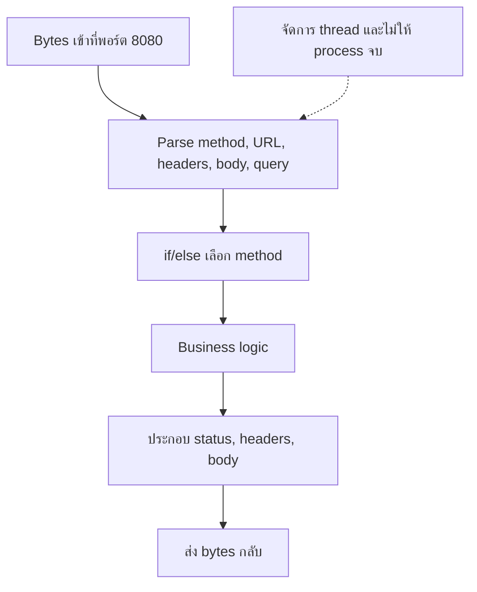
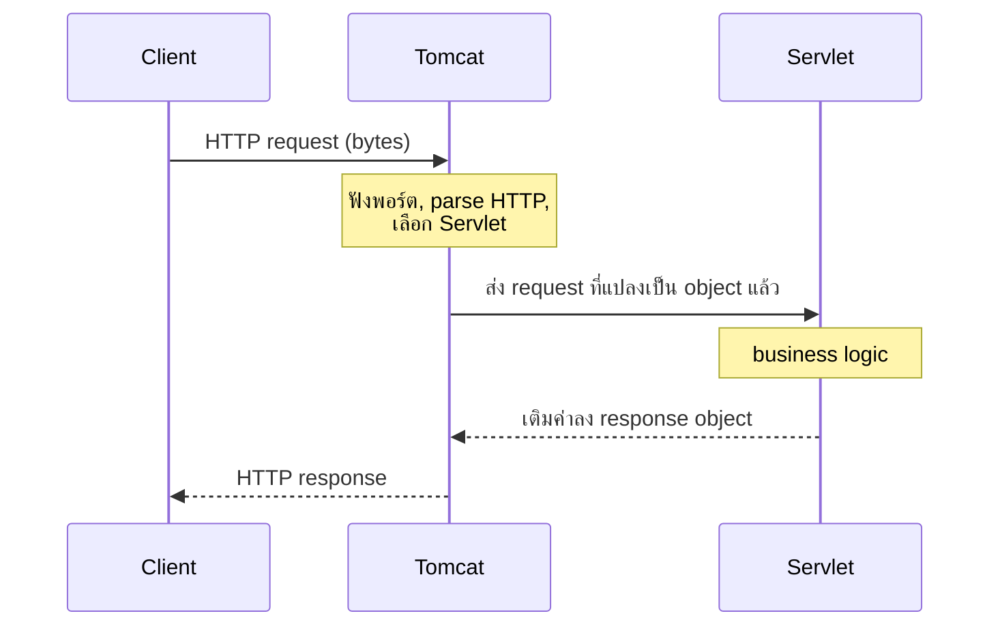
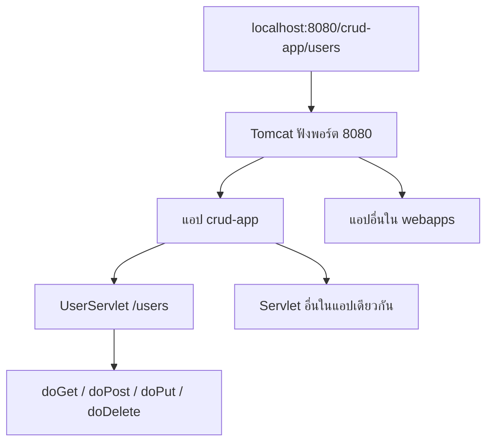
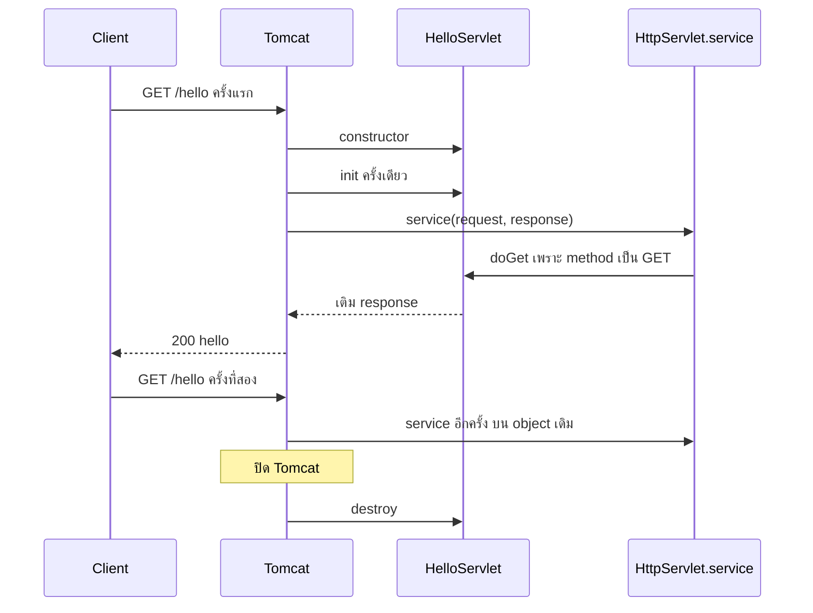
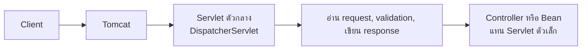

# #14 — Servlet, Tomcat และ WAR: เว็บแอป Java ทำงานจริงอย่างไร

> **วิดีโอ:** [How Java Web Apps Actually Work | Servlets, Tomcat & WAR Files | Spring Boot Full Course #14](https://youtu.be/TSHrq65q5dw) — Coder Army, ~1 ชม. 47 นาที
> **แหล่งที่ใช้สรุป:** ซับไตเติลภาษาฮินดีที่ YouTube สร้างอัตโนมัติ
> **เวอร์ชันในโค้ด:** Spring Boot 4.1 + Java 21 (ใส่หมายเหตุไว้ทุกจุดที่ Spring Boot 3.x ต่างกัน)

ตอนนี้ผู้สอนลงไปที่ชั้นใต้ Spring Boot แล้วตอบคำถามเดียว: **request ที่เข้ามาที่พอร์ตหนึ่งกลายเป็นการเรียก method ของ class Java ได้อย่างไร** เขาให้สร้าง CRUD ของ user ด้วย Servlet เปล่า ๆ แพ็กเป็นไฟล์ WAR แล้ว deploy ลง Tomcat ที่ติดตั้งแยก เพื่อให้เห็นว่า Tomcat รับงาน HTTP ไปตรงไหน และทำไมแอปแบบนี้ถึง tightly coupled จนต้องมี Spring

ส่วนที่ติดป้าย `💡 เพิ่มเติม` คือของที่ผมเติมเอง ไม่ได้อยู่ในวิดีโอ ส่วนที่ติด `⚠️ แก้จากวิดีโอ` คือจุดที่วิดีโอพูดคลาดเคลื่อน

---

## สารบัญ

| เวลา | หัวข้อ |
|---|---|
| [0:00](https://youtu.be/TSHrq65q5dw?t=0) | [1. ทำไมต้องเข้าใจ Servlet](#1-ทำไมต้องเข้าใจ-servlet) |
| [1:22](https://youtu.be/TSHrq65q5dw?t=82) | [2. Client-Server และรูปแบบของ HTTP request](#2-client-server-และรูปแบบของ-http-request) |
| [2:45](https://youtu.be/TSHrq65q5dw?t=165) | [3. java.net ฟังพอร์ตได้ แต่ไม่รู้จัก HTTP](#3-javanet-ฟังพอร์ตได้-แต่ไม่รู้จัก-http) |
| [14:47](https://youtu.be/TSHrq65q5dw?t=887) | [4. Servlet Container รับงานนั้นไป](#4-servlet-container-รับงานนั้นไป) |
| [17:02](https://youtu.be/TSHrq65q5dw?t=1022) | [5. Tomcat คือ process และ Servlet คือ class](#5-tomcat-คือ-process-และ-servlet-คือ-class) |
| [20:46](https://youtu.be/TSHrq65q5dw?t=1246) | [6. แนวคิดเดียวกับ IoC Container และ Bean](#6-แนวคิดเดียวกับ-ioc-container-และ-bean) |
| [22:18](https://youtu.be/TSHrq65q5dw?t=1338) | [7. HttpServletRequest กับ HttpServletResponse](#7-httpservletrequest-กับ-httpservletresponse) |
| [27:25](https://youtu.be/TSHrq65q5dw?t=1645) | [8. External Tomcat กับไฟล์ WAR](#8-external-tomcat-กับไฟล์-war) |
| [29:15](https://youtu.be/TSHrq65q5dw?t=1755) | [9. เปิด Tomcat ที่พอร์ต 8080](#9-เปิด-tomcat-ที่พอร์ต-8080) |
| [31:43](https://youtu.be/TSHrq65q5dw?t=1903) | [10. โปรเจกต์ Maven และ Jakarta Servlet](#10-โปรเจกต์-maven-และ-jakarta-servlet) |
| [36:16](https://youtu.be/TSHrq65q5dw?t=2176) | [11. UserServlet ผูก endpoint ที่ระดับ class](#11-userservlet-ผูก-endpoint-ที่ระดับ-class) |
| [45:06](https://youtu.be/TSHrq65q5dw?t=2706) | [12. สร้างและอ่าน user จาก query parameter](#12-สร้างและอ่าน-user-จาก-query-parameter) |
| [1:02:04](https://youtu.be/TSHrq65q5dw?t=3724) | [13. เขียน response และประกอบ JSON เอง](#13-เขียน-response-และประกอบ-json-เอง) |
| [1:16:03](https://youtu.be/TSHrq65q5dw?t=4563) | [14. Package เป็น WAR แล้ว deploy](#14-package-เป็น-war-แล้ว-deploy) |
| [1:20:22](https://youtu.be/TSHrq65q5dw?t=4822) | [15. Bug สองตัวที่เจอตอนรัน](#15-bug-สองตัวที่เจอตอนรัน) |
| [1:25:17](https://youtu.be/TSHrq65q5dw?t=5117) | [16. Tomcat หนึ่งตัวถือหลายแอป](#16-tomcat-หนึ่งตัวถือหลายแอป) |
| [1:29:02](https://youtu.be/TSHrq65q5dw?t=5342) | [17. scope provided](#17-scope-provided) |
| [1:31:12](https://youtu.be/TSHrq65q5dw?t=5472) | [18. Lifecycle ของ Servlet](#18-lifecycle-ของ-servlet) |
| [1:43:22](https://youtu.be/TSHrq65q5dw?t=6202) | [19. จาก Servlet หลายตัวไปสู่ DispatcherServlet](#19-จาก-servlet-หลายตัวไปสู่-dispatcherservlet) |
| — | [20. สรุปท้ายตอน](#20-สรุปท้ายตอน) |

---

## 1. ทำไมต้องเข้าใจ Servlet

[▶ 0:00](https://youtu.be/TSHrq65q5dw?t=0)

ผู้สอนบอกว่าในยุค Spring Boot ยังต้องเข้าใจ Servlet เพราะสถาปัตยกรรมของ Spring MVC ที่ใช้สร้างเว็บแอปวางอยู่บน Servlet ทั้งก้อน Servlet เป็นเทคโนโลยีฐานของการทำเว็บด้วย Java ถ้าไม่เห็นชั้นนี้ จะอธิบายไม่ได้ว่า Boot ทำงานข้างในอย่างไร

เขาไม่ลงทฤษฎียาว ๆ แผนของตอนคือสร้างเว็บแอป CRUD (Create, Read, Update, Delete) ด้วย Servlet ธรรมดา แล้ว deploy ขึ้น Tomcat ประเด็นที่ต้องแยกให้ได้มีสามอย่าง: Servlet คืออะไร, Tomcat คืออะไร, และ external Tomcat ต่างจาก embedded Tomcat อย่างไร

---

## 2. Client-Server และรูปแบบของ HTTP request

[▶ 1:22](https://youtu.be/TSHrq65q5dw?t=82)

เว็บแอปทุกตัวเป็น client-server ฝั่ง client ส่ง HTTP request ฝั่ง server ส่ง HTTP response กลับ

Client คือใครก็ได้ที่ส่ง request วันนี้เขาใช้ **Postman** เป็น client นอกนั้นอาจเป็น frontend, mobile app หรือโปรแกรมอื่น Server ของวันนี้คือ **Tomcat** และ Servlet จะถูก deploy ไว้ข้างในนั้น

[▶ 4:07](https://youtu.be/TSHrq65q5dw?t=247) ตัวอย่างที่เขาใช้คิดคือ `GET /hello` มายัง `localhost:8080`

ต้องมี process หนึ่งฟังพอร์ต 8080 อยู่ในวันนี้ process นั้นคือ Tomcat แต่ก่อนจะถึงตรงนั้น เขาไล่ก่อนว่า Core Java ทำเองได้แค่ไหน

Endpoint สุดท้ายคือการเรียก method เพราะ Java เป็นภาษา object-oriented ทุกอย่างอยู่ใน method ของ class

| Request | Method ที่ถูกเรียก |
|---|---|
| `/hello` | `hello` |
| `/login` | `login` |
| `/courses` | `courses` |

จะเลือก method ได้ ต้องรู้รูปแบบของ HTTP request ก่อน request มี method (`GET`, `POST`, `PUT`, `PATCH`, `DELETE`), endpoint, headers แบบ key-value เช่น `Content-Type: application/json`, body และอาจมี query parameter กับ path variable `GET` ปกติไม่มี body `POST` และ `PUT` มีได้

---

## 3. java.net ฟังพอร์ตได้ แต่ไม่รู้จัก HTTP

[▶ 2:45](https://youtu.be/TSHrq65q5dw?t=165)

คำถามคือสร้างเว็บด้วย Core Java ได้ไหม คำตอบของเขาคือ **ได้ แต่ยากมาก** แม้แต่โปรเจกต์เล็ก และทำระดับ enterprise ไม่ไหว

Package `java.net` มี `ServerSocket` ที่ **listen พอร์ต** ได้ เช่น `localhost:8080` แล้วตอบ request ที่เข้ามานั้น นี่คือโครงเดียวกับ client-server: server รอ HTTP request

[▶ 8:22](https://youtu.be/TSHrq65q5dw?t=502) ปัญหาคือ `java.net` **ไม่รู้จักรูปแบบ HTTP** สำหรับมันแล้ว request ที่เข้ามาเป็นแค่ **stream of bytes** นักพัฒนาต้อง parse string เอง เจอ `GET` ก็ถือว่าเป็น method เจอของหลัง `/` ก็ถือว่าเป็น endpoint แล้วแยก header, body, query parameter และ path variable ต่อ

หลัง parse ได้ เขาเขียนเงื่อนไขบนกระดานประมาณนี้

```java
if (endpoint.equals("/hello") && method.equals("GET")) {
  // call hello method
}
```

งานของนักพัฒนาควรเป็น business logic งาน parse แบบนี้เป็นงานของ server

`java.net` ไม่รู้จัก HTTP response เช่นกัน หลัง method ทำงานจบ ต้องประกอบ response เอง ทั้ง header และ body และถ้ามี client หลายคนพร้อมกัน ต้องเขียน multithreading เอง ไม่งั้นคนที่เหลือต้องรอจนกว่า request แรกจะจบ เขาจึงสรุปว่าใช้ `java.net` สร้างแอปที่สเกลได้ไม่ไหว

ใน Spring Boot ไม่มีขั้นตอนนี้ เขียน mapping ของ `/hello`, `/login`, `/courses` แล้วเริ่มที่ business logic ได้เลย

### สิ่งที่ต้องทำเองถ้าไม่มี Servlet

[▶ 12:03](https://youtu.be/TSHrq65q5dw?t=723)

ผู้สอนฉายสไลด์ไว้ประมาณ 13 ข้อ แล้วไล่ด้วยปากดังนี้ ทั้งหมดนี้ยังไม่ใช่ business logic เป็นแค่การทำให้แอปฟังพอร์ตและรับ request ได้

1. อ่าน raw HTTP text
2. Parse URL
3. แยก headers
4. แยก query parameters
5. แยก body
6. แยก HTTP method
7. Map endpoint ไปหา method แล้วส่งข้อมูลจาก request เข้า method นั้น
8. ให้ method ทำ business logic เช่นคุยกับ database
9. สร้างข้อความ response เพราะ `java.net` ไม่เข้าใจ HTTP response
10. ใส่ status code เอง
11. ใส่ response headers เอง
12. ส่ง response กลับ browser
13. จัดการ thread เมื่อมีผู้ใช้พร้อมกัน และทำให้ process รันค้างเพื่อฟังพอร์ตต่อ



เขาแบ่ง server ในภาพออกเป็นสองส่วน ส่วนที่ parse HTTP กับส่วนที่เป็น method อย่าง `hello` ส่วนหลังคือสิ่งที่อยากเขียนอย่างเดียว

---

## 4. Servlet Container รับงานนั้นไป

[▶ 14:47](https://youtu.be/TSHrq65q5dw?t=887)

Servlet กับ Servlet Container เกิดมาเพื่อรับส่วน parse ไปทั้งก้อน เหลือให้แอปทำแค่ mapping กับ business logic

เขาให้จินตนาการว่ามี container หนึ่งทำหน้าที่เปิดพอร์ต, อ่าน bytes, แยก header, body, query parameter, endpoint และ method แล้วเรียก method ของ class ให้ Container ตัวที่นิยมที่สุดคือ **Tomcat** ชีวิตประจำวันคนเรียกมันว่า server เพราะมันทำงานของ server ครบ

ตัวอย่างบนกระดาน: class `Greeting` มี method `hello` เมื่อมี `GET /hello` Tomcat แยก request แล้วเรียก `Greeting.hello` method คืนค่ากลับให้ Tomcat และ Tomcat ส่ง HTTP response กลับ client



---

## 5. Tomcat คือ process และ Servlet คือ class

[▶ 17:02](https://youtu.be/TSHrq65q5dw?t=1022)

ผู้สอนนิยาม Tomcat ว่าเป็น Java server ที่ช่วยรัน Java web application จากมุมของระบบปฏิบัติการ ทุกอย่างคือ process **Tomcat เป็น long-running process** มันไม่จบเอง และฟังพอร์ตหนึ่ง พอร์ต default คือ **8080** request เข้าพอร์ตนั้นเมื่อไร Tomcat ต้องรู้ method, endpoint, headers, body และ request parameters แล้วเรียก method ของ Java class

Class ที่ถูกเรียกนั้นคือ **Servlet** มีได้หลายตัว Servlet เป็น class ที่เราเขียนเอง แต่เป็น class พิเศษ เพราะ **Tomcat เป็นคนสร้างและดูแล object ของมัน** เราไม่ `new` เอง

สมมติมี request `/hello` Tomcat parse แล้วรู้ว่าต้องส่งให้ Servlet A มี request `/login` แล้วรู้ว่าต้องส่งให้ Servlet B Tomcat เก็บ mapping ว่า request แบบไหนไป Servlet ตัวไหน เราบอก mapping นี้ด้วยไฟล์พิเศษหรือด้วย annotation รายละเอียดอยู่ตอนลงโค้ด

Servlet A และ Servlet B เป็น Java class ทั้งคู่ ข้างในมี method ที่ map กับ endpoint หน้าที่เข้าใจ request เป็นของ Tomcat

---

## 6. แนวคิดเดียวกับ IoC Container และ Bean

[▶ 20:46](https://youtu.be/TSHrq65q5dw?t=1246)

ผู้สอนเทียบกับของที่เรียนไปแล้วใน Spring

| ใน Spring | ในโลก Servlet |
|---|---|
| IoC Container | Tomcat |
| Bean ที่ container ดูแล | Servlet ที่ Tomcat ดูแล |

ทั้ง Bean และ Servlet เป็น object ของ Java class ผู้สอนบอกว่าแนวคิด IoC Container กับ Bean ของ Spring มาจากภาพนี้: มี container หนึ่งถือ object หลายตัวไว้ แล้วเป็นคนจัดการให้ ผู้ใช้ไม่ได้จัดการ class เหล่านั้นเอง ความรับผิดชอบในการดูแล Servlet ทุกตัวเป็นของ Tomcat

---

## 7. HttpServletRequest กับ HttpServletResponse

[▶ 22:18](https://youtu.be/TSHrq65q5dw?t=1338)

Java ของเราเข้าใจ object กับ method ไม่เข้าใจข้อความ HTTP Tomcat จึงแปลง request ที่เข้ามาเป็น object ก่อนเรียก Servlet

สมมติเข้ามา `GET /hello` ที่ `localhost:8080` Tomcat สร้าง object สองตัว

1. **HTTP request** ที่อัดข้อมูลจากข้อความ HTTP ไว้ใน method สำหรับอ่าน ผู้สอนเรียกชื่อแนวคิดว่า `getHostName`, `getEndpoint`, `getHeaders` เรียกแล้วได้ `localhost`, `/hello` และ headers ตามลำดับ ชื่อ method จริงใน API ไม่ตรงกับชื่อที่เขาเขียนบนกระดานทุกตัว
2. **HTTP response ว่าง** ไว้ให้ Servlet เติมค่ากลับ method ฝั่งนี้เป็นตัวตั้งค่า เขายก `setContent`, `setHeaders` และ set status code เช่น 200 หรือ 404

Tomcat ส่งทั้งสอง object เข้า Servlet ที่ตรงกับ request Servlet อ่านสิ่งที่ต้องใช้จาก request แล้วใส่สิ่งที่จะตอบลง response เท่านี้จบงานของ Servlet

[▶ 26:25](https://youtu.be/TSHrq65q5dw?t=1585) เขาเน้นว่า method ของ Servlet เป็น **void** Servlet ไม่ได้ `return` response object ออกไป เพราะ Tomcat ส่ง object เข้ามาให้แก้ในหน่วยความจำ ตามกฎของ Java object ถูกอ้างด้วย reference สิ่งที่ Servlet ใส่ลงไปอยู่ใน object ตัวที่ Tomcat ถืออยู่ Tomcat จึงเอา object นั้นประกอบเป็น HTTP response ส่งกลับ client

> ⚠️ **แก้จากวิดีโอ:** ในช่วงเดียวกันผู้สอนพูดทั้งว่า Tomcat แชร์ reference ของ response และว่า Tomcat ส่ง copy ของ object ไปให้ Servlet ที่ถูกคือส่ง reference ของ object ตัวเดียวกัน ไม่มีการ copy object การแก้ค่าใน Servlet จึงเห็นที่ฝั่ง Tomcat

ชื่อ class จริงที่เขาใช้ในโค้ดต่อจากนั้นคือ `HttpServletRequest` กับ `HttpServletResponse`

---

## 8. External Tomcat กับไฟล์ WAR

[▶ 27:25](https://youtu.be/TSHrq65q5dw?t=1645)

แอป Spring Boot ที่เคยทำมา Tomcat มากับ dependency ที่เขาเรียกว่า Spring Boot Starter Web นั่นคือ **embedded Tomcat** ตัว server อยู่ในแอป

> ⚠️ **Boot 4 vs 3:** ใน Boot 3.x artifact ชื่อ `spring-boot-starter-web` ใน Boot 4 ชื่อที่ใช้คือ `spring-boot-starter-webmvc` ชื่อเดิมยังอยู่แต่ถูก deprecate แล้ว
> ([Spring Boot 4.0 Migration Guide](https://github.com/spring-projects/spring-boot/wiki/Spring-Boot-4.0-Migration-Guide))

สมัยก่อนไม่เป็นแบบนั้น ต้องดาวน์โหลด Tomcat มาติดตั้งเอง เขาเรียกแบบนี้ว่า **external Tomcat** แอป Java อยู่คนละที่ พอสร้างเสร็จต้องแพ็กแล้วเอาไปวางใน Tomcat

ทุกวันนี้แพ็กเป็น **JAR** (Java Archive) สมัย Servlet แพ็กเป็น **WAR** (Web Archive หรือ Web Application Archive)

WAR หน้าตาเหมือน JAR ในแง่ที่เป็นแฟ้มรวมของที่ compile แล้ว ข้างในมี

- class ที่ compile แล้ว รวม Servlet
- ไฟล์ configuration
- ไฟล์ HTML, CSS, JavaScript ได้ ถ้าต้องการ

เอา WAR นี้ไป deploy บน external Tomcat แล้ว Tomcat เป็นคนรันแอป

> ⚠️ **Boot 4 vs 3:** ถ้าภายหลังจะ deploy แอป Spring Boot 4 เป็น WAR ลง Tomcat ต้องเปลี่ยน `spring-boot-starter-tomcat` เป็น `spring-boot-starter-tomcat-runtime` โปรเจกต์ของตอนนี้เป็น Servlet เปล่า ไม่ได้เป็นแอป Boot จึงยังไม่ใช้ starter ตัวนั้น
> ([Spring Boot 4.0 Migration Guide](https://github.com/spring-projects/spring-boot/wiki/Spring-Boot-4.0-Migration-Guide))

---

## 9. เปิด Tomcat ที่พอร์ต 8080

[▶ 29:15](https://youtu.be/TSHrq65q5dw?t=1755)

เขาค้น "Tomcat download" แล้วเข้าเว็บ Apache Tomcat เลื่อนไปที่หัวข้อ Core บน Mac ให้โหลดไฟล์ `tar.gz` บน Windows ให้โหลด ZIP จากนั้น unzip

รุ่นที่เขา unzip คือ **Apache Tomcat 10.1.56** เขาบอกให้ใช้ Tomcat รุ่น 10

> ⚠️ **แก้จากวิดีโอ:** เขาให้ติดตั้ง Tomcat 10.1.56 แต่ตอนใส่ dependency เลือก `jakarta.servlet-api` **6.1.0** Tomcat 10.1 implement **Servlet 6.0** ส่วน API 6.1 เป็นสายของ **Tomcat 11** method `doPatch` มีบน `HttpServlet` ของ Servlet 6.1 และไม่มีบน Tomcat 10.1 โค้ด CRUD ในตอนไม่ได้เรียก `doPatch` จึงรันบน Tomcat 10.1 ได้
>
> ⚠️ **Boot 4 vs 3:** Boot 4 ตั้งบน Jakarta EE 11 และต้องการ Servlet 6.1 เป็นเส้นฐาน BOM ของ Boot 4.1.1 ล็อก `tomcat.version` ที่ **11.0.24** และ `jakarta-servlet.version` ที่ **6.1.0** Boot 3 ใช้ Tomcat 10.1 กับ Servlet 6.0 migration guide บอกว่าไม่แนะนำให้ deploy แอป Boot 4 ลง container ที่ไม่รองรับ Servlet 6.1 Tomcat 10 ที่วิดีโอให้โหลดจึงใช้เรียน Servlet ชุดนี้ได้ แต่ใช้เป็นที่วางแอป Boot 4 ไม่ได้
> ([Spring Boot 4.0 Migration Guide](https://github.com/spring-projects/spring-boot/wiki/Spring-Boot-4.0-Migration-Guide))

ข้างในโฟลเดอร์มี `bin`, `conf`, `lib`, `temp` และอื่น ๆ เขาเปิด `conf/server.xml` แล้วค้น `Connector` จะเจอบรรทัดที่บอกว่า Tomcat ฟังพอร์ต 8080 ก่อนสตาร์ท `localhost:8080` เปิดไม่ขึ้น พอสตาร์ทแล้ว request ที่เข้าพอร์ตนี้ Tomcat จะรู้

> 💡 **เพิ่มเติม:** บรรทัดที่เขาชี้ใน `server.xml` ของ Tomcat 10.1 คือ `Connector` ที่มี `port="8080"` เขาไม่ได้อ่าน attribute อื่นบนจอ

บน Mac ต้องให้สิทธิ์สคริปต์ก่อนสตาร์ท เขาสาธิตในเทอร์มินัลแต่ไม่ได้อ่านคำสั่ง chmod ออกเสียง ทั้งคำสั่งอยู่ในโน้ตของเขา จากนั้นรัน `catalina` แบบ run สตาร์ทสำเร็จเมื่อ log มีข้อความแนว Server startup และตัวเลขเวลา ในคลิปคือ 292 มิลลิวินาที เปิด `localhost:8080` แล้วเห็นหน้าเอกสารของ Apache Tomcat แปลว่า process ฟังพอร์ตนั้นแล้ว

> 💡 **เพิ่มเติม:** คำสั่งที่ตรงกับที่เขาทำบน Mac คือเข้าไปในโฟลเดอร์ Tomcat แล้วรัน `chmod +x bin/*.sh` จากนั้น `bin/catalina.sh run` ปิดด้วย `bin/shutdown.sh` ตามที่เขาใช้ตอนท้ายคลิป บน Windows เขาให้ข้ามขั้น chmod แล้วใช้คำสั่งในโน้ตของช่อง เขาไม่ได้อ่านชื่อไฟล์ `.bat` ออกเสียง

---

## 10. โปรเจกต์ Maven และ Jakarta Servlet

[▶ 31:43](https://youtu.be/TSHrq65q5dw?t=1903)

ใน IntelliJ เขาสร้างโปรเจกต์ Maven ชื่อ Servlet CRUD Demo ใส่ sample code โครงโฟลเดอร์เป็นแบบ Maven ปกติ โปรเจกต์นี้ไม่ใช้ Spring Core และไม่ใช้ Spring Boot

ใน `pom.xml` เขาใส่ `<packaging>war</packaging>` ถ้าไม่ใส่ Maven ใช้ `jar` เป็นค่า default เรื่องนี้เขาอ้างกลับไปตอน Maven ว่า packaging มีได้สองแบบคือ `jar` กับ `war`

จากนั้นไปที่เว็บ Maven Repository ค้น Jakarta Servlet เลือก artifact **Jakarta Servlet API** รุ่น **6.1.0** เพราะออกมาประมาณสองสามปีและมีคนใช้มาก แล้ววาง dependency ลง `pom.xml` บรรทัด comment จากเว็บเขาลบทิ้ง Reload Maven แล้วตรวจใน External Libraries ว่ามี Jakarta Servlet นอกจาก JDK

scope ของ dependency นี้คือ **`provided`** เขารู้จัก `compile` กับ `test` อยู่แล้ว และบอกว่าจะอธิบาย `provided` ทีหลัง รายละเอียดอยู่ใน[ส่วนที่ 17](#17-scope-provided)

`pom.xml` ส่วนที่เกี่ยวกับตอนนี้

```xml
<groupId>in.coderarmy</groupId>
<artifactId>demo</artifactId>
<version>1.0-SNAPSHOT</version>
<packaging>war</packaging>

<properties>
  <java.version>21</java.version>
</properties>

<dependencies>
  <dependency>
    <groupId>jakarta.servlet</groupId>
    <artifactId>jakarta.servlet-api</artifactId>
    <version>6.1.0</version>
    <scope>provided</scope>
  </dependency>
</dependencies>
```

> 💡 **เพิ่มเติม:** parent ของโปรเจกต์ที่ใช้ตรวจโค้ดคือ `spring-boot-starter-parent` 4.1.1 เพื่อให้ compiler เป็น Java 21 ตามคอร์ส แอปนี้ไม่ได้เรียก Spring เลย ซับได้ยิน package เป็น `in.strikes` ชุดโน้ตของคอร์สใช้ `in.coderarmy` จึงใช้ชื่อนั้น ชื่อ package ไม่ได้เปลี่ยนพฤติกรรมของ Servlet

> 💡 **เพิ่มเติม:** บทเรียนเก่าบางชุด import `javax.servlet` package นั้นใช้กับ Servlet ยุคก่อน Jakarta ไม่ compile กับ `jakarta.servlet-api` 6.1.0 ทั้ง Boot 3 และ Boot 4 ใช้ `jakarta.servlet` แล้ว

เขาลบ `main` ของ sample ทิ้ง แล้วพิมพ์ `Hello` ครั้งหนึ่งเพื่อตรวจว่าโปรเจกต์รันได้ จากนั้นเริ่ม CRUD

CRUD นี้ไม่ต่อ database เพราะต้องเขียน JDBC ซึ่งยังไม่ถึงตอนนั้น เขาเก็บข้อมูลใน **HashMap ในหน่วยความจำ** object คือ `User` มี name, email, mobile และต่อมาเขาใส่ `id` ด้วย สี่ฟิลด์นี้พอสำหรับ create, read, update, delete

[▶ 34:44](https://youtu.be/TSHrq65q5dw?t=2084) สร้าง package `model` แล้วสร้าง `User` เป็น POJO ไม่มี `@Component` หรือ `@Entity` เพราะไม่มี Spring มารับ class นี้ เขากด generate getter, setter และ constructor ที่รับครบทุกฟิลด์

```java
package in.coderarmy.model;

public class User {

  private Integer id;
  private String name;
  private String email;
  private String mobile;

  public User(Integer id, String name, String email, String mobile) {
    this.id = id;
    this.name = name;
    this.email = email;
    this.mobile = mobile;
  }

  public Integer getId() {
    return id;
  }

  public void setId(Integer id) {
    this.id = id;
  }

  public String getName() {
    return name;
  }

  public void setName(String name) {
    this.name = name;
  }

  public String getEmail() {
    return email;
  }

  public void setEmail(String email) {
    this.email = email;
  }

  public String getMobile() {
    return mobile;
  }

  public void setMobile(String mobile) {
    this.mobile = mobile;
  }
}
```

---

## 11. UserServlet ผูก endpoint ที่ระดับ class

[▶ 36:16](https://youtu.be/TSHrq65q5dw?t=2176)

เขาสร้าง package `servlets` แล้วสร้าง class `UserServlet` Servlet คือ Java class สิ่งที่ทำให้มันพิเศษคือ Tomcat จะเป็นคนดูแล object

พอโค้ดเสร็จ เขาจะกด Maven lifecycle `package` ได้ไฟล์ WAR ในโฟลเดอร์ `target` เอาไฟล์นั้นไปวางใน Tomcat แล้วสตาร์ท Tomcat จึงจะถือว่าเว็บแอปถูก deploy

Tomcat แปลง request เป็น `HttpServletRequest` ให้แล้ว แต่ Tomcat ต้องรู้ด้วยว่า endpoint ไหนต้องเรียก `UserServlet` มีสองวิธี

| วิธี | ที่มา |
|---|---|
| Annotation | `@WebServlet` วิธีที่เขาใช้ |
| XML | ไฟล์ `web.xml` เขียนชื่อ Servlet กับ endpoint เป็นแบบเก่า เขาไม่ลงรายละเอียด |

> ⚠️ **แก้จากวิดีโอ:** เขาบอกว่าถ้าใช้แบบ XML ให้ไปสร้าง `web.xml` ในโฟลเดอร์ resources ไฟล์ที่ Tomcat อ่านเป็น deployment descriptor ต้องอยู่ที่ `src/main/webapp/WEB-INF/web.xml` ถ้าสร้างใน `src/main/resources` Maven จะแพ็กมันเข้า `WEB-INF/classes` และ Tomcat ไม่ได้ใช้ไฟล์นั้นเป็น `web.xml` ในคลิปเขาไม่ได้สร้างไฟล์นี้ ใช้ `@WebServlet` อย่างเดียว

[▶ 38:01](https://youtu.be/TSHrq65q5dw?t=2281) `@WebServlet("/users")` บอกว่า request ที่เข้า `/users` ให้มาที่ class นี้ และ class ต้อง `extends HttpServlet`

`HttpServlet` เป็น **abstract class** สร้าง object ตรง ๆ ไม่ได้ งานของ `UserServlet` คือ override method ของมัน เขาเลื่อนดูใน IDE แล้วเจอ `init`, `doGet`, `doHead`, `getLastModified`, `doPatch`, `doPost` และตัวอื่น method เหล่านี้มาจาก `HttpServlet`

### Endpoint ผูกกับ class

[▶ 39:41](https://youtu.be/TSHrq65q5dw?t=2381)

แผน CRUD ที่เขาเทียบกับของ Spring Boot

| การทำงาน | Method | Path |
|---|---|---|
| สร้าง user | `POST` | `/users` |
| อ่าน user คนเดียว | `GET` | `/users` พร้อม query `id=1` |
| อ่านทุกคน | `GET` | `/users` โดยไม่ส่ง `id` |
| แก้ไข | `PUT` | `/users` |
| ลบ | `DELETE` | `/users` |

path เป็น `/users` ทุกแถว เพราะใน Servlet **endpoint ผูกกับ class** ไม่ได้ผูกกับ method แบบ `@GetMapping` กับ `@PostMapping` คนละ path ได้ Servlet หนึ่งตัวรับ `GET`, `POST`, `PUT`, `DELETE` ของ endpoint นั้น แล้วแยกด้วยชื่อ method ที่ override

| Method ที่ override | รับ request แบบ |
|---|---|
| `doPost` | `POST` |
| `doGet` | `GET` ทั้งอ่านคนเดียวและอ่านทั้งหมด |
| `doPut` | `PUT` |
| `doDelete` | `DELETE` |
| `doPatch` | `PATCH` เขาพูดถึงแต่ไม่ได้เขียน |

`doGet` ตัวเดียวต้องรับทั้ง "เอา user คนหนึ่ง" และ "เอาทุกคน" เพราะแยก path ไม่ได้

เราไม่ `new UserServlet` เอง Tomcat เป็นคนสร้าง เราเขียน class แล้วแพ็ก WAR ไป deploy `@WebServlet` คือสิ่งที่ Tomcat อ่านเพื่อรู้ว่า `/users` ต้องมาที่ class นี้ แล้วมันจะเรียก `doPost` เมื่อเป็น POST และเรียก `doGet` เมื่อเป็น GET

เขาอธิบายภาพในหัวของ Tomcatว่า เมื่อมี `GET /users` Tomcat ทำแนว ๆ

```java
UserServlet servlet = new UserServlet();
servlet.doGet(...);
```

ถ้าเป็น POST ก็เรียก `doPost` บน object ตัวเดิม request แรกสร้าง object request ถัดไปใช้ตัวเดิม รายละเอียดว่าสร้างเมื่อไรอยู่ที่ [lifecycle](#18-lifecycle-ของ-servlet)

ทุก `doXxx` รับสองพารามิเตอร์คือ `HttpServletRequest` กับ `HttpServletResponse` และใส่ `@Override` เพราะเป็นการ override ของ `HttpServlet` เขาตั้งชื่อพารามิเตอร์สั้น ๆ ว่า `request` กับ `response`

---

## 12. สร้างและอ่าน user จาก query parameter

[▶ 45:06](https://youtu.be/TSHrq65q5dw?t=2706)

ใน Postman เขาตั้ง `POST http://localhost:8080/users` แล้วร่าง JSON body ให้ตรงฟิลด์ของ `User` คือ `id`, `name`, `email`, `mobile` ตัวอย่างชื่อ Aditya, อีเมล `adi@gmail.com`, เบอร์ `9876543210` และ `id` เป็น 1 header `Accept` เป็นของเสริม เขาไม่ใส่

JSON ก้อนนี้ควรกลายเป็น object `User` Java ไม่เข้าใจ JSON ต้องมีคนแปลง

ใน Spring Boot มี Jackson ทำให้อัตโนมัติ ใน Servlet ไม่มี ถ้าจะใช้ Jackson ต้องเขียนการ map เองทีละฟิลด์ เขาไม่อยากทำให้ซับซ้อน เพราะหลังตอนนี้จะไม่เขียน Servlet ต่อ เขาจึง **ไม่ส่ง body** และส่งค่าทั้งหมดเป็น **query parameter** แทน เพราะ `getParameter` อ่านง่ายกว่าการอ่าน body

URL ที่ยิงจริงจึงเป็นแนว

```text
/users?id=1&name=Aditya&email=adi@gmail.com&mobile=9876543210
```

Tomcat ใส่ค่าเหล่านี้ลง `HttpServletRequest` ให้แล้ว ใน `doPost` อ่านด้วย `request.getParameter("id")` ค่าที่ได้เป็น **String เสมอ** `id` ใน `User` เป็น `Integer` จึงต้อง `Integer.parseInt` เอง จากนั้นอ่าน `name`, `email`, `mobile` แบบเดียวกัน

ถ้าฟิลด์ใดเป็น `null` เขาตั้งใจตอบ **400** เพราะ request ไม่ครบ ช่วงแรกเขาพูดถึง 404 แล้วแก้เป็น 400 ถ้าครบ ก็ `new User(id, name, email, mobile)`

> 💡 **เพิ่มเติม:** ซับช่วงที่เขาพูดเลข 201 ได้ยินเป็น "2001" บนจอคือ status 201 ลำดับระหว่าง `parseInt` กับเช็ค `null` จากซับไม่ชัดทั้งก้อน โค้ดด้านล่างเช็ค String ว่าเป็น `null` ก่อน แล้วค่อย `parseInt` เพื่อให้ขาดฟิลด์แล้วได้ 400 ตามที่เขาตั้งใจ ถ้าเรียก `Integer.parseInt(null)` จะได้ `NumberFormatException` และ Tomcat ตอบ 500 ข้อความของ exception นี้รันแยกไว้ใน[ส่วนที่ 15](#15-bug-สองตัวที่เจอตอนรัน)

### ชั้น service และการ new เอง

[▶ 51:22](https://youtu.be/TSHrq65q5dw?t=3082)

Servlet มีหน้าที่รับ request แล้วส่งต่อ เขาแยก package `service` กับ class `UserService` ให้หน้าตาใกล้ Spring Boot ที่มี controller กับ service ที่นี่คือ Servlet กับ service ไม่มีชั้น repository เพราะไม่ใช้ database ข้อมูลลง HashMap ตรง ๆ และไม่มี annotation เพราะไม่ใช่โปรเจกต์ Spring

ใน `UserService` เขาสร้าง `Map<Integer, User>` ชื่อ `userDB` คีย์คือ user id ค่าคือ object ทั้งก้อน เขาบอกว่าประกาศฟิลด์แล้วกำหนดค่าใน constructor ดีกว่ากำหนดตรงฟิลด์ และตั้งชื่อ method ว่า `createUser`

`UserServlet` ต้องมี `UserService` ถึงจะเรียก `createUser` ได้ ใน Spring จะเขียน `@Autowired` ที่นี่ทำไม่ได้ เขาจึงเขียน

```java
private final UserService userService = new UserService();
```

เขาบอกว่าการ `new` ตรงนี้ทำให้แอป **tightly coupled** และนี่คือข้อจำกัดของ Servlet ที่ทำให้ย้ายไป Spring รายละเอียดที่ Tomcat ไม่ได้ inject ให้ อยู่ใน[ส่วนที่ 18](#18-lifecycle-ของ-servlet)

`createUser` ทำ `userDB.put(userRequest.getId(), userRequest)` แล้วคืน user ตัวเดิม เพราะถือว่าบันทึกแล้ว

`UserService` ทั้งคลาส รวม method ที่เขาให้นักเรียนเขียนเองสำหรับ update กับ delete

```java
package in.coderarmy.service;

import in.coderarmy.model.User;
import java.util.ArrayList;
import java.util.HashMap;
import java.util.List;
import java.util.Map;

public class UserService {

  private final Map<Integer, User> userDB;

  public UserService() {
    this.userDB = new HashMap<>();
  }

  public User createUser(User userRequest) {
    userDB.put(userRequest.getId(), userRequest);
    return userRequest;
  }

  public List<User> getAllUsers() {
    List<User> usersResponse = new ArrayList<>();
    for (User user : userDB.values()) {
      usersResponse.add(user);
    }
    return usersResponse;
  }

  public User getUserById(Integer id) {
    return userDB.getOrDefault(id, null);
  }

  public User updateUser(User userRequest) {
    if (!userDB.containsKey(userRequest.getId())) {
      return null;
    }
    userDB.put(userRequest.getId(), userRequest);
    return userRequest;
  }

  public User deleteUser(Integer id) {
    return userDB.remove(id);
  }
}
```

> 💡 **เพิ่มเติม:** `updateUser` กับ `deleteUser` เป็นการบ้านที่เขาให้ทำเองตอน [1:15:39](https://youtu.be/TSHrq65q5dw?t=4539) เขาอธิบายว่า PUT อ่าน query parameter แบบ POST แล้วไปแก้ค่าใน map ส่วน DELETE ลบค่าออกจาก map สอง method นี้เขียนตามคำอธิบายนั้น `getOrDefault(id, null)` ให้ผลเดียวกับ `get(id)`

> 💡 **เพิ่มเติม:** Tomcat สร้าง `UserServlet` แค่ตัวเดียวแล้วใช้ซ้ำทุก request ส่วน thread เป็นของ Tomcat `userDB` จึงถูกหลาย request ใช้ร่วมกัน `HashMap` ไม่ได้กันการแก้พร้อมกัน ถ้ามี POST พร้อมกันอาจเสียข้อมูล เขาใช้ `HashMap` เพื่อให้ตัวอย่างสั้น

### doGet อ่านคนเดียวหรืออ่านทั้งหมด

[▶ 56:15](https://youtu.be/TSHrq65q5dw?t=3375)

`GET /users?id=1` คือเอา user id 1 `GET /users` โดยไม่มี query คือเอาทุกคน ทั้งสองทางเข้า `doGet` ตัวเดียวกัน เพราะแยก method ตาม annotation แบบ Spring Boot ไม่ได้

`request.getParameter("id")` ได้ String หรือได้ `null` ถ้า client ไม่ส่งมา เขาชมว่าตรงนี้ง่ายกว่า `java.net` มาก ถ้าทำเองต้องไปตัดสตริงหลัง `?` เพื่อหา `id=1`

- ถ้า `id` เป็น `null` เรียก `userService.getAllUsers()` แล้วจะตอบ list
- ถ้ามี `id` แปลงด้วย `Integer.parseInt` แล้วเรียก `getUserById` ถ้าได้ `null` ตอบ **404** ถ้าเจอ ตอบ **200** เขาย้ำว่าเขียน 200 ไม่ใช่เลขที่พิมพ์ผิดบนจอ

`getAllUsers` ตอนแรกเขา cast `userDB.values()` เป็น `List` แล้วพังตอนรัน แบบที่แก้แล้วคือวน `values()` ใส่ `ArrayList` เขาบอกว่าใช้ stream ก็ได้ แต่เขียนลูปไว้สำหรับคนที่ยังไม่ถนัด stream และยอมรับว่า HashMap ไม่ได้แทน database จริง เป้าหมายของตอนคือเข้าใจ Servlet

`getUserById` คืน `userDB.getOrDefault(id, null)`

---

## 13. เขียน response และประกอบ JSON เอง

[▶ 1:02:04](https://youtu.be/TSHrq65q5dw?t=3724)

`doPost`, `doGet`, `doPut`, `doDelete` เป็น **void** เพราะไม่ได้ return ค่าออกจาก method งานคือเติม `HttpServletResponse` ที่ Tomcat ส่งมาให้

ฝั่ง request มี getter เช่น `getParameter` ฝั่ง response มี setter ถ้าฟิลด์ขาด เขาทำสามอย่าง

1. `response.setStatus(400)`
2. `response.setContentType("application/json")`
3. `response.getWriter().write(...)` เพื่อใส่ body

body ที่เขาต้องการเป็น JSON เขาพิมพ์เป็น String ใน Java เครื่องหมายคำพูดข้างในต้อง escape ด้วย `\"` IDE ใส่ให้ ตัวอย่างข้อความ error คือ `Some fields are missing` ช่วงแรกเขาวางข้อความ "User added successfully" ไว้ฝั่ง 400 แล้วขยับไปไว้ฝั่งสำเร็จ

`getWriter().write` โยน `IOException` เขาจึงใส่ `throws IOException` ที่ signature

ฝั่งสร้างสำเร็จเขาเลือก status **201** เพราะ 201 หมายถึง resource ถูกสร้าง ใช้ 200 ก็ได้ แต่ 201 เหมาะกว่า แล้วใส่ content type เป็น JSON และข้อความ `User added successfully` ใน Spring Boot จะ `return user` แล้วให้ Jackson แปลงเป็น JSON ที่นี่ต้องประกอบสตริงเอง

[▶ 1:06:31](https://youtu.be/TSHrq65q5dw?t=3991) ใน `doGet` เขาวางสามทาง

| กรณี | Status | Body |
|---|---|---|
| ไม่เจอ user | 404 | ไม่ใส่ข้อความ เขามองว่า 404 พอแล้ว |
| เจอ user คนเดียว | 200 | JSON ของ user ทั้งก้อน |
| ไม่ส่ง id | 200 | JSON array ของทุกคน |

JSON ของคนเดียวมี `id`, `name`, `email`, `mobile` เขาประกอบสตริงแล้วต่อด้วย `+ userResp.getId()` และ getter ตัวที่เหลือ แล้วตัดก้อนนี้ไปไว้ method `userToJson(User)` เพื่อใช้ซ้ำ

[▶ 1:09:33](https://youtu.be/TSHrq65q5dw?t=4173) หลายคนเป็น JSON array คือ `[ { ... }, { ... } ]` เขาใช้ `StringBuilder` ใน method `usersToJson`

1. append `[`
2. วนทุก user แล้ว append ผลของ `userToJson`
3. append `,` ถ้ายังไม่ใช่ตัวสุดท้าย เพราะจุลภาคท้าย array ทำให้ JSON ผิด
4. for-each เช็คตัวสุดท้ายไม่ได้ เขาจึงเปลี่ยนเป็นลูป `for (int i = 0; i < users.size(); i++)` แล้วใส่จุลภาคเมื่อ `i < users.size() - 1`
5. append `]`
6. `return sb.toString()`

ฝั่ง get-all ตั้ง status 200, content type เป็น JSON แล้ว `write(usersToJson(users))` เขาบอกว่าการตั้ง status กับ content type ซ้ำทุกที่ดึงเป็น method ได้ แต่เขาปล่อยไว้ตรงนั้น

`UserServlet` ที่รันได้ ทั้งส่วนที่เขาเขียนและส่วนการบ้าน PUT/DELETE

```java
package in.coderarmy.servlets;

import in.coderarmy.model.User;
import in.coderarmy.service.UserService;
import jakarta.servlet.annotation.WebServlet;
import jakarta.servlet.http.HttpServlet;
import jakarta.servlet.http.HttpServletRequest;
import jakarta.servlet.http.HttpServletResponse;
import java.io.IOException;
import java.util.List;

@WebServlet("/users")
public class UserServlet extends HttpServlet {

  private final UserService userService = new UserService();

  @Override
  protected void doPost(HttpServletRequest request, HttpServletResponse response) throws IOException {
    String idParam = request.getParameter("id");
    String name = request.getParameter("name");
    String email = request.getParameter("email");
    String mobile = request.getParameter("mobile");

    if (idParam == null || name == null || email == null || mobile == null) {
      response.setStatus(400);
      response.setContentType("application/json");
      response.getWriter().write("{\"message\":\"Some fields are missing\"}");
      return;
    }

    int id = Integer.parseInt(idParam);
    User user = new User(id, name, email, mobile);
    userService.createUser(user);

    response.setStatus(201);
    response.setContentType("application/json");
    response.getWriter().write("{\"message\":\"User added successfully\"}");
  }

  @Override
  protected void doGet(HttpServletRequest request, HttpServletResponse response) throws IOException {
    String idParam = request.getParameter("id");
    if (idParam == null) {
      List<User> users = userService.getAllUsers();
      response.setStatus(200);
      response.setContentType("application/json");
      response.getWriter().write(usersToJson(users));
      return;
    }

    int id = Integer.parseInt(idParam);
    User userResp = userService.getUserById(id);
    if (userResp == null) {
      response.setStatus(404);
      response.setContentType("application/json");
      return;
    }

    response.setStatus(200);
    response.setContentType("application/json");
    response.getWriter().write(userToJson(userResp));
  }

  @Override
  protected void doPut(HttpServletRequest request, HttpServletResponse response) throws IOException {
    String idParam = request.getParameter("id");
    String name = request.getParameter("name");
    String email = request.getParameter("email");
    String mobile = request.getParameter("mobile");

    if (idParam == null || name == null || email == null || mobile == null) {
      response.setStatus(400);
      response.setContentType("application/json");
      response.getWriter().write("{\"message\":\"Some fields are missing\"}");
      return;
    }

    User updated = userService.updateUser(new User(Integer.parseInt(idParam), name, email, mobile));
    if (updated == null) {
      response.setStatus(404);
      response.setContentType("application/json");
      return;
    }

    response.setStatus(200);
    response.setContentType("application/json");
    response.getWriter().write(userToJson(updated));
  }

  @Override
  protected void doDelete(HttpServletRequest request, HttpServletResponse response) throws IOException {
    String idParam = request.getParameter("id");
    if (idParam == null) {
      response.setStatus(400);
      response.setContentType("application/json");
      response.getWriter().write("{\"message\":\"Some fields are missing\"}");
      return;
    }

    User removed = userService.deleteUser(Integer.parseInt(idParam));
    if (removed == null) {
      response.setStatus(404);
      response.setContentType("application/json");
      return;
    }

    response.setStatus(200);
    response.setContentType("application/json");
    response.getWriter().write("{\"message\":\"User deleted\"}");
  }

  private String userToJson(User user) {
    return "{\"id\":" + user.getId()
        + ",\"name\":\"" + user.getName()
        + "\",\"email\":\"" + user.getEmail()
        + "\",\"mobile\":\"" + user.getMobile()
        + "\"}";
  }

  private String usersToJson(List<User> users) {
    StringBuilder sb = new StringBuilder();
    sb.append('[');
    for (int i = 0; i < users.size(); i++) {
      sb.append(userToJson(users.get(i)));
      if (i < users.size() - 1) {
        sb.append(',');
      }
    }
    sb.append(']');
    return sb.toString();
  }
}
```

> 💡 **เพิ่มเติม:** `doPut` กับ `doDelete` เป็นการบ้าน เขาไม่ได้พิมพ์ทั้งสอง method ในคลิป โครงคืออ่าน query parameter แล้วอัปเดตหรือลบใน map ถ้าไม่ส่งฟิลด์ตอบ 400 ถ้าไม่เจอ id ตอบ 404

> 💡 **เพิ่มเติม:** `service` ของ `HttpServlet` ใน Servlet 6.1 เป็นตัวที่ Tomcat เรียก แล้วมันอ่าน `request.getMethod()` เพื่อเลือก `doGet`, `doHead`, `doPost`, `doPut`, `doDelete`, `doOptions`, `doTrace` หรือ `doPatch` method ที่ไม่รู้จักได้ 501 ถ้าไม่ได้ override `doPost` ตัว default จะ `sendError` เป็น 405 เมื่อ protocol เป็น HTTP/1.1 นี่คือเหตุที่ override `doGet` แล้วของเราถูกเรียก ทั้งก้อนนี้ตรวจจาก `jakarta.servlet-api` 6.1.0 เขาเปิดเมธอดบนจอแต่ไม่ได้อ่านทุกบรรทัด

---

## 14. Package เป็น WAR แล้ว deploy

[▶ 1:16:03](https://youtu.be/TSHrq65q5dw?t=4563)

ก่อน package เขาใส่ใน `pom.xml`

```xml
<build>
  <finalName>crud-app</finalName>
</build>
```

`finalName` คือชื่อไฟล์ WAR ใน `target` เขาตั้งเป็น `crud-app` จึงได้ `crud-app.war` ถ้าไม่ใส่ ชื่อจะเป็น artifactId ตามด้วย version ในโปรเจกต์ของเขาคือ `demo-1.0-SNAPSHOT` เขาไม่อยากได้ชื่อยาว เพราะชื่อนี้จะไปโผล่ใน URL เดี๋ยวจะเห็นใน[ส่วนที่ 16](#16-tomcat-หนึ่งตัวถือหลายแอป)

Reload Maven แล้วรัน lifecycle `package` ได้ BUILD SUCCESS และไฟล์ `target/crud-app.war`

แอป Spring Boot จะรันจาก `main` แล้ว embedded Tomcat สตาร์ทเอง ที่นี่ทำแบบนั้นไม่ได้ เขา copy `crud-app.war` ไปที่โฟลเดอร์ **`webapps`** ของ Tomcat โฟลเดอร์นี้คือที่รวมเว็บแอปทุกตัว พอ Tomcat ทำงานอยู่ มันแตก WAR เป็นโฟลเดอร์ให้เอง ข้างในมี `META-INF`, `WEB-INF`, `classes` และ class ที่ compile แล้วของ model, service, servlet ตามโครงที่เขียนไว้ จากนั้นเขา restart Tomcat จน log บอกว่า server สตาร์ทอีกครั้ง

เปิด `localhost:8080` ยังเห็นหน้าเอกสารของ Tomcat เหมือนเดิม การยิง CRUD ทำผ่าน Postman

[▶ 1:18:51](https://youtu.be/TSHrq65q5dw?t=4731) ยิง `POST http://localhost:8080/users` ได้ **404** เพราะยังไม่มี endpoint นั้น ต้องนำหน้าด้วยชื่อ WAR คือ **`/crud-app/users`** พอยิงใหม่ได้ข้อความ User added successfully เขาเพิ่มคนที่สองชื่อ Rohit โดยเปลี่ยน id เป็น 2 เปลี่ยนอีเมล และเปลี่ยนเบอร์หนึ่งหลัก แล้วได้ข้อความสำเร็จอีกครั้ง

`GET /crud-app/users?id=1` ได้ JSON ของ Aditya พร้อม 200 `GET` ด้วย id 2 ได้คนที่สอง

> 💡 **เพิ่มเติม:** ชุดโค้ดของโน้ตนี้รันบน embedded Tomcat **11.0.24** ที่พอร์ต **9014** เพื่อไม่ต้องติดตั้ง Tomcat 10 ลงเครื่อง Servlet, `@WebServlet` และ `finalName` เป็นชุดเดียวกับในคลิป คำสั่งคือ `mvn -q -DskipTests package` แล้วสตาร์ทคลาส `EmbeddedTomcat` ซึ่งลงทะเบียน Servlet เข้า context `/crud-app` ผลด้านล่างคือ output จริงจากคำสั่งนั้น

`POST` สร้าง Aditya

```http
HTTP/1.1 201
Content-Type: application/json;charset=ISO-8859-1
Content-Length: 37

{"message":"User added successfully"}
```

`GET /crud-app/users?id=1`

```http
HTTP/1.1 200
Content-Type: application/json;charset=ISO-8859-1
Content-Length: 70

{"id":1,"name":"Aditya","email":"adi@gmail.com","mobile":"9876543210"}
```

`GET /crud-app/users` หลังมีสองคน

```http
HTTP/1.1 200
Content-Type: application/json;charset=ISO-8859-1
Content-Length: 144

[{"id":1,"name":"Aditya","email":"adi@gmail.com","mobile":"9876543210"},{"id":2,"name":"Rohit","email":"rohit@gmail.com","mobile":"9876543211"}]
```

`POST` ที่ส่งแค่ `id` กับ `name`

```http
HTTP/1.1 400
Content-Type: application/json;charset=ISO-8859-1
Content-Length: 37

{"message":"Some fields are missing"}
```

`GET /crud-app/users?id=99`

```http
HTTP/1.1 404
Content-Type: application/json
Content-Length: 0
```

> 💡 **เพิ่มเติม:** `getWriter()` โดยที่ยังไม่กำหนด encoding ทำให้ Tomcat เติม `;charset=ISO-8859-1` ตามค่า default ของ Servlet spec ข้อความภาษาอังกฤษในตัวอย่างไม่เพี้ยน ถ้าจะตอบภาษาไทยต้อง `response.setCharacterEncoding("UTF-8")` ก่อน `getWriter()` กรณี 404 ไม่ได้เรียก `getWriter()` จึงไม่มี `charset` ต่อท้าย อีเมลของ Rohit ในคลิปเขาแก้บนจอแต่ไม่ได้อ่านทั้งสตริง การรันนี้ใช้ `rohit@gmail.com` ลำดับใน array มาจาก `HashMap` ซึ่งไม่การันตีลำดับ รอบนี้ได้ id 1 แล้วตามด้วย id 2

การบ้าน PUT แล้วตามด้วย DELETE ในการรันเดียวกัน หลัง PUT เบอร์ของ id 1 และหลัง DELETE id 2

```http
HTTP/1.1 200
Content-Type: application/json;charset=ISO-8859-1
Content-Length: 70

{"id":1,"name":"Aditya","email":"adi@gmail.com","mobile":"9000000000"}
```

```http
HTTP/1.1 200
Content-Type: application/json;charset=ISO-8859-1
Content-Length: 26

{"message":"User deleted"}
```

ยิง `http://localhost:9014/users` โดยไม่มี `/crud-app` ได้ 404 สอดคล้องกับที่เขาเจอใน Postman

ภายใน `crud-app.war` มี class อยู่ที่ `WEB-INF/classes` และ **ไม่มี** `WEB-INF/lib` เพราะ servlet-api เป็น `provided` ดู[ส่วนที่ 17](#17-scope-provided)

```text
WEB-INF/classes/in/coderarmy/model/User.class
WEB-INF/classes/in/coderarmy/service/UserService.class
WEB-INF/classes/in/coderarmy/servlets/UserServlet.class
WEB-INF/classes/in/coderarmy/servlets/HelloServlet.class
```

---

## 15. Bug สองตัวที่เจอตอนรัน

[▶ 1:20:22](https://youtu.be/TSHrq65q5dw?t=4822)

`GET` ทุกคนครั้งแรกล้ม `ClassCastException` เพราะ `userDB.values()` คืน collection ภายในของ `HashMap` ไม่ใช่ `List` การ cast ตรง ๆ พังตอนรัน ทั้งที่ compile ผ่าน เขาเลิก cast แล้วสร้าง `ArrayList` ว่างจากนั้นวน `userDB.values()` แล้ว `add` ทีละตัว ซึ่งเป็น `getAllUsers` ในโค้ดด้านบน

รัน cast แบบที่เขาเขียนครั้งแรกได้ exception จริงดังนี้

```text
java.lang.ClassCastException: class java.util.HashMap$Values cannot be cast to class java.util.List (java.util.HashMap$Values and java.util.List are in module java.base of loader 'bootstrap')
```

เขาต้อง package ใหม่ ลบ WAR เก่าใน `webapps` ใส่ก้อนใหม่ restart Tomcat แล้ว POST ข้อมูลใหม่ทั้งคู่ เพราะ map อยู่ในหน่วยความจำ พอ process ตายข้อมูลหาย

[▶ 1:22:45](https://youtu.be/TSHrq65q5dw?t=4965) รอบถัดไปได้รายชื่อแล้ว แต่ status เป็น **500** ใน `doGet` สาขา `id` เป็น `null` เขาเขียน response ของ get-all แล้ว **ไม่มี `return`** โค้ดจึงไหลไป `Integer.parseInt(idParam)` ทั้งที่ `idParam` เป็น `null`

```text
java.lang.NumberFormatException: Cannot parse null string
```

exception ที่หลุดออกจาก Servlet ทำให้ Tomcat ตอบ 500 ตามที่เขาเห็นใน Postman เขาใส่ `return` หลังเขียน list แล้วทำรอบเดิมอีกครั้งคือ package, วาง WAR, restart, POST สองคนใหม่ สุดท้าย `GET /crud-app/users` ได้ **200** และได้ list ของทุกคน

เขาใช้จังหวะนี้สรุปว่า Servlet เขียนได้ แต่ขั้นตอน deploy ช้า แก้ทีละจุดต้องสร้าง WAR ใหม่และเปิด Tomcat ใหม่ทุกครั้ง

---

## 16. Tomcat หนึ่งตัวถือหลายแอป

[▶ 1:25:17](https://youtu.be/TSHrq65q5dw?t=5117)

คำถามคือทำไม URL ถึงเป็น `localhost:8080/crud-app/users` ไม่ใช่แค่ `/users`

external Tomcat ตัวเดียว deploy **ได้หลายแอป** ใน `webapps` ตอนนี้มี `crud-app` พรุ่งนี้ใส่แอป student หรือ teacher เพิ่มได้ Tomcat แยกแอปด้วยชื่อ และแต่ละแอปมี endpoint ของตัวเอง

| แอปใน webapps | path ชั้นแรก |
|---|---|
| `crud-app.war` | `/crud-app` |
| สมมติ `order-app` | `/order-app` |
| สมมติแอปครู | `/teachers-app` |

ในแอปหนึ่งมีได้หลาย Servlet `UserServlet` ผูก `/users` ถ้ามี `StudentServlet` ก็ผูก path ของมัน เช่น `/student`

Tomcat อ่าน URL เป็นชั้น ๆ

1. `localhost:8080` คือ process ที่ฟังพอร์ต 8080 ซึ่งคือ Tomcat
2. `/crud-app` เลือกแอป
3. `/users` เลือก Servlet ในแอปนั้น
4. HTTP method เลือก `doGet`, `doPost`, `doPut` หรือ `doDelete` ของ Servlet นั้น



endpoint ของ `UserServlet` ยังเป็น `/users` เท่าเดิม การ map มาจาก `@WebServlet` นอกนั้นยังมีแบบ XML ที่เขาไม่ได้เขียน

path ชั้นแรกนี้เรียกว่า **context path** มันเท่ากับชื่อ WAR โดยไม่มี `.war` นั่นคือเหตุผลที่เขาตั้ง `finalName` ให้สั้น

---

## 17. scope provided

[▶ 1:29:02](https://youtu.be/TSHrq65q5dw?t=5342)

dependency Jakarta Servlet เป็น JAR ที่ให้ class อย่าง `HttpServlet`, `HttpServletRequest` และ `HttpServletResponse` โค้ด Servlet ถึง compile ได้

ถ้าไม่ใส่ scope ตอน package คลาสเหล่านี้จะถูกใส่เข้าไปใน WAR ด้วย เขาไม่ต้องการแบบนั้น เพราะ **Tomcat มีไลบรารี Jakarta Servlet ของตัวเองอยู่แล้ว** งานของ Tomcat คือสร้าง Servlet และถือ request กับ response มันจึงต้องมี class พวกนี้อยู่ในตัว

`<scope>provided</scope>` บอก Maven ว่า

- ต้องใช้ JAR นี้ตอน **compile** ซึ่งเกิดก่อนขั้น package
- ตอนสร้าง WAR **อย่าแพ็ก JAR นี้เข้าไป** เพราะเครื่องปลายทางมีให้แล้ว

ถ้าแพ็กเข้าไปทั้งที่ Tomcat ก็มี จะเกิดปัญหาว่ามี class ชื่อเดียวกันสองชุด Tomcat จะเลือกชุดของตัวเองหรือชุดที่มากับแอปไม่ชัด เขาจึงใส่ `provided` เพื่อเลี่ยงความสับสนนั้น

WAR ที่ `mvn package` สร้างจากโปรเจกต์นี้ไม่มี `WEB-INF/lib` และไม่มี `jakarta.servlet-api` อยู่ในแฟ้ม สอดคล้องกับที่เขาอธิบาย

> 💡 **เพิ่มเติม:** class ใน `WEB-INF/lib` ถูกโหลดด้วย classloader ของแอป คนละตัวกับ classloader ของ Tomcat แม้ชื่อ class จะเหมือนกันก็เป็นคนละ class ในสายตาของ JVM นี่คือรูปธรรมของความสับสนที่เขาพูดถึง

---

## 18. Lifecycle ของ Servlet

[▶ 1:31:12](https://youtu.be/TSHrq65q5dw?t=5472)

เขาเทียบ Tomcat กับ IoC Container อีกครั้ง container ของ Spring รับผิดชอบการสร้าง การฉีด dependency และการทำลาย Bean Tomcat รับผิดชอบการสร้างและการทำลาย Servlet **ไม่มีการ inject dependency และไม่มี autowiring** นั่นคือเหตุที่ `UserServlet` ต้อง `new UserService()` เอง

Servlet จึงมี lifecycle ของตัวเอง เขายกสาม method

| Method | เขาเทียบกับ Spring | เกิดเมื่อไร |
|---|---|---|
| `init` | `@PostConstruct` | หลังสร้าง Servlet เรียกครั้งเดียว |
| `service` | การเรียกใช้งานปกติ | ทุก request แล้วจึงกระจายไป `doGet`, `doPost`, `doPut`, `doDelete` |
| `destroy` | `@PreDestroy` | ตอน Tomcat ปิดหรือ deploy แอปใหม่ |

ทั้งสามเป็น callback ถ้าไม่ override ก็ไม่มีโค้ดของเราให้เรียก

[▶ 1:32:30](https://youtu.be/TSHrq65q5dw?t=5550) ค่า default คือ Tomcat สร้าง Servlet **แบบ lazy** คือสร้างเมื่อ request แรกที่ต้องใช้มันมาถึง ไม่ได้สร้างตั้งแต่สตาร์ท เขาบอกว่าเปลี่ยนใน configuration ได้

ลำดับเมื่อ `GET /hello` มาถึงครั้งแรก และมี `HelloServlet` ผูกกับ `/hello`

1. Tomcat เลือก Servlet จาก path
2. `new HelloServlet()` constructor ทำงาน
3. เรียก `init()` ถ้ามีการ override
4. เรียก `service(request, response)`
5. `HelloServlet` ไม่ได้ override `service` จึงไปที่ `service` ของพ่อคือ `HttpServlet`
6. `service` ของพ่อดู method แล้วเรียก `doGet` หรือ `doPost` ที่เรา override
7. `doXxx` เติม `HttpServletResponse`
8. Tomcat ส่ง response กลับ client
9. request ถัดไปของ Servlet ตัวนี้ไม่สร้าง object ใหม่ เรียก `service` ซ้ำ
10. ตอนปิด Tomcat หรือ redeploy เรียก `destroy()`



เขาเปิด `service` ใน `HttpServlet` บนจอ โครงคือถ้า method เป็น POST ให้เรียก `doPost` ถ้าเป็น PUT ให้เรียก `doPut` และทำแบบเดียวกันกับ DELETE, OPTIONS, PATCH เราไม่ควร override `service` เอง ให้อยู่ที่ `doGet` กับ `doPost`

ใช้ `init` ตอนต้องเตรียมของหนักครั้งเดียว และใช้ `destroy` ตอนต้องปิดของนั้นก่อน Servlet หายไป เขายกตัวอย่างการโหลดหรือ flush ของอย่าง Redis งานธุรกิจประจำ request อยู่ใน `doGet`, `doPost`, `doPut`, `doDelete`

> ⚠️ **แก้จากวิดีโอ:** ตอนตาราง lifecycle เขาเทียบ `destroy` กับ `@PreDestroy` ถูกแล้ว ตอนลงมือเขียน `HelloServlet` เขาพูดว่า `destroy` ทำหน้าที่เหมือน pre-construct คำนั้นสลับด้าน `@PostConstruct` คู่กับ `init` ตอนสร้าง ส่วนตอนทำลายคือ `@PreDestroy`

> 💡 **เพิ่มเติม:** การเปลี่ยนจาก lazy เป็นสร้างตอนสตาร์ททำได้ที่ `@WebServlet(urlPatterns = "/hello", loadOnStartup = 1)` ค่า default ของ `loadOnStartup` คือ `-1` ซึ่งแปลว่าสร้างเมื่อมี request แรก ตรงกับที่เขาบอก

### HelloServlet พิสูจน์ลำดับ

[▶ 1:37:53](https://youtu.be/TSHrq65q5dw?t=5873)

เขาสร้าง `HelloServlet` ผูก `@WebServlet("/hello")` มี constructor ที่พิมพ์ว่า constructor ถูกเรียก, override `init` พิมพ์ว่า init ถูกเรียก, override `doGet` ให้ตอบข้อความ `hello` และ override `destroy` พิมพ์ว่า destroy ถูกเรียก ตอนแรก `init` error เพราะยังไม่ได้ `extends HttpServlet` พอ extend แล้ว error หาย

ใน `doGet` เขาตั้ง status 200, `setContentType("text/plain")` และ `getWriter().write("hello")` ไม่ได้ตอบเป็น JSON และใส่ `throws IOException` ให้ `getWriter`

```java
package in.coderarmy.servlets;

import jakarta.servlet.annotation.WebServlet;
import jakarta.servlet.http.HttpServlet;
import jakarta.servlet.http.HttpServletRequest;
import jakarta.servlet.http.HttpServletResponse;
import java.io.IOException;

@WebServlet("/hello")
public class HelloServlet extends HttpServlet {

  public HelloServlet() {
    System.out.println("Hello Servlet constructor called");
  }

  @Override
  public void init() {
    System.out.println("init method called");
  }

  @Override
  protected void doGet(HttpServletRequest request, HttpServletResponse response) throws IOException {
    response.setStatus(200);
    response.setContentType("text/plain");
    response.getWriter().write("hello");
  }

  @Override
  public void destroy() {
    System.out.println("Destroy method called");
  }
}
```

เขา package ใหม่ วางทับ WAR เก่า แล้ว restart Tomcat log ของ constructor กับ `init` **ไม่โผล่ใน IntelliJ** เพราะแอปไม่ได้รันใน IDE มันรันใน process ของ Tomcat log จึงอยู่ที่เทอร์มินัลของ Tomcat

ยิง `GET /crud-app/hello` ได้ 200 และ body เป็น `hello` ใน log เห็น constructor ก่อน แล้วตามด้วย init ยิงซ้ำไม่ได้สร้าง object ใหม่

ปิด Tomcat บน Mac ด้วย `./bin/shutdown.sh` แล้วเห็น `destroy` ถูกเรียกก่อน process จบ

ผลจากการรันชุดเดียวกันบนพอร์ต 9014 ยิง `/hello` สองครั้งได้ครั้งละ

```http
HTTP/1.1 200
Content-Type: text/plain;charset=ISO-8859-1
Content-Length: 5

hello
```

log ของ Servlet มีบรรทัดเหล่านี้บรรทัดละครั้ง ทั้งที่ยิงสองครั้ง แล้ว `destroy` มาตอนปิด process

```text
INFO: Starting Servlet engine: [Apache Tomcat/11.0.24]
Hello Servlet constructor called
init method called
Destroy method called
```

> 💡 **เพิ่มเติม:** คลาสที่ใช้สตาร์ท Tomcat 11 โดยไม่ติดตั้งไฟล์ภายนอกมีไว้ตรวจโน้ตนี้เท่านั้น ไม่อยู่ในคลิป พอร์ต 9014 กันไม่ให้ชนกับตอนอื่น context ยังชื่อ `/crud-app` ตาม `finalName` shutdown hook เรียก `stop` กับ `destroy` ตอนปิด process เพื่อให้เห็นบรรทัด `Destroy method called` แบบเดียวกับ `shutdown.sh` ในคลิป

```java
package in.coderarmy;

import java.io.File;
import org.apache.catalina.Context;
import org.apache.catalina.startup.Tomcat;

public class EmbeddedTomcat {

  public static void main(String[] args) throws Exception {
    Tomcat tomcat = new Tomcat();
    tomcat.setPort(9014);
    tomcat.getConnector();

    File base = new File(System.getProperty("java.io.tmpdir"), "ep14-crud");
    base.mkdirs();
    Context ctx = tomcat.addContext("/crud-app", base.getAbsolutePath());
    ctx.setParentClassLoader(EmbeddedTomcat.class.getClassLoader());

    Tomcat.addServlet(ctx, "users", "in.coderarmy.servlets.UserServlet");
    ctx.addServletMappingDecoded("/users", "users");
    Tomcat.addServlet(ctx, "hello", "in.coderarmy.servlets.HelloServlet");
    ctx.addServletMappingDecoded("/hello", "hello");

    Runtime.getRuntime().addShutdownHook(new Thread(() -> {
      try {
        tomcat.stop();
        tomcat.destroy();
      } catch (Exception e) {
        e.printStackTrace();
      }
    }));

    tomcat.start();
    System.out.println("READY http://localhost:9014/crud-app");
    tomcat.getServer().await();
  }
}
```

dependency `tomcat-embed-core` ในโปรเจกต์ตรวจโค้ดใส่ scope `provided` เพื่อไม่ให้ JAR ของ Tomcat หลุดเข้า WAR รุ่นที่ parent 4.1.1 เลือกให้คือ 11.0.24

---

## 19. จาก Servlet หลายตัวไปสู่ DispatcherServlet

[▶ 1:43:22](https://youtu.be/TSHrq65q5dw?t=6202)

เขาสรุปว่า Servlet ใช้ทำงานได้ แต่พอแอปโต แต่ละ Servlet ต้องอ่าน input เอง เขียน response เอง ตรวจ validation เอง และเลือกทางเดินของ request เอง แล้วค่อยเรียก service ของตัวเอง อย่าง `UserService` งานพวกนี้ซ้ำกันทุก Servlet

เขาเสนอให้มี **Servlet ตัวกลาง** ตัวหนึ่งรับ request ทุก endpoint จาก Tomcat ก่อน ตัวกลางเป็นคน log, ตรวจ validation, อ่าน request และเขียน response จากนั้นค่อยส่งต่อไป Servlet ตัวเล็กที่เหลือ Servlet ตัวเล็กจึงเบาลง เพราะไม่ต้องทำงานซ้ำที่ทุกตัวทำเหมือนกัน

นี่คือความคิดของ **Spring MVC** Servlet ตัวกลางใน Spring MVC ชื่อ **DispatcherServlet** Spring MVC ไม่ได้ทิ้ง Servlet มันยังใช้ Servlet อยู่ โดยเก็บไว้ตัวเดียวชื่อ DispatcherServlet ส่วน Servlet ตัวเล็ก ๆ ถูกแทนด้วย **Controller** หรือ Bean ของมัน

**Spring Boot ไม่ได้เป็นตัวสร้างเว็บแอป** มันบูต Spring MVC แล้วใส่ automatic configuration ทับลงไป ตัวที่สร้างเว็บแอปคือ Spring MVC และ Spring MVC ใช้ Servlet ในลักษณะนี้ เขาจะแกะภาพนี้ในตอนถัดไป และฝากให้ทำการบ้าน CRUD ให้ครบ



---

## 20. สรุปท้ายตอน

### ประเด็นที่ต้องจำ

1. Spring MVC วางบน Servlet การเห็นชั้นนี้คือทางเข้าใจว่า Boot ทำอะไรให้
2. `java.net` ฟังพอร์ตได้ แต่เห็น request เป็น bytes ต้อง parse, map method, ประกอบ response, จัดการ thread และทำให้ process ไม่จบเอง
3. **Tomcat** คือ Servlet Container ที่เป็น long-running process ฟังพอร์ต 8080 แล้วทำขั้นพวกนั้นให้
4. **Servlet** คือ class ที่เราเขียน Tomcat เป็นคนสร้างและเรียก เราส่ง mapping ด้วย `@WebServlet`
5. Tomcat แปลง HTTP เป็น `HttpServletRequest` กับ `HttpServletResponse` method ของ Servlet เป็น void เพราะแก้ response ผ่าน reference
6. ใน Servlet endpoint ผูกกับ **class** `doGet` ตัวเดียวรับทั้งอ่านคนเดียวและอ่านทั้งหมด
7. ไม่มี Jackson จึงอ่านค่าด้วย query parameter และประกอบ JSON ด้วย `StringBuilder` เอง
8. `new UserService()` ใน Servlet ทำให้ tightly coupled เพราะ Tomcat ไม่ได้ inject dependency
9. แอปแบบนี้แพ็กเป็น **WAR** แล้ววางใน `webapps` ของ external Tomcat ชื่อไฟล์โดยไม่มี `.war` คือ context path เช่น `/crud-app`
10. scope **`provided`** ใช้ servlet-api ตอน compile แต่ไม่ใส่เข้า WAR เพราะ Tomcat มีให้อยู่แล้ว
11. Lifecycle คือ constructor แล้ว `init` ครั้งเดียว จากนั้น `service` ทุก request ซึ่งไปเรียก `doXxx` และ `destroy` ตอนปิด สร้างแบบ lazy เมื่อ request แรกมาถึง
12. Spring MVC รวมงานซ้ำไว้ที่ **DispatcherServlet** แล้วให้ Controller ทำงานส่วนที่ต่างกัน Boot เป็นชั้นที่บูต MVC ให้

### คำถามทบทวน

1. ถ้ามีแค่ `ServerSocket` ต้องลงมืออะไรเองบ้างก่อนจะถึง business logic
2. Tomcat ทำอะไรกับ bytes ที่เข้าพอร์ต ก่อนจะถึง method ของเรา
3. ทำไม `doPost` ถึงเป็น `void` ทั้งที่ client ได้รับ JSON กลับไป
4. ทำไม `GET` คนเดียวกับ `GET` ทุกคนถึงต้องอยู่ใน `doGet` ตัวเดียวกัน
5. ยิง `http://localhost:8080/users` แล้วได้ 404 ทั้งที่ `@WebServlet("/users")` ถูก ขาดอะไรใน URL
6. ถ้าเอา `<scope>provided</scope>` ออกจาก `jakarta.servlet-api` แล้ว package WAR จะต่างตรงไหน
7. request ที่สองของ `HelloServlet` ยังเรียก constructor อีกครั้งหรือไม่ และ `destroy` ถูกเรียกเมื่อไร
8. `userDB.values()` cast เป็น `List` แล้วพังด้วย exception อะไร
9. การ `new UserService()` ใน Servlet ต่างจากการให้ IoC Container inject อย่างไร
10. DispatcherServlet รับงานที่ Servlet แต่ละตัวเคยทำซ้ำไปตรงไหน

### ตอนถัดไป

[#15 — Spring MVC Architecture | DispatcherServlet, HandlerMapping & JSP Flow](./15-spring-mvc-architecture.md)
