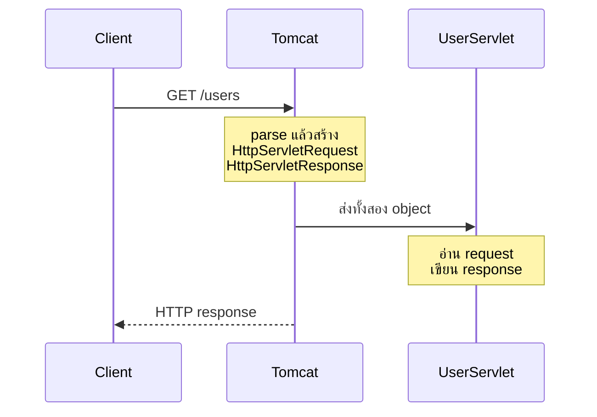
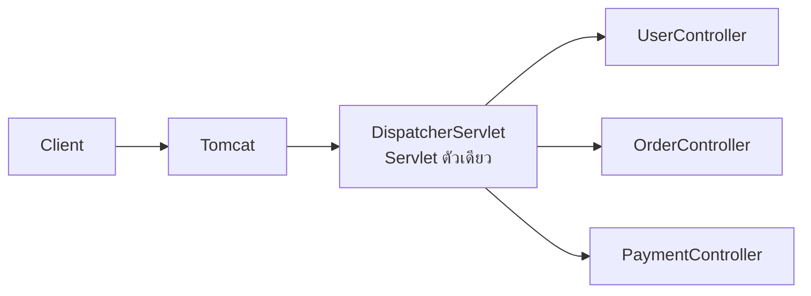
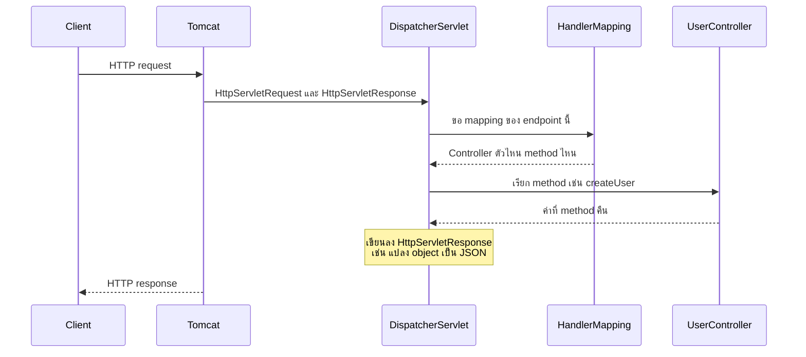

# #15 — สถาปัตยกรรม Spring MVC: DispatcherServlet, HandlerMapping และ JSP

> **วิดีโอ:** [Spring MVC Architecture | DispatcherServlet, HandlerMapping & JSP Flow | Spring Boot Full Course #15](https://youtu.be/M7_XxF6Zczw) — Coder Army, ~76 นาที
> **แหล่งที่ใช้สรุป:** ซับไตเติลภาษาอังกฤษที่ YouTube สร้างอัตโนมัติ
> **เวอร์ชันในโค้ด:** Spring Boot 4.1.1 + Java 21 (Spring Framework 7.0.9, embedded Tomcat 11.0.24, Jackson 3.1.5) ใส่หมายเหตุไว้ทุกจุดที่ Spring Boot 3.x ต่างกัน

ตอนนี้ตอบคำถามที่ค้างจากตอนที่เขียน Controller ไปแล้ว: **ระหว่าง Tomcat ที่ฟังพอร์ต กับ method ใน Controller มีอะไรอยู่** ผู้สอนไล่จากยุค Servlet หลายตัว มาที่ `DispatcherServlet` ตัวเดียว แล้วสร้างแอป CRUD ด้วย Spring MVC เปล่า ๆ (ไม่มี Spring Boot) เพื่อให้เห็น boilerplate ที่ Boot ซ่อนไว้ ท้ายตอนเปิด JSP เพื่อให้เห็นว่าชื่อ MVC มาจาก Model, View, Controller

ส่วนที่ติดป้าย `💡 เพิ่มเติม` คือของที่ผมเติมเอง ไม่ได้อยู่ในวิดีโอ ส่วนที่ติด `⚠️ แก้จากวิดีโอ` คือจุดที่วิดีโอพูดคลาดเคลื่อน

---

## สารบัญ

| เวลา | หัวข้อ |
|---|---|
| [0:00](https://youtu.be/M7_XxF6Zczw?t=0) | [1. Spring MVC คือ web framework ของ Spring](#1-spring-mvc-คือ-web-framework-ของ-spring) |
| [2:15](https://youtu.be/M7_XxF6Zczw?t=135) | [2. Spring Boot เป็นชั้น auto-configuration บน MVC](#2-spring-boot-เป็นชั้น-auto-configuration-บน-mvc) |
| [3:48](https://youtu.be/M7_XxF6Zczw?t=228) | [3. ใคร map endpoint ไปหา method](#3-ใคร-map-endpoint-ไปหา-method) |
| [5:54](https://youtu.be/M7_XxF6Zczw?t=354) | [4. ยุค Servlet หลายตัว งานซ้ำทุกตัว](#4-ยุค-servlet-หลายตัว-งานซ้ำทุกตัว) |
| [9:21](https://youtu.be/M7_XxF6Zczw?t=561) | [5. DispatcherServlet ตัวเดียว หลาย Controller](#5-dispatcherservlet-ตัวเดียว-หลาย-controller) |
| [12:54](https://youtu.be/M7_XxF6Zczw?t=774) | [6. HandlerMapping สร้างตาราง endpoint ไปหา method](#6-handlermapping-สร้างตาราง-endpoint-ไปหา-method) |
| [16:55](https://youtu.be/M7_XxF6Zczw?t=1015) | [7. ข้อมูลจาก client สามทาง](#7-ข้อมูลจาก-client-สามทาง) |
| [21:00](https://youtu.be/M7_XxF6Zczw?t=1260) | [8. ทางกลับของ response](#8-ทางกลับของ-response) |
| [22:13](https://youtu.be/M7_XxF6Zczw?t=1333) | [9. ภาพรวมหนึ่ง request](#9-ภาพรวมหนึ่ง-request) |
| [23:30](https://youtu.be/M7_XxF6Zczw?t=1410) | [10. Embedded Tomcat กับ external Tomcat](#10-embedded-tomcat-กับ-external-tomcat) |
| [24:14](https://youtu.be/M7_XxF6Zczw?t=1454) | [11. โปรเจกต์เปล่าและ dependency สามตัว](#11-โปรเจกต์เปล่าและ-dependency-สามตัว) |
| [28:32](https://youtu.be/M7_XxF6Zczw?t=1712) | [12. Student, Repository, Service, Controller](#12-student-repository-service-controller) |
| [40:37](https://youtu.be/M7_XxF6Zczw?t=2437) | [13. WebConfig: ComponentScan และ EnableWebMvc](#13-webconfig-componentscan-และ-enablewebmvc) |
| [42:08](https://youtu.be/M7_XxF6Zczw?t=2528) | [14. Boilerplate ใน main](#14-boilerplate-ใน-main) |
| [54:01](https://youtu.be/M7_XxF6Zczw?t=3241) | [15. รัน CRUD และบั๊กของ @PathVariable](#15-รัน-crud-และบั๊กของ-pathvariable) |
| [57:37](https://youtu.be/M7_XxF6Zczw?t=3457) | [16. @Controller กับ @RestController](#16-controller-กับ-restcontroller) |
| [58:42](https://youtu.be/M7_XxF6Zczw?t=3522) | [17. ชื่อ MVC และ View](#17-ชื่อ-mvc-และ-view) |
| [1:00:40](https://youtu.be/M7_XxF6Zczw?t=3640) | [18. JSP: Model ส่งข้อมูลเข้าหน้า](#18-jsp-model-ส่งข้อมูลเข้าหน้า) |
| [1:14:05](https://youtu.be/M7_XxF6Zczw?t=4445) | [19. จบ Spring Core กับ Spring MVC](#19-จบ-spring-core-กับ-spring-mvc) |
| — | [20. สรุปท้ายตอน](#20-สรุปท้ายตอน) |

---

## 1. Spring MVC คือ web framework ของ Spring

[▶ 0:00](https://youtu.be/M7_XxF6Zczw?t=0)

ผู้สอนบอกว่า Spring Boot และ Spring MVC วางอยู่บน Java Servlet ถ้าเข้าใจสถาปัตยกรรมของส่วนเว็บของ Spring Framework ซึ่งคือ Spring MVC จะเข้าใจว่ามันใช้ Servlet และ Tomcat อย่างไร และพอเข้าใจครั้งเดียว ส่วนเว็บภายในของ Spring Boot ก็ครอบคลุมด้วย เพราะ Spring Boot เป็นชั้น auto-configuration ที่วางบน Spring MVC

**Spring MVC คือ web framework จริงของสถาปัตยกรรม Spring** Spring ถือว่านี่คือ web framework ทางการ ใช้สร้างเว็บแอปได้สองแบบ

1. **REST API** ที่ตอบเป็น JSON ตอนนี้โฟกัสแบบนี้ก่อน
2. เว็บแอปที่คืน **หน้า HTML หรือหน้า JSP** ให้ client JSP ย่อมาจาก **JavaServer Pages** ผู้สอนบอกว่าจะกลับมาดูท้ายวิดีโอ

ในเอกสารของ Spring ชื่อ module คือ **Spring Web MVC** เวลาพูดทั่วไปเรียก Spring MVC

Spring MVC เป็นฝ่ายให้ annotation และ class สำหรับทำเว็บ เช่น `@Controller`, `@RestController`, `@GetMapping`, `@PostMapping`, `@RequestMapping` ของพวกนี้มาจาก Spring MVC

---

## 2. Spring Boot เป็นชั้น auto-configuration บน MVC

[▶ 2:15](https://youtu.be/M7_XxF6Zczw?t=135)

ถ้าสร้างเว็บแอปด้วย Spring MVC ได้อยู่แล้ว Spring Boot ทำหน้าที่ทำให้ทางนั้นสั้นลง Boot ให้ auto-configuration เพื่อให้เริ่มเขียน business logic ได้เร็ว

ผู้สอนย้อนไปที่ CRUD ที่สร้างไปแล้วในคอร์ส ชั้นที่เขียนคือ Controller ซึ่ง map endpoint ไปหา method แล้วเรียก Service, Service เรียก Repository, Repository คุยกับ database แอปสตาร์ทแล้วใช้งานได้โดยที่ไม่ได้ไปตั้งค่าเบื้องหลังเอง

ถ้าเขียนชุดเดียวกันด้วย Spring MVC ตรง ๆ งานที่ต้องทำเองมีอย่างน้อยสามก้อน

- ตั้ง **Tomcat**
- ประกาศ **DispatcherServlet**
- โหลด dependency เองทีละตัว

Boot หุ้มงานนี้ไว้ ผู้สอนบอกว่าถ้ารู้สถาปัตยกรรมของ Spring Web MVC ก็รู้สถาปัตยกรรมของ Spring Boot ในส่วนเว็บไปด้วย

---

## 3. ใคร map endpoint ไปหา method

[▶ 3:48](https://youtu.be/M7_XxF6Zczw?t=228)

ภาพที่รู้แล้วคือ client ส่ง request เข้าแอป แล้วโค้ดที่เขียนเริ่มที่ Controller

ตัวอย่างบนกระดาน: `GET /hello` ไปที่ `HelloController` ซึ่งเป็น class มีหลาย method สมมติว่ามี `hello` และต้องการให้ method นี้ทำงานเมื่อ request นั้นเข้ามา ก็เขียน `@GetMapping("/hello")` ไว้เหนือ method

หลังจาก Controller แล้วเส้นทางที่รู้คือ Service, Repository, แล้ว database

สิ่งที่ยังไม่รู้คือ **ช่วงก่อน Controller** Controller ไม่ได้เปิดพอร์ตฟังเอง ถ้า request มาที่ `localhost:8080` คนที่ฟังพอร์ต 8080 คือ Tomcat ในฐานะ Servlet Container และ Tomcat คุยกับ Servlet

`HelloController` ไม่ได้เป็น Servlet ดังนั้นยังมีงานภายในอีกชุดที่ยังไม่ได้ตอบ: เมื่อ client ส่ง `GET /hello` **ใครเป็นคน map ว่าต้องเรียก `HelloController.hello()`**

---

## 4. ยุค Servlet หลายตัว งานซ้ำทุกตัว

[▶ 5:54](https://youtu.be/M7_XxF6Zczw?t=354)

ผู้สอนให้ลืม Spring ชั่วคราว แล้วย้อนไปดูแอป Servlet

Tomcat รับ HTTP request แล้ว parse แยก endpoint, method เช่น `GET`, request parameter, path variable แล้วใส่ลง object สองตัวคือ `HttpServletRequest` กับ `HttpServletResponse` จากนั้นส่งทั้งคู่ให้ Servlet ที่ map ไว้

ตัวอย่างบนกระดานมีสาม Servlet: `UserServlet`, `OrderServlet`, `PaymentServlet` ถ้า call มาที่ `/users` Tomcat รู้ว่าต้องเรียก `UserServlet` Servlet อ่าน parameter และ body จาก request แล้วเขียนคำตอบลง response เมื่อแก้ object response แล้ว Tomcat ประกอบ **HTTP response** ส่งกลับ client



ปัญหาคือทุก Servlet ทำงานซ้ำชุดที่ไม่ใช่ business logic

- ตรวจ request parameter
- แปลง JSON ใน body เป็น Java object
- สร้าง response คือใส่ status code และ body
- ถ้าจะคืน object เป็น JSON ก็ต้องแปลง Java object กลับเป็น JSON
- จัดการ exception

`UserServlet`, `OrderServlet` และ `PaymentServlet` เขียนงานชุดนี้ซ้ำกันหมด

---

## 5. DispatcherServlet ตัวเดียว หลาย Controller

[▶ 9:21](https://youtu.be/M7_XxF6Zczw?t=561)

แนวของ Spring คือ Tomcat ยังเป็น Servlet Container ที่ฟัง request อยู่ แต่แทนที่จะส่งให้ Servlet หลายตัว Tomcat ส่งให้ **Servlet ตัวเดียว** ชื่อ **DispatcherServlet**

Tomcat ยังสร้าง `HttpServletRequest` กับ `HttpServletResponse` แล้วส่งทั้งคู่ให้ DispatcherServlet จากนั้น DispatcherServlet เป็นคนตัดสินว่าจะส่งต่อให้ Controller ตัวไหน

Servlet เดิมถูกแทนด้วย Controller: `UserController`, `OrderController`, `PaymentController` แต่ละตัวมี method ที่ map กับ endpoint ของตัวเอง เช่น `UserController.createUser` รับ `/users` พร้อม request body สำหรับสร้าง user และมี endpoint สำหรับดึง ลบ อัปเดต

Controller ไม่ได้คุยกับ Tomcat ตรง ๆ มี DispatcherServlet คั่นกลาง แล้ว DispatcherServlet ใช้ request กับ response ที่ได้มาทำงานชุดที่เมื่อกี้ซ้ำในทุก Servlet คือตรวจ parameter, แปลง JSON เป็น Java, สร้าง response, และจัดการ exception แบบรวมศูนย์ ก่อนส่งต่อให้ Controller



[▶ 12:00](https://youtu.be/M7_XxF6Zczw?t=720)

ตัวอย่างที่เห็นตอนใช้ Postman: client ส่ง JSON มาที่ body แล้ว parameter ของ Controller กลายเป็น Java object เอง เช่น method `createUser` รับ `User user` คู่กับ `@RequestBody` ที่ `POST /users` ฟิลด์อย่าง id กับ name ใน JSON ไปลงฟิลด์ของ object

ผู้สอนย้ำว่านี่ไม่ใช่เวทมนตร์ **DispatcherServlet แปลง JSON เป็น Java ไปแล้ว** ก่อน method ของเราเริ่มทำงาน งานสร้าง response และจัดการ exception ก็อยู่ฝั่งนี้เช่นกัน

> 💡 **เพิ่มเติม:** ของที่ลงมือแปลงคือ `HttpMessageConverter` ใน Spring Framework 7 ตัวของ JSON คือ `JacksonJsonHttpMessageConverter` เมื่อมี Jackson 3 บน classpath `DispatcherServlet` ไม่ได้เรียก Jackson เอง มันส่งต่องานเรียก method ให้ `HandlerAdapter` แล้วตัว adapter ใช้ converter นี้ตอนอ่าน `@RequestBody` และตอนเขียนค่าที่ method return รายละเอียดของ adapter อยู่หัวข้อถัดไป

---

## 6. HandlerMapping สร้างตาราง endpoint ไปหา method

[▶ 12:54](https://youtu.be/M7_XxF6Zczw?t=774)

DispatcherServlet ไม่ได้ทำงานทุกอย่างด้วยตัวเอง ผู้สอนเรียกมันว่า **entry point** ข้างในมีหลาย class ช่วย ตัวแรกที่ต้องรู้คือ **HandlerMapping**

HandlerMapping สร้าง **ตาราง** ว่า endpoint ไหนไป method ไหน ตัวอย่างบนกระดาน

| Request | Method |
|---|---|
| `GET /student` | `StudentController.getAllStudents` |
| `POST /student` | `StudentController.createStudent` |

DispatcherServlet ใช้ตารางนี้ตอนจะเรียก method คำถามหลักของ web framework คือ endpoint ไหนไป method ไหน HandlerMapping เป็นคนสร้างตาราง DispatcherServlet เป็นคนใช้ตาราง

### ตารางมาจาก Bean ใน IoC Container

[▶ 14:24](https://youtu.be/M7_XxF6Zczw?t=864)

IoC Container ดูแล Bean Bean คือ object ที่ประกาศด้วย `@Component` หรือ `@Bean` ในบรรดา Bean มี Controller เพราะ `@Controller` และ `@RestController` ใช้ `@Component` ข้างใน มี Service และมี Repository

เมื่อ container สร้าง Bean เหล่านี้แล้ว HandlerMapping เข้าไปดู method ใน Controller ว่าติด mapping อะไร เช่น `@PostMapping`, `@GetMapping` รวมถึง `@PutMapping` กับ `@DeleteMapping` แล้วประกอบเป็นตาราง

ใครสร้าง object ของ Controller คือ IoC Container ใครเรียก method คือ DispatcherServlet

[▶ 16:00](https://youtu.be/M7_XxF6Zczw?t=960)

ผู้สอนเสริมว่า DispatcherServlet ไม่ได้เรียก method ตรง ๆ มันใช้ **HandlerAdapter** ภายใน แต่บอกว่าไม่ต้องลงลึก จำสองชิ้นก็พอคือ DispatcherServlet กับ HandlerMapping หน้าที่ของ HandlerMapping คือสร้าง mapping ว่า endpoint ไหนเรียก method ไหน โดยสแกน annotation หลังจาก IoC Container สร้าง Bean ครบ แล้ว DispatcherServlet ใช้ mapping นั้นเรียก method ที่ถูกของ Controller ที่ถูก

> 💡 **เพิ่มเติม:** implementation ที่ `@RequestMapping` ใช้คือ `RequestMappingHandlerMapping` มันสร้างตารางตอน IoC Container refresh ครั้งเดียว ตอน request เข้ามา DispatcherServlet **ค้นตาราง** ไม่ได้สแกน annotation ใหม่ทุกครั้ง ตัวที่เรียก method จริงคือ `RequestMappingHandlerAdapter`

---

## 7. ข้อมูลจาก client สามทาง

[▶ 16:55](https://youtu.be/M7_XxF6Zczw?t=1015)

ผู้สอนบอกว่า client ส่งข้อมูลให้ server ได้สามแบบ

| แบบ | ตัวอย่างที่เขียนบนกระดาน |
|---|---|
| Request body | JSON ใน `POST` หรือ `PUT` |
| Path variable | `/user/1` เลข 1 คือ id |
| Query parameter | `/users?id=1` |

> ⚠️ **แก้จากวิดีโอ:** ผู้สอนพูดว่า body ใส่ได้ใน POST, PUT หรือ **UPDATE** HTTP ไม่มี method ชื่อ `UPDATE` method ที่ใช้แก้ข้อมูลคือ `PUT` กับ `PATCH` ทั้งคู่มี body ได้

### Body กับ Jackson

[▶ 17:48](https://youtu.be/M7_XxF6Zczw?t=1068)

สมมติ body เป็น JSON มี `id = 1` และ `name = Aditya` ต้องกลายเป็น object ของ class `User` ที่มี `int id` กับ `String name` DispatcherServlet ใช้ไลบรารี **Jackson** เป็นคนจับคู่ฟิลด์

### Path variable

[▶ 18:51](https://youtu.be/M7_XxF6Zczw?t=1131)

ผู้สอนบอกว่า HandlerMapping ดู endpoint `/user/1` แล้วไปหา pattern ที่ประกาศไว้ เช่น `/users/{id}` จากนั้นรู้ว่า `1` คือ path variable ที่ต้องใส่ให้พารามิเตอร์ `id` เขาบอกว่าข้างในใช้ resolver ชื่อยาว **HandlerMethodArgumentResolver** และบอกว่าไม่ต้องจำชื่อ จำ DispatcherServlet กับ HandlerMapping ก็พอ โดย DispatcherServlet เป็นชั้นแรกที่คั่นระหว่าง Tomcat กับ Controller

> ⚠️ **แก้จากวิดีโอ:** ผู้สอนวาง `HandlerMethodArgumentResolver` ไว้ใน HandlerMapping ที่ถูก HandlerMapping (`RequestMappingHandlerMapping`) จับคู่ pattern `/students/{id}` กับ method ตอนสตาร์ท ส่วนการดึงเลข `1` ใส่พารามิเตอร์เกิดตอนเรียก method โดย `RequestMappingHandlerAdapter` ผ่าน `HandlerMethodArgumentResolver` stack ที่จับได้ตอน reproduce บั๊กใน [หัวข้อ 15](#บั๊ก-long-id-ไม่เกี่ยวกับตัว-l) ชี้มาที่ `AbstractNamedValueMethodArgumentResolver` ซึ่งถูกเรียกจาก `RequestMappingHandlerAdapter.invokeHandlerMethod` ไม่ได้ถูกเรียกจาก HandlerMapping

### Query parameter

[▶ 20:02](https://youtu.be/M7_XxF6Zczw?t=1202)

ผู้สอนบอกว่า query parameter เป็นงานของ Tomcat Tomcat สร้าง `HttpServletRequest` กับ `HttpServletResponse` แล้วเก็บค่า query ไว้ใน request มี method ให้ดึง เขาเรียกมันว่า `getQueryParameter` แล้วสรุปบนกระดานว่า

- query parameter: Tomcat
- path variable: handler method argument resolver ซึ่งเขาบอกว่าอยู่ภายใน HandlerMapping
- request body: DispatcherServlet แปลง JSON เป็น Java และแปลงกลับ

> ⚠️ **แก้จากวิดีโอ:** method ใน Servlet API ที่ดึงค่านี้คือ `getParameter` (และ `getParameterMap`, `getQueryString`) ไม่มี `getQueryParameter` Tomcat parse query string ใส่ parameter map ของ request จริง แต่การเอาค่านั้นใส่ argument ของ `@RequestParam` ยังเป็น `HandlerMethodArgumentResolver` ตัวเดียวกับกลุ่มของ `@PathVariable` คือ `RequestParamMethodArgumentResolver` Tomcat ไม่ได้ฉีดค่าเข้า method ของ Controller โดยตรง

---

## 8. ทางกลับของ response

[▶ 21:00](https://youtu.be/M7_XxF6Zczw?t=1260)

หลัง Controller แล้ว request มักไปต่อที่ Service แล้ว Repository จากนั้นค่าเดินกลับ Repository ไป Service ไป Controller แล้ว Controller ส่งกลับ DispatcherServlet

DispatcherServlet ถือ `HttpServletResponse` อยู่ ถ้า method คืน object มันแปลง object เป็น JSON แล้ว Tomcat ส่ง response นั้นกลับ client

ผู้สอนเชื่อมกับตอน Servlet: method ของ Servlet เป็น `void` มันไม่ได้ return ค่า มันเขียนลง object `HttpServletResponse` ที่ถูกส่งเข้ามา และเพราะ object ก้อนเดียวกันนี้ถูกแชร์ Tomcat จึงอ่านคำตอบกลับไปให้ client ได้

method ที่เขายกชื่อคือ `doGet()`, `doPost()`, `doPut()`, `doDelete()` ทั้งหมดเป็น `void`

---

## 9. ภาพรวมหนึ่ง request

[▶ 22:13](https://youtu.be/M7_XxF6Zczw?t=1333)

ภาพสุดท้ายที่ผู้สอนวาด และเขาบอกว่านี่คือสถาปัตยกรรมของ Spring MVC ซึ่งก็คือสถาปัตยกรรมส่วนเว็บของ Spring Boot ด้วย ข้อที่ค้างระหว่าง Controller กับ Tomcat คือมี DispatcherServlet



[▶ 23:10](https://youtu.be/M7_XxF6Zczw?t=1390)

ผู้สอนแก้ภาพตัวเองทันที DispatcherServlet ไม่ได้ "ส่ง response กลับให้ Tomcat" เป็นขั้นตอนแยก method `doGet()`, `doPost()`, `doPut()`, `doDelete()` เป็น `void` มันแก้ค่าใน `HttpServletResponse` แล้ว Tomcat หยิบ object นั้นส่งให้ client เอง

---

## 10. Embedded Tomcat กับ external Tomcat

[▶ 23:30](https://youtu.be/M7_XxF6Zczw?t=1410)

จากตอน Servlet มี Tomcat สองแบบ

| แบบ | ที่อยู่ของ Tomcat |
|---|---|
| External | Tomcat รันแยก แอปถูกแพ็กเป็น WAR แล้ว deploy เข้าไป |
| Embedded | Tomcat อยู่ในแอป งานรับ request แล้วยื่นให้ DispatcherServlet เหมือนเดิม |

ตอนนี้จะสร้างโปรเจกต์ Spring MVC ตัวแรกโดยใช้ embedded Tomcat

---

## 11. โปรเจกต์เปล่าและ dependency สามตัว

[▶ 24:14](https://youtu.be/M7_XxF6Zczw?t=1454)

ผู้สอนเปิด IntelliJ สร้างโปรเจกต์ Maven ว่างชื่อ **Spring MVC Demo** ลบโค้ดตัวอย่าง แล้วรัน `Hello World` ให้ชัวร์ว่าโปรเจกต์ติดก่อน จากนั้นใส่ `<dependencies>`

เพราะไม่มี auto-configuration ต้องประกาศสามอย่างเอง

1. **`spring-webmvc`** ให้ annotation อย่าง `@PostMapping`, `@GetMapping`, `@RestController`, `@Controller` และส่วนประกอบของ MVC
2. **`tomcat-embed-core`** คือ embedded Tomcat เขาเลือก Core ไม่เอา artifact ของ JSP ในขั้นนี้
3. **Jackson Databind** สำหรับแปลง JSON กับ Java object

บน Maven Central เขาหยิบ `spring-webmvc` **7.0.7**, `tomcat-embed-core` **11.0.22** และ Jackson Databind รุ่นที่หน้าเว็บติดป้าย vulnerability ไว้หนึ่งรายการ เขาบอกว่ายังไม่ deploy จริงจึงยังไม่สน แต่ให้จำไว้ว่ามี แล้ว reload Maven จะเห็น transitive dependency ของทั้งสามตัว

เพราะใช้ embedded Tomcat จึงไม่ต้องสร้าง WAR ไป deploy แพ็กเป็น JAR แล้วพอสตาร์ทแอป Tomcat ก็รันไปด้วย

> ⚠️ **Boot 4 vs 3:** ในวิดีโอพูดว่าแอป Spring Boot ใส่ dependency ชื่อ **Spring Boot Starter Web** แล้วได้ Tomcat, annotation และ Jackson มาให้ ใน Boot 4 starter ของเว็บแบบ servlet ชื่อ `spring-boot-starter-webmvc` ชื่อเดิม `spring-boot-starter-web` ยังใช้ได้แต่ถูก deprecate POM ของ starter นี้ดึง `spring-boot-starter`, `spring-boot-starter-jackson`, `spring-boot-starter-tomcat`, `spring-boot-http-converter` และ `spring-boot-webmvc`
> ([Spring Boot 4.0 Migration Guide](https://github.com/spring-projects/spring-boot/wiki/Spring-Boot-4.0-Migration-Guide))

> ⚠️ **Boot 4 vs 3 — Jackson:** โน้ตที่เผยแพร่คู่กับตอนนี้ปัก `com.fasterxml.jackson.core:jackson-databind:2.21.4` ซึ่งคือ **Jackson 2** Spring Framework 7 ยังลงทะเบียน `MappingJackson2HttpMessageConverter` ให้ถ้าเจอ Jackson 2 แต่ Boot 4 ใช้ **Jackson 3** เป็น default พิกัดคือ `tools.jackson.core:jackson-databind` และ converter ชื่อ `JacksonJsonHttpMessageConverter` โค้ดด้านล่างใช้ Jackson 3.1.5 จาก BOM ของ Boot 4.1.1 class `Student` ไม่ได้ import Jackson ตรง ๆ จึงหน้าตาเหมือนในวิดีโอ
> ([Spring Boot 4.0 Migration Guide](https://github.com/spring-projects/spring-boot/wiki/Spring-Boot-4.0-Migration-Guide))

> 💡 **เพิ่มเติม:** วิดีโอคอมไพล์ด้วย Java 23 ตาม `pom.xml` ในโน้ต ไฟล์นี้ใช้ Java 21 ตามคอร์ส เวอร์ชันที่ BOM ของ Boot 4.1.1 เลือกให้คือ Spring Framework **7.0.9** และ Tomcat **11.0.24** คนละ patch กับ 7.0.7 และ 11.0.22 ในวิดีโอ แต่อยู่สาย Spring Framework 7 กับ Tomcat 11 เหมือนกัน พอร์ตในวิดีโอคือ **8080** ตอนรันด้านล่างใช้ **9015**

`pom.xml` ของโมดูล REST (parent คือ `spring-boot-starter-parent` 4.1.1 เพื่อให้เวอร์ชันถูกจัดการ แอปนี้ไม่ได้เรียก `SpringApplication`)

```xml
<dependencies>
  <dependency>
    <groupId>org.springframework</groupId>
    <artifactId>spring-webmvc</artifactId>
  </dependency>
  <dependency>
    <groupId>org.apache.tomcat.embed</groupId>
    <artifactId>tomcat-embed-core</artifactId>
  </dependency>
  <dependency>
    <groupId>tools.jackson.core</groupId>
    <artifactId>jackson-databind</artifactId>
  </dependency>
</dependencies>
```

---

## 12. Student, Repository, Service, Controller

[▶ 28:32](https://youtu.be/M7_XxF6Zczw?t=1712)

งานของแอปคือเก็บและดึงข้อมูลนักเรียนแบบ CRUD ย่อ ๆ **ไม่ต่อ database** ผู้สอนใช้ `HashMap` เป็นที่เก็บ เพื่อเลียนว่ามีการ save จริง และบอกว่ายังไม่ต้องใช้ JPA หรือ JDBC ตรงนี้ อยากเห็นแค่ว่า Spring MVC ต้องตั้งค่าอะไรเมื่อเทียบกับ Boot

แพ็กเกจในโน้ตของตอนนี้คือ `in.strikes`

### Entity

[▶ 29:14](https://youtu.be/M7_XxF6Zczw?t=1754)

เขาสร้างแพ็กเกจชื่อ `entity` แล้วบอกเองว่าจะไม่ใส่ annotation ของ JPA class `Student` มี `Long id`, `String name`, `String email` พร้อม getter กับ setter

JSON ที่จะยิงจาก Postman มีฟิลด์เดียวกัน เช่น id `1`, name `Aditya`, email `aditya@gmail.com` แล้ว Jackson จับคู่ชื่อฟิลด์

```java
package in.strikes.entity;

public class Student {
  private Long id;
  private String name;
  private String email;

  public Long getId() {
    return id;
  }

  public void setId(Long id) {
    this.id = id;
  }

  public String getName() {
    return name;
  }

  public void setName(String name) {
    this.name = name;
  }

  public String getEmail() {
    return email;
  }

  public void setEmail(String email) {
    this.email = email;
  }
}
```

### Repository

[▶ 30:25](https://youtu.be/M7_XxF6Zczw?t=1825)

`StudentRepository` ถือ `Map<Long, Student>` ชื่อ `studentDB` สร้าง `HashMap` ใน constructor มีสาม method

- `save` ทำ `put` ด้วย id แล้วคืน object เดิม
- `findById` เลียนชื่อของ JPA คืน object หรือ `null`
- `findAll` คืน `new ArrayList<>(studentDB.values())` คือค่าทั้งหมดใน map

ติด `@Repository` ซึ่งใช้ `@Component` ข้างใน จึงเป็น Bean

```java
package in.strikes.repository;

import in.strikes.entity.Student;
import java.util.ArrayList;
import java.util.HashMap;
import java.util.List;
import java.util.Map;
import org.springframework.stereotype.Repository;

@Repository
public class StudentRepository {

  private final Map<Long, Student> studentDB;

  public StudentRepository() {
    studentDB = new HashMap<>();
  }

  public Student save(Student studentReq) {
    studentDB.put(studentReq.getId(), studentReq);
    return studentReq;
  }

  public Student findById(Long id) {
    return studentDB.get(id);
  }

  public List<Student> findAll() {
    return new ArrayList<>(studentDB.values());
  }
}
```

### Service

[▶ 33:13](https://youtu.be/M7_XxF6Zczw?t=1993)

`StudentService` ติด `@Service` รับ `StudentRepository` ทาง constructor ผู้สอนบอกว่า constructor injection แบบนี้ไม่ต้องเขียน `@Autowired` method ส่งต่องานให้ repository ตรง ๆ ไม่มี validation

- `createStudent` เรียก `save`
- `getStudent` เรียก `findById`
- `getAllStudent` เรียก `findAll`

```java
package in.strikes.service;

import in.strikes.entity.Student;
import in.strikes.repository.StudentRepository;
import java.util.List;
import org.springframework.stereotype.Service;

@Service
public class StudentService {

  private final StudentRepository studentRepository;

  public StudentService(StudentRepository studentRepository) {
    this.studentRepository = studentRepository;
  }

  public Student createStudent(Student studentReq) {
    return studentRepository.save(studentReq);
  }

  public Student getStudent(Long id) {
    return studentRepository.findById(id);
  }

  public List<Student> getAllStudent() {
    return studentRepository.findAll();
  }
}
```

> 💡 **เพิ่มเติม:** Spring ไม่ต้องใส่ `@Autowired` ที่ constructor เมื่อ class มี constructor ตัวเดียว กฎนี้มีมาตั้งแต่ Spring Framework 4.3

### Controller

[▶ 35:29](https://youtu.be/M7_XxF6Zczw?t=2129)

เพราะกำลังทำ REST API เขาใส่ `@RestController` แล้วบอกว่าถ้าใช้ `@Controller` จะต้องใส่ `@ResponseBody` เพิ่ม จะกลับมาทำให้ดูทีหลัง แล้วใส่ `@RequestMapping("/students")` เป็น prefix ของทุก method ใน class

- `POST /students` method `createStudent` รับ `@RequestBody Student` เรียก service แล้ว `return ResponseEntity.ok(studentResp)` ซึ่งคือ 200
- `GET /students/{id}` method `getStudent` รับ `@PathVariable` ถ้า service คืน `null` ให้ `ResponseEntity.notFound().build()` ไม่งั้น `ResponseEntity.ok`
- `GET /students` method `getAllStudent` คืน `List<Student>` เขาพูดถึงการเช็ค `isEmpty` แล้วสรุปว่าลิสต์ว่างก็ยังตอบ OK พร้อมลิสต์ว่าง โค้ดที่เซฟไว้ไม่ได้เช็ค `isEmpty` มันคืน `ResponseEntity.ok` เสมอ

```java
package in.strikes.controller;

import in.strikes.entity.Student;
import in.strikes.service.StudentService;
import java.util.List;
import org.springframework.http.ResponseEntity;
import org.springframework.web.bind.annotation.GetMapping;
import org.springframework.web.bind.annotation.PathVariable;
import org.springframework.web.bind.annotation.PostMapping;
import org.springframework.web.bind.annotation.RequestBody;
import org.springframework.web.bind.annotation.RequestMapping;
import org.springframework.web.bind.annotation.ResponseBody;
import org.springframework.web.bind.annotation.RestController;

@RestController
@RequestMapping("/students")
public class StudentController {

  private final StudentService studentService;

  public StudentController(StudentService studentService) {
    this.studentService = studentService;
  }

  @PostMapping
  @ResponseBody
  public ResponseEntity<Student> createStudent(@RequestBody Student studentReq) {
    Student studentResp = studentService.createStudent(studentReq);
    return ResponseEntity.ok(studentResp);
  }

  @GetMapping("/{id}")
  @ResponseBody
  public ResponseEntity<Student> getStudent(@PathVariable("id") Long id) {
    Student studentResp = studentService.getStudent(id);
    if (studentResp == null) {
      return ResponseEntity.notFound().build();
    }
    return ResponseEntity.ok(studentResp);
  }

  @GetMapping
  @ResponseBody
  public ResponseEntity<List<Student>> getAllStudent() {
    List<Student> studentResp = studentService.getAllStudent();
    return ResponseEntity.ok(studentResp);
  }
}
```

`@ResponseBody` บน method อยู่ในไฟล์โน้ตของตอน แม้ class จะเป็น `@RestController` อยู่แล้ว ความหมายของสอง annotation นี้มาใน [หัวข้อ 16](#16-controller-กับ-restcontroller)

ถึงจุดนี้ชั้น business เหมือนแอป Spring Boot ที่เขาเคยเขียน สิ่งที่ยังเหลือคือการสตาร์ท IoC Container กับ Tomcat

---

## 13. WebConfig: ComponentScan และ EnableWebMvc

[▶ 40:37](https://youtu.be/M7_XxF6Zczw?t=2437)

Spring MVC วางบน Spring Core ดังนั้นต้องบอกเองว่าจะใช้ configuration ไหน ให้สร้าง Bean ของใคร และจะสแกน component ที่ไหน เขาสร้างแพ็กเกจ `config` และ class `WebConfig`

- `@Configuration` ซึ่งใช้ `@Component` ข้างใน
- `@ComponentScan(basePackages = "in.strikes")` ถ้าไม่ส่งชื่อแพ็กเกจ การสแกนจะอยู่แค่แพ็กเกจของ class นี้คือ `in.strikes.config` เขาอยากให้สแกนทั้ง `in.strikes` จึงใส่ base package เขาบอกว่าเขียน `"in.strikes"` เฉย ๆ ก็ได้ ไม่ต้องเขียนชื่อ attribute `basePackages`
- `@EnableWebMvc` เขาบอกว่า annotation นี้เปิด configuration และ annotation ให้ใช้ได้ เช่น `@RequestBody`, `@PostMapping`, `@GetMapping` ถ้าไม่ใส่ annotation พวกนั้นจะไม่ทำงาน

ไม่ต้องประกาศ `@Bean` ของ repository, service, controller เอง เพราะ component scan หาแล้วเอาไปไว้ใน IoC Container

```java
package in.strikes.config;

import org.springframework.context.annotation.ComponentScan;
import org.springframework.context.annotation.Configuration;
import org.springframework.web.servlet.config.annotation.EnableWebMvc;

@Configuration
@ComponentScan(basePackages = "in.strikes")
@EnableWebMvc
public class WebConfig {
}
```

> 💡 **เพิ่มเติม:** `@EnableWebMvc` import `DelegatingWebMvcConfiguration` ซึ่งลงทะเบียน infrastructure ของ MVC เช่น `RequestMappingHandlerMapping`, `RequestMappingHandlerAdapter` และ `HttpMessageConverter` annotation อย่าง `@GetMapping` เป็นแค่ metadata บน method ถ้าไม่มี infrastructure นี้ จะไม่มีใครอ่านมัน

---

## 14. Boilerplate ใน main

[▶ 42:08](https://youtu.be/M7_XxF6Zczw?t=2528)

ใน `Main` ต้องเขียน boilerplate ทุกครั้งที่เปิดแอป Spring MVC เพราะตั้งค่าเองทั้งหมด ใน Boot ไม่ต้องเขียน เพราะ `@SpringBootApplication` ใช้ `@EnableAutoConfiguration` ข้างใน

ลำดับที่เขาเขียน และความหมายที่เขาอธิบาย มีดังนี้

### สตาร์ท Tomcat และบอกพอร์ต

```java
Tomcat tomcat = new Tomcat();
tomcat.setPort(9015);
tomcat.getConnector();
```

`setPort` บอกว่า Tomcat จะฟังพอร์ตนี้ `getConnector()` สร้าง connector ที่ทำหน้าที่ฟังพอร์ตนั้นจริง วิดีโอใช้พอร์ต 8080

### Context path กับโฟลเดอร์ของเว็บแอป

[▶ 43:44](https://youtu.be/M7_XxF6Zczw?t=2624)

```java
String contextPath = "";
String baseDoc = new File("src/main/webapp").getAbsolutePath();
Context context = tomcat.addContext(contextPath, baseDoc);
```

เขาอธิบายจาก Tomcat แบบ external ว่าในเครื่อง Tomcat หนึ่งตัว deploy ได้หลายเว็บแอป แต่ละแอปมี Servlet ของตัวเอง ในโฟลเดอร์ที่ติดตั้ง Tomcat จะมี `webapps` เขาเปิดแอปจากตอน Servlet ให้ดู ข้างในมี `WEB-INF/classes` ซึ่งเป็นที่อยู่ของ class

**Context path** คือตัวที่บอกว่ากำลังพูดถึงเว็บแอปไหน เช่น app หนึ่ง, app สอง, app สาม เขาปล่อย context path เป็นสตริงว่าง เพราะใช้ embedded Tomcat และไม่ได้ deploy แยกเป็นแอปย่อย

Tomcat ยังต้องการโฟลเดอร์จริงของ context นั้น แม้ context path จะว่าง เขาจึงสร้างโฟลเดอร์ว่าง `src/main/webapp` แล้วส่ง absolute path ของโฟลเดอร์นั้นเป็น base directory ผ่าน `tomcat.addContext`

ระหว่างไลฟ์เขาพยายามประกอบ path ด้วย `System.getProperty` แล้วรันไม่ผ่านที่บรรทัดนั้น จากนั้นเปลี่ยนมาเป็น `new File("src/main/webapp").getAbsolutePath()` ซึ่งเป็นแบบในโน้ต

> ⚠️ **แก้จากวิดีโอ:** context path ว่างไม่ได้แปลว่า "ไม่ได้ deploy แอป" มันแปลว่าแอปนี้ถูก mount ที่ราก `/` embedded Tomcat ใส่ context path ไม่ว่างได้ เช่น `/demo` แล้ว URL จะขึ้นต้นด้วย path นั้น ส่วน absolute path ที่ส่งให้ `addContext` เป็น path ในระบบไฟล์ ไม่ใช่ URL

> 💡 **เพิ่มเติม:** `new File("src/main/webapp")` อ่านจาก working directory ตอนรัน ถ้ารันจากคนละโฟลเดอร์กับโมดูล Tomcat จะสตาร์ทไม่ขึ้นเพราะหา docBase ไม่เจอ

### IoC Container แบบเว็บ

[▶ 47:59](https://youtu.be/M7_XxF6Zczw?t=2879)

ขั้นแรกเขาเขียน `AnnotationConfigApplicationContext` แบบตอน Spring Core แล้วส่ง `WebConfig.class` เข้า constructor พอเอา context นี้ไปให้ `DispatcherServlet` IDE ฟ้องว่าที่ส่งไปเป็น `ApplicationContext` แต่ต้องเป็น `WebApplicationContext`

เขาจึงเปลี่ยนเป็น `AnnotationConfigWebApplicationContext` ซึ่ง constructor ไม่รับ class แล้วเรียก `register(WebConfig.class)` แทน

เขาย้ำว่า IoC Container ยังเป็นตัวเดิม สิ่งที่เปลี่ยนคือ implementation class แบบ annotation ปกติใช้ `AnnotationConfigApplicationContext` แบบเว็บใช้ `AnnotationConfigWebApplicationContext` ถ้าเป็น XML ก็มี class อีกตัว

ต้องส่ง context นี้เข้า `DispatcherServlet` เพราะ servlet ต้องเข้าไปใน container เพื่อดูว่า Bean ไหนเป็น Controller และ method ไหนติด `@PostMapping` หรือ `@GetMapping` HandlerMapping ใช้ข้อมูลนั้นสร้างตาราง

### ลงทะเบียน servlet แล้วเปิดเซิร์ฟเวอร์

[▶ 51:20](https://youtu.be/M7_XxF6Zczw?t=3080)

```java
Tomcat.addServlet(context, "dispatcherServlet", dispatcherServlet);
context.addServletMappingDecoded("/", "dispatcherServlet");
```

`Tomcat.addServlet` เป็น static method รับสามอย่าง: context ที่จะเพิ่ม servlet, ชื่อ servlet, และ object จริง

`addServletMappingDecoded("/", "dispatcherServlet")` บอกว่า request ที่ pattern เป็น `/` ให้ไปที่ DispatcherServlet เขาอธิบายว่า `/` ครอบคลุม request ที่เข้ามา เพราะ path ของ HTTP ขึ้นต้นด้วย `/`

จากนั้น `tomcat.start()` ซึ่งโยน `LifecycleException` แล้วพิมพ์เองว่า Tomcat started on port 8080 ใน Boot บรรทัดแบบนี้โผล่ใน log ให้เอง สุดท้าย `tomcat.getServer().await()` เพื่อไม่ให้ process จบ Tomcat จะได้ฟัง request ต่อ

`Main` ทั้งไฟล์

```java
package in.strikes;

import in.strikes.config.WebConfig;
import java.io.File;
import org.apache.catalina.Context;
import org.apache.catalina.LifecycleException;
import org.apache.catalina.startup.Tomcat;
import org.springframework.web.context.support.AnnotationConfigWebApplicationContext;
import org.springframework.web.servlet.DispatcherServlet;

public class Main {
  public static void main(String[] args) throws LifecycleException {
    Tomcat tomcat = new Tomcat();
    tomcat.setPort(9015);
    tomcat.getConnector();

    String contextPath = "";
    String baseDoc = new File("src/main/webapp").getAbsolutePath();
    Context context = tomcat.addContext(contextPath, baseDoc);

    AnnotationConfigWebApplicationContext springContext = new AnnotationConfigWebApplicationContext();
    springContext.register(WebConfig.class);

    DispatcherServlet dispatcherServlet = new DispatcherServlet(springContext);
    Tomcat.addServlet(context, "dispatcherServlet", dispatcherServlet);
    context.addServletMappingDecoded("/", "dispatcherServlet");

    tomcat.start();
    System.out.println("Tomcat started on port 9015");
    tomcat.getServer().await();
  }
}
```

ผู้สอนสรุปว่าไม่ต้องท่องบล็อกนี้ ดึงจากโน้ตได้ สิ่งที่ต้องรู้คือแต่ละบรรทัดทำอะไร: สตาร์ท Tomcat, ตั้งพอร์ต, สร้าง connector, ให้ context กับโฟลเดอร์, เปิด IoC Container, register configuration, สร้าง DispatcherServlet แล้วผูกกับ Tomcat, map ทุก path, `start` แล้ว `await`

---

## 15. รัน CRUD และบั๊กของ @PathVariable

[▶ 54:01](https://youtu.be/M7_XxF6Zczw?t=3241)

เขารันแล้วเห็นบรรทัดที่พิมพ์เอง จากนั้นยิงจาก Postman โดยไม่มี prefix `/api`

1. `POST http://localhost:8080/students` ได้ 200
2. ยิงอีกรายการ เปลี่ยนชื่อเป็น Rohit
3. `GET /students/1` ได้ Aditya และ `GET /students/2` ได้ Rohit
4. `GET /students` ได้ทั้งสองรายการ

ข้อมูลอยู่ใน `HashMap` ของ process พอรีสตาร์ท ข้อมูลหาย เขาต้อง POST ใหม่หลังแก้โค้ด

ผลจากโค้ดในไฟล์นี้บนพอร์ต 9015

```http
POST /students
Content-Type: application/json

{"id":1,"name":"Aditya","email":"aditya@gmail.com"}
```

```http
HTTP/1.1 200
Content-Type: application/json

{"email":"aditya@gmail.com","id":1,"name":"Aditya"}
```

รายการที่สองและรายการที่ดึงกลับมาได้แบบเดียวกัน เปลี่ยนชื่อเป็น Rohit กับ `rohit@gmail.com` ส่วน `GET /students/99` ได้ `HTTP/1.1 404` และ body ว่าง เพราะ `ResponseEntity.notFound().build()`

`GET /students` หลังใส่สองรายการ

```http
HTTP/1.1 200
Content-Type: application/json

[{"email":"aditya@gmail.com","id":1,"name":"Aditya"},{"email":"rohit@gmail.com","id":2,"name":"Rohit"}]
```

> 💡 **เพิ่มเติม:** ลำดับ key `email`, `id`, `name` เป็นลำดับที่ Jackson 3 เขียนออกมาในการรันนี้ ไม่ได้เรียงตามการประกาศฟิลด์ใน class

### บั๊ก Long id ไม่เกี่ยวกับตัว L

[▶ 55:34](https://youtu.be/M7_XxF6Zczw?t=3334)

ตอนแรก `GET /students/1` พัง เขาเดาว่าเพราะพารามิเตอร์เป็น `Long` Spring แปลงเป็น `1L` ไม่ได้ แบบที่ `float` ต้องมี `f` และบอกว่าถ้าเป็น `Integer` จะผ่าน แล้วแก้โดยเขียนชื่อใน annotation เป็น `@PathVariable("id")` จากนั้นรีสตาร์ท แล้ว GET ทั้งสอง id ผ่าน

> ⚠️ **แก้จากวิดีโอ:** สาเหตุไม่ใช่ชนิด `Long` และเปลี่ยนเป็น `Integer` ก็ไม่หาย เมื่อคอมไพล์โดยไม่มีชื่อพารามิเตอร์ใน class file แล้วเขียน `@PathVariable` โดยไม่ใส่ชื่อ ทั้ง `Long` และ `Integer` ได้ exception เดียวกัน ข้อความของ `Long` คือ
>
> `java.lang.IllegalArgumentException: Name for argument of type [java.lang.Long] not specified, and parameter name information not available via reflection. Ensure that the compiler uses the '-parameters' flag.`
>
> ของ `Integer` เปลี่ยนแค่ชื่อคลาสในข้อความเป็น `java.lang.Integer` Spring ต้องรู้ว่า argument นี้คู่กับ `{id}` ถ้าไม่เขียน `"id"` ใน annotation มันจะไปอ่านชื่อพารามิเตอร์จาก bytecode ซึ่งมีก็ต่อเมื่อคอมไพล์ด้วย `-parameters` โน้ตของวิดีโอเป็น Maven เปล่า ๆ ที่ไม่ได้เปิดแฟล็กนี้ parent ของ Spring Boot ตั้ง `<parameters>true</parameters>` ให้แล้ว ดังนั้นโปรเจกต์ Boot มักไม่เจอบั๊กนี้ การใส่ `@PathVariable("id")` ใช้ได้ทั้งสองแบบ

[▶ 56:47](https://youtu.be/M7_XxF6Zczw?t=3407)

เขาสรุปว่าทั้งหมดนี้คือ configuration ที่ Spring MVC ต้องทำเพื่อได้ CRUD ถ้าเป็น Spring Boot จะใส่ starter ตัวเดียว ได้ embedded Tomcat ไม่ต้องเขียน `Main` ยาว ไม่ต้องมี `WebConfig` เพื่อตั้ง base package และ Tomcat ฟัง 8080 ให้เอง Boot ทำให้ทางของเว็บแอปสั้นลง

---

## 16. @Controller กับ @RestController

[▶ 57:37](https://youtu.be/M7_XxF6Zczw?t=3457)

เขาเปลี่ยน class จาก `@RestController` เป็น `@Controller` แล้วใส่ `@ResponseBody` ใต้ mapping ของทุก method ที่คืนค่า รีสตาร์ทแล้วยิง POST กับ GET ได้อีก จึงสรุปว่าใช้ `@Controller` คู่กับ `@ResponseBody` หรือยุบเป็น `@RestController` ก็ได้

`@RestController` ใช้ `@ResponseBody` ข้างใน ถ้าติด `@RestController` อยู่แล้ว ได้ `@ResponseBody` อัตโนมัติ `@ResponseBody` ที่ยังอยู่บน method ในโค้ดหัวข้อ 12 จึงซ้ำกับที่ class มีอยู่แล้ว เป็นสถานะหลังเขาทดลองบนจอ

ความหมายของ `@ResponseBody` มาพร้อมคำอธิบายถัดไป Spring MVC ไม่ได้มีไว้ทำ REST อย่างเดียว มันคืนหน้าเว็บได้ด้วย ถ้าไม่มี `@ResponseBody` สตริงที่ return จาก `@Controller` จะถูกอ่านเป็น **ชื่อ view** ไม่ได้ถูกเขียนลง body

---

## 17. ชื่อ MVC และ View

[▶ 58:42](https://youtu.be/M7_XxF6Zczw?t=3522)

ผู้สอนบอกว่าผลลัพธ์ไม่จำเป็นต้องเป็น JSON ของ REST API Spring MVC คืนหน้า HTML หรือหน้า JSP ได้ สิ่งเหล่านี้เรียกว่า **View**

ชื่อเต็มของ MVC

| ตัวอักษร | ความหมายในตอนนี้ |
|---|---|
| **M** Model | object ที่ถือข้อมูลจาก Controller ไปให้ View เพื่อทำ HTML แบบ dynamic |
| **V** View | หน้า HTML หรือหน้า JSP ที่ผู้ใช้เห็นฝั่งหน้าเว็บ |
| **C** Controller | ชั้นที่รับ HTTP request และประกาศ endpoint |

เขาบอกว่าทุกวันนี้ไม่ค่อยใช้ JSP แล้ว มันเป็นเทคโนโลยีเก่า หน้าเว็บไปใช้ React, Vue และ JavaScript จะเจอ JSP ในโค้ดเก่า แต่ควรรู้ว่าชื่อ MVC เดิมหมายถึง Model, View, Controller และ View ในที่นี้คือหน้า HTML กับ JSP

> ⚠️ **แก้จากวิดีโอ:** ช่วงนี้นี้เขาเรียก JSP ว่า "Java Servlet Pages" สองครั้ง ต้นตอนที่นาที 1:25 เขาพูดถูกแล้วว่า **JavaServer Pages** และตอนอธิบายซ้ำที่ประมาณ 1:00:36 เขากลับมาที่ JavaServer Pages อีกครั้ง JSP ไม่ใช่ชื่อของ Servlet

---

## 18. JSP: Model ส่งข้อมูลเข้าหน้า

[▶ 1:00:40](https://youtu.be/M7_XxF6Zczw?t=3640)

เขาเปิดโปรเจกต์ว่างอีกตัวชื่อ **JSP Demo** แล้วก็อป dependency ของ Spring MVC กับ embedded Tomcat มาจากโปรเจกต์แรก **ไม่ใส่ Jackson** เพราะไม่ได้ตอบ JSON ใส่ตัวที่สามคือ **JSP engine ของ Tomcat** artifact `tomcat-embed-jasper` รุ่น 11.0.22 ในวิดีโอ แล้ว reload

โมดูลนี้ในไฟล์โน้ตใช้เวอร์ชันจาก BOM เดียวกับข้อ 11 และพอร์ต 9015

```xml
<dependencies>
  <dependency>
    <groupId>org.springframework</groupId>
    <artifactId>spring-webmvc</artifactId>
  </dependency>
  <dependency>
    <groupId>org.apache.tomcat.embed</groupId>
    <artifactId>tomcat-embed-core</artifactId>
  </dependency>
  <dependency>
    <groupId>org.apache.tomcat.embed</groupId>
    <artifactId>tomcat-embed-jasper</artifactId>
  </dependency>
</dependencies>
```

### Controller คืนชื่อ view

[▶ 1:02:11](https://youtu.be/M7_XxF6Zczw?t=3731)

`HelloController` ใช้ `@Controller` เพราะไม่ต้องการให้เป็น REST API method `showHomePage` คืน `String` และติด `@GetMapping("/")` เขาอยากให้เปิด `localhost:8080/` แล้วเห็นหน้าแรก

พารามิเตอร์เป็น `Model` ซึ่งเป็นตัวถือข้อมูลจาก Controller ไป View เขาเรียก `model.addAttribute("message", "Enter your name")` แล้ว `return "home"`

สตริง `"home"` ไม่ได้ถูกส่งเป็นข้อความให้ client มันคือ **ชื่อ view** Spring MVC รู้เพราะ class นี้เป็น `@Controller` และ method ไม่มี `@ResponseBody`

```java
package in.strikes.controller;

import org.springframework.stereotype.Controller;
import org.springframework.ui.Model;
import org.springframework.web.bind.annotation.GetMapping;
import org.springframework.web.bind.annotation.PostMapping;
import org.springframework.web.bind.annotation.RequestParam;

@Controller
public class HelloController {

  @GetMapping("/")
  public String showHomePage(Model model) {
    model.addAttribute("message", "Enter your name");
    return "home";
  }

  @PostMapping("/greet")
  public String greetUser(@RequestParam("name") String name, Model model) {
    model.addAttribute("message", "Hello " + name);
    return "home";
  }
}
```

### ไฟล์ JSP อยู่ใต้ WEB-INF

[▶ 1:04:06](https://youtu.be/M7_XxF6Zczw?t=3846)

เขาเทียบกับ Tomcat แบบ external ว่าในแต่ละแอปมี `META-INF` กับ `WEB-INF` แล้วสร้าง `src/main/webapp/WEB-INF/views` โฟลเดอร์ `webapp` ในโปรเจกต์แรกว่างไว้เพื่อส่งให้ Tomcat ที่นี่มันเก็บของที่เป็น static ด้วย เช่น HTML กับ CSS

เขาตั้งชื่อไฟล์พลาดเป็น `hello.jsp` ก่อน แล้วเปลี่ยนเป็น `home.jsp` ให้ตรงกับสตริงที่ Controller return หน้านี้คือ View Controller คือ `HelloController` และ `Model` คือก้อนที่ส่งจาก Controller เข้า View

```jsp
<%@ page contentType="text/html;charset=UTF-8" language="java" %>

<!DOCTYPE html>
<html>
<head>
    <meta charset="UTF-8">
    <title>Spring MVC JSP Demo</title>
    <link rel="stylesheet" href="/assets/style.css">
</head>
<body>

<div class="container">

    <h1>Spring MVC JSP Demo</h1>

    <p>${message}</p>

    <form action="/greet" method="post">
        <input type="text" name="name" placeholder="Enter your name" required>
        <button type="submit">Submit</button>
    </form>

</div>

</body>
</html>
```

`${message}` คือค่าที่ใส่ใน `Model` ด้วยชื่อ `message` ตอนเปิดหน้าแรกข้อความใน `<p>` จึงเป็น `Enter your name`

ฟอร์ม `POST` ไปที่ `/greet` ช่อง input ชื่อ `name` method `greetUser` รับค่านั้นด้วย `@RequestParam("name")` แล้วใส่ attribute ใหม่เป็น `"Hello " + name` ก่อนคืนชื่อ view `"home"` อีกครั้ง หน้าเดิมจึงถูกวาดใหม่ด้วยข้อความใหม่

> ⚠️ **แก้จากวิดีโอ:** เขาบอกว่าค่าจากฟอร์มมาเป็น query parameter เหมือนตอนส่ง `?name=` ใน URL ฟอร์มในไฟล์นี้เป็น `method="post"` และไม่ได้ตั้ง `enctype` ดังนั้นเบราว์เซอร์ส่ง `name=Aditya` ใน **body** แบบ `application/x-www-form-urlencoded` ไม่ได้ต่อท้าย URL `@RequestParam` อ่านได้ทั้ง query string และฟิลด์ฟอร์ม เพราะทั้งคู่ไปอยู่ใน `request.getParameter` แต่สองทางนั้นไม่ใช่ที่อยู่เดียวกัน

CSS อยู่ที่ `src/main/webapp/assets/style.css` เขาวางสไตล์ตัวอย่างให้กล่องกลางจอ พื้นหลังเทา ปุ่มน้ำเงิน ไฟล์ยาวประมาณสี่สิบบรรทัด ไม่มี logic

### ViewResolver กับไฟล์ CSS

[▶ 1:09:28](https://youtu.be/M7_XxF6Zczw?t=4168)

`WebConfig` ของโปรเจกต์นี้ก็อปมาจากตัวแรก แล้วทำเพิ่มสองอย่าง

1. `implements WebMvcConfigurer` แล้ว override `addResourceHandlers` ให้ `/assets/**` ไปที่ `/assets/` เขาบอกว่าถ้าไม่มีบล็อกนี้ CSS จะไม่โหลด เพราะใช้ `@EnableWebMvc` และไม่ต้องท่อง คัดลอกจากโน้ตได้
2. `@Bean` ของ `ViewResolver` เป็น `InternalResourceViewResolver` ตั้ง prefix `/WEB-INF/views/` กับ suffix `.jsp` ดังนั้นสตริง `home` กลายเป็น `/WEB-INF/views/home.jsp`

```java
package in.strikes.config;

import org.springframework.context.annotation.Bean;
import org.springframework.context.annotation.ComponentScan;
import org.springframework.context.annotation.Configuration;
import org.springframework.web.servlet.ViewResolver;
import org.springframework.web.servlet.config.annotation.EnableWebMvc;
import org.springframework.web.servlet.config.annotation.ResourceHandlerRegistry;
import org.springframework.web.servlet.config.annotation.WebMvcConfigurer;
import org.springframework.web.servlet.view.InternalResourceViewResolver;

@Configuration
@ComponentScan(basePackages = "in.strikes")
@EnableWebMvc
public class WebConfig implements WebMvcConfigurer {

  @Bean
  public ViewResolver viewResolver() {
    InternalResourceViewResolver resolver = new InternalResourceViewResolver();
    resolver.setPrefix("/WEB-INF/views/");
    resolver.setSuffix(".jsp");
    return resolver;
  }

  @Override
  public void addResourceHandlers(ResourceHandlerRegistry registry) {
    registry.addResourceHandler("/assets/**").addResourceLocations("/assets/");
  }
}
```


### Jasper กับ mapping ของ JSP

[▶ 1:11:40](https://youtu.be/M7_XxF6Zczw?t=4300)

`Main` ก็อปมาจากโปรเจกต์แรก แล้วเพิ่มของ JSP ก่อนสร้าง DispatcherServlet

- `context.addServletContainerInitializer(new JasperInitializer(), Set.of())` ผูก Jasper ที่เป็น dependency ของ view
- สร้าง `JspServlet` ชื่อ `"jsp"` ตั้ง `setLoadOnStartup(3)` แล้ว map ทั้ง `*.jsp` และ `*.jspx`
- DispatcherServlet ถูก `setLoadOnStartup(1)` แล้ว map ที่ `/` เหมือนเดิม

บนจอเขากล่าวถึงการเปลี่ยน `addContext` เป็น `addWebapp` ด้วย โค้ดในโน้ตที่รันได้ยังเป็น `addContext` คู่กับการลงทะเบียน `JspServlet` เอง

[▶ 1:13:07](https://youtu.be/M7_XxF6Zczw?t=4387)

รอบแรกรันแล้วยังไม่ขึ้นหน้า เขาบอกว่าโดยปกติ DispatcherServlet รับ endpoint ที่เป็น `/` ไปเอง ทำให้ `HelloController` ไม่ได้ถูกเรียกสำหรับ `/` เลยเพิ่มบรรทัดให้หน้า JSP ถูกแยกออกไป บรรทัดนั้นคือ mapping `*.jsp` ไปที่ `JspServlet` ในบล็อกด้านบน pattern `*.jsp` เฉพาะกว่า `/` ตอน Spring forward ไปที่ `home.jsp` จึงไปที่ Jasper ไม่วนกลับเข้า DispatcherServlet

```java
package in.strikes;

import in.strikes.config.WebConfig;
import java.io.File;
import java.util.Set;
import org.apache.catalina.Context;
import org.apache.catalina.LifecycleException;
import org.apache.catalina.Wrapper;
import org.apache.catalina.startup.Tomcat;
import org.apache.jasper.servlet.JasperInitializer;
import org.apache.jasper.servlet.JspServlet;
import org.springframework.web.context.support.AnnotationConfigWebApplicationContext;
import org.springframework.web.servlet.DispatcherServlet;

public class Main {
  public static void main(String[] args) throws LifecycleException {
    Tomcat tomcat = new Tomcat();
    tomcat.setPort(9015);
    tomcat.getConnector();

    String contextPath = "";
    String baseDoc = new File("src/main/webapp").getAbsolutePath();
    Context context = tomcat.addContext(contextPath, baseDoc);

    context.addServletContainerInitializer(new JasperInitializer(), Set.of());

    Wrapper jspWrapper = Tomcat.addServlet(context, "jsp", new JspServlet());
    jspWrapper.setLoadOnStartup(3);
    context.addServletMappingDecoded("*.jsp", "jsp");
    context.addServletMappingDecoded("*.jspx", "jsp");

    AnnotationConfigWebApplicationContext springContext = new AnnotationConfigWebApplicationContext();
    springContext.register(WebConfig.class);

    DispatcherServlet dispatcherServlet = new DispatcherServlet(springContext);
    Wrapper dispatcherWrapper = Tomcat.addServlet(context, "dispatcherServlet", dispatcherServlet);
    dispatcherWrapper.setLoadOnStartup(1);
    context.addServletMappingDecoded("/", "dispatcherServlet");

    tomcat.start();
    System.out.println("Tomcat started on port 9015");
    tomcat.getServer().await();
  }
}
```

เขาบอกว่าไม่ต้องท่อง สิ่งที่ต้องจำคือต้องสตาร์ท Tomcat สร้าง DispatcherServlet ให้ object นั้นกับ Tomcat และให้ object ของ IoC Container กับ DispatcherServlet

### สิ่งที่เบราว์เซอร์เห็น

[▶ 1:12:51](https://youtu.be/M7_XxF6Zczw?t=4371)

เปิด `localhost:8080` แล้วเห็นฟอร์ม ช่องให้กรอกชื่อ พิมพ์ Aditya แล้วกด submit ได้ข้อความ Hello Aditya พิมพ์ Rohit ได้ Hello Rohit ฝั่งเซิร์ฟเวอร์คือ `POST /greet` รับชื่อนั้นแล้วใส่กลับใน `Model`

ผลจากการรันโค้ดนี้

`GET /` ได้ `HTTP/1.1 200` และ `Content-Type: text/html;charset=UTF-8` ใน body มี `<p>Enter your name</p>`

`GET /assets/style.css` ได้ `HTTP/1.1 200` และ `Content-Type: text/css`

`POST /greet` ด้วย body `name=Aditya` และ `Content-Type: application/x-www-form-urlencoded` ได้หน้าเดิมที่ `<p>` เป็น `Hello Aditya` ส่ง `name=Rohit` ได้ `Hello Rohit`

---

## 19. จบ Spring Core กับ Spring MVC

[▶ 1:14:05](https://youtu.be/M7_XxF6Zczw?t=4445)

ผู้สอนสรุปว่าเห็นสถาปัตยกรรมของ Spring MVC และได้ลอง CRUD บนนั้นแล้ว JSP แทบไม่ได้ใช้แล้ว แต่ MVC สร้างได้ทั้ง REST API และเว็บที่คืน HTML หรือ JSP โดยตรง JSP คือหน้า HTML ที่ฝังโค้ด Java ได้ ชื่อยังเป็น Model-View-Controller แม้ทุกวันนี้จะใช้ Spring MVC ทำ REST เป็นหลัก

boilerplate ชุดนี้คือเหตุผลที่ย้ายจาก Spring MVC มาตรงมาที่ Spring Boot ถ้าตามซีรีส์มาถึงจุดนี้ ถือว่าจบ Spring Core และจบ Spring MVC พร้อมสถาปัตยกรรมภายในแล้ว

แอปต่อจากนี้จะเขียนบน Spring Boot เพราะไม่ต้องการเขียน boilerplate ซ้ำ สิ่งที่ต้องเข้าใจก่อนคือ Servlet ทำงานอย่างไร MVC ทำงานอย่างไร และ Spring Core คืออะไร เพื่อจะได้เห็นเทคโนโลยีที่รอง Spring Boot อยู่ งานหลักที่เหลือคือเขียน business logic ให้เร็ว เขาบอกว่าตอนหน้าจะไปที่ฟีเจอร์ของ Spring Boot แล้วเขียนโค้ดและสร้างแอปบนนั้นต่อ

---

## 20. สรุปท้ายตอน

### ประเด็นที่ต้องจำ

1. **Spring MVC** คือ web framework ของ Spring ชื่อ module คือ Spring Web MVC annotation ของเว็บมาจากที่นี่
2. **Spring Boot** เป็น auto-configuration บน MVC มันไม่ได้มาแทน MVC
3. Controller ไม่ได้ฟังพอร์ต Tomcat ฟังพอร์ต แล้วคุยกับ Servlet
4. ยุค Servlet หลายตัว งาน parse, แปลง JSON, สร้าง response และจัดการ exception ถูกเขียนซ้ำ Spring รวมงานนั้นไว้ที่ **DispatcherServlet** หนึ่งตัว แล้วให้มีได้หลาย **Controller**
5. **HandlerMapping** สร้างตาราง endpoint ไปหา method จาก annotation บน Bean ของ Controller หลังจาก IoC Container สร้าง Bean แล้ว ตอน request เข้ามา DispatcherServlet ค้นตารางนั้น
6. ตัวที่เรียก method จริงคือ **HandlerAdapter** รวมถึงการใส่ค่า `@PathVariable`, `@RequestParam` และ `@RequestBody`
7. Client ส่งข้อมูลได้ทาง body, path variable และ query string Jackson แปลง JSON ของ body
8. Method `doGet` / `doPost` ของ Servlet เป็น `void` และเขียนลง `HttpServletResponse` ก้อนที่ Tomcat ส่งมา Tomcat เป็นคนส่ง HTTP response กลับ
9. แอป Spring MVC เปล่า ๆ ต้องมี `spring-webmvc`, embedded Tomcat และ Jackson เอง ต้องมี `@EnableWebMvc` กับ `@ComponentScan` และต้อง `new Tomcat`, สร้าง `AnnotationConfigWebApplicationContext`, แล้ว `new DispatcherServlet` ใน `main`
10. `@RestController` คือ `@Controller` รวมกับ `@ResponseBody` ไม่มี `@ResponseBody` แล้วสตริงที่ return จะเป็นชื่อ view
11. **Model** ถือข้อมูลไปให้ **View** **ViewResolver** ต่อ prefix กับ suffix ให้ชื่อ view กลายเป็นไฟล์ เช่น `home` ไปเป็น `/WEB-INF/views/home.jsp`
12. JSP คือ HTML ที่ฝัง expression อย่าง `${message}` ได้ ทุกวันนี้ส่วนใหญ่ใช้ Spring MVC ทำ REST ชื่อ MVC ยังเหลือจากยุคที่มี View

### คำถามทบทวน

1. ทำไม `HelloController` ถึงฟังพอร์ต 8080 ไม่ได้ แม้จะมี `@GetMapping("/hello")`
2. งานอะไรบ้างที่ Servlet ทุกตัวต้องเขียนซ้ำ ก่อนจะมี DispatcherServlet
3. HandlerMapping สร้างตารางตอนไหน และ DispatcherServlet ใช้ตารางนั้นตอนไหน
4. `@PathVariable` กับ `@RequestParam` ถูกใส่ค่าโดยคลาสกลุ่มไหน ของ Tomcat จบที่ขั้นไหน
5. ทำไม `new DispatcherServlet(...)` ต้องได้ `WebApplicationContext` ไม่ใช่ `AnnotationConfigApplicationContext` ธรรมดา
6. context path ที่เป็นสตริงว่างหมายความว่าอะไร และ `addContext` ต้องการโฟลเดอร์ไปทำไม
7. `GET /students/1` พังทั้งที่ path มี `1` สาเหตุจริงคืออะไร และทำไมเปลี่ยนชนิดเป็น `Integer` แล้วไม่หาย
8. method ที่เป็น `@Controller` แล้ว `return "home"` โดยไม่มี `@ResponseBody` สตริงนั้นไปไหน
9. ในตัวอย่าง JSP อะไรคือ Model อะไรคือ View และ ViewResolver ประกอบ path อย่างไร
10. ถ้าโปรเจกต์เดียวกันนี้ใช้ `spring-boot-starter-webmvc` แล้วเรียก `SpringApplication.run` บรรทัดไหนใน `Main` และ class ไหนที่ไม่ต้องเขียนเอง

### ตอนถัดไป

[#16 — DTOs & Validations in Spring Boot | Make Your REST API Professional](./16-dtos-and-validations.md)
