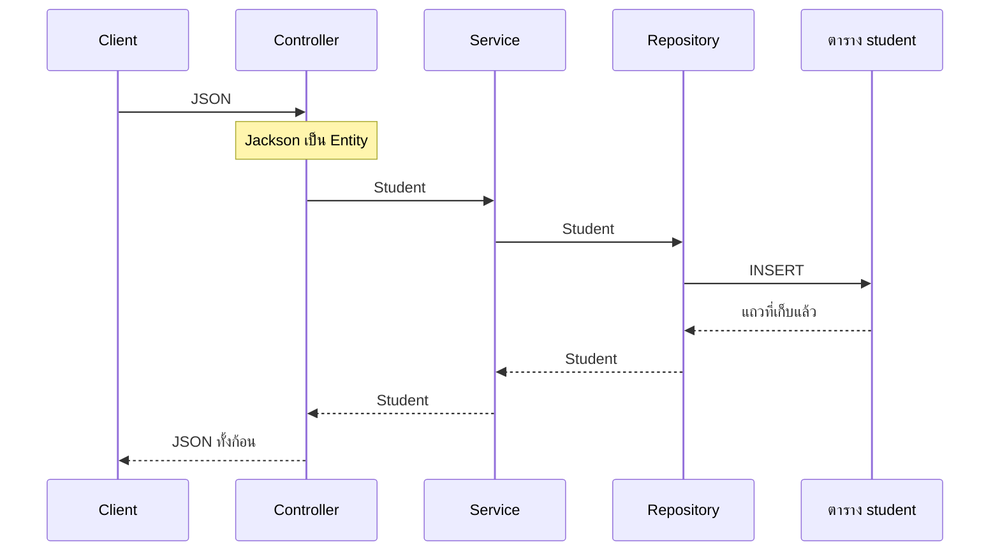
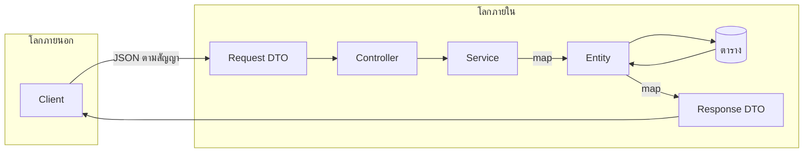
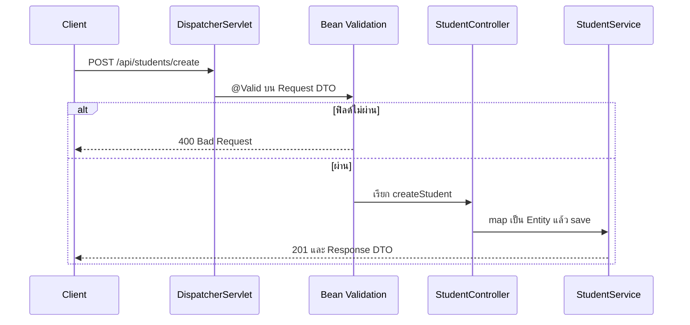
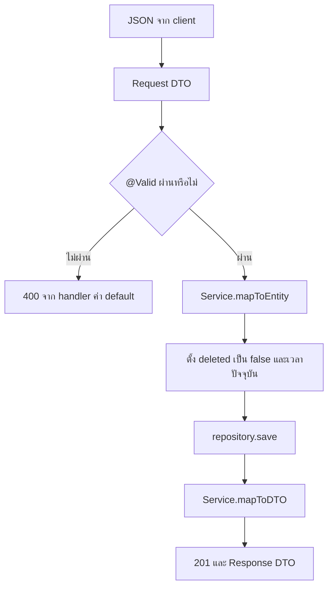

# #16 — DTO กับ Validation: แยกสัญญา API ออกจาก Entity

> **วิดีโอ:** [DTOs & Validations in Spring Boot | Make Your REST API Professional | Spring Boot Full Course #16](https://youtu.be/vXA78rtCeTY) — Coder Army, ~64 นาที
> **แหล่งที่ใช้สรุป:** ซับไตเติลภาษาอังกฤษที่ YouTube สร้างอัตโนมัติ
> **เวอร์ชันในโค้ด:** Spring Boot 4.1.1 + Java 21 (Spring Framework 7.0.9, embedded Tomcat 11.0.24, Jackson 3.1.5, Hibernate Validator 9.1.3) ใส่หมายเหตุไว้ทุกจุดที่ Spring Boot 3.x ต่างกัน

ตอนนี้ตอบคำถามที่ค้างจากโปรเจกต์ CRUD: **ทำไมรับ request และส่ง response ด้วย Entity ตรง ๆ ถึงผูก client เข้ากับตาราง** และจะกันข้อมูลเพี้ยนตั้งแต่ request ถึง Controller ได้อย่างไร ผู้สอนเริ่มจากหน้าที่ที่ Entity แบกไว้เกิน แล้วแยก **DTO** สำหรับรับกับส่ง จากนั้นใส่ Bean Validation บน Request DTO

ส่วนที่ติดป้าย `💡 เพิ่มเติม` คือของที่ผมเติมเอง ไม่ได้อยู่ในวิดีโอ ส่วนที่ติด `⚠️ แก้จากวิดีโอ` คือจุดที่วิดีโอพูดคลาดเคลื่อน

---

## สารบัญ

| เวลา | หัวข้อ |
|---|---|
| [0:00](https://youtu.be/vXA78rtCeTY?t=0) | [1. โฟลว์เดิม Entity เดินทุกชั้น](#1-โฟลว์เดิม-entity-เดินทุกชั้น) |
| [2:36](https://youtu.be/vXA78rtCeTY?t=156) | [2. Entity รับหน้าที่เกินไป](#2-entity-รับหน้าที่เกินไป) |
| [3:22](https://youtu.be/vXA78rtCeTY?t=202) | [3. โปรเจกต์บน Initializr แล้วกลับไปใช้ CRUD ตอนที่ 13](#3-โปรเจกต์บน-initializr-แล้วกลับไปใช้-crud-ตอนที่-13) |
| [13:00](https://youtu.be/vXA78rtCeTY?t=780) | [4. Client ส่งฟิลด์ภายในได้](#4-client-ส่งฟิลด์ภายในได้) |
| [15:49](https://youtu.be/vXA78rtCeTY?t=949) | [5. Response ส่งฟิลด์ภายในกลับไปด้วย](#5-response-ส่งฟิลด์ภายในกลับไปด้วย) |
| [17:22](https://youtu.be/vXA78rtCeTY?t=1042) | [6. เปลี่ยนตารางแล้วสัญญา API พัง](#6-เปลี่ยนตารางแล้วสัญญา-api-พัง) |
| [18:09](https://youtu.be/vXA78rtCeTY?t=1089) | [7. โลกภายนอกกับโลกภายใน](#7-โลกภายนอกกับโลกภายใน) |
| [19:22](https://youtu.be/vXA78rtCeTY?t=1162) | [8. DTO คือ POJO สำหรับย้ายข้อมูล](#8-dto-คือ-pojo-สำหรับย้ายข้อมูล) |
| [23:03](https://youtu.be/vXA78rtCeTY?t=1383) | [9. ใครเป็นคนแปลง DTO เป็น Entity](#9-ใครเป็นคนแปลง-dto-เป็น-entity) |
| [24:27](https://youtu.be/vXA78rtCeTY?t=1467) | [10. Create: map ไปมาใน Service](#10-create-map-ไปมาใน-service) |
| [31:55](https://youtu.be/vXA78rtCeTY?t=1915) | [11. createdAt กับ updatedAt อยู่ที่ Entity](#11-createdat-กับ-updatedat-อยู่ที่-entity) |
| [37:01](https://youtu.be/vXA78rtCeTY?t=2221) | [12. Update ใช้ DTO คนละชุด](#12-update-ใช้-dto-คนละชุด) |
| [45:46](https://youtu.be/vXA78rtCeTY?t=2746) | [13. get กับ getAll ก็ไม่คืน Entity](#13-get-กับ-getall-ก็ไม่คืน-entity) |
| [48:23](https://youtu.be/vXA78rtCeTY?t=2903) | [14. delete ไม่ต้องมี DTO](#14-delete-ไม่ต้องมี-dto) |
| [49:29](https://youtu.be/vXA78rtCeTY?t=2969) | [15. ข้อมูลเพี้ยนยังเข้าตารางได้](#15-ข้อมูลเพี้ยนยังเข้าตารางได้) |
| [50:49](https://youtu.be/vXA78rtCeTY?t=3049) | [16. การตรวจพื้นฐานควรจบที่ Controller](#16-การตรวจพื้นฐานควรจบที่-controller) |
| [52:19](https://youtu.be/vXA78rtCeTY?t=3139) | [17. spring-boot-starter-validation](#17-spring-boot-starter-validation) |
| [55:10](https://youtu.be/vXA78rtCeTY?t=3310) | [18. Annotation บน Request DTO](#18-annotation-บน-request-dto) |
| [58:39](https://youtu.be/vXA78rtCeTY?t=3519) | [19. ต้องมี @Valid annotation ถึงจะทำงาน](#19-ต้องมี-valid-annotation-ถึงจะทำงาน) |
| [59:11](https://youtu.be/vXA78rtCeTY?t=3551) | [20. 400 ยังไม่บอกว่าฟิลด์ไหนผิด](#20-400-ยังไม่บอกว่าฟิลด์ไหนผิด) |
| — | [21. สรุปท้ายตอน](#21-สรุปท้ายตอน) |

---

## 1. โฟลว์เดิม Entity เดินทุกชั้น

[▶ 0:00](https://youtu.be/vXA78rtCeTY?t=0)

ผู้สอนทบทวนชั้นที่โปรเจกต์ CRUD มีอยู่แล้ว request จาก client ถึง **Controller** ก่อน จากนั้นไป **Service** แล้วไป **Repository**

ตัวอย่างคือ `POST /api/students` พร้อม JSON ที่มี `id` กับ `name` Controller map JSON ก้อนนั้นเป็น object ของคลาส **Entity** ชื่อ `Student` แล้วส่ง object เดิมต่อไปทุกชั้น Repository เก็บมันลงตาราง พอได้แถวกลับมา Entity ก้อนเดิมเดินย้อนขึ้นมา แล้ว Controller แปลงเป็น JSON ส่งให้ client ตัวที่แปลงสองทางคือไลบรารี **Jackson**

ชื่อคลาส Entity กลายเป็นชื่อตาราง ฟิลด์อย่าง `id`, `name`, `email` กลายเป็นคอลัมน์



---

## 2. Entity รับหน้าที่เกินไป

[▶ 2:36](https://youtu.be/vXA78rtCeTY?t=156)

งานของ Entity ควรเป็นการ map ลง database อย่างเดียว ในโฟลว์ด้านบนมันทำมากกว่านั้น

- รับ JSON ของ request
- เดินผ่าน Service และ Repository
- กลับขึ้นมาเป็น JSON ของ response

ผู้สอนบอกว่าพอโปรเจกต์ใหญ่ขึ้น หน้าที่ที่ซ้อนกันแบบนี้จะเป็นปัญหา ทางแก้ของตอนนี้คือ **DTO** ย่อจาก **Data Transfer Object** DTO รับหน้าที่ย้ายข้อมูลแทน เพื่อให้ Entity เหลือหน้าที่เกี่ยวกับตาราง

---

## 3. โปรเจกต์บน Initializr แล้วกลับไปใช้ CRUD ตอนที่ 13

[▶ 3:22](https://youtu.be/vXA78rtCeTY?t=202)

เขาเปิด Spring Initializr เลือก Java, Maven, Spring Boot 4.1.0, แพ็กเป็น JAR, Java 21 แล้วใส่ dependency สามตัวคือเว็บ, JPA และ MySQL driver artifact ที่เขาตั้งชื่อคือ `crud-dto-demo`

> 💡 **เพิ่มเติม:** ซับพูด group ประมาณ `in.stryx` แล้วต่อมาพูด package ประมาณ `in.strikes.demo` โน้ตนี้ใช้ package `in.strike.crudspringbootdemo` ตามโปรเจกต์ CRUD ของตอนที่ 13 เพราะหลังจากสร้างโปรเจกต์ใหม่ไม่กี่นาที เขาเปิดโปรเจกต์นั้นมาแก้ต่อ โค้ดที่รันด้านล่างเป็น Boot **4.1.1** ตามชุดโน้ต

ในโปรเจกต์ใหม่เขาจัด package `controller`, `service`, `repository`, `entity` แล้วสร้าง `Student` ด้วยฟิลด์ `id` เป็น `Long`, `name`, `email` ใส่ getter กับ setter จาก IDE แล้วติด `@Entity` IDE เตือนให้มี primary key เขาจึงใส่ `@Id` และ `@GeneratedValue(strategy = GenerationType.IDENTITY)`

`StudentController` ติด `@RestController` กับ `@RequestMapping("/api/students")` method `create` คืน `ResponseEntity<Student>` รับ `@RequestBody Student` แล้วเรียก service `StudentService` ติด `@Service` รับ `StudentRepository` ทาง constructor `StudentRepository` เป็น interface ที่ `extends JpaRepository<Student, Long>` method `createStudent` เรียก `save` แล้วคืน Entity กลับขึ้นไป Controller ห่อด้วย `ResponseEntity.ok`

เขาบอกว่านี่คือโฟลว์ create ทั้งเส้น และเป็นโฟลว์เดียวกับแอป CRUD ที่ทำไว้แล้ว ทุกชั้นจับ Entity ตัวเดิม ทั้งตอนรับ request ตอนส่งต่อ และตอนตอบ

[▶ 10:28](https://youtu.be/vXA78rtCeTY?t=628)

จากนั้นเขาปิดสเก็ตช์ แล้วเปิดโปรเจกต์ CRUD จากตอนที่ 13 (ในคลิปเขาบอกให้ดาวน์โหลดจาก GitHub ของ lecture 13 ถ้ายังไม่มี) ฟิลด์ของ `Student` ในโปรเจกต์นั้นคือ `id`, `name`, `age`, `email`, `rollNumber`, `subject` และ `deleted` ฟิลด์ `deleted` ใช้ทำ soft delete `id` เป็น primary key แบบ auto-generated

Endpoint ที่เขาสรุปจาก Controller เดิม

| งาน | HTTP | Path |
|---|---|---|
| สร้าง | `POST` | `/api/students/create` |
| อ่านคนเดียว | `GET` | `/api/students/get?id=` |
| อ่านทั้งหมด | `GET` | `/api/students/getAll` |
| แทนที่ | `PUT` | `/api/students/update?id=` |
| Hard delete | `DELETE` | `/api/students/delete?id=` |
| Soft delete | `PATCH` | `/api/students/delete-soft?id=` |

`id` ของ get, update, delete และ soft delete เป็น **request parameter** ไม่ใช่ path variable ตามที่ตอนที่ 13 จบไว้ Service เรียก method มาตรฐานของ `JpaRepository` และ derived query `findByIdAndDeletedIsFalse`

`application.properties` ของเขาต่อ MySQL มี URL, username, password และเปิด SQL ใน log สองค่า คือ `spring.jpa.show-sql=true` กับ `spring.jpa.properties.hibernate.format_sql=true`

เขาสตาร์ทแอป อ่าน log ว่า Tomcat started แล้วยิง `POST /api/students/create` จาก Postman ได้ `201 Created` refresh ตารางแล้วเห็นแถวใหม่

> 💡 **เพิ่มเติม — ฐานที่ใช้รันในโน้ตนี้:** วิดีโอต่อ MySQL โน้ตนี้ใช้ H2 in-memory และพอร์ต `9016` เพื่อไม่ต้องมีเซิร์ฟเวอร์ฐานแยก `ddl-auto=update`, `show-sql` และ `format_sql` คือค่าที่โปรเจกต์ในวิดีโอใช้อยู่แล้ว

```properties
server.port=9016

spring.datasource.url=jdbc:h2:mem:student_dto_db
spring.datasource.driver-class-name=org.h2.Driver

spring.jpa.hibernate.ddl-auto=update
spring.jpa.show-sql=true
spring.jpa.properties.hibernate.format_sql=true
```

สเก็ตช์ตอนต้นคืน `ResponseEntity.ok` ซึ่งคือ `200` ส่วน Controller ของโปรเจกต์ CRUD ที่เขายิงจริงตอบ `201` โน้ตนี้คง `201` ของโปรเจกต์นั้น

---

## 4. Client ส่งฟิลด์ภายในได้

[▶ 13:00](https://youtu.be/vXA78rtCeTY?t=780)

ปัญหาแรกของการรับ Entity ทั้งก้อนคือ client ส่งฟิลด์ที่เราไม่ต้องการให้ส่งได้

`deleted` เป็นธง soft delete ที่ฝั่ง server ต้องเป็นคนตั้ง เขาไม่อยากให้ client ส่งเอง เขาสมมติเพิ่มฟิลด์ metadata อีกสองตัว `createdAt` กับ `updatedAt` ตอนแรกเป็น `String` (เขาพูดถึง epoch ไว้แล้วบอกว่าจะกลับมาดูทีหลัง) สองฟิลด์นี้บอกว่าแถวถูกสร้างเมื่อไรและถูกแก้เมื่อไร เป็นของภายในแถว

ถ้า request body map เข้า `Student` ตรง ๆ ไม่มีอะไรกัน client ไม่ให้ส่ง `deleted: true` หรือใส่เวลาเอง เขาจึงต้องไปเขียนทับใน service ก่อน save เช่น `setDeleted(false)` ทุกครั้ง ไม่ว่า client จะส่งมาหรือไม่ และต้องทำแบบเดียวกันกับเวลา ลืมทับเมื่อไร ค่าจาก client ลงตาราง

เขาสรุปว่าการให้ client ส่ง Entity ทั้งก้อนคือการเปิดให้แก้ข้อมูลที่เราไม่ต้องการให้แก้

---

## 5. Response ส่งฟิลด์ภายในกลับไปด้วย

[▶ 15:49](https://youtu.be/vXA78rtCeTY?t=949)

ปัญหาที่สองอยู่ฝั่งกลับ `save` คืน Entity ทั้งก้อน Service ส่งต่อให้ Controller และ Controller ส่งให้ client

เขาสตาร์ทใหม่แล้วยิง create ด้วยข้อมูลของ Aisha อายุ 25 อีเมลของ Aisha เลข 107 วิชา Django response ที่ได้มีทั้งอายุ อีเมล ชื่อ เลข วิชา และมีคีย์ `deleted` ด้วย เพราะเขากำลังคืน Entity ทั้งตัว

client ที่เป็นแอป React ไม่จำเป็นต้องรู้ว่าข้างในมีธง soft delete ถ้ามี `createdAt` กับ `updatedAt` สองฟิลด์นั้นจะหลุดไปด้วย เขายกตัวอย่างฟิลด์ที่ไม่อยากโชว์อีกอย่างคือรหัสผ่าน

---

## 6. เปลี่ยนตารางแล้วสัญญา API พัง

[▶ 17:22](https://youtu.be/vXA78rtCeTY?t=1042)

ปัญหาที่สามคือ schema กับ client ผูกกัน

**API contract** ตามที่เขาอธิบายคือสิ่งที่ทั้งสองฝั่งตกลงกันว่า request จะมีฟิลด์อะไร และ response จะมีฟิลด์อะไร วันนี้ตกลงว่า client ส่ง `name` ก้อนเดียว พรุ่งนี้เขาแยกคอลัมน์ในตารางเป็น `firstName` กับ `lastName` เขาต้องไปบอก client ให้เลิกส่ง `name` แล้วส่งสองฟิลด์ใหม่ การแก้ database จึงดึงให้ฝั่ง client ต้องแก้ตาม

เขาสรุปว่า database กับ logic ภายในถูกผูกแน่นกับ client

---

## 7. โลกภายนอกกับโลกภายใน

[▶ 18:09](https://youtu.be/vXA78rtCeTY?t=1089)

เขาแบ่งแอปเป็นสองโลก

- **โลกภายนอก** คือฝั่งที่ client เรียก API เข้ามาทางเครือข่าย
- **โลกภายใน** เริ่มเมื่อ request ถึง Controller

Entity อยู่ในโลกภายใน มันบอกว่าจะเก็บอะไรลงตาราง มันไม่ควรเป็นก้อนที่ส่งออกไปหา client อัตโนมัติ

สิ่งที่ขาดคือคลาสอีกชุดสำหรับรับ request และส่ง response โดยฟิลด์ชุดนั้นต่างจากสิ่งที่เก็บในตารางได้



ผลที่เขาไม่อยากได้ถ้ายังใช้ Entity ทุกที่

- client ส่งฟิลด์อ่อนไหวเข้ามา
- server ส่งฟิลด์อ่อนไหวออกไป
- ต้องเขียนการกันค่าไว้ใน service หลายจุด ลืมจุดไหนค่าผิดลงตาราง
- แก้ตารางแล้วสัญญากับ client พัง

---

## 8. DTO คือ POJO สำหรับย้ายข้อมูล

[▶ 19:22](https://youtu.be/vXA78rtCeTY?t=1162)

**DTO** เป็นคลาส Java ธรรมดา เขายกให้เทียบกับ POJO มีฟิลด์พร้อม getter กับ setter แบบ Entity แต่เลือกเฉพาะฟิลด์ที่อยากรับจาก client หรืออยากส่งกลับ เขาให้มองว่า DTO เป็นสับเซตของ Entity ได้ และสองฝั่งไม่จำเป็นต้องมีฟิลด์เท่ากัน

[▶ 19:58](https://youtu.be/vXA78rtCeTY?t=1198)

ตัวอย่างที่เขาใช้คือ client ส่ง `name`, `age`, `email`, `rollNumber`, `subject` ตอนตอบเขาอยากเพิ่มข้อความว่าบันทึกสำเร็จ request กับ response จึงคนละรูป เขาแยกเป็นสองคลาส

- **Request DTO** เก็บฟิลด์ที่รับ
- **Response DTO** เก็บฟิลด์ที่ส่งกลับ

เขาบอกว่านี่เป็นแนวปฏิบัติมาตรฐานของงาน Spring Boot หน้าที่ของ DTO คือย้ายข้อมูล Entity ไม่ต้องเดินจาก Controller ไปจนถึง client อีก

[▶ 21:00](https://youtu.be/vXA78rtCeTY?t=1260)

เขาเพิ่ม package สำหรับ DTO แล้วสร้างคลาส request ฟิลด์ที่เอาจาก Entity คือชื่อ อายุ อีเมล เลข และวิชา เขาไม่รับ `id` เพราะ server สร้างให้เอง และไม่รับ `deleted` จากนั้นให้ IDE สร้าง getter กับ setter แล้วเปลี่ยนชื่อคลาสเป็น `StudentRequestDTO` ก่อน ช่วงท้ายเขาจะเติมคำว่า `Create` ข้างหน้า

Controller ของ create เปลี่ยนพารามิเตอร์จาก `Student` เป็น DTO นี้ เขาบอกว่าพอสัญญาอยู่บนฟิลด์ของ DTO client ส่ง `deleted` มาก็ไม่มีฟิลด์ให้ map

> 💡 **เพิ่มเติม:** Spring Boot ปิด `FAIL_ON_UNKNOWN_PROPERTIES` ของ Jackson ไว้เป็นค่า default คีย์ที่ DTO ไม่มีจึงถูกทิ้ง request ยังสำเร็จ ทดลองยิง create พร้อม `"deleted": true` และ `"createdAt": "2000-01-01T00:00:00"` ได้ `201` และเวลาใน response เป็นเวลาของ server ไม่ใช่ปี 2000 ค่า `deleted` ไม่ได้อยู่ใน response เพราะ Response DTO ไม่มีฟิลด์นั้น `mapToEntity` ตั้ง `deleted` เป็น `false` เอง

---

## 9. ใครเป็นคนแปลง DTO เป็น Entity

[▶ 23:03](https://youtu.be/vXA78rtCeTY?t=1383)

Controller ส่ง Request DTO ต่อให้ Service ได้ แต่ `save` เก็บได้เฉพาะ Entity เพราะคอลัมน์มาจากฟิลด์ของ Entity ต้องมีคนแปลง DTO เป็น Entity ก่อนถึง Repository

เขาไล่สามทางเลือก

| ที่แปลง | เหตุผลที่เขาชั่ง |
|---|---|
| Controller | แปลงเสร็จแล้วค่อยส่ง Entity ให้ Service |
| Service | business logic อยู่ที่นี่ เขาเลือกทางนี้ก่อน |
| Repository | รับ DTO แล้วแปลงเองก่อน save |

พอโปรเจกต์โต เขาจะย้ายงานแปลงไปไว้ที่ **mapper** ใน package ของตัวเอง mapper แปลง Entity เป็น DTO และแปลงกลับ แล้วให้ Service เป็นคนเรียก mapper ตอนนี้เขายังเขียน method แปลงไว้ใน Service ก่อน

---

## 10. Create: map ไปมาใน Service

[▶ 24:27](https://youtu.be/vXA78rtCeTY?t=1467)

`createStudent` รับ Request DTO เรียก `mapToEntity` ได้ `Student` แล้ว `studentRepository.save` ค่าที่ `save` คืนมาก็เป็น Entity เขาไม่ส่ง Entity ก้อนนี้กลับ Controller เพราะอยากซ่อนบางฟิลด์และอยากเติมข้อความว่าบันทึกสำเร็จ เขาจึงสร้าง `StudentResponseDTO` ที่มีฟิลด์ของแถวบวก `message` แล้ว `mapToDTO` แปลง Entity เป็น DTO นั้น

เขาบอกเองว่าการยัด `message` เข้าไปใน DTO ของนักเรียนแบบนี้ยังไม่ใช่รูป response ที่จะใช้จริง ตอนถัดไปเรื่อง exception handling จะจัดรูป response ให้ ตอนนี้ฟิลด์นี้มีไว้ให้เห็นว่า response ใส่คีย์ที่ Entity ไม่มีได้

`mapToEntity` กับ `mapToDTO` เป็น `private` เพราะไม่มีใครนอกคลาสนี้เรียก

ระหว่าง map เขาเผลอ `setRollNumber` สองครั้ง แล้วแก้บรรทัดที่สองเป็น `setSubject` จากค่าใน request เขาบอกว่าการนั่ง set ทีละฟิลด์แบบนี้หลงลืมได้ ภายหลังจะใช้ **builder pattern** ตอนนี้ยัง set ทีละฟิลด์

นอกจากห้าฟิลด์จาก client แล้ว `mapToEntity` เรียก `setDeleted(false)` ซึ่งคือการกันค่าที่เคยเขียนไว้ใน service ย้ายมาอยู่จุดแปลงนี้

[▶ 27:18](https://youtu.be/vXA78rtCeTY?t=1638)

`mapToDTO` สร้าง `StudentResponseDTO` แล้วก็อป `name`, `age`, `email`, `rollNumber`, `subject` เขาใส่ `id` ด้วย เพื่อให้ client ฝั่ง frontend เอา id ไปขอข้อมูลทีหลัง และ `setMessage("Student saved successfully")`

[▶ 31:06](https://youtu.be/vXA78rtCeTY?t=1866)

เขาสตาร์ทใหม่แล้วยิง create ของ Saurabh อายุ 27 เลข 108 วิชา React response มีอายุ อีเมล ข้อความ ชื่อ เลข และวิชา ตามที่เขาเลือก ไม่มี `deleted` เขาบอกว่าตอนนี้เขากำหนดได้แล้วว่าจะรับอะไรและจะส่งอะไร

ฟิลด์ของ Request DTO ช่วงนี้มีห้าตัว คือ `name`, `age`, `email`, `rollNumber`, `subject` ยังไม่มี annotation ตรวจค่า และ `age` กับ `rollNumber` ยังเป็น `int` เขาจะเปลี่ยนสองฟิลด์นั้นเป็น `Integer` ตอนใส่ `@NotNull` คลาสที่คอมไพล์อยู่ใน [ส่วนที่ 18](#18-annotation-บน-request-dto) ฟิลด์เวลาถูกเพิ่มบน Entity ในส่วนถัดไป ไม่ได้อยู่ใน Request DTO

---

## 11. createdAt กับ updatedAt อยู่ที่ Entity

[▶ 31:55](https://youtu.be/vXA78rtCeTY?t=1915)

เขาเพิ่มสองฟิลด์นี้บน Entity แต่ไม่ใส่ใน Request DTO ชนิดไม่ใช้ `String` แล้ว เขาใช้ `LocalDateTime` เพื่อเก็บวันและเวลา แล้วให้ IDE สร้าง getter กับ setter

Controller ยังรับ Request DTO ชุดเดิม เขาเลยสรุปว่าแก้ Entity ได้โดยไม่ต้องไปบอก client โลกนอกกับโลกในแยกจากกันแล้ว

เขาอยากให้ client เห็นเวลาใน response จึงใส่สองฟิลด์นี้ใน Response DTO ด้วย ถ้าไม่อยากให้เห็นก็ไม่ต้อง set

ใน `mapToEntity` เขาตั้งทั้ง `createdAt` และ `updatedAt` เป็นเวลาปัจจุบันตอนสร้างแถว เขาบอกว่าตอนอัปเดตภายหลังจะขยับเฉพาะ `updatedAt` เพื่อให้รู้ว่าแถวเกิดเมื่อไรและถูกแก้ครั้งล่าสุดเมื่อไร

จากนั้น `save` แล้ว `mapToDTO` ก็อปสองเวลาจาก Entity เข้า Response DTO

Entity หลังเพิ่มฟิลด์

```java
package in.strike.crudspringbootdemo.entity;

import jakarta.persistence.Entity;
import jakarta.persistence.GeneratedValue;
import jakarta.persistence.GenerationType;
import jakarta.persistence.Id;
import java.time.LocalDateTime;

@Entity
public class Student {

  @Id
  @GeneratedValue(strategy = GenerationType.IDENTITY)
  private Long id;

  private String name;
  private String email;
  private int age;
  private int rollNumber;
  private String subject;
  private boolean deleted;
  private LocalDateTime createdAt;
  private LocalDateTime updatedAt;

  public Long getId() {
    return id;
  }

  public void setId(Long id) {
    this.id = id;
  }

  public String getName() {
    return name;
  }

  public void setName(String name) {
    this.name = name;
  }

  public String getEmail() {
    return email;
  }

  public void setEmail(String email) {
    this.email = email;
  }

  public int getAge() {
    return age;
  }

  public void setAge(int age) {
    this.age = age;
  }

  public int getRollNumber() {
    return rollNumber;
  }

  public void setRollNumber(int rollNumber) {
    this.rollNumber = rollNumber;
  }

  public String getSubject() {
    return subject;
  }

  public void setSubject(String subject) {
    this.subject = subject;
  }

  public boolean isDeleted() {
    return deleted;
  }

  public void setDeleted(boolean deleted) {
    this.deleted = deleted;
  }

  public LocalDateTime getCreatedAt() {
    return createdAt;
  }

  public void setCreatedAt(LocalDateTime createdAt) {
    this.createdAt = createdAt;
  }

  public LocalDateTime getUpdatedAt() {
    return updatedAt;
  }

  public void setUpdatedAt(LocalDateTime updatedAt) {
    this.updatedAt = updatedAt;
  }
}
```

[▶ 35:38](https://youtu.be/vXA78rtCeTY?t=2138)

เขาบอกว่าสตาร์ทตอนนี้แล้วยังไม่ได้คอลัมน์ใหม่ จึงลบตาราง `student` ทิ้ง แล้วสตาร์ทใหม่ log มี `create table` และคอลัมน์เวลาเป็น datetime เขา refresh ตารางในเครื่องมือดูฐาน เห็น `created at` กับ `updated at`

> ⚠️ **แก้จากวิดีโอ:** เขาบอกว่าเพิ่มฟิลด์แล้วสตาร์ทใหม่ คอลัมน์จะไม่ถูกเพิ่มให้เอง ต้องลบตารางก่อน ที่ถูกคือโปรเจกต์นี้ตั้ง `spring.jpa.hibernate.ddl-auto=update` ค่านี้เพิ่มคอลัมน์ใหม่ให้เมื่อโครงสร้าง Entity เปลี่ยน ซึ่งตรวจไว้แล้วในตอนที่ 13 สิ่งที่ `update` ไม่ทำคือเขียนนิยามคอลัมน์เดิมใหม่ เช่น ทำให้ `id` เป็น identity การลบตารางจำเป็นสำหรับกรณีนั้น สำหรับฟิลด์ใหม่สองตัวนี้การรีสตาร์ทอย่างเดียวพอ บน H2 แบบ in-memory ฐานว่างทุกครั้งที่สตาร์ท จึงเห็น `CREATE TABLE` ทุกครั้งอยู่แล้ว

SQL ตอนสตาร์ทบน H2

```sql
create table student (
    id bigint generated by default as identity,
    age integer not null,
    created_at timestamp(6),
    deleted boolean not null,
    email varchar(255),
    name varchar(255),
    roll_number integer not null,
    subject varchar(255),
    updated_at timestamp(6),
    primary key (id)
)
```

> 💡 **เพิ่มเติม:** ชื่อ `created_at` กับ `roll_number` มาจาก `SpringPhysicalNamingStrategy` ที่ Boot ใช้อยู่แล้ว บน MySQL ในวิดีโอเขาอ่านชนิดเวลาเป็น datetime ของ H2 คือ `timestamp(6)`

เขายิง create ชื่อ Saurav อายุ 27 เลข 1001 วิชา React response มีวันเวลาที่สร้าง อีเมล id ข้อความ ชื่อ และเลข ตารางเก็บตรงกับที่ตั้งใจ

ผลจริงของ create ในโน้ตนี้ ชื่อ Aditya อายุ 19 อีเมล `ad@gmail.com` เลข 105 วิชา Spring Boot และ body ยังแถม `deleted` กับ `createdAt` ปี 2000 มาด้วย

```http
HTTP/1.1 201
Content-Type: application/json

{"age":19,"createdAt":"2026-10-16T18:46:32.461436","email":"ad@gmail.com","id":1,"message":"Student saved successfully","name":"Aditya","rollNumber":105,"subject":"Spring Boot","updatedAt":"2026-10-16T18:46:32.461436"}
```

`createdAt` กับ `updatedAt` เป็นเวลาเดียวกัน เพราะ `mapToEntity` เรียก `LocalDateTime.now()` ครั้งเดียวแล้วใส่ทั้งสองฟิลด์ ไม่มีคีย์ `deleted`

> 💡 **เพิ่มเติม:** เวลาใน JSON นี้เป็นเวลาท้องถิ่นของเครื่องที่รัน ไม่มี offset เครื่องนี้อยู่โซน +07 จึงเป็น `18:46` ตัว `timestamp` ของ error `400` ในส่วนที่ 20 เป็น UTC ลงท้าย `Z` ตอน `11:46` ซึ่งเป็นวินาทีเดียวกัน

[▶ 36:57](https://youtu.be/vXA78rtCeTY?t=2217)

เขาบอกว่าทำแบบนี้กับ create อย่างเดียวไม่พอ ทุก operation ไม่ควร map เข้า Entity ตรง ๆ กฎที่เขายกเป็นตัวอย่างคือตอนสร้างต้องส่งครบ แต่ตอนอัปเดตแก้ได้แค่ชื่อ อายุ เลข และวิชา แก้เมลไม่ได้ หลายแอปตั้งเมลครั้งเดียวแล้วเปลี่ยนไม่ได้ `UpdateDTO` จึงไม่ใส่เมล

---

## 12. Update ใช้ DTO คนละชุด

[▶ 37:14](https://youtu.be/vXA78rtCeTY?t=2234)

เขา rename คลาสเดิมเป็น `CreateStudentRequestDTO` กับ `CreateStudentResponseDTO` แล้วให้ IDE แก้ทุกจุดที่อ้างถึง จากนั้นสร้าง `UpdateStudentRequestDTO` กับ `UpdateStudentResponseDTO`

Request ของ update มีสี่ฟิลด์ คือ `name`, `age`, `rollNumber`, `subject` ไม่มี `email` และไม่มี `id` Response เขาตั้งให้ใกล้เคียงของ create แต่ครั้งนี้ไม่ส่ง `createdAt` ส่งแค่ `updatedAt` เขาบอกว่าเลือกฟิลด์ได้ตาม business logic และแยกคลาสไว้ตั้งแต่ตอนนี้ เพราะวันหลัง response ของ update อาจมีฟิลด์มากกว่าหรือน้อยกว่าของ create ถ้าใช้ชื่อกลาง ๆ อย่าง `StudentResponseDTO` ก็ได้ แต่จะต้องมาแยกทีหลัง

ระหว่างแก้เขาตั้งชื่อคลาสขึ้นต้นด้วยตัวเล็ก แล้วแก้ให้ขึ้นต้นด้วยตัวใหญ่ตามธรรมเนียมของชื่อคลาส

`UpdateStudentRequestDTO`

```java
package in.strike.crudspringbootdemo.dto;

public class UpdateStudentRequestDTO {

  private String name;
  private int age;
  private int rollNumber;
  private String subject;

  public String getName() {
    return name;
  }

  public void setName(String name) {
    this.name = name;
  }

  public int getAge() {
    return age;
  }

  public void setAge(int age) {
    this.age = age;
  }

  public int getRollNumber() {
    return rollNumber;
  }

  public void setRollNumber(int rollNumber) {
    this.rollNumber = rollNumber;
  }

  public String getSubject() {
    return subject;
  }

  public void setSubject(String subject) {
    this.subject = subject;
  }
}
```

`UpdateStudentResponseDTO` ไม่มี `createdAt`

```java
package in.strike.crudspringbootdemo.dto;

import java.time.LocalDateTime;

public class UpdateStudentResponseDTO {

  private Long id;
  private String name;
  private int age;
  private String email;
  private int rollNumber;
  private String subject;
  private String message;
  private LocalDateTime updatedAt;

  public Long getId() {
    return id;
  }

  public void setId(Long id) {
    this.id = id;
  }

  public String getName() {
    return name;
  }

  public void setName(String name) {
    this.name = name;
  }

  public int getAge() {
    return age;
  }

  public void setAge(int age) {
    this.age = age;
  }

  public String getEmail() {
    return email;
  }

  public void setEmail(String email) {
    this.email = email;
  }

  public int getRollNumber() {
    return rollNumber;
  }

  public void setRollNumber(int rollNumber) {
    this.rollNumber = rollNumber;
  }

  public String getSubject() {
    return subject;
  }

  public void setSubject(String subject) {
    this.subject = subject;
  }

  public String getMessage() {
    return message;
  }

  public void setMessage(String message) {
    this.message = message;
  }

  public LocalDateTime getUpdatedAt() {
    return updatedAt;
  }

  public void setUpdatedAt(LocalDateTime updatedAt) {
    this.updatedAt = updatedAt;
  }
}
```

[▶ 39:36](https://youtu.be/vXA78rtCeTY?t=2376)

`PUT /update` รับ `@RequestParam("id")` กับ body เป็น `UpdateStudentRequestDTO` Service หาแถวด้วย `findByIdAndDeletedIsFalse` ถ้า `Optional` ว่างคืน `null` แล้ว Controller ตอบ `404` ถ้าเจอ ก็อปชื่อ อายุ เลข และวิชาจาก request เข้า Entity ที่โหลดมา

บรรทัด `getEmail()` แดง เพราะ Update Request DTO ไม่มีเมล เขาลบบรรทัดนั้น อีเมลของแถวจึงไม่ถูกเขียนทับ จากนั้น `setDeleted(false)` และ `setUpdatedAt(LocalDateTime.now())` แล้ว `save` ผลลัพธ์แปลงด้วย `mapToUpdateDTO` ข้อความคือ `Student updated successfully` response นี้มีเมลที่อ่านจาก Entity มี `updatedAt` และไม่มี `createdAt`

[▶ 44:22](https://youtu.be/vXA78rtCeTY?t=2662)

เขายิง `PUT` ไปที่ id `1` เปลี่ยนวิชาเป็น MERN และพยายามส่งเมลใหม่ response บอกเวลาที่อัปเดต แล้วเขา refresh ตารางเห็นชื่อถูกแก้

ยิงจริงในโน้ตนี้ที่ id `1` พร้อม `"email": "hacker@gmail.com"` และ `"deleted": true`

```http
HTTP/1.1 200
Content-Type: application/json

{"age":19,"email":"ad@gmail.com","id":1,"message":"Student updated successfully","name":"Aditya","rollNumber":105,"subject":"MERN","updatedAt":"2026-10-16T18:46:32.87807"}
```

เมลยังเป็น `ad@gmail.com` วิชาเป็น MERN ไม่มี `createdAt` พอ `GET /api/students/get?id=1` หลังอัปเดต `createdAt` ยังเป็น `18:46:32.461436` ตอนสร้าง ส่วน `updatedAt` เป็น `18:46:32.87807`

`PUT` ที่ `id=99` ซึ่งไม่มีแถว ได้ `HTTP/1.1 404` และ body ว่าง

> 💡 **เพิ่มเติม:** Update Request DTO ยังใช้ `int` และยังไม่ติด `@Valid` ถ้า body ไม่ส่ง `age` ค่า primitive เป็น `0` แล้วยิง `PUT /api/students/update?id=2` โดยไม่ใส่ `age` ได้ `200` และ `"age": 0` ทับอายุ 27 ของ Saurabh นี่คือช่องที่เขาบอกว่าใส่ validation ที่ update ได้ แต่ในคลิปยังไม่ได้ใส่

---

## 13. get กับ getAll ก็ไม่คืน Entity

[▶ 45:46](https://youtu.be/vXA78rtCeTY?t=2746)

`getStudent` เดิมคืน Entity ตรง ๆ เขาเปลี่ยนให้เรียก `mapToDTO` ซึ่งแปลงเป็น `CreateStudentResponseDTO` ถ้าไม่มีแถวก็ยังคืน `null` แล้ว Controller ตอบ `404` เขาบอกว่าจะคืน Update Response DTO หรือสร้าง Get DTO ใหม่ก็ได้ ตอนนี้เลือกของ create

`GET /api/students/get?id=1` จึงได้ข้อความ `Student saved successfully` ทั้งที่นี่คือการอ่าน ไม่ใช่การสร้าง เพราะ method แปลงตัวเดียวกันใส่ข้อความนั้นทุกครั้ง

[▶ 46:50](https://youtu.be/vXA78rtCeTY?t=2810)

`getAll` เดิมคืน `List<Student>` เขาเปลี่ยนเป็น `List<CreateStudentResponseDTO>` ใน service เขายังโหลด `List<Student>` จาก `findByDeletedIsFalse` แล้วแปลงทีละตัว เขาเขียนด้วย stream

```java
return studentList.stream().map(this::mapToDTO).toList();
```

เขาบอกว่าใครยังไม่ถนัด stream ให้ใช้ for loop ได้ งานคือแปลงทีละแถวแล้วคืนลิสต์ Controller รับลิสต์ของ Response DTO แล้วส่งต่อให้ client

ยิง `GET /api/students/getAll` หลังมี Aditya กับ Saurabh

```http
HTTP/1.1 200
Content-Type: application/json

[{"age":19,"createdAt":"2026-10-16T18:46:32.461436","email":"ad@gmail.com","id":1,"message":"Student saved successfully","name":"Aditya","rollNumber":105,"subject":"MERN","updatedAt":"2026-10-16T18:46:32.87807"},{"age":27,"createdAt":"2026-10-16T18:46:32.920747","email":"saurabh@gmail.com","id":2,"message":"Student saved successfully","name":"Saurabh","rollNumber":108,"subject":"React","updatedAt":"2026-10-16T18:46:32.920747"}]
```

ทั้งสองแถวมี `message` ของ create และไม่มี `deleted`

`CreateStudentResponseDTO`

```java
package in.strike.crudspringbootdemo.dto;

import java.time.LocalDateTime;

public class CreateStudentResponseDTO {

  private Long id;
  private String name;
  private int age;
  private String email;
  private int rollNumber;
  private String subject;
  private String message;
  private LocalDateTime createdAt;
  private LocalDateTime updatedAt;

  public Long getId() {
    return id;
  }

  public void setId(Long id) {
    this.id = id;
  }

  public String getName() {
    return name;
  }

  public void setName(String name) {
    this.name = name;
  }

  public int getAge() {
    return age;
  }

  public void setAge(int age) {
    this.age = age;
  }

  public String getEmail() {
    return email;
  }

  public void setEmail(String email) {
    this.email = email;
  }

  public int getRollNumber() {
    return rollNumber;
  }

  public void setRollNumber(int rollNumber) {
    this.rollNumber = rollNumber;
  }

  public String getSubject() {
    return subject;
  }

  public void setSubject(String subject) {
    this.subject = subject;
  }

  public String getMessage() {
    return message;
  }

  public void setMessage(String message) {
    this.message = message;
  }

  public LocalDateTime getCreatedAt() {
    return createdAt;
  }

  public void setCreatedAt(LocalDateTime createdAt) {
    this.createdAt = createdAt;
  }

  public LocalDateTime getUpdatedAt() {
    return updatedAt;
  }

  public void setUpdatedAt(LocalDateTime updatedAt) {
    this.updatedAt = updatedAt;
  }
}
```

---

## 14. delete ไม่ต้องมี DTO

[▶ 48:23](https://youtu.be/vXA78rtCeTY?t=2903)

Hard delete รับ id แล้วตอบข้อความ `recordDeleted` ไม่รับ Entity และไม่คืน Entity Soft delete ก็เหมือนกัน ทั้งคู่ทำงานกับแถวที่มีอยู่แล้ว เขาจึงไม่สร้าง DTO ให้สองเส้นนี้

`PATCH /api/students/delete-soft?id=2` ได้

```http
HTTP/1.1 200
Content-Type: text/plain;charset=UTF-8
Content-Length: 13

recordDeleted
```

จากนั้น `GET /api/students/get?id=2` ได้ `404` body ว่าง เพราะ query ยังกรอง `deleted = false`

เขาสรุปว่า DTO ทำให้แอปขยายต่อได้ และแยกโลกในออกจากโลกนอก

Repository ยังเป็นชุดเดิมของตอนที่ 13

```java
package in.strike.crudspringbootdemo.repository;

import in.strike.crudspringbootdemo.entity.Student;
import java.util.List;
import java.util.Optional;
import org.springframework.data.jpa.repository.JpaRepository;
import org.springframework.stereotype.Repository;

@Repository
public interface StudentRepository extends JpaRepository<Student, Long> {

  Optional<Student> findByIdAndDeletedIsFalse(Long id);

  List<Student> findByDeletedIsFalse();
}
```

Service ทั้งคลาสหลังแยก DTO

```java
package in.strike.crudspringbootdemo.service;

import in.strike.crudspringbootdemo.dto.CreateStudentRequestDTO;
import in.strike.crudspringbootdemo.dto.CreateStudentResponseDTO;
import in.strike.crudspringbootdemo.dto.UpdateStudentRequestDTO;
import in.strike.crudspringbootdemo.dto.UpdateStudentResponseDTO;
import in.strike.crudspringbootdemo.entity.Student;
import in.strike.crudspringbootdemo.repository.StudentRepository;
import java.time.LocalDateTime;
import java.util.List;
import java.util.Optional;
import org.springframework.stereotype.Service;

@Service
public class StudentService {

  private final StudentRepository studentRepository;

  public StudentService(StudentRepository studentRepository) {
    this.studentRepository = studentRepository;
  }

  public CreateStudentResponseDTO createStudent(CreateStudentRequestDTO studentRequestDTO) {
    Student student = mapToEntity(studentRequestDTO);
    Student studentResponse = studentRepository.save(student);
    return mapToDTO(studentResponse);
  }

  public CreateStudentResponseDTO getStudent(Long id) {
    return studentRepository.findByIdAndDeletedIsFalse(id).map(this::mapToDTO).orElse(null);
  }

  public List<CreateStudentResponseDTO> getAllStudents() {
    List<Student> studentList = studentRepository.findByDeletedIsFalse();
    return studentList.stream().map(this::mapToDTO).toList();
  }

  public UpdateStudentResponseDTO updateStudent(Long id, UpdateStudentRequestDTO studentRequest) {
    Optional<Student> existingStudent = studentRepository.findByIdAndDeletedIsFalse(id);
    if (existingStudent.isEmpty()) {
      return null;
    }
    Student studentToSave = existingStudent.get();
    studentToSave.setName(studentRequest.getName());
    studentToSave.setAge(studentRequest.getAge());
    studentToSave.setRollNumber(studentRequest.getRollNumber());
    studentToSave.setSubject(studentRequest.getSubject());
    studentToSave.setDeleted(false);
    studentToSave.setUpdatedAt(LocalDateTime.now());
    Student savedStudent = studentRepository.save(studentToSave);
    return mapToUpdateDTO(savedStudent);
  }

  public boolean deleteStudent(Long id) {
    if (!studentRepository.existsById(id)) {
      return false;
    }
    studentRepository.deleteById(id);
    return true;
  }

  public boolean deleteStudentSoftly(Long id) {
    Optional<Student> existingStudent = studentRepository.findByIdAndDeletedIsFalse(id);
    if (existingStudent.isEmpty()) {
      return false;
    }
    Student studentToSave = existingStudent.get();
    studentToSave.setDeleted(true);
    studentRepository.save(studentToSave);
    return true;
  }

  private Student mapToEntity(CreateStudentRequestDTO studentRequestDTO) {
    Student student = new Student();
    student.setName(studentRequestDTO.getName());
    student.setAge(studentRequestDTO.getAge());
    student.setEmail(studentRequestDTO.getEmail());
    student.setRollNumber(studentRequestDTO.getRollNumber());
    student.setSubject(studentRequestDTO.getSubject());
    student.setDeleted(false);
    LocalDateTime now = LocalDateTime.now();
    student.setCreatedAt(now);
    student.setUpdatedAt(now);
    return student;
  }

  private CreateStudentResponseDTO mapToDTO(Student student) {
    CreateStudentResponseDTO responseDTO = new CreateStudentResponseDTO();
    responseDTO.setId(student.getId());
    responseDTO.setName(student.getName());
    responseDTO.setAge(student.getAge());
    responseDTO.setEmail(student.getEmail());
    responseDTO.setRollNumber(student.getRollNumber());
    responseDTO.setSubject(student.getSubject());
    responseDTO.setMessage("Student saved successfully");
    responseDTO.setCreatedAt(student.getCreatedAt());
    responseDTO.setUpdatedAt(student.getUpdatedAt());
    return responseDTO;
  }

  private UpdateStudentResponseDTO mapToUpdateDTO(Student student) {
    UpdateStudentResponseDTO responseDTO = new UpdateStudentResponseDTO();
    responseDTO.setId(student.getId());
    responseDTO.setName(student.getName());
    responseDTO.setAge(student.getAge());
    responseDTO.setEmail(student.getEmail());
    responseDTO.setRollNumber(student.getRollNumber());
    responseDTO.setSubject(student.getSubject());
    responseDTO.setMessage("Student updated successfully");
    responseDTO.setUpdatedAt(student.getUpdatedAt());
    return responseDTO;
  }
}
```

---

## 15. ข้อมูลเพี้ยนยังเข้าตารางได้

[▶ 49:29](https://youtu.be/vXA78rtCeTY?t=2969)

DTO กันฟิลด์ที่ไม่ได้ประกาศไว้ แต่ยังไม่กันค่าที่ประกาศแล้วส่งมาเพี้ยน เขาไล่ตัวอย่าง

- เมลว่าง หรือเมลที่ไม่มีรูปอย่าง `xyz` เมลจริงมี `@` แล้วตามด้วยโฮสต์ เช่น `gmail.com` หรือ Yahoo
- ชื่อเป็น null ว่าง หรือมีแต่ช่องว่าง
- อายุไม่ถึง 18 เขายกตัวอย่างว่าเด็กสี่ขวบไม่ควรใช้แอปนี้

ตอนนี้ service รับ DTO แล้ว map ลงตารางตามที่ได้รับมา เขาบอกว่าแบบนี้อันตราย เพราะไม่ได้ตรวจ input เลย

เขาบอกว่าเขียน if ใน service หรือแยกคลาส validation ให้ service เรียกก็ทำได้ ตรวจชื่อไม่ว่าง อายุอย่างน้อย 18 เลขไม่ว่าง เมลถูกรูป วิชาไม่ว่าง

---

## 16. การตรวจพื้นฐานควรจบที่ Controller

[▶ 50:49](https://youtu.be/vXA78rtCeTY?t=3049)

คำถามของเขาคือทำไมเรื่องนี้ต้องไปถึง Service ข้อมูลผิดมาตั้งแต่ request การตรวจแบบคำนวณจากข้อมูลที่ client ส่ง ซึ่งเป็น business logic ยังอยู่ที่ Service ได้ แต่การตรวจพื้นฐานควรหยุดที่ Controller ตั้งแต่ `POST /create` ถ้าไม่ผ่าน ก็ไม่ควรส่งก้อนนั้นเข้า Service

เขายก Service ว่าเป็นที่ที่ logic ของแอปอยู่ และอยากกันข้อมูลขยะออกไปก่อน

ของที่ Spring Boot ให้คือ validation แบบ annotation ใส่บน Request DTO แล้วโหลดเป็น dependency

---

## 17. spring-boot-starter-validation

[▶ 52:19](https://youtu.be/vXA78rtCeTY?t=3139)

ชื่อ dependency คือ `spring-boot-starter-validation`

เขาตอบคำถามที่เจอบ่อยว่าไม่ต้องจำชื่อ artifact เอง พอทำโปรเจกต์ไปเรื่อย ๆ จะรู้ว่าต่อ JPA ก็เลือก Spring Data JPA บน Initializr เว็บก็เลือกของเว็บ Initializr เติม artifact ให้ ถ้าจะดูชื่อจริงให้เปิด `pom.xml` ของโปรเจกต์นี้เขามี `spring-boot-starter-data-jpa` กับ `spring-boot-starter-webmvc` พิมพ์คำว่า validation ใน Initializr ก็ได้ dependency นี้

> ⚠️ **แก้จากวิดีโอ:** ตอนเล่าว่าจะเพิ่ม dependency เขาเรียกว่า Spring JPA ชื่อใน `pom.xml` ที่เขาอ่านเองภายหลังคือ `spring-boot-starter-data-jpa` JPA เป็น specification ส่วน module ของ Spring คือ Spring Data JPA

โปรเจกต์นี้เขาไม่ได้กลับไปกด Initializr เขาเปิด Maven Central ค้น spring boot validation แล้วเลือก `spring-boot-starter-validation` เขาเลื่อนไปที่รุ่น 4.0.6 เพราะจำนวนผู้ใช้บนหน้านั้น แล้วก็อปบล็อก dependency มาวางใน `pom.xml`

จากนั้นเขาลบ `<version>` กับ `<scope>` ออก เขาบอกว่า scope ที่ไม่เขียนคือ compile อยู่แล้ว และไม่ต้องใส่ version เพราะ parent `spring-boot-starter-parent` เลือกเวอร์ชันที่เข้ากันให้เอง ถ้าไปปัก 4.0.6 คู่กับ data-jpa ของคนละรุ่น อาจเข้ากันไม่ได้

> ⚠️ **Boot 4 vs 3 — ชื่อ starter ของเว็บ:** ใน `pom.xml` ที่เขาอ่านมี `spring-boot-starter-webmvc` Boot 3.x ใช้ชื่อ `spring-boot-starter-web` ชื่อเดิมใน Boot 4 ยังใช้ได้แต่ถูก deprecate แล้ว ชื่อ `spring-boot-starter-data-jpa` และ `spring-boot-starter-validation` ยังเหมือน Boot 3
> ([Spring Boot 4.0 Migration Guide](https://github.com/spring-projects/spring-boot/wiki/Spring-Boot-4.0-Migration-Guide))

> ⚠️ **Boot 4 vs 3 — ตัวที่ทำ validation:** annotation ยัง import จาก `jakarta.validation` เหมือน Boot 3 สิ่งที่เปลี่ยนคือของข้างใต้ Boot 4.1.1 ดึง Hibernate Validator **9.1.3** และ Jakarta Validation **3.1.1** ผ่านโมดูล `spring-boot-validation` ตรวจจาก dependency tree ของโปรเจกต์นี้ Boot 3.5.16 ใน `spring-boot-dependencies` ปัก Hibernate Validator **8.0.3** และ Jakarta Validation **3.0.2** โมดูล `spring-boot-validation` อยู่ในตารางโมดูลของ migration guide รุ่น 4
> ([Spring Boot 4.0 Migration Guide](https://github.com/spring-projects/spring-boot/wiki/Spring-Boot-4.0-Migration-Guide))

`pom.xml` ส่วนที่รัน

```xml
<parent>
  <groupId>org.springframework.boot</groupId>
  <artifactId>spring-boot-starter-parent</artifactId>
  <version>4.1.1</version>
</parent>

<properties>
  <java.version>21</java.version>
</properties>

<dependencies>
  <dependency>
    <groupId>org.springframework.boot</groupId>
    <artifactId>spring-boot-starter-webmvc</artifactId>
  </dependency>
  <dependency>
    <groupId>org.springframework.boot</groupId>
    <artifactId>spring-boot-starter-data-jpa</artifactId>
  </dependency>
  <dependency>
    <groupId>org.springframework.boot</groupId>
    <artifactId>spring-boot-starter-validation</artifactId>
  </dependency>
  <dependency>
    <groupId>com.h2database</groupId>
    <artifactId>h2</artifactId>
    <scope>runtime</scope>
  </dependency>
</dependencies>
```

ในหน้าต่าง Maven เขาชี้ว่ามี data-jpa, webmvc, validation, MySQL connector และชุด test ของ jpa กับ webmvc

> 💡 **เพิ่มเติม:** โน้ตนี้ใส่ H2 แทน MySQL connector ตามตอนที่ 12–13 ไม่ได้ใส่ test starter แยก ต้นไม้ dependency ของ `spring-boot-starter-validation:4.1.1` คือ `spring-boot-validation` แล้วถึง `hibernate-validator`

---

## 18. Annotation บน Request DTO

[▶ 55:10](https://youtu.be/vXA78rtCeTY?t=3310)

เขาใส่ annotation ที่ Request DTO ของ create เพราะนั่นคือก้อนที่ user ส่งมา

- `name` ติด `@NotBlank` เขาบอกว่าค่าจะเป็น null ไม่ได้ ว่างไม่ได้ และมีแต่ช่องว่างไม่ได้
- `age` ติด `@Min(18)`
- `email` ติด `@Email` ให้ตรวจรูปเมล
- `rollNumber` เขาลอง `@NotEmpty` ก่อน แล้วเปลี่ยนเป็น `@NotNull` เพราะเป็นตัวเลข
- `subject` ติด `@NotBlank`

[▶ 56:52](https://youtu.be/vXA78rtCeTY?t=3412)

รายการที่เขาอ่านจากหน้าจอ

| Annotation | ความหมายตามที่เขาอธิบาย |
|---|---|
| `@NotNull` | ห้ามเป็น null ส่งค่าว่างหรือช่องว่างยังได้ |
| `@NotEmpty` | ห้าม null และห้ามว่าง แต่ช่องว่างล้วนยังผ่าน |
| `@NotBlank` | ห้าม null ห้ามว่าง และห้ามมีแต่ช่องว่าง |
| `@Email` | ตรวจรูปอีเมล |
| `@Min` / `@Max` | ค่าต่ำสุดและสูงสุด |
| `@Size` | ความยาว มีทั้ง `min` และ `max` |
| `@Positive` | ต้องเป็นจำนวนบวก |
| `@Past` / `@Future` | วันเวลาต้องอยู่ในอดีต หรือต้องอยู่ในอนาคต |

สามตัวที่เขาบอกว่าใช้บ่อยคือ `@NotNull`, `@NotBlank`, `@NotEmpty` สำหรับ `String` เขาแนะนำ `@NotBlank` เพราะตรวจครบทั้ง null ว่าง และช่องว่าง

[▶ 58:23](https://youtu.be/vXA78rtCeTY?t=3503)

`rollNumber` เป็น `int` เขาเปลี่ยนเป็น `Integer` เพราะ primitive เก็บ null ไม่ได้ `@NotNull` จึงตรวจอะไรไม่ได้ เขายังเปลี่ยน `age` เป็น `Integer` ด้วยเหตุผลเดียวกัน ตอน map เข้า Entity ที่ยังเป็น `int` ค่าจะถูก unbox หลังตรวจผ่านแล้วจึงไม่เป็น null

[▶ 1:00:06](https://youtu.be/vXA78rtCeTY?t=3606)

เขาใส่ `message` ของตัวเองทีละตัว

- `@Size(min = 2, max = 50)` บนชื่อ ข้อความว่าชื่อต้องยาว 2 ถึง 50 ตัว
- `@NotNull` บนอายุ ข้อความว่าต้องใส่อายุ และ `@Min` ว่าต้องอย่างน้อย 18
- `@Email` ว่าเมลต้องถูกรูป และเพิ่ม `@NotBlank` เพราะ `@Email` อย่างเดียวไม่กันค่าว่าง
- `@NotNull` บนเลข ว่าต้องใส่เลข
- `@NotBlank` บนวิชา ว่าต้องใส่วิชา

ชื่อบางฟิลด์มีสอง annotation พร้อมกัน

> 💡 **เพิ่มเติม:** ซับเป็นคำพูด มองไม่เห็นสตริงบนจอ ข้อความ `message` ด้านล่างถอดจากประโยคที่เขาอ่าน

> ⚠️ **แก้จากวิดีโอ:** เขาอธิบายว่า `@Email` ตรวจรูปที่มี `@` และโดเมนแบบ `gmail.com` ทดลองบน Hibernate Validator 9.1.3 ค่า `xyz` ได้ `400` แต่ `a@b` ได้ `201` และถูกบันทึกเป็นแถว id `3` attribute `regexp` ของ `@Email` มีค่า default `.*` จึงไม่ได้บังคับให้โดเมนมีจุด ถ้าต้องการรูปที่เข้มกว่านี้ต้องใส่ `regexp` เอง

Request DTO รูปสุดท้ายที่รัน

```java
package in.strike.crudspringbootdemo.dto;

import jakarta.validation.constraints.Email;
import jakarta.validation.constraints.Min;
import jakarta.validation.constraints.NotBlank;
import jakarta.validation.constraints.NotNull;
import jakarta.validation.constraints.Size;

public class CreateStudentRequestDTO {

  @NotBlank(message = "Name cannot be null, empty, or blank")
  @Size(min = 2, max = 50, message = "Student name must be within 2 to 50 characters")
  private String name;

  @NotNull(message = "age is required")
  @Min(value = 18, message = "student must be at least 18 years old")
  private Integer age;

  @NotBlank(message = "student email cannot be blank")
  @Email(message = "student email must be valid")
  private String email;

  @NotNull(message = "roll number is required")
  private Integer rollNumber;

  @NotBlank(message = "subject is required")
  private String subject;

  public String getName() {
    return name;
  }

  public void setName(String name) {
    this.name = name;
  }

  public Integer getAge() {
    return age;
  }

  public void setAge(Integer age) {
    this.age = age;
  }

  public String getEmail() {
    return email;
  }

  public void setEmail(String email) {
    this.email = email;
  }

  public Integer getRollNumber() {
    return rollNumber;
  }

  public void setRollNumber(Integer rollNumber) {
    this.rollNumber = rollNumber;
  }

  public String getSubject() {
    return subject;
  }

  public void setSubject(String subject) {
    this.subject = subject;
  }
}
```

คลาสนี้แทนบล็อกในส่วนที่ 10 โปรเจกต์ที่คอมไพล์ใช้รูปนี้รูปเดียว `mapToEntity` เรียก `getAge()` กับ `getRollNumber()` แล้วส่งเข้า setter ของ Entity ที่รับ `int`

---

## 19. ต้องมี @Valid annotation ถึงจะทำงาน

[▶ 58:39](https://youtu.be/vXA78rtCeTY?t=3519)

ติด annotation บนฟิลด์อย่างเดียวแล้วยังไม่ตรวจ ต้องใส่ `@Valid` ที่พารามิเตอร์ `@RequestBody` ของ Controller `@Valid` เป็นตัวที่สั่งให้ annotation เหล่านั้นทำงาน เขาบอกว่าถ้าไม่ใส่ การตรวจจะไม่เกิด

ในคลิปเขาใส่ที่ create อย่างเดียว และบอกว่า update DTO ใส่แบบเดียวกันได้ แต่ยังไม่ได้ใส่

```java
package in.strike.crudspringbootdemo.controller;

import in.strike.crudspringbootdemo.dto.CreateStudentRequestDTO;
import in.strike.crudspringbootdemo.dto.CreateStudentResponseDTO;
import in.strike.crudspringbootdemo.dto.UpdateStudentRequestDTO;
import in.strike.crudspringbootdemo.dto.UpdateStudentResponseDTO;
import in.strike.crudspringbootdemo.service.StudentService;
import jakarta.validation.Valid;
import java.util.List;
import org.springframework.http.HttpStatus;
import org.springframework.http.ResponseEntity;
import org.springframework.web.bind.annotation.DeleteMapping;
import org.springframework.web.bind.annotation.GetMapping;
import org.springframework.web.bind.annotation.PatchMapping;
import org.springframework.web.bind.annotation.PostMapping;
import org.springframework.web.bind.annotation.PutMapping;
import org.springframework.web.bind.annotation.RequestBody;
import org.springframework.web.bind.annotation.RequestMapping;
import org.springframework.web.bind.annotation.RequestParam;
import org.springframework.web.bind.annotation.RestController;

@RestController
@RequestMapping("/api/students")
public class StudentController {

  private final StudentService studentService;

  public StudentController(StudentService studentService) {
    this.studentService = studentService;
  }

  @PostMapping("/create")
  public ResponseEntity<CreateStudentResponseDTO> createStudent(
      @Valid @RequestBody CreateStudentRequestDTO studentRequestDTO) {
    CreateStudentResponseDTO createdStudent = studentService.createStudent(studentRequestDTO);
    return ResponseEntity.status(HttpStatus.CREATED).body(createdStudent);
  }

  @GetMapping("/get")
  public ResponseEntity<CreateStudentResponseDTO> getStudent(@RequestParam("id") Long id) {
    CreateStudentResponseDTO studentResponse = studentService.getStudent(id);
    if (studentResponse == null) {
      return ResponseEntity.notFound().build();
    }
    return ResponseEntity.ok(studentResponse);
  }

  @GetMapping("/getAll")
  public ResponseEntity<List<CreateStudentResponseDTO>> getAllStudents() {
    List<CreateStudentResponseDTO> students = studentService.getAllStudents();
    if (students.isEmpty()) {
      return ResponseEntity.notFound().build();
    }
    return ResponseEntity.ok(students);
  }

  @PutMapping("/update")
  public ResponseEntity<UpdateStudentResponseDTO> updateStudent(
      @RequestParam("id") Long id, @RequestBody UpdateStudentRequestDTO studentRequest) {
    UpdateStudentResponseDTO updated = studentService.updateStudent(id, studentRequest);
    if (updated == null) {
      return ResponseEntity.notFound().build();
    }
    return ResponseEntity.ok(updated);
  }

  @DeleteMapping("/delete")
  public ResponseEntity<String> deleteStudent(@RequestParam("id") Long id) {
    if (!studentService.deleteStudent(id)) {
      return ResponseEntity.notFound().build();
    }
    return ResponseEntity.ok("recordDeleted");
  }

  @PatchMapping("/delete-soft")
  public ResponseEntity<String> deleteStudentSoftly(@RequestParam("id") Long id) {
    if (!studentService.deleteStudentSoftly(id)) {
      return ResponseEntity.notFound().build();
    }
    return ResponseEntity.ok("recordDeleted");
  }
}
```



> 💡 **เพิ่มเติม:** ถอด `@Valid` ออกแล้วยิง body เดิมที่ชื่อเป็นช่องว่าง อายุ 4 เมลว่าง ได้ `201` และแถวถูก insert จริง response เป็น `{"age":4,"email":"","name":" ","message":"Student saved successfully",...}` annotation บนฟิลด์ไม่ทำงานเอง

---

## 20. 400 ยังไม่บอกว่าฟิลด์ไหนผิด

[▶ 59:11](https://youtu.be/vXA78rtCeTY?t=3551)

เขาสตาร์ทแล้วส่งชื่อว่าง เมลว่าง ที่เหลือถูก เลข 105 ได้ `400 Bad Request` body มี timestamp, status `400`, error `Bad Request` และ path `/api/students/create` เขาบอกว่า response นี้ไม่ใช่ของที่เขาเขียน Spring Boot สร้างให้ เพื่อบอกว่า request นี้แย่ ยังไม่บอกว่าแย่ตรงไหน

ยิงจริงด้วยชื่อที่เป็นช่องว่าง อายุ 4 เมลว่าง เลข 105 วิชา React

```http
HTTP/1.1 400
Content-Type: application/json

{"timestamp":"2026-10-16T11:46:32.367Z","status":400,"error":"Bad Request","path":"/api/students/create"}
```

เมล `xyz` ได้ body รูปเดียวกัน คนละเวลา

```http
HTTP/1.1 400
Content-Type: application/json

{"timestamp":"2026-10-16T11:46:32.428Z","status":400,"error":"Bad Request","path":"/api/students/create"}
```

[▶ 1:02:33](https://youtu.be/vXA78rtCeTY?t=3753)

เขาใส่ `message` บน annotation แล้วสตาร์ทใหม่ ยิง body เสียอีกครั้ง ยังได้ข้อความกลาง ๆ ชุดเดิม เหตุผลที่เขาให้คือนี่เป็น response จาก exception handling ค่า default ของ Spring Boot ถ้ามี exception มันสร้าง object รูปนี้ แปลงเป็น JSON แล้วส่งกลับ เขายังไม่ได้เขียน handler ของตัวเองมาทับ ดังนั้นข้อความที่ใส่ใน annotation ยังไม่ถึง client

เขาบอกว่างานของตอนนี้คืออย่างน้อย client รู้ว่า request มีปัญหา ตอนถัดไปจะทำ exception handling เพื่อให้ข้อความที่เขียนไว้ถึงผู้ใช้ และผู้ใช้จะได้รู้ว่าผิดตรงไหน

[▶ 1:03:33](https://youtu.be/vXA78rtCeTY?t=3813)

body ที่ถูกเขาใช้ชื่อ Aditya อายุ 19 และเมล `ad@gmail.com` ยิงแล้วผ่าน นั่นคือ create ของ Aditya ในส่วนที่ 11

> 💡 **เพิ่มเติม:** log ของเคสช่องว่างกับอายุ 4 เป็น `MethodArgumentNotValidException` มี 4 error ข้อความใน exception คือ `student email cannot be blank`, `Name cannot be null, empty, or blank`, `Student name must be within 2 to 50 characters` และ `student must be at least 18 years old` ข้อความพวกนี้อยู่ใน log แล้ว แต่ JSON ที่ client ได้ไม่มีฟิลด์ `message` หรือ `errors` เคสอายุเป็นสตริง `"I am four years old"` ได้ `400` รูปเดียวกัน แต่คนละ exception คือ `HttpMessageNotReadableException` เพราะ Jackson แปลงสตริงเป็น `Integer` ไม่ได้ มันเกิดก่อน Bean Validation ตอนหน้าจะแยกสองกรณีนี้ได้ก็ต่อเมื่อเขียน handler เอง

---

## 21. สรุปท้ายตอน

### ลำดับของ create หลังจบตอน



### ประเด็นที่ต้องจำ

1. Entity มีหน้าที่ map ตาราง การใช้มันรับ request และส่ง response ทำให้ client ส่งฟิลด์ภายในได้ เห็นฟิลด์ภายใน และต้องแก้ตามทุกครั้งที่ตารางเปลี่ยน
2. **DTO** เป็น POJO สำหรับย้ายข้อมูล แยก Request DTO กับ Response DTO ได้ เพราะสองฝั่งไม่จำเป็นต้องมีฟิลด์ชุดเดียวกัน
3. แปลง DTO กับ Entity ที่ Service ก่อน พอโปรเจกต์โตค่อยย้ายไป mapper ที่ Service เรียก
4. `mapToEntity` ของ create ตั้ง `deleted` เป็น `false` และตั้ง `createdAt` กับ `updatedAt` เป็นเวลาปัจจุบัน client ไม่ได้ส่งสองอย่างนี้
5. Update ใช้ DTO อีกชุด จึงไม่รับเมล ตอน save ขยับแค่ `updatedAt`
6. get กับ getAll ในคลิปคืน `CreateStudentResponseDTO` ผ่าน `mapToDTO` delete ทั้งสองแบบไม่แตะ Entity ใน body
7. การตรวจพื้นฐานอยู่บน Request DTO ด้วย annotation ของ Bean Validation และต้องมี `@Valid` ที่ argument ไม่งั้น annotation ไม่ทำงาน
8. `@NotBlank` กัน null ว่าง และช่องว่าง `@NotEmpty` ยังปล่อยช่องว่าง `@NotNull` กันแค่ null ฟิลด์ตัวเลขที่ต้องกัน null ใช้ `Integer` ไม่ใช้ `int`
9. `@Email` ไม่แทน `@NotBlank` และตัวตรวจ default หลวมกว่าคำว่า "ต้องเป็นเมลแบบ gmail.com"
10. พอตรวจไม่ผ่าน Boot ตอบ `400` รูป timestamp, status, error, path ข้อความใน `message` ของ annotation ยังไม่ถึง client จนกว่าจะเขียน exception handling ซึ่งเป็นตอนถัดไป
11. ไม่ต้องจำเวอร์ชันของ starter เอง parent เป็นคนจัดการ ใส่ `<version>` จาก Maven Central ทับ parent ได้เมื่อตั้งใจปักรุ่น

### คำถามทบทวน

1. ถ้า create รับ `Student` ทั้งก้อน client ส่ง `"deleted": true` แล้ว service ไม่ได้ `setDeleted(false)` แถวในตารางจะเป็นอย่างไร
2. Request DTO ของ create ในคลิปไม่มีฟิลด์อะไรบ้างเมื่อเทียบกับ Entity
3. ทำไม `save` รับ Entity ไม่รับ DTO และตอนนี้ใครเป็นคนแปลง
4. หลังอัปเดต ทำไม response ไม่มี `createdAt` แต่ `GET` คนเดิมยังมี
5. `getAll` ที่ใช้ `mapToDTO` ทำให้ทุกแถวมีข้อความว่าบันทึกสำเร็จ ข้อความนั้นมาจากบรรทัดไหน
6. `@NotNull`, `@NotEmpty` และ `@NotBlank` ต่างกันตรงค่าว่างกับช่องว่างอย่างไร
7. ทำไม `@NotNull` บน `int` ตรวจ null ไม่ได้
8. ลืม `@Valid` แล้วยิงอายุ 4 กับชื่อที่เป็นช่องว่าง แถวลงตารางหรือไม่ และรหัสที่ได้คืออะไร
9. ใส่ `message` บน `@Min` แล้ว client ยังเห็นแค่ `Bad Request` เพราะอะไร
10. `ddl-auto=update` กับฟิลด์ `createdAt` ที่เพิ่งเพิ่ม ต้องลบตารางก่อนหรือไม่

### ตอนถัดไป

[#17 — Spring Boot Exception Handling: Make Your APIs Professional](./17-exception-handling.md) ผู้สอนบอกว่าจะเขียน handler ของตัวเอง เพื่อให้ข้อความ validation ที่ใส่ไว้ใน annotation ถึง client
