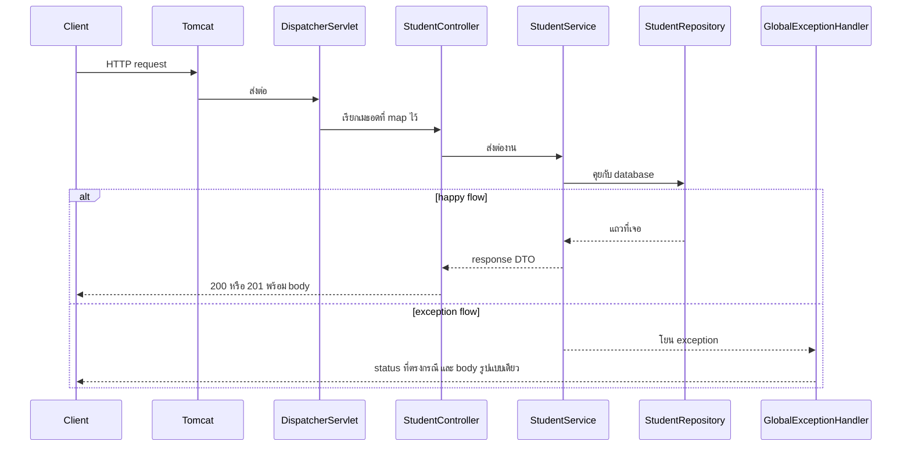
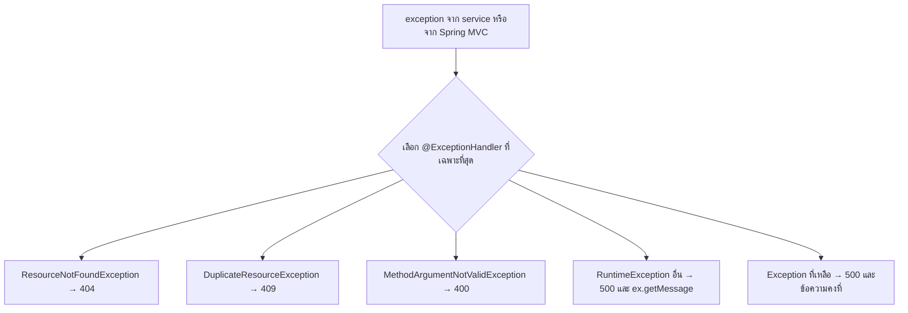

# #17 — Exception Handling: ทำให้ API ตอบอย่างมืออาชีพ

> **วิดีโอ:** [Spring Boot Exception Handling: Make Your APIs Professional | Spring Boot Full Course #17](https://youtu.be/1au7XK_b1sI) — Coder Army, ~87 นาที
> **แหล่งที่ใช้สรุป:** ซับไตเติลภาษาอังกฤษที่ YouTube สร้างอัตโนมัติ
> **เวอร์ชันในโค้ด:** Spring Boot 4.1 + Java 21 (ใส่หมายเหตุไว้ทุกจุดที่ Spring Boot 3.x ต่างกัน)

ตอนนี้ตอบคำถามว่า ถ้า backend มีปัญหา จะส่ง response กลับไปให้ client อย่างไรให้รู้ว่าพังเพราะอะไร โดยไม่ให้ Controller เต็มไปด้วย `if` และไม่ให้ body ของ error แต่ละเส้นทางหน้าตาคนละแบบ

ส่วนที่ติดป้าย `💡 เพิ่มเติม` คือของที่ผมเติมเอง ไม่ได้อยู่ในวิดีโอ ส่วนที่ติด `⚠️ แก้จากวิดีโอ` คือจุดที่วิดีโอพูดคลาดเคลื่อน

> 💡 **เพิ่มเติม — วิดีโอใช้ MySQL:** ผู้สอนเปิดโปรเจกต์ CRUD ของนักเรียนจากตอนก่อน ต่อ MySQL แล้วดูแถวใน DBeaver โน้ตนี้รันชุดเดียวกันบน **H2 in-memory** ที่พอร์ต `9017` ชุดที่สตาร์ทจริงคือ Spring Boot 4.1.1, Java 21, Tomcat 11.0.24, Hibernate 7.4.5.Final

---

## สารบัญ

| เวลา | หัวข้อ |
|---|---|
| [0:00](https://youtu.be/1au7XK_b1sI?t=0) | [1. ทำไม exception handling ถึงสำคัญกับ API](#1-ทำไม-exception-handling-ถึงสำคัญกับ-api) |
| [0:39](https://youtu.be/1au7XK_b1sI?t=39) | [2. Response มีสามส่วน และนี่คือจุดที่ API ดูมืออาชีพ](#2-response-มีสามส่วน-และนี่คือจุดที่-api-ดูมืออาชีพ) |
| [2:32](https://youtu.be/1au7XK_b1sI?t=152) | [3. Request เดียวมีได้หลายสถานการณ์](#3-request-เดียวมีได้หลายสถานการณ์) |
| [4:03](https://youtu.be/1au7XK_b1sI?t=243) | [4. มือใหม่ตอบ 200 ทุกกรณี](#4-มือใหม่ตอบ-200-ทุกกรณี) |
| [4:39](https://youtu.be/1au7XK_b1sI?t=279) | [5. มีข้อมูล: 200 และ body เป็น DTO](#5-มีข้อมูล-200-และ-body-เป็น-dto) |
| [5:30](https://youtu.be/1au7XK_b1sI?t=330) | [6. ไม่พบข้อมูล: 404](#6-ไม่พบข้อมูล-404) |
| [6:54](https://youtu.be/1au7XK_b1sI?t=414) | [7. Request ไม่ถูกต้อง: 400](#7-request-ไม่ถูกต้อง-400) |
| [8:20](https://youtu.be/1au7XK_b1sI?t=500) | [8. ฝั่ง server พัง: 500](#8-ฝั่ง-server-พัง-500) |
| [10:14](https://youtu.be/1au7XK_b1sI?t=614) | [9. โปรเจกต์ CRUD ที่เอามาต่อ](#9-โปรเจกต์-crud-ที่เอามาต่อ) |
| [12:14](https://youtu.be/1au7XK_b1sI?t=734) | [10. จัด endpoint ให้คู่ method กับ path ไม่ซ้ำ](#10-จัด-endpoint-ให้คู่-method-กับ-path-ไม่ซ้ำ) |
| [16:29](https://youtu.be/1au7XK_b1sI?t=989) | [11. Controller ไม่ควรตัดสิน edge case](#11-controller-ไม่ควรตัดสิน-edge-case) |
| [18:54](https://youtu.be/1au7XK_b1sI?t=1134) | [12. Happy flow กับ exception flow](#12-happy-flow-กับ-exception-flow) |
| [21:48](https://youtu.be/1au7XK_b1sI?t=1308) | [13. Optional.get() โยน NoSuchElementException](#13-optionalget-โยน-nosuchelementexception) |
| [23:00](https://youtu.be/1au7XK_b1sI?t=1380) | [14. Default exception handling ของ Spring Boot](#14-default-exception-handling-ของ-spring-boot) |
| [25:57](https://youtu.be/1au7XK_b1sI?t=1557) | [15. Endpoint /error และ Whitelabel Error Page](#15-endpoint-error-และ-whitelabel-error-page) |
| [27:08](https://youtu.be/1au7XK_b1sI?t=1628) | [16. ทำไมไม่ปล่อยให้ default จัดการ](#16-ทำไมไม่ปล่อยให้-default-จัดการ) |
| [30:20](https://youtu.be/1au7XK_b1sI?t=1820) | [17. ห้าครอบครัวของ status code](#17-ห้าครอบครัวของ-status-code) |
| [34:25](https://youtu.be/1au7XK_b1sI?t=2065) | [18. ResponseEntity](#18-responseentity) |
| [36:07](https://youtu.be/1au7XK_b1sI?t=2167) | [19. Error ต้องรูปแบบเดียวกัน](#19-error-ต้องรูปแบบเดียวกัน) |
| [38:14](https://youtu.be/1au7XK_b1sI?t=2294) | [20. @RestControllerAdvice กับ @ControllerAdvice](#20-restcontrolleradvice-กับ-controlleradvice) |
| [41:44](https://youtu.be/1au7XK_b1sI?t=2504) | [21. @ExceptionHandler](#21-exceptionhandler) |
| [47:06](https://youtu.be/1au7XK_b1sI?t=2826) | [22. Safety net กับลำดับความเฉพาะ](#22-safety-net-กับลำดับความเฉพาะ) |
| [50:02](https://youtu.be/1au7XK_b1sI?t=3002) | [23. ResourceNotFoundException](#23-resourcenotfoundexception) |
| [59:23](https://youtu.be/1au7XK_b1sI?t=3563) | [24. DuplicateResourceException](#24-duplicateresourceexception) |
| [1:06:26](https://youtu.be/1au7XK_b1sI?t=3986) | [25. ลบ if ออกจาก getAll, update, delete](#25-ลบ-if-ออกจาก-getall-update-delete) |
| [1:14:44](https://youtu.be/1au7XK_b1sI?t=4484) | [26. ExceptionResponseDTO](#26-exceptionresponsedto) |
| [1:20:11](https://youtu.be/1au7XK_b1sI?t=4811) | [27. MethodArgumentNotValidException](#27-methodargumentnotvalidexception) |
| [1:24:55](https://youtu.be/1au7XK_b1sI?t=5095) | [28. สาธิตปิดท้าย](#28-สาธิตปิดท้าย) |
| — | [29. สรุปท้ายตอน](#29-สรุปท้ายตอน) |

---

## 1. ทำไม exception handling ถึงสำคัญกับ API

[▶ 0:00](https://youtu.be/1au7XK_b1sI?t=0)

ผู้สอนบอกว่า exception handling ใน Java เรียนมาแล้ว แต่ใน Spring Boot มันสำคัญกว่า เพราะเมื่อ backend มีปัญหา client ต้องได้ response ที่อธิบายได้ว่าติดตรงไหน ข้อความนั้นช่วยให้คนเรียก API รู้ว่า endpoint ไหนมีปัญหา

เขาบอกว่าเรื่องนี้ใช้ทั้งตอนสัมภาษณ์และตอนสร้างแอปเอง

---

## 2. Response มีสามส่วน และนี่คือจุดที่ API ดูมืออาชีพ

[▶ 0:39](https://youtu.be/1au7XK_b1sI?t=39)

เขาทบทวนว่า API response มีสามส่วน

| ส่วน | ความหมายที่เขาใช้ |
|---|---|
| **Status code** | ความหมายของผลลัพธ์ สำเร็จหรือล้มเหลว และล้มเหลวแบบไหน |
| **Headers** | metadata แบบ key–value |
| **Body** | ข้อมูลที่ส่งให้ client ในรูป JSON |

Body คือข้อมูลที่อยากให้ client ได้ Header คือข้อมูลประกอบ Status code บอกว่าดึงได้ เก็บได้ หรือพัง

เขาบอกว่า API ของคนที่เพิ่งเริ่มกับ API ที่ทำเป็นมืออาชีพ ต่างกันตรงวิธีจัดสามส่วนนี้ ไม่ว่า client จะเป็น Postman หรือแอป frontend เป้าหมายคือส่ง response ที่ client ใช้ต่อได้ เขาบอกว่านี่คือเหตุผลที่ HTTP มี status code หลายครอบครัว จะไล่รายละเอียดอีกทีในช่วงหลังของตอน

---

## 3. Request เดียวมีได้หลายสถานการณ์

[▶ 2:32](https://youtu.be/1au7XK_b1sI?t=152)

ตัวอย่างบนกระดานคือ `GET /api/students` สำหรับนักเรียน id `1` มี header อย่าง `Host` เขาสมมติว่าแอปอยู่ที่ localhost

> ⚠️ **แก้จากวิดีโอ:** เขาพูดพอร์ตเป็น "880" แอป Spring Boot ในคลิปที่รันต่อจากนั้นใช้พอร์ตมาตรฐาน **8080** โน้ตนี้ใช้ `9017`

เขายกสถานการณ์ที่ request เดียวกันเจอได้

1. มีข้อมูลของนักเรียนคนนั้น
2. ไม่มีข้อมูล
3. รูปแบบ id ผิด เช่น API ต้องการ request parameter แต่ client ส่งมาเป็น path variable หรือกลับกัน
4. Database ล่ม
5. Server ล่ม
6. มี bug ในแอปที่ยังระบุสาเหตุไม่ได้

ข้อ 4–6 อยู่นอกสิ่งที่ request ของ client ควบคุม

---

## 4. มือใหม่ตอบ 200 ทุกกรณี

[▶ 4:03](https://youtu.be/1au7XK_b1sI?t=243)

คนที่เพิ่งเขียน API ได้มักส่ง status เดิมทุกเส้นทาง มีข้อมูลก็ `200` ไม่มีข้อมูลก็ยัง `200` แล้วไปบอกในข้อความว่าหาไม่เจอ เขาบอกว่าแต่ละสถานการณ์ในส่วนที่ 3 ต้องได้ status คนละตัว API ที่เป็นมืออาชีพแยกสถานการณ์เหล่านี้

---

## 5. มีข้อมูล: 200 และ body เป็น DTO

[▶ 4:39](https://youtu.be/1au7XK_b1sI?t=279)

ถ้ามีข้อมูล ตอบ `200 OK` แล้วใส่ข้อมูลนักเรียนใน body ตามรูปของ response DTO ตัวอย่างบนกระดานมี `id` เป็น `1` ชื่อ Aditya และอีเมล `ad@gmail.com` สามฟิลด์นี้เป็นตัวอย่างของรูป DTO ไม่ใช่รายการฟิลด์ทั้งหมดของโปรเจกต์

---

## 6. ไม่พบข้อมูล: 404

[▶ 5:30](https://youtu.be/1au7XK_b1sI?t=330)

ทางที่เขาบอกว่าผิดคือตอบ `200 OK` แล้วใส่ body ประมาณ `{"message": "No data found"}` เพราะ `200` แปลว่าสำเร็จ ทั้งที่ไม่ได้ข้อมูลที่ client ขอ

> ⚠️ **แก้จากวิดีโอ:** ช่วงนี้เขาพูดก่อนว่า `400` แปลว่า not found แล้วแก้เองบนกระดานในอีกไม่กี่วินาทีว่า not found คือ **`404`** และ `400` คือ bad request รหัสที่ใช้เมื่อไม่พบ resource คือ **`404 Not Found`**

ข้อความใน body ที่เขาเขียนเป็นตัวอย่างคือทำนองว่า student id นั้นหาไม่เจอ เขาบอกว่าเดี๋ยวจะกลับมาดูว่าการคืน body แบบข้อความลอย ๆ ยังไม่ดี เพราะอยากให้ response มีรูปแบบคงที่ ตอนนี้ยังคุยแค่ status code

---

## 7. Request ไม่ถูกต้อง: 400

[▶ 6:54](https://youtu.be/1au7XK_b1sI?t=414)

กรณีที่ client ส่ง request ผิดรูป เช่น id ไม่ใช่ตัวเลข หรือส่ง id มาคนละที่กับที่ API รอรับ ความผิดอยู่ที่ client server ไม่ได้พัง เขาใช้ **`400 Bad Request`** แล้วใส่ข้อความในฟิลด์ `message` ว่าต้องแก้อะไร เช่น student id ต้องเป็นตัวเลข หรือให้ส่งใน request parameter แทน path variable

---

## 8. ฝั่ง server พัง: 500

[▶ 8:20](https://youtu.be/1au7XK_b1sI?t=500)

Database ล่ม, server ล่ม, หรือ bug ที่ระบุสาเหตุไม่ได้ รวมเป็นอีกกรณี เขาตอบ **`500 Internal Server Error`** ซึ่งเป็นรหัสกว้าง อาจแปลว่า server ล่ม จริง database ล่ม หรือมี bug ที่ยังจัดเข้าช่องอื่นไม่ได้

เมื่อยังไม่รู้สาเหตุ ข้อความที่ส่งได้คือ `"Something went wrong"` เขาบอกว่ารหัส `500`, `400`, `404` และ `200` คือชุดที่ API มืออาชีพใช้แยกสถานการณ์ และจะเอามาใช้ตอนเขียน exception handling

---

## 9. โปรเจกต์ CRUD ที่เอามาต่อ

[▶ 10:14](https://youtu.be/1au7XK_b1sI?t=614)

เขาไม่เริ่มโปรเจกต์ใหม่ ใช้แอป CRUD ของนักเรียนจากตอนก่อน มี Controller, Service, Repository ต่อ database มี entity `Student` และ DTO คนละตัวสำหรับการสร้างกับการอัปเดต เขาบอกให้โหลดโปรเจกต์ที่จบจากวิดีโอก่อนหน้า (เขาเรียกว่า Video 16) แล้วค่อยเติม exception handling

โครงที่เขาเปิดมี package หลักแล้วแยก `controller`, `repository`, `service`, `entity`, `dto` Controller ตัวเดียวชื่อ `StudentController` service คือ `StudentService` repository คือ `StudentRepository` ใช้ JPA เพื่อไม่ต้องเขียน query เอง

ฟิลด์ของ `Student` ที่เขาอ่านจาก entity คือ `id`, `name`, `age`, `email`, `rollNumber`, `subject`, `deleted`, `created`, `updated` เขาเรียก `created` กับ `updated` ว่า metadata ใช้ `deleted` ทำ soft delete `id` เป็น primary key ที่ generate ให้

> 💡 **เพิ่มเติม:** ตอน #16 ตั้งชื่อฟิลด์เวลาเป็น `createdAt` กับ `updatedAt` ชนิด `LocalDateTime` โน้ตนี้ใช้ชื่อนี้ ชื่อ package ใช้ `in.strike.crudspringbootdemo` ตามโน้ตตอนที่สร้างโปรเจกต์ ซับตอนนี้พูดชื่อ package ไม่ชัด

Endpoint ที่มีอยู่ก่อนเขาจัดใหม่ในส่วนถัดไป ได้แก่ create, get, get all, update, hard delete และ soft delete

เขาโพสต์นักเรียนใหม่ชื่อ Rohit อายุที่เขาลองแล้วปรับ roll number เป็น `103` อีเมล `rohit@gmail.com` วิชาที่เขาพิมพ์แทน Django เป็น Node ฟิลด์ที่ body ส่งตรงกับ `CreateStudentRequestDTO` คือ `name`, `age`, `email`, `rollNumber`, `subject` มี validation จากตอนก่อน ซึ่งตอนนี้จะเอามาจับ exception ด้วย

ผลที่เขาเห็นตอนโพสต์สำเร็จคือสถานะ created และ body เป็น response ทั้งก้อน พอ refresh ใน DBeaver แถวถูกเพิ่ม

> ⚠️ **แก้จากวิดีโอ:** เขาเรียกผลสร้างสำเร็จว่า "200 created" รหัสของ Created คือ **`201`** เขาพูดตัวเลขนี้ถูกในภายหลังเป็น `201` ผลจริงของ `POST /api/students` ในโน้ตนี้คือ `201`

---

## 10. จัด endpoint ให้คู่ method กับ path ไม่ซ้ำ

[▶ 12:14](https://youtu.be/1au7XK_b1sI?t=734)

เขาบอกว่าแค่มี CRUD ยังไม่ตรงแนว REST ที่ Spring Boot ใช้กัน เพราะ path ยังแยกคำว่า create, get, getAll, update, delete ทั้งที่ prefix `/api/students` บอกอยู่แล้วว่าเป็นของ `StudentController`

ประเด็นของเขาคือคู่ของ **path กับ HTTP method** ไม่ซ้ำกันอยู่แล้ว จึงไม่ต้องมี path คนละเส้นสำหรับแต่ละคำกริยา วิธีแรกที่ทำให้ API ดูเป็นมืออาชีพคือเอา path ส่วนเกินออก

สิ่งที่เขาเปลี่ยนบนจอ

- `POST /api/students` สำหรับสร้าง ไม่มี `/create`
- `GET /api/students/{id}` อ่านคนเดียว เขาย้าย id จาก request parameter มาเป็น **path variable**
- `GET /api/students` โดยไม่มี id แปลว่าขอทั้งหมด
- `PUT` ที่ `/api/students` แปลว่าอัปเดต
- `DELETE` ที่ `/api/students` แปลว่าลบ
- soft delete เขายังเก็บ path ของตัวเองไว้ เพราะ `PATCH` แปลว่าเปลี่ยนบางฟิลด์ ไม่ได้แปลว่าลบเสมอไป

> 💡 **เพิ่มเติม — path ของ id ใน PUT, DELETE และ PATCH:** ซับระบุชัดว่า get เปลี่ยนจาก `@RequestParam` เป็น `@PathVariable` ส่วน PUT กับ DELETE เขาพูดว่าดูจาก method บน `/api/students` และเมธอดยังรับ id อยู่ โค้ดที่รันด้านล่างใส่ id ใน path เป็น `PUT /api/students/{id}`, `DELETE /api/students/{id}` และคง path ของ soft delete เป็น `PATCH /api/students/delete-soft/{id}` ถ้าบนจอ update ยังเป็น query string โครงคิดยังเหมือนกัน คือคู่ method กับ path เป็นตัวบอกงาน

หลังจัดแล้วเขาสตาร์ทแอปได้ แล้วยิง `POST /api/students` สร้าง Rohit สำเร็จ

ตารางหลังจัด

| งาน | Method และ path |
|---|---|
| สร้าง | `POST /api/students` |
| อ่านคนเดียว | `GET /api/students/{id}` |
| อ่านทั้งหมด | `GET /api/students` |
| อัปเดต | `PUT /api/students/{id}` |
| Hard delete | `DELETE /api/students/{id}` |
| Soft delete | `PATCH /api/students/delete-soft/{id}` |

---

## 11. Controller ไม่ควรตัดสิน edge case

[▶ 16:29](https://youtu.be/1au7XK_b1sI?t=989)

การจัด path อย่างเดียวไม่ทำให้ API เป็นมืออาชีพ เขามอง Controller แล้วเห็นว่าทุกเมธอดยังตรวจเอง

- `createStudent` เรียก service แล้วตอบ `201` พร้อม body ได้ตรง ๆ
- `getStudent` เรียก service แล้วเช็ค `null` ถ้ามีข้อมูลตอบ `200` ถ้า `null` ตอบ `404`
- `getAll` เช็คว่ารายการว่างหรือไม่ แล้วเลือกตอบลิสต์ว่างหรือ not found
- `updateStudent` เช็ค response เป็น `null`
- `deleteStudent` เช็คว่าลบได้หรือไม่ และ soft delete ก็มีเช็คแบบเดียวกัน

เขาบอกว่าอย่างน้อยไม่ได้ตอบ `200` ทุกกรณี แต่ Controller ยังหนา

งานของ Controller ตามที่เขาวางไว้มีอย่างเดียว คือรับข้อมูลจาก client ส่งต่อให้ service แล้วเอา response DTO ที่ service คืน ส่งกลับให้ client การเช็ค `null` หรือลิสต์ว่างเป็น edge case ถ้าใส่ `if` นี้ในทุก Controller ชั้นนี้จะบวม

เขายก `getAll` เป็นตัวอย่างที่ควรเปลี่ยน ลิสต์ว่างก็ยังตอบ `200` ได้ เพราะการดึงสำเร็จ แค่ไม่มีแถว เขาจะแก้จุดนี้ต่อ

ทางที่เขาอยากได้คือแยกเป็นสองสาย สายปกติให้ Controller ดูแล สาย exception ให้คลาสที่สร้างขึ้นมาดูแล ถ้ามี exception เกิดขึ้น จะไม่ใช่หน้าที่ของ Controller

---

## 12. Happy flow กับ exception flow

[▶ 18:54](https://youtu.be/1au7XK_b1sI?t=1134)

เขาวาดทางของ request ก่อนถึง Controller ว่า client เข้า Tomcat แล้ว Tomcat ส่งต่อให้ DispatcherServlet แล้วจึงถึง Controller ช่วงนี้เขาข้ามสองชั้นแรก แล้วสมมติว่า request ถึง `StudentController` แล้ว จากนั้นไป `StudentService` แล้วไป `StudentRepository`

exception มักเกิดที่ service เพราะนั่นคือชั้นที่ทำ business logic เช่นหาข้อมูลไม่เจอ โค้ดเดิมส่งผลลัพธ์แบบ `null` กลับไปให้ Controller ตัดสิน



ใน `getStudent` ของ service เขาเปิดให้ดูว่าเรียก `findById` แล้วได้ `Optional` ถ้ามีข้อมูลก็ map เป็น DTO ถ้าไม่มีก็คืน `null` Controller จึงต้องเช็คซ้ำ

เขายิง `GET` id `1` ได้แถวของ Saurav แล้วยิง id `100` ที่ไม่มี ได้ `404` และ body ว่าง เพราะ Controller เขียน `if` แบบนั้น

---

## 13. Optional.get() โยน NoSuchElementException

[▶ 21:48](https://youtu.be/1au7XK_b1sI?t=1308)

เขาคอมเมนต์ทาง `if` ทิ้ง แล้วเรียก `Optional.get()` ตรง ๆ

```java
return mapToDto(studentRepository.findByIdAndDeletedIsFalse(id).get());
```

`Optional.get()` เมื่อข้างในไม่มีค่าจะโยน `NoSuchElementException` ข้อความของมันคือ `No value present` exception นี้เป็น runtime exception เมธอดที่ไม่ได้จับมันจะปล่อยให้ลอยขึ้นไปหาคนเรียก คนเรียก `getStudent` คือเมธอดใน Controller ซึ่งก็ไม่ได้จับ เขาจึงคาดว่า client จะเห็นชื่อ exception นี้

> ⚠️ **แก้จากวิดีโอ:** ก่อนเปิด log เขาเรียก exception นี้ว่า "Field Not Found" พอเปิดเทอร์มินัลเขาอ่านถูกแล้วว่าเป็น **`NoSuchElementException`** ข้อความ `No value present` เขาเรียกช่วงนี้ว่า compiler เป็นคนตรวจว่าเมธอดจับ exception หรือไม่ สำหรับ unchecked exception อย่าง `NoSuchElementException` คอมไพเลอร์ไม่ได้บังคับให้จับ มันลอยตอนรัน

เขายิง id ที่ไม่มี ผลไม่ใช่ชื่อ exception ลอยไปทั้งก้อน

---

## 14. Default exception handling ของ Spring Boot

[▶ 23:00](https://youtu.be/1au7XK_b1sI?t=1380)

ที่ได้คือ `500 Internal Server Error` พร้อม body และ header ที่ Spring Boot จัดให้ ทั้งที่เขาไม่ได้เขียนตัวจับ exception เขาบอกว่าก่อน response ออกไปหา client DispatcherServlet จัดมันเป็น body ใส่ status `500` เพราะเป็นรหัสกว้างสำหรับกรณีที่แอปไม่ได้จับเอง

Body ที่เขาอ่านมี timestamp, status, error และ path ของ request ข้อความภายในไม่ถูกส่งให้ client เพราะไม่อยากเปิดว่าคลาสข้างในชื่ออะไร และ exception ไหนยังไม่ถูกจับ

ใน log เขาเห็น `NoSuchElementException` และ root cause `No value present` client ไม่ได้เห็นข้อความนี้

รันแบบเดียวกันโดยยังไม่มี `@RestControllerAdvice` แล้วยิง `GET /api/students/100`

```http
HTTP/1.1 500
Content-Type: application/json

{"timestamp":"2026-10-16T11:49:32.126Z","status":500,"error":"Internal Server Error","path":"/api/students/100"}
```

บรรทัดใน log

```text
Servlet.service() for servlet [dispatcherServlet] in context with path [] threw exception [Request processing failed: java.util.NoSuchElementException: No value present] with root cause
java.util.NoSuchElementException: No value present
	at java.base/java.util.Optional.get(Optional.java:143)
	at in.strike.crudspringbootdemo.service.StudentService.getStudent(StudentService.java:35)
```

[▶ 25:14](https://youtu.be/1au7XK_b1sI?t=1514)

ถ้าอยากเห็นข้อความของ exception ที่ client เขาให้ใส่ property แล้วบอกว่าเปิดเฉพาะตอน debug บนเครื่องตัวเอง ตอน production ต้องปิด เพราะไม่อยากให้ client รู้ logic ภายใน

เขาพูดชื่อ property ว่า `spring.web.error.includeMessageAlways`

> ⚠️ **แก้จากวิดีโอ:** ไม่มี key ชื่อ `includeMessageAlways` บน Boot 4 property คือ **`spring.web.error.include-message=always`** ค่าที่ใส่ได้คือ `never`, `always` และ `on-param` ค่า default คือ `never`

> ⚠️ **Boot 4 vs 3:** Boot 3.5 ผูกชุดเดียวกันไว้ที่ **`server.error.include-message`** (ดู `spring-configuration-metadata.json` ใน `spring-boot-autoconfigure-3.5.4`) Boot 4.1.1 ย้ายไปที่ **`spring.web.error.include-message`** เพราะ `ErrorProperties` อยู่ใต้ `WebProperties` ที่ติด `@ConfigurationProperties("spring.web")` ทดลองส่ง `--server.error.include-message=always` บน Boot 4.1.1 แล้ว body ยังไม่มีฟิลด์ `message` ต้องใช้ชื่อใหม่ Migration guide บอกให้ใช้ `spring-boot-properties-migrator` ช่วยตอนย้าย property ที่ถูกเปลี่ยนชื่อ
> ([Spring Boot 4.0 Migration Guide](https://github.com/spring-projects/spring-boot/wiki/Spring-Boot-4.0-Migration-Guide) หัวข้อ Configuration Properties Migration)

หลังใส่ `spring.web.error.include-message=always` แล้วยิง id เดิมอีกครั้ง

```http
HTTP/1.1 500
Content-Type: application/json

{"timestamp":"2026-10-16T11:49:45.522Z","status":500,"error":"Internal Server Error","message":"No value present","path":"/api/students/100"}
```

เขาบอกว่าปกติเมื่อปิด property นี้ client ได้สี่ค่า คือ timestamp, status, error และ path ฟิลด์ `message` เป็นของที่เปิดเพิ่มตอน debug

---

## 15. Endpoint /error และ Whitelabel Error Page

[▶ 25:57](https://youtu.be/1au7XK_b1sI?t=1557)

กลไกที่เขาอธิบายคือ exception ที่ไม่มีใครจับจะถูกส่งไปที่ endpoint `/error` ถ้า client เป็น Postman จะได้ JSON ถ้า client เป็น browser จะได้หน้า HTML

เขาเปิด URL เดิมใน browser แล้วเห็นหน้า Whitelabel ข้อความบนหน้านั้นบอกว่าแอปไม่มี mapping ของ `/error` โดยตรง จึงเห็นหน้า fallback บนหน้าระบุชนิด Internal Server Error, status `500`, เวลา และข้อความ `No value present`

> ⚠️ **แก้จากวิดีโอ:** เขาใช้คำว่า redirect ไป `/error` สิ่งที่เกิดขึ้นคือการ **forward ภายในเซิร์ฟเวอร์** URL ที่ client เรียกยังเป็น `/api/students/100` และฟิลด์ `path` ใน JSON ก็เป็น path นี้ ไม่ได้เปลี่ยนเป็น `/error` ด้วยรหัส `302`

ยิงด้วย `Accept: text/html` ได้หน้านี้จริง ความยาว 314 ไบต์

```html
<html><body><h1>Whitelabel Error Page</h1><p>This application has no explicit mapping for /error, so you are seeing this as a fallback.</p><div id='created'>Fri Oct 16 18:49:45 ICT 2026</div><div>There was an unexpected error (type=Internal Server Error, status=500).</div><div>No value present</div></body></html>
```

> 💡 **เพิ่มเติม:** คลาสที่รับ `/error` ชื่อ `BasicErrorController` ผู้สอนไม่ได้พูดชื่อคลาสนี้

> ⚠️ **Boot 4 vs 3 — package ของ error controller:** Boot 4 อยู่ที่ `org.springframework.boot.webmvc.autoconfigure.error.BasicErrorController` ใน jar `spring-boot-webmvc-4.1.1` Boot 3.5 อยู่ที่ `org.springframework.boot.autoconfigure.web.servlet.error.BasicErrorController` ใน `spring-boot-autoconfigure-3.5.4` `DefaultErrorAttributes` ย้ายจาก `org.springframework.boot.web.servlet.error` ใน Boot 3 ไป `org.springframework.boot.webmvc.error` ใน Boot 4 เป็นผลจาก modularization ที่แต่ละ module ขึ้นต้น package ด้วย `org.springframework.boot.<module>`
> ([Spring Boot 4.0 Migration Guide](https://github.com/spring-projects/spring-boot/wiki/Spring-Boot-4.0-Migration-Guide) หัวข้อ Package Organization)

> 💡 **เพิ่มเติม:** ทั้ง Boot 3.5 และ Boot 4.1 ค่า `spring.mvc.problemdetails.enabled` เป็น `false` JSON สี่ฟิลด์ด้านบนจึงยังเป็นรูปแบบ error เดิมของ Boot ไม่ใช่ Problem Details ตาม RFC 9457 ถ้าเปิด flag นี้ รูป body จะเปลี่ยน

---

## 16. ทำไมไม่ปล่อยให้ default จัดการ

[▶ 27:08](https://youtu.be/1au7XK_b1sI?t=1628)

เขาถามว่าถ้า Boot จับให้อยู่แล้ว ทำไมต้องเขียนเอง คำตอบคือของที่ Boot ให้เป็นข้อความกว้าง ถ้าไม่ได้เขียนอะไรเอง มันตอบ `500` และ body ชุดเดิมทุกครั้ง client ไม่รู้ว่าต้องแก้อะไร

เขาลองโพสต์นักเรียนชื่อ Raman แล้วเปลี่ยนชื่อเป็นช่องว่าง validation จากตอนก่อนอยู่บน `CreateStudentRequestDTO` และเมธอด create มี `@Valid` ฟิลด์ name ติด `@NotBlank` เขาบอกว่าข้อความ "name cannot be null, empty, or blank" จะยังไม่ถึง client เพราะยังไม่ได้จับ exception เอง

ผลคือ `400 Bad Request` และ body ชุด generic อีกครั้ง มี timestamp, status, error, path

รันจริงโดยยังไม่มี handler ของเรา

```http
HTTP/1.1 400
Content-Type: application/json

{"timestamp":"2026-10-16T11:49:32.184Z","status":400,"error":"Bad Request","path":"/api/students"}
```

เมื่อเปิด `spring.web.error.include-message=always` ข้อความที่ client ได้คือ

```json
{"timestamp":"2026-10-16T11:49:45.588Z","status":400,"error":"Bad Request","message":"Validation failed for object='createStudentRequestDTO'. Error count: 3","path":"/api/students"}
```

ชื่อคลาสของ request โผล่ในข้อความ แต่รายการฟิลด์ที่พังยังไม่ถูกจัดเป็น map ให้ client อ่าน ใน log มีรายละเอียดยาวกว่านั้น รวม method signature ของ `createStudent` และรหัส validation

> 💡 **เพิ่มเติม:** ถ้าเปิด `spring.web.error.include-binding-errors=always` ด้วย Boot จะใส่ array `errors` ที่มี `rejectedValue`, `codes` และ regex ของ `@Email` เข้าไปใน JSON นั่นคือรายละเอียดภายในที่เขาไม่อยากส่งให้ client

เขาอยากได้สองอย่างจากการเขียน flow เอง

1. Controller สั้นลง รับ request ส่งให้ service แล้วส่ง response กลับ
2. บอก client ได้ตรง ๆ ว่าชื่อว่างไม่ได้ อายุต้องอย่างน้อย 18 หรือ `Student with id 100 does not exist`

Validation ที่เขาอ้างจาก DTO ของตอนก่อน และใช้ในโค้ดที่รัน มีดังนี้ เขาให้ IDE สร้าง getter กับ setter ของทุกฟิลด์

```java
package in.strike.crudspringbootdemo.dto;

import jakarta.validation.constraints.Email;
import jakarta.validation.constraints.Min;
import jakarta.validation.constraints.NotBlank;
import jakarta.validation.constraints.NotNull;
import jakarta.validation.constraints.Size;

public class CreateStudentRequestDTO {

  @NotBlank(message = "Name cannot be null, empty, or blank")
  @Size(min = 2, max = 50, message = "Student name must be within 2 to 50 characters")
  private String name;

  @NotNull(message = "Age is required")
  @Min(value = 18, message = "Student must be at least 18 years old")
  private Integer age;

  @NotBlank(message = "Student email cannot be blank")
  @Email(message = "Student email must be valid")
  private String email;

  @NotNull(message = "Roll number is required")
  private Integer rollNumber;

  @NotBlank(message = "Subject is required")
  private String subject;

  // getter และ setter ของทุกฟิลด์ สร้างจาก IDE ตามที่เขาทำ
}
```

`age` กับ `rollNumber` เป็น `Integer` เพราะ `@NotNull` ใช้กับ primitive `int` ไม่ได้ primitive ไม่มีทางเป็น `null`

---

## 17. ห้าครอบครัวของ status code

[▶ 30:20](https://youtu.be/1au7XK_b1sI?t=1820)

ก่อนลงมือจับ exception เขาแบ่ง HTTP status เป็นห้าครอบครัว

| ครอบครัว | ความหมายที่เขาให้ | ตัวที่เขาจะใช้ |
|---|---|---|
| `1xx` | informational ให้ข้อมูล | ยังไม่ใช้ในแอปนี้ |
| `2xx` | สำเร็จ | `200` OK, `201` เมื่อสร้าง resource จาก `POST`, `204` เมื่อลบแล้วไม่มี content |
| `3xx` | redirection เช่น `301` และ `302` | เขาบอกว่ายังไม่ต้องจำรายละเอียด |
| `4xx` | ความผิดฝั่ง client | `400` bad request, `404` resource ไม่มี, `409` conflict |
| `5xx` | ความผิดฝั่ง server | `500` internal server error |

> ⚠️ **แก้จากวิดีโอ:** ซับได้ยินตัวเลขเพี้ยนเป็น `2001`, `2004`, `44`, `49` และ `3001` ตัวที่เขาหมายถึงและพูดถูกในรอบสรุปคือ **`201`**, **`204`**, **`404`**, **`409`** และ **`301`**

`409` เขาอธิบายด้วยอีเมลซ้ำ ถ้าอีเมลมีในระบบแล้ว จะไม่สร้างบัญชีใหม่ แล้วตอบ conflict ซึ่งยังเป็นความผิดฝั่ง client จึงอยู่ในครอบครัว `4xx`

[▶ 33:16](https://youtu.be/1au7XK_b1sI?t=1996)

`204 No Content` เขาใช้ตอนลบ resource แบบ hard delete เดิมเขาตอบ `200` เขาบอกว่าทางที่เป็นมืออาชีพกว่าคือ `204` แปลว่าเนื้อหาที่ขอไม่มีอยู่อีกแล้ว เพราะถูกลบ

เขาแยกจาก `404` ชัด ๆ

- `404` คือทำสิ่งที่ client ขอไม่ได้ เพราะหา resource ไม่เจอ เป็นความล้มเหลวฝั่ง client
- `204` คือลบสำเร็จ เป็นความสำเร็จในครอบครัว `2xx`

ชุดที่เขาบอกว่าจะใช้บ่อยคือ `200`, `201`, `400`, `404`, `409`, `500` และเพิ่ม `204` สำหรับการลบ

---

## 18. ResponseEntity

[▶ 34:25](https://youtu.be/1au7XK_b1sI?t=2065)

Controller ของโปรเจกต์คืน `ResponseEntity` เขาบอกว่าถ้าไม่ใช้คลาสนี้ Boot จะตอบ `200` คงที่ `ResponseEntity` ทำให้กำหนด status, body และ header ได้ตามต้องการ

รูปแบบที่เขาไล่

- body คู่กับ status
- body คู่กับ status คู่กับ header
- status อย่างเดียว

`ResponseEntity.ok(student)` เป็นทางสั้นของ `ResponseEntity.status(HttpStatus.OK).body(student)` ทั้งคู่ส่ง status `200` กับ body Header ในจุดนี้เขาไม่ได้ใส่ `ResponseEntity.notFound()` คือทางสั้นของ `404` ที่เขาใช้อยู่ก่อนจะย้ายไป exception handler

> 💡 **เพิ่มเติม:** ค่า `200` เป็นค่าของเมธอดที่คืนค่าสำเร็จตามปกติ ถ้ามี exception หรือใส่ `@ResponseStatus` status จะเป็นอย่างอื่นได้ ตอนลบเขาใช้ `ResponseEntity.noContent().build()` ซึ่งมีแค่ status `204` ไม่มี body เพราะ `.build()` ปิดก้อนที่ยังไม่ได้ใส่ body

---

## 19. Error ต้องรูปแบบเดียวกัน

[▶ 36:07](https://youtu.be/1au7XK_b1sI?t=2167)

เขาไม่เขียน `try-catch` ใน Controller ด้วยสองเหตุผล

1. อยากให้ Controller มีหน้าที่เดียว
2. อยากให้ error ทุกรูปแบบหน้าตาเดียวกัน บางจุดส่ง status กับ body บางจุดส่งแค่ข้อความ บางจุดคืน `String` ใช้ต่อไม่ได้

เขาเทียบกับ body default ของ Boot ที่มี timestamp, status, error, message และ path ค่าข้างในเปลี่ยนได้ แต่ชื่อฟิลด์ต้องคงที่

จากนั้นเขาวาดสองสายอีกครั้ง สายปกติเดิน client, Controller, service, repository แล้วเดินกลับ สายที่มี exception ที่ service จะไม่กลับเข้า Controller เพราะ Controller รับแค่ happy case มันไปที่คลาสที่เขาเรียกว่า exception handler แล้วคลาสนั้นสร้าง body กับ status ส่งให้ client

---

## 20. @RestControllerAdvice กับ @ControllerAdvice

[▶ 38:14](https://youtu.be/1au7XK_b1sI?t=2294)

เขาเพิ่ม package `exceptions` แล้วสร้างคลาส `GlobalExceptionHandler` ชื่อนี้หมายถึงคลาสเดียวจับ exception ที่เกิดที่ไหนก็ได้ในโปรเจกต์ ไม่ต้องไปเขียนจับทีละจุด

Annotation ที่เขาใส่คือ `@RestControllerAdvice` อีกตัวที่ใส่แทนกันได้คือ `@ControllerAdvice`

ความหมายที่เขาให้คือคลาสนี้เป็นตัวช่วยของ Controller ทุกตัว พฤติกรรมร่วมที่อยากกำหนดครั้งเดียวเขียนไว้ที่นี่ แล้วมันไปถึงทุก Controller Exception เป็นพฤติกรรมร่วมแบบนั้น Controller จึงไม่จับเอง

เขาบอกว่านอกจาก exception แล้วคลาสแบบนี้ยังใช้กำหนด model attribute และ data binding ได้ จะดูทีหลัง งานวันนี้คือ exception handling อย่างเดียว

ความต่างของสอง annotation เขาเทียบกับ `@Controller` กับ `@RestController`

- `@ControllerAdvice` ใช้เมื่อสิ่งที่คืนเป็น view หรือหน้า HTML
- ถ้าใช้ `@ControllerAdvice` แต่คืน JSON ต้องใส่ `@ResponseBody` ที่เมธอด
- `@RestControllerAdvice` ใช้เมื่อ API คืน JSON

แอปนี้เป็น REST เขาจึงใส่ `@RestControllerAdvice`

เขาบอกว่าพอถึงตอน AOP จะเข้าใจว่าคลาสแบบนี้คืออะไร ตอนนี้ให้จำว่ามันคือที่รวม logic ร่วมของ Controller

---

## 21. @ExceptionHandler

[▶ 41:44](https://youtu.be/1au7XK_b1sI?t=2504)

ในคลาสนี้เขาเขียนเมธอดคนละตัวต่อชนิดของ exception เขาทบทวนว่า exception มีทั้ง runtime และ compile-time ใต้ runtime มี `NullPointerException`, `ArithmeticException` และอื่น ๆ ทุกตัวมี parent คือ `Exception`

เมธอดแรกชื่อ `handleRuntimeException` รับ `RuntimeException ex` คืน `ResponseEntity` มันทำงานเมื่อมี runtime exception เขาใส่ `@ExceptionHandler(RuntimeException.class)` เพื่อบอกว่านี่คือเมธอดจับ exception และจับชนิดนี้ การส่ง `.class` คือการส่งตัวแทนของชนิดนั้น

ตอนแรกเขาคืน status `500` กับ body ที่เป็น `ex.getMessage()` เขาเลือก `500` เพราะ runtime exception กว้าง อาจเป็น null pointer, arithmetic หรืออย่างอื่น Boot ก็ตอบ `500` ให้กรณีที่ระบุชนิดไม่ได้เหมือนกัน เขาเขียนได้ทั้งเลข `500` และ `HttpStatus.INTERNAL_SERVER_ERROR` ซึ่งข้างในมีค่า `500` กับ reason phrase

เมธอดช่วงนี้ที่รันแล้วได้ body เป็นข้อความล้วน

```java
@ExceptionHandler(RuntimeException.class)
public ResponseEntity<String> handleRuntimeException(RuntimeException ex) {
  return ResponseEntity.status(HttpStatus.INTERNAL_SERVER_ERROR).body(ex.getMessage());
}
```

เขาเทียบเมธอดนี้กับ `catch` ที่ระบุชนิด ถ้า service เรียก `Optional.get()` แล้วไม่มีค่า จะได้ runtime exception เมธอดใน service และ Controller ไม่จับ มันจึงมาที่ `handleRuntimeException` แล้ว client ได้ `500` กับข้อความ `No value present`

```http
HTTP/1.1 500
Content-Type: text/plain;charset=UTF-8
Content-Length: 16

No value present
```

จากนั้นเขาลองทาง `orElse(null)` แล้ว `mapToDto` ทันที ถ้าแถวไม่มี student เป็น `null` พอ `mapToDto` เรียก `getId()` จะได้ `NullPointerException` ซึ่งเป็น runtime exception เมธอดเดิมจึงถูกเรียกอีกครั้ง ข้อความที่ได้บอก package และชื่อเมธอด

```http
HTTP/1.1 500
Content-Type: text/plain;charset=UTF-8

Cannot invoke "in.strike.crudspringbootdemo.entity.Student.getId()" because "student" is null
```

เขาบอกว่าข้อความนี้ใช้ทดสอบได้ แต่ไม่ควรส่งให้ client เพราะมันเปิดว่ามี entity ชื่อ `Student` package อะไร และ `getId` โดนเรียกตอนค่าเป็น `null` การ map `null` แล้วฝากให้ handler ของ runtime exception จับ จึงยังไม่ใช่ทางที่เขาอยากได้ ทางที่ดีกว่าคือโยน exception ที่สื่อ business เอง

---

## 22. Safety net กับลำดับความเฉพาะ

[▶ 47:06](https://youtu.be/1au7XK_b1sI?t=2826)

เขาเทียบกับ `try` ที่มีหลาย `catch` จับชนิดเฉพาะก่อน แล้วจึงจับ parent เขาเพิ่มเมธอด `handleGenericException` ที่รับ `Exception` ไม่ใช่ `RuntimeException` ตอบ `500` และข้อความคงที่ `"Something went wrong. Please try again later."` ไม่ใส่ `ex.getMessage()`

เมธอดนี้เป็น safety net ถ้าเมธอดที่เฉพาะกว่าจับไม่ได้ ตัวนี้จับที่เหลือ เขาบอกว่านี่ไม่ใช่ business logic เป็นทางสุดท้าย

[▶ 48:54](https://youtu.be/1au7XK_b1sI?t=2934)

ลำดับเมธอดในคลาสไม่สำคัญ เขาบอกว่าต่างจาก `catch` ที่ต้องเรียงจากชนิดเฉพาะไปหาชนิดกว้าง Spring เลือกเมธอดที่ตรงกับ exception ที่เฉพาะที่สุดให้เอง ถ้าเป็น `RuntimeException` จะเข้า `handleRuntimeException` ถ้าเป็น `Exception` ที่ไม่เข้าพวก runtime จะเข้า safety net ถ้าเขียนเมธอดของ `ArithmeticException` หรือชนิดอื่นไว้ ชนิดนั้นจะถูกเลือกเมื่อมันถูกโยน



> 💡 **เพิ่มเติม:** ผลข้างเคียงของการจับ `RuntimeException` ทั้งก้อนคือ exception ของ Spring ที่เป็น runtime ด้วยจะไม่เหลือให้ตัว default ตอบ `400` ยิง `GET /api/students/abc` โดยที่ id เป็น `Long` ถ้ายังไม่มี handler ของเรา ได้ `400 Bad Request` พอมี `handleRuntimeException` แล้วได้ `500` และข้อความ `Method parameter 'id': Failed to convert value of type 'java.lang.String' to required type 'java.lang.Long'` ซึ่งเปิดรายละเอียดภายในแบบที่เขาไม่อยากส่ง

---

## 23. ResourceNotFoundException

[▶ 50:02](https://youtu.be/1au7XK_b1sI?t=3002)

เขาไม่คืน `Optional` และไม่คืน `null` จาก `getStudent` เขาเรียก `findById` แล้ว `orElseThrow` ถ้าไม่มีแถวให้โยน `ResourceNotFoundException` ถ้ามีก็ `mapToDto` ได้เลย เพราะถ้าว่าง exception จะถูกโยนก่อนถึงบรรทัด map

`orElseThrow` รับ supplier เขาเขียนแลมบ์ดาที่คืน object ของ exception ไม่ใส่คำว่า `throw` ในแลมบ์ดา เขาแก้บนจอเองว่าคำว่า `throw` ไม่ได้อยู่ตรงนี้ แค่สร้าง exception ตัวใหม่ แล้ว `orElseThrow` เป็นคนโยน

`ResourceNotFoundException` ไม่มีใน Java เขาต้องสร้างเอง `NullPointerException` กับ `ArithmeticException` มีอยู่แล้ว เขาให้คลาสนี้ extends `RuntimeException` constructor รับ `String message` แล้วส่งต่อด้วย `super(message)` เขาเรียกคลาสนี้ว่าตัวทำเครื่องหมาย ไม่มี logic อื่น นอกจากทำให้ business logic โยนชนิดที่อ่านรู้เรื่อง แทน exception กว้าง ๆ

```java
package in.strike.crudspringbootdemo.exceptions;

public class ResourceNotFoundException extends RuntimeException {

  public ResourceNotFoundException(String message) {
    super(message);
  }
}
```

ข้อความที่เขาใส่คือ student พร้อม id ที่ client ส่งมา แล้วตามด้วย not found

ถ้ายิ่งไม่มีเมธอดจับชนิดนี้โดยเฉพาะ มันจะตกไปที่ `handleRuntimeException` เพราะมันเป็น runtime exception เขาทดลองแล้วยิง id `100` ได้ข้อความ `Student with id 100 not found` แต่ status ยังเป็น `500` เขาจึงเพิ่มเมธอด `handleResourceNotFoundException` ที่รับ `ResourceNotFoundException` แล้วตอบ `HttpStatus.NOT_FOUND` ซึ่งคือ `404` body ช่วงแรกยังเป็น `ex.getMessage()`

หลังมีเมธอดนี้ ยิง id `100` ได้ `404` และข้อความนั้น Controller ของ get เหลือบรรทัดเดียว เพราะถ้างานเดินกลับมาถึง Controller แปลว่าเป็น happy flow ถ้าไม่เจอแถว งานไปที่ exception handler แทน

```java
@GetMapping("/{id}")
public ResponseEntity<CreateStudentResponseDTO> getStudent(@PathVariable("id") Long id) {
  return ResponseEntity.ok(studentService.getStudent(id));
}
```

ใน service

```java
public CreateStudentResponseDTO getStudent(Long id) {
  Student student = studentRepository.findByIdAndDeletedIsFalse(id)
      .orElseThrow(() -> new ResourceNotFoundException(
          "Student with id " + id + " not found"));
  return mapToDto(student);
}
```

`findByIdAndDeletedIsFalse` คือ derived query จากตอน soft delete แถวที่ถูกมาร์คว่าลบจะถูกมองว่าไม่พบเหมือนกัน

ผลจริง

```http
HTTP/1.1 404
Content-Type: application/json

{"timestamp":"2026-10-16T18:48:39.099811","status":404,"error":"Not Found","message":"Student with id 100 not found","path":"/api/students/100"}
```

รูป JSON นี้เป็นของ `ExceptionResponseDTO` ในส่วนที่ 26 ช่วงที่เขายังคืน `String` client จะเห็นแค่ข้อความ ไม่มี timestamp กับ path

---

## 24. DuplicateResourceException

[▶ 59:23](https://youtu.be/1au7XK_b1sI?t=3563)

กรณี conflict ของอีเมลซ้ำเขาทำใน `createStudent` เขาย้าย `setCreated` กับ `setUpdated` เข้าไปใน `mapToEntity` เพราะเป็นส่วนของการประกอบ entity หลัง map เขาตรวจว่าอีเมลมีแล้วหรือยัง ถ้ามีให้โยน `DuplicateResourceException`

คลาสนี้สร้างแบบเดียวกับ resource not found คือ extends `RuntimeException` และส่ง message ให้ `super`

```java
package in.strike.crudspringbootdemo.exceptions;

public class DuplicateResourceException extends RuntimeException {

  public DuplicateResourceException(String message) {
    super(message);
  }
}
```

ข้อความที่ประกอบคือ student with email ตามด้วยอีเมลที่ส่งมา แล้วตามด้วย already exists

เมธอดตรวจเป็น private คืน `boolean` รับ entity `Student` เขาอธิบายว่า service เป็นชั้นเดียวที่รู้จักทั้ง entity และ DTO Controller ไม่ควรรู้จัก entity repository ไม่ควรรู้จัก DTO เวลาจะเรียก repository จึงส่ง entity เวลาจะตอบ Controller จึงส่ง DTO

การตรวจใช้อีก derived query

```java
boolean existsByEmail(String email);
```

Spring Data สร้าง query จากชื่อเมธอด เขาเตือนว่าอีเมลไม่ใช่ primary key ถ้าไม่มี index การค้นนี้จะไล่ทีละแถว และช้าเมื่อมีข้อมูลจำนวนมาก สำหรับเดโมเขาทำแบบนี้ได้ ถ้าแอปจริงเรียก `existsByEmail` บ่อย เขาจะใส่ index และมี cache สำหรับการอ่านที่เกิดบ่อย

SQL ที่ H2 รันจริงตอนตรวจอีเมล

```sql
select
    s1_0.id
from
    student s1_0
where
    s1_0.email=?
fetch
    first ? rows only
```

handler ของชนิดนี้ตอบ `HttpStatus.CONFLICT` ซึ่งคือ `409` แล้วใส่ `ex.getMessage()`

เขาสตาร์ทแล้วยิงสร้างคนที่ใช้อีเมล `saurav@gmail.com` ซึ่งมีอยู่แล้ว ได้ `409` พร้อมข้อความว่าอีเมลนี้มีแล้ว ผลจริง

```http
HTTP/1.1 409
Content-Type: application/json

{"timestamp":"2026-10-16T18:48:39.114053","status":409,"error":"Conflict","message":"Student with email saurav@gmail.com already exists","path":"/api/students"}
```

ถ้าอีเมลไม่ซ้ำ งานไม่เข้า handler นี้ service `save` แล้ว map เป็น DTO Controller ตอบ `ResponseEntity.status(HttpStatus.CREATED)` ซึ่งคือ `201`

---

## 25. ลบ if ออกจาก getAll, update, delete

[▶ 1:06:26](https://youtu.be/1au7XK_b1sI?t=3986)

### getAll

เขาเลิกเช็คว่ารายการว่าง เรียก `findByDeletedIsFalse` map ทั้งลิสต์เป็น DTO แล้ว Controller ตอบ `ResponseEntity.ok(studentList)` ลิสต์ว่างก็ยังเป็น `200` เพราะการดึงสำเร็จ

```http
HTTP/1.1 200
Content-Type: application/json

[]
```

เขาใช้ stream `map(this::mapToDto).toList()` ซึ่งเป็นของที่มีตั้งแต่ตอนแยก DTO ถ้าไม่ใช้ stream ก็เขียน loop ได้ผลเดียวกัน

### update

เขาเลิกคืน `Optional` เรียก `findByIdAndDeletedIsFalse` แล้ว `orElseThrow` ด้วย `ResourceNotFoundException` ข้อความเดิมว่า student id นี้ไม่พบ ถ้าเจอแถวก็อัปเดตฟิลด์จาก request บังคับ `deleted` เป็น `false` อัปเดต `updatedAt` เป็น `LocalDateTime.now()` แล้ว `save` และ map กลับเป็น DTO

`UpdateStudentRequestDTO` ไม่มีอีเมล ตามที่ตอนก่อนตัดการแก้ email ออก service จึงไม่เรียก `setEmail` จาก request แต่ response ยังใส่ email ของแถวเดิม

Controller ของ update ตอบ `ResponseEntity.ok(...)` ไม่มี `if` ของ not found แล้ว เพราะ `404` มาจาก handler

ยิง `PUT /api/students/999` ได้

```http
HTTP/1.1 404
Content-Type: application/json

{"timestamp":"2026-10-16T18:48:39.186777","status":404,"error":"Not Found","message":"Student with id 999 not found","path":"/api/students/999"}
```

ยิงอัปเดต id ที่มีอยู่ ได้ `200` body เป็น `UpdateStudentResponseDTO` ข้อความ `Student updated successfully.` และมี `updatedAt` ไม่มี `createdAt` ตามที่ตอนก่อนแยก response ของ update

### hard delete

เขาเลิกใช้ `existsById` แล้วคืน `boolean` เรียก `findById` แล้ว `orElseThrow` ถ้าไม่มีแถว ถ้ามีก็ `studentRepository.delete(entity)` ทั้งก้อน ไม่ใช้ `deleteById` เมธอดนี้ไม่มีค่าคืน เขาเปลี่ยนเป็น `void` เพราะถ้าไม่มีแถว exception ไปที่ handler อยู่แล้ว ไม่ต้องให้ Controller มาเช็ค `true` หรือ `false`

`findById` ไม่กรอง `deleted` hard delete จึงลบได้แม้แถวจะถูก soft delete ไปก่อน ตามที่ตอน soft delete วางไว้

Controller เรียก service แล้วตอบ `204`

```java
studentService.deleteStudent(id);
return ResponseEntity.noContent().build();
```

เขาเทียบกับ `ResponseEntity.status(HttpStatus.NO_CONTENT).build()` แล้วเลือกทางสั้น `noContent().build()` ต้องเรียก `build()` เพราะไม่มี body `204` แปลว่าไม่มี content จะส่ง body ไปด้วยก็ไม่เข้ากับความหมาย

```http
HTTP/1.1 204
Date: Fri, 16 Oct 2026 11:48:39 GMT
```

ไม่มี `Content-Type` และไม่มี body ยิงลบ id เดิมอีกครั้งได้ `404` กับข้อความ `Student with id 1 not found`

### soft delete

[▶ 1:12:37](https://youtu.be/1au7XK_b1sI?t=4357)

เขาทำแบบ delete แต่ใช้ `findByIdAndDeletedIsFalse` ถ้าไม่เจอแถวที่ยังไม่ถูกลบ ก็โยน `ResourceNotFoundException` ถ้าเจอให้ `setDeleted(true)` แล้ว `save` เมธอดเป็น `void` Controller ตอบ `204` เหมือน hard delete เขาบอกว่าทั้งสองแบบบอก client ว่าลบแล้ว ต่างกันที่ soft delete แค่ทำเครื่องหมาย ส่วน hard delete เอาแถวออก

หลัง soft delete แล้ว `GET` id นั้นได้ `404` เพราะ get ใช้ `findByIdAndDeletedIsFalse`

ถึงตรงนี้ Controller ไม่มี `if` เหลือ หน้าที่คือเรียก service แล้วส่งผลกลับ service คุยกับ repository ถ้าไม่เจอแถวก็โยน custom exception

---

## 26. ExceptionResponseDTO

[▶ 1:14:44](https://youtu.be/1au7XK_b1sI?t=4484)

จนถึงช่วงนี้ handler หลายตัวคืน `ResponseEntity<String>` เขาบอกว่าข้อความล้วนอ่านยากและไม่บอกรายละเอียดพอจะเรียกว่ามืออาชีพ เขาจึงทำ DTO เดียวสำหรับทุก error เริ่มชื่อ `ExceptionDTO` แล้ว rename เป็น `ExceptionResponseDTO`

ฟิลด์ที่เขาเลือกให้ตรงกับ body default ของ Boot

| ฟิลด์ | ชนิด | ที่มา |
|---|---|---|
| `timestamp` | `LocalDateTime` | `LocalDateTime.now()` ตอนจับ exception |
| `status` | เลขของ status | `HttpStatus.NOT_FOUND.value()` ได้ `404` |
| `error` | `String` | `getReasonPhrase()` เช่น `Not Found` |
| `message` | `String` | `ex.getMessage()` ของ business exception |
| `path` | `String` | path ของ endpoint ที่พัง |

เขาให้ IDE สร้าง getter, setter และ constructor ที่รับทุกฟิลด์

path ไม่ได้อยู่ใน exception เขาฉีด `HttpServletRequest` เป็นพารามิเตอร์ของเมธอด handler เพราะ DispatcherServlet ถือ request นี้อยู่ และมันมี path เขาพูด `getURI` ก่อน แล้วใช้ **`getRequestURI()`**

จากนั้นเขาเปลี่ยนทุกเมธอดที่เคยคืน `String` ให้สร้าง `ExceptionResponseDTO` แล้วใส่เป็น body

- not found ใช้ `NOT_FOUND.value()` กับ reason phrase ของมัน
- conflict ใช้ `CONFLICT`
- runtime ใช้ `INTERNAL_SERVER_ERROR` และยังใส่ `ex.getMessage()`
- generic ใช้ `INTERNAL_SERVER_ERROR` และข้อความ `"Something went wrong. Please try again later."`

```java
package in.strike.crudspringbootdemo.dto;

import java.time.LocalDateTime;

public class ExceptionResponseDTO {

  private LocalDateTime timestamp;
  private int status;
  private String error;
  private String message;
  private String path;

  public ExceptionResponseDTO(
      LocalDateTime timestamp, int status, String error, String message, String path) {
    this.timestamp = timestamp;
    this.status = status;
    this.error = error;
    this.message = message;
    this.path = path;
  }

  public LocalDateTime getTimestamp() {
    return timestamp;
  }

  public int getStatus() {
    return status;
  }

  public String getError() {
    return error;
  }

  public String getMessage() {
    return message;
  }

  public String getPath() {
    return path;
  }
}
```

> 💡 **เพิ่มเติม:** timestamp ของ error default จาก Boot เป็นเวลา UTC มีตัว `Z` ท้าย เช่น `2026-10-16T11:49:32.126Z` DTO นี้ใช้ `LocalDateTime.now()` จึงเป็นเวลาท้องถิ่นของ JVM ไม่มี offset เช่น `2026-10-16T18:48:39.099811` ทั้งสองแบบมาจากคนละชนิด

---

## 27. MethodArgumentNotValidException

[▶ 1:20:11](https://youtu.be/1au7XK_b1sI?t=4811)

validation บน `CreateStudentRequestDTO` ยังไม่ส่งข้อความของแต่ละฟิลด์ให้ client เขาบอกว่าต้องรู้ก่อนว่า Boot โยน exception ชื่ออะไรเมื่อ `@Valid` ไม่ผ่าน ชื่อนั้นคือ **`MethodArgumentNotValidException`** เป็นคลาสที่มีอยู่แล้ว ไม่ใช่คลาสที่เขาสร้าง ถ้าไม่เขียนเมธอดจับมัน มันจะไม่ถูกแยกออกมา

> ⚠️ **แก้จากวิดีโอ:** เขาบอกว่าถ้าไม่จับชนิดนี้ มันจะตกไปที่ handler ของ `RuntimeException` เพราะตัวนั้นเป็น parent ที่ถูกคือ `MethodArgumentNotValidException` extends `BindException` ซึ่ง extends `Exception` มันไม่ใช่ `RuntimeException` มันจึงตกไปที่ `handleGenericException` ที่รับ `Exception` ไม่ใช่เมธอด runtime ถ้ายังไม่มี safety net ของ `Exception` Spring จะตอบ `400` แบบ default เอง

เขาเพิ่มเมธอดที่รับ `MethodArgumentNotValidException` แล้วบอกว่า validation พลาดได้พร้อมกันหลายฟิลด์ เช่นชื่อว่างและอายุต่ำกว่า 18 ฟิลด์ `message` เดียวจึงไม่พอ เขาไม่ยัดทุกข้อความลง DTO เดิม แต่สร้าง `ValidationExceptionResponseDTO` ที่มีห้าฟิลด์เดิม บวก `fieldErrors` เป็น `Map<String, String>`

ค่าใน map มาจาก exception

```java
ex.getBindingResult().getFieldErrors()
```

แต่ละ `FieldError` มีชื่อฟิลด์จาก `getField()` และข้อความจาก `getDefaultMessage()` เขาวน `forEach` แล้ว `put` ลง `HashMap`

status ของกรณีนี้คือ `400 Bad Request` เขาเน้นว่าเป็น bad request ไม่ใช่ bad gateway

ตอนแรกเขาใส่ message จาก exception แล้วยิง Postman ด้วยชื่อที่ยาว อายุ `17` และอีเมลที่รูปแบบไม่ถูก ได้ body ที่มี timestamp, status, error และข้อความที่ยาว เขาบอกว่าข้อความนั้นเปิดข้อมูลภายในมากไป จึงเปลี่ยน `message` เป็น `"Validation Failed"`

> 💡 **เพิ่มเติม:** `getMessage()` ของ `MethodArgumentNotValidException` ใน log คือข้อความยาวที่ขึ้นต้นว่า `Validation failed for argument [0] in public ... StudentController.createStudent(...)` แล้วตามด้วย field error ของแต่ละฟิลด์ รวมชื่อเมธอดของ Controller นั่นคือข้อความที่เขาไม่อยากส่ง หลังเปลี่ยนเป็น `"Validation Failed"` รายละเอียดที่ client ควรเห็นย้ายไปอยู่ที่ `fieldErrors`

```java
package in.strike.crudspringbootdemo.dto;

import java.time.LocalDateTime;
import java.util.Map;

public class ValidationExceptionResponseDTO {

  private LocalDateTime timestamp;
  private int status;
  private String error;
  private String message;
  private String path;
  private Map<String, String> fieldErrors;

  public ValidationExceptionResponseDTO(
      LocalDateTime timestamp,
      int status,
      String error,
      String message,
      String path,
      Map<String, String> fieldErrors) {
    this.timestamp = timestamp;
    this.status = status;
    this.error = error;
    this.message = message;
    this.path = path;
    this.fieldErrors = fieldErrors;
  }

  public LocalDateTime getTimestamp() {
    return timestamp;
  }

  public int getStatus() {
    return status;
  }

  public String getError() {
    return error;
  }

  public String getMessage() {
    return message;
  }

  public String getPath() {
    return path;
  }

  public Map<String, String> getFieldErrors() {
    return fieldErrors;
  }
}
```

> 💡 **เพิ่มเติม:** `HashMap` ไม่รักษาลำดับการใส่ key ลำดับใน `fieldErrors` จึงเปลี่ยนได้ระหว่างการรัน ฟิลด์ที่มี annotation สองตัวจะเหลือข้อความเดียว เพราะ `put` ทับ key เดิม `@Size` มอง `null` ว่าผ่าน ดังนั้นชื่อที่เป็น `null` จะได้ข้อความของ `@NotBlank` ส่วนชื่อที่ยาวเกิน 50 ตัวจะได้ข้อความของ `@Size`

ยิง `POST` ด้วยชื่อว่าง อายุ `17` อีเมล `sauravgmail.com` roll number `114` วิชา `Flask`

```http
HTTP/1.1 400
Content-Type: application/json

{"timestamp":"2026-10-16T18:48:39.130677","status":400,"error":"Bad Request","message":"Validation Failed","path":"/api/students","fieldErrors":{"name":"Name cannot be null, empty, or blank","email":"Student email must be valid","age":"Student must be at least 18 years old"}}
```

ชื่อที่ยาวเกิน 50 ตัวอักษรได้อย่างเดียว ได้ `fieldErrors.name` เป็น `Student name must be within 2 to 50 characters`

> 💡 **เพิ่มเติม:** ซับตอนสาธิตอ่านข้อความของ name ว่า "Name cannot be null" ข้อความของ `@NotBlank` ที่เขาเขียนไว้ตอนก่อนและที่รันได้คือ **"Name cannot be null, empty, or blank"**

---

## 28. สาธิตปิดท้าย

[▶ 1:24:55](https://youtu.be/1au7XK_b1sI?t=5095)

เขาแก้ body ให้ผ่าน validation ใช้ชื่อ Alia ปรับอายุ เปลี่ยน roll number เป็น `114` อีเมล `alia@gmail.com` วิชา Flask แล้วโพสต์ ได้ `201`

```http
HTTP/1.1 201
Content-Type: application/json

{"age":22,"createdAt":"2026-10-16T18:48:39.171133","email":"alia@gmail.com","id":2,"message":"Student saved successfully.","name":"Alia","rollNumber":114,"subject":"Flask","updatedAt":"2026-10-16T18:48:39.171133"}
```

จากนั้นเขาใช้อีเมลของ Saurav ซ้ำ ได้ `409` ในรูปของ `ExceptionResponseDTO` พร้อม `path`

`GET /api/students/1` ได้ `200` และ body ชุดเดียวกับตอนสร้าง เพราะ `getStudent` ใช้ `mapToDto` ตัวเดิม ซึ่งใส่ข้อความ `Student saved successfully.`

> 💡 **เพิ่มเติม:** ข้อความนั้นมาจาก `mapToDto` ของตอนที่แยก DTO ตอนนี้เขาไม่ได้เปลี่ยนข้อความของสาย get

เขาสรุปว่า exception handling ทำงานแล้ว API ทำตามแนวที่แอป CRUD ควรทำ และ `StudentController` กับ `StudentService` ดูเป็นงานที่ตั้งใจออกแบบ

### โค้ดที่รันทั้งก้อน

`pom.xml` ส่วนที่เกี่ยวกับ dependency

```xml
<parent>
  <groupId>org.springframework.boot</groupId>
  <artifactId>spring-boot-starter-parent</artifactId>
  <version>4.1.1</version>
</parent>

<properties>
  <java.version>21</java.version>
</properties>

<dependencies>
  <dependency>
    <groupId>org.springframework.boot</groupId>
    <artifactId>spring-boot-starter-webmvc</artifactId>
  </dependency>
  <dependency>
    <groupId>org.springframework.boot</groupId>
    <artifactId>spring-boot-starter-data-jpa</artifactId>
  </dependency>
  <dependency>
    <groupId>org.springframework.boot</groupId>
    <artifactId>spring-boot-starter-validation</artifactId>
  </dependency>
  <dependency>
    <groupId>com.h2database</groupId>
    <artifactId>h2</artifactId>
    <scope>runtime</scope>
  </dependency>
</dependencies>
```

> ⚠️ **Boot 4 vs 3 — ชื่อ starter ของเว็บ:** Boot 4 ใช้ `spring-boot-starter-webmvc` ชื่อเดิม `spring-boot-starter-web` ยังใช้ได้แต่ถูก deprecate ใน Boot 3 ใช้ `spring-boot-starter-web` ชื่อ `spring-boot-starter-validation` ยังเหมือนเดิม
> ([Spring Boot 4.0 Migration Guide](https://github.com/spring-projects/spring-boot/wiki/Spring-Boot-4.0-Migration-Guide))

`application.properties` ที่รัน ไม่ได้เปิด `include-message` เพราะ handler ของเราส่งข้อความเอง และเขาบอกให้ปิดค่านี้ใน production

```properties
server.port=9017

spring.datasource.url=jdbc:h2:mem:student_crud_db
spring.datasource.driver-class-name=org.h2.Driver

spring.jpa.hibernate.ddl-auto=update
spring.jpa.show-sql=true
spring.jpa.properties.hibernate.format_sql=true
```

`StudentRepository`

```java
package in.strike.crudspringbootdemo.repository;

import in.strike.crudspringbootdemo.entity.Student;
import java.util.List;
import java.util.Optional;
import org.springframework.data.jpa.repository.JpaRepository;

public interface StudentRepository extends JpaRepository<Student, Long> {

  Optional<Student> findByIdAndDeletedIsFalse(Long id);

  List<Student> findByDeletedIsFalse();

  boolean existsByEmail(String email);
}
```

`Student` มีฟิลด์ `id` (`@Id` และ `@GeneratedValue(strategy = GenerationType.IDENTITY)`), `name`, `email`, `age`, `rollNumber`, `subject`, `deleted`, `createdAt`, `updatedAt` พร้อม getter และ setter ที่ IDE สร้างให้ ตารางที่ H2 สร้างตอนสตาร์ท

```sql
create table student (
    id bigint generated by default as identity,
    age integer not null,
    created_at timestamp(6),
    deleted boolean not null,
    email varchar(255),
    name varchar(255),
    roll_number integer not null,
    subject varchar(255),
    updated_at timestamp(6),
    primary key (id)
)
```

`StudentController` หลังเอา `if` ออก

```java
package in.strike.crudspringbootdemo.controller;

import in.strike.crudspringbootdemo.dto.CreateStudentRequestDTO;
import in.strike.crudspringbootdemo.dto.CreateStudentResponseDTO;
import in.strike.crudspringbootdemo.dto.UpdateStudentRequestDTO;
import in.strike.crudspringbootdemo.dto.UpdateStudentResponseDTO;
import in.strike.crudspringbootdemo.service.StudentService;
import jakarta.validation.Valid;
import java.util.List;
import org.springframework.http.HttpStatus;
import org.springframework.http.ResponseEntity;
import org.springframework.web.bind.annotation.DeleteMapping;
import org.springframework.web.bind.annotation.GetMapping;
import org.springframework.web.bind.annotation.PatchMapping;
import org.springframework.web.bind.annotation.PathVariable;
import org.springframework.web.bind.annotation.PostMapping;
import org.springframework.web.bind.annotation.PutMapping;
import org.springframework.web.bind.annotation.RequestBody;
import org.springframework.web.bind.annotation.RequestMapping;
import org.springframework.web.bind.annotation.RestController;

@RestController
@RequestMapping("/api/students")
public class StudentController {

  private final StudentService studentService;

  public StudentController(StudentService studentService) {
    this.studentService = studentService;
  }

  @PostMapping
  public ResponseEntity<CreateStudentResponseDTO> createStudent(
      @Valid @RequestBody CreateStudentRequestDTO request) {
    return ResponseEntity.status(HttpStatus.CREATED).body(studentService.createStudent(request));
  }

  @GetMapping("/{id}")
  public ResponseEntity<CreateStudentResponseDTO> getStudent(@PathVariable("id") Long id) {
    return ResponseEntity.ok(studentService.getStudent(id));
  }

  @GetMapping
  public ResponseEntity<List<CreateStudentResponseDTO>> getAllStudents() {
    return ResponseEntity.ok(studentService.getAllStudents());
  }

  @PutMapping("/{id}")
  public ResponseEntity<UpdateStudentResponseDTO> updateStudent(
      @PathVariable("id") Long id, @Valid @RequestBody UpdateStudentRequestDTO request) {
    return ResponseEntity.ok(studentService.updateStudent(id, request));
  }

  @DeleteMapping("/{id}")
  public ResponseEntity<Void> deleteStudent(@PathVariable("id") Long id) {
    studentService.deleteStudent(id);
    return ResponseEntity.noContent().build();
  }

  @PatchMapping("/delete-soft/{id}")
  public ResponseEntity<Void> deleteStudentSoftly(@PathVariable("id") Long id) {
    studentService.deleteStudentSoftly(id);
    return ResponseEntity.noContent().build();
  }
}
```

> 💡 **เพิ่มเติม:** `@Valid` บน update ใช้ชุด annotation เดียวกับ create ยกเว้น email เพราะ request ของ update ไม่มีฟิลด์นั้น ตอนก่อนเขาบอกว่าใส่ validation ที่ update ได้เหมือนกัน สาธิตในคลิปนี้ยิง validation ที่ `POST`

`StudentService`

```java
package in.strike.crudspringbootdemo.service;

import in.strike.crudspringbootdemo.dto.CreateStudentRequestDTO;
import in.strike.crudspringbootdemo.dto.CreateStudentResponseDTO;
import in.strike.crudspringbootdemo.dto.UpdateStudentRequestDTO;
import in.strike.crudspringbootdemo.dto.UpdateStudentResponseDTO;
import in.strike.crudspringbootdemo.entity.Student;
import in.strike.crudspringbootdemo.exceptions.DuplicateResourceException;
import in.strike.crudspringbootdemo.exceptions.ResourceNotFoundException;
import in.strike.crudspringbootdemo.repository.StudentRepository;
import java.time.LocalDateTime;
import java.util.List;
import org.springframework.stereotype.Service;

@Service
public class StudentService {

  private final StudentRepository studentRepository;

  public StudentService(StudentRepository studentRepository) {
    this.studentRepository = studentRepository;
  }

  public CreateStudentResponseDTO createStudent(CreateStudentRequestDTO request) {
    Student student = mapToEntity(request);
    if (emailExists(student)) {
      throw new DuplicateResourceException(
          "Student with email " + student.getEmail() + " already exists");
    }
    student.setDeleted(false);
    return mapToDto(studentRepository.save(student));
  }

  public CreateStudentResponseDTO getStudent(Long id) {
    Student student = studentRepository.findByIdAndDeletedIsFalse(id)
        .orElseThrow(() -> new ResourceNotFoundException(
            "Student with id " + id + " not found"));
    return mapToDto(student);
  }

  public List<CreateStudentResponseDTO> getAllStudents() {
    return studentRepository.findByDeletedIsFalse().stream().map(this::mapToDto).toList();
  }

  public UpdateStudentResponseDTO updateStudent(Long id, UpdateStudentRequestDTO request) {
    Student existingStudent = studentRepository.findByIdAndDeletedIsFalse(id)
        .orElseThrow(() -> new ResourceNotFoundException(
            "Student with id " + id + " not found"));
    existingStudent.setName(request.getName());
    existingStudent.setAge(request.getAge());
    existingStudent.setRollNumber(request.getRollNumber());
    existingStudent.setSubject(request.getSubject());
    existingStudent.setDeleted(false);
    existingStudent.setUpdatedAt(LocalDateTime.now());
    return mapToUpdateDto(studentRepository.save(existingStudent));
  }

  public void deleteStudent(Long id) {
    Student studentToBeDeleted = studentRepository.findById(id)
        .orElseThrow(() -> new ResourceNotFoundException(
            "Student with id " + id + " not found"));
    studentRepository.delete(studentToBeDeleted);
  }

  public void deleteStudentSoftly(Long id) {
    Student studentToBeDeleted = studentRepository.findByIdAndDeletedIsFalse(id)
        .orElseThrow(() -> new ResourceNotFoundException(
            "Student with id " + id + " not found"));
    studentToBeDeleted.setDeleted(true);
    studentToBeDeleted.setUpdatedAt(LocalDateTime.now());
    studentRepository.save(studentToBeDeleted);
  }

  private boolean emailExists(Student student) {
    return studentRepository.existsByEmail(student.getEmail());
  }

  private Student mapToEntity(CreateStudentRequestDTO request) {
    Student student = new Student();
    student.setName(request.getName());
    student.setAge(request.getAge());
    student.setEmail(request.getEmail());
    student.setRollNumber(request.getRollNumber());
    student.setSubject(request.getSubject());
    LocalDateTime now = LocalDateTime.now();
    student.setCreatedAt(now);
    student.setUpdatedAt(now);
    return student;
  }

  private CreateStudentResponseDTO mapToDto(Student student) {
    CreateStudentResponseDTO response = new CreateStudentResponseDTO();
    response.setId(student.getId());
    response.setName(student.getName());
    response.setAge(student.getAge());
    response.setEmail(student.getEmail());
    response.setRollNumber(student.getRollNumber());
    response.setSubject(student.getSubject());
    response.setMessage("Student saved successfully.");
    response.setCreatedAt(student.getCreatedAt());
    response.setUpdatedAt(student.getUpdatedAt());
    return response;
  }

  private UpdateStudentResponseDTO mapToUpdateDto(Student student) {
    UpdateStudentResponseDTO response = new UpdateStudentResponseDTO();
    response.setId(student.getId());
    response.setName(student.getName());
    response.setAge(student.getAge());
    response.setEmail(student.getEmail());
    response.setRollNumber(student.getRollNumber());
    response.setSubject(student.getSubject());
    response.setMessage("Student updated successfully.");
    response.setUpdatedAt(student.getUpdatedAt());
    return response;
  }
}
```

`GlobalExceptionHandler` รูปสุดท้าย

```java
package in.strike.crudspringbootdemo.exceptions;

import in.strike.crudspringbootdemo.dto.ExceptionResponseDTO;
import in.strike.crudspringbootdemo.dto.ValidationExceptionResponseDTO;
import jakarta.servlet.http.HttpServletRequest;
import java.time.LocalDateTime;
import java.util.HashMap;
import java.util.Map;
import org.springframework.http.HttpStatus;
import org.springframework.http.ResponseEntity;
import org.springframework.web.bind.MethodArgumentNotValidException;
import org.springframework.web.bind.annotation.ExceptionHandler;
import org.springframework.web.bind.annotation.RestControllerAdvice;

@RestControllerAdvice
public class GlobalExceptionHandler {

  @ExceptionHandler(ResourceNotFoundException.class)
  public ResponseEntity<ExceptionResponseDTO> handleResourceNotFoundException(
      ResourceNotFoundException ex, HttpServletRequest request) {
    ExceptionResponseDTO body = new ExceptionResponseDTO(
        LocalDateTime.now(),
        HttpStatus.NOT_FOUND.value(),
        HttpStatus.NOT_FOUND.getReasonPhrase(),
        ex.getMessage(),
        request.getRequestURI());
    return ResponseEntity.status(HttpStatus.NOT_FOUND).body(body);
  }

  @ExceptionHandler(DuplicateResourceException.class)
  public ResponseEntity<ExceptionResponseDTO> handleDuplicateResourceException(
      DuplicateResourceException ex, HttpServletRequest request) {
    ExceptionResponseDTO body = new ExceptionResponseDTO(
        LocalDateTime.now(),
        HttpStatus.CONFLICT.value(),
        HttpStatus.CONFLICT.getReasonPhrase(),
        ex.getMessage(),
        request.getRequestURI());
    return ResponseEntity.status(HttpStatus.CONFLICT).body(body);
  }

  @ExceptionHandler(MethodArgumentNotValidException.class)
  public ResponseEntity<ValidationExceptionResponseDTO> handleMethodArgumentNotValidException(
      MethodArgumentNotValidException ex, HttpServletRequest request) {
    Map<String, String> fieldErrors = new HashMap<>();
    ex.getBindingResult().getFieldErrors().forEach(error ->
        fieldErrors.put(error.getField(), error.getDefaultMessage()));
    ValidationExceptionResponseDTO body = new ValidationExceptionResponseDTO(
        LocalDateTime.now(),
        HttpStatus.BAD_REQUEST.value(),
        HttpStatus.BAD_REQUEST.getReasonPhrase(),
        "Validation Failed",
        request.getRequestURI(),
        fieldErrors);
    return ResponseEntity.status(HttpStatus.BAD_REQUEST).body(body);
  }

  @ExceptionHandler(RuntimeException.class)
  public ResponseEntity<ExceptionResponseDTO> handleRuntimeException(
      RuntimeException ex, HttpServletRequest request) {
    ExceptionResponseDTO body = new ExceptionResponseDTO(
        LocalDateTime.now(),
        HttpStatus.INTERNAL_SERVER_ERROR.value(),
        HttpStatus.INTERNAL_SERVER_ERROR.getReasonPhrase(),
        ex.getMessage(),
        request.getRequestURI());
    return ResponseEntity.status(HttpStatus.INTERNAL_SERVER_ERROR).body(body);
  }

  @ExceptionHandler(Exception.class)
  public ResponseEntity<ExceptionResponseDTO> handleGenericException(
      Exception ex, HttpServletRequest request) {
    ExceptionResponseDTO body = new ExceptionResponseDTO(
        LocalDateTime.now(),
        HttpStatus.INTERNAL_SERVER_ERROR.value(),
        HttpStatus.INTERNAL_SERVER_ERROR.getReasonPhrase(),
        "Something went wrong. Please try again later.",
        request.getRequestURI());
    return ResponseEntity.status(HttpStatus.INTERNAL_SERVER_ERROR).body(body);
  }
}
```

`mvn -q -DskipTests package` ผ่าน แล้วยิงครบสาย create, get, ไม่พบ, อีเมลซ้ำ, validation, update, soft delete และ hard delete ตามผลในแต่ละหัวข้อด้านบน

---

## 29. สรุปท้ายตอน

### ประเด็นที่ต้องจำ

1. API ดูมืออาชีพที่วิธีเลือก **status code** และรูปของ **body** ไม่ใช่ที่การตอบ `200` ทุกกรณี
2. มีข้อมูลตอบ `200` สร้างสำเร็จตอบ `201` ลบสำเร็จตอบ `204` request ผิดตอบ `400` หา resource ไม่เจอตอบ `404` ข้อมูลชนกันตอบ `409` ความพังที่ระบุชนิดไม่ได้ตอบ `500`
3. `204` เป็นความสำเร็จ `404` เป็นความล้มเหลว ลิสต์ว่างยังตอบ `200` พร้อม `[]` ได้
4. งานของ Controller คือรับ request ส่งให้ service แล้วส่ง response กลับ การเช็ค `null` ไม่ใช่งานของชั้นนี้
5. Happy flow เดินกลับมาที่ Controller Exception flow ออกที่ `@RestControllerAdvice`
6. `@RestControllerAdvice` ใช้เมื่อตอบ JSON `@ControllerAdvice` ใช้เมื่อตอบ view และต้องคู่กับ `@ResponseBody` ถ้าจะตอบ JSON
7. `@ExceptionHandler` เลือกชนิดที่เฉพาะที่สุดให้เอง ลำดับเมธอดในคลาสไม่เปลี่ยนผล
8. Exception ที่ไม่ได้จับจะถูก forward ไป `/error` client ที่ขอ JSON ได้ body default client ที่ขอ HTML ได้ Whitelabel Error Page
9. `server` ไม่ส่ง `ex.getMessage()` ของ bug ภายในให้ client ใน production ข้อความเฉพาะส่งได้เมื่อเราตั้งใจเขียนใน custom exception
10. `ResourceNotFoundException` กับ `DuplicateResourceException` เป็น runtime exception ที่เราสร้าง เพื่อให้ business อ่านรู้เรื่อง แล้ว handler แปลงเป็น `404` กับ `409`
11. `@Valid` ที่ไม่ผ่านโยน `MethodArgumentNotValidException` ข้อความรายฟิลด์อยู่ที่ `getBindingResult().getFieldErrors()`
12. Service เป็นชั้นที่รู้จักทั้ง entity และ DTO

### คำถามทบทวน

1. ทำไมการตอบ `200` พร้อมข้อความ `No data found` ถึงสื่อความหมายผิด
2. `404` กับ `204` ต่างกันอย่างไรในการลบนักเรียน
3. ทำไม `GET /api/students` ที่ยังไม่มีแถวถึงตอบ `200` และ body เป็น `[]`
4. `@RestControllerAdvice` ต่างจาก `@ControllerAdvice` ตรงไหน และเมื่อไรต้องใส่ `@ResponseBody`
5. ถ้ามีทั้งเมธอดจับ `RuntimeException` และเมธอดจับ `ResourceNotFoundException` Spring เลือกตัวไหนเมื่อ service โยน `ResourceNotFoundException` ลำดับเมธอดในไฟล์มีผลไหม
6. ทำไม body default ของ Boot ถึงไม่ใส่ `message` จนกว่าจะเปิด property และ property ที่ถูกบน Boot 4 ชื่ออะไร
7. `Optional.get()` เมื่อค่าว่างโยน exception ชื่ออะไร และทำไมเขาจึงเปลี่ยนไปใช้ `orElseThrow` กับ custom exception
8. `existsByEmail` ช้าได้อย่างไรเมื่อข้อมูลเยอะ ทั้งที่เมธอดนี้เขียนสั้น
9. `MethodArgumentNotValidException` มาจาก annotation ใดบนพารามิเตอร์ของ Controller และรายการฟิลด์ที่พังอ่านจากเมธอดใด
10. Hard delete ในคลิปใช้ `findById` ส่วน soft delete ใช้ `findByIdAndDeletedIsFalse` ผลต่างคืออะไรเมื่อแถวนั้นถูกมาร์คว่าลบแล้ว

### ตอนถัดไป

[#18 — Spring Boot Profiles & YAML Explained | Dev vs Prod Configuration](./18-profiles-and-yaml.md)
