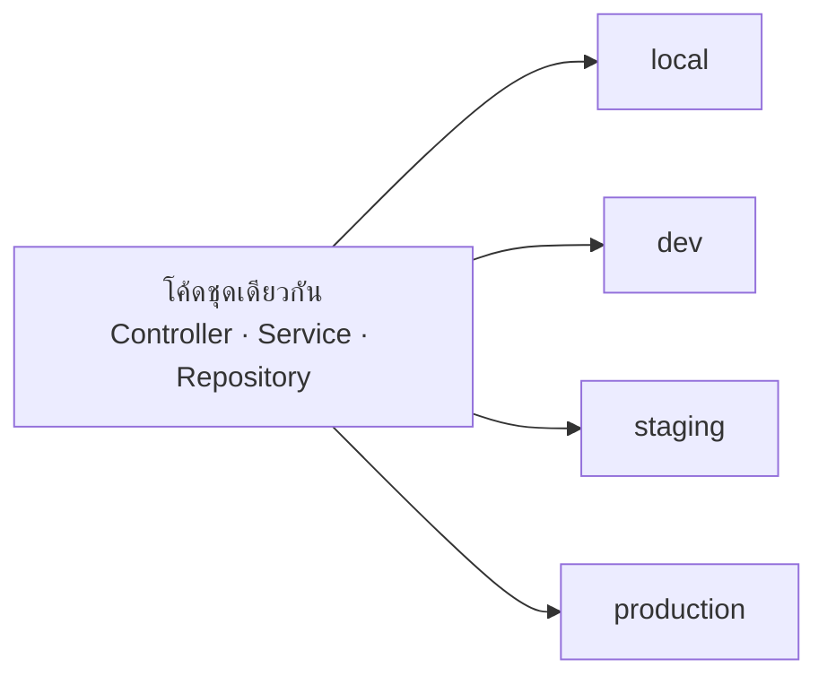
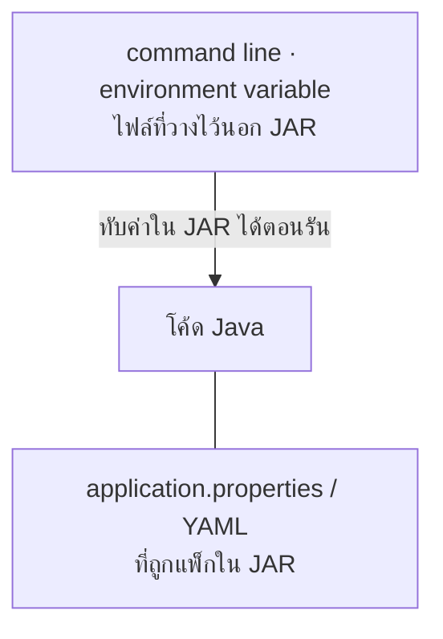
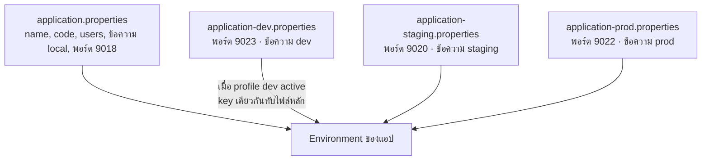
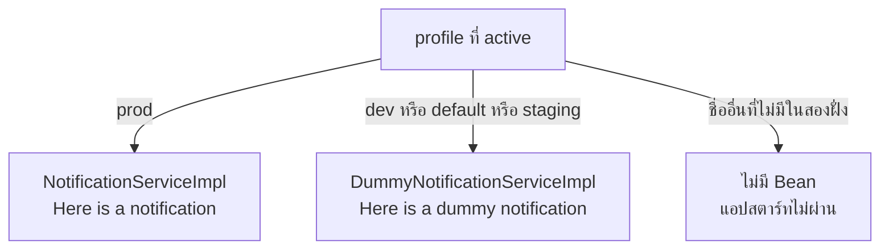

# #18 — Profiles และ YAML: แยก config ตาม environment

> **วิดีโอ:** [Spring Boot Profiles & YAML Explained | Dev vs Prod Configuration | Spring Boot Full Course #18](https://youtu.be/K3H-rqhndEM) — Coder Army, ~52 นาที
> **แหล่งที่ใช้สรุป:** ซับไตเติลภาษาอังกฤษที่ YouTube สร้างอัตโนมัติ (en-US)
> **เวอร์ชันในโค้ด:** Spring Boot 4.1 + Java 21 (ใส่หมายเหตุไว้ทุกจุดที่ Spring Boot 3.x ต่างกัน)

ตอนนี้ตอบคำถามที่เจอทันทีที่เอาแอปออกจากเครื่องตัวเอง: **โค้ดชุดเดียวกันจะใช้ค่าคนละชุดใน local, dev, staging และ production ได้อย่างไร** ผู้สอนแยกสองกลไกที่คนมักปนกัน กลไกแรกคือไฟล์ config คนละใบต่อ environment อีกลไกคือ `@Profile` ที่ให้ IoC Container สร้างคนละ Bean

ตอนนี้ต่อจาก [ตอนที่ 10](./10-application-properties-value-runners.md) ผู้สอนบอกว่าถ้ายังไม่ได้ดูตอนนั้นให้กลับไปดูก่อน เขาจะทบทวน `application.properties` กับ `@Value` สั้น ๆ แล้วค่อยไป YAML, profile และค่าที่ส่งจากนอก JAR

ส่วนที่ติดป้าย `💡 เพิ่มเติม` คือของที่ผมเติมเอง ไม่ได้อยู่ในวิดีโอ ส่วนที่ติด `⚠️ แก้จากวิดีโอ` คือจุดที่วิดีโอพูดคลาดเคลื่อน

---

## สารบัญ

| เวลา | หัวข้อ |
|---|---|
| [0:00](https://youtu.be/K3H-rqhndEM?t=0) | [1. โค้ดไม่เปลี่ยน แต่ config เปลี่ยน](#1-โค้ดไม่เปลี่ยน-แต่-config-เปลี่ยน) |
| [3:00](https://youtu.be/K3H-rqhndEM?t=180) | [2. Configuration คือค่าที่ทำให้โค้ดรันได้](#2-configuration-คือค่าที่ทำให้โค้ดรันได้) |
| [4:43](https://youtu.be/K3H-rqhndEM?t=283) | [3. โปรเจกต์ profile-demo](#3-โปรเจกต์-profile-demo) |
| [5:46](https://youtu.be/K3H-rqhndEM?t=346) | [4. Hardcode แล้วต้องแก้โค้ดทุก environment](#4-hardcode-แล้วต้องแก้โค้ดทุก-environment) |
| [9:17](https://youtu.be/K3H-rqhndEM?t=557) | [5. อ่านค่าด้วย @Value และ server.port](#5-อ่านค่าด้วย-value-และ-serverport) |
| [14:52](https://youtu.be/K3H-rqhndEM?t=892) | [6. ไฟล์ใน JAR กับ config นอก JAR](#6-ไฟล์ใน-jar-กับ-config-นอก-jar) |
| [15:36](https://youtu.be/K3H-rqhndEM?t=936) | [7. YAML](#7-yaml) |
| [25:07](https://youtu.be/K3H-rqhndEM?t=1507) | [8. ไฟล์คนละใบต่อ profile](#8-ไฟล์คนละใบต่อ-profile) |
| [29:04](https://youtu.be/K3H-rqhndEM?t=1744) | [9. spring.profiles.active](#9-springprofilesactive) |
| [32:42](https://youtu.be/K3H-rqhndEM?t=1962) | [10. สั่ง profile จากข้างนอกโปรเซส](#10-สั่ง-profile-จากข้างนอกโปรเซส) |
| [37:36](https://youtu.be/K3H-rqhndEM?t=2256) | [11. ไม่อยากให้ dev ส่ง notification จริง](#11-ไม่อยากให้-dev-ส่ง-notification-จริง) |
| [43:38](https://youtu.be/K3H-rqhndEM?t=2618) | [12. สอง Bean ใน environment เดียวกัน](#12-สอง-bean-ใน-environment-เดียวกัน) |
| [47:06](https://youtu.be/K3H-rqhndEM?t=2826) | [13. @Profile](#13-profile) |
| [50:28](https://youtu.be/K3H-rqhndEM?t=3028) | [14. สองกลไกนี้คนละงาน](#14-สองกลไกนี้คนละงาน) |
| — | [สรุปท้ายตอน](#สรุปท้ายตอน) |

---

## 1. โค้ดไม่เปลี่ยน แต่ config เปลี่ยน

[▶ 0:00](https://youtu.be/K3H-rqhndEM?t=0)

ผู้สอนเริ่มจากปัญหาที่เจอตอนจะ deploy: เขียน Spring Boot บนเครื่องตัวเองได้แล้ว แต่พอจะขึ้น production จะติดเรื่อง profiles กับ configuration

แอปมีสองส่วนที่ต้องแยกให้ออก

1. **โค้ด** คือ Controller, Service, Repository และ business logic เขียนครั้งเดียวแล้วต้องการให้รันได้ทั้งบนเครื่องตัวเอง ตอนทดสอบ และตอนผู้ใช้จริง
2. **Configuration** คือค่าที่เปลี่ยนไปตามที่รัน เช่น URL ของ database, username, password และ port

"โค้ดไม่เปลี่ยน" ไม่ได้แปลว่าห้ามเพิ่ม feature แปลว่า logic ที่เขียนเสร็จแล้วไม่ควรถูกแก้แค่เพราะกำลังจะเอาขึ้นอีก environment

### Environment ที่บริษัทมี

[▶ 0:47](https://youtu.be/K3H-rqhndEM?t=47)

ผู้สอนไล่ชื่อที่เจอบ่อย บริษัทต่างกันตั้งชื่อไม่เหมือนกัน เขาให้ยึดหน้าที่ของแต่ละที่

| ชื่อที่เขาใช้ | ทำอะไร |
|---|---|
| **local** | เครื่องของคนเขียน เปิดเซิร์ฟเวอร์เอง คนนอกเรียกไม่ถึง |
| **dev** | ที่ให้ developer ทดสอบต่อจากเครื่องตัวเอง |
| **QA / staging / pre-prod** | สภาพที่ทำให้เหมือน production เพื่อให้ QA หา bug ก่อนขึ้นจริง บางบริษัทใช้ชื่อเหล่านี้แทนกัน |
| **production** | ที่ผู้ใช้จริงใช้งาน |

[▶ 1:27](https://youtu.be/K3H-rqhndEM?t=87)

**Staging** ในคำอธิบายของเขาคือ environment ที่สร้างไว้ก่อน production ให้เหมือนของจริง ทีม QA รันโค้ดที่นั่นแล้วดูว่ามี bug หรือไม่



สิ่งที่เปลี่ยนระหว่างกล่องขวาคือ configuration ไม่ใช่ class ของ business logic

> 💡 **เพิ่มเติม:** วิดีโอเรียกฟีเจอร์นี้ว่า profiling ในโลก Java คำว่า profiling มักแปลว่าการวัดประสิทธิภาพของโปรแกรม ฟีเจอร์ในตอนนี้ชื่อ **Profile** คือชื่อ environment ที่ Spring ใช้เลือก config และ Bean

---

## 2. Configuration คือค่าที่ทำให้โค้ดรันได้

[▶ 3:00](https://youtu.be/K3H-rqhndEM?t=180)

เขาวาดแอป Spring Boot ที่มี logic อยู่แล้ว และต้องคุยกับ database ค่าที่ต้องบอกแอปก่อนรัน ได้แก่

- URL ของ database และ port ของ database
- username กับ password
- port ที่แอป Spring Boot จะฟัง
- ค่าที่เราสร้างเอง เช่นข้อความต้อนรับ

ค่าพวกนี้เคยเขียนใน `application.properties` แล้วในตอนที่ 10 วันนี้เขาจะเขียนใหม่ให้เห็นทางที่ค่าเดินเข้ามาในโค้ด แล้วเทียบกับอีกฟอร์แมตหนึ่งคือ YAML และจะอธิบายว่า external configuration กับ profile คืออะไร

บน Spring Initializr ตอนสร้างโปรเจกต์มีให้เลือกไฟล์ config เป็น properties หรือ YAML ซีรีส์นี้ใช้ properties มาตลอด วันนี้จึงได้ใช้ YAML

---

## 3. โปรเจกต์ profile-demo

[▶ 4:43](https://youtu.be/K3H-rqhndEM?t=283)

ผู้สอนเปิด [Spring Initializr](https://start.spring.io) แล้วตั้งค่าตามนี้

- Spring Boot **4.1.0** ในวิดีโอ
- ชื่อโปรเจกต์ `profile.demo`
- Java **21**
- dependency ฝั่งเว็บอย่างเดียว เขาเรียกว่า Web / Spring Web
- ไม่ใส่ dependency อื่น

จากนั้น unzip แล้วเปิดใน IntelliJ ได้ `pom.xml`, class หลัก และ `src/main/resources/application.properties`

> 💡 **เพิ่มเติม:** โน้ตนี้รันด้วย Spring Boot **4.1.1** ชื่อที่เขาพูดว่า `profile.demo` ใช้เป็น artifact ไม่ได้เพราะมีจุด จึงใช้ `profile-demo` และ package `com.example.profiledemo` ตามค่าเริ่มต้นของ Initializr ที่เขาไม่ได้อ่านออกเสียง group

`pom.xml` ส่วนที่เกี่ยวกับ dependency

```xml
<parent>
  <groupId>org.springframework.boot</groupId>
  <artifactId>spring-boot-starter-parent</artifactId>
  <version>4.1.1</version>
</parent>

<groupId>com.example</groupId>
<artifactId>profile-demo</artifactId>
<version>0.0.1-SNAPSHOT</version>

<properties>
  <java.version>21</java.version>
</properties>

<dependencies>
  <dependency>
    <groupId>org.springframework.boot</groupId>
    <artifactId>spring-boot-starter-webmvc</artifactId>
  </dependency>
</dependencies>
```

> ⚠️ **Boot 4 vs 3:** ใน Boot 4 starter ของเว็บแบบ servlet คือ `spring-boot-starter-webmvc` ชื่อเดิม `spring-boot-starter-web` ยังใส่ได้แต่ถูก deprecate ใน Boot 3.x โปรเจกต์นี้ใช้ `spring-boot-starter-web`
> ([Spring Boot 4.0 Migration Guide](https://github.com/spring-projects/spring-boot/wiki/Spring-Boot-4.0-Migration-Guide))

เขาบอกว่าใน Initializr มีสองทางเลือกของไฟล์ config คือ properties กับ YAML ซีรีส์ก่อนหน้านี้เลือก properties

---

## 4. Hardcode แล้วต้องแก้โค้ดทุก environment

[▶ 5:46](https://youtu.be/K3H-rqhndEM?t=346)

เขาไม่สร้าง API เต็มชั้น Controller เรียก Service เรียก Repository ต้องการแค่เมธอดเดียวเพื่อทดลองว่าค่าเดินเข้ามาได้อย่างไร

สร้าง `DemoController` เป็น `@RestController` มีเมธอด `simpleGreet` คืน `ResponseEntity<String>` เขาตั้ง mapping ที่ระดับ class เป็น `/api/demo` แล้วตั้งเมธอดเป็น `/greet` ช่วงแรกพูดว่า `@PostMapping` แล้วแก้เองเป็น `@GetMapping`

ข้างในมี field `message` ที่จะคืนให้ client ถ้าเขียนข้อความติดไปกับ field เลย เช่น `Hello, welcome to my application` แอปตอบได้ แต่มีสองปัญหา

1. จะเปลี่ยนข้อความทีหลัง ต้องเปิดโค้ดมาแก้
2. เขาต้องการให้ข้อความคนละแบบใน local, staging และ production

[▶ 8:12](https://youtu.be/K3H-rqhndEM?t=492)

ตัวอย่างที่เขาเขียนบนกระดานคือ field เดียวชื่อ `message` แต่ค่าที่แสดงนำหน้าด้วยชื่อ environment เช่น `local`, `staging`, `production` ตัวอย่างนี้เล็ก แต่รูปแบบเดียวกันกับค่าที่เปลี่ยนจริง

### ใช้ database เป็นภาพ

[▶ 8:36](https://youtu.be/K3H-rqhndEM?t=516)

URL, username และ password ของ database ไม่เหมือนกันทุก environment

- บน local อาจชี้ `localhost:3306` และใช้ password ง่าย ๆ อย่าง `123`
- บน staging กับ production URL คนละเครื่อง password ยากกว่า

ถ้าประกาศตัวแปรใน class แล้ว hardcode URL ไว้ ทุกครั้งที่จะ deploy ต้อง comment ตัวแปรของ local แล้วเปิดตัวแปรของ prod เขามองว่าวิธีนี้แย่ เพราะต้องแก้โค้ดซ้ำก่อน deploy ทุกครั้ง

เขากลับไปที่ `DemoController` แล้วสมมติ field `dbUrl`, `username`, `password` จากนั้นยกสามเหตุผลที่ห้ามฝังค่าเหล่านี้ในโค้ด

[▶ 12:09](https://youtu.be/K3H-rqhndEM?t=729)

1. **ค่าผูกกับ environment** แก้ที่หมาย ต้องแก้โค้ดแล้ว comment สลับไปมา
2. **ความลับหลุดเข้า Git** [▶ 14:04](https://youtu.be/K3H-rqhndEM?t=844) โค้ดต้องขึ้น Git หรือแพลตฟอร์มเก็บเวอร์ชันอื่น ถ้า URL, username และ password อยู่ใน source มันจะติดไปกับประวัติ
3. **เปลี่ยนทีต้อง deploy ใหม่ทั้งก้อน** [▶ 14:25](https://youtu.be/K3H-rqhndEM?t=865) แม้แต่ข้อความต้อนรับ ถ้าฝังในโค้ด การแก้ครั้งหนึ่งคือ commit, push แล้ว deploy เขาอยากได้ค่าจากข้างนอก เพื่อไม่ต้องทำรอบนี้ทุกครั้งที่ข้อความหรือรหัสผ่านเปลี่ยน

เขาลองพิมพ์ `spring.datasource.url` แบบ `jdbc:mysql://localhost:3306/...` พร้อม username กับ password แล้ว IDE ฟ้องว่าไม่พบ driver เพราะโปรเจกต์ไม่ได้ใส่ MySQL driver เขาบอกให้เมิน error นั้น ดูแค่รูปร่างของ config

> 💡 **เพิ่มเติม:** โปรเจกต์ในโน้ตนี้ไม่ใส่ `spring.datasource.*` จึงไม่มี driver ให้ classpath และแอปสตาร์ทได้โดยไม่ต่อ database เรื่องที่เขาต้องการให้เห็นคือค่าพวกนี้ต้องออกจาก source code

---

## 5. อ่านค่าด้วย @Value และ server.port

[▶ 9:17](https://youtu.be/K3H-rqhndEM?t=557)

ทางที่เขาใช้แทน hardcode คือใส่ key ใน `application.properties` แล้วดึงเข้า field ด้วย `@Value`

ขั้นแรกเขาเขียนแค่

```properties
app.welcome.message=Hello, welcome to my application
```

ใน Controller

```java
@Value("${app.welcome.message}")
private String message;
```

`${...}` คือ placeholder ตอนแอปสตาร์ท Spring แทนที่ด้วยค่าของ key นั้น เมธอดคืน `ResponseEntity.ok(message)`

เขารันแอป เห็น Tomcat ขึ้นที่พอร์ต 8080 แล้วยิงจาก Postman ที่ `GET /api/demo/greet` ได้ข้อความ `Hello, welcome to my application` ไม่มี body หรือ header พิเศษใน request

เขาโยงกลับตอนที่ 10 ว่าพอแอปสตาร์ท ค่าในไฟล์นี้เข้าสู่แอป Spring Boot แล้ว `@Value` อ่านจากตรงนั้น

### ค่าที่ Boot กำหนดไว้ กับค่าที่เราสร้างเอง

[▶ 11:15](https://youtu.be/K3H-rqhndEM?t=675)

ต่อจากข้อความ เขาเปลี่ยนพอร์ตของเซิร์ฟเวอร์ IDE แนะนำ `server.port` และค่าเริ่มต้นของ Tomcat คือ `8080` เขาตั้งเป็น `9090` แล้วรันใหม่ Tomcat ขึ้นที่พอร์ตใหม่ ยิงพอร์ตเดิมไม่ติด ต้องยิงพอร์ตที่ตั้งไว้

เขาแยกสองชนิดของ key

| ชนิด | ตัวอย่างในตอนนี้ | ใครเป็นคนนิยาม |
|---|---|---|
| ของ Spring Boot | `server.port`, `spring.application.name` | Boot มีความหมายให้แล้ว |
| ของแอปเรา | `app.welcome.message` | เราตั้งชื่อเอง แล้วอ่านด้วย `@Value` |

`server.port` คือตัวอย่างของค่าที่ไม่อยาก hardcode ใน `new ServerSocket(...)` หรือในโค้ดสตาร์ท เพราะแต่ละ environment ฟังคนละพอร์ตได้

> 💡 **เพิ่มเติม — พอร์ตในวิดีโอกับพอร์ตในโน้ตนี้**
> ประโยคที่พูดชัดคือ local ใช้ค่าเริ่มต้นของ Tomcat คือ **8080**, dev คือ **9090**, staging คือ **8080**, prod คือ **8191** ซับอัตโนมัติได้ยิน 9090 เป็น 1990 หรือ 990 และได้ยิน 8080 เป็น 880 หลายครั้ง
> โปรเจกต์ที่รันคู่กับโน้ตนี้เลื่อนพอร์ตไปชุด **9018 / 9023 / 9020 / 9022** เพื่อไม่ให้ชนกับแอปอื่นบนเครื่องเดียวกัน ค่าที่เหลือตรงกับที่เขาตั้ง ตารางอยู่ที่ [ค่ากลางกับค่าเฉพาะ profile](#อะไรอยู่ไฟล์กลาง-อะไรอยู่ไฟล์ของ-profile)

โค้ดสุดท้ายของ Controller รวม field ที่เขาค่อย ๆ เพิ่มทีหลัง (`code` กับ `names`) ไว้ที่นี่ทีเดียว เพื่อให้ตรงกับไฟล์ที่รัน

```java
package com.example.profiledemo;

import java.util.List;
import org.springframework.beans.factory.annotation.Value;
import org.springframework.http.ResponseEntity;
import org.springframework.web.bind.annotation.GetMapping;
import org.springframework.web.bind.annotation.RequestMapping;
import org.springframework.web.bind.annotation.RestController;

@RestController
@RequestMapping("/api/demo")
public class DemoController {

  @Value("${app.welcome.message}")
  private String message;

  @Value("${app.welcome.code}")
  private Integer code;

  @Value("${app.welcome.users}")
  private List<String> names;

  @GetMapping("/greet")
  public ResponseEntity<String> simpleGreet() {
    System.out.println(names);
    return ResponseEntity.ok(message + " : " + code);
  }
}
```

เขาให้คืนข้อความต่อด้วย code โดยเว้นวรรคแล้วตามด้วยโคลอน รายชื่อผู้ใช้ไม่ได้ใส่ใน response เขาพิมพ์ออก console ด้วย `System.out.println` แล้วบอกว่า `List` มี `toString` อยู่แล้ว

> 💡 **เพิ่มเติม:** `@Value` วางบน field ตามที่เขาพิมพ์ ในตอนที่ 10 มีรูปแบบค่า default `${key:ค่าสำรอง}` ถ้า key หาย แอปนี้จะสตาร์ทไม่ผ่านเพราะไม่มีค่าสำรอง

---

## 6. ไฟล์ใน JAR กับ config นอก JAR

[▶ 14:52](https://youtu.be/K3H-rqhndEM?t=892)

หลังจากย้ายค่าออกจาก Java แล้ว เขาย้ำว่า `application.properties` **ยังไม่ใช่** สิ่งที่เขาเรียกว่า external configuration

เหตุผลของเขา: ตอน build เป็น JAR ไฟล์นี้ถูกแพ็กเข้าไปข้างใน JAR ทุก environment ที่รัน JAR ใบนั้นจึงเห็นไฟล์เดียวกัน การจะเปลี่ยนข้อความยังต้อง build ใหม่

นิยามที่เขาใช้: **external configuration คือค่าที่ส่งให้แอปจากข้างนอก JAR** เขาจะกลับมาทำตรงนี้ด้วย command line และ environment variable ช่วงนี้เขายังอยู่ที่ไฟล์ในโปรเจกต์ และเรียกมันว่า internal configuration

> ⚠️ **แก้จากวิดีโอ:** วิดีโอบอกว่า `application.properties` ไม่ใช่ external configuration เพราะถูกแพ็กอยู่ใน JAR ที่ถูกในเอกสาร Spring Boot คือบท [Externalized Configuration](https://docs.spring.io/spring-boot/reference/features/external-config.html) ใช้คำนี้กับกลไกทั้งหมดที่ดึงค่าออกจากโค้ด Java รวมถึง `application.properties` และ YAML ที่อยู่ข้างใน JAR ด้วย แหล่งนั้นเป็นลำดับแรกของ property source
> จุดที่วิดีโอต้องการให้ทำตามยังใช้ได้: ไฟล์ที่แพ็กใน JAR เปลี่ยนราย environment โดยไม่ build ใหม่ไม่ได้ ส่วน command line กับ environment variable เปลี่ยนตอนรันได้



---

## 7. YAML

[▶ 15:36](https://youtu.be/K3H-rqhndEM?t=936)

เขาทิ้ง `application.properties` ไว้ก่อน แล้วสร้าง `application.yml` คัดลอก key เดิมไปวาง แล้ว comment ของเก่าเพราะไวยากรณ์คนละแบบ

### หน้าที่เดียวกัน คนละไวยากรณ์

[▶ 16:00](https://youtu.be/K3H-rqhndEM?t=960)

ทั้งสองไฟล์ส่ง configuration เข้าแอป `@Value("${app.welcome.message}")` อ่านได้จากทั้งคู่ สิ่งที่ต่างคือวิธีเขียน

| | properties | YAML |
|---|---|---|
| รูปร่าง | key แบนกับ value คู่หนึ่งต่อหนึ่งบรรทัด | ต้นไม้ ใช้การย่อหน้า |
| ตัวคั่นชั้น | จุด `app.welcome.message` | บรรทัดใหม่และการเยื้อง ไม่ใช้จุด ไม่ใช้วงเล็บ |
| key ที่มี parent เดียวกัน | ต้องเขียน prefix ซ้ำทุกบรรทัด | เขียน parent ครั้งเดียว แล้วใส่ลูกข้างใต้ |

เขายก `app.welcome.message` กับ `app.welcome.code` ใน properties สอง key นี้เขียน prefix `app.welcome` ซ้ำ ใน YAML ทั้งคู่เป็นลูกของ `welcome` ซึ่งเป็นลูกของ `app`

[▶ 17:26](https://youtu.be/K3H-rqhndEM?t=1046)

วิธีที่เขาพิมพ์ `spring.application.name` ใน YAML

```yaml
spring:
  application:
    name: profile-demo
```

กด Enter แล้ว IDE เยื้องให้ เขาเทียบกับการเยื้องของ Python ไม่มี `{` `}` และไม่มีจุด ชั้นถัดไปคือ `server` แล้วลูกคือ `port` จากนั้น `app` → `welcome` → `message` และ `code` อยู่ชั้นเดียวกันกับ `message` เพราะ parent เดียวกัน

ข้อความเขาไม่ได้ใส่เครื่องหมายคำพูด แล้วบอกว่าใส่ double quote ก็ได้ ทั้งสองแบบทำงาน

ไฟล์ YAML ที่รันในโน้ตนี้ คือช่วงก่อนเขาแยก profile ข้อความยังไม่มีชื่อ environment นำหน้า

```yaml
spring:
  application:
    name: profile-demo
server:
  port: 9018
app:
  welcome:
    message: Hello, welcome to my application
    code: 200
    users: Aditya, Rohit, Sohan, Rohan
```

ข้างใน Spring ต้นไม้นี้ถูกทำให้แบนกลับเป็น key แบบ properties

```properties
spring.application.name=profile-demo
server.port=9018
app.welcome.message=Hello, welcome to my application
app.welcome.code=200
app.welcome.users=Aditya, Rohit, Sohan, Rohan
```

`@Value` จึงเขียน key แบบจุดเหมือนเดิม ไม่ว่าค่าจะมาจากไฟล์ไหน

> 💡 **เพิ่มเติม:** YAML ห้ามใช้ tab เยื้อง ต้องเป็น space เท่านั้น ถ้า value มี `: ` หรือขึ้นต้นด้วยอักขระพิเศษ ต้องใส่ quote ข้อความ `Hello, welcome to my application` ไม่มีเครื่องหมายนั้น จึงไม่ต้อง quote ตามที่เขาทำ

### อ่าน code กับ list

[▶ 19:18](https://youtu.be/K3H-rqhndEM?t=1158)

เขาเพิ่ม field `code` เป็น `Integer` อ่าน `${app.welcome.code}` แล้วต่อท้ายข้อความตอนคืนค่า จากนั้นลบ `application.properties` เพราะถ้ามีทั้งสองไฟล์ properties ได้ก่อน แล้วรีสตาร์ท

ผลของชุด YAML ด้านบน เมื่อยิง `GET /api/demo/greet`

```http
HTTP/1.1 200
Content-Type: text/plain;charset=UTF-8

Hello, welcome to my application : 200
```

[▶ 21:03](https://youtu.be/K3H-rqhndEM?t=1263)

เขากลับไปดูการเยื้องอีกรอบ `message` กับ `code` อยู่ชั้นเดียวกัน จึงไม่เยื้องต่างกัน ถ้าเอา `code` ไปอยู่ใต้ `message` ต้องเยื้องเพิ่ม และความหมายของ key จะเปลี่ยน

[▶ 21:06](https://youtu.be/K3H-rqhndEM?t=1266)

จากนั้นเขาใส่ list ของชื่อเป็นค่าคั่นด้วยจุลภาค ที่ key `users` ชื่อที่พิมพ์ออกมาบน console คือ Aditya, Rohit, Sohan, Rohan เขาบอกว่าใส่ list นี้เพื่อโชว์ไวยากรณ์ ไม่ได้มี business logic

ใน Controller เขาเพิ่ม

```java
@Value("${app.welcome.users}")
private List<String> names;
```

แล้ว `System.out.println(names)` ในเมธอด greet ผลบน console หลังยิง request

```text
[Aditya, Rohit, Sohan, Rohan]
```

[▶ 21:47](https://youtu.be/K3H-rqhndEM?t=1307)

เขาเน้นว่า **annotation `@Value` ไม่เปลี่ยน** ไม่ว่าค่าจะมาจาก properties, YAML หรือ command line รูปแบบ placeholder ยังเป็น `${key}`

เขาพูดถึงการเขียน list แบบมีขีดนำหน้า และการเขียน object ซ้อนใน YAML แล้วบอกว่าปกติไม่ทำใน `@Value` งานนั้นใช้ `@ConfigurationProperties` ซึ่งจะดูทีหลัง

> 💡 **เพิ่มเติม:** `@ConfigurationProperties` อยู่ใน [ตอนที่ 10](./10-application-properties-value-runners.md) `@Value` แปลงสตริงที่คั่นด้วยจุลภาคเป็น `List<String>` ได้ตามที่รันด้านบน list แบบขีดของ YAML ควรผูกด้วย `@ConfigurationProperties` ไม่ใช่ `@Value`

โปรเจกต์ตอนจบของวิดีโอไม่มีไฟล์ YAML แล้ว เขาลบมันก่อนเข้าเรื่อง profile ไฟล์ด้านบนคือชุดที่รันเพื่อตรวจว่า `@Value` อ่านต้นไม้ YAML ได้จริง

### มีทั้งสองไฟล์ ตัวไหนชนะ

[▶ 20:01](https://youtu.be/K3H-rqhndEM?t=1201)

เขาตอบเองว่าถ้า `application.properties` กับ `application.yml` อยู่ในที่เดียวกัน **properties ได้ลำดับสูงกว่า** อยากให้ค่าใน YAML มีผลกับ key ที่ทั้งสองไฟล์เขียนไว้ ต้องลบไฟล์ properties

เหตุผลที่เขาให้คือ YAML ถูกทำให้แบนเป็น key-value เหมือน properties อยู่แล้ว จึงไปชนกับไฟล์ที่แบนอยู่แล้ว และ Boot เลือก properties

[▶ 23:04](https://youtu.be/K3H-rqhndEM?t=1384)

เขาบอกว่าเลือกฟอร์แมตตามความถนัดได้ ทั้งคู่ทำงาน จบที่ key แบนชุดเดียวกัน และให้เลือกอย่างใดอย่างหนึ่งเป็นหลัก

> 💡 **เพิ่มเติม — key ที่ทับกัน กับ key ที่มีไฟล์เดียว**
> เอกสาร Boot บอกว่าถ้ามีทั้ง `.properties` และ YAML ในที่เดียวกัน `.properties` มี precedence สูงกว่า ([Externalized Configuration](https://docs.spring.io/spring-boot/reference/features/external-config.html))
> การตรวจในโน้ตนี้ใส่ทั้งสองไฟล์พร้อมกัน YAML มี `server.port=9018`, ข้อความ `from yaml file`, `code=200` และรายชื่อ ส่วน properties มีแค่ `server.port=9024` กับข้อความ `from properties file` ผลคือ Tomcat ขึ้นที่พอร์ต **9024** และ body เป็น `from properties file : 200` ส่วน console ยังพิมพ์ `[Aditya, Rohit, Sohan, Rohan]`
> key ที่ทั้งคู่เขียน ทับด้วย properties key ที่มีแต่ใน YAML ยังถูกอ่าน วิดีโอต้องลบ properties เพราะ key ที่เขากำลังดูมีอยู่ในทั้งสองไฟล์

---

## 8. ไฟล์คนละใบต่อ profile

[▶ 23:37](https://youtu.be/K3H-rqhndEM?t=1417)

เขากลับมาที่ปัญหาเดิม แม้ค่าจะอยู่ใน YAML หรือ properties แล้ว ทั้งสองไฟล์ก็ยังเข้า JAR พอรัน JAR ใบนั้น local, staging และ production ได้ config ชุดเดียวกัน

เขาต้องการให้ข้อความ `Hello, welcome to my application` นำหน้าด้วยชื่อ environment คนละคำ บน local ขึ้นต้น `local` บน staging ขึ้นต้น `staging` บน prod ขึ้นต้น `prod`

[▶ 25:07](https://youtu.be/K3H-rqhndEM?t=1507)

Spring Boot ให้สร้าง**หลายไฟล์** หนึ่งไฟล์ต่อหนึ่ง environment แทนที่จะยัดทุกค่าลงไฟล์เดียวแล้วแก้สลับไปมา

ชื่อไฟล์คือ

```text
application.properties              ไฟล์หลัก อ่านทุกครั้ง
application-{profile}.properties    อ่านเมื่อ profile ชื่อนั้น active
```

เขาลบไฟล์ YAML ทิ้ง แล้วบอกว่าสิ่งที่ทำกับ properties ใช้กับ YAML ได้เหมือนกัน จากนั้นสร้างสามไฟล์

- `application-dev.properties`
- `application-staging.properties`
- `application-prod.properties`

ชื่อ profile เป็นชื่อที่บริษัทตั้งได้ เช่น testing หรือ pre-prod เขาไม่ลงรายละเอียดว่า staging กับ pre-prod ต่างกันไหม และใช้สามชื่อนี้เป็นแบบฝึก

เขาบอกว่า local จะอ่านจาก `application.properties` ไฟล์หลัก ยังไม่ใส่ชื่อ profile

### อะไรอยู่ไฟล์กลาง อะไรอยู่ไฟล์ของ profile

[▶ 27:18](https://youtu.be/K3H-rqhndEM?t=1638)

กฎที่เขาใช้

- ค่าที่อยากให้เหมือนกันทุก environment ใส่ไฟล์หลัก
- ค่าที่เปลี่ยนตามที่รัน ใส่ไฟล์ของ profile นั้น แล้วเอาออกจากไฟล์หลักถ้าไม่อยากให้หลุดไปทุกที่

เขาให้ `spring.application.name=profile-demo` อยู่ไฟล์หลัก เพราะชื่อแอปไม่เปลี่ยน

`server.port` เปลี่ยนได้ เขาเลยย้ายออกจากไฟล์หลัก แล้วใส่คนละค่า

| profile | พอร์ตในวิดีโอ | พอร์ตในโปรเจกต์ที่รัน |
|---|---|---|
| local ไม่ได้เปิด profile | ไม่เขียน `server.port` จึงได้ **8080** | **9018** เขียนไว้ในไฟล์หลัก |
| dev | **9090** | **9023** |
| staging | **8080** | **9020** |
| prod | **8191** | **9022** |

ในวิดีโอ local กับ staging ได้พอร์ต 8080 ทั้งคู่ เพราะไม่ได้รันพร้อมกัน โน้ตนี้แยกพอร์ตเพื่อให้ยิงถูกตัวและไม่ชนแอปอื่น

ข้อความ `app.welcome.message` ก็คนละประโยค ส่วน `app.welcome.code=200` กับรายชื่อ `users` เขาให้เหมือนกันทุก environment จึงอยู่ไฟล์หลักไฟล์เดียว

`application.properties`

```properties
spring.application.name=profile-demo
server.port=9018

app.welcome.message=local: Hello, welcome to my application
app.welcome.code=200
app.welcome.users=Aditya, Rohit, Sohan, Rohan
```

`application-dev.properties`

```properties
server.port=9023
app.welcome.message=dev: Hello, welcome to my application
```

`application-staging.properties`

```properties
server.port=9020
app.welcome.message=staging: Hello, welcome to my application
```

`application-prod.properties`

```properties
server.port=9022
app.welcome.message=prod: Hello, welcome to my application
```



ไฟล์ของ profile ไม่ต้องเขียน key ที่ไม่ได้จะเปลี่ยน `code` กับ `users` จึงไม่มีในสามไฟล์นั้น และยังมาจากไฟล์หลัก

---

## 9. spring.profiles.active

[▶ 29:04](https://youtu.be/K3H-rqhndEM?t=1744)

จะบอกแอปว่าให้หยิบไฟล์ไหน ใส่ key นี้ในไฟล์หลัก

```properties
spring.profiles.active=dev
```

เขาอธิบายผลว่าแอปจะอ่าน config ของ profile `dev` ไม่ใช่ของ prod หรือ staging และไม่ได้ทิ้งไฟล์หลัก มันอ่าน**สองไฟล์** คือ `application.properties` กับ `application-dev.properties` ถ้าเปลี่ยนค่าเป็น `staging` ก็เป็นไฟล์หลักคู่กับ `application-staging.properties` เช่นเดียวกันกับ `prod`

key ที่มีในไฟล์ของ profile ทับ key เดียวกันในไฟล์หลัก key ที่ไฟล์ของ profile ไม่ได้เขียน คงค่าจากไฟล์หลัก

เขารันด้วย profile dev แล้วเช็คสองอย่างให้ตรงไฟล์: พอร์ตต้องเป็นของ dev และข้อความต้องขึ้นต้น `dev` จากนั้นสลับเป็น staging แล้วยิงพอร์ตเดิมไม่ได้ เพราะพอร์ตเปลี่ยน ต้องยิงพอร์ตของ staging จึงเห็นข้อความขึ้นต้น `staging`

> 💡 **เพิ่มเติม:** ถ้าระบุหลาย profile พร้อมกัน เช่น `spring.profiles.active=prod,live` Boot โหลดไฟล์ของทุกชื่อ และไฟล์ของชื่อที่อยู่ท้ายสุดทับชื่อที่อยู่ก่อนหน้า กรณีที่เขาสาธิตมีทีละหนึ่ง profile จึงเห็นสองไฟล์

### แก้ค่านี้ในไฟล์ก่อน deploy ยังติดปัญหาเดิม

[▶ 31:03](https://youtu.be/K3H-rqhndEM?t=1863)

เขาชี้ว่าไฟล์หลักก็อยู่ใน JAR เหมือนกัน ถ้าจะขึ้น dev ต้องมาแก้ `spring.profiles.active=dev` แล้วค่อย push ก่อนขึ้น staging ต้องแก้เป็น `staging` แล้ว push อีกรอบ

นั่นคือปัญหาเดียวกับ hardcode ข้อความใน `DemoController` แค่ย้ายจาก Java มาอยู่ที่ไฟล์ config ยังต้องแก้ของที่อยู่ใน repo ทุกครั้งที่เปลี่ยน environment

เขาสังเกตด้วยว่า IntelliJ โชว์ค่าที่ `@Value` ชี้ไปถึงใน editor พอคลิกก็กลับไปที่ key จริง นั่นเป็นของ IDE ไม่ได้แปลว่าค่าถูกคอมไพล์ติดไปใน class

เขาจึง comment บรรทัด `spring.profiles.active` ทิ้งตอนรันบน local เพื่อให้ค่ามาจากไฟล์หลัก แล้วบอกว่าวิธีแก้ในไฟล์แล้วค่อย push ไม่ใช่ทางที่อยากใช้

ในโปรเจกต์ของโน้ตนี้จึง**ไม่ใส่** `spring.profiles.active` ลงไฟล์ เปิด profile จากข้างนอกตามส่วนถัดไป

---

## 10. สั่ง profile จากข้างนอกโปรเซส

[▶ 32:42](https://youtu.be/K3H-rqhndEM?t=1962)

เขาอยากให้คนที่เอา JAR ไปรันเป็นคนส่ง config จากข้างนอก โดยไม่แก้ไฟล์ในโปรเจกต์ เขายกสองทาง

1. **Command line** ซึ่งเขาจะทำให้ดู
2. **Environment variable** ซึ่งเป็นคู่ key-value เหมือนใน properties แต่ไม่ได้อยู่ในแอป อาจมาจาก OS ตอนเปิดเทอร์มินัล, จาก CI/CD, จาก Kubernetes หรือจาก OS ของเครื่องที่ deploy เขาบอกว่าวิธีประกาศตอน deploy จะดูกันอีกที วันนี้โฟกัส command line

[▶ 34:04](https://youtu.be/K3H-rqhndEM?t=2044)

คำสั่งที่เขาใช้คือ

```bash
mvn spring-boot:run
```

ถ้ายังมี `spring.profiles.active=staging` ในไฟล์ แอปจะขึ้น staging เขาลบบรรทัดนั้นออก แล้วรันใหม่โดยไม่ส่ง profile ผลต้องมาจากไฟล์หลัก ข้อความที่เขาใส่คำว่า local ไว้ในไฟล์นั้นต้องโผล่ และ log ต้องบอกว่าเป็น default profile

จากนั้นเขาส่งชื่อ profile ทาง Maven plugin

```bash
mvn spring-boot:run -Dspring-boot.run.profiles=prod
```

เขาพูดคำสั่งนี้เป็น `-Dspring-boot.run.profiles=` แล้วตามด้วยชื่อ ครั้งแรกเขาจะใช้ `staging` แล้วเปลี่ยนเป็น `prod` พอแอปขึ้น log บอกว่า profile เป็น prod แล้วยิงพอร์ตของ prod จึงเห็นข้อความขึ้นต้น `prod`

สลับเป็น `dev` หรือ `staging` ได้ด้วย argument เดียวกัน ถ้าไม่ส่งอะไร ใช้ไฟล์หลัก

ผลที่รันจากโปรเจกต์นี้

ไม่ส่ง profile พอร์ต 9018

```text
No active profile set, falling back to 1 default profile: "default"
Tomcat started on port 9018 (http) with context path '/'
```

```http
HTTP/1.1 200
Content-Type: text/plain;charset=UTF-8
Content-Length: 45

local: Hello, welcome to my application : 200
```

```text
[Aditya, Rohit, Sohan, Rohan]
```

`mvn spring-boot:run -Dspring-boot.run.profiles=dev` พอร์ต 9023

```text
The following 1 profile is active: "dev"
Tomcat started on port 9023 (http) with context path '/'
```

```text
dev: Hello, welcome to my application : 200
```

`staging` พอร์ต 9020 ข้อความ `staging: Hello, welcome to my application : 200`

`prod` พอร์ต 9022

```text
The following 1 profile is active: "prod"
Tomcat started on port 9022 (http) with context path '/'
```

```text
prod: Hello, welcome to my application : 200
```

ชื่อ `profile-demo` ใน log มาจาก `spring.application.name` ในไฟล์หลัก ทุก profile เห็นชื่อนี้เพราะไม่มีไฟล์ไหนเขียนทับ

> 💡 **เพิ่มเติม — คำสั่งนี้เป็นของ Maven plugin ไม่ใช่ของ `java -jar`**
> `spring-boot.run.profiles` เป็นพารามิเตอร์ของ `spring-boot-maven-plugin` มันไปเปิด profile ให้ก่อนแอปทำงาน
> รัน JAR โดยตรงใช้ argument ของ Spring
>
> ```bash
> java -jar profile-demo-0.0.1-SNAPSHOT.jar --spring.profiles.active=prod
> ```
>
> environment variable ที่คู่กับ key เดียวกัน ผ่าน relaxed binding คือ `SPRING_PROFILES_ACTIVE` รัน `SPRING_PROFILES_ACTIVE=prod mvn spring-boot:run` แล้ว log ขึ้น `The following 1 profile is active: "prod"` ที่พอร์ต 9022 เช่นกัน
> เอกสาร Boot บอกว่า `spring.profiles.active` ใช้ลำดับ property source เดียวกับ key อื่น แหล่งที่อยู่สูงกว่าทับแหล่งที่อยู่ต่ำกว่า จึงใส่ค่านี้ในไฟล์แล้วทับด้วย command line ได้

> 💡 **เพิ่มเติม — ลำดับที่เกี่ยวกับสิ่งที่เขาพูดถึง** แหล่งที่อยู่บนทับแหล่งที่อยู่ล่าง
>
> 1. command line argument `--spring.profiles.active=prod`
> 2. system property `-Dspring.profiles.active=prod`
> 3. environment variable `SPRING_PROFILES_ACTIVE`
> 4. ไฟล์ `application-{profile}` ที่วางไว้นอก JAR
> 5. ไฟล์ `application-{profile}` ที่แพ็กใน JAR
> 6. `application.properties` หรือ YAML นอก JAR
> 7. `application.properties` หรือ YAML ใน JAR
>
> รหัสผ่านของ production ถ้าเขียนลง `application-prod.properties` แล้วยัง commit ไฟล์นั้น มันเข้า Git และเข้า JAR อยู่ดี ทางที่กันความลับออกจาก repo คือข้อ 1–4 ไม่ใช่การแยกไฟล์ profile อย่างเดียว

### ค่าที่ไฟล์ profile ไม่ได้เขียน ยังมาจากไฟล์หลัก

[▶ 36:07](https://youtu.be/K3H-rqhndEM?t=2167)

เขาให้ดูเลข `200` กับรายชื่อผู้ใช้ ว่าไม่มีอยู่ในไฟล์ dev, staging หรือ prod แต่ response ยังมี `200` และ console ยังพิมพ์รายชื่อเดิม ทั้งสี่ profile ด้านบนพิมพ์ `[Aditya, Rohit, Sohan, Rohan]` และลงท้าย body ด้วย `200`

สิ่งที่เปลี่ยนมีแค่พอร์ตกับข้อความ สิ่งที่อยู่ไฟล์หลักอย่างเดียวยังอยู่

เขาบอกว่าตัวอย่างข้อความกับพอร์ตเป็นของสาธิต ของที่ใช้จริงคือ database คนละ URL คนละ username คนละ password ใน local, dev, staging และ prod ใส่ key เหล่านั้นลงไฟล์ของ profile แทน แล้วเลือกไฟล์ด้วย profile ที่เปิดตอนรัน

---

## 11. ไม่อยากให้ dev ส่ง notification จริง

[▶ 37:36](https://youtu.be/K3H-rqhndEM?t=2256)

ช่วงที่สองเขาเปลี่ยนจาก "ค่าในไฟล์" ไปเป็น "Bean คนละตัว"

เขาสร้าง `NotificationController` ให้ส่งการแจ้งเตือน มี `@RequestMapping("/api/notification")` เมธอด `sendNotification` คืน `ResponseEntity<String>` ครั้งแรกเขายิงแล้วได้ 404 เพราะลืมใส่ mapping ที่เมธอด เขาเติม `@PostMapping` โดยไม่มี path เพิ่ม จึงเป็น `POST /api/notification` ไม่มี request body เพราะเป็นเดโม

Controller เรียก `NotificationService.send()` เขาใส่ `@Service` ที่ class บริการ มีเมธอด `send` ที่คืนข้อความ `Here is a notification` แล้วบอกให้สมมติว่าข้างในคือการส่งอีเมลหรือ SMS จริง

การผูก dependency เขาใช้ constructor แล้วบอกว่านี่คือแนวที่เขาใช้เสมอ ไม่ใช้ field injection

พอรันแล้วยิง `POST /api/notification` ได้ 200 พร้อมข้อความนั้น

จากนั้นเขาถามว่าถ้ารันโค้ดเดียวกันบน dev หรือ staging อยากให้เกิดการส่งจริงหรือไม่ การส่งมีต้นทุน อีเมลถูกกว่า SMS และเป็นการรบกวนผู้รับ เขากำลังทดสอบ feature ใหม่ของโมดูลนี้ ไม่อยากให้ทุกครั้งที่ยิง API แล้วมีของจริงออกไป โดยเฉพาะบน dev บน staging เขาอาจยอมครั้งเดียวเพราะใกล้ production แต่บน dev เขาไม่ต้องการเลย

ทางที่เขาใช้คือ annotation `@Profile` ซึ่งคนละอย่างกับไฟล์ `application-{profile}.properties` ที่เพิ่งทำ

### แยก interface กับของจริง ของปลอม

[▶ 41:52](https://youtu.be/K3H-rqhndEM?t=2512)

เขาดึง `NotificationService` ออกมาเป็น interface มีเมธอด `send` อย่างเดียว ไม่ใส่ `@Service` ที่ interface เพราะไม่มี implementation

ของจริงชื่อ `NotificationServiceImpl` ตามธรรมเนียมที่ interface ชื่อ `NotificationService` แล้ว class ที่ทำงานชื่อลงท้าย `Impl` 메ธอด `send` คืน `Here is a notification` ซึ่งเขาให้หมายถึงการส่งอีเมลหรือ SMS จริง

ของปลอมเขาตั้งชื่อแนว `DummyNotificationServiceImpl` เมธอดเดียวกันคืน `Here is a dummy notification` ไม่มีการส่งออกไป ผู้เรียก API ยังได้คำตอบว่าส่งแล้ว แต่ไม่มีใครถูกสแปม และยิงบน dev เพื่อทดสอบได้

เขาใส่ทุก class ไว้ package เดียวกันเพื่อให้เดโมสั้น และบอกว่าปกติ Controller กับ Service แยก package

`NotificationService.java`

```java
package com.example.profiledemo;

public interface NotificationService {

  String send();
}
```

`NotificationController.java`

```java
package com.example.profiledemo;

import org.springframework.http.ResponseEntity;
import org.springframework.web.bind.annotation.PostMapping;
import org.springframework.web.bind.annotation.RequestMapping;
import org.springframework.web.bind.annotation.RestController;

@RestController
@RequestMapping("/api/notification")
public class NotificationController {

  private final NotificationService notificationService;

  public NotificationController(NotificationService notificationService) {
    this.notificationService = notificationService;
  }

  @PostMapping
  public ResponseEntity<String> sendNotification() {
    String notification = notificationService.send();
    return ResponseEntity.ok(notification);
  }
}
```

> 💡 **เพิ่มเติม:** constructor ตัวเดียวของ Bean ไม่ต้องใส่ `@Autowired` Spring inject ให้เอง เขาพูดว่า autowire ผ่าน constructor โค้ดด้านบนคือรูปนั้น

ช่วงที่ยังมี implementation เดียว เขาทบทวน Spring Core ว่า IoC Container สร้าง Bean ของ class นั้น แล้วตอน Controller ขอ `NotificationService` container ส่งตัวนั้นให้ เพราะมีแค่ตัวเดียว

---

## 12. สอง Bean ใน environment เดียวกัน

[▶ 43:38](https://youtu.be/K3H-rqhndEM?t=2618)

พอมี `NotificationServiceImpl` กับ `DummyNotificationServiceImpl` ทั้งคู่เป็น `@Service` และทั้งคู่เป็น `NotificationService` Controller ต้องการแค่ตัวเดียว container ไม่รู้ว่าจะ inject ตัวไหน

เขารันแล้วแอปพัง ข้อความที่เขาเล่าคือมีหลาย Bean ให้ใช้ `@Primary` หรือ `@Qualifier` สองอย่างนี้เขาเคยสอนใน Spring Core ใช้เมื่ออยู่ใน environment เดียวกันแล้วต้องเลือกหนึ่งตัว

ผลตอนถอด `@Profile` ออกทั้งสอง class แล้วสตาร์ท

```text
***************************
APPLICATION FAILED TO START
***************************

Description:

Parameter 0 of constructor in com.example.profiledemo.NotificationController required a single bean, but 2 were found:
	- dummyNotificationServiceImpl: defined in file [/private/tmp/sbc/ep18/target/classes/com/example/profiledemo/DummyNotificationServiceImpl.class]
	- notificationServiceImpl: defined in file [/private/tmp/sbc/ep18/target/classes/com/example/profiledemo/NotificationServiceImpl.class]

Action:

Consider marking one of the beans as @Primary, updating the consumer to accept multiple beans, or using @Qualifier to identify the bean that should be consumed
```

> 💡 **เพิ่มเติม:** log ชุดนี้ยังมีข้อความแนะนำให้เปิด compiler flag `-parameters` ต่อท้าย นั่นไม่ใช่สาเหตุที่มีสอง Bean สาเหตุคือมี `@Service` สองตัวที่ implements interface เดียวกัน

เขาบอกว่า `@Primary` กับ `@Qualifier` ช่วยตอนที่ environment เดียวต้องเลือกหนึ่ง Bean งานนี้ต้องการคนละ Bean ตาม environment จึงยังไม่จบ

---

## 13. @Profile

[▶ 47:06](https://youtu.be/K3H-rqhndEM?t=2826)

เขาใส่ `@Profile` ที่ class ของแต่ละ implementation

- ของปลอม สร้างเมื่อ environment เป็น dev
- ของจริง สร้างเมื่อ environment เป็น prod

ความหมายที่เขาพูด: บอก IoC Container ว่าถ้า environment เป็น dev ให้สร้าง Bean ปลอมแล้ว inject ตัวนั้น ถ้าเป็น prod ให้สร้าง Bean จริง Bean ที่ profile ไม่ตรงจะไม่ถูกสร้าง จึงไม่มีสองตัวให้เลือกในคราวเดียวกัน

เขารันผ่านเทอร์มินัลด้วย profile `dev` log บอกว่า dev active พอร์ตของ dev ไม่ใช่ 8080 ยิง `POST /api/notification` ที่พอร์ตนั้นได้ `Here is a dummy notification`

สลับเป็น `prod` พอร์ตของ prod ได้ `Here is a notification`

ผลจากโปรเจกต์นี้

| คำสั่ง | พอร์ต | `POST /api/notification` |
|---|---|---|
| ไม่ส่ง profile | 9018 | `Here is a dummy notification` |
| `-Dspring-boot.run.profiles=dev` | 9023 | `Here is a dummy notification` |
| `-Dspring-boot.run.profiles=staging` | 9020 | `Here is a dummy notification` |
| `-Dspring-boot.run.profiles=prod` | 9022 | `Here is a notification` |

แถวของ prod คือของจริง สามแถวที่เหลือคือของปลอม เหตุผลที่แถวแรกกับแถว staging ได้ของปลอมอยู่ในส่วนถัดไป ตอนที่เขาเพิ่งใส่แค่ `dev` กับ `prod` สองแถวนั้นยังพัง

`NotificationServiceImpl.java` ของจริง

```java
package com.example.profiledemo;

import org.springframework.context.annotation.Profile;
import org.springframework.stereotype.Service;

@Service
@Profile("prod")
public class NotificationServiceImpl implements NotificationService {

  @Override
  public String send() {
    return "Here is a notification";
  }
}
```

### ไม่มี Bean ที่ profile ตรง

[▶ 48:47](https://youtu.be/K3H-rqhndEM?t=2927)

เขาถามต่อว่าถ้ายิงโดยไม่ส่ง profile เลย พอร์ตเป็นของไฟล์หลัก แอปควรอ่าน `application.properties` แต่เขายังไม่ได้บอกว่า local จะใช้ Bean ปลอมหรือของจริง ของจริงผูกกับ prod ของปลอมผูกกับ dev ไม่มีใครผูกกับ local หรือ staging

เขารันแล้วบอกว่าแอปจะระเบิด เพราะไม่มี implementation ของ `NotificationService` ใน environment ปัจจุบัน มีแค่ของ prod กับของ dev

ผลตอน `@Profile("dev")` กับ `@Profile("prod")` เท่านั้น แล้วสตาร์ทโดยไม่เปิด profile

```text
No active profile set, falling back to 1 default profile: "default"

***************************
APPLICATION FAILED TO START
***************************

Description:

Parameter 0 of constructor in com.example.profiledemo.NotificationController required a bean of type 'com.example.profiledemo.NotificationService' that could not be found.

Action:

Consider defining a bean of type 'com.example.profiledemo.NotificationService' in your configuration.
```

ประโยค Action ตรงกับที่เขาอ่านจากหน้าจอ ให้ไปประกาศ Bean ของ type นั้น ในเคสนี้ไม่ใช่ลืมเขียน class แต่ class ที่มีอยู่ถูก `@Profile` กรองออกเพราะ profile ไม่ตรง

### ใส่ได้หลายชื่อ และชื่อ default

[▶ 49:47](https://youtu.be/K3H-rqhndEM?t=2987)

เขาบอกว่าส่งได้หลายค่าคั่นด้วยจุลภาค อยากไม่ให้ส่งของจริงบน dev, บน local และบน staging ของ local เขาเรียกว่า **default** ของจริงเหลือแค่ prod

จากนั้นเขารันแบบไม่ส่ง profile อีกครั้ง แอปขึ้นได้ และ `POST` ที่พอร์ตของไฟล์หลักได้ `Here is a dummy notification`

ซับไม่ได้อ่าน annotation บนจอทีละตัวหลังแก้รอบนี้ ประโยตที่เขาตั้งใจคือของปลอมใช้กับ dev, default และ staging ของจริงใช้กับ prod โปรเจกต์นี้เขียนตามนั้น

`DummyNotificationServiceImpl.java`

```java
package com.example.profiledemo;

import org.springframework.context.annotation.Profile;
import org.springframework.stereotype.Service;

@Service
@Profile({"dev", "default", "staging"})
public class DummyNotificationServiceImpl implements NotificationService {

  @Override
  public String send() {
    return "Here is a dummy notification";
  }
}
```



ชื่อ `default` ไม่ได้เป็นการตั้งเองลอย ๆ ตอนไม่ส่ง `spring.profiles.active` log คือ `No active profile set, falling back to 1 default profile: "default"` profile ชื่อ `default` จึง active และ `@Profile("default")` ตรง

> 💡 **เพิ่มเติม:** `@Profile({"dev", "default", "staging"})` แปลว่าตรงอย่างน้อยหนึ่งชื่อ เป็น OR
> สตริงเดียว `@Profile("dev,default,staging")` ไม่ได้แปลแบบนั้น มันคือชื่อ profile ชื่อเดียวที่สะกดว่า `dev,default,staging` ลองสตาร์ทโดยไม่เปิด profile แล้วแอปพังด้วย error ไม่มี Bean ของ `NotificationService` แบบเดียวกับกรณีก่อนใส่ `default`
> รูป expression ที่เขียน OR ในสตริงเดียวคือ `@Profile("dev | default | staging")` เครื่องหมาย `|` คือ OR และ `!prod` คือไม่ใช่ prod วิดีโอไม่ได้ใช้รูปนี้

> 💡 **เพิ่มเติม:** ถ้ามีไฟล์ `application-default.properties` มันจะถูกโหลดตอนที่ไม่มีการเปิด profile อื่น เพราะ profile `default` active เขาไม่ได้สร้างไฟล์นั้น ข้อความ local อยู่ใน `application.properties` ซึ่งถูกโหลดทุกครั้งอยู่แล้ว พอเปิด profile `dev` ชื่อ `default` ไม่ได้ active พร้อมกัน `@Profile("default")` จึงไม่ตรงกับรอบที่รัน dev

---

## 14. สองกลไกนี้คนละงาน

[▶ 50:28](https://youtu.be/K3H-rqhndEM?t=3028)

เขาสรุปความต่างก่อนจบ

**ไฟล์ profile** ใช้เมื่ออยากให้ค่า config เปลี่ยนตาม environment สร้าง `application-dev.properties`, `application-prod.properties`, `application-staging.properties` ถ้า environment เป็น dev ก็ได้ไฟล์ dev ถ้าเป็น prod ก็ได้ไฟล์ prod ถ้าเป็น staging ก็ได้ไฟล์ staging ไฟล์ `application.properties` ถูกอ่านทุกกรณี และเป็นที่อยู่ของค่าเริ่มต้นที่ใช้ร่วมกัน

ทำแบบเดียวกันกับ YAML ได้ เป็น `application-dev.yml`, `application-prod.yml` และ `application-staging.yml` ทำงานเหมือนไฟล์ properties

**`@Profile`** ใช้เมื่ออยากให้ตัว Bean เปลี่ยนตาม environment ไม่ใช่แค่ค่าในไฟล์

เขาบอกว่าเรื่องนี้สำคัญตอน deploy โค้ดชุดเดียวกันขึ้นหลาย environment แล้วจบตอน

| | ไฟล์ `application-{profile}` | `@Profile` |
|---|---|---|
| เปลี่ยนอะไร | ค่าที่ `@Value` หรือ Boot อ่าน เช่นพอร์ต ข้อความ URL ของ database | ว่า class ไหนจะถูกสร้างเป็น Bean |
| เลือกด้วยอะไร | `spring.profiles.active` หรือค่าที่ส่งจาก command line / environment variable | ชื่อใน annotation ต้องตรงกับ profile ที่ active |
| ไม่ตรงแล้วเกิดอะไร | ใช้ค่าจากไฟล์หลัก ถ้า key นั้นไม่มีในไฟล์ของ profile | Bean นั้นไม่ถูกสร้าง ถ้าไม่มีตัวอื่นให้ inject แอปสตาร์ทไม่ผ่าน |
| ไฟล์หลัก | `application.properties` หรือ `application.yml` ยังถูกอ่านเสมอ | ไม่ได้เลือกไฟล์ มันกรอง Bean |

---

## สรุปท้ายตอน

### ประเด็นที่ต้องจำ

1. โค้ดของ business logic ชุดเดียวกันรันได้หลาย environment สิ่งที่เปลี่ยนคือ configuration
2. ชื่อที่เจอบ่อยคือ local, dev, staging หรือ pre-prod, และ production บริษัทตั้งชื่อได้ต่างกัน
3. Hardcode URL, password หรือข้อความใน class ทำให้ต้องแก้โค้ดก่อน deploy, ความลับติดเข้า Git, และทุกการเปลี่ยนต้อง build ใหม่
4. `@Value("${key}")` อ่าน key เดียวกันได้จาก properties, จาก YAML และจากค่าที่ส่งตอนรัน
5. YAML เป็นต้นไม้ที่ใช้การเยื้อง Spring ทำให้แบนกลับเป็น key แบบจุด
6. ถ้ามีทั้ง `.properties` และ YAML ในที่เดียวกัน key ที่ซ้ำกันใช้ค่าจาก properties key ที่มีแต่ใน YAML ยังอยู่
7. ไฟล์ใน `src/main/resources` ถูกแพ็กเข้า JAR เปลี่ยนราย environment โดยไม่ build ใหม่ไม่ได้
8. `application-{profile}.properties` ทับ key เดียวกันในไฟล์หลัก ไฟล์หลักยังถูกอ่านเสมอ
9. อย่าฝัง `spring.profiles.active` แล้วแก้ไฟล์ทุกครั้งที่ deploy ส่งชื่อ profile จาก `-Dspring-boot.run.profiles` ตอนใช้ Maven หรือจาก `SPRING_PROFILES_ACTIVE`
10. `@Profile` คนละงานกับไฟล์ profile มันตัด Bean ที่ชื่อไม่ตรงออกจาก container
11. มีสอง `@Service` ที่เป็น interface เดียวกันโดยไม่มี `@Profile` แอปสตาร์ทไม่ผ่าน มีแต่ Bean ที่ profile ไม่ตรงกับที่เปิดอยู่ ก็สตาร์ทไม่ผ่านเหมือนกัน
12. ไม่ได้เปิด profile ใดเลย Spring ใช้ profile ชื่อ `default`

### คำถามทบทวน

1. ทำไม URL ของ database บน local กับ production ไม่ควรอยู่ใน field ของ class
2. `app.welcome.message` ในไฟล์ YAML สามชั้น แบนกลับเป็น key อะไร
3. มีทั้ง `application.properties` และ `application.yml` และทั้งคู่ตั้ง `server.port` คนละค่า พอร์ตที่ได้เป็นของไฟล์ไหน แล้ว key ที่มีแต่ใน YAML หายไปหรือไม่
4. profile `dev` active อยู่ แอปอ่านกี่ไฟล์ และไฟล์ไหนทับอีกไฟล์เมื่อ key ซ้ำ
5. ทำไมการใส่ `spring.profiles.active=prod` ในไฟล์หลักแล้วยังต้อง build ใหม่ถึงจะสลับ environment ยังเหมือน hardcode
6. คำสั่ง Maven ที่เขาใช้เปิด profile `prod` คืออะไร และ environment variable ตัวไหนให้ผลแบบเดียวกัน
7. `code=200` ไม่ได้เขียนใน `application-prod.properties` ทำไม response ของ prod ยังลงท้ายด้วย 200
8. `@Primary` ช่วยตอนมีสอง implementation ใน environment เดียวกัน `@Profile` ช่วยคนละกรณีอย่างไร
9. เปิดแอปโดยไม่ส่ง profile และไม่มี `@Profile` ตัวไหนเขียนว่า `default` ทำไม `NotificationController` สร้างไม่ได้
10. `@Profile("dev,staging")` เป็นสตริงเดียว กับ `@Profile({"dev", "staging"})` ต่างกันอย่างไร

### ตอนถัดไป

[#19 — Spring Boot Filters | FilterChain, Logging, Auth & Request Flow](./19-filters-filterchain.md)
