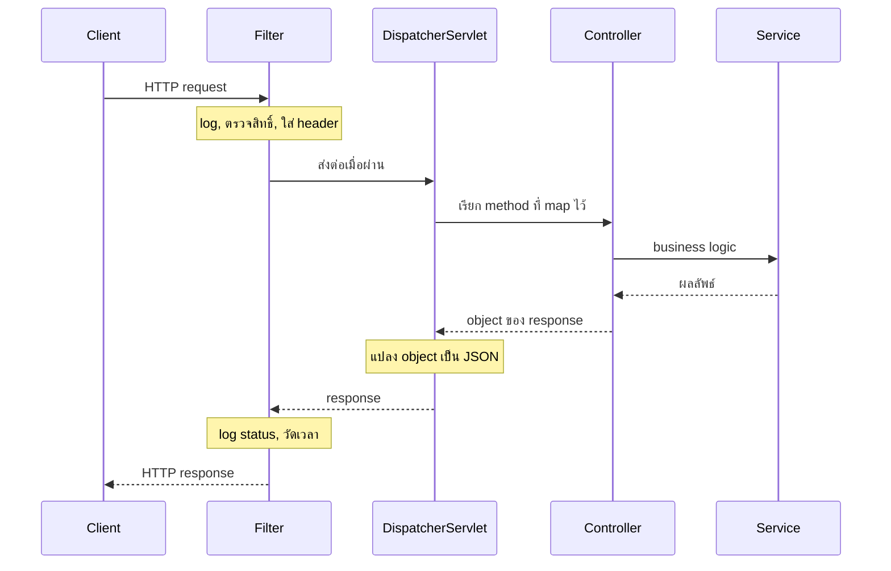
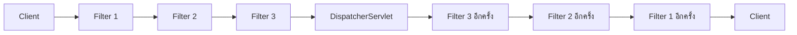
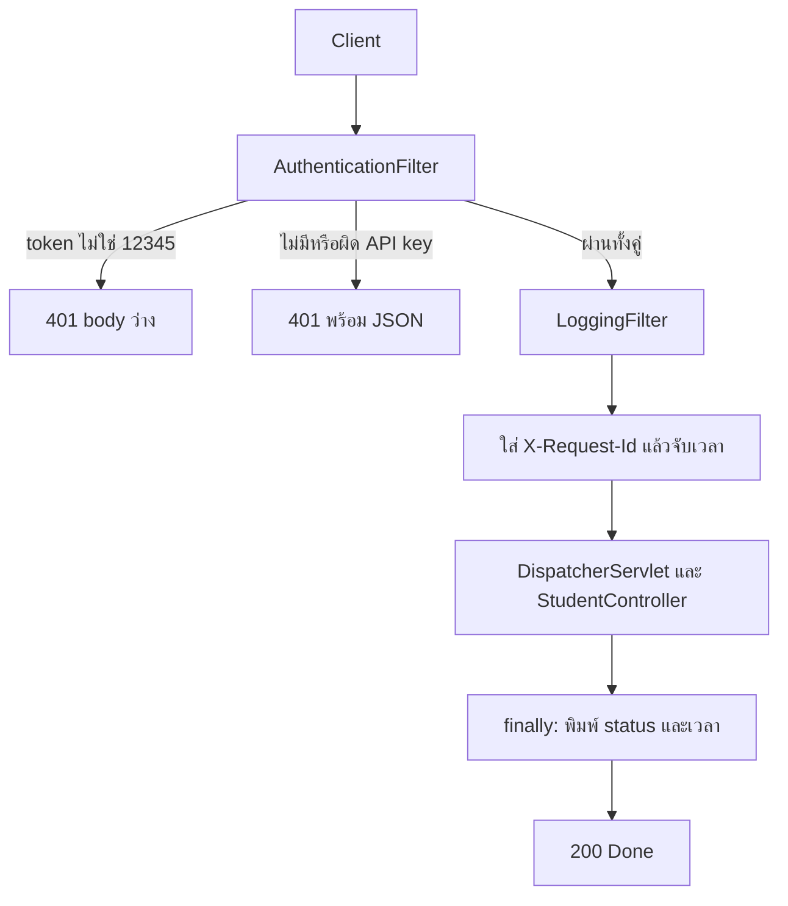

# #19 — Filter และ FilterChain: log, ตรวจ token และวัดเวลาก่อน Controller

> **วิดีโอ:** [Spring Boot Filters | FilterChain, Logging, Auth & Request Flow | Spring Boot Full Course #19](https://youtu.be/ma-macdL9DI) — Coder Army, ~66 นาที
> **แหล่งที่ใช้สรุป:** ซับภาษาอังกฤษที่ YouTube สร้างอัตโนมัติ (en-US)
> **เวอร์ชันในโค้ด:** Spring Boot 4.1 + Java 21 (ใส่หมายเหตุไว้ทุกจุดที่ Spring Boot 3.x ต่างกัน)

ตอนนี้ตอบคำถามว่า งานที่ต้องเกิดกับทุก request ก่อน business logic จะอยู่ตรงไหนของแอป ผู้สอนไล่จากชั้น Controller, Service, Repository ที่รู้แล้ว แล้วแสดงว่าการ copy งาน log, ตรวจผู้ใช้ และแปะ request id เข้าทุก Controller ทำให้โค้ดซ้ำและผิดหน้าที่ จากนั้นเขาใส่ชั้น **Filter** ไว้ก่อน **DispatcherServlet** แล้วเขียน Filter สองตัวให้ทำงานเป็นโซ่

ส่วนที่ติดป้าย `💡 เพิ่มเติม` คือของที่ผมเติมเอง ไม่ได้อยู่ในวิดีโอ ส่วนที่ติด `⚠️ แก้จากวิดีโอ` คือจุดที่วิดีโอพูดคลาดเคลื่อน

---

## สารบัญ

| เวลา | หัวข้อ |
|---|---|
| [0:00](https://youtu.be/ma-macdL9DI?t=0) | [1. งานที่ซ้ำทุก API ไม่ใช่หน้าที่ของ Controller](#1-งานที่ซ้ำทุก-api-ไม่ใช่หน้าที่ของ-controller) |
| [7:32](https://youtu.be/ma-macdL9DI?t=452) | [2. Filter อยู่ก่อน DispatcherServlet](#2-filter-อยู่ก่อน-dispatcherservlet) |
| [11:31](https://youtu.be/ma-macdL9DI?t=691) | [3. Filter ทำอะไรได้](#3-filter-ทำอะไรได้) |
| [15:36](https://youtu.be/ma-macdL9DI?t=936) | [4. Request ที่ไม่เข้า Controller](#4-request-ที่ไม่เข้า-controller) |
| [16:19](https://youtu.be/ma-macdL9DI?t=979) | [5. โปรเจกต์ FilterDemo และ POST /api/students](#5-โปรเจกต์-filterdemo-และ-post-apistudents) |
| [21:17](https://youtu.be/ma-macdL9DI?t=1277) | [6. Filter เป็นของ Servlet](#6-filter-เป็นของ-servlet) |
| [22:02](https://youtu.be/ma-macdL9DI?t=1322) | [7. Lifecycle: init, doFilter, destroy](#7-lifecycle-init-dofilter-destroy) |
| [24:19](https://youtu.be/ma-macdL9DI?t=1459) | [8. ServletRequest กับ HttpServletRequest](#8-servletrequest-กับ-httpservletrequest) |
| [27:29](https://youtu.be/ma-macdL9DI?t=1649) | [9. FilterChain](#9-filterchain) |
| [29:34](https://youtu.be/ma-macdL9DI?t=1774) | [10. เข้า filter ก่อน แล้วกลับมาทำต่อหลัง chain](#10-เข้า-filter-ก่อน-แล้วกลับมาทำต่อหลัง-chain) |
| [34:46](https://youtu.be/ma-macdL9DI?t=2086) | [11. log method, URI และ status](#11-log-method-uri-และ-status) |
| [42:07](https://youtu.be/ma-macdL9DI?t=2527) | [12. AuthenticationFilter ตัด request ด้วย 401](#12-authenticationfilter-ตัด-request-ด้วย-401) |
| [48:13](https://youtu.be/ma-macdL9DI?t=2893) | [13. Request ID ต้องใส่ก่อน doFilter](#13-request-id-ต้องใส่ก่อน-dofilter) |
| [52:16](https://youtu.be/ma-macdL9DI?t=3136) | [14. วัดเวลาทั้ง request](#14-วัดเวลาทั้ง-request) |
| [56:20](https://youtu.be/ma-macdL9DI?t=3380) | [15. try/finally](#15-tryfinally) |
| [57:09](https://youtu.be/ma-macdL9DI?t=3429) | [16. ส่ง error body กลับเอง](#16-ส่ง-error-body-กลับเอง) |
| [1:02:04](https://youtu.be/ma-macdL9DI?t=3724) | [17. @Order รวมสอง filter](#17-order-รวมสอง-filter) |
| [1:04:35](https://youtu.be/ma-macdL9DI?t=3875) | [18. ไม่ใส่ @Order](#18-ไม่ใส่-order) |
| — | [19. สรุปท้ายตอน](#19-สรุปท้ายตอน) |

---

## 1. งานที่ซ้ำทุก API ไม่ใช่หน้าที่ของ Controller

[▶ 0:00](https://youtu.be/ma-macdL9DI?t=0)

ผู้สอนบอกว่าแอปจริงใช้ Filter บ่อยมาก และเรื่องถัดไปคือ Interceptor ซึ่งก็ใช้บ่อยเช่นกัน ตอนนี้จะปู Filter ให้ครบก่อน

เขาวาดชั้นที่รู้แล้วเป็นแนวตั้ง: **Controller**, **Service**, **Repository** request เข้าจาก client มาที่ Controller แล้วลงไป Service และ Repository response เดินย้อนขึ้นมาที่ client

ก่อนถึง Controller ยังมี **DispatcherServlet** ซึ่งเป็น Servlet ตัวกลาง มันเป็นตัวตัดสินว่า request นี้ต้องเรียก Controller ตัวไหน client จึงไม่ได้ยิงเข้า Controller ตรง ๆ

### โจทย์ที่เขาตั้ง

[▶ 1:48](https://youtu.be/ma-macdL9DI?t=108)

สมมติว่ามี `GET /api/students` ที่ `localhost:8080` ก่อนจะยอมให้ request นี้ไปทำ business logic เขาต้องการสามอย่าง

1. **log request** พิมพ์หรือเก็บ request ที่เข้ามา
2. **authenticate** ผู้ใช้ที่ยังไม่ล็อกอิน หรือไม่มี token ต้องเข้ามาไม่ได้
3. **สร้าง request id** เป็นเลขไม่ซ้ำต่อ request เช่น request แรกได้ `1001` request ถัดไปได้ `1002`

หลัง response ถูกสร้างแล้ว เขายังอยากทำอีกชุด เช่น ใส่ request id กลับไปใน response เติม field หรือเติม header ให้ client

ระหว่างสองชุดนั้นคือ business logic เช่น บันทึกข้อมูล

`GET /api/students` ในตัวอย่างนี้คือการดึงรายชื่อนักเรียน เงื่อนไขด้านบนต้องเกิดก่อน แล้วงานชุด response เกิดหลัง

### ทำใน Controller ไม่ไหว

[▶ 3:18](https://youtu.be/ma-macdL9DI?t=198)

ความคิดแรกคือพอ DispatcherServlet ส่งงานมาถึง Controller ก็ log, ตรวจผู้ใช้ และสร้าง request id ที่นั่น แล้วค่อยให้ Service ทำ business logic

พอแอปมี 50 endpoint หรือมากกว่านั้น จะต้องเปิดทุก Controller แล้วเขียนสามอย่างนี้ซ้ำ เขาบอกว่าแนวนี้ใช้ไม่ได้ และอยากมีชั้นกลางที่ทำงานเหล่านี้ครั้งเดียว แล้วค่อยเรียก Controller

การแยกคลาสช่วยแล้วให้ทุก Controller เรียกคลาสนั้นเองก็ยังไม่จบ เพราะทุก Controller ต้องสร้าง object แล้วเรียก method นั้น และ Controller ยังผูกกับโค้ดโครงสร้างพื้นฐานอยู่ดี

[▶ 6:08](https://youtu.be/ma-macdL9DI?t=368)

เขาแยกงานนี้ออกจากหน้าที่ของ Controller

- log request, สร้าง request id เป็นงานโครงสร้างพื้นฐาน
- ตรวจผู้ใช้เป็นงานความปลอดภัย

หน้าที่ของ Controller มีอย่างเดียว คือรับ request ของ API แล้วส่งต่อให้ Service ไม่ใส่ business logic ไม่ใส่ตรรกะโครงสร้างพื้นฐาน และไม่ใส่ validation เขาอ้างตอนก่อน ๆ ที่ดึง validation ไปไว้ที่การจัดการ exception และดึง business logic ไปไว้ที่ Service

หลักที่ใช้คือข้อแรกของ SOLID คือ **Single Responsibility Principle** คลาสหนึ่งควรมีหน้าที่เดียว เขาบอกว่าสถาปัตยกรรม Spring Boot ของคอร์สนี้จะยึดแนว clean code แบบนี้ต่อเนื่อง

ชั้นที่รับงานนี้คือ **Filter** ส่วน **Interceptor** จะแยกไปอีกตอน

---

## 2. Filter อยู่ก่อน DispatcherServlet

[▶ 7:32](https://youtu.be/ma-macdL9DI?t=452)

ตำแหน่งของ Filter อยู่ก่อน DispatcherServlet request จาก client ชน Filter ก่อน Filter ทำงานกับ request นั้น แล้วจึงส่งต่อไป DispatcherServlet จากนั้นเส้นทางที่รู้แล้วคือ Controller, Service, Repository แล้วเดินกลับ

ตอนขากลับ Controller สร้าง object ของ response DispatcherServlet แปลง object นั้นเป็น JSON ก่อน JSON จะออกไปหา client มันผ่าน Filter อีกครั้ง Filter จึงได้ทำงานกับ response แล้วจึงส่งต่อให้ client

เขาเรียกชั้นนี้ว่า Filter เพราะมันกรองทั้ง request ที่เข้าและ response ที่ออก ชั้นที่เพิ่มจากภาพเดิมคือชั้นนี้ชั้นเดียว ภาพ Controller, Service, Repository ยังอยู่เหมือนเดิม



### ตอนที่ Filter ทำงาน ยังไม่รู้ว่าจะเรียก Controller ไหน

[▶ 9:51](https://youtu.be/ma-macdL9DI?t=591)

เขาบอกว่าหน้าที่ของ DispatcherServlet คือสร้าง `HttpServletRequest` กับ `HttpServletResponse` เข้าใจ method, endpoint, request parameter และ map body จาก JSON เป็น object ด้วย Jackson และใช้ **HandlerMapping** ตัดสินว่า `/api/students` จะเรียก method ไหนของ Controller ไหน Filter ทำงานก่อนการตัดสินใจนั้น จึงไม่รู้ว่า Controller ตัวไหนจะถูกเรียก

> ⚠️ **แก้จากวิดีโอ:** เขาบอกว่า DispatcherServlet เป็นตัวสร้าง `HttpServletRequest` และ `HttpServletResponse` และ request ที่ถึง Filter ยังเป็น raw request ทั้งก้อน ที่ถูกคือ **Servlet Container** (ในแอปนี้คือ embedded Tomcat) parse HTTP แล้วสร้าง request/response สองตัวนี้ **ก่อน** เข้า Filter Chain method, URI และ header จึงอ่านได้ตั้งแต่บรรทัดแรกของ `doFilter` สิ่งที่ยังไม่เกิดตอนอยู่ใน Filter คือ HandlerMapping ยังไม่จับคู่ Controller และ Jackson ยังไม่แปลง body เป็น object ของเรา ส่วนที่เขาพูดถูกคือ DispatcherServlet ใช้ Jackson แปลง object ที่ Controller คืน เป็น JSON ตอนขากลับ

[▶ 11:12](https://youtu.be/ma-macdL9DI?t=672)

เขาปักตำแหน่งของ Interceptor ไว้ล่วงหน้า Interceptor อยู่หลัง DispatcherServlet แต่ก่อน Controller จึงพอรู้ได้ว่าจะเรียก Controller ไหน Filter ไม่มีข้อมูลนั้น ผลคืองานใน Filter ควรเป็นงานทั่วไปที่ใช้ร่วมกันทุก Controller

> ⚠️ **แก้จากวิดีโอ:** ตอนท้ายคลิปเขาบอกว่า Interceptor มาจากฝั่ง Spring Boot Filter มาจาก Servlet spec ถูกเฉพาะครึ่งหลัง Interceptor ใน Spring คือ `HandlerInterceptor` ของ **Spring MVC** (`org.springframework.web.servlet`) Spring Boot เป็นตัวที่ประกอบแอปให้ ไม่ได้เป็นผู้กำหนดแนวคิด Interceptor

---

## 3. Filter ทำอะไรได้

[▶ 11:31](https://youtu.be/ma-macdL9DI?t=691)

เขาไล่รายการงานที่มักใส่ใน Filter

**Logging** เก็บ request ทั้งก้อน เฉพาะ URL หรือเฉพาะบางส่วนลงไฟล์ เพื่อรู้ภายหลังว่าอะไรเข้ามาในระบบ response ที่ออกไปก็ log ได้ ถ้าเป็นข้อมูลอ่อนไหว เช่น บัตรเครดิตหรือรายละเอียดการจ่ายเงิน เขาบอกว่าจะเข้ารหัสก่อนเขียน log หรือไม่เขียนส่วนนั้นเลยก็ได้ เป็นการตัดสินใจของเรา

**ตรวจสิทธิ์** อ่าน token หรือ header ที่เกี่ยวกับการยืนยันตัวตน ถ้าไม่มี ถือว่าผู้ใช้ยังไม่ผ่าน และไม่ปล่อย request ให้เดินต่อ Filter ตัด request ได้ตรงนี้แล้วส่งกลับ client

**แก้ request และ response** ตัวอย่างที่เขาใช้คือแปะ header ของ request id ทุก response เพื่อให้ client หรือระบบภายนอกเอา id นั้นมาขอ log ทีหลัง เขาบอกว่าการแก้ request ต้นทางใน Filter เป็นแนวที่เขาไม่แนะนำ ถ้าต้องเปลี่ยนรูปข้อมูลให้ใช้ DTO การใช้ Filter เปลี่ยนโครงสร้าง request ทั้งก้อนทำให้ของที่เข้ามาไม่ตรงกับของที่ client ส่ง

**Character encoding** บังคับให้ request เป็น UTF-8 ได้ใน Filter

รายการที่เขาเขียนปิดท้ายช่วงนี้คือ Filter อ่าน header ได้ อ่าน cookie และข้อมูล authentication ได้ เติม response header ได้ แก้ request ได้ ห่อ response ได้ ตัด request ได้ ปล่อยให้เดินต่อได้ log ได้ และวัดเวลาทั้งรอบได้

[▶ 15:02](https://youtu.be/ma-macdL9DI?t=902)

การวัดเวลาได้เพราะนาฬิกาเริ่มตอน request เข้า Filter แล้วไป Servlet, Controller, Service, Repository และกลับมาที่ Filter ผลต่างคือเวลาทั้งรอบ เขาเรียกว่า turnaround time หรือ TAT เป็นตัวเลขประมาณว่าการให้บริการ request นี้ใช้เวลานานเท่าไร

---

## 4. Request ที่ไม่เข้า Controller

[▶ 15:36](https://youtu.be/ma-macdL9DI?t=936)

เพราะ Filter อยู่ก่อน Servlet มันเห็น request ที่อาจไม่ถึง Controller เลย เขายกสามแบบ

- ไฟล์คงที่ เช่น `static/logo.png` ไม่มี Controller มารับ แต่ผ่าน Filter
- endpoint ของ error ซับได้ยินเป็น "flash error" จากบริบทคือเส้น error ที่ไม่ได้เขียนเป็น Controller ของเรา
- `favicon.ico`

เขาบอกว่า endpoint กลุ่มนี้ไม่ถึง Controller แต่ Filter ยังเฝ้าดูได้

> 💡 **เพิ่มเติม:** ใน Spring Boot ค่า default ให้ **DispatcherServlet** รับ path `/` ไฟล์ใน `classpath:/static/` ถูกเสิร์ฟโดย resource handler ของ DispatcherServlet จึงเข้า DispatcherServlet แต่ไม่เข้า method ที่เราเขียนด้วย `@RestController` ตอนรันชุดโค้ดท้ายคลิป `GET /favicon.ico` และ `GET /nope` ได้ **401** จาก `AuthenticationFilter` ทั้งคู่ เพราะ filter นี้ลงทะเบียนกับทุก URL และตัด request ที่ไม่มี token ก่อนที่ตัวจัดการ favicon หรือหน้า error จะทำงาน นี่คือผลที่เขาหมายถึงว่า Filter เห็น request ที่ไม่เข้า Controller ของเรา

---

## 5. โปรเจกต์ FilterDemo และ POST /api/students

[▶ 16:19](https://youtu.be/ma-macdL9DI?t=979)

เขาเปิด Spring Initializr ตั้ง group เป็น `in.strikes` ชื่อโปรเจกต์เป็น `FilterDemo` ใช้ Java 21 และเพิ่ม dependency ของเว็บอย่างเดียว เขาเรียกมันว่า Spring Web แล้วตอนเปิดโปรเจกต์บอกว่ามี Spring Boot Starter Web MVC กับ Starter Web MVC Test

> ⚠️ **Boot 4 vs 3:** dependency ที่ Initializr ของ Boot 4 ใส่ให้คือ `spring-boot-starter-webmvc` ชื่อเดิม `spring-boot-starter-web` ถูก deprecate ใน Boot 4 แล้ว Boot 3 ยังใช้ชื่อ `spring-boot-starter-web`
> ([Spring Boot 4.0 Migration Guide](https://github.com/spring-projects/spring-boot/wiki/Spring-Boot-4.0-Migration-Guide))

> 💡 **เพิ่มเติม:** เขาไม่ได้อ่านชื่อ package ออกเสียง โน้ตใช้ `in.strikes.filterdemo` ตามที่ Initializr สร้างจาก group `in.strikes` กับ artifact `filter-demo` พอร์ตในวิดีโอคือ 8080 ชุดนี้ฟังที่ **9019** เพื่อไม่ชนกับตอนอื่น

`pom.xml`

```xml
<parent>
  <groupId>org.springframework.boot</groupId>
  <artifactId>spring-boot-starter-parent</artifactId>
  <version>4.1.1</version>
</parent>

<groupId>in.strikes</groupId>
<artifactId>filter-demo</artifactId>
<version>0.0.1-SNAPSHOT</version>

<properties>
  <java.version>21</java.version>
</properties>

<dependencies>
  <dependency>
    <groupId>org.springframework.boot</groupId>
    <artifactId>spring-boot-starter-webmvc</artifactId>
  </dependency>
  <dependency>
    <groupId>org.springframework.boot</groupId>
    <artifactId>spring-boot-starter-webmvc-test</artifactId>
    <scope>test</scope>
  </dependency>
</dependencies>
```

`src/main/resources/application.properties`

```properties
spring.application.name=filterdemo
server.port=9019
```

เขาสร้าง package `controller`, `service` และ `repository` แล้วบอกว่าตอนนี้ยังไม่ลง repository จึงไม่สร้างคลาสนั้น โน้ตนี้จึงไม่มี package `repository`

### Controller กับ Service ชุดแรก

[▶ 17:31](https://youtu.be/ma-macdL9DI?t=1051)

ขั้นแรกเขาสร้าง `POST /api/students` ที่ยังไม่รับ body เพื่อดูว่าเส้นทางวิ่งได้ `StudentController` เป็น `@RestController` มี `@RequestMapping("/api/students")` method `createStudent` เป็น `@PostMapping` คืน `ResponseEntity.ok("Done")`

`StudentService` เป็น `@Service` method `createStudent` พิมพ์ `Student Created` Controller รับ `StudentService` ทาง constructor แล้วเรียก service ก่อนคืน `"Done"` เขายิงจาก Postman แบบ POST ได้ข้อความ Done และคอนโซลพิมพ์ว่าสร้าง student แล้ว

จากนั้นเขาใส่ body จริง เพื่อให้ Filter มีอะไรให้ log

```json
{
  "id": 1,
  "name": "Aditya",
  "email": "ad@gmail.com"
}
```

[▶ 35:37](https://youtu.be/ma-macdL9DI?t=2137)

คลาสที่รับ body ชื่อ `Student` อยู่ใน package `dto` เขาไม่ใส่ `@Component` เพราะไม่ได้ให้ IoC Container สร้างให้ ฟิลด์เป็น `long id`, `String name`, `String email` พร้อม getter และ setter Controller รับด้วย `@RequestBody Student` แล้วส่ง object นั้นเข้า `createStudent` Service พิมพ์สามอย่าง คือข้อความว่าสร้างแล้ว ชื่อ และอีเมล

`Student.java`

```java
package in.strikes.filterdemo.dto;

public class Student {

  private long id;
  private String name;
  private String email;

  public long getId() {
    return id;
  }

  public void setId(long id) {
    this.id = id;
  }

  public String getName() {
    return name;
  }

  public void setName(String name) {
    this.name = name;
  }

  public String getEmail() {
    return email;
  }

  public void setEmail(String email) {
    this.email = email;
  }
}
```

`StudentService.java`

```java
package in.strikes.filterdemo.service;

import org.springframework.stereotype.Service;

import in.strikes.filterdemo.dto.Student;

@Service
public class StudentService {

  public void createStudent(Student student) {
    // try {
    //   Thread.sleep(2000);
    // } catch (Exception e) {
    // }
    System.out.println("Student Created");
    System.out.println(student.getName());
    System.out.println(student.getEmail());
  }
}
```

บล็อก `Thread.sleep(2000)` คือตัวที่เขาใส่ตอนวัดเวลา แล้ว comment ทิ้งตอนจบคลิป รายละเอียดอยู่ใน[ส่วนที่ 14](#14-วัดเวลาทั้ง-request)

`StudentController.java`

```java
package in.strikes.filterdemo.controller;

import org.springframework.http.ResponseEntity;
import org.springframework.web.bind.annotation.PostMapping;
import org.springframework.web.bind.annotation.RequestBody;
import org.springframework.web.bind.annotation.RequestMapping;
import org.springframework.web.bind.annotation.RestController;

import in.strikes.filterdemo.dto.Student;
import in.strikes.filterdemo.service.StudentService;

@RestController
@RequestMapping("/api/students")
public class StudentController {

  private final StudentService studentService;

  public StudentController(StudentService studentService) {
    this.studentService = studentService;
  }

  @PostMapping
  public ResponseEntity<String> createStudent(@RequestBody Student student) {
    studentService.createStudent(student);
    return ResponseEntity.ok("Done");
  }
}
```

`FilterDemoApplication.java`

```java
package in.strikes.filterdemo;

import org.springframework.boot.SpringApplication;
import org.springframework.boot.autoconfigure.SpringBootApplication;

@SpringBootApplication
public class FilterDemoApplication {

  public static void main(String[] args) {
    SpringApplication.run(FilterDemoApplication.class, args);
  }
}
```

> 💡 **เพิ่มเติม:** `@SpringBootApplication` เปิด component scan ที่ package `in.strikes.filterdemo` Filter ที่ใส่ `@Component` ใน package ลูกจึงถูกเก็บเป็น Bean โดยไม่ต้องประกาศเพิ่ม Jackson 3 ของ Boot 4 แปลง JSON เป็น `Student` ผ่าน setter ได้โดยไม่ต้อง import Jackson ในคลาสนี้

---

## 6. Filter เป็นของ Servlet

[▶ 20:29](https://youtu.be/ma-macdL9DI?t=1229)

เขาแยก package `filter` แล้วสร้าง `LoggingFilter` เพื่อให้ IoC Container จัดการ เขาใส่ `@Component` บนคลาส

การบอกว่าคลาสนี้คือ Filter ทำโดย `implements Filter` และต้องเลือก interface จาก `jakarta.servlet` เขาเปิด interface ให้ดู แล้วสรุปว่า Spring ไม่ได้คิด Filter ขึ้นมา Servlet เป็นคนเอามาให้ จึงเห็น package `jakarta.servlet`

---

## 7. Lifecycle: init, doFilter, destroy

[▶ 22:02](https://youtu.be/ma-macdL9DI?t=1322)

`Filter` มีสาม method คือ `init`, `doFilter` และ `destroy` เขาให้มองเป็น lifecycle สามขั้น แบบเดียวกับ lifecycle ของ Servlet

| Method | เมื่อไหร่ | ใช้ทำอะไรในแอปทั่วไป |
|---|---|---|
| `init` | ตอน Filter ถูกสร้าง | ตั้งค่าครั้งเดียว เขาบอกว่าแทบไม่ได้เขียน |
| `doFilter` | ทุกครั้งที่มี request เข้า Filter นี้ | งานจริงทั้งหมดอยู่ตรงนี้ |
| `destroy` | ตอน Filter จบชีวิต | เก็บของ เขาบอกว่าแทบไม่ได้เขียน |

[▶ 23:53](https://youtu.be/ma-macdL9DI?t=1433)

ใน interface ที่เขาเปิด `doFilter` เป็น method ที่ประกาศไว้เฉย ๆ ต้องเขียนเอง `init` กับ `destroy` มีตัวเป็นค่าว่างอยู่แล้ว จึงไม่บังคับให้ override เขาให้ IDE สร้างเฉพาะ `doFilter`

พอมี Bean ที่ `implements Filter` request ที่เข้าแอปจะผ่าน Filter นี้ก่อนถึง Servlet แล้วจึงถึง `StudentController`

> 💡 **เพิ่มเติม:** ใน `jakarta.servlet-api` 6.1.0 ที่ Boot 4.1.1 ใช้ `init` และ `destroy` เป็น `default` method ตัวว่าง จริงตามที่เขาชี้ Tomcat 11.0.24 เรียก `filter.init(this)` ตอนเตรียม Filter และ `filter.destroy()` ตอนถอด จาก `ApplicationFilterConfig` เขาไม่ได้พิมพ์สอง method นี้บนจอ

---

## 8. ServletRequest กับ HttpServletRequest

[▶ 24:19](https://youtu.be/ma-macdL9DI?t=1459)

ลายเซ็นของ `doFilter` รับสามอย่าง

- `ServletRequest`
- `ServletResponse`
- `FilterChain`

เขาโยงกับตอน Servlet ว่า Java ไม่ได้สร้าง Servlet มาเพื่อ HTTP อย่างเดียว มี `GenericServlet` ที่คุยกับ `ServletRequest` และ `ServletResponse` ส่วนงาน HTTP ได้คลาสเฉพาะคือ `HttpServletRequest` และ `HttpServletResponse`

Filter ถูกออกแบบให้ทั่วไปแบบเดียวกัน จึงรับ `ServletRequest` ไม่ได้รับ HTTP โดยตรง ถ้าจะอ่าน method หรือ header ของ HTTP ต้อง cast เป็น `HttpServletRequest` และ cast response เป็น `HttpServletResponse` เขาบอกว่าส่วนใหญ่เราทำแบบนี้เพราะงานเกือบทั้งหมดเป็น HTTP

[▶ 26:42](https://youtu.be/ma-macdL9DI?t=1602)

เขาบอกว่าถ้าไม่อยาก cast ซ้ำ Spring MVC มีคลาสให้ และจะพูดถึงอีกสักครู่ หลังจากนี้เขาไม่ได้กลับไปเปิดคลาสนั้น

> 💡 **เพิ่มเติม:** คลาสของ Servlet spec ที่ตัด cast ให้คือ `jakarta.servlet.http.HttpFilter` method ที่ให้ override รับ `HttpServletRequest` กับ `HttpServletResponse` อยู่แล้ว คลาสของ Spring ที่คนใช้ในแอปจริงบ่อยกว่าคือ `OncePerRequestFilter` ใน `org.springframework.web.filter` method ที่ให้เขียนคือ `doFilterInternal(HttpServletRequest, HttpServletResponse, FilterChain)` และมันกันไม่ให้ Filter ตัวเดียวทำงานซ้ำใน request เดิมตอนมีการ forward หรือ error dispatch คลิปนี้เขียน `implements Filter` ตรง ๆ ตามที่เขาทำ

### javax กับ jakarta

[▶ 27:00](https://youtu.be/ma-macdL9DI?t=1620)

เขาบอกว่าถ้าเปิดโปรเจกต์ Spring Boot 1 หรือ 2 import ของ `ServletRequest`, `ServletResponse` และ `Filter` จะเป็น `javax.servlet` ตั้งแต่ Boot 3 ขึ้นไปเป็น `jakarta.servlet` เขาอยากให้ใช้ Boot รุ่นใหม่

> 💡 **เพิ่มเติม:** Boot 4 ยังใช้ `jakarta.servlet` เหมือน Boot 3 จุดนี้ไม่ใช่ความต่างระหว่าง Boot 4 กับ Boot 3 ความต่างของสาย Servlet อยู่ที่เวอร์ชัน API Boot 4 ตั้งบน Jakarta EE 11 และใช้ Servlet 6.1 เป็นเส้นฐาน embedded Tomcat ของ Boot 4.1.1 คือ 11.0.24
> ([Spring Boot 4.0 Migration Guide](https://github.com/spring-projects/spring-boot/wiki/Spring-Boot-4.0-Migration-Guide))

---

## 9. FilterChain

[▶ 27:29](https://youtu.be/ma-macdL9DI?t=1649)

Filter มีได้มากกว่าหนึ่งตัว เขาวาด Filter 1, Filter 2 และ Filter 3 เรียงระหว่าง client กับ DispatcherServlet

ขาไป: client เข้า Filter 1 แล้ว Filter 2 แล้ว Filter 3 แล้วจึงถึง DispatcherServlet

ขากลับ: DispatcherServlet กลับเข้า Filter 3 แล้ว Filter 2 แล้ว Filter 1 แล้วจึงถึง client

`FilterChain` คือตัวที่บอก Filter ถัดไปว่าตัวปัจจุบันทำงานเสร็จแล้ว ให้ทำต่อ แต่ละ Filter ทำงานของตัวเอง แล้วเรียก `filterChain.doFilter(request, response)` Filter สุดท้ายไม่มี Filter ถัดไป ตอนนั้น chain ส่งงานเข้า DispatcherServlet



[▶ 30:25](https://youtu.be/ma-macdL9DI?t=1825)

`FilterChain` มี method เดียวคือ `doFilter` รับ `ServletRequest` กับ `ServletResponse` มันเป็น interface เขาเปิดรายการ implementation ใน IDE แล้วบอกว่าไม่ต้องลงลึก กลไกที่เขาอธิบายมีสองกรณี

- ยังมี Filter ถัดไป ก็เรียก `doFilter` ของตัวนั้น พร้อม request, response และ chain
- เป็นตัวสุดท้าย ก็ส่งงานเข้า DispatcherServlet ซึ่งมี `doGet`, `doPost`, `doPut`, `doDelete` ถ้า client ยิง POST เขาบอกว่ารอบสุดท้ายจะเรียก `doPost`

เขาแก้คำพูดเองในจังหวะถัดมาว่า Filter ไม่ได้เรียก Servlet เอง Filter เรียกแค่ chain แล้ว chain เป็นคนจัดการตัวถัดไป

> 💡 **เพิ่มเติม:** implementation ที่ Tomcat 11 ใช้จริงคือ `org.apache.catalina.core.ApplicationFilterChain` ตราบใดที่ยังมี Filter ในโซ่ มันเรียก `filter.doFilter` พอหมดโซ่แล้วมันเรียก `servlet.service` ไม่ได้เรียก `doPost` ตรง ๆ `HttpServlet.service` อ่าน `request.getMethod()` แล้วจึงแยกไป `doPost` สำหรับ POST ชื่อที่ซับได้ยินในรายการของ IDE มี `MockFilterChain` และ `PassThroughFilterChain` ซึ่งอยู่ใน `spring-test` และ `VirtualFilterChain` ซึ่งใน Spring Framework 7 เป็น inner class ของ `CompositeFilter` ชื่อ `FilterChainInfo` ในซับไม่ตรงกับคลาสบน classpath ของโปรเจกต์นี้

เขาย้ำว่าให้ส่ง request กับ response ตัวเดิมเข้า `filterChain.doFilter` ตัวที่ cast เป็น HTTP ใช้อ่านใน Filter ปัจจุบัน ส่วนตัวที่ส่งต่อคืออาร์กิวเมนต์ต้นทาง

---

## 10. เข้า filter ก่อน แล้วกลับมาทำต่อหลัง chain

[▶ 29:34](https://youtu.be/ma-macdL9DI?t=1774)

ชุดแรกของ `LoggingFilter` ยังไม่ log ของจริง เขาพิมพ์หนึ่งบรรทัดตอน request เข้า เรียก `filterChain.doFilter` แล้วพิมพ์อีกบรรทัดตอนกำลังออก ซับได้ยินข้อความเป็น "login filter" ทั้งที่ชื่อคลาสที่เขาตั้งคือ `LoggingFilter`

ลำดับที่เขาอ่านจากคอนโซลหลังยิง Postman คือบรรทัดตอนเข้า filter แล้ว `Student Created` แล้วบรรทัดตอนออกจาก filter เขาอธิบายภาพนี้ว่า request ไปถึง `StudentController` แล้ว `StudentService` จากนั้นเดินกลับมาที่บรรทัดถัดจาก `doFilter`

[▶ 54:07](https://youtu.be/ma-macdL9DI?t=3247)

เขาเปรียบกับโค้ดแบบ recursive จุดที่เรียก `doFilter` คือจุดที่ฟังก์ชันนี้พักไว้ พอ chain ทั้งเส้นกลับมา การทำงานของ Filter นี้จะต่อจากบรรทัดนั้น ไม่ได้เริ่ม `doFilter` ใหม่

โค้ดท้ายคลิปไม่มีสองข้อความนั้นแล้ว เพราะเขาแทนที่ด้วยการ log method, status และเวลา กลไกเดียวกันยังเห็นได้จาก output ใน[ส่วนที่ 17](#17-order-รวมสอง-filter) บรรทัด `Incoming request` มาก่อน `Student Created` และ `Response status` มาทีหลัง

---

## 11. log method, URI และ status

[▶ 34:46](https://youtu.be/ma-macdL9DI?t=2086)

เขายกตัวอย่างเดิมทิ้ง แล้ว cast เป็น HTTP เพื่อ log ของที่ client ส่งมา เขาบอกว่าในแอปจริงควรเขียนลงไฟล์ด้วยไลบรารี log ตอนนี้ยังพิมพ์ที่คอนโซลก่อน ของที่อยากเห็นคือ method, endpoint และส่วนอื่นของ request

เขาพิมพ์ method จาก `getMethod` ซึ่งคืน `GET`, `POST`, `PUT` ตามของที่เข้ามา แล้วต่อด้วย `getRequestURI` ซึ่งเป็น path ที่ถูกเรียก เช่น `/api/students`

หลัง `filterChain.doFilter` เขาส่ง `ServletRequest` กับ `ServletResponse` ตัวเดิม แล้วพิมพ์ status จาก `httpResponse.getStatus`

รอบที่เขายิง body ของ Aditya คอนโซลมี request แบบ POST ไปที่ `/api/students` ตามด้วยชื่อและอีเมลจาก Service และจบด้วย status 200 เขาบอกว่านี่คือการใช้ Filter เพื่อ log และถ้าต้องการก็ log body ได้ด้วย

ชุด log นี้ถูกรวมเข้า `LoggingFilter` ตัวท้ายคลิปใน[ส่วนที่ 17](#17-order-รวมสอง-filter) พร้อม request id และเวลา

---

## 12. AuthenticationFilter ตัด request ด้วย 401

[▶ 42:07](https://youtu.be/ma-macdL9DI?t=2527)

ตัวอย่างที่สองคือการตรวจสิทธิ์แบบหยาบ เขาบอกว่าของจริงจะใช้ค่าที่เข้ารหัสหรือ Bearer token และจะลงรายละเอียดใน Spring Security ตอนนี้สมมติว่าทุก API ต้องมี header ชื่อ `token` ค่าต้องเป็น `12345` ถ้าตรง ถือว่าเป็นผู้ใช้ที่ระบบรู้จัก ถ้าไม่ตรง ให้ตัด

เขายกภาพจากงานจริงว่ามักมี API แยกสำหรับออก token แล้ว client ส่ง token นั้นไปกับ API อื่น ถ้ายังไม่เคยทำแบบนั้น ให้ถือตามสมมติฐานของคลิปไปก่อน

เขาปิด `@Component` ของ `LoggingFilter` ชั่วคราว เพื่อไม่ให้ Spring สร้าง Bean นั้น แล้วสร้าง `AuthenticationFilter` ที่ `implements Filter` เช่นกัน

ตรรกะที่เขาเขียน

1. อ่าน `httpRequest.getHeader("token")`
2. ถ้า token เป็น `null` หรือไม่เท่ากับ `"12345"` ให้ตั้ง status เป็น unauthorized แล้ว `return` โดยไม่เรียก `filterChain.doFilter`
3. ถ้านอกนั้น ให้เรียก `filterChain.doFilter` เพื่อปล่อย request เดินต่อ

[▶ 46:15](https://youtu.be/ma-macdL9DI?t=2775)

เลขของ unauthorized คือ **401** เขาเปิด `HttpServletResponse` แล้วใช้ค่าคงที่ `SC_UNAUTHORIZED` แทนเลขล้วน เพื่อให้อ่านแล้วรู้ว่าหมายถึงผู้ใช้ไม่ได้รับอนุญาต

`return` ตรงนี้คือการไม่ปล่อยให้เดินต่อ สิ่งที่ทำถึงบรรทัดนั้นพอแล้ว จากนั้น response กลับไปหา client

### ลืม @Component

[▶ 47:08](https://youtu.be/ma-macdL9DI?t=2828)

รอบแรกเขายิง token `12345` ได้ Done ตามคาด แล้วยิง `1234` แล้วยังได้ 200 เขาตรวจแล้วพบว่ายังไม่ได้ใส่ `@Component` Spring จึงไม่ได้สร้าง Filter นี้ เขาใส่ `@Component` แล้วรันใหม่

- token `12345` ได้ Done และ Service พิมพ์ว่าสร้าง student แล้ว
- token `1234` ได้ **401 Unauthorized** request ไม่เดินต่อจนกว่าค่าจะเป็น `12345`

ผลของชุดท้ายคลิปซึ่งมีทั้ง token และ API key อยู่ใน[ส่วนที่ 17](#17-order-รวมสอง-filter) กรณี token ผิดอย่างเดียวได้ 401 และ body ว่าง

---

## 13. Request ID ต้องใส่ก่อน doFilter

[▶ 48:13](https://youtu.be/ma-macdL9DI?t=2893)

เขาปิด `AuthenticationFilter` แล้วกลับมาที่ `LoggingFilter` งานใหม่คือทุก request ได้ id ไม่ซ้ำ และส่ง id นั้นกลับใน response เพื่อให้ client เอาไปขอประวัติ log ทีหลัง ตอนนี้ยังไม่ได้เก็บ log ลงไฟล์ เขาให้สมมติว่าแอปจริงเขียนไฟล์แล้วค้นด้วย id นี้ได้

เขาใช้ `UUID.randomUUID().toString()` แล้วตั้งชื่อตัวแปรว่า request id ทุกครั้งที่ยิง ได้ id คนละค่า

> ⚠️ **แก้จากวิดีโอ:** เขาบอกว่า `UUID.randomUUID()` ใช้ `Math.random` ข้างใน ใน Java 21 method นี้เอา `SecureRandom` จาก `UUID.Holder.numberGenerator` แล้วเรียก `nextBytes` ไม่ได้เรียก `Math.random`

[▶ 50:03](https://youtu.be/ma-macdL9DI?t=3003)

คำถามที่เขาตั้งคือจะ `setHeader` ตอนไหน ทำก่อน `filterChain.doFilter` ก็ได้ เพราะตอน request เพิ่งเข้ามาก็มี `HttpServletResponse` อยู่ในมือแล้ว ทำหลัง `doFilter` ตอน response กำลังกลับไปหา client ก็น่าจะได้

เขาบอกว่าทางหลังมีปัญหา พอ response เดินกลับมาถึง Filter จากงานข้างล่าง response ถูก **commit** แล้ว commit แปลว่าอ่านได้อย่างเดียว เติมของเข้าไปไม่ได้อีก แนวที่เขาใช้จึงเป็นการใส่ header ก่อนเรียก chain เพื่อให้ header นี้อยู่กับ response ตัวเดียวกันทั้งขาไปและขากลับ

บน Postman เขาเห็น header `x-request-id` และยิงซ้ำได้ค่าใหม่ทุกครั้ง

> ⚠️ **แก้จากวิดีโอ:** ประโยคที่ว่าพอกลับมาที่ Filter แล้ว response อ่านได้อย่างเดียวเสมอ กว้างกว่าของที่เกิดขึ้นจริง รอบที่ `POST /api/students` สำเร็จ Tomcat commit response ก่อน `doFilter` จะคืน การเรียก `setHeader` ใน `finally` จึงไม่โผล่ใน response ที่ client เห็น สอดคล้องกับคำแนะนำของเขาสำหรับเคสนี้ รอบที่ Service โยน exception ออกมาจาก Servlet ตอน `finally` ทำงาน status ยังเป็น 200 และ response ยังไม่ commit header ที่ใส่ใน `finally` ติดไปกับ response ที่ client ได้รับเป็น 500 รายละเอียดของรอบ exception อยู่ใน[ส่วนที่ 15](#15-tryfinally)

> 💡 **เพิ่มเติม:** โค้ดในโน้ตเรียก `setHeader("X-Request-Id", requestId)` ชื่อที่ curl คืนคือ `X-Request-Id` ตามสตริงนี้ HTTP มองชื่อ header ไม่สนตัวพิมพ์ใหญ่เล็ก จึงเป็น header เดียวกับ `x-request-id` ที่เขาอ่านจาก Postman

---

## 14. วัดเวลาทั้ง request

[▶ 52:16](https://youtu.be/ma-macdL9DI?t=3136)

เขายังอยู่ที่ `LoggingFilter` ของที่มีอยู่แล้วคือสร้าง request id ใส่ header พิมพ์ method กับ URI ตอนเข้า และพิมพ์ status ตอนออก เขาอยากได้เวลาทั้งรอบเพิ่ม ตั้งแต่เข้า Filter จนกลับมาที่ Filter รวม Servlet, Controller และ Service

เขายังไม่มี repository ตัวเลขจึงสั้นมาก แต่บอกว่าพอมี database จะเป็นสัญญาณที่ดีว่า API ใช้เวลานานเท่าไร

วิธีที่เขาทำ

1. ตอนเข้า `doFilter` เก็บ `long startTime = System.currentTimeMillis()`
2. ปล่อยให้ chain ทำงาน
3. พอกลับมา คำนวณ `System.currentTimeMillis() - startTime`
4. พิมพ์ต่อจาก status เป็นเวลาของ API

รอบแรกบนเครื่องเขา คอนโซลขึ้นว่า API response time เป็น **43** มิลลิวินาที

[▶ 55:14](https://youtu.be/ma-macdL9DI?t=3314)

เพื่อให้เห็นตัวเลขขยับ เขาใส่ `Thread.sleep` ใน `StudentService` แรกพูดถึง 5000 มิลลิวินาที แล้วเปลี่ยนเป็น **2000** จับ `Exception` แล้วไม่ทำอะไรใน catch เขาให้มองว่า sleep นี้แทนเวลาของ database, Redis หรือการเรียกแบบ synchronous

รันใหม่แล้วยิงอีกครั้ง เขาอ่านเวลาจากคอนโซลได้ **2550** มิลลิวินาที จากนั้น comment sleep ทิ้ง เพื่อไม่ให้ทุก request ช้าโดยไม่จำเป็น

> 💡 **เพิ่มเติม:** ชุดเดียวกันบนเครื่องของโน้ตนี้ รอบที่ไม่มี sleep พิมพ์ `API response time: 34` รอบที่เปิด `Thread.sleep(2000)` พิมพ์ `API response time: 2037` เลขไม่เท่ากับ 43 และ 2550 ของเขา เพราะเป็นคนละเครื่องและคนละรอบ โครงคือเวลาทั้งก้อนรวมช่วงที่ Service นอนอยู่ ไฟล์ในโปรเจกต์ตรวจโค้ด comment sleep ไว้แบบท้ายคลิป

---

## 15. try/finally

[▶ 56:20](https://youtu.be/ma-macdL9DI?t=3380)

เขาบอกว่าเรียก `filterChain.doFilter` ตรง ๆ ยังไม่ดีพอ ควรอยู่ใน `try` และให้งานหลัง chain อยู่ใน `finally` เหตุผลของเขาคือถ้า Controller หรือ Service โยน exception บรรทัดหลัง `doFilter` จะไม่ทำงาน เขาอยากให้การคำนวณเวลา การพิมพ์ status และการพิมพ์เวลาเกิดเสมอ `finally` ทำงานไม่ว่าจะมี exception หรือไม่

> ⚠️ **แก้จากวิดีโอ:** `finally` ทำให้บรรทัดหลัง chain ทำงานแม้ `doFilter` จะโยน exception จริงตามที่เขาตั้งใจ แต่ `getStatus()` ตอนนั้นไม่ใช่ status ที่ client ได้รับเสมอไป รอบทดลองที่ `createStudent` โยน `IllegalStateException` คอนโซลของ `finally` พิมพ์ `Response status: 200` และ response ยังไม่ถูก commit จากนั้น Tomcat บันทึกว่า `Servlet.service()` ของ `dispatcherServlet` โยน exception และ client ได้รับ **500** พร้อม JSON ของหน้า error ของ Boot status 500 ถูกเขียนหลัง `finally` ของ Filter นี้แล้ว การพิมพ์ status ใน `finally` จึงเห็นค่าเดิมตอน exception ยังลอยออกจาก Servlet ไม่ใช่ 500 ที่สายไฟส่งกลับไป

> 💡 **เพิ่มเติม:** ถ้า exception ถูกจับข้างใน DispatcherServlet แล้วเขียน response จบก่อน `service` จะคืน `doFilter` จะกลับมาแบบปกติและ `getStatus()` ใน `finally` จะเป็นค่าที่ Servlet ตั้งไว้ รอบทดลองด้านบนเป็นกรณีที่ exception หลุดออกจาก `service` โค้ดท้ายคลิปไม่มี endpoint ที่โยน exception นี้

---

## 16. ส่ง error body กลับเอง

[▶ 57:09](https://youtu.be/ma-macdL9DI?t=3429)

เขาบอกว่าปกติไม่ทำแบบนี้ทุกกรณี แต่บางครั้ง client ไม่ส่งคีย์ที่จำเป็น และเราไม่อยากประมวลผลต่อ ก็ส่ง error กลับจาก Filter ได้เลย

เขาเพิ่ม header `x-api-key` ใน `AuthenticationFilter` ชื่อ header ของ HTTP ไม่สนตัวพิมพ์ เขาจึงเขียนเป็นตัวเล็กได้ ถ้า key เป็น `null` หรือไม่ใช่ค่าที่กำหนด ให้ตอบ 401 พร้อม body รอบนี้เขาตั้งค่าที่ต้องการเป็น `secret123`

ลำดับที่เขาเขียนตอนส่ง body

1. `setStatus` เป็น `SC_UNAUTHORIZED`
2. `setContentType("application/json")`
3. `getWriter().write(...)` ด้วย JSON ที่มี message ว่า API key ไม่ถูกต้องหรือหายไป
4. `return` โดยไม่เรียก chain

เงื่อนไข token ยังเหมือนเดิม ถ้า token ไม่ใช่ `12345` ตอบ 401 โดยไม่มี body ถ้า token ผ่านแต่ API key ไม่ใช่ `secret123` ตอบ 401 พร้อม body ถ้าทั้งคู่ผ่าน จึงเรียก `doFilter`

### บั๊กที่เขาเจอบนจอ

[▶ 1:01:03](https://youtu.be/ma-macdL9DI?t=3663)

รอบแรกเขาส่ง `secret123` แล้วยังได้ข้อความว่า key ไม่ถูกต้อง เขาดูเงื่อนไขแล้วพบว่าเขียน `.equals("secret123")` โดยลืมเครื่องหมาย `!` เงื่อนไขจึงเป็นจริงตอน key **ถูกต้อง** เขาแก้เป็นไม่เท่ากัน แล้วรันใหม่

หลังแก้ เขายิง `secret123` ผ่าน และยิงค่าผิดเช่น `secret1` แล้วได้ invalid อีกครั้ง ระหว่างนั้น sleep 2000 มิลลิวินาทียังเปิดอยู่ เขา comment sleep ทิ้งใน `StudentService`

เขาสรุปรายการที่ทำให้ดูใน Filter ห้าอย่าง คือ logging, authentication, request id, เวลาของ request และการส่ง error กลับ client นอกนั้นยังแก้ body ได้ แต่เขาไม่ชอบแนวนี้

---

## 17. @Order รวมสอง filter

[▶ 1:02:04](https://youtu.be/ma-macdL9DI?t=3724)

ถึงตรงนี้เขาเปิดทีละตัวโดย comment `@Component` เขาอยากให้ทั้งคู่ทำงานพร้อมกัน และให้ `AuthenticationFilter` มาก่อน เพราะต้องตรวจผู้ใช้ก่อน ถ้า token ไม่ใช่ `12345` หรือ API key ไม่ใช่ `secret123` ให้กลับทันที ถ้าผ่าน จึงให้ `LoggingFilter` ทำงาน ใส่ `X-Request-Id` วัดเวลา แล้วค่อยเรียก chain จนถึง DispatcherServlet

เขาใส่ `@Order(1)` ที่ authentication และ `@Order(2)` ที่ logging เปิด `@Component` ทั้งคู่ แล้วรันใหม่

ผลที่เขาเช็คบน Postman

- token กับ secret ถูก ได้ Done และได้ header ของ request id แปลว่าทั้งสอง filter ทำงาน
- secret ผิด ได้ unauthorized
- token ผิด ได้ unauthorized
- ผ่านเฉพาะเมื่อส่งครบและถูก

เขาบอกว่าโซ่ยาวได้ตามต้องการด้วย `@Order(3)`, `@Order(4)` และควรให้ Filter หนึ่งตัวมีหน้าที่เดียว `LoggingFilter` ควร log อย่างเดียว ไม่ควรยัด authentication เข้าไปเป็น filter สารพัดประโยชน์ โซ่มีไว้แยกงาน ถ้ายัดทุกอย่างในตัวเดียวก็ทำได้ แต่จะไม่ต้องมีโซ่

โค้ดท้ายคลิปที่รันด้านล่างคือชุดนี้

`AuthenticationFilter.java`

```java
package in.strikes.filterdemo.filter;

import java.io.IOException;

import org.springframework.core.annotation.Order;
import org.springframework.stereotype.Component;

import jakarta.servlet.Filter;
import jakarta.servlet.FilterChain;
import jakarta.servlet.ServletException;
import jakarta.servlet.ServletRequest;
import jakarta.servlet.ServletResponse;
import jakarta.servlet.http.HttpServletRequest;
import jakarta.servlet.http.HttpServletResponse;

@Component
@Order(1)
public class AuthenticationFilter implements Filter {

  @Override
  public void doFilter(ServletRequest request, ServletResponse response, FilterChain filterChain)
      throws IOException, ServletException {
    HttpServletRequest httpRequest = (HttpServletRequest) request;
    HttpServletResponse httpResponse = (HttpServletResponse) response;

    String token = httpRequest.getHeader("token");
    if (token == null || !token.equals("12345")) {
      httpResponse.setStatus(HttpServletResponse.SC_UNAUTHORIZED);
      return;
    }

    String apiKey = httpRequest.getHeader("x-api-key");
    if (apiKey == null || !apiKey.equals("secret123")) {
      httpResponse.setStatus(HttpServletResponse.SC_UNAUTHORIZED);
      httpResponse.setContentType("application/json");
      httpResponse.getWriter().write("{\"message\":\"Invalid or missing API key\"}");
      return;
    }

    filterChain.doFilter(request, response);
  }
}
```

`LoggingFilter.java`

```java
package in.strikes.filterdemo.filter;

import java.io.IOException;
import java.util.UUID;

import org.springframework.core.annotation.Order;
import org.springframework.stereotype.Component;

import jakarta.servlet.Filter;
import jakarta.servlet.FilterChain;
import jakarta.servlet.ServletException;
import jakarta.servlet.ServletRequest;
import jakarta.servlet.ServletResponse;
import jakarta.servlet.http.HttpServletRequest;
import jakarta.servlet.http.HttpServletResponse;

@Component
@Order(2)
public class LoggingFilter implements Filter {

  @Override
  public void doFilter(ServletRequest request, ServletResponse response, FilterChain filterChain)
      throws IOException, ServletException {
    HttpServletRequest httpRequest = (HttpServletRequest) request;
    HttpServletResponse httpResponse = (HttpServletResponse) response;

    long startTime = System.currentTimeMillis();
    String requestId = UUID.randomUUID().toString();
    httpResponse.setHeader("X-Request-Id", requestId);

    System.out.println(
        "Incoming request: " + httpRequest.getMethod() + " " + httpRequest.getRequestURI());

    try {
      filterChain.doFilter(request, response);
    } finally {
      long duration = System.currentTimeMillis() - startTime;
      System.out.println("Response status: " + httpResponse.getStatus());
      System.out.println("API response time: " + duration);
    }
  }
}
```

### ผลรันจริง

คำสั่งคือ `mvn -q -DskipTests package` แล้วสตาร์ท jar ที่พอร์ต 9019 body ทุกเส้นด้านล่างเป็น JSON ของ Aditya

token `12345` และ `x-api-key: secret123`

```http
HTTP/1.1 200
X-Request-Id: e42e3aa2-5b14-4c7b-911e-2241599703ef
Content-Type: text/plain;charset=UTF-8
Content-Length: 4
Date: Fri, 16 Oct 2026 11:50:14 GMT

Done
```

คอนโซลของรอบนี้

```text
Incoming request: POST /api/students
Student Created
Aditya
ad@gmail.com
Response status: 200
API response time: 34
```

ยิงซ้ำด้วย header `Token` และ `X-API-KEY` คนละตัวพิมพ์ ได้ 200 และได้คนละ id คือ `967a6cf6-e854-4ecf-bd56-e0e07aa1ce91` เวลาของรอบที่สองคือ 1 มิลลิวินาที ชื่อ header ที่ต่างตัวพิมพ์ยังผ่าน ตามที่เขาบอกว่า header ไม่สนตัวพิมพ์

token `1234` ได้ 401 และ body ว่าง คอนโซลไม่มี `Incoming request` เพราะ `AuthenticationFilter` return ก่อนเรียก chain `LoggingFilter` จึงไม่ทำงาน

```http
HTTP/1.1 401
Content-Length: 0
Date: Fri, 16 Oct 2026 11:50:14 GMT
```

ไม่ส่ง `x-api-key` หรือส่ง `secret1` ได้ 401 พร้อม JSON

```http
HTTP/1.1 401
Content-Type: application/json;charset=ISO-8859-1
Content-Length: 40
Date: Fri, 16 Oct 2026 11:50:14 GMT

{"message":"Invalid or missing API key"}
```

> 💡 **เพิ่มเติม:** `charset=ISO-8859-1` มาจาก `getWriter()` โดยที่ยังไม่เรียก `setCharacterEncoding` Servlet ล็อก encoding ของ response เป็น ISO-8859-1 ข้อความอังกฤษในตัวอย่างไม่เพี้ยน Boot มี `OrderedCharacterEncodingFilter` ตั้ง charset ของ **request** เป็น UTF-8 เป็นค่า default แต่ไม่ได้บังคับ encoding ของ response ถ้าจะให้ JSON นี้เป็น UTF-8 ต้องตั้ง encoding ก่อน `getWriter()`

> 💡 **เพิ่มเติม:** `@Order(1)` ไม่ได้ทำให้สองคลาสนี้เป็น Filter ตัวแรกของทั้งโปรเจกต์ รายการ Filter bean ที่ Boot 4.1.1 เรียงให้ในแอปนี้คือ `OrderedCharacterEncodingFilter` ที่ order `-2147483648` แล้ว `OrderedFormContentFilter` ที่ `-9900` แล้ว `OrderedRequestContextFilter` ที่ `-105` จากนั้นจึงถึง `AuthenticationFilter` แล้ว `LoggingFilter` ตัวเลข `@Order` น้อยกว่าได้ทำก่อน `HiddenHttpMethodFilter` ไม่ถูกสร้างในค่า default ของแอปนี้

---

## 18. ไม่ใส่ @Order

[▶ 1:04:35](https://youtu.be/ma-macdL9DI?t=3875)

เขาถามว่าถ้าเปิด `@Component` ทั้งคู่แต่ไม่ใส่ `@Order` จะเกิดอะไร เขาตอบว่า Spring จะรัน Filter ที่สร้าง Bean ได้ก่อน แล้วตามด้วยอีกตัว ลำดับนี้ไม่เหมือนเดิมทุกครั้ง บางเครื่องอาจได้ authentication ก่อน บางเครื่องได้ logging ก่อน ถ้าต้องการโซ่ที่กำหนดเองต้องใส่ order ถ้าไม่ใส่ โซ่ยังถูกสร้าง แต่เราไม่ได้เป็นคนเลือก Spring เป็นคนเลือก

> 💡 **เพิ่มเติม:** รอบที่ถอด `@Order` ออกทั้งสองคลาสแล้วสตาร์ทใหม่ ทั้งคู่ไม่มีค่า order และรายการ Filter bean ยังวาง `AuthenticationFilter` ไว้ก่อน `LoggingFilter` ซึ่งตรงกับลำดับชื่อคลาสใน package เดียวกัน รอบเดียวที่ลำดับไม่สลับไม่ได้แปลว่าลำดับนั้นเป็นสัญญา Spring ไม่ได้รับประกันลำดับของ Filter ที่ order เท่ากัน คำเตือนของเขาจึงยังใช้ได้

[▶ 1:05:16](https://youtu.be/ma-macdL9DI?t=3916)

เขาปิดคลิปว่ายังมี Filter ที่เป็นของ Spring เอง ซึ่งจะดูทีหลัง ภาพคร่าว ๆ ของ Filter พอแล้ว Filter มาจากฝั่ง Servlet แต่ใช้ในโค้ด Spring Boot บ่อย Interceptor มาจากฝั่ง Spring และใช้บ่อยเช่นกัน จะอยู่ในคลิปถัด ๆ ไป

---

## 19. สรุปท้ายตอน

### ลำดับของ request ในชุดท้ายคลิป



### ประเด็นที่ต้องจำ

1. งาน log, ตรวจสิทธิ์ และ request id เป็นงานร่วมของทุก request การ copy เข้าทุก Controller ทำให้ซ้ำและฝืน Single Responsibility Principle
2. **Filter** อยู่ก่อน DispatcherServlet จึงยังไม่รู้ว่าจะเรียก Controller ไหน งานใน Filter ควรเป็นงานทั่วไปของทั้งแอป
3. Filter เป็น interface ของ Servlet ใน package `jakarta.servlet` ตั้งแต่ Boot 3 ขึ้นไป ไม่ใช่สิ่งที่ Spring คิดขึ้นเอง
4. method ที่ต้องเขียนคือ `doFilter` ส่วน `init` กับ `destroy` มีตัว default และแทบไม่ได้ใช้ในแอปทั่วไป
5. งาน HTTP ต้อง cast เป็น `HttpServletRequest` และ `HttpServletResponse`
6. **FilterChain.doFilter** ส่งงานให้ Filter ถัดไป ตัวสุดท้ายของโซ่ทำให้ถึง Servlet การไม่เรียก chain คือการตัด request
7. ใส่ header ที่ต้องออกไปกับ response **ก่อน** `doFilter` ในเคสที่ response สำเร็จของคลิปนี้ เพราะพอ chain กลับมา response ถูก commit แล้ว
8. วัดเวลาโดยเก็บ `currentTimeMillis` ก่อน chain แล้วลบตอนกลับมา และวางงานหลัง chain ไว้ใน `finally`
9. `@Order` ตัวเลขน้อยกว่าได้ทำก่อน ถ้าไม่ใส่ โซ่ยังมี แต่ลำดับไม่ใช่สิ่งที่เรากำหนด
10. Filter หนึ่งตัวควรมีหน้าที่เดียว authentication กับ logging จึงคนละคลาส

### คำถามทบทวน

1. ทำไมการแยกคลาส log แล้วให้ทุก Controller เรียกเองยังไม่พอ
2. ตอนอยู่ใน Filter รู้อะไรเกี่ยวกับ request แล้ว และอะไรที่ยังไม่ถูกตัดสิน
3. ถ้า `doFilter` ของ Filter ไม่เรียก `filterChain.doFilter` client จะได้อะไร และ Controller จะถูกเรียกไหม
4. ทำไม `doFilter` รับ `ServletRequest` ทั้งที่แอปนี้คุยเป็น HTTP
5. ทำไม `X-Request-Id` ถูกใส่ก่อน `filterChain.doFilter` ใน `LoggingFilter`
6. token ผิดกับ API key ผิด ตอบ 401 ต่างกันตรงไหน
7. `@Order(1)` กับ `@Order(2)` ตัวไหนได้ `doFilter` ก่อน และรอบที่ token ผิดทำไมคอนโซลไม่มี `Incoming request`
8. `UUID.randomUUID()` ใช้ตัวสร้างเลขสุ่มแบบไหน
9. ทำไม `getStatus()` ใน `finally` ถึงไม่ใช่ status ที่ client เห็นเสมอไป เมื่อ exception หลุดออกจาก Servlet
10. Filter กับ Interceptor ต่างกันที่ตำแหน่งในเส้นทาง request อย่างไร

### ตอนถัดไป

[#20 — Spring Boot Filters | Modify Requests, Response, Headers & Bodies](./20-filters-modify-request-response.md) ต่อจากจุดที่ตอนนี้บอกว่าการแก้ request และ body ใน Filter ทำได้ แต่ไม่ใช่แนวที่เขาชอบใช้เป็นค่าเริ่มต้น
