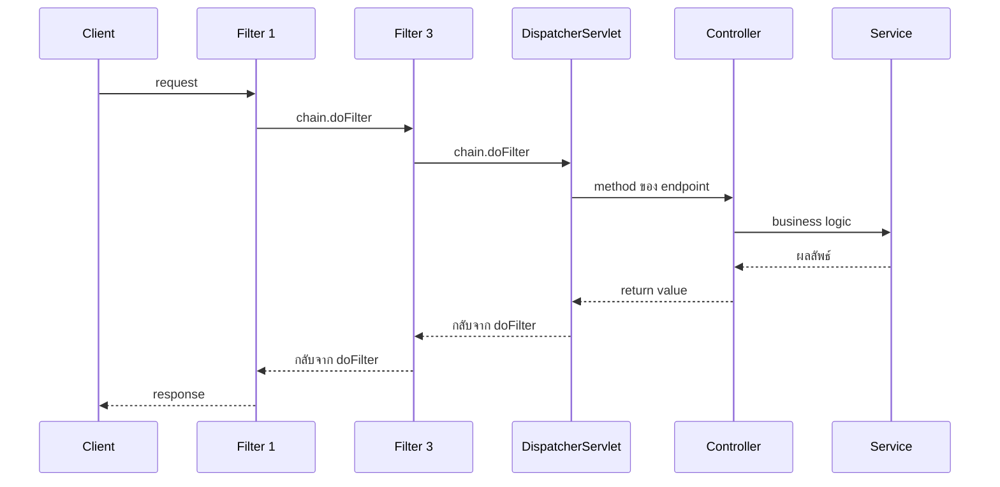
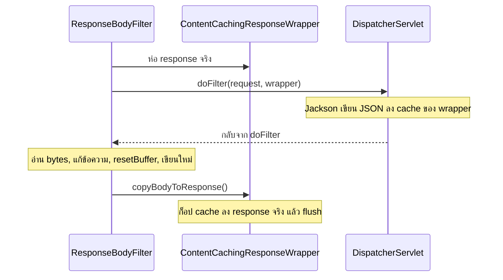
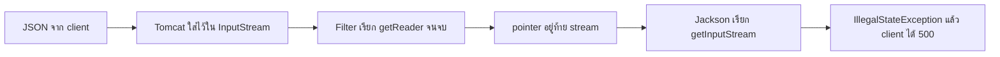

# #20 — Filter: แก้ header, status และ body

> **วิดีโอ:** [Spring Boot Filters | Modify Requests, Response, Headers & Bodies | Spring Boot Full Course #20](https://youtu.be/fXcDynZ8C-g) — Coder Army, ~73 นาที
> **แหล่งที่ใช้สรุป:** ซับไตเติลภาษาอังกฤษที่ YouTube สร้างอัตโนมัติ
> **เวอร์ชันในโค้ด:** Spring Boot 4.1.1 + Java 21 (Spring Framework 7.0.9, embedded Tomcat 11.0.24, Jackson 3.1.5) ใส่หมายเหตุไว้ทุกจุดที่ Spring Boot 3.x ต่างกัน

ตอนนี้ต่อจากตอนที่สร้าง Filter ครั้งแรก ผู้สอนตอบคำถามว่า filter แก้ request กับ response ได้ไกลแค่ไหน เขาใส่ response header, ตัด request ที่ไม่มี token แล้วคืน 401, ห่อ response เพื่อแก้ body ที่ Controller สร้างแล้ว, แล้วแสดงว่าการอ่าน request body ตรง ๆ ทำให้ Controller พัง เพราะ stream อ่านได้ครั้งเดียว ท้ายตอนลงทะเบียน filter ด้วย `FilterRegistrationBean` และใช้ `OncePerRequestFilter` ของ Spring

ส่วนที่ติดป้าย `💡 เพิ่มเติม` คือของที่ผมเติมเอง ไม่ได้อยู่ในวิดีโอ ส่วนที่ติด `⚠️ แก้จากวิดีโอ` คือจุดที่วิดีโอพูดคลาดเคลื่อน

---

## สารบัญ

| เวลา | หัวข้อ |
|---|---|
| [0:00](https://youtu.be/fXcDynZ8C-g?t=0) | [1. ทางของ request และโปรเจกต์ตั้งต้น](#1-ทางของ-request-และโปรเจกต์ตั้งต้น) |
| [3:13](https://youtu.be/fXcDynZ8C-g?t=193) | [2. ส่วนของ response ที่จะลองแก้](#2-ส่วนของ-response-ที่จะลองแก้) |
| [4:02](https://youtu.be/fXcDynZ8C-g?t=242) | [3. ใส่ response header ก่อน doFilter](#3-ใส่-response-header-ก่อน-dofilter) |
| [10:02](https://youtu.be/fXcDynZ8C-g?t=602) | [4. ตั้ง header หลัง doFilter ไม่ติด](#4-ตั้ง-header-หลัง-dofilter-ไม่ติด) |
| [13:54](https://youtu.be/fXcDynZ8C-g?t=834) | [5. ตัด chain แล้วคืน 401](#5-ตัด-chain-แล้วคืน-401) |
| [18:01](https://youtu.be/fXcDynZ8C-g?t=1081) | [6. แก้ body ตอนขากลับตรง ๆ ไม่ได้](#6-แก้-body-ตอนขากลับตรง-ๆ-ไม่ได้) |
| [20:13](https://youtu.be/fXcDynZ8C-g?t=1213) | [7. ContentCachingResponseWrapper](#7-contentcachingresponsewrapper) |
| [22:56](https://youtu.be/fXcDynZ8C-g?t=1376) | [8. ประกอบ response body ใหม่](#8-ประกอบ-response-body-ใหม่) |
| [34:57](https://youtu.be/fXcDynZ8C-g?t=2097) | [9. ลืม resetBuffer แล้ว body ต่อกัน](#9-ลืม-resetbuffer-แล้ว-body-ต่อกัน) |
| [36:46](https://youtu.be/fXcDynZ8C-g?t=2206) | [10. ทำได้ แต่ไม่ควรให้ filter กำหนด contract](#10-ทำได้-แต่ไม่ควรให้-filter-กำหนด-contract) |
| [38:28](https://youtu.be/fXcDynZ8C-g?t=2308) | [11. Request ส่วนใหญ่เป็น read-only](#11-request-ส่วนใหญ่เป็น-read-only) |
| [48:23](https://youtu.be/fXcDynZ8C-g?t=2903) | [12. Tomcat เป็นคนสร้าง request และ response](#12-tomcat-เป็นคนสร้าง-request-และ-response) |
| [51:56](https://youtu.be/fXcDynZ8C-g?t=3116) | [13. อ่าน body แล้ว stream หมด](#13-อ่าน-body-แล้ว-stream-หมด) |
| [56:36](https://youtu.be/fXcDynZ8C-g?t=3396) | [14. ทำไม stream อ่านซ้ำไม่ได้](#14-ทำไม-stream-อ่านซ้ำไม่ได้) |
| [59:56](https://youtu.be/fXcDynZ8C-g?t=3596) | [15. cache body แล้วส่ง wrapper ต่อ](#15-cache-body-แล้วส่ง-wrapper-ต่อ) |
| [1:01:27](https://youtu.be/fXcDynZ8C-g?t=3687) | [16. FilterRegistrationBean](#16-filterregistrationbean) |
| [1:07:10](https://youtu.be/fXcDynZ8C-g?t=4030) | [17. เช็ค URI เองใน doFilter](#17-เช็ค-uri-เองใน-dofilter) |
| [1:08:57](https://youtu.be/fXcDynZ8C-g?t=4137) | [18. OncePerRequestFilter](#18-onceperrequestfilter) |
| — | [19. สรุปท้ายตอน](#19-สรุปท้ายตอน) |

---

## 1. ทางของ request และโปรเจกต์ตั้งต้น

[▶ 0:00](https://youtu.be/fXcDynZ8C-g?t=0)

ผู้สอนทบทวนแผนภาพจากตอนที่แล้ว request ออกจาก client เข้า **filter chain** ได้หลายตัวเรียงกัน จาก filter หนึ่งไป filter สอง แล้วไป filter สาม จากนั้นเข้า **DispatcherServlet** ซึ่งเป็น Servlet ตัวกลางของ Spring MVC DispatcherServlet เลือก method ของ Controller ตาม endpoint จาก Controller ไป Service แล้วไป Repository ขากลับเดินย้อนทางเดิมจนถึง client

ระหว่าง DispatcherServlet กับ Controller มี **Interceptor** ผู้สอนบอกว่าจะอธิบายในตอนถัดไป ตอนนี้ยังไม่ลงรายละเอียด



โค้ดที่เขียนหลัง `chain.doFilter(...)` คือขากลับ โค้ดที่เขียนก่อนหน้านั้นคือขาไป

[▶ 2:09](https://youtu.be/fXcDynZ8C-g?t=129)

โปรเจกต์คือของเดิมจากตอนที่แล้ว เขาลบ filter เก่าออก เหลือ `StudentController`, `Student` (id, name, email) และ `StudentService` ยังไม่มี Repository เพราะตอนนี้ไม่ได้สอนการเก็บข้อมูล

ช่วงต้นของวิดีโอ Service แค่พิมพ์ `Student Created` พร้อมชื่อและอีเมล แล้ว Controller คืน `ResponseEntity` ที่ body เป็นสตริง `"Done"` กับ status 200 ต่อมาตอนจะแก้ response body เขาเปลี่ยนให้คืน `StudentResponse` ที่มี `name` กับ `message` โปรเจกต์ตัวอย่างใช้รูปหลังนี้ตลอด เพื่อให้ทุก demo รันจากโค้ดชุดเดียวกัน

`Student.java`

```java
package in.strikes.filterdemo.dto;

public class Student {

  private Long id;
  private String name;
  private String email;

  public Long getId() {
    return id;
  }

  public void setId(Long id) {
    this.id = id;
  }

  public String getName() {
    return name;
  }

  public void setName(String name) {
    this.name = name;
  }

  public String getEmail() {
    return email;
  }

  public void setEmail(String email) {
    this.email = email;
  }
}
```

`StudentResponse.java`

```java
package in.strikes.filterdemo.dto;

public class StudentResponse {

  private String name;
  private String message;

  public String getName() {
    return name;
  }

  public void setName(String name) {
    this.name = name;
  }

  public String getMessage() {
    return message;
  }

  public void setMessage(String message) {
    this.message = message;
  }
}
```

`StudentService.java`

```java
package in.strikes.filterdemo.service;

import in.strikes.filterdemo.dto.Student;
import in.strikes.filterdemo.dto.StudentResponse;
import org.springframework.stereotype.Service;

@Service
public class StudentService {

  public StudentResponse createStudent(Student student) {
    System.out.println("Student Created");
    System.out.println(student.getName());
    System.out.println(student.getEmail());

    StudentResponse response = new StudentResponse();
    response.setName(student.getName());
    response.setMessage("Student is saved successfully");
    return response;
  }
}
```

`StudentController.java`

```java
package in.strikes.filterdemo.controller;

import in.strikes.filterdemo.dto.Student;
import in.strikes.filterdemo.dto.StudentResponse;
import in.strikes.filterdemo.service.StudentService;
import org.springframework.http.ResponseEntity;
import org.springframework.web.bind.annotation.GetMapping;
import org.springframework.web.bind.annotation.PostMapping;
import org.springframework.web.bind.annotation.RequestBody;
import org.springframework.web.bind.annotation.RestController;

@RestController
public class StudentController {

  private final StudentService studentService;

  public StudentController(StudentService studentService) {
    this.studentService = studentService;
  }

  @PostMapping("/api/students")
  public ResponseEntity<StudentResponse> createStudent(@RequestBody Student student) {
    return ResponseEntity.ok(studentService.createStudent(student));
  }

  @GetMapping("/ping")
  public String ping() {
    return "pong";
  }

  @GetMapping("/admin/health")
  public String adminHealth() {
    return "ok";
  }
}
```

> 💡 **เพิ่มเติม:** วิดีโอมีแค่ `POST /api/students` endpoint `/ping` กับ `/admin/health` ถูกเพิ่มเพื่อพิสูจน์ URL pattern ในส่วนที่ 16–18 ตอนที่วิดีโอยังคืน `"Done"` เมธอดมีรูปประมาณ `return ResponseEntity.ok("Done");` ผล 200 ในหัวข้อ header และ authentication ของวิดีโอจึงเป็นข้อความ `Done` ผลรันด้านล่างเป็น JSON ของ `StudentResponse` เพราะใช้ Controller ชุดท้ายตอน

`pom.xml` ส่วนที่เกี่ยวกับเวอร์ชัน

```xml
<parent>
  <groupId>org.springframework.boot</groupId>
  <artifactId>spring-boot-starter-parent</artifactId>
  <version>4.1.1</version>
</parent>

<properties>
  <java.version>21</java.version>
</properties>

<dependencies>
  <dependency>
    <groupId>org.springframework.boot</groupId>
    <artifactId>spring-boot-starter-webmvc</artifactId>
  </dependency>
</dependencies>
```

> ⚠️ **Boot 4 vs 3:** Boot 4 ใช้ starter `spring-boot-starter-webmvc` ชื่อเดิม `spring-boot-starter-web` ยังใส่ได้แต่ถูก deprecate ใน Boot 3.x ใช้ `spring-boot-starter-web`
> ([Spring Boot 4.0 Migration Guide](https://github.com/spring-projects/spring-boot/wiki/Spring-Boot-4.0-Migration-Guide))

`application.properties`

```properties
server.port=9020
```

> 💡 **เพิ่มเติม:** วิดีโอใช้พอร์ต 8080 โปรเจกต์นี้ใช้ 9020 ตามข้อตกลงของโน้ตชุดนี้ วิดีโอปิด filter ที่ไม่ต้องการโดยเอา `@Component` ออก โปรเจกต์ติด `@Profile` ไว้ที่ filter แต่ละตัว แล้วสตาร์ทด้วย `--spring.profiles.active=...` ทีละตัว ถ้าเปิดพร้อมกัน `RequestLogFilter` จะอ่าน body จนหมด แล้ว demo อื่นพังทั้งชุด

ไม่มี profile ใดเปิดอยู่ request ถึง Controller ตรง ๆ

```bash
java -jar target/filter-demo-0.0.1.jar
curl -si -X POST http://localhost:9020/api/students \
  -H 'Content-Type: application/json' \
  -d '{"id":1,"name":"Aditya","email":"adi@gmail.com"}'
```

```http
HTTP/1.1 200
Content-Type: application/json
Transfer-Encoding: chunked

{"message":"Student is saved successfully","name":"Aditya"}
```

คอนโซลของ Service

```text
Student Created
Aditya
adi@gmail.com
```

> ⚠️ **Boot 4 vs 3 — ลำดับ field ใน JSON:** Boot 4 ใช้ Jackson 3 (`tools.jackson`) เป็น default Jackson 3 เปิด `MapperFeature.SORT_PROPERTIES_ALPHABETICALLY` ไว้ตั้งแต่แรก จึงเรียง `message` ก่อน `name` Jackson 2 ที่ Boot 3 ใช้ (`com.fasterxml.jackson`) ค่า default ของ flag นี้เป็น false จึงเรียงตามลำดับที่ประกาศใน class คือ `name` แล้วค่อย `message` โครงข้อมูลเท่ากัน
> (ค่า default ดูจาก bytecode ของ `jackson-databind` 3.1.5 กับ 2.21.4 และ [Migration Guide](https://github.com/spring-projects/spring-boot/wiki/Spring-Boot-4.0-Migration-Guide) เรื่อง Jackson 3)

---

## 2. ส่วนของ response ที่จะลองแก้

[▶ 3:13](https://youtu.be/fXcDynZ8C-g?t=193)

ตอนที่แล้วใช้ filter เพื่อดู request กับ response ตอนนี้ผู้สอนจะ **alter** คือแก้ไข response และ request เขาเริ่มจาก response ซึ่งมีสามส่วน: status code, headers และ body

> ⚠️ **แก้จากวิดีโอ:** นาทีที่ 3:51 เขาบอกว่าสามส่วนนี้มีทั้งใน request body และ response body request ไม่มี status code ส่วนของ request ที่เขาไล่ทีหลัง (นาทีที่ 38) ถูกแล้ว คือ method, endpoint, headers, body และ request parameter

จากนั้นเขาแยกงานเป็นสองแบบ

1. เขียน status, header หรือ body ใน filter แล้วส่งกลับ client ทันที โดยไม่เรียก `chain.doFilter` ตัวอย่างคือ authentication ที่ไม่ผ่าน
2. ปล่อยให้ Controller สร้าง response ก่อน แล้วค่อยแก้ก้อนนั้นตอนขากลับ อันนี้ตรง ๆ ไม่ได้ เพราะพอเขียน body แล้ว response ถูก **commit**

---

## 3. ใส่ response header ก่อน doFilter

[▶ 4:02](https://youtu.be/fXcDynZ8C-g?t=242)

`jakarta.servlet.Filter` มีสามเมธอดตาม lifecycle คือ `init`, `doFilter` และ `destroy` งานประจำอยู่ที่ `doFilter` อีกสองตัวมักไม่ต้อง override

> ⚠️ **แก้จากวิดีโอ:** เขาเรียก `Filter` ว่า class ที่ถูกคือ **interface** `OncePerRequestFilter` ในส่วนที่ 18 ต่างกันตรงที่เป็น class จึงใช้ `extends`

`doFilter` รับ `ServletRequest`, `ServletResponse` และ `FilterChain` แล้วโยน `IOException` กับ `ServletException` สองตัวแรกเป็นชนิดกว้าง งาน HTTP ต้อง cast เป็น `HttpServletRequest` กับ `HttpServletResponse` filter ตัวนี้ใช้แค่ response เขาจึง cast เฉพาะ response

เขาอยากส่ง request id กลับไปกับทุก response header เป็นคู่ key กับ value key คือ `X-Request-ID` value คือ `UUID.randomUUID().toString()` ซึ่งเปลี่ยนทุกครั้ง จากนั้นเรียก `chain.doFilter` โดยส่ง request กับ response ตัวเดิมต่อให้ filter ถัดไป ถ้าไม่มี filter อื่น ตัวถัดไปคือ DispatcherServlet

`ResponseHeaderFilter.java`

```java
package in.strikes.filterdemo.filter;

import jakarta.servlet.Filter;
import jakarta.servlet.FilterChain;
import jakarta.servlet.ServletException;
import jakarta.servlet.ServletRequest;
import jakarta.servlet.ServletResponse;
import jakarta.servlet.http.HttpServletResponse;
import java.io.IOException;
import java.util.UUID;
import org.springframework.context.annotation.Profile;
import org.springframework.stereotype.Component;

@Component
@Profile("header")
public class ResponseHeaderFilter implements Filter {

  @Override
  public void doFilter(ServletRequest request, ServletResponse response, FilterChain chain)
      throws IOException, ServletException {
    HttpServletResponse httpResponse = (HttpServletResponse) response;
    String requestId = UUID.randomUUID().toString();
    httpResponse.setHeader("X-Request-ID", requestId);
    chain.doFilter(request, response);
  }
}
```

```bash
java -jar target/filter-demo-0.0.1.jar --spring.profiles.active=header
```

```http
HTTP/1.1 200
X-Request-ID: 48367b8c-1310-4732-9b26-45bf50294967
Content-Type: application/json
Transfer-Encoding: chunked

{"message":"Student is saved successfully","name":"Aditya"}
```

ยิงซ้ำได้ UUID คนละค่า Service ยังพิมพ์ชื่อกับอีเมล แปลว่า request เดินถึง Controller

> 💡 **เพิ่มเติม:** `@Profile("header")` ไม่ได้อยู่ในวิดีโอ วิดีโอติด `@Component` อย่างเดียว แล้วปิด filter อื่นด้วยการเอา annotation ออก

---

## 4. ตั้ง header หลัง doFilter ไม่ติด

[▶ 10:02](https://youtu.be/fXcDynZ8C-g?t=602)

คำถามคือจะย้าย `setHeader` ไปไว้หลัง `chain.doFilter` ได้ไหม เพื่อให้ใส่ header ตอน response เดินกลับมา

เขาลองแล้วยิง Postman ใหม่ header `X-Request-ID` หายไป

สาเหตุที่เขาอธิบาย: พอเรียก `doFilter` งานเลยไปถึง DispatcherServlet และ Controller Controller คืนค่าเช่น `ResponseEntity` ที่หมายถึง status 200 กับ body DispatcherServlet เขียนค่าเหล่านั้นลง `HttpServletResponse` ผ่าน writer ที่ได้จาก `getWriter()` การเขียนลง stream นั้นทำให้ response **commit** ของที่ commit แล้วแก้ไม่ได้อีก เลยเดินกลับ client ทั้งที่ filter เรียก `setHeader` ทีหลัง

`LateResponseHeaderFilter.java` คือ filter เดียวกัน แค่ย้ายสองบรรทัดไปไว้หลัง `doFilter` วิดีโอแก้ใน class เดิม โปรเจกต์แยก class เพื่อให้รันทั้งสองแบบได้

```java
@Override
public void doFilter(ServletRequest request, ServletResponse response, FilterChain chain)
    throws IOException, ServletException {
  chain.doFilter(request, response);
  HttpServletResponse httpResponse = (HttpServletResponse) response;
  String requestId = UUID.randomUUID().toString();
  httpResponse.setHeader("X-Request-ID", requestId);
}
```

profile `late` ให้ผลนี้ ไม่มี `X-Request-ID`

```http
HTTP/1.1 200
Content-Type: application/json
Transfer-Encoding: chunked

{"message":"Student is saved successfully","name":"Aditya"}
```

> ⚠️ **แก้จากวิดีโอ (กลไกการเขียน body):** เขาบอกว่า DispatcherServlet เขียน body ด้วย `getWriter().write()` ตอนตอบ JSON ตัวแปลงของ Jackson เขียนผ่าน `getOutputStream()` ข้อสรุปที่เขาสาธิตยังถูก และรันซ้ำได้: พอ body ถูกเขียน response ก็ commit `setHeader` หลัง `doFilter` จึงไม่ไปถึง client งานใส่ header ต้องทำก่อน `chain.doFilter`

> 💡 **เพิ่มเติม:** commit เกิดเมื่อมีการเขียน body หรือ flush buffer ถ้า Controller ไม่ได้เขียนอะไรเลย header ที่ตั้งหลัง `doFilter` อาจยังติด กรณี `POST /api/students` นี้มี body จึง commit ทุกครั้ง

---

## 5. ตัด chain แล้วคืน 401

[▶ 13:54](https://youtu.be/fXcDynZ8C-g?t=834)

อีกทางหนึ่งคือ filter สร้าง response เองแล้วไม่ส่งต่อ เขาทำ `AuthenticationFilter` client ต้องส่ง header `token` ค่าที่รับคือ `12345` ถ้า header ไม่มี หรือค่าไม่ตรง เขาตั้ง status เป็น 401

ตั้งได้สองแบบที่ความหมายเดียวกัน คือ `httpResponse.setStatus(401)` หรือ `httpResponse.setStatus(HttpServletResponse.SC_UNAUTHORIZED)` ค่าคงที่นั้นคือ 401 จากนั้น `return` เพื่อไม่เรียก `chain.doFilter` ถ้า token ถูก จึงค่อย `doFilter` ส่งต่อ

เขาใส่ body ด้วย `getWriter().write(...)` เป็น JSON และตั้ง `Content-Type` เป็น `application/json` ก่อนเขียน เพราะ body เป็น JSON

`AuthenticationFilter.java`

```java
package in.strikes.filterdemo.filter;

import jakarta.servlet.Filter;
import jakarta.servlet.FilterChain;
import jakarta.servlet.ServletException;
import jakarta.servlet.ServletRequest;
import jakarta.servlet.ServletResponse;
import jakarta.servlet.http.HttpServletRequest;
import jakarta.servlet.http.HttpServletResponse;
import java.io.IOException;
import org.springframework.context.annotation.Profile;
import org.springframework.stereotype.Component;

@Component
@Profile("auth")
public class AuthenticationFilter implements Filter {

  @Override
  public void doFilter(ServletRequest request, ServletResponse response, FilterChain chain)
      throws IOException, ServletException {
    HttpServletRequest httpRequest = (HttpServletRequest) request;
    HttpServletResponse httpResponse = (HttpServletResponse) response;

    String token = httpRequest.getHeader("token");
    if (token == null || !token.equals("12345")) {
      httpResponse.setStatus(HttpServletResponse.SC_UNAUTHORIZED);
      httpResponse.setContentType("application/json");
      httpResponse.getWriter().write("{\"message\":\"Authentication is required\"}");
      return;
    }
    chain.doFilter(request, response);
  }
}
```

> 💡 **เพิ่มเติม:** เขาอ่านออกเสียงว่า body คือข้อความ `Authentication is required` ในรูป JSON ไม่ได้อ่านชื่อ field ทีละตัว ตัวอย่างนี้ใช้ key `message`

token ถูก (`12345`) ได้ 200 และ Service ทำงาน

```http
HTTP/1.1 200
Content-Type: application/json
Transfer-Encoding: chunked

{"message":"Student is saved successfully","name":"Aditya"}
```

token เป็น `123` หรือไม่ส่ง header ได้ 401 และ Service ไม่พิมพ์อะไร เพราะ `return` ก่อน `doFilter`

```http
HTTP/1.1 401
Content-Type: application/json;charset=ISO-8859-1
Content-Length: 40

{"message":"Authentication is required"}
```

> 💡 **เพิ่มเติม:** `charset=ISO-8859-1` มาจากค่า default ของ Servlet ตอนเรียก `getWriter()` หลัง `setContentType("application/json")` โดยไม่ระบุ charset ข้อความนี้เป็น ASCII จึงอ่านได้ตรง ถ้า body มีภาษาไทย ให้ตั้ง `application/json;charset=UTF-8` หรือ `setCharacterEncoding("UTF-8")` ก่อน `getWriter()`

งานนี้ยังไม่แตะ body ที่ Controller สร้าง มันคือการตอบจาก filter เอง ผู้สอนถือว่าแบบนี้ใช้ได้ เช่น กัน request ที่ยังไม่ authenticate

---

## 6. แก้ body ตอนขากลับตรง ๆ ไม่ได้

[▶ 18:01](https://youtu.be/fXcDynZ8C-g?t=1081)

เขาอยากได้อีกแบบ request เดินถึง Controller จนได้ JSON ของ `name` กับ `message` แล้ว filter เติม `appName` ก่อนส่งให้ client ตัวอย่างที่เขาพูดถึงคือค่าประมาณ `Student Management System`

ทำแบบ header ไม่ได้ หลัง `chain.doFilter` body ถูก commit ไปแล้ว เขียนทับตรง ๆ ไม่ติด เหตุผลเดียวกับหัวข้อที่ 4

ทางอ้อมคือไม่ส่ง `HttpServletResponse` ตัวจริงเข้า `doFilter` แต่ส่ง **wrapper** ชั้นล่างเขียนลง wrapper พอขากลับมาถึง filter ตัวที่สร้าง wrapper จึงอ่านของในนั้น แก้ แล้วค่อยก็อปไปที่ response จริง

เขาเทียบกับ decorator pattern จากคลิป LLD ของเขา ถ้ายังไม่รู้ pattern นี้ ก็พอเข้าใจว่า wrapper หุ้ม response ไว้ แล้วทำตัวเหมือน `HttpServletResponse` คนที่ได้รับจึงเขียนลงไปตามปกติ

---

## 7. ContentCachingResponseWrapper

[▶ 20:13](https://youtu.be/fXcDynZ8C-g?t=1213)

class ที่เขาใช้คือ `ContentCachingResponseWrapper` constructor รับ `HttpServletResponse` ที่จะหุ้ม ส่ง wrapper นี้เข้า `chain.doFilter` แทน response ตัวจริง

DispatcherServlet และ Jackson เรียก `getOutputStream()` หรือ `getWriter()` บนวัตถุที่คิดว่าเป็น response จริง เขียนนั้นไปลง cache ใน wrapper แทนที่จะลง socket ของ client พอ `doFilter` คืนกลับมา filter อ่าน cache เป็น `byte[]` ได้จาก `getContentAsByteArray()`



> ⚠️ **แก้จากวิดีโอ:** เขาเรียก `ContentCachingResponseWrapper` ว่า wrapper ใน Java ที่ถูกคือ class ของ Spring Framework อยู่ใน `org.springframework.web.util` มัน extend `HttpServletResponseWrapper` ของ Servlet API อีกที คู่ของมัน `ContentCachingRequestWrapper` อยู่ package เดียวกัน javadoc บอก `@since 4.1.3` ซึ่งหมายถึง Spring Framework 4.1.3 ปี 2014 ไม่เกี่ยวกับ Spring Boot 4.1

> 💡 **เพิ่มเติม:** `copyBodyToResponse()` เป็นจุดที่ bytes ใน cache ถูกเขียนลง response จริง ถ้าไม่เรียก client จะไม่ได้ body เพราะของที่ Controller เขียนยังค้างใน wrapper เมธอดนี้ตั้ง `Content-Length` จากขนาด cache แล้ว flush

---

## 8. ประกอบ response body ใหม่

[▶ 22:56](https://youtu.be/fXcDynZ8C-g?t=1376)

ขั้นตอนที่เขาทำใน `ResponseBodyFilter`

1. ห่อ response ด้วย `ContentCachingResponseWrapper`
2. `chain.doFilter(request, wrappedResponse)` ช่วงนี้ Controller สร้าง `StudentResponse` และ Jackson เขียน JSON ลง wrapper
3. `getContentAsByteArray()` แล้ว `new String(...)` เพื่อได้ข้อความของ body เดิม
4. สร้างข้อความใหม่ที่ใส่ JSON เดิมไว้ใน field `originalResponse` และเติม `appName`
5. เขียนข้อความใหม่กลับเข้า wrapper
6. `copyBodyToResponse()` เพื่อส่งของจริงให้ client

เขาต่อสตริงด้วย `+` ไม่ได้สะดวก เพราะ `}` ปิดของ JSON เดิมอยู่ท้ายข้อความ ถ้าจะแทรก field ข้างในต้องไปตัดวงเล็บ เขาเลยห่อทั้งก้อนเดิมไว้ใต้ key `originalResponse`

เครื่องมือที่เขาใช้คือ **text block** เปิดและปิดด้วย `"""` ตรงที่เป็น `%s` จะถูกแทนที่เมื่อเรียก `formatted(originalBody)` เขาบอกว่าคล้าย `printf` ที่ใช้กับ `System.out` อยู่แล้ว

[▶ 30:00](https://youtu.be/fXcDynZ8C-g?t=1800)

> ⚠️ **แก้จากวิดีโอ:** เขาบอกว่า text block มาใน Java 15 หรือ Java 16 ที่ถูกคือเป็นมาตรฐานใน **Java 15** (JEP 378) ช่วง Java 13 และ 14 ยังเป็น preview `String.formatted` มากับ Java 15 เช่นกัน

ก่อนรันเขาเปลี่ยน Controller ให้คืน `StudentResponse` ไม่คืน `"Done"` แล้วปิด filter ตัวอื่นไว้ เหลือตัวนี้ตัวเดียว โค้ดที่รันได้มี `resetBuffer()` อยู่แล้ว หัวข้อถัดไปคือสิ่งที่เกิดขึ้นก่อนเขาจะใส่บรรทัดนั้น

`ResponseBodyFilter.java`

```java
package in.strikes.filterdemo.filter;

import jakarta.servlet.Filter;
import jakarta.servlet.FilterChain;
import jakarta.servlet.ServletException;
import jakarta.servlet.ServletRequest;
import jakarta.servlet.ServletResponse;
import jakarta.servlet.http.HttpServletResponse;
import java.io.IOException;
import java.nio.charset.StandardCharsets;
import org.springframework.context.annotation.Profile;
import org.springframework.stereotype.Component;
import org.springframework.web.util.ContentCachingResponseWrapper;

@Component
@Profile("body")
public class ResponseBodyFilter implements Filter {

  @Override
  public void doFilter(ServletRequest request, ServletResponse response, FilterChain chain)
      throws IOException, ServletException {
    HttpServletResponse httpResponse = (HttpServletResponse) response;
    ContentCachingResponseWrapper wrappedResponse = new ContentCachingResponseWrapper(httpResponse);

    chain.doFilter(request, wrappedResponse);

    byte[] originalBodyBytes = wrappedResponse.getContentAsByteArray();
    String originalBody = new String(originalBodyBytes, StandardCharsets.UTF_8);
    String modifiedBody = """
        {
          "originalResponse": %s,
          "appName": "Student Management System"
        }
        """.formatted(originalBody);
    wrappedResponse.resetBuffer();
    wrappedResponse.getWriter().write(modifiedBody);
    wrappedResponse.copyBodyToResponse();
  }
}
```

> 💡 **เพิ่มเติม:** วิดีโอใช้ `new String(byte[])` ซึ่งถอดรหัสด้วย charset ของเครื่อง ตัวอย่างนี้ใส่ `StandardCharsets.UTF_8` ให้ตรงกับที่ Jackson เขียน ชื่อแอปในวิดีโอสลับระหว่าง Student Management Application กับ Student Management System ตอนประกอบข้อความเขาลงที่ **Student Management System**

profile `body`

```http
HTTP/1.1 200
Content-Type: application/json
Content-Length: 128

{
  "originalResponse": {"message":"Student is saved successfully","name":"Aditya"},
  "appName": "Student Management System"
}
```

> 💡 **เพิ่มเติม:** `%` ใน body เดิมจะทำให้ `formatted` พัง เพราะ `%` เป็นตัวเปิด format specifier ทางที่ทนกว่าคือใช้ Jackson สร้าง object ใหม่แล้วเขียน JSON จาก object นั้น ไม่ได้ต่อสตริงเอง นี่เป็นอีกเหตุผลที่เขาไม่แนะนำให้ filter ไปประกอบ JSON

---

## 9. ลืม resetBuffer แล้ว body ต่อกัน

[▶ 34:57](https://youtu.be/fXcDynZ8C-g?t=2097)

รอบแรกเขาได้ body สองก้อนติดกัน JSON ของ Controller ทั้งก้อน แล้วตามด้วย JSON ที่ filter สร้าง

สาเหตุ: wrapper มีข้อความที่ Controller เขียนค้างอยู่ใน buffer อยู่แล้ว `getWriter().write(modifiedBody)` **ต่อท้าย** ของเก่า ไม่ได้แทนที่ เขาใส่ `wrappedResponse.resetBuffer()` ก่อนเขียน เพื่อล้าง buffer แล้วรันใหม่ ได้ก้อนเดียวตามหัวข้อที่ 8

โปรเจกต์แยกช่วงก่อนแก้ไว้ที่ `ResponseBodyAppendFilter` (profile `body-append`) ซึ่งเป็นโค้ดเดียวกันแต่ไม่มี `resetBuffer()`

```java
wrappedResponse.getWriter().write(modifiedBody);
wrappedResponse.copyBodyToResponse();
```

```http
HTTP/1.1 200
Content-Type: application/json
Content-Length: 187

{"message":"Student is saved successfully","name":"Aditya"}{
  "originalResponse": {"message":"Student is saved successfully","name":"Aditya"},
  "appName": "Student Management System"
}
```

`Content-Length` เพิ่มจาก 128 เป็น 187 เพราะมี JSON เดิมติดไปด้วย client ที่ parse JSON จะอ่านก้อนนี้ไม่ได้

---

## 10. ทำได้ แต่ไม่ควรให้ filter กำหนด contract

[▶ 36:46](https://youtu.be/fXcDynZ8C-g?t=2206)

ผู้สอนสรุปว่าเทคนิค wrapper ใช้ได้ แต่โดยทั่วไปไม่ควรให้ filter ไปแก้ response ที่สร้างเสร็จแล้ว

- client อาจรอโครง JSON คนละแบบกับที่ filter ไปเปลี่ยน
- พรุ่งนี้มีคนปิด filter หรือเปลี่ยน field contract ของ client พัง ทั้งที่ Controller ไม่ได้แก้
- โครงของ response ควรตัดสินที่ Service กับ Controller

สิ่งที่เขาแยกให้ทำได้มีสองอย่าง

| งาน | ทำใน filter ได้ | เหตุผลที่เขาให้ |
|---|---|---|
| เติม response header เช่น `X-Request-ID` | ได้ ต้องตั้งก่อน `doFilter` | ไม่ได้เปลี่ยนโครง body ที่ client รอ |
| ตอบ 401 พร้อม body จาก filter แล้ว `return` | ได้ | ยังไม่ปล่อยให้ Controller สร้าง body |
| แก้ body ที่ Controller สร้างแล้ว | ทำผ่าน wrapper ได้ | ไม่ควรทำในงานจริง |

---

## 11. Request ส่วนใหญ่เป็น read-only

[▶ 38:28](https://youtu.be/fXcDynZ8C-g?t=2308)

ฝั่ง request ที่เดินเข้ามามี method, endpoint, headers, request parameter และถ้าเป็น POST หรือ PUT ก็มี body เขาถามว่า filter แก้ของเหล่านี้ได้ไหม

`HttpServletRequest` อ่านได้อย่างเดียวในส่วนนี้

| อยากได้อะไร | เมธอดที่มี | เมธอดที่ไม่มี |
|---|---|---|
| Header | `getHeader` | `setHeader` |
| Request parameter | `getParameter` | `setParameter` |
| Method | `getMethod` | ไม่มีตัวตั้ง method |
| Endpoint | `getRequestURI` | ไม่มีตัวตั้ง URI |

มี `setAttribute` กับ `setCharacterEncoding` แต่นั่นไม่ใช่การแก้ header ที่ client ส่งมา header, parameter, method และ URI ที่ Tomcat parse ไว้จึงอ่านได้อย่างเดียว

เขาให้เหตุผลว่านี่คือ contract ถ้า client ส่ง POST มาที่ `/api/students` พร้อม header ตามที่ตกลง filter ไม่ควรเปลี่ยน method เป็น GET หรือแอบเติม header ให้ ชั้นนั้นไม่ใช่ที่สำหรับเพิ่มของ

[▶ 42:55](https://youtu.be/fXcDynZ8C-g?t=2575)

ทางอ้อมยังมี เขาเปิด class `HttpServletRequestWrapper` แล้วบอกว่าต้องเขียน class ของเราให้ `extends` มัน แล้ว override เมธอดที่คนข้างหลังจะเรียก

- จะแอบเติม header ต้อง override `getHeader`, `getHeaders` และ `getHeaderNames`
- จะแอบเติม request parameter ต้อง override `getParameter`, `getParameterMap`, `getParameterNames` และ `getParameterValues`

เขาเริ่ม class ชื่อ `RequestWrapper` แล้วลบทิ้งก่อนเขียนให้จบ และบอกว่านี่เป็นวิธีที่ hack มาก ไม่มีประโยชน์ที่จะทำ ไม่ควรทำทั้งกับ header, parameter, method และ endpoint

---

## 12. Tomcat เป็นคนสร้าง request และ response

[▶ 48:23](https://youtu.be/fXcDynZ8C-g?t=2903)

ก่อนอธิบาย body เขาแก้แผนภาพที่พูดง่ายไปก่อนหน้านี้ วัตถุ `HttpServletRequest` กับ `HttpServletResponse` ถูกสร้างโดย **Tomcat** ซึ่งเป็น Servlet Container ไม่ได้ถูกสร้างโดย DispatcherServlet DispatcherServlet เป็น Servlet ตัวหนึ่งที่ Tomcat เรียก ในแอป Spring ตัวนี้เป็น Servlet ของแอป

Tomcat รับ bytes จาก client แล้วแยก method, URI, host, query string เก็บลง request ส่วน body เก็บเป็น input stream ต้องเรียก `getInputStream()` ถึงจะได้

> ⚠️ **แก้จากวิดีโอ:** นาทีที่ 5 และนาทีที่ 11 เขาบอกว่า DispatcherServlet เป็นคนสร้างวัตถุสองตัวนี้ นาทีที่ 48 เขาแก้เองว่าผู้สร้างคือ Tomcat และที่แผนภาพก่อนหน้าพูดว่า DispatcherServlet จัดการทั้งหมดนั้นเป็นการย่อ stack trace ตอน body พังก็ออกจาก `org.apache.catalina.connector.Request` ซึ่งเป็นคลาสของ Tomcat

ทำไม body ไม่ถูกแยกเป็น field แบบ header: body เป็นอะไรก็ได้ JSON, HTML, เสียง, วิดีโอ, PDF หรือข้อความธรรมดา Tomcat บอกชนิดให้ตายตัวไม่ได้ เลยถือว่าเป็น **stream of bytes** ทุกชนิดลงท้ายเป็น bytes อยู่แล้ว

อ่าน stream นี้ได้สองทาง

- `getInputStream()` ได้ `ServletInputStream` เป็น bytes
- `getReader()` ได้ `BufferedReader` ซึ่งแปลง bytes เป็นตัวอักษร

> ⚠️ **แก้จากวิดีโอ:** เขาเรียก `getReader()` ว่าเป็นวิธีแบบใหม่ของ `getInputStream()` ทั้งคู่มีมาพร้อม Servlet API คนละงานกัน ตัวหนึ่งคือ bytes อีกตัวคือตัวอักษร เรียกตัวใดตัวหนึ่งแล้ว อีกตัวใช้กับ request เดิมไม่ได้อีก

---

## 13. อ่าน body แล้ว stream หมด

[▶ 51:56](https://youtu.be/fXcDynZ8C-g?t=3116)

ประเด็นที่เขาบอกว่าเจอเองตอนทำงาน: แค่อยาก log body ทั้งก้อน โดยไม่ได้ตั้งใจแก้อะไร พอ filter อ่าน stream จนจบ Controller จะไม่เห็น body อีก

เขาเขียน `RequestLogFilter` แบบนี้

1. `httpRequest.getReader()`
2. `readLine()` ทีละบรรทัดจนกว่าจะได้ `null` แล้ว `append` เข้า `StringBuilder`
3. พิมพ์ body
4. `chain.doFilter(request, response)` ส่ง request ตัวเดิมต่อ

ไม่มีเมธอด `getBody()` เพราะ body มากับ stream

`RequestLogFilter.java`

```java
package in.strikes.filterdemo.filter;

import jakarta.servlet.Filter;
import jakarta.servlet.FilterChain;
import jakarta.servlet.ServletException;
import jakarta.servlet.ServletRequest;
import jakarta.servlet.ServletResponse;
import jakarta.servlet.http.HttpServletRequest;
import java.io.BufferedReader;
import java.io.IOException;
import org.springframework.context.annotation.Profile;
import org.springframework.stereotype.Component;

@Component
@Profile("consume")
public class RequestLogFilter implements Filter {

  @Override
  public void doFilter(ServletRequest request, ServletResponse response, FilterChain chain)
      throws IOException, ServletException {
    HttpServletRequest httpRequest = (HttpServletRequest) request;
    BufferedReader reader = httpRequest.getReader();
    StringBuilder body = new StringBuilder();
    String line = reader.readLine();
    while (line != null) {
      body.append(line);
      line = reader.readLine();
    }
    System.out.println(body);
    chain.doFilter(request, response);
  }
}
```

คอนโซลพิมพ์ body ได้ครบ แล้วตามด้วย exception

```text
{"id":1,"name":"Aditya","email":"adi@gmail.com"}
java.lang.IllegalStateException: getReader() has already been called for this request
    at org.apache.catalina.connector.Request.getInputStream(Request.java:1100)
```

บรรทัด log ของ Tomcat ตรงกับที่เขาอ่านบนจอ: `Servlet.service() for servlet [dispatcherServlet] in context with path [] threw exception` และสาเหตุคือ `getReader() has already been called for this request`

client ได้ 500

```http
HTTP/1.1 500
Content-Type: application/json
Connection: close

{"timestamp":"2026-10-16T11:46:49.073Z","status":500,"error":"Internal Server Error","path":"/api/students"}
```

เกิดเพราะ filter เรียก `getReader()` จนอ่านหมด แล้ว Jackson ผ่าน `ServletServerHttpRequest.getBody()` ไปเรียก `getInputStream()` เพื่อแปลง JSON เป็น `Student` Tomcat ห้ามสลับจาก reader มาที่ stream บน request เดียวกัน



---

## 14. ทำไม stream อ่านซ้ำไม่ได้

[▶ 56:36](https://youtu.be/fXcDynZ8C-g?t=3396)

เขาให้เห็นภาพ body `{"id":1}` เป็นแถวตัวอักษร ทุกครั้งที่อ่าน pointer ขยับไปข้างหน้า พออ่านจบ stream ว่าง และย้อนกลับไปต้นไม่ได้

Tomcat ไม่เก็บสำเนาของ body ไว้ให้ เพราะไม่รู้ว่า client ส่งอะไรมา อาจเป็นไฟล์ขนาด 2GB ถ้าเก็บทั้งก้อนก่อนค่อยส่งต่อ หน่วยความจำจะรับไม่ไหว หน้าที่ของ container คือเปิด stream ให้คนที่ต้องใช้เป็นคนอ่าน และคนอ่านจะเก็บเองหรือไม่ก็ได้

คนที่ต้องอ่านต่อคือ Jackson ใน DispatcherServlet เพื่อสร้าง `Student` พอ filter อ่านไปแล้ว โดยไม่ได้ใส่ stream กลับเข้า request ที่ส่งต่อ Jackson จึงเจอ stream ว่าง

เขาบอกทางแก้คร่าว ๆ สองแบบ ซึ่งลงเอยที่เดียวกัน

- อ่าน body ที่อ่านไปแล้วให้กลับเข้า request ก่อนส่งต่อ ซึ่ง request ตัวจริงไม่มีเมธอดให้ใส่ stream คืน ต้องห่อด้วย wrapper
- สร้าง `HttpServletRequestWrapper` อ่านเข้า `byte[]` แล้วให้ `getInputStream` ของ wrapper อ่านจาก array นั้นใหม่ได้ ส่ง wrapper เข้า `doFilter`

เทคนิคเดียวกันนี้ใช้แก้เนื้อ body ได้ด้วย เช่น ต่อสตริงแล้วค่อยทำเป็น stream ส่งต่อ เขาบอกอีกครั้งว่าไม่ควรแก้ request ที่ client ส่งมา รู้ว่าทำได้ก็พอ

---

## 15. cache body แล้วส่ง wrapper ต่อ

[▶ 59:56](https://youtu.be/fXcDynZ8C-g?t=3596)

เขาอธิบายแนว wrapper แต่ไม่ได้พิมพ์ class จบ (ตัว `RequestWrapper` ถูกลบไปก่อน) โค้ดด้านล่างทำให้พฤติกรรมที่เขาบรรยายรันได้: อ่าน bytes ครั้งเดียวใน constructor แล้วให้ทั้ง `getInputStream` และ `getReader` อ่านจาก array นั้นใหม่ได้

> 💡 **เพิ่มเติมทั้งสอง class นี้:** ประกอบจากคำอธิบายในวิดีโอ ไม่ได้มีไฟล์นี้บนจอ ต้อง override ทั้ง `getInputStream` และ `getReader` เพราะ `HttpServletRequestWrapper` รุ่น default ส่ง `getReader()` ต่อไปที่ request ตัวจริง ซึ่งถูกอ่านหมดแล้ว

`CachedBodyRequestWrapper.java`

```java
package in.strikes.filterdemo.filter;

import jakarta.servlet.ReadListener;
import jakarta.servlet.ServletInputStream;
import jakarta.servlet.http.HttpServletRequest;
import jakarta.servlet.http.HttpServletRequestWrapper;
import java.io.BufferedReader;
import java.io.ByteArrayInputStream;
import java.io.IOException;
import java.io.InputStreamReader;
import java.nio.charset.StandardCharsets;

public class CachedBodyRequestWrapper extends HttpServletRequestWrapper {

  private final byte[] cachedBody;

  public CachedBodyRequestWrapper(HttpServletRequest request) throws IOException {
    super(request);
    this.cachedBody = request.getInputStream().readAllBytes();
  }

  public byte[] getCachedBody() {
    return cachedBody;
  }

  @Override
  public ServletInputStream getInputStream() {
    ByteArrayInputStream input = new ByteArrayInputStream(cachedBody);
    return new ServletInputStream() {
      @Override
      public boolean isFinished() {
        return input.available() == 0;
      }

      @Override
      public boolean isReady() {
        return true;
      }

      @Override
      public void setReadListener(ReadListener readListener) {}

      @Override
      public int read() {
        return input.read();
      }
    };
  }

  @Override
  public BufferedReader getReader() {
    return new BufferedReader(new InputStreamReader(getInputStream(), StandardCharsets.UTF_8));
  }
}
```

`CachedRequestLogFilter.java`

```java
package in.strikes.filterdemo.filter;

import jakarta.servlet.Filter;
import jakarta.servlet.FilterChain;
import jakarta.servlet.ServletException;
import jakarta.servlet.ServletRequest;
import jakarta.servlet.ServletResponse;
import jakarta.servlet.http.HttpServletRequest;
import java.io.IOException;
import java.nio.charset.StandardCharsets;
import org.springframework.context.annotation.Profile;
import org.springframework.stereotype.Component;

@Component
@Profile("cache")
public class CachedRequestLogFilter implements Filter {

  @Override
  public void doFilter(ServletRequest request, ServletResponse response, FilterChain chain)
      throws IOException, ServletException {
    HttpServletRequest httpRequest = (HttpServletRequest) request;
    CachedBodyRequestWrapper wrappedRequest = new CachedBodyRequestWrapper(httpRequest);
    String body = new String(wrappedRequest.getCachedBody(), StandardCharsets.UTF_8);
    System.out.println(body);
    chain.doFilter(wrappedRequest, response);
  }
}
```

profile `cache` คอนโซลพิมพ์ body แล้ว Controller ทำงานต่อ client ได้ 200

```text
{"id":1,"name":"Aditya","email":"adi@gmail.com"}
Student Created
Aditya
adi@gmail.com
```

```http
HTTP/1.1 200
Content-Type: application/json

{"message":"Student is saved successfully","name":"Aditya"}
```

> 💡 **เพิ่มเติม:** `ContentCachingRequestWrapper` ของ Spring คนละงานกับ wrapper ด้านบน มัน cache ไปพร้อมกับที่คนข้างหลังอ่าน stream ตัวเดิม จึงใช้ log **หลัง** `doFilter` เมื่อ Controller อ่าน body ไปแล้ว มันไม่อ่านย้อนให้ใหม่ ถ้าจะ log ก่อนแล้วให้ Controller อ่านได้อีก ต้องใช้ wrapper ที่แจก stream ใหม่จาก `byte[]` แบบด้านบน

---

## 16. FilterRegistrationBean

[▶ 1:01:27](https://youtu.be/fXcDynZ8C-g?t=3687)

ปิดท้ายเขาแสดงอีกวิธีสร้าง filter โดยไม่ติด `@Component` ที่ class

`DummyFilter` implement `Filter` แล้วพิมพ์ `A dummy filter called` จากนั้น `doFilter` ส่งต่อ ไม่ได้แก้ request หรือ response

การลงทะเบียนอยู่ที่ `@Configuration` เมธอดที่คืน `FilterRegistrationBean<DummyFilter>` ติด `@Bean` ข้างในสร้าง bean แล้ว

- `setFilter(new DummyFilter())` บอกว่า filter ตัวนี้คืออะไร
- `setOrder(1)` กำหนดลำดับ เขาทบทวนว่า `@Order(1)` จากตอนที่แล้วทำให้ตัวนั้นรันก่อนตัวที่ order สูงกว่า
- `addUrlPatterns("/api/*", "/admin/*")` ให้รันเฉพาะ path ที่ตรง pattern `*` คือส่วนที่ตามหลัง
- `setName("dummyFilter")` ตั้งชื่อ ใช้ตอน log

`DummyFilter.java`

```java
package in.strikes.filterdemo.filter;

import jakarta.servlet.Filter;
import jakarta.servlet.FilterChain;
import jakarta.servlet.ServletException;
import jakarta.servlet.ServletRequest;
import jakarta.servlet.ServletResponse;
import java.io.IOException;

public class DummyFilter implements Filter {

  @Override
  public void doFilter(ServletRequest request, ServletResponse response, FilterChain chain)
      throws IOException, ServletException {
    System.out.println("A dummy filter called");
    chain.doFilter(request, response);
  }
}
```

`FilterConfig.java`

```java
package in.strikes.filterdemo.config;

import in.strikes.filterdemo.filter.DummyFilter;
import org.springframework.boot.web.servlet.FilterRegistrationBean;
import org.springframework.context.annotation.Bean;
import org.springframework.context.annotation.Configuration;
import org.springframework.context.annotation.Profile;

@Configuration
@Profile("registration")
public class FilterConfig {

  @Bean
  public FilterRegistrationBean<DummyFilter> getDummyFilterBean() {
    FilterRegistrationBean<DummyFilter> registrationBean = new FilterRegistrationBean<>();
    registrationBean.setFilter(new DummyFilter());
    registrationBean.setOrder(1);
    registrationBean.addUrlPatterns("/api/*", "/admin/*");
    registrationBean.setName("dummyFilter");
    return registrationBean;
  }
}
```

> 💡 **เพิ่มเติม:** อย่าติด `@Component` ที่ `DummyFilter` พร้อมกับลงทะเบียนผ่าน `FilterRegistrationBean` เพราะจะถูกใส่เข้า chain สองครั้ง วิดีโอไม่ได้ติด `@Component` ในทางนี้ `@Profile` เป็นของโปรเจกต์ตัวอย่าง

profile `registration` คอนโซลมี `A dummy filter called` สองครั้ง ครั้งแรกก่อน `Student Created` คือ `POST /api/students` ครั้งที่สองคือ `GET /admin/health` ไม่มีบรรทัดที่สามตอนเรียก `GET /ping` เพราะ `/ping` ไม่ตรง `/api/*` และไม่ตรง `/admin/*`

```text
A dummy filter called
Student Created
Aditya
adi@gmail.com
A dummy filter called
```

```http
HTTP/1.1 200
Content-Type: text/plain;charset=UTF-8
Content-Length: 4

pong
```

เขาบอกว่า URL pattern ทำแบบนี้ได้ที่ `FilterRegistrationBean` ถ้าจะจำกัดที่ Controller เองต้องใช้วิธีอื่น ซึ่งเขาเรียกว่า hack และทำให้ดูในหัวข้อถัดไป

---

## 17. เช็ค URI เองใน doFilter

[▶ 1:07:10](https://youtu.be/fXcDynZ8C-g?t=4030)

อีกแบบคือ filter ยังเป็น `@Component` แล้วเช็ค path เอง

1. cast เป็น `HttpServletRequest`
2. `String uri = httpRequest.getRequestURI()`
3. ถ้า **ไม่** ขึ้นต้นด้วย `/api/` ให้ `chain.doFilter` แล้ว `return` งานของ filter นี้ไม่รัน
4. ถ้าขึ้นต้นด้วย `/api/` จึงค่อยทำงาน แล้วส่งต่อ

`PrefixCheckFilter.java` คือก้อน if ที่เขาเขียนใน dummy filter แยก class เพื่อไม่ชนกับการลงทะเบียนในหัวข้อที่ 16

```java
package in.strikes.filterdemo.filter;

import jakarta.servlet.Filter;
import jakarta.servlet.FilterChain;
import jakarta.servlet.ServletException;
import jakarta.servlet.ServletRequest;
import jakarta.servlet.ServletResponse;
import jakarta.servlet.http.HttpServletRequest;
import java.io.IOException;
import org.springframework.context.annotation.Profile;
import org.springframework.stereotype.Component;

@Component
@Profile("prefix")
public class PrefixCheckFilter implements Filter {

  @Override
  public void doFilter(ServletRequest request, ServletResponse response, FilterChain chain)
      throws IOException, ServletException {
    HttpServletRequest httpRequest = (HttpServletRequest) request;
    String uri = httpRequest.getRequestURI();
    if (!uri.startsWith("/api/")) {
      chain.doFilter(request, response);
      return;
    }
    System.out.println("prefix filter logic");
    chain.doFilter(request, response);
  }
}
```

> 💡 **เพิ่มเติม:** ข้อความ `prefix filter logic` เป็นจุดสังเกตว่าเข้าสาขาของ `/api/` วิดีโอใช้คำว่าจะทำงานที่ตั้งใจไว้เฉพาะเมื่อ path ตรง ไม่ได้อ่านข้อความนี้

profile `prefix` พิมพ์ `prefix filter logic` แค่ตอน `POST /api/students` ทั้ง `GET /admin/health` และ `GET /ping` ยังได้ 200 แต่ไม่มีบรรทัดนั้น

ความต่างที่เขาเน้น

| วิธี | request ที่ path ไม่ตรง |
|---|---|
| `addUrlPatterns` | container ไม่เรียก filter นี้เลย |
| `if` ใน `doFilter` | filter ถูกเรียกทุก request แล้วค่อยข้ามงานเอง เป็นชั้นเพิ่มหนึ่งชั้น |

เขาชอบ URL pattern มากกว่า เพราะไม่เพิ่มชั้นนั้น

---

## 18. OncePerRequestFilter

[▶ 1:08:57](https://youtu.be/fXcDynZ8C-g?t=4137)

Spring MVC มี base class ให้ใช้แทนการ implement `Filter` เอง ชื่อ `OncePerRequestFilter` อยู่ใน `org.springframework.web.filter` มันเป็น class จึง `extends` ไม่ใช่ `implements`

override `doFilterInternal` ซึ่งรับ `HttpServletRequest` กับ `HttpServletResponse` อยู่แล้ว ไม่ต้อง cast จาก `ServletRequest` เรียก filter ถัดไปด้วย `filterChain.doFilter` เหมือนเดิม ถ้าตัวถัดไปเป็น `OncePerRequestFilter` เช่นกัน container จะเข้า `doFilterInternal` ของตัวนั้น

`SpringDemoFilter.java`

```java
package in.strikes.filterdemo.filter;

import jakarta.servlet.FilterChain;
import jakarta.servlet.ServletException;
import jakarta.servlet.http.HttpServletRequest;
import jakarta.servlet.http.HttpServletResponse;
import java.io.IOException;
import org.springframework.context.annotation.Profile;
import org.springframework.stereotype.Component;
import org.springframework.web.filter.OncePerRequestFilter;

@Component
@Profile("once")
public class SpringDemoFilter extends OncePerRequestFilter {

  @Override
  protected void doFilterInternal(
      HttpServletRequest request, HttpServletResponse response, FilterChain filterChain)
      throws ServletException, IOException {
    System.out.println("Spring demo filter called");
    filterChain.doFilter(request, response);
  }

  @Override
  protected boolean shouldNotFilter(HttpServletRequest request) {
    String uri = request.getRequestURI();
    return !uri.startsWith("/api/");
  }
}
```

> 💡 **เพิ่มเติม:** ข้อความ `Spring demo filter called` ใส่ไว้ให้เห็นในคอนโซลว่า `doFilterInternal` ทำงาน วิดีโอบอกให้ใส่ logic ที่ต้องการตรงนี้

[▶ 1:11:01](https://youtu.be/fXcDynZ8C-g?t=4261)

มีเมธอด `shouldNotFilter(HttpServletRequest)` คืน `boolean` ใช้แทน if ที่เขียนเองในหัวข้อที่ 17 เขาให้คืนค่าเมื่อ URI ไม่ขึ้นต้นด้วย `/api/`

- คืน `true` แปลว่า **ไม่** เข้า `doFilterInternal` ของรอบนี้ แล้วส่งต่อ chain
- คืน `false` แปลว่าให้ filter ทำงาน

ค่า default ใน class แม่คือ `return false` คือ filter ทุก request จนกว่า subclass จะ override

profile `once` พิมพ์ `Spring demo filter called` เฉพาะ `POST /api/students` ไม่พิมพ์ตอน `/admin/health` และ `/ping` ทั้งสาม endpoint ยังตอบ 200

> ⚠️ **แก้จากวิดีโอ:** เขาบอกว่า `doFilterInternal` เป็นคนเรียก `shouldNotFilter` ข้างใน ที่ถูกคือ `doFilter` ของ `OncePerRequestFilter` เช็ค `shouldNotFilter` **ก่อน** ถ้าได้ `true` จะ `chain.doFilter` แล้วไม่เข้า `doFilterInternal` เลย

> 💡 **เพิ่มเติม:** ชื่อ Once per request มาจาก attribute ที่ class นี้แปะไว้บน request กันไม่ให้ตัวเองรันซ้ำใน dispatch แบบ async หรือ error ของ request เดียวกัน ค่า default ของ `shouldNotFilterAsyncDispatch()` และ `shouldNotFilterErrorDispatch()` คือ `true` คือไม่เข้าสอง dispatch นั้น วิดีโอไม่ได้เปิดสองเมธอดนี้

---

## 19. สรุปท้ายตอน

### ประเด็นที่ต้องจำ

1. โค้ดก่อน `chain.doFilter` คือขาไป โค้ดหลังคือขากลับ
2. response header ต้องตั้งก่อน `doFilter` หลัง body ถูกเขียน response commit แล้ว `setHeader` ไม่ไปถึง client
3. filter ตอบเองได้ด้วย `setStatus`, `setContentType` และ `getWriter().write` แล้ว `return` โดยไม่เรียก chain ตัวอย่างในตอนคือ 401 เมื่อ token ไม่ใช่ `12345`
4. แก้ body ที่ Controller สร้างแล้วต้องห่อด้วย `ContentCachingResponseWrapper` อ่าน `getContentAsByteArray()` เรียก `resetBuffer()` ก่อนเขียนทับ แล้ว `copyBodyToResponse()`
5. ทำแบบข้อ 4 ได้ แต่ไม่ควรให้ filter ไปเปลี่ยน contract ของ JSON ที่ client รอ
6. method, URI, header และ request parameter ของ `HttpServletRequest` อ่านได้อย่างเดียว การ override ผ่าน `HttpServletRequestWrapper` เป็นทาง hack และเขาไม่ให้ใช้
7. body เป็น stream เพราะ Tomcat ไม่รู้ชนิดข้อมูล อ่านด้วย `getInputStream()` หรือ `getReader()` ได้ครั้งเดียว
8. filter ที่อ่าน body แล้วส่ง request ตัวเดิมต่อ ทำให้ Jackson โยน `IllegalStateException: getReader() has already been called for this request` และ client ได้ 500
9. จะ log body ก่อนถึง Controller ได้ ต้อง cache เป็น `byte[]` แล้วส่ง `HttpServletRequestWrapper` ที่อ่านจาก array นั้นซ้ำได้
10. `FilterRegistrationBean` ตั้ง order, ชื่อ และ URL pattern ได้ pattern ที่ไม่ตรงแปลว่า filter ไม่ถูกเรียก ส่วน `if` ใน `doFilter` แปลว่าถูกเรียกทุกครั้งแล้วค่อยข้าม
11. `OncePerRequestFilter` ให้ `doFilterInternal` ที่รับชนิด HTTP อยู่แล้ว `shouldNotFilter` คืน `true` เมื่ออยากข้าม และถูกเช็คใน `doFilter` ไม่ใช่ใน `doFilterInternal`

### คำถามทบทวน

1. ทำไม `X-Request-ID` ที่ `setHeader` หลัง `chain.doFilter` ไม่ปรากฏใน response ของ `POST /api/students`
2. การคืน 401 จาก filter แล้ว `return` ต่างจากการไปแก้ JSON ที่ Controller สร้างแล้วตรงไหน และอันไหนที่ผู้สอนยอมให้ใช้ในงานจริง
3. `resetBuffer()` แก้อาการ body สองก้อนติดกันอย่างไร
4. ถ้าลืม `copyBodyToResponse()` client จะไม่เห็น body ที่ Controller เขียน เพราะอะไร
5. ทำไม `HttpServletRequest` มี `getHeader` แต่ไม่มี `setHeader`
6. filter เรียก `getReader()` เพื่อ log แล้ว Controller ได้ 500 exception ข้อความว่าอะไร และใครเป็นคนเรียก `getInputStream()` ทีหลัง
7. `ContentCachingRequestWrapper` ใช้ log หลัง Controller อ่าน body แล้วได้ แต่เอามาอ่านก่อนแล้วส่งต่อตรง ๆ ไม่ได้ เพราะอะไร
8. `addUrlPatterns("/api/*")` กับ `if (!uri.startsWith("/api/"))` ใน `doFilter` ต่างกันตอนมี request มาที่ `/ping` อย่างไร
9. `shouldNotFilter` คืน `true` แปลว่าอะไร และเมธอดไหนเป็นคนเรียกมัน
10. text block ที่มี `%s` แล้วเรียก `.formatted(originalBody)` จะพังเมื่อ body เดิมมีอักขระอะไร

### ตอนถัดไป

[#21 — Spring Boot Interceptors | preHandle, postHandle & afterCompletion](./21-interceptors.md) ผู้สอนบอกไว้ตอนต้นว่า Interceptor อยู่ระหว่าง DispatcherServlet กับ Controller
