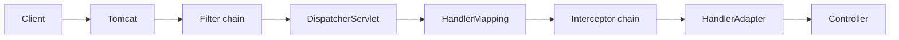
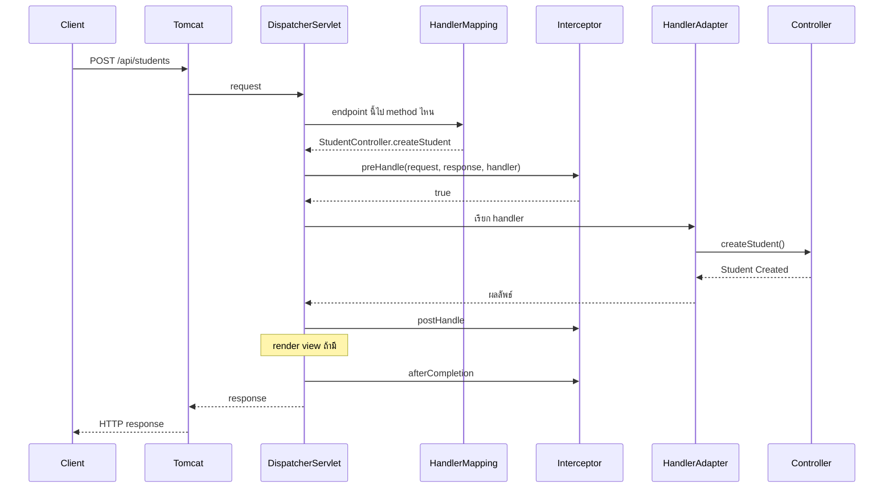

# #21 — Interceptor: preHandle, postHandle และ afterCompletion

> **วิดีโอ:** [Spring Boot Interceptors | preHandle, postHandle & afterCompletion | Spring Boot Full Course #21](https://youtu.be/XE4xsgbArCQ) — Coder Army, ~73 นาที
> **แหล่งที่ใช้สรุป:** ซับไตเติลภาษาอังกฤษที่ YouTube สร้างอัตโนมัติ
> **เวอร์ชันในโค้ด:** Spring Boot 4.1.1 + Java 21 (Spring Framework 7.0.9, embedded Tomcat 11.0.24) ใส่หมายเหตุไว้ทุกจุดที่ Spring Boot 3.x ต่างกัน

ตอนนี้ตอบคำถามที่ค้างจากเรื่อง Filter: **ถ้า Filter ห่อ request ได้แล้ว ทำไม Spring ยังมี Interceptor** ผู้สอนวาง Interceptor ไว้หลัง `DispatcherServlet` แล้วไล่สาม method ของ `HandlerInterceptor` คือ `preHandle`, `postHandle` และ `afterCompletion` จากนั้นลงทะเบียนผ่าน `WebMvcConfigurer` จำกัด path เรียงลำดับหลายตัว และปิดท้ายด้วยว่า authentication ไม่ควรอยู่ชั้นนี้

ส่วนที่ติดป้าย `💡 เพิ่มเติม` คือของที่ผมเติมเอง ไม่ได้อยู่ในวิดีโอ ส่วนที่ติด `⚠️ แก้จากวิดีโอ` คือจุดที่วิดีโอพูดคลาดเคลื่อน

---

## สารบัญ

| เวลา | หัวข้อ |
|---|---|
| [0:00](https://youtu.be/XE4xsgbArCQ?t=0) | [1. Filter ทำอะไรไปแล้ว](#1-filter-ทำอะไรไปแล้ว) |
| [2:06](https://youtu.be/XE4xsgbArCQ?t=126) | [2. ทำไมยังต้องมี Interceptor](#2-ทำไมยังต้องมี-interceptor) |
| [4:27](https://youtu.be/XE4xsgbArCQ?t=267) | [3. โซ่ของ Interceptor](#3-โซ่ของ-interceptor) |
| [7:33](https://youtu.be/XE4xsgbArCQ?t=453) | [4. HandlerInterceptor สาม method](#4-handlerinterceptor-สาม-method) |
| [9:54](https://youtu.be/XE4xsgbArCQ?t=594) | [5. Handler ไม่ได้แปลว่า Controller เสมอ](#5-handler-ไม่ได้แปลว่า-controller-เสมอ) |
| [15:21](https://youtu.be/XE4xsgbArCQ?t=921) | [6. ต้องลงทะเบียนใน WebMvcConfigurer](#6-ต้องลงทะเบียนใน-webmvcconfigurer) |
| [20:16](https://youtu.be/XE4xsgbArCQ?t=1216) | [7. request, response และ HandlerMethod](#7-request-response-และ-handlermethod) |
| [25:55](https://youtu.be/XE4xsgbArCQ?t=1555) | [8. preHandle คืน true หรือ false](#8-prehandle-คืน-true-หรือ-false) |
| [26:52](https://youtu.be/XE4xsgbArCQ?t=1612) | [9. postHandle กับ ModelAndView](#9-posthandle-กับ-modelandview) |
| [29:47](https://youtu.be/XE4xsgbArCQ?t=1787) | [10. afterCompletion กับ exception](#10-aftercompletion-กับ-exception) |
| [33:52](https://youtu.be/XE4xsgbArCQ?t=2032) | [11. แทรกอยู่ระหว่าง HandlerMapping กับ HandlerAdapter](#11-แทรกอยู่ระหว่าง-handlermapping-กับ-handleradapter) |
| [43:34](https://youtu.be/XE4xsgbArCQ?t=2614) | [12. หลายตัว: ไปตามลำดับ กลับย้อนลำดับ](#12-หลายตัว-ไปตามลำดับ-กลับย้อนลำดับ) |
| [46:52](https://youtu.be/XE4xsgbArCQ?t=2812) | [13. LoggingInterceptor](#13-logginginterceptor) |
| [53:12](https://youtu.be/XE4xsgbArCQ?t=3192) | [14. AuthenticationInterceptor](#14-authenticationinterceptor) |
| [55:10](https://youtu.be/XE4xsgbArCQ?t=3310) | [15. Path pattern และ exclude](#15-path-pattern-และ-exclude) |
| [1:00:47](https://youtu.be/XE4xsgbArCQ?t=3647) | [16. AuthorizationInterceptor: 401 กับ 403](#16-authorizationinterceptor-401-กับ-403) |
| [1:03:58](https://youtu.be/XE4xsgbArCQ?t=3838) | [17. เรียงด้วย order](#17-เรียงด้วย-order) |
| [1:08:44](https://youtu.be/XE4xsgbArCQ?t=4124) | [18. จะใช้ Filter หรือ Interceptor](#18-จะใช้-filter-หรือ-interceptor) |
| — | [19. สรุปท้ายตอน](#19-สรุปท้ายตอน) |

---

## 1. Filter ทำอะไรไปแล้ว

[▶ 0:00](https://youtu.be/XE4xsgbArCQ?t=0)

ผู้สอนบอกให้ดูตอน Filter ก่อน ตอนนี้จะเข้าใจเร็ว เพราะ Interceptor ห่อ Controller แบบเดียวกัน คือมีที่ให้เขียน logic ก่อนเรียก Controller และหลัง Controller คืนค่า

เขาวาด flow ที่คุ้นจากตอนก่อน แล้วเติม Tomcat ที่ตอนนั้นยังไม่ได้วาด

1. Client ส่ง request เข้า Tomcat
2. Tomcat ส่งต่อเข้า **filter chain** มีได้หลายตัว เช่น Filter 1, Filter 2, Filter 3
3. ผ่านครบแล้วถึง `DispatcherServlet`
4. จากนั้นเข้า Controller แล้ว Service แล้ว Repository
5. ทางกลับคือ Repository, Service, Controller สร้าง response กลับเข้า `DispatcherServlet` แล้วถอยออก Filter 3, Filter 2, Filter 1 แล้ว Tomcat ส่งกลับ client

งานที่เขาเคยใส่ใน Filter เป็น logic ซ้ำที่ไม่อยากเขียนทุก Controller

| งาน | ความหมายในวิดีโอ |
|---|---|
| Log request | บันทึกว่ามี request เข้า |
| Authenticate user | ตรวจว่าผู้ใช้เป็นใคร |
| API response time | จับเวลาตั้งแต่ต้นทางถึงตอบกลับ |
| Add value to header | เติม header ใน response |

ถ้าเขียนสิ่งเหล่านี้ใน Controller ต้องก็อปลงทุกตัว

---

## 2. ทำไมยังต้องมี Interceptor

[▶ 2:06](https://youtu.be/XE4xsgbArCQ?t=126)

คำถามของทั้งตอนคือ ถ้า Filter ทำครบแล้ว แนวคิดชื่อ Interceptor เพิ่มมาทำไม

**Filter เป็นเทคโนโลยีของ Servlet** Spring MVC และ Spring Boot นำมาใช้ได้ แต่ไม่ได้เป็นคนคิด คลาสอยู่ที่ `jakarta.servlet.Filter` จึงถูกวาง **ก่อน** `DispatcherServlet` คั่นระหว่าง Tomcat กับ Servlet

ผลคือ Filter เห็น **raw request** มันไม่รู้ว่า method ไหนของ Controller ไหนจะถูกเรียก คนที่ตัดสินใจคือ `DispatcherServlet`

[▶ 3:14](https://youtu.be/XE4xsgbArCQ?t=194)

ผู้สอนทบทวนงานของ `DispatcherServlet` จากตอนสถาปัตยกรรม Spring MVC

- ใช้ **HandlerMapping** สร้างตารางว่า endpoint ไหนไป method ไหน
- ตอนจะเรียกจริง ใช้ **HandlerAdapter**
- ถ้าเป็น `POST` ที่มี JSON มันแปลง JSON เป็น object เช่น `StudentDTO` ด้วย Jackson

ดังนั้นอะไรที่อยู่ก่อน `DispatcherServlet` รวมถึง Filter จึงยังไม่รู้ชั้น Controller

Interceptor ถูกวาง **หลัง** `DispatcherServlet` และ **ก่อน** Controller ตอนนั้น mapping เสร็จแล้ว จึงรู้ว่าจะเรียก method ไหน และทำงานบนผลนั้นได้

> ⚠️ **แก้จากวิดีโอ:** การแปลง JSON เป็น object ไม่ได้เกิดก่อน Interceptor `preHandle` ถูกเรียกหลัง HandlerMapping หา handler ได้ แล้ว HandlerAdapter ค่อยถูกเรียกทีหลัง การอ่าน `@RequestBody` แล้วให้ Jackson แปลงเป็น `StudentDTO` อยู่ใน `HandlerAdapter.handle()` ซึ่งอยู่ **หลัง** `preHandle` ตอน `preHandle` body ยังเป็น stream ของ Servlet อยู่ ถ้า Interceptor อ่าน stream นั้นจนหมด Controller จะอ่าน `@RequestBody` ไม่ได้อีก
> ([`HandlerInterceptor` javadoc](https://docs.spring.io/spring-framework/docs/7.0.9/javadoc-api/org/springframework/web/servlet/HandlerInterceptor.html), `DispatcherServlet.doDispatch` ใน spring-webmvc 7.0.9)

> ⚠️ **Boot 4 vs 3:** Boot 4 ใช้ **Jackson 3** (`tools.jackson`) เป็นตัวแปลง JSON ค่า default Boot 3 ใช้ Jackson 2 (`com.fasterxml.jackson`) ผู้สอนพูดแค่ชื่อ Jackson โค้ดตอนนี้ไม่ได้ import Jackson ตรง ๆ
> ([Spring Boot 4.0 Migration Guide](https://github.com/spring-projects/spring-boot/wiki/Spring-Boot-4.0-Migration-Guide))



---

## 3. โซ่ของ Interceptor

[▶ 4:47](https://youtu.be/XE4xsgbArCQ?t=287)

ผู้สอนเอารูปเดิมมาวาง `DispatcherServlet` ไว้ต้นทาง แล้วต่อ Interceptor 1, 2, 3 เข้าหากันแบบ filter chain

ไป: `DispatcherServlet` แล้ว Interceptor 1 แล้ว 2 แล้ว 3 แล้ว Controller, Service, Repository

กลับ: Repository, Service, Controller แล้วถอย Interceptor 3, 2, 1 แล้วกลับเข้า Servlet ทางกลับควรเรียกว่า response

**Interceptor เป็นแนวคิดของ Spring MVC** ตำแหน่งเปลี่ยนจาก Filter และเป็นของ Spring

เพราะรู้ method ล่วงหน้า งานเลยเฉพาะกว่า Filter ที่ครอบทุก request

| งานที่เขาเขียนบนกระดาน | ทำได้เพราะรู้อะไร |
|---|---|
| Log request, authenticate | ทำได้ทั้ง Filter และ Interceptor |
| Authorize user | ตรวจสิทธิ์หลังรู้ว่าจะเรียก method ไหน |
| Track which controller method was called | อ่านชื่อ Controller และชื่อ method |
| จับเวลาที่ Interceptor | ได้เวลาของช่วง Controller กับ Service เวลาของ Filter รวมงานของ `DispatcherServlet` ทั้งก้อนด้วย เขาบอกว่าตัวเลขไม่ต่างกันมาก |

เขาสรุปว่า Interceptor ใช้เมื่อไม่อยากได้ตัวครอบทั่วไป อยากได้ตัวที่เจาะ Controller บางกลุ่ม

---

## 4. HandlerInterceptor สาม method

[▶ 7:33](https://youtu.be/XE4xsgbArCQ?t=453)

โปรเจกต์ว่างชื่อ Interceptor Demo มีแค่ `StudentController` method `createStudent` รับ `POST /api/students` แล้วคืนข้อความ `Student Created` ไม่มี DTO, Service, Repository หรือ Filter เขาจะสร้างทีละชั้น

package ที่เขาพูดถึงตอนรันคือ `in.strikes...` ตัวอย่างด้านล่างใช้ `in.strikes.interceptordemo` สตาร์ทที่พอร์ต **9021**

`LoggingInterceptor` ติด `@Component` เพื่อให้ IoC Container ถือเป็น Bean แล้ว `implements HandlerInterceptor`

ใน interface มีสาม method และ **ทั้งสามเป็น default method** จะ override ตัวใดตัวหนึ่งหรือไม่ override เลยก็คอมไพล์ผ่าน ถ้าไม่ override เลยก็ไม่มีประโยชน์

| Method | คืนค่า | เรียกเมื่อไหร่ |
|---|---|---|
| `preHandle` | `boolean` | ก่อน handler ถูกเรียก |
| `postHandle` | `void` | หลัง handler ทำงานสำเร็จ ก่อน render view |
| `afterCompletion` | `void` | หลัง request ประมวลผลจบ รวมถึงหลัง render view |

เขาเทียบกับ Filter ว่า Filter มีแค่ `doFilter` โค้ดก่อน `chain.doFilter()` คือช่วงก่อนเรียกต่อ โค้ดหลัง `chain.doFilter()` คือช่วงหลัง `afterCompletion` ไม่มีคู่ใน Filter จึงงง และเขาจะอธิบายทีหลัง

Parameter ที่เห็นทันที

- `preHandle` รับ `HttpServletRequest`, `HttpServletResponse`, `Object handler`
- `postHandle` รับสามตัวเดิม บวก `ModelAndView` ที่เป็น null ได้
- `afterCompletion` รับสามตัวเดิม บวก `Exception` ที่เป็น null ได้

รอบแรกเขาพิมพ์ `preHandle called`, `postHandle called`, `afterCompletion called` แล้ว `preHandle` คืน `true` Controller พิมพ์ `Controller Called`

> ⚠️ **Boot 4 vs 3:** signature ของ `postHandle` และ `afterCompletion` ใน Spring Framework 7 ติด `@Nullable` จาก **`org.jspecify.annotations.Nullable`** Boot 3 / Spring Framework 6 ใช้ `org.springframework.lang.Nullable` ผู้สอนลบ annotation นี้ออกตอน override จึงไม่ต้อง import
> ([Migration Guide, JSpecify Nullability annotations](https://github.com/spring-projects/spring-boot/wiki/Spring-Boot-4.0-Migration-Guide))

---

## 5. Handler ไม่ได้แปลว่า Controller เสมอ

[▶ 9:54](https://youtu.be/XE4xsgbArCQ?t=594)

Spring ใช้คำว่า **handler** แบบกว้าง เพราะไม่ได้ทำแค่ REST API

| ชนิดแอป | handler ที่ถูกเรียก |
|---|---|
| REST API | method ของ Controller ซึ่ง Java เก็บในคลาส `HandlerMethod` |
| หน้าเว็บแบบเดิม | view เช่น JSP |
| ไฟล์นิ่ง | static resource เช่น HTML, CSS, JavaScript |

`HandlerInterceptor` จึงห่อ handler ไม่ได้ห่อเฉพาะ Controller

เขาเรียกโมเดลนี้ว่า **onion peel** ชั้นนอกคือ Interceptor ซ้อนได้เรื่อย ๆ ชั้นในสุดคือ handler เมื่อปอกครบถึง Controller

สาม method บนหัวหอม

- `preHandle` ทำงานก่อนเรียก handler
- `postHandle` ทำงานหลัง handler คืนค่า
- `afterCompletion` ทำงานเมื่อ request ทั้งก้อนจบ รายละเอียดอยู่ในส่วนที่ 10

---

## 6. ต้องลงทะเบียนใน WebMvcConfigurer

[▶ 15:21](https://youtu.be/XE4xsgbArCQ?t=921)

เขารันแอปแล้วยิง `POST localhost:8080/api/students` จาก Postman ได้ข้อความ `Student Created` ใน log มีแค่ `Controller Called` **ไม่มี method ของ Interceptor ถูกเรียก**

Filter ที่เป็น Bean ถูกเรียกเอง แต่ Interceptor ไม่เป็นแบบนั้น `@Component` บอกแค่ว่า IoC Container จัดการ Bean นี้ ยังไม่ได้บอกว่าให้มันรันก่อน `StudentController`

ต้องมีคลาส config เขาตั้งชื่อ `WebConfig` ติด `@Configuration` แล้ว `implements WebMvcConfigurer` จากนั้น constructor-inject Bean ของ Interceptor แล้ว override `addInterceptors(InterceptorRegistry registry)`

ข้างในเรียก `registry.addInterceptor(...)` เขาเปิดคลาส `InterceptorRegistry` แล้วเห็น `addInterceptor`, `addWebRequestInterceptor` และ `getInterceptors` ลงทะเบียนครั้งเดียวตอนสตาร์ท ไม่ใช่ทุก request

รอบแรกเขา override ชื่อ method ผิด IDE ขึ้น error ที่ `@Override` ชื่อที่ถูกคือ `addInterceptors` มี `s`

รันใหม่แล้ว log เป็นลำดับนี้

```text
preHandle called
Controller Called
postHandle called
afterCompletion called
```

นั่นคือ preHandle แล้ว Controller แล้ว postHandle แล้ว afterCompletion

> 💡 **เพิ่มเติม:** โปรเจกต์ที่รันด้านล่างลงทะเบียนไว้ตั้งแต่ต้น จึงไม่มีรอบที่เห็นแค่ `Controller Called` ข้อความสามบรรทัดด้านบนคือสิ่งที่ผู้สอนอ่านจาก console ในวิดีโอ

---

## 7. request, response และ HandlerMethod

[▶ 20:16](https://youtu.be/XE4xsgbArCQ?t=1216)

สาม parameter แรกซ้ำกันทุก method

**`HttpServletRequest`** เก็บ request ที่เข้ามา method ที่เขาเอ่ยคือ `getHeaders`, `getParameter` และ `getRequestURI` ค่าของ URI ในตัวอย่างคือ `/api/students` ส่วนนี้เคยใช้ใน Filter แล้ว

**`HttpServletResponse`** คือ object ที่ Tomcat สร้าง แล้วส่งผ่าน `DispatcherServlet` มาถึง Interceptor เขาใช้ `response.setHeader(...)` เพื่อให้ client เห็น header นั้น ข้อมูลที่ต้องส่งกลับ client ประกอบจาก object นี้

**`Object handler`** เป็น handler ที่ Spring MVC เลือกไว้แล้ว ถ้าทำ REST API ตัวนี้คือ `HandlerMethod` ซึ่งชี้ไปที่ method ของ Controller ที่จะถูกเรียกสำหรับ endpoint นั้น เช่น `POST /api/students` ทำให้ handler เก็บข้อมูลของ `StudentController`

เขา cast แล้วดึงชื่อ

```java
HandlerMethod method = (HandlerMethod) handler;
String controllerName = method.getBeanType().getName();
String methodName = method.getMethod().getName();
```

`getBeanType().getName()` ได้ชื่อคลาสเต็ม `getMethod().getName()` ได้ชื่อ method รันแล้วเขาอ่านได้ชื่อแพ็กเกจ `in.strikes...StudentController` และ method `createStudent` ลำดับ log ยังเป็น preHandle, Controller Called, postHandle, afterCompletion

ทำไมชนิดถึงเป็น `Object` เพราะ framework ไม่รู้ว่าแอปเป็น REST หรือไม่ ถ้าเป็น REST ตัวแทนของ Controller method คือคลาส `HandlerMethod`

[▶ 24:39](https://youtu.be/XE4xsgbArCQ?t=1479)

การ cast ตรง ๆ พังได้ถ้า handler ไม่ใช่ `HandlerMethod` เขาจึงเปลี่ยนเป็น `instanceof` ถ้าไม่ใช่ก็ข้ามบล็อกไป ไม่มี exception

```java
if (handler instanceof HandlerMethod handlerMethod) {
  String controllerName = handlerMethod.getBeanType().getName();
  String methodName = handlerMethod.getMethod().getName();
}
```

นี่คือข้อมูลของ Controller และ method ที่จะถูกเรียก เก็บอยู่ใน handler ตั้งแต่ก่อนเข้า Controller

---

## 8. preHandle คืน true หรือ false

[▶ 25:55](https://youtu.be/XE4xsgbArCQ?t=1555)

`preHandle` คือที่วาง logic ก่อนเรียก Controller ค่าที่คืนเป็น `boolean`

- คืน `true` แปลว่าให้ไปต่อ Spring จะเรียก `preHandle` ของ Interceptor ตัวถัดไป ถ้าไม่มีตัวถัดไปจึงเรียก Controller
- คืน `false` แปลว่าหยุด request ไม่เข้า Controller และไม่เข้า Interceptor ที่อยู่ถัดไป เขายกเคส authentication ที่ token ไม่ตรง แล้วบอกให้ผู้ชมทำการบ้านย้ายตัวอย่างจาก Filter มาทำใน Interceptor

มีโซ่ของ Interceptor เช่นเดียวกับ filter chain ภาพหลายตัวอยู่ในส่วนที่ 12

> 💡 **เพิ่มเติม — `false` ไม่ได้ปิดทุก callback:** ใน `HandlerExecutionChain.applyPreHandle` ถ้าตัวปัจจุบันคืน `false` Spring เรียก `afterCompletion` ของตัวที่ `preHandle` คืน `true` ไปแล้ว โดยย้อนลำดับ ตัวที่คืน `false` ไม่ได้ `afterCompletion` ของตัวเอง และไม่มีใครได้ `postHandle` ผลรันอยู่ใน[ส่วนที่ 17](#17-เรียงด้วย-order)
> (spring-webmvc 7.0.9, `HandlerExecutionChain`)

---

## 9. postHandle กับ ModelAndView

[▶ 26:52](https://youtu.be/XE4xsgbArCQ?t=1612)

`postHandle` ถูกเรียกเมื่อ method ของ Controller ทำงานจบ สาม argument แรกเหมือนเดิม argument ที่สี่คือ `ModelAndView`

Spring MVC ไม่ได้มีแค่ REST จะคืน **view** เช่น JSP ซึ่งเขาให้นึกเป็นหน้า HTML ที่มี Java ฝังอยู่ก็ได้ `ModelAndView` เก็บชื่อ view และข้อมูลใน model จาก Interceptor พิมพ์ชื่อ view ได้ อ่านข้อมูลใน model ได้ และ **เติมข้อมูลเข้า view** ได้ ถ้า Controller ลืมใส่ หรือตั้งใจให้ Interceptor เป็นคนใส่

ถ้าทำ REST API ที่คืน JSON ค่านี้เป็น **null** ไม่ต้องใช้ มันมีประโยชน์ตอนคืนหน้าเว็บแบบเดิม

งานที่เขาบอกว่าเหมาะกับ `postHandle` คือ log ว่า Controller จบแล้ว และเติม model ให้ view สำหรับ REST เขาบอกว่า `postHandle` ไม่ค่อยมีประโยชน์ `afterCompletion` มีประโยชน์กว่า และไม่ override `postHandle` ก็ได้ เพราะเป็น default method

> 💡 **เพิ่มเติม:** javadoc ระบุว่า `postHandle` เกิดหลัง handler **สำเร็จ** เท่านั้น ถ้า Controller โยน exception method นี้ไม่ถูกเรียก ดู log ใน[ส่วนที่ 10](#10-aftercompletion-กับ-exception)

---

## 10. afterCompletion กับ exception

[▶ 29:47](https://youtu.be/XE4xsgbArCQ?t=1787)

`afterCompletion` คือที่วางงานแบบเดียวกับโค้ดหลัง `chain.doFilter()` ใน Filter ถ้ายิง REST API

- พิมพ์ response
- ถ้าเริ่มจับเวลาใน `preHandle` ให้หยุดนาฬิกาที่นี่
- parameter `Exception ex` คือ exception จาก Controller หรือ Service พิมพ์ได้ด้วย `ex.getMessage()` ต้องเช็ก `ex != null` ก่อน เพราะบางครั้งมันว่าง
- จากจุดนี้สร้าง response ส่งกลับได้ แต่ไม่จำเป็น

เขาเตือนว่าการหลุดออกจาก `if (ex != null)` ไม่ได้แปลว่าไม่มี exception ในระบบ ถ้ามี **Global Exception Handler** exception ถูกจัดการที่นั่นแล้ว object ที่นี่จะว่าง บล็อก `ex != null` จะไม่ถูกรัน เขาบอกว่า parameter นี้มีประโยชน์เมื่อยังไม่มี handler กลาง

[▶ 31:32](https://youtu.be/XE4xsgbArCQ?t=1892)

`postHandle` กับ `afterCompletion` ถูกเรียกหลัง Controller ทั้งคู่ ความต่างมีไม่กี่อย่าง และเห็นชัดตอนทำเว็บแบบมี view

- Controller ทำงานจบ คือจังหวะ `postHandle` view อาจยัง render ไม่เสร็จ
- view render ครบ request ถูกประมวลผลทั้งก้อนแล้ว คือจังหวะ `afterCompletion`

สาม method มีไว้เพราะ Spring รองรับทั้ง REST และเว็บ MVC ถ้าทำ REST เขาใช้ `preHandle` กับ `afterCompletion` เป็นหลัก และข้าม `postHandle` ได้

จะ override แค่ตัวที่ต้องใช้ก็ได้ ถ้าสนใจแค่ก่อนเข้า Controller ก็เหลือ `preHandle` ถ้าสนใจแค่ status หรือ exception ก็เหลือ `afterCompletion`

> 💡 **เพิ่มเติม — สองเคสที่รันจริงบนพอร์ต 9021** วิดีโออธิบาย exception แต่ไม่ได้ยิง request ที่พัง โปรเจกต์ตัวอย่างเพิ่ม `GET /api/students/fail` ซึ่งโยน `IllegalStateException` และไม่มี `@ControllerAdvice`
>
> `postHandle` ไม่ถูกเรียก `afterCompletion` ได้ `ex` เป็นข้อความ `student service failed` แต่ `response.getStatus()` ตอนนั้นยังเป็น **200** client ได้รับ **500** ทีหลัง เพราะ Tomcat กับ error page ของ Boot ตั้ง status หลังจาก callback นี้
>
> อีกเคสคือ `GET /api` ไม่มี Controller Spring เลือก resource handler แล้วไม่เจอไฟล์ exception นี้ถูก resolver ของ Boot แปลงเป็น 404 ตั้งแต่ก่อน `afterCompletion` จึงเห็น `ex=null` และ status **404** ตรงกับที่ผู้สอนบอกว่าถ้ามีคนจัดการ exception ให้แล้ว object ตรงนี้จะว่าง
>
> javadoc ของ `afterCompletion` เขียนว่า `ex` ไม่รวม exception ที่ exception resolver จัดการไปแล้ว และ method นี้ถูกเรียกก็ต่อเมื่อ `preHandle` ของตัวนั้นคืน `true`

---

## 11. แทรกอยู่ระหว่าง HandlerMapping กับ HandlerAdapter

[▶ 33:52](https://youtu.be/XE4xsgbArCQ?t=2032)

เขาประกอบทุกชั้นที่เรียนมาเป็นภาพเดียว request ตัวอย่างเป็น `POST /api/students` ที่ `localhost:8080` body มี `id` เป็น 1 และ `name` เป็น Aditya

ลำดับที่เขาวาด

1. Client ส่งเข้า Tomcat
2. Tomcat ส่งเข้า `DispatcherServlet` เขายก Filter ออกชั่วคราวเพื่อดูแกน
3. `DispatcherServlet` ให้ HandlerMapping เปิดตารางว่า endpoint นี้เรียก `StudentController.createStudent` ตารางยังมี `getStudent` ของ student และ method ของ teacher controller ด้วย
4. เอกสารของ Spring บอกว่าถ้ามี Interceptor ให้เรียก `preHandle` **หลัง HandlerMapping และก่อน HandlerAdapter** เพราะชื่อ method รู้ได้ก็ต่อเมื่อ HandlerMapping ทำงานแล้ว `DispatcherServlet` ส่ง handler object เข้า `preHandle`
5. `preHandle` คืนค่าแล้ว `DispatcherServlet` บอก HandlerAdapter ให้เรียก `createStudent` จริง
6. Controller คืนค่ากลับมาที่ Servlet
7. Servlet เรียก `postHandle` แล้วเรียก `afterCompletion`
8. response ถูกประกอบ Tomcat ส่งกลับ client

เขาย้ำว่าไม่รู้ HandlerMapping กับ HandlerAdapter ก็สร้างโปรเจกต์ได้ แต่จะไม่รู้ว่า Interceptor ทำอะไรได้และทำอะไรไม่ได้ เช่น ไม่รู้ว่า `HttpServletRequest` กับ `HttpServletResponse` มาจากไหน



> 💡 **เพิ่มเติม:** ลูกศร `postHandle` ในรูปนี้คือกรณี handler สำเร็จ ถ้า handler โยน exception ที่ไม่มีใครรับ ลูกศรนั้นหายไป เหลือ `afterCompletion`

---

## 12. หลายตัว: ไปตามลำดับ กลับย้อนลำดับ

[▶ 43:34](https://youtu.be/XE4xsgbArCQ?t=2614)

ถ้ามีมากกว่าหนึ่งตัว เขาให้คิดเป็นโซ่ของ `preHandle` ก่อน แล้วค่อยเป็นโซ่ของ `postHandle` แล้วค่อยเป็นโซ่ของ `afterCompletion`

ภาพที่เขาอธิบายช่วงนี้คือ HandlerMapping แล้ว preHandle ตัวแรก แล้วตัวที่สอง แล้ว HandlerAdapter เรียก Controller แล้ว **postHandle ตัวแรกแล้วตัวที่สอง** แล้ว **afterCompletion ตัวแรกแล้วตัวที่สอง**

> ⚠️ **แก้จากวิดีโอ:** ทางกลับไม่เรียงตัวแรกแล้วตัวที่สอง javadoc เขียนว่า `postHandle` และ `afterCompletion` ถูกเรียก **ย้อนลำดับ** ตัวที่ `preHandle` ก่อน จะได้ callback หลังสุด ภาพหัวหอมตอนต้นคลิปที่ถอย Interceptor 3 แล้ว 2 แล้ว 1 ตรงกับโค้ด ส่วนกระดานช่วงนาทีที่ 43 ที่ให้ postHandle ตัวแรกแล้วตัวที่สอง เรียงเดียวกับขาไป ไม่ตรง
>
> สิ่งที่เขาสรุปถูกคือ Servlet เรียก `postHandle` ของทุกตัวให้ครบก่อน แล้วค่อยเรียก `afterCompletion` ของทุกตัว สำหรับ REST เขายังบอกให้ข้าม `postHandle` ได้เมื่อไม่ได้ทำ view

ภาพง่ายที่เขาใช้ปิดท้ายสถาปัตยกรรมคือ `DispatcherServlet` ไป Interceptor 1 ไป Interceptor 2 ไป Controller แล้วถอย 2 แล้ว 1 กลับเข้า Servlet ขาไปคือ `preHandle` ของ 1 แล้วของ 2 ขากลับเขาย่อว่าเป็น `afterCompletion` เพราะคนส่วนใหญ่งงที่มี method จบสองตัว วิธีที่เขาให้จำคือขาไปเป็น preHandle สองตัวแล้ว Controller ขากลับ Servlet เรียก postHandle ของทั้งคู่ก่อน แล้วค่อย afterCompletion ของทั้งคู่

Filter ยังแทรกหน้า `DispatcherServlet` ได้ Interceptor กับ Filter ทำงานร่วมกันได้

> 💡 **เพิ่มเติม:** `afterCompletion` ย้อนลำดับเฉพาะตัวที่ `preHandle` คืน `true` แล้ว ตัวที่ยังไม่ได้ถูกเรียก หรือตัวที่คืน `false` ไม่ถูกเรียก

---

## 13. LoggingInterceptor

[▶ 46:52](https://youtu.be/XE4xsgbArCQ?t=2812)

เขาลบการพิมพ์ `preHandle called` ทั้งก้อน และบอกว่าจะไม่ override `postHandle` แล้ว เพราะ REST ไม่ได้ใช้ จากนั้น log request จริงด้วย object ที่ถืออยู่

| บรรทัดที่เขาพิมพ์ | method |
|---|---|
| HTTP method | `request.getMethod()` |
| request URI | `request.getRequestURI()` |
| request parameters | `request.getQueryString()` |
| client IP | `request.getRemoteAddr()` |
| header ชื่อ `token` | `request.getHeader("token")` |
| ชื่อ Controller และ method | `HandlerMethod` หลัง `instanceof` |

ท้าย `preHandle` คืน `true` ใน `afterCompletion` เขาพิมพ์ `response.getStatus()`

ยิงจาก Postman โดยใส่ header `token` เป็น `123` ได้ `Student Created` แล้ว log มี `POST`, `/api/students`, query เป็น null, IP, token `123`, ชื่อ Controller, ชื่อ method และ status `200`

เขาเติม query `name=Aditya&age=28` ทั้งที่ Controller ไม่ได้อ่านค่านี้ `getQueryString()` ก็พิมพ์ทั้งสตริงออกมา

> ⚠️ **แก้จากวิดีโอ:** เขาอ่าน IP ว่า `0.0.1` แล้วบอกว่าเป็นที่อยู่ของเครื่องตัวเอง ค่าจริงจาก Tomcat 11 ตอนยิง `localhost` คือ **`0:0:0:0:0:0:0:1`** ซึ่งเป็น IPv6 localhost ตัวเดียวกับ `::1` ซับหลุดตัว `:` ไป

> 💡 **เพิ่มเติม:** ในคำพูดเขาเรียกคลาสนี้ทั้ง LoggingInterceptor และ LoginInterceptor สลับไปมา คลาสที่ log request ในโน้ตนี้ชื่อ `LoggingInterceptor` ส่วน Authentication เป็นคนละคลาสในส่วนถัดไป ตัวอย่างด้านล่างยัง override `postHandle` ไว้บรรทัดเดียว เพื่อให้ log แสดงจังหวะที่เขาพิมพ์ไว้ครึ่งแรกของคลิป พร้อมกับรายละเอียด request ครึ่งหลัง

`pom.xml`

```xml
<parent>
  <groupId>org.springframework.boot</groupId>
  <artifactId>spring-boot-starter-parent</artifactId>
  <version>4.1.1</version>
</parent>

<properties>
  <java.version>21</java.version>
</properties>

<dependencies>
  <dependency>
    <groupId>org.springframework.boot</groupId>
    <artifactId>spring-boot-starter-webmvc</artifactId>
  </dependency>
</dependencies>
```

> ⚠️ **Boot 4 vs 3:** starter ของเว็บฝั่ง servlet ใน Boot 4 คือ `spring-boot-starter-webmvc` ชื่อ `spring-boot-starter-web` ใน Boot 3.x ยังใช้ได้ใน Boot 4 แต่ถูก deprecate
> ([Migration Guide](https://github.com/spring-projects/spring-boot/wiki/Spring-Boot-4.0-Migration-Guide))

`StudentController` ตามคลิปมีแค่ `createStudent` สอง method ถัดไปเป็นของตัวอย่างที่รัน เพื่อให้เห็น path ซ้อนและ exception

```java
package in.strikes.interceptordemo.controller;

import org.springframework.web.bind.annotation.GetMapping;
import org.springframework.web.bind.annotation.PathVariable;
import org.springframework.web.bind.annotation.PostMapping;
import org.springframework.web.bind.annotation.RequestMapping;
import org.springframework.web.bind.annotation.RestController;

@RestController
@RequestMapping("/api/students")
public class StudentController {

  @PostMapping
  public String createStudent() {
    System.out.println("Controller Called");
    return "Student Created";
  }

  @GetMapping("/{id}")
  public String getStudent(@PathVariable long id) {
    System.out.println("Controller Called");
    return "Student " + id;
  }

  @GetMapping("/fail")
  public String fail() {
    System.out.println("Controller Called");
    throw new IllegalStateException("student service failed");
  }
}
```

```java
package in.strikes.interceptordemo.interceptor;

import jakarta.servlet.http.HttpServletRequest;
import jakarta.servlet.http.HttpServletResponse;
import org.springframework.stereotype.Component;
import org.springframework.web.method.HandlerMethod;
import org.springframework.web.servlet.HandlerInterceptor;
import org.springframework.web.servlet.ModelAndView;

@Component
public class LoggingInterceptor implements HandlerInterceptor {

  @Override
  public boolean preHandle(HttpServletRequest request, HttpServletResponse response, Object handler)
      throws Exception {
    System.out.println("[logging] preHandle");
    System.out.println("incoming request");
    System.out.println("HTTP method: " + request.getMethod());
    System.out.println("request URI: " + request.getRequestURI());
    System.out.println("request parameter: " + request.getQueryString());
    System.out.println("client IP: " + request.getRemoteAddr());
    System.out.println("token header: " + request.getHeader("token"));

    if (handler instanceof HandlerMethod handlerMethod) {
      System.out.println("controller name: " + handlerMethod.getBeanType().getName());
      System.out.println("controller method: " + handlerMethod.getMethod().getName());
    }
    return true;
  }

  @Override
  public void postHandle(HttpServletRequest request, HttpServletResponse response, Object handler,
      ModelAndView modelAndView) {
    System.out.println("[logging] postHandle called, modelAndView=" + modelAndView);
  }

  @Override
  public void afterCompletion(HttpServletRequest request, HttpServletResponse response, Object handler,
      Exception ex) {
    System.out.println("[logging] afterCompletion");
    System.out.println("response status: " + response.getStatus());
    if (ex != null) {
      System.out.println("exception: " + ex.getMessage());
    }
  }
}
```

คำสั่งที่รันจริง

```bash
curl -i -X POST 'http://localhost:9021/api/students?name=Aditya&age=28' \
  -H 'token: 123' \
  -H 'X-API-KEY: secret123' \
  -H 'X-User-Role: admin'
```

```http
HTTP/1.1 200
Content-Type: text/plain;charset=UTF-8
Content-Length: 15

Student Created
```

`@RestController` ที่คืน `String` ได้ `text/plain` ข้อความ `Student Created` ยาว 15 ตัวอักษร header `X-API-KEY` กับ `X-User-Role` เป็นของสอง Interceptor ถัดไป ถ้าไม่ใส่ สองตัวนั้นจะตัด request ก่อนถึงบรรทัด log

---

## 14. AuthenticationInterceptor

[▶ 53:12](https://youtu.be/XE4xsgbArCQ?t=3192)

เขาเปิดคลาสใหม่ ติด `@Component` แล้ว `implements HandlerInterceptor` override แค่ `preHandle`

อ่าน header `X-API-KEY` ถ้าไม่เป็น null และเท่ากับ `secret123` ให้คืน `true` นอกนั้นคืน `false` เขาบอกว่าตรงนี้ตั้ง status เป็น unauthorized และเขียน body ด้วย `response.getWriter().write(...)` ได้ เป็นการบ้านคู่กับตัวอย่าง Filter

รอบที่เขารันจริงยังไม่ได้ตั้ง status เขายิงโดยไม่ใส่ `secret123` แล้วบอกว่าไม่มี log ของตัวที่อยู่ถัดไป เพราะตัวนั้นถูกเรียงไว้ทีหลัง และเขาไม่ได้ตั้ง status ไว้

> 💡 **เพิ่มเติม:** โค้ดด้านล่างใส่ status `401` และข้อความ `Authentication failed` ตามที่เขาสั่งให้ทำให้ครบ ถ้าคืน `false` โดยไม่เขียนอะไรลง response client จะได้ body ว่างและ status ยังเป็นค่าเริ่มต้นของ Servlet ซึ่งมักเป็น 200 เขาเจอเคสนั้นในคลิป

```java
package in.strikes.interceptordemo.interceptor;

import jakarta.servlet.http.HttpServletRequest;
import jakarta.servlet.http.HttpServletResponse;
import org.springframework.stereotype.Component;
import org.springframework.web.servlet.HandlerInterceptor;

@Component
public class AuthenticationInterceptor implements HandlerInterceptor {

  @Override
  public boolean preHandle(HttpServletRequest request, HttpServletResponse response, Object handler)
      throws Exception {
    System.out.println("[auth] preHandle");
    String apiKey = request.getHeader("X-API-KEY");
    if (apiKey != null && apiKey.equals("secret123")) {
      return true;
    }
    response.setStatus(HttpServletResponse.SC_UNAUTHORIZED);
    response.setContentType("text/plain;charset=UTF-8");
    response.getWriter().write("Authentication failed");
    return false;
  }

  @Override
  public void afterCompletion(HttpServletRequest request, HttpServletResponse response, Object handler,
      Exception ex) {
    System.out.println("[auth] afterCompletion status=" + response.getStatus()
        + " ex=" + (ex == null ? "null" : ex.getMessage()));
  }
}
```

เขาสั่งให้สร้าง `TimingInterceptor` อีกตัว เริ่มนาฬิกาใน `preHandle` แล้วหยุดใน `afterCompletion` โค้ดด้านล่างเก็บเวลาเริ่มไว้ใน request attribute เพราะ Interceptor เป็น singleton จะเก็บลง field แล้ว request จะทับกัน

```java
package in.strikes.interceptordemo.interceptor;

import jakarta.servlet.http.HttpServletRequest;
import jakarta.servlet.http.HttpServletResponse;
import org.springframework.stereotype.Component;
import org.springframework.web.servlet.HandlerInterceptor;

@Component
public class TimingInterceptor implements HandlerInterceptor {

  static final String START = "startTime";

  @Override
  public boolean preHandle(HttpServletRequest request, HttpServletResponse response, Object handler) {
    System.out.println("[timing] preHandle");
    request.setAttribute(START, System.nanoTime());
    return true;
  }

  @Override
  public void postHandle(HttpServletRequest request, HttpServletResponse response, Object handler,
      org.springframework.web.servlet.ModelAndView modelAndView) {
    System.out.println("[timing] postHandle");
  }

  @Override
  public void afterCompletion(HttpServletRequest request, HttpServletResponse response, Object handler,
      Exception ex) {
    Object start = request.getAttribute(START);
    long elapsedMs = (System.nanoTime() - (long) start) / 1_000_000;
    System.out.println("[timing] afterCompletion " + elapsedMs + " ms, ex="
        + (ex == null ? "null" : ex.getMessage()));
  }
}
```

บรรทัด `[timing] postHandle` เป็นของตัวอย่างนี้ เพื่อให้เห็นลำดับย้อนกลับใน log เขาไม่ได้พิมพ์บรรทัดนั้นในคลิป

---

## 15. Path pattern และ exclude

[▶ 55:10](https://youtu.be/XE4xsgbArCQ?t=3310)

`registry.addInterceptor(...).addPathPatterns(...)` เลือก URL ที่ตัวนั้นทำงาน เขาเทียบกับ config ของ Filter ที่เคยใส่ URL pattern หลายแบบ

ใน Filter เขาเคยเขียน `/api/*` เพราะนั่นเป็น pattern ของ Servlet Spring MVC ใช้คนละกฎ

| Pattern ที่เขาเขียน | ความหมายใน Spring MVC |
|---|---|
| `/api` | ตรงเป๊ะ ถ้ามีอะไรต่อท้ายจะไม่เข้า |
| `/api/*` | ลึกหนึ่งท่อน เช่น `/api/students` และ `/api/teachers` ถ้ามีท่อนที่สามเช่น `/api/students/1` จะไม่เข้า |
| `/api/**` | ลึกกี่ท่อนก็ได้ภายใต้ `/api` |

เขาบอกว่า pattern ของ Servlet ที่ลงท้ายด้วย `/*` ครอบทั้งกิ่ง ไม่มีโหมด "แค่หนึ่งท่อน" แยกจาก "กี่ท่อนก็ได้" แบบที่ Spring แยก `*` กับ `**`

`excludePathPatterns` คือรายการที่ไม่ให้รัน เขายก `/admin` เป็นตัวอย่างสั้น ๆ แล้วเปลี่ยนไปที่ authentication

Authentication ควรครอบ `/api/**` เพราะทุก endpoint ต้องรู้ว่าผู้ใช้ผ่านแล้วหรือยัง แต่ผู้ใช้ต้อง login ได้ และบางหน้าต้องเปิดสาธารณะ เขาเทียบกับหน้าแรกของ X ที่เคยดูได้โดยไม่ login จึงใส่ exclude

- `/api/authenticate/login`
- `/api/public`

> 💡 **เพิ่มเติม — สิ่งที่รันแล้วนอกเหนือจากที่เขาพูดบนกระดาน**
>
> - `/api/**` ครอบ path `/api` เปล่า ๆ ด้วย เพราะ `**` จับศูนย์ท่อนได้ ยิง `GET /api` พร้อม key ที่ถูกแล้ว Interceptor ทำงาน แต่ไม่มีบรรทัดชื่อ Controller เพราะ handler เป็น resource handler ไม่ใช่ `HandlerMethod` แล้วได้ 404
> - `/api/*` ไม่ครอบ `/api/students/1` และไม่ครอบ `/api/authenticate/login`
> - คลาส `OneLevelInterceptor` ในโปรเจกต์มีไว้พิสูจน์แถว `*` เท่านั้น มันพิมพ์หนึ่งบรรทัดเมื่อ pattern นี้ตรง

> ⚠️ **Boot 4 vs 3:** `InterceptorRegistration` ใน Spring Framework 7 เพิ่ม `includeHttpMethods` กับ `excludeHttpMethods` (`@since 7.0`) ใช้จำกัดตาม HTTP method โดยไม่ต้องแยก path Boot 3 / Spring Framework 6 ไม่มีสอง method นี้ นอกจากนี้ `pathMatcher(...)` ถูก deprecate ตั้งแต่ 7.0 เพราะ runtime ใช้ `PathPatternParser` แทน `AntPathMatcher` ผู้สอนยังไม่ได้เรียก method พวกนี้ เขาใช้ `addPathPatterns` กับ `excludePathPatterns` ซึ่งมีอยู่ทั้งสองรุ่น
> (ซอร์ส `InterceptorRegistration.java` ใน spring-webmvc 7.0.9)

endpoint สาธารณะที่ใส่ไว้ให้ exclude มีของจริงให้ยิง

```java
package in.strikes.interceptordemo.controller;

import org.springframework.web.bind.annotation.GetMapping;
import org.springframework.web.bind.annotation.PostMapping;
import org.springframework.web.bind.annotation.RestController;

@RestController
public class PublicController {

  @PostMapping("/api/authenticate/login")
  public String login() {
    System.out.println("Login Controller Called");
    return "Logged in";
  }

  @GetMapping("/api/public/home")
  public String home() {
    System.out.println("Public Controller Called");
    return "Public home";
  }
}
```

`POST /api/authenticate/login` โดยไม่ใส่ `X-API-KEY` ได้ `200` และข้อความ `Logged in` ใน log ไม่มี `[auth]` แต่ยังมี `[logging]` เพราะตัว log ครอบ `/api/**` และไม่ได้ถูก exclude

---

## 16. AuthorizationInterceptor: 401 กับ 403

[▶ 1:00:47](https://youtu.be/XE4xsgbArCQ?t=3647)

เขาแยกสองคำ

- **Authentication** ถามว่า login แล้วหรือยัง
- **Authorization** login แล้วก็ยังทำบางอย่างไม่ได้ เช่น ผู้ใช้ธรรมดาเรียก API ลบข้อมูลไม่ได้ เขาอยากกัน delete ของ CRUD ไว้ชั้นนี้

> ⚠️ **แก้จากวิดีโอ:** เขาพูดว่า Authorization interceptor ให้ `implements HandlerMapping` คลาสที่เขากำลังเขียนคือ `HandlerInterceptor` **HandlerMapping** เป็นอีกชิ้นหนึ่ง คือตาราง endpoint ไปหา method ที่ `DispatcherServlet` ใช้ก่อนถึง Interceptor

ใน `preHandle` อ่าน header `X-User-Role` ถ้าเป็น `admin` ให้ผ่าน นอกนั้นหยุด

เรื่อง status เขาแยกไว้ชัด

| สถานการณ์ | code ที่เขาใช้ | ชื่อ |
|---|---|---|
| ยังไม่ได้ login | `401` | Unauthorized |
| login แล้วแต่ทำอย่างนั้นไม่ได้ | `403` | Forbidden |

เขาบอกว่าชื่อ `401 Unauthorized` ฟังแล้วเหมือนเรื่องสิทธิ์ ทั้งที่เขาใช้ตอน authenticate คือตอนให้ login คำว่า Forbidden ของ `403` คือทำอย่างนี้ไม่ได้

เขาเริ่มเขียน `response.sendError` ด้วย `SC_FORBIDDEN` แล้วตามด้วย `getWriter().write(...)` IDE ฟ้อง unhandled exception เพราะ method นั้นโยน `IOException` เขาใส่ `throws` ให้ผ่าน จากนั้นรอบที่ทำงานจริงเขาบอกว่าตั้ง status แล้วเขียน writer และต่อมาตั้ง `response.setContentType("application/json")` ข้อความที่เขียนคือ `You are not authorized to perform this action.`

ยิงโดยไม่ส่ง role `admin` ได้ `403` และข้อความนั้น รอบแรก Postman แสดงเป็น text เพราะยังไม่ได้ตั้ง content type พอตั้ง `application/json` แล้วรีสตาร์ท Postman มองเป็น JSON เอง

> ⚠️ **แก้จากวิดีโอ:** body ที่เขาเขียนเป็นประโยคธรรมดา ไม่ใช่เอกสาร JSON header ที่ curl ได้รับคือ `Content-Type: application/json;charset=ISO-8859-1` Tomcat เติม charset ตอน `getWriter()` Postman สลับแท็บตาม header ได้ ทั้งที่ตัวหนังสือยัง parse เป็น JSON ไม่ผ่าน โค้ดด้านล่างคง `setStatus` กับประโยคนี้ไว้ตามรอบที่เขาทำให้ติด เพราะ `sendError` ไม่ใช่รุ่นที่เขาโชว์ body นี้ใน Postman

```java
package in.strikes.interceptordemo.interceptor;

import jakarta.servlet.http.HttpServletRequest;
import jakarta.servlet.http.HttpServletResponse;
import org.springframework.stereotype.Component;
import org.springframework.web.servlet.HandlerInterceptor;

@Component
public class AuthorizationInterceptor implements HandlerInterceptor {

  @Override
  public boolean preHandle(HttpServletRequest request, HttpServletResponse response, Object handler)
      throws Exception {
    System.out.println("[authz] preHandle");
    String userRole = request.getHeader("X-User-Role");
    if (userRole != null && userRole.equals("admin")) {
      return true;
    }
    response.setStatus(HttpServletResponse.SC_FORBIDDEN);
    response.setContentType("application/json");
    response.getWriter().write("You are not authorized to perform this action.");
    return false;
  }

  @Override
  public void postHandle(HttpServletRequest request, HttpServletResponse response, Object handler,
      org.springframework.web.servlet.ModelAndView modelAndView) {
    System.out.println("[authz] postHandle");
  }

  @Override
  public void afterCompletion(HttpServletRequest request, HttpServletResponse response, Object handler,
      Exception ex) {
    System.out.println("[authz] afterCompletion status=" + response.getStatus()
        + " ex=" + (ex == null ? "null" : ex.getMessage()));
  }
}
```

```bash
curl -i -X POST http://localhost:9021/api/students \
  -H 'X-API-KEY: secret123' \
  -H 'X-User-Role: user'
```

```http
HTTP/1.1 403
Content-Type: application/json;charset=ISO-8859-1
Content-Length: 46

You are not authorized to perform this action.
```

---

## 17. เรียงด้วย order

[▶ 1:03:58](https://youtu.be/XE4xsgbArCQ?t=3838)

เขามีสามตัวแล้ว คือ authentication, authorization และตัวที่ log request แต่ละตัวเป็น `@Component` แล้ว constructor ของ `WebConfig` รับครบ

การต่อโซ่คือเรียก `registry.addInterceptor` หลายครั้ง แล้วต่อ `.order(...)`

| ตัว | `order` | งาน |
|---|---|---|
| AuthenticationInterceptor | `1` | รันก่อน |
| AuthorizationInterceptor | `2` | รันถัดไป |
| LoggingInterceptor | `3` | รันทีหลังสุดในสามตัวของคลิป |

เขาบอกว่าค่า 1 คือให้รันเป็นตัวแรก เขาไม่ได้ใส่ path ให้ตัว log ในตัวอย่างช่วงท้าย ส่วน authorization เขาบอกว่าไม่ควรครอบทุก endpoint และใส่ path ได้เหมือนกัน แต่ตอนสาธิตเขาโฟกัสที่ order

ยิงได้ต้องส่ง `X-API-KEY: secret123` และ `X-User-Role: admin` ผลคือ `Student Created` แล้วมี log ของ request เขาสังเกตว่า token เป็น null เพราะรอบนั้นไม่ได้ส่ง header `token` และ query ก็เป็น null

ถ้าไม่ส่ง `admin` ได้ `403` และประโยคเดิม

ถ้า role ถูกแต่ไม่ส่ง `secret123` ตัว log ไม่ทำงาน เพราะ order ของมันคือ 3 authentication ที่เป็น 1 คืน `false` ไปก่อน เขาบอกว่ารอบนั้น authentication ยังไม่ได้ตั้ง status จึงไม่มี body ที่ตั้งใจไว้

> 💡 **เพิ่มเติม:** ค่า default ของ `order` คือ `0` ค่าน้อยกว่าได้ `preHandle` ก่อน ถ้าค่าเท่ากัน ลำดับที่ `addInterceptor` จะถูกใช้ต่อ โปรเจกต์นี้ใส่ Timing เป็น `4` และตัวทดสอบ `/api/*` เป็น `5` จึงอยู่หลังสามตัวของคลิป

`WebConfig` ที่รัน

```java
package in.strikes.interceptordemo.config;

import in.strikes.interceptordemo.interceptor.AuthenticationInterceptor;
import in.strikes.interceptordemo.interceptor.AuthorizationInterceptor;
import in.strikes.interceptordemo.interceptor.LoggingInterceptor;
import in.strikes.interceptordemo.interceptor.OneLevelInterceptor;
import in.strikes.interceptordemo.interceptor.TimingInterceptor;
import org.springframework.context.annotation.Configuration;
import org.springframework.web.servlet.config.annotation.InterceptorRegistry;
import org.springframework.web.servlet.config.annotation.WebMvcConfigurer;

@Configuration
public class WebConfig implements WebMvcConfigurer {

  private final AuthenticationInterceptor authenticationInterceptor;
  private final AuthorizationInterceptor authorizationInterceptor;
  private final LoggingInterceptor loggingInterceptor;
  private final TimingInterceptor timingInterceptor;
  private final OneLevelInterceptor oneLevelInterceptor;

  public WebConfig(AuthenticationInterceptor authenticationInterceptor,
      AuthorizationInterceptor authorizationInterceptor,
      LoggingInterceptor loggingInterceptor,
      TimingInterceptor timingInterceptor,
      OneLevelInterceptor oneLevelInterceptor) {
    this.authenticationInterceptor = authenticationInterceptor;
    this.authorizationInterceptor = authorizationInterceptor;
    this.loggingInterceptor = loggingInterceptor;
    this.timingInterceptor = timingInterceptor;
    this.oneLevelInterceptor = oneLevelInterceptor;
  }

  @Override
  public void addInterceptors(InterceptorRegistry registry) {
    registry.addInterceptor(authenticationInterceptor)
        .addPathPatterns("/api/**")
        .excludePathPatterns("/api/authenticate/login", "/api/public/**")
        .order(1);

    registry.addInterceptor(authorizationInterceptor)
        .addPathPatterns("/api/**")
        .excludePathPatterns("/api/authenticate/login", "/api/public/**")
        .order(2);

    registry.addInterceptor(loggingInterceptor)
        .addPathPatterns("/api/**")
        .order(3);

    registry.addInterceptor(timingInterceptor)
        .addPathPatterns("/api/**")
        .order(4);

    registry.addInterceptor(oneLevelInterceptor)
        .addPathPatterns("/api/*")
        .order(5);
  }
}
```

Log จริงของ `POST /api/students?name=Aditya&age=28` พร้อม `token: 123`, `X-API-KEY: secret123`, `X-User-Role: admin`

```text
[auth] preHandle
[authz] preHandle
[logging] preHandle
incoming request
HTTP method: POST
request URI: /api/students
request parameter: name=Aditya&age=28
client IP: 0:0:0:0:0:0:0:1
token header: 123
controller name: in.strikes.interceptordemo.controller.StudentController
controller method: createStudent
[timing] preHandle
[one-level] preHandle /api/students
Controller Called
[timing] postHandle
[logging] postHandle called, modelAndView=null
[authz] postHandle
[timing] afterCompletion 6 ms, ex=null
[logging] afterCompletion
response status: 200
[authz] afterCompletion status=200 ex=null
[auth] afterCompletion status=200 ex=null
```

ขาไปเรียงตาม `order` ขากลับของ `postHandle` คือ timing แล้ว logging แล้ว authz ย้อนจาก 4 ไป 3 ไป 2 `afterCompletion` ย้อนต่อจนถึง auth `modelAndView` เป็น null ตามที่เขาบอกสำหรับ REST เวลา 6 ms เป็นของรอบนี้ รอบอื่นเป็น 0 ms ได้

`POST` เดิมโดย role เป็น `user` และ key ถูก

```text
[auth] preHandle
[authz] preHandle
[auth] afterCompletion status=403 ex=null
```

logging ไม่ได้รัน Controller ไม่ได้รัน ไม่มี `postHandle` authz ที่คืน `false` ไม่ได้ `afterCompletion` ของตัวเอง แต่ auth ที่คืน `true` ไปแล้วได้ `afterCompletion` และเห็น status `403` เพราะ `setStatus` ทำงานก่อนคืน `false`

`GET /api/students/fail` พร้อม key กับ role ที่ถูก

```text
[auth] preHandle
[authz] preHandle
[logging] preHandle
incoming request
HTTP method: GET
request URI: /api/students/fail
controller name: in.strikes.interceptordemo.controller.StudentController
controller method: fail
[timing] preHandle
Controller Called
[timing] afterCompletion 1 ms, ex=student service failed
[logging] afterCompletion
response status: 200
exception: student service failed
[authz] afterCompletion status=200 ex=student service failed
[auth] afterCompletion status=200 ex=student service failed
```

ไม่มี `[one-level]` เพราะ `/api/students/fail` สองท่อนหลัง `/api` ไม่ตรง `/api/*` ไม่มี `postHandle` เพราะ handler โยน exception client ได้

```http
HTTP/1.1 500
Content-Type: application/json

{"timestamp":"2026-10-16T11:46:15.836Z","status":500,"error":"Internal Server Error","path":"/api/students/fail"}
```

`GET /nope` ได้ 404 และไม่มีบรรทัดของ Interceptor เพราะ path ไม่อยู่ใน `/api/**` และไม่มี handler ของ Controller

---

## 18. จะใช้ Filter หรือ Interceptor

[▶ 1:08:44](https://youtu.be/XE4xsgbArCQ?t=4124)

เขาสรุปว่าสาธิต authentication และ authorization ทั้งใน Filter และ Interceptor แล้ว แต่ของจริงไม่ทำเองแบบนั้น ใช้ **Spring Security** Spring Security ใส่ Filter ของมันเองเข้าไปในโซ่ และจะลงรายละเอียดทีหลัง

**Interceptor เป็นที่ที่แย่ที่สุดสำหรับ logic ความปลอดภัย** เพราะกว่าจะถึงชั้นนี้ `DispatcherServlet` ทำงานไปแล้ว เขาอยากให้ผู้ใช้ถูกตรวจตั้งแต่ชั้น Filter ก่อนเข้า Servlet

เรื่อง body เขาเคยบอกในตอน Filter ว่าห่อ request กับ response แล้วแก้ของที่ส่งเข้าและส่งกลับได้ แต่ไม่ควรแก้ body Header เพิ่มได้ การแก้ body ใน `preHandle` ของ Interceptor ก็ทำได้และเป็นแนวปฏิบัติที่ไม่ดีเหมือนกัน

กฎที่เขาให้ใช้

| อยากทำอะไร | วางที่ไหน |
|---|---|
| Log ทั่วไปทั้งแอป | Filter |
| Log ที่ผูกกับ Controller หรือ method | Interceptor เพราะมี handler |
| Authentication ขั้นต่ำ โดยยังไม่ใช้ Spring Security | Filter |
| Authorization ที่ต้องรู้ว่ากำลังจะเรียก method ไหน | เขาสาธิตใน Interceptor แล้วบอกว่าของจริงให้ Spring Security |
| เงื่อนไขคนละแบบต่อ Controller เช่น log ของ student คนละแบบกับ teacher | Interceptor ตรวจ handler แล้วแยกทาง Filter ต้องแยก logger เอง เปิดบางเส้น ปิดบางเส้น |

แอปจริงใช้ทั้งคู่ปนกัน Filter สำหรับ logic ระดับทั้งระบบ Interceptor สำหรับ logic เฉพาะจุด รวมถึงจับเวลา response

Spring เองก็ใช้ Filter จำนวนมาก และใช้ Interceptor บางตัว เขาบอกว่าต่อไปตอนทำโปรเจกต์จะใช้ Interceptor กับ custom annotation

การบ้านท้ายคลิปคือสร้างหลายตัวแล้วต่อโซ่ ลองประกบ Filter กับ Interceptor ในแอปเดียว และเอาไปใส่แอป CRUD ให้คนที่ role เป็น admin เท่านั้นที่ลบหรือ soft-delete ได้

> 💡 **เพิ่มเติม:** javadoc ของ `HandlerInterceptor` สรุปแบบเดียวกับเขาว่า Interceptor ไม่เหมาะเป็นชั้นความปลอดภัย เพราะจังหวะมันมาถึงไม่ตรงกับ path ของ Controller ที่ประกาศด้วย annotation เอกสารแนะนำ Spring Security หรือของที่อยู่ใน filter chain และควรทำงานให้เร็วที่สุด Filter ยังเปลี่ยนตัว request กับ response ที่ส่งต่อในโซ่ได้ Interceptor ทำแบบนั้นไม่ได้

---

## 19. สรุปท้ายตอน

### ประเด็นที่ต้องจำ

1. **Filter เป็นของ Servlet** อยู่ก่อน `DispatcherServlet` จึงเห็น raw request และไม่รู้ว่าจะเรียก method ไหน
2. **Interceptor เป็นของ Spring MVC** อยู่หลัง HandlerMapping และก่อน HandlerAdapter จึงถือ `HandlerMethod` ได้
3. `HandlerInterceptor` มี `preHandle`, `postHandle`, `afterCompletion` เป็น default method จะ override แค่ที่ใช้ก็ได้
4. **handler** เป็นได้ทั้ง Controller, view และ static resource ก่อนอ่านชื่อ method ให้เช็ก `instanceof HandlerMethod`
5. `@Component` ทำให้เป็น Bean เท่านั้น ต้อง `implements WebMvcConfigurer` แล้ว `addInterceptors` ถึงจะถูกเรียก
6. `preHandle` คืน `true` เพื่อไปต่อ คืน `false` เพื่อไม่เข้า Controller ตัวที่เคยคืน `true` ยังได้ `afterCompletion`
7. `postHandle` ได้ `ModelAndView` หลัง handler สำเร็จ ของ REST ค่านี้เป็น null ถ้า handler โยน exception method นี้ไม่ถูกรัน
8. `afterCompletion` อยู่หลัง request จบ รวม view ที่ render แล้ว `ex` ว่างเมื่อ exception ถูก resolver จัดการไปแล้ว
9. หลายตัว: `preHandle` ตาม `order` ค่าน้อยก่อน `postHandle` กับ `afterCompletion` ย้อนลำดับ
10. Pattern ของ Spring คือ `/api` ตรงเป๊ะ, `/api/*` หนึ่งท่อน, `/api/**` กี่ท่อนก็ได้ ใช้ `excludePathPatterns` เปิด login กับหน้าสาธารณะ
11. ในตัวอย่าง `401` คือยังไม่ผ่าน authentication `403` คือผ่านแล้วแต่ทำไม่ได้
12. ของจริงให้ **Spring Security** ตรวจสิทธิ์ที่ชั้น Filter Interceptor ใช้กับ log ที่ต้องรู้ Controller, เงื่อนไขราย method และงานเฉพาะจุด

### คำถามทบทวน

1. ทำไม Interceptor ที่ติดแค่ `@Component` ถึงไม่ถูกรัน ทั้งที่ Filter แบบ Bean ถูกรัน
2. `preHandle` อยู่ก่อนหรือหลัง HandlerMapping และก่อนหรือหลังการแปลง `@RequestBody`
3. handler ที่ชนิดไม่ใช่ `HandlerMethod` เกิดเมื่อไหร่ และทำไมต้องใช้ `instanceof`
4. `preHandle` คืน `false` แล้ว `postHandle` กับ `afterCompletion` ของตัวเองและของตัวก่อนหน้าเป็นอย่างไร
5. REST API แล้ว `ModelAndView` ใน `postHandle` เป็นอะไร และเมื่อไหร่ `postHandle` ถึงไม่ถูกเรียก
6. `/api/*` กับ `/api/**` ตัวไหนจับ `GET /api/students/1` และทำไม login ต้องอยู่ใน `excludePathPatterns`
7. ทำไม `401` กับ `403` ในตัวอย่างนี้สลับกันไม่ได้
8. ถ้าเรียง authentication เป็น order 1 และ logging เป็น order 3 แล้ว key ผิด logging จะเห็น request ไหม
9. Controller โยน exception ที่ไม่มี `@ExceptionHandler` แล้ว `response.getStatus()` ใน `afterCompletion` เป็น status ที่ client เห็นหรือยัง
10. งานแบบไหนเขาให้ใส่ Filter และงานแบบไหนให้ใส่ Interceptor

### ตอนถัดไป

[#22 — Spring AOP | Cross-Cutting Concerns & Proxies](./22-spring-aop.md)
