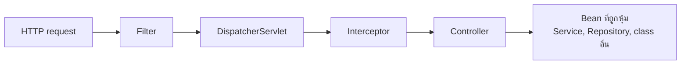
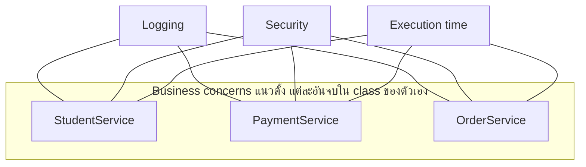
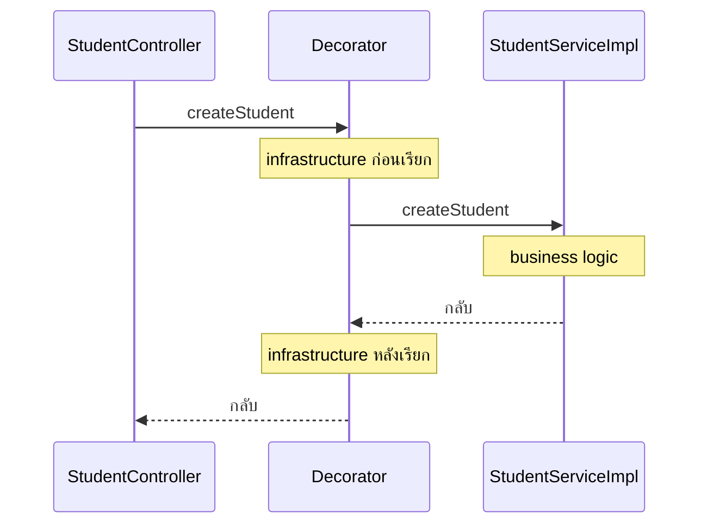
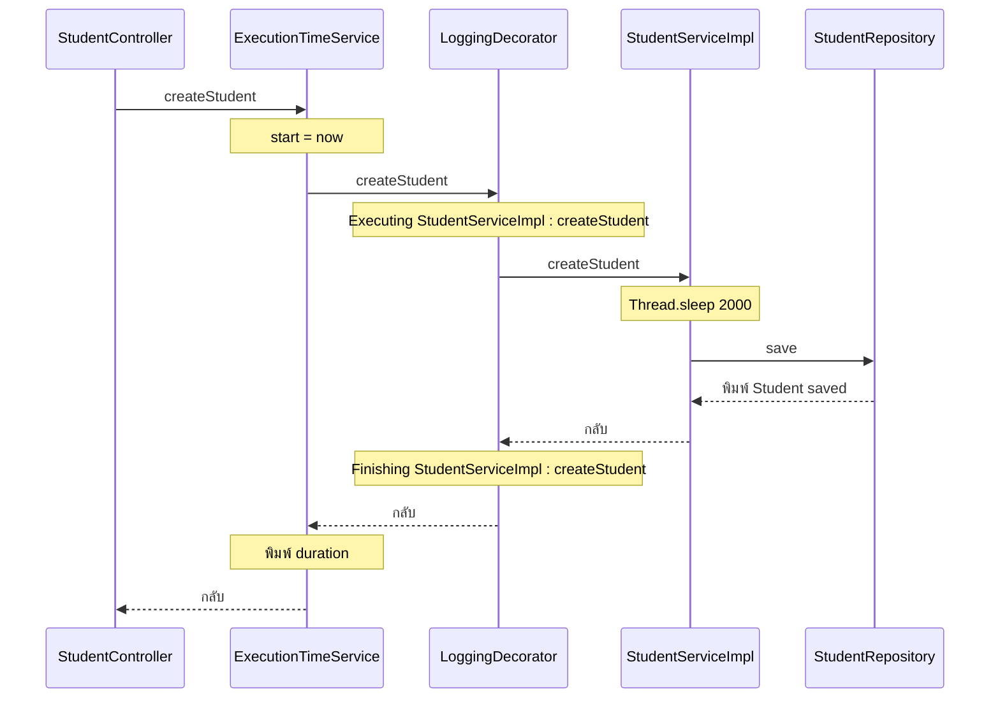
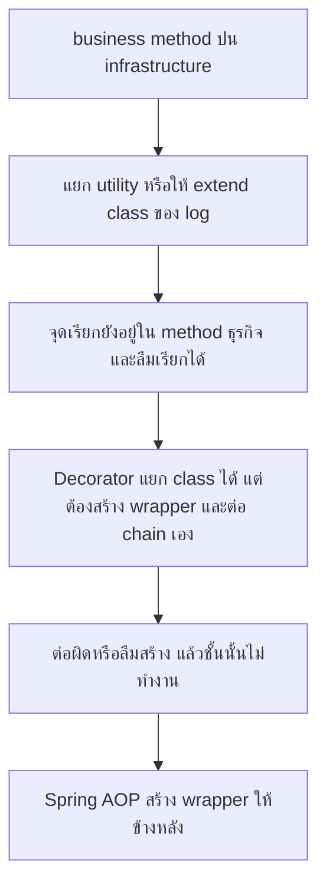
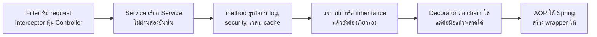

# #22 — Spring AOP: Cross-Cutting Concerns และ wrapper ที่หุ้ม Bean

> **วิดีโอ:** [Spring AOP | Cross-Cutting Concerns & Proxies | Spring Boot Full Course #22](https://youtu.be/s4B-WbUWEFs) — Coder Army, ~50 นาที
> **แหล่งที่ใช้สรุป:** ซับไตเติลภาษาอังกฤษที่ YouTube สร้างอัตโนมัติ
> **เวอร์ชันในโค้ด:** Spring Boot 4.1.1 + Java 21 (Spring Framework 7.0.9, embedded Tomcat 11.0.24, Jackson 3.1.5) ใส่หมายเหตุไว้ทุกจุดที่ Spring Boot 3.x ต่างกัน

ตอนนี้ตอบคำถามว่า **ทำไม logging, security และการวัดเวลาไปปนอยู่ใน method ที่ควรมีแค่ business logic และจะดึงมันออกโดยไม่ต้องเรียกเองทุก method ได้อย่างไร** ผู้สอนยังไม่เขียน `@Aspect` เขาเริ่มจาก Filter กับ Interceptor ที่หุ้มได้แค่ขอบของ HTTP แล้วไล่ปัญหาที่เรียกว่า cross-cutting concerns ลองแยก utility และลอง inheritance ซึ่งยังต้องเรียกจากใน method จากนั้นเขียน Decorator ด้วยมือเป็นชั้น ๆ เพื่อให้เห็นว่า Spring AOP กำลังสร้าง wrapper แบบนี้อยู่ข้างหลัง

ส่วนที่ติดป้าย `💡 เพิ่มเติม` คือของที่ผมเติมเอง ไม่ได้อยู่ในวิดีโอ ส่วนที่ติด `⚠️ แก้จากวิดีโอ` คือจุดที่วิดีโอพูดคลาดเคลื่อน

---

## สารบัญ

| เวลา | หัวข้อ |
|---|---|
| [0:00](https://youtu.be/s4B-WbUWEFs?t=0) | [1. AOP คือ module ของ cross-cutting concerns](#1-aop-คือ-module-ของ-cross-cutting-concerns) |
| [1:04](https://youtu.be/s4B-WbUWEFs?t=64) | [2. Filter กับ Interceptor หุ้มคนละชั้น](#2-filter-กับ-interceptor-หุ้มคนละชั้น) |
| [3:10](https://youtu.be/s4B-WbUWEFs?t=190) | [3. โปรเจกต์เปล่าและ endpoint สร้าง Student](#3-โปรเจกต์เปล่าและ-endpoint-สร้าง-student) |
| [6:52](https://youtu.be/s4B-WbUWEFs?t=412) | [4. รันครั้งแรกก่อนใส่ infrastructure](#4-รันครั้งแรกก่อนใส่-infrastructure) |
| [7:19](https://youtu.be/s4B-WbUWEFs?t=439) | [5. method เดียวรับงาน infrastructure ทั้งก้อน](#5-method-เดียวรับงาน-infrastructure-ทั้งก้อน) |
| [12:49](https://youtu.be/s4B-WbUWEFs?t=769) | [6. Business logic กับ infrastructure logic](#6-business-logic-กับ-infrastructure-logic) |
| [13:52](https://youtu.be/s4B-WbUWEFs?t=832) | [7. Concern แนวตั้งกับแนวนอน](#7-concern-แนวตั้งกับแนวนอน) |
| [17:20](https://youtu.be/s4B-WbUWEFs?t=1040) | [8. Cross-cutting concerns](#8-cross-cutting-concerns) |
| [18:07](https://youtu.be/s4B-WbUWEFs?t=1087) | [9. Scattering กับ Tangling](#9-scattering-กับ-tangling) |
| [21:37](https://youtu.be/s4B-WbUWEFs?t=1297) | [10. ทางแก้ที่ 1 แยก utility แล้วยังเรียกจากใน method](#10-ทางแก้ที่-1-แยก-utility-แล้วยังเรียกจากใน-method) |
| [25:24](https://youtu.be/s4B-WbUWEFs?t=1524) | [11. ทางแก้ที่ 2 inheritance แล้วยังเรียกจากใน method](#11-ทางแก้ที่-2-inheritance-แล้วยังเรียกจากใน-method) |
| [26:13](https://youtu.be/s4B-WbUWEFs?t=1573) | [12. Decorator Design Pattern](#12-decorator-design-pattern) |
| [32:54](https://youtu.be/s4B-WbUWEFs?t=1974) | [13. เขียน LoggingDecorator แล้วชน Bean ซ้ำ](#13-เขียน-loggingdecorator-แล้วชน-bean-ซ้ำ) |
| [40:07](https://youtu.be/s4B-WbUWEFs?t=2407) | [14. Decorator ชั้นที่สองวัดเวลา](#14-decorator-ชั้นที่สองวัดเวลา) |
| [45:12](https://youtu.be/s4B-WbUWEFs?t=2712) | [15. ข้อจำกัดของการหุ้มด้วยมือ](#15-ข้อจำกัดของการหุ้มด้วยมือ) |
| [45:54](https://youtu.be/s4B-WbUWEFs?t=2754) | [16. AOP สร้าง wrapper ให้ และตอบสามคำถาม](#16-aop-สร้าง-wrapper-ให้-และตอบสามคำถาม) |
| — | [17. สรุปท้ายตอน](#17-สรุปท้ายตอน) |

---

## 1. AOP คือ module ของ cross-cutting concerns

[▶ 0:00](https://youtu.be/s4B-WbUWEFs?t=0)

**AOP** ย่อมาจาก **Aspect-Oriented Programming** เป็น module แยกใน Spring Framework งานของมันคือจัดการ **cross-cutting concerns** ผู้สอนบอกว่าคนจำนวนมากเริ่มเรียนแล้วรู้สึกว่าเรื่องนี้ยาก ทั้งตอนนี้จึงตั้งใจอธิบายจากปัญหาให้เห็นก่อน แล้วค่อยบอกว่า AOP แก้ปัญหานั้นอย่างไร กลไกข้างในว่า Spring สร้าง wrapper ให้ได้อย่างไรจะอยู่ในตอนถัดไป

> 💡 **เพิ่มเติม — ซับได้ยิน log เป็น login และ lock ทั้งตอน**
> ซับอัตโนมัติถอดคำว่า log เป็น login, lock หรือ locks ตลอดคลิป เช่น LoginDecorator, login service, "locks are printing" บริบททั้งหมดคือการพิมพ์ log ก่อนและหลัง method โน้ตใช้คำว่า log และตั้งชื่อ class ว่า `LoggingDecorator` กับ `LoggingServiceUtil` ตามที่ผู้สอน rename util บนจอว่า `LoggingServiceUtil`

---

## 2. Filter กับ Interceptor หุ้มคนละชั้น

[▶ 1:04](https://youtu.be/s4B-WbUWEFs?t=64)

ผู้สอนใช้ Filter กับ Interceptor เป็นภาพเปรียบ ใครยังไม่ได้ดูสองตอนนั้นก็ยังตาม AOP ได้ แต่มีภาพนี้อยู่แล้วจะเห็นเร็วขึ้น

| สิ่งที่หุ้ม | หุ้มอะไร | อยู่ตรงไหน |
|---|---|---|
| **Filter** | raw incoming request | ชั้นก่อน `DispatcherServlet` request ยังเป็นของที่เข้ามาทั้งก้อน |
| **Interceptor** | Controller | รอบการเรียก Controller |
| **AOP** | class หรือ method ใดก็ได้ที่เป็น Bean | Service, Repository, utility, helper หรือ Bean อื่นในแอป |

Filter ช่วยเมื่องานต้องเกิดก่อนหรือหลัง request เข้ามา Interceptor หุ้ม Controller แต่แอป Spring ไม่ได้มีแค่ request ที่วิ่งเข้า Controller มี Service, Repository, utility และ helper อีกมาก บางครั้งต้องทำอะไรบางอย่างก่อน method ทำงาน หลัง method ทำงาน หรือทั้งสองจังหวะ AOP คือ module ที่อธิบายการหุ้มแบบนั้นกับ class หรือ method ใดก็ได้



เหตุผลที่ Filter กับ Interceptor ไม่พอจะกลับมาอีกทีใน [ส่วนที่ 5](#5-method-เดียวรับงาน-infrastructure-ทั้งก้อน) เมื่อ service ตัวหนึ่งเรียก service อีกตัวโดยไม่ผ่าน HTTP

---

## 3. โปรเจกต์เปล่าและ endpoint สร้าง Student

[▶ 3:10](https://youtu.be/s4B-WbUWEFs?t=190)

ผู้สอนเปิดโปรเจกต์ว่างชื่อแนว ๆ ว่า AOP Introduction Demo ใน `pom.xml` มีแค่ starter ของเว็บแบบ MVC นอกนั้นยังไม่มี class ธุรกิจ `main` เป็น boilerplate ของ Spring Boot ตามปกติ

จากนั้นเขาสร้างสาม package คือ `controller`, `service` และ `dto` แล้วสร้าง class `Student` เป็น DTO ที่ใช้ซ้ำในคอร์ส มีสี่ฟิลด์ คือ `name`, `age`, `rollNumber` และ `subject` เขาบอกว่าจะไม่เก็บลง database แล้ว generate getter กับ setter ให้ครบ

> 💡 **เพิ่มเติม — ชื่อ package และค่าใน body**
> ซับไม่ได้อ่านชื่อ package บนจอ โค้ดชุดนี้ใช้ `com.example.aopintro` ฟิลด์ `name` ถูกพูดซ้ำสองครั้งในซับ ฟิลด์ที่ใช้คือสี่ตัวด้านบน ค่า JSON ที่ยิงตอนรันด้านล่างเป็นค่าที่ใส่ให้ request สมบูรณ์ ซับบรรยาย body ใน Postman ไม่ชัด แค่บอกว่าตรงกับ DTO

`Student.java`

```java
package com.example.aopintro.dto;

public class Student {

  private String name;
  private int age;
  private int rollNumber;
  private String subject;

  public String getName() {
    return name;
  }

  public void setName(String name) {
    this.name = name;
  }

  public int getAge() {
    return age;
  }

  public void setAge(int age) {
    this.age = age;
  }

  public int getRollNumber() {
    return rollNumber;
  }

  public void setRollNumber(int rollNumber) {
    this.rollNumber = rollNumber;
  }

  public String getSubject() {
    return subject;
  }

  public void setSubject(String subject) {
    this.subject = subject;
  }
}
```

[▶ 4:29](https://youtu.be/s4B-WbUWEFs?t=269)

ต่อด้วย `StudentController`

- เป็น `@RestController`
- `@RequestMapping("/api/students")`
- method `createStudent` เป็น `@PostMapping` เพราะกำลังสร้าง student
- รับ body เป็น `Student`
- คืน `ResponseEntity<String>` คำว่า `Done` เขาบอกว่าถ้าจะทำ response DTO ก็ได้ แต่ตอนนี้ยังไม่ต้องการ แค่บอก client ว่าบันทึกแล้ว

จากนั้นสร้าง `StudentService` ติด `@Service` มี method `createStudent(Student)` ตอนแรกเขาคิดจะคืน `String` แล้วเปลี่ยนเป็น `void` method นี้พิมพ์ว่า student ถูกบันทึกแล้ว ไม่ได้ต่อ database Controller รับ `StudentService` ผ่าน constructor แล้วเรียก `createStudent` โดยส่ง `student` เข้าไป

> 💡 **เพิ่มเติม:** ซับบอกว่า autowire ผ่าน constructor แต่ไม่ได้อ่าน `@Autowired` โค้ดด้านล่างไม่ใส่ annotation นี้ เพราะ Spring ฉีด constructor ตัวเดียวให้อยู่แล้ว ร่างของ Controller ที่แสดงใน [ส่วนที่ 13](#13-เขียน-loggingdecorator-แล้วชน-bean-ซ้ำ) เป็นร่างสุดท้ายที่ type ของฟิลด์เป็น interface `StudentService` ตอนแรกในวิดีโอ type นี้ยังเป็น class ธรรมดาที่ติด `@Service`

`pom.xml` เฉพาะส่วนสำคัญ

```xml
<parent>
  <groupId>org.springframework.boot</groupId>
  <artifactId>spring-boot-starter-parent</artifactId>
  <version>4.1.1</version>
</parent>

<properties>
  <java.version>21</java.version>
</properties>

<dependencies>
  <dependency>
    <groupId>org.springframework.boot</groupId>
    <artifactId>spring-boot-starter-webmvc</artifactId>
  </dependency>
</dependencies>
```

> ⚠️ **Boot 4 vs 3 — ชื่อ starter ของเว็บ:** ผู้สอนพูดถึง Spring Boot Starter Web MVC และบอกว่าโหลดแค่ dependency ของเว็บ Boot 4 ใช้ `spring-boot-starter-webmvc` ชื่อเดิม `spring-boot-starter-web` ยังอยู่แต่ถูก deprecate แล้ว จะถูกถอดในรุ่นถัดไป
> ([Spring Boot 4.0 Migration Guide — Deprecated Starters](https://github.com/spring-projects/spring-boot/wiki/Spring-Boot-4.0-Migration-Guide#deprecated-starters))

---

## 4. รันครั้งแรกก่อนใส่ infrastructure

[▶ 6:52](https://youtu.be/s4B-WbUWEFs?t=412)

ผู้สอนรันแอป แล้วยิงจาก Postman ไปที่ `POST /api/students` พร้อม body ที่ตรงกับ DTO ได้คำตอบ `done` บน console มีบรรทัด `Student is saved successfully` ซึ่งพิมพ์จาก `createStudent` ของ service

จนถึงจุดนี้ยังไม่มี business logic จริง เป็น endpoint ธรรมดา Controller บาง Service บาง และยังไม่ได้ใส่ infrastructure ใด ๆ

---

## 5. method เดียวรับงาน infrastructure ทั้งก้อน

[▶ 7:19](https://youtu.be/s4B-WbUWEFs?t=439)

ผู้สอนชวนคิดว่าถ้าเป็นแอปจริง จะมี Repository ที่ `save` student แล้ว service คืน response DTO หน้าที่ของ `createStudent` ในฐานะ service คือ business logic ของการสร้าง student ถ้ามีคนถามว่า student ถูกสร้างอย่างไร ก็เปิด method นี้แล้วเห็นคำตอบ คือเรียก `studentRepository.save` แล้วคืน DTO

service อื่นก็ตอบคำถามของตัวเองได้แบบเดียวกัน เช่น order ถูกวางอย่างไร payment ถูกตรวจอย่างไร แต่ละตัวมี concern ของธุรกิจตัวเอง

[▶ 8:51](https://youtu.be/s4B-WbUWEFs?t=531)

พอเอาขึ้น production การเรียก `save` แล้วคืนค่าไม่พอ ต้องมี infrastructure หรือ helper logic อีกชุด เขาไล่ตัวอย่างใน method เดียวกัน

1. **Log ว่า method ไหนของ class ไหนถูกเรียก** เพื่อ audit วันหลังมีปัญหาจะได้เปิด log ดู
2. **วัดเวลาของ method** เก็บ `start` ด้วย `System.currentTimeMillis()` ตอนต้น method และเก็บ `end` ก่อน `return` เพราะพอ return แล้วพิมพ์อะไรต่อไม่ได้ จากนั้น `duration = end - start`
3. **ตรวจ permission** ว่าคนที่เรียก `createStudent` มีสิทธิ์หรือไม่ ดูจาก role
4. **metrics อื่น**
5. **cache ผลลัพธ์** ก่อนคืนค่า ครั้งถัดไปที่ต้องคืน student ตัวเดิมจะได้ดึงจาก cache

[▶ 11:01](https://youtu.be/s4B-WbUWEFs?t=661)

เขาตอบข้อสงสัยว่าทำไมไม่ให้ Filter หรือ Interceptor ตรวจ permission ไปแล้ว จุดสำคัญคือบางการเรียกเริ่มจาก service ที่เรียก service อีกตัวโดยตรง เช่น service อื่นเรียก `createStudent` จากข้างใน การเรียกแบบนั้นไม่ผ่าน Filter และไม่ผ่าน Interceptor เพราะสองอย่างนั้นอยู่ข้างนอกชั้น HTTP ถ้าต้องรู้ว่าผู้เรียกภายในมีสิทธิ์หรือไม่ ต้องตรวจตรง method นี้

พอใส่ครบ method `createStudent` จึงอ่านยาก เปิดมาเจอ permission, log และเวลา ทั้งที่ business logic มีบรรทัดเดียว คือ `studentRepository.save` เขาถึงกับสร้าง object ของ repository ไว้ใน method แค่เพื่อชี้ว่า "นี่คือ business logic" ที่เหลือเป็นงานที่ต้องทำรอบ ๆ บรรทัดนั้น

---

## 6. Business logic กับ infrastructure logic

[▶ 12:49](https://youtu.be/s4B-WbUWEFs?t=769)

ผู้สอนแบ่ง logic เป็นสองชนิด

| ชนิด | คืออะไร | เปลี่ยนตามอะไร |
|---|---|---|
| **Business logic** | งานของ domain เช่น บันทึก student, วาง order, ตรวจ payment | เปลี่ยนตาม domain แอป student กับแอป payment คนละชุด |
| **Infrastructure logic** หรือ supporting logic | log, วัด response time, security, cache, audit | เทคนิคเหมือนกันแทบทุกแอป จึงเรียกว่า boilerplate |

สิ่งที่เปลี่ยนใน infrastructure คือรายละเอียด เช่น log key อะไร หรือ cache เก็บอะไร วิธี log และวิธีเก็บ cache ยังเป็นแบบเดิม เขาจึงบอกว่า supporting logic ไม่ได้เปลี่ยนไปตาม domain

Business logic เป็นสิ่งที่นิยาม domain ของแอป ส่วน infrastructure คอยรองรับ business logic นั้น

---

## 7. Concern แนวตั้งกับแนวนอน

[▶ 13:52](https://youtu.be/s4B-WbUWEFs?t=832)

**Concern** ในที่นี้คือ area of interest ของแอป แอปใหญ่มีได้หลาย concern พร้อมกัน เช่น student management, payment management, order management แม้จะอยู่คนละ microservice หรือ codebase ก้อนใหญ่ก้อนเดียว

concern เหล่านี้เป็นเรื่องของ business logic การจะแก้ student management ต้องมี `StudentService` payment management อยู่ที่ `PaymentService` order management อยู่ที่ `OrderService` method ที่เกี่ยวกับ student อยู่ครบใน class นั้น class อื่นก็เหมือนกัน

[▶ 15:28](https://youtu.be/s4B-WbUWEFs?t=928)

ใน low-level design เขาเรียก business logic concerns ว่า **vertical** method ของ `StudentService` เรียงลงใน class นั้น method ของ `PaymentService` เรียงลงใน class ของมัน แนวตั้งคือ "ของ domain นี้อยู่ใน class นี้"

infrastructure คนละแบบ log, security ซึ่งรวม authentication, และการวัดเวลา ไม่ได้จบใน class เดียว ถ้าจะ log ต้องเขียนในกี่ class ถ้าจะตรวจ security ต้องเขียนในกี่ class ถ้าจะวัดเวลาต้องเข้าไปทุก class แบบที่เพิ่งเขียนใน `createStudent` แม้แยกเป็น `LoggingService`, `SecurityService` หรือ `TimeEvaluationService` แล้ว method หลักก็ยังต้องเรียก `log` ตอนต้น เรียก `log` ตอนท้าย และเรียก start กับ end ของตัวจับเวลา จุดเรียกยังกระจายอยู่ใน method ธุรกิจ

[▶ 17:08](https://youtu.be/s4B-WbUWEFs?t=1028)

เขาจึงเรียก concern ของ infrastructure ว่า **horizontal** เพราะมันเกี่ยวหลาย class พร้อมกัน



---

## 8. Cross-cutting concerns

[▶ 17:20](https://youtu.be/s4B-WbUWEFs?t=1040)

concern แนวนอนนี้มีชื่อเฉพาะว่า **cross-cutting concerns** ผู้สอนบอกว่าต้องเข้าใจคำนี้ก่อนเรียน Spring AOP เพราะเอกสารจะพูดเสมอว่า AOP แก้ cross-cutting concerns

ความหมายที่เขาใช้คือ infrastructure concerns ที่ area of interest เป็น log, security และการวัดเวลา มันตัดผ่านหลายจุดในระบบ เพราะแทบทุก class ต้องถูก log และ audit บางจุดต้องวัดเวลาหรือตรวจ security

> ⚠️ **แก้จากวิดีโอ:** ผู้สอนพูดว่า cross-cutting concerns ตัดข้ามหลาย applications ที่ถูกคือ concern นั้นไปปรากฏในหลาย class ของระบบเดียวกัน ตัวอย่างที่เขาใช้เองคือ `StudentService`, `PaymentService` และ `OrderService` ในแอปเดียวกัน เอกสาร Spring นิยาม **aspect** ว่าคือการจัด concern ที่ตัดข้ามหลาย class ให้เป็นโมดูล ตัวอย่างในเอกสารคือ transaction management
> ([AOP Concepts](https://docs.spring.io/spring-framework/reference/core/aop/introduction-defn.html))

---

## 9. Scattering กับ Tangling

[▶ 18:07](https://youtu.be/s4B-WbUWEFs?t=1087)

cross-cutting concerns ก่อปัญหาสองแบบ เขาบอกว่าทั้งคู่เข้าใจไม่ยาก

### Scattering

**Scattering** คือ infrastructure logic กระจายไปแทบทุก class

ถ้ามี `LoggingService` แล้วจะ log ใน `StudentService` ต้องประกาศฟิลด์ autowire แล้วเรียก method ของมัน ใน `OrderService`, `PaymentService`, `TeacherService` และ `PrincipalService` ก็ต้องทำซ้ำ โค้ด log จึงกระจายทั้งแอป

### Tangling

**Tangling** เป็นอีกด้านของเหรียญเดียวกัน มองที่ method เดียว เช่น `createStudent` ภายใน method นั้นไปพันกับหลาย service พร้อมกัน มี object ของ logging เรียก `log` มี object ของการวัดเวลา เรียก `startTime` แล้วค่อยถึงบรรทัดธุรกิจ เขาใช้คำว่า entangling สำหรับภาพนี้

| ปัญหา | มองจากไหน | อาการ |
|---|---|---|
| **Scattering** | มองข้าม class | concern เดียวกันถูกก็อปไปหลาย class |
| **Tangling** | มองใน method เดียว | method หนึ่งปนหลาย concern จน business logic หลุดกลางทาง |

[▶ 19:43](https://youtu.be/s4B-WbUWEFs?t=1183)

เขาให้ภาพ production ว่าอาจมีเป็นร้อยหรือเป็นพัน class แต่ละ class มี method ประมาณ 20 ตัว ถ้าก็อป logic นี้ซ้ำ โค้ดจะบวม และครึ่งหนึ่งของเวลาที่อ่าน method จะหมดไปกับ infrastructure ทั้งที่บรรทัดธุรกิจอาจมีแค่ `save` แล้วแปลงเป็น DTO จากนั้น infrastructure เริ่มอีกฝั่ง คือจบเวลา คำนวณ duration และ cache ผล

[▶ 21:00](https://youtu.be/s4B-WbUWEFs?t=1260)

เขาวาด `createStudent` สองฝั่งเทียบกัน

ฝั่งซ้ายปนกันหมด ลำดับบนกระดานเป็นแบบนี้

1. `log.info`
2. เรียก security service เพื่อเช็ก permission
3. เปิด start time
4. ใน `try` คือ business logic `studentRepository.save` แล้วเก็บ result
5. เรียก audit service ให้ `record`
6. คืน result
7. ใน `catch` เป็น exception handling
8. ใน `finally` หยุดนาฬิกา

ฝั่งขวาสะอาด เหลือ `studentRepository.save` อย่างเดียว

เขาถามว่าอยากได้ฝั่งไหน ทุกคนอยากได้ฝั่งขวา แต่พอขึ้น production ต้องมี log, audit, การวัดเวลา, exception handling และ security พอทำครบ business logic ไปหลุดอยู่ตรงกลาง ทั้งที่งานที่ตั้งใจทำมีแค่บันทึก student

> 💡 **เพิ่มเติม — class นี้เป็นภาพบนกระดานที่แยกไฟล์ไว้ให้ compile**
> ผู้สอนวาดฝั่งซ้ายบนกระดาน ซับไม่มีตัวโค้ดครบ `SecurityService` กับ `AuditService` ด้านล่างเป็น stub เพื่อให้ไฟล์ compile ได้ class นี้อยู่ในแพ็กเกจ `examples` ไม่มี `@Component` หรือ `@Service` จึงไม่ถูกใส่เข้า IoC Container แอปที่รันใช้เฉพาะ chain ในส่วนที่ 13 และ 14

```java
package com.example.aopintro.examples;

import com.example.aopintro.dto.Student;
import com.example.aopintro.repository.StudentRepository;

public class TangledCreateStudent {

  private final StudentRepository studentRepository;
  private final SecurityService securityService;
  private final AuditService auditService;

  public TangledCreateStudent(
      StudentRepository studentRepository,
      SecurityService securityService,
      AuditService auditService) {
    this.studentRepository = studentRepository;
    this.securityService = securityService;
    this.auditService = auditService;
  }

  public String createStudent(Student student) {
    System.out.println("log.info createStudent");
    securityService.checkPermission();
    long start = System.currentTimeMillis();
    try {
      studentRepository.save(student);
      String result = "saved";
      auditService.record(result);
      return result;
    } catch (RuntimeException ex) {
      throw ex;
    } finally {
      long end = System.currentTimeMillis();
      System.out.println(end - start);
    }
  }

  public static class SecurityService {

    public void checkPermission() {
      System.out.println("check permission");
    }
  }

  public static class AuditService {

    public void record(String result) {
      System.out.println("audit " + result);
    }
  }
}
```

---

## 10. ทางแก้ที่ 1 แยก utility แล้วยังเรียกจากใน method

[▶ 21:37](https://youtu.be/s4B-WbUWEFs?t=1297)

ทางแรกที่เขาลองคือแยก service สำหรับ log, authentication, auditing และการวัดเวลา แล้วพบว่าปัญหายังอยู่ เพราะ business method ยังต้องเรียก service เหล่านั้น เขาจึงลบของอื่นออกชั่วคราว เหลือบรรทัด log กับบรรทัดธุรกิจ เพื่อลองให้เห็นกับ log อย่างเดียว

[▶ 22:09](https://youtu.be/s4B-WbUWEFs?t=1329)

เขาสร้าง class สำหรับ log ตอนแรกคิดจะติด `@Component` ให้ Spring จัดการ object ให้ แล้วเปลี่ยนใจทำเป็น **utility** คือ helper class ตาม naming convention และเอา `@Component` ออก เพราะ utility ที่เขาถนัดใช้ **static method** เรียกด้วยชื่อ class ได้เลย ไม่ต้องสร้าง object เขา rename ให้เป็น `LoggingServiceUtil`

method ที่เขียนมีสองตัว

- `logStart(className, methodName)` พิมพ์ว่ากำลัง execute class กับ method นั้น
- `logEnd(className, methodName)` พิมพ์ว่า finishing

ใน `StudentService` เขาเรียก `LoggingServiceUtil.logStart("StudentService", "createStudent")` ก่อนธุรกิจ และเรียก `logEnd` หลังธุรกิจ

> 💡 **เพิ่มเติม:** รูปแบบสตริงบนจออ่านจากซับไม่ครบ เขาอ่านตอนรันว่าบรรทัดแรกขึ้นคำว่า Executing โค้ดนี้พิมพ์ `Executing ` ตามด้วยชื่อ class แล้วมี ` : ` แล้วตามด้วยชื่อ method ฝั่งจบใช้คำว่า `Finishing` ตามที่เขาอ่านจาก console

```java
package com.example.aopintro.util;

public class LoggingServiceUtil {

  public static void logStart(String className, String methodName) {
    System.out.println("Executing " + className + " : " + methodName);
  }

  public static void logEnd(String className, String methodName) {
    System.out.println("Finishing " + className + " : " + methodName);
  }
}
```

`ServiceCallingUtil` คือภาพของทางแก้ที่ 1 หลังจากแยก helper แล้ว จุดเรียกยังอยู่ใน method ธุรกิจ class นี้ก็ไม่เป็น Bean เช่นกัน ของจริงที่ยิง HTTP ในส่วนถัดไปย้ายสองบรรทัด `logStart` และ `logEnd` ออกไปอยู่ที่ decorator

```java
package com.example.aopintro.examples;

import com.example.aopintro.dto.Student;
import com.example.aopintro.repository.StudentRepository;
import com.example.aopintro.util.LoggingServiceUtil;

public class ServiceCallingUtil {

  private final StudentRepository studentRepository;

  public ServiceCallingUtil(StudentRepository studentRepository) {
    this.studentRepository = studentRepository;
  }

  public void createStudent(Student student) {
    LoggingServiceUtil.logStart("StudentService", "createStudent");
    studentRepository.save(student);
    LoggingServiceUtil.logEnd("StudentService", "createStudent");
  }
}
```

[▶ 24:17](https://youtu.be/s4B-WbUWEFs?t=1457)

เขาสรุปว่าทางนี้ไม่จบปัญหา ด้วยสามเหตุ

1. Business logic ยังถูกคั่นกลางด้วยการเรียก helper ถ้ามี authentication, เวลา และ exception handling method จะยาวอีก
2. คนเขียนอาจลืมเรียก log ในบาง method ทั้งที่ audit ต้องการ log นั้น
3. ตอนนี้เขียนแค่กรณีสำเร็จ ถ้ามีทั้งทางสำเร็จและทาง exception ต้องเขียน `try-catch` เอง log สองทางไม่เหมือนกัน method ก็โตต่อ

ทางที่หนึ่งคือการสร้าง helper จึงยังเหลือการเรียกไว้ในฟังก์ชันธุรกิจ

---

## 11. ทางแก้ที่ 2 inheritance แล้วยังเรียกจากใน method

[▶ 25:24](https://youtu.be/s4B-WbUWEFs?t=1524)

ทางที่สองคือ **inheritance** สร้าง superclass สำหรับ log แล้วให้ `StudentService` และ `OrderService` extend class นั้น logic ของ log ย้ายไปอยู่ที่ parent ส่วน class ลูกเขียนโค้ดธุรกิจ

พอจะเริ่ม log ยังต้องเรียก method ของ parent และพอจะจบ log ก็ต้องเรียก method ของ parent อีกครั้ง ไม่ว่าจะเป็น utility หรือ inheritance จุดที่สอดโค้ดยังอยู่ใน business logic อันนี้คือปัญหาที่เขายังไม่ยอมรับ

```java
package com.example.aopintro.examples;

import com.example.aopintro.util.LoggingServiceUtil;

public class LoggingServiceBase {

  protected void logStart(String className, String methodName) {
    LoggingServiceUtil.logStart(className, methodName);
  }

  protected void logEnd(String className, String methodName) {
    LoggingServiceUtil.logEnd(className, methodName);
  }
}
```

```java
package com.example.aopintro.examples;

import com.example.aopintro.dto.Student;
import com.example.aopintro.repository.StudentRepository;

public class StudentServiceByInheritance extends LoggingServiceBase {

  private final StudentRepository studentRepository;

  public StudentServiceByInheritance(StudentRepository studentRepository) {
    this.studentRepository = studentRepository;
  }

  public void createStudent(Student student) {
    logStart("StudentService", "createStudent");
    studentRepository.save(student);
    logEnd("StudentService", "createStudent");
  }
}
```

> 💡 **เพิ่มเติม:** สอง class นี้ก็อยู่ในแพ็กเกจ `examples` และไม่เป็น Bean ผู้สอนพูดทาง inheritance บนกระดานมากกว่าจะรันเป็นแอปแยก โครงคือ class ลูก extend class ของ log แล้วยังเรียก `logStart` กับ `logEnd` เอง

---

## 12. Decorator Design Pattern

[▶ 26:13](https://youtu.be/s4B-WbUWEFs?t=1573)

ทางที่สามคือเขียน **wrapper** เอง เขาบอกว่า wrapper มาจาก **Decorator Design Pattern** ถ้าเคยดูวิดีโอ LLD ของเขาเรื่อง Decorator จะตามได้เร็ว ถ้ายังไม่เคย เขาอธิบายย่อในตอนนี้ และบอกว่าดูวิดีโอนั้นทีหลังได้

ปัญหาคืออยากได้ `createStudent` ที่ข้างในมีแค่ `studentRepository.save` แต่ให้ log และการวัดเวลาเกิดเอง โดยไม่เขียนมันใน method นั้น

Decorator บอกให้มอง object ธุรกิจเป็นของชิ้นหลัก ทุกคนที่ต้องการงานนี้มาขอ object นี้ `StudentController` มี endpoint `POST /api/students` แล้ว delegate งานให้ `StudentService.createStudent` Controller จึงมี dependency ไปที่ service

จากนั้นให้หุ้ม business object ด้วย decorator และเวลา Controller ขอ business object ให้ส่ง decorator ไปแทน Decorator ต้องหน้าตาเหมือน business object Controller จึงไม่รู้ว่าได้ decorator มา

> ⚠️ **แก้จากวิดีโอ:** ผู้สอนบอกว่าจะส่ง decorator แทน business object ได้ก็ต่อเมื่อ decorator inherit class ของ business object ที่เขาลงมือเขียนหลังจากนั้นคนละแบบ เขาดึง `StudentService` ออกมาเป็น interface แล้วให้ทั้ง implementation และ decorator implement interface เดียวกัน ผู้เรียกจึงผูกกับ interface การ extend class จริงจะติดทันทีถ้า class นั้นเป็น `final` หรือการสร้าง object เดิมผูกกับ constructor คนละแบบ

[▶ 28:42](https://youtu.be/s4B-WbUWEFs?t=1722)

โครงที่เขาวาดในโค้ดมีสามส่วน

1. `StudentService` เป็น interface มี `createStudent`
2. `StudentServiceImpl` implement interface นี้ และถือ business logic เขาเรียกตัวนี้ว่า main object
3. Decorator อีก class ก็ implement `StudentService` เช่นกัน

Controller ต้องการ `StudentService` จึงรับได้ทั้ง impl และ decorator โดยไม่รู้ว่าตัวไหนเข้ามา นี่คือความสัมพันธ์แบบ is-a ที่เขาเรียกว่า inherit ตลอดคลิป แม้ใน Java จะเป็น `implements`

Decorator ยังมีอีกความสัมพันธ์หนึ่งกับ impl คือ **composition** หรือ has-a เขาให้ decorator ถือ object ของ impl ไว้ข้างใน

ลำดับการเรียกที่เขาไล่มีห้าจังหวะ

1. Controller เรียก `createStudent` บนตัวที่คิดว่าเป็น `StudentService` แต่จริง ๆ คือ decorator
2. Decorator ทำ infrastructure ก่อน เช่น เริ่ม log
3. Decorator เรียก `createStudent` ของ impl
4. Impl ทำ business logic แล้วกลับมาที่ decorator
5. Decorator ทำ infrastructure หลังงาน เช่น จบ log แล้วกลับไปที่ Controller



เขาบอกว่าถ้ายังไม่เห็นภาพ จะปิดแอปแล้วเขียนให้ดู ซึ่งเป็นโค้ดในส่วนถัดไป

---

## 13. เขียน LoggingDecorator แล้วชน Bean ซ้ำ

[▶ 32:54](https://youtu.be/s4B-WbUWEFs?t=1974)

เขา rename class ธุรกิจเป็น `StudentServiceImpl` ทั้งโปรเจกต์ แล้วสร้าง interface `StudentService` ให้ impl ตัวนั้น `implements` interface method `createStudent` บน interface ไม่ใส่ `public` เพราะ method ของ interface เป็น public อยู่แล้ว จากนั้นลบ infrastructure ออกจาก impl จนเหลือการเรียก `studentRepository.save`

> 💡 **เพิ่มเติม — ที่พิมพ์ `Student saved` และที่หลับสองวินาที**
> ซับไม่แยกชัดว่า `System.out.println("Student saved")` อยู่ใน service หรือใน `save` ของ repository เขาบอกว่าไม่ได้ต่อ database และตอนรันอ่านบรรทัดนี้จาก console หนึ่งครั้ง โค้ดนี้ให้ `StudentRepository.save` เป็นคนพิมพ์ ส่วน `Thread.sleep(2000)` เขายังไม่ใส่ในจังหวะนี้ เขามาใส่ทีหลังใน [ส่วนที่ 14](#14-decorator-ชั้นที่สองวัดเวลา) เพื่อให้ duration ไม่เป็น 0 ไฟล์ impl ด้านล่างเป็นร่างสุดท้ายจึงมี sleep รวมอยู่แล้ว
> `catch` ว่างเป็นแบบที่เขาเขียนบนจอ เขาบอกว่าจับ exception แล้วไม่ทำอะไร

### Interface และ implementation

```java
package com.example.aopintro.service;

import com.example.aopintro.dto.Student;

public interface StudentService {

  void createStudent(Student student);
}
```

```java
package com.example.aopintro.service;

import com.example.aopintro.dto.Student;
import com.example.aopintro.repository.StudentRepository;
import org.springframework.stereotype.Service;

@Service
public class StudentServiceImpl implements StudentService {

  private final StudentRepository studentRepository;

  public StudentServiceImpl(StudentRepository studentRepository) {
    this.studentRepository = studentRepository;
  }

  @Override
  public void createStudent(Student student) {
    try {
      Thread.sleep(2000);
    } catch (InterruptedException ex) {
    }
    studentRepository.save(student);
  }
}
```

```java
package com.example.aopintro.repository;

import com.example.aopintro.dto.Student;
import org.springframework.stereotype.Repository;

@Repository
public class StudentRepository {

  public void save(Student student) {
    System.out.println("Student saved");
  }
}
```

### LoggingDecorator

[▶ 34:07](https://youtu.be/s4B-WbUWEFs?t=2047)

เขาสร้าง class ที่ implement `StudentService` อีกตัว งานของ `createStudent` ในตัวนี้คือ

1. เรียก `LoggingServiceUtil.logStart` โดยส่งชื่อ class `StudentServiceImpl` และชื่อ method `createStudent` ซึ่งเป็น log ที่เดิมจะเขียนไว้ใน impl
2. เรียก `studentServiceImpl.createStudent(student)`
3. เรียก `logEnd` ด้วยชื่อ class และชื่อ method เดิม

decorator รับ `StudentServiceImpl` ผ่าน constructor เป็น composition ที่เขาพูดไว้ ไม่ได้รับเป็น interface `StudentService`

> 💡 **เพิ่มเติม:** ถ้าฟิลด์ใน decorator เป็น interface `StudentService` จุดฉีดนั้นจะเห็น Bean ทุกตัวที่ implement interface เดียวกัน รวมถึงตัว decorator เอง การรับ type เป็น `StudentServiceImpl` ทำให้ Spring รู้ว่าต้องส่ง implementation ก้อนธุรกิจเข้ามา

```java
package com.example.aopintro.decorator;

import com.example.aopintro.dto.Student;
import com.example.aopintro.service.StudentService;
import com.example.aopintro.service.StudentServiceImpl;
import com.example.aopintro.util.LoggingServiceUtil;
import org.springframework.stereotype.Component;

@Component
public class LoggingDecorator implements StudentService {

  private final StudentServiceImpl studentServiceImpl;

  public LoggingDecorator(StudentServiceImpl studentServiceImpl) {
    this.studentServiceImpl = studentServiceImpl;
  }

  @Override
  public void createStudent(Student student) {
    LoggingServiceUtil.logStart("StudentServiceImpl", "createStudent");
    studentServiceImpl.createStudent(student);
    LoggingServiceUtil.logEnd("StudentServiceImpl", "createStudent");
  }
}
```

### Bean ซ้ำ และ `@Primary`

[▶ 36:26](https://youtu.be/s4B-WbUWEFs?t=2186)

พอมี interface `StudentService` และมีของที่ implement สองตัว คือ decorator กับ impl ตอน IoC Container จะฉีด dependency ให้ Controller มันไม่รู้ว่าจะให้อันไหน Controller ขอ `StudentService` ซึ่งเป็น interface

เขาติด `@Component` ที่ decorator แล้ว IDE บอกว่า autowire ไม่ได้ เพราะมี Bean ของ `StudentService` มากกว่าหนึ่งตัว ข้อความที่เขาอ่านคือมี more than one bean of `StudentService`

ทางแก้ที่เขาพูดมีสองอย่าง คือ `@Primary` หรือ `@Qualifier` ตอนนี้เขาเลือก `@Primary` บน decorator เพื่อให้ Controller ได้ decorator ตัวนี้ แล้วเขาสร้าง constructor ของ decorator ให้รับ `StudentServiceImpl` เพราะรอบแรกยังลืมฉีด dependency นี้

ลำดับที่เขาไล่ตอนยิง `POST /api/students` มีดังนี้

1. Request เข้า `createStudent` ของ Controller
2. Controller ได้ `LoggingDecorator` เพราะมี `@Primary` แม้จะมี impl อีกตัวที่ implement interface เดียวกัน
3. Decorator พิมพ์ log เริ่ม แล้วเรียก `StudentServiceImpl.createStudent`
4. Impl เรียก `save` ซึ่งพิมพ์ `Student saved`
5. กลับมาที่ decorator เพื่อพิมพ์ log จบ
6. กลับมาที่ Controller แล้วตอบ `Done`

[▶ 39:27](https://youtu.be/s4B-WbUWEFs?t=2367)

เขารันแล้วยิง Postman ได้ `Done` บน console ลำดับเป็น Executing แล้ว `Student saved` แล้ว Finishing เขาชี้ว่า `StudentServiceImpl` เหลือ business logic อย่างเดียว ไม่มี log ก่อนและไม่มี log หลัง นี่คือสิ่งที่ Decorator ทำให้

ในร่างสุดท้าย `@Primary` ถูกย้ายออกจาก `LoggingDecorator` ไปอยู่ที่ชั้นนอกสุด ดูในส่วนถัดไป ถ้ายิงกับโค้ดสุดท้ายจะมีบรรทัด duration เพิ่มท้ายสุด

---

## 14. Decorator ชั้นที่สองวัดเวลา

[▶ 40:07](https://youtu.be/s4B-WbUWEFs?t=2407)

decorator ตัวเดียวหุ้มได้แค่ logging เขาบอกว่าใส่ wrapper เพิ่มได้เรื่อย ๆ เช่น ชั้นในเป็น log ชั้นถัดไปเป็นการวัดเวลา ชั้นถัดไปเป็น authentication เขาบอกว่า authentication น่าจะเกิดก่อนชั้นอื่น แต่ตัวอย่างนี้แค่ให้เห็นว่าต่อชั้นได้

โครงบนกระดานคือ decorator ชั้นสองก็ implement `StudentService` และ override `createStudent` ข้างในถือ decorator ชั้นหนึ่งไว้ Controller ได้ชั้นสอง ไม่ได้ถือ impl โดยตรง

ลำดับคือ Controller เรียกชั้นสอง ชั้นสองทำ logic ของตัวเอง แล้วเรียกชั้นหนึ่ง ชั้นหนึ่งทำ logic ของตัวเอง แล้วเรียก impl ซึ่งทำธุรกิจ

[▶ 42:00](https://youtu.be/s4B-WbUWEFs?t=2520)

ในโค้ดเขาตั้งชื่อชั้นวัดเวลาว่า execution time service ให้ `implements StudentService` ติด `@Component` แล้วรับ `LoggingDecorator` ผ่าน constructor

`createStudent` ของชั้นนี้ทำสามอย่าง

1. `start = System.currentTimeMillis()`
2. เรียก `loggingDecorator.createStudent(student)` ซึ่งจะ log แล้วค่อยเข้า impl
3. `end = System.currentTimeMillis()` แล้วพิมพ์ `duration = end - start`

เขาเอา `@Primary` ออกจาก logging decorator แล้วใส่ที่ execution time service เพราะอยากให้ Controller ได้ชั้นนอกสุด

```java
package com.example.aopintro.decorator;

import com.example.aopintro.dto.Student;
import com.example.aopintro.service.StudentService;
import org.springframework.context.annotation.Primary;
import org.springframework.stereotype.Component;

@Component
@Primary
public class ExecutionTimeService implements StudentService {

  private final LoggingDecorator loggingDecorator;

  public ExecutionTimeService(LoggingDecorator loggingDecorator) {
    this.loggingDecorator = loggingDecorator;
  }

  @Override
  public void createStudent(Student student) {
    long start = System.currentTimeMillis();
    loggingDecorator.createStudent(student);
    long end = System.currentTimeMillis();
    long duration = end - start;
    System.out.println(duration);
  }
}
```

Controller ร่างสุดท้ายขอ interface `StudentService` จุดนี้คือจุดเดียวที่ต้องเลือก Bean ด้วย `@Primary`

```java
package com.example.aopintro.controller;

import com.example.aopintro.dto.Student;
import com.example.aopintro.service.StudentService;
import org.springframework.http.ResponseEntity;
import org.springframework.web.bind.annotation.PostMapping;
import org.springframework.web.bind.annotation.RequestBody;
import org.springframework.web.bind.annotation.RequestMapping;
import org.springframework.web.bind.annotation.RestController;

@RestController
@RequestMapping("/api/students")
public class StudentController {

  private final StudentService studentService;

  public StudentController(StudentService studentService) {
    this.studentService = studentService;
  }

  @PostMapping
  public ResponseEntity<String> createStudent(@RequestBody Student student) {
    studentService.createStudent(student);
    return ResponseEntity.ok("Done");
  }
}
```

```java
package com.example.aopintro;

import org.springframework.boot.SpringApplication;
import org.springframework.boot.autoconfigure.SpringBootApplication;

@SpringBootApplication
public class AopIntroApplication {

  public static void main(String[] args) {
    SpringApplication.run(AopIntroApplication.class, args);
  }
}
```

```properties
server.port=9022
```

> 💡 **เพิ่มเติม:** วิดีโอใช้พอร์ต default `8080` โค้ดชุดนี้ตั้ง `9022` เพื่อไม่ให้ชนกับตอนอื่นที่รันพร้อมกัน path ยังเป็น `POST /api/students`

### ถ้าไม่ใส่ `@Primary` แอปสตาร์ทไม่ขึ้น

มี Bean ที่เป็น `StudentService` สามตัว คือ `ExecutionTimeService`, `LoggingDecorator` และ `StudentServiceImpl` เอา `@Primary` ออกแล้วสตาร์ท ได้ error จริงแบบนี้

```text
***************************
APPLICATION FAILED TO START
***************************

Description:

Parameter 0 of constructor in com.example.aopintro.controller.StudentController required a single bean, but 3 were found:
	- executionTimeService
	- loggingDecorator
	- studentServiceImpl

This may be due to missing parameter name information

Action:

Consider marking one of the beans as @Primary, updating the consumer to accept multiple beans, or using @Qualifier to identify the bean that should be consumed

Ensure that your compiler is configured to use the '-parameters' flag.
```

ข้อความนี้ตรงกับที่ผู้สอนอ่านจาก IDE ว่ามี Bean ของ `StudentService` มากกว่าหนึ่ง และตรงกับทางที่เขาบอกว่าใช้ `@Primary` หรือ `@Qualifier` ได้ ชื่อ Bean เป็นชื่อ class ที่ขึ้นต้นด้วยตัวพิมพ์เล็ก ตามค่า default ของ Spring

> 💡 **เพิ่มเติม — สาเหตุคือ Bean สามตัว ย่อหน้า `-parameters` เป็นข้อความต่อท้าย**
> คลาสที่คอมไพล์ด้วย parent ของ Boot 4.1.1 มีชื่อ parameter อยู่แล้ว (`studentService`) แอปสตาร์ทไม่ขึ้นเพราะมี Bean สามตัวที่ type เป็น `StudentService` ย่อหน้าเรื่อง compiler flag เป็นข้อความที่ failure analyzer ต่อท้ายไว้ การใส่ `@Primary` ที่ `ExecutionTimeService` ทำให้สตาร์ทผ่าน โดยไม่ต้องไปเปิด flag เพิ่ม

`LoggingDecorator` ยังเป็น Bean อยู่ แม้ไม่มี `@Primary` เพราะ `ExecutionTimeService` ขอ type เป็น `LoggingDecorator` โดยตรง `StudentServiceImpl` ก็ถูกขอเป็น type นั้นจาก `LoggingDecorator` มีแค่ Controller ที่ขอ interface จึงต้องมีตัวที่ถูกเลือกหนึ่งตัว

### ผลตอนรัน chain สองชั้น

[▶ 44:06](https://youtu.be/s4B-WbUWEFs?t=2646)

รอบแรกของสองชั้น เขาเห็นลำดับ Executing, Student saved, Finishing แล้วตัวเลขเวลาเป็น 0 เพราะงานจบทันที เขาจึงใส่ `Thread.sleep(2000)` ใน impl ตรงจุดที่ธุรกิจทำงาน หุ้มด้วย `try-catch` แล้วปล่อย catch ว่าง จากนั้นสตาร์ทใหม่ ยิงอีกครั้ง request ใช้เวลาประมาณสองวินาที และตัวเลขเวลาไม่เป็น 0

เขาย้ำว่า sleep ใส่ไว้ให้เห็นเวลา ส่วนธุรกิจคือการ save และ log กับเวลาอยู่ที่ decorator ข้างนอก เพิ่ม decorator ชั้นสี่ชั้นห้าได้แบบเดียวกัน



สตาร์ทแล้ว log มีบรรทัด `Tomcat started on port 9022 (http) with context path '/'`

ยิง

```bash
curl -i -X POST http://localhost:9022/api/students \
  -H 'Content-Type: application/json' \
  -d '{"name":"Amit","age":21,"rollNumber":12,"subject":"Math"}'
```

```http
HTTP/1.1 200
Content-Type: text/plain;charset=UTF-8
Content-Length: 4

Done
```

console ของแอป ในจังหวะเดียวกับ request

```text
Executing StudentServiceImpl : createStudent
Student saved
Finishing StudentServiceImpl : createStudent
2001
```

`2001` คือ millisecond ที่ `ExecutionTimeService` พิมพ์ เกิน 2000 เล็กน้อยเพราะมีงานรอบ ๆ `sleep` body เป็นข้อความ `Done` จึงได้ `Content-Type: text/plain` ส่วน body ของ request เป็น JSON และ Jackson แปลงเข้า `Student` ให้

---

## 15. ข้อจำกัดของการหุ้มด้วยมือ

[▶ 45:12](https://youtu.be/s4B-WbUWEFs?t=2712)

เขาบอกว่าทางที่สามแยก infrastructure ออกจาก business logic ได้จริง และยังมีข้อจำกัดอีกชุด

- ทุกครั้งที่สร้าง service class ใหม่ ต้องสร้าง wrapper ของมันด้วย
- คนเขียนอาจลืมสร้าง wrapper
- ต่อ chain ผิดได้ เช่น ตั้งใจให้ decorator 2 เรียก decorator 3 แต่ดันให้ decorator 1 เรียก decorator 3 ตรง ๆ ชั้นที่ถูกข้ามจะไม่ทำงานเลย

ข้อผิดพลาดพวกนี้เกิดเพราะต่อ wrapper ด้วยมือ



---

## 16. AOP สร้าง wrapper ให้ และตอบสามคำถาม

[▶ 45:54](https://youtu.be/s4B-WbUWEFs?t=2754)

ตรงข้อจำกัดนั้นเองที่ **Aspect-Oriented Programming** เข้ามา เขาบอกว่า AOP แก้ด้วยวิธีคล้ายกับที่เพิ่งเขียน คือสร้าง decorator หรือ package แบบเดียวกันไว้ข้างใน สร้าง wrapper ให้ class หลัก โดยเราไม่เห็นโค้ดของ wrapper นั้น มันทำงานข้างหลัง

สิ่งที่ AOP ทำกับ service, repository หรือ class อื่นที่เป็น component ใน Spring Boot คือสอด logic ได้หลายจังหวะ

- ก่อน method ทำงาน
- หลัง method ทำงาน
- เมื่อมี exception
- เมื่อคืนค่าแบบสำเร็จ

รายละเอียดของแต่ละจังหวะเขาบอกว่าจะดูกันอีกที

> 💡 **เพิ่มเติม — wrapper ที่ Spring สร้างคือ Proxy ตามชื่อตอน**
> ในคลิปเขาใช้คำว่า wrapper และ decorator ไม่ได้พูดคำว่า proxy เอกสาร Spring เรียกกลไกนี้ว่า Spring AOP แบบ proxy-based ตอน runtime Spring สร้าง proxy หุ้ม Bean แล้วสอด logic ก่อนหรือหลัง method โดยไม่แก้ bytecode ของ class ตอน compile ซึ่งคนละทางกับ AspectJ แบบ compile-time weaving
> เรียก method อื่นผ่าน `this` จากข้างใน Bean ตัวเดียวกันจะไม่ผ่าน proxy ดังนั้น logic ที่หุ้มไว้จะไม่ทำงาน การเรียกจาก object อื่นเข้ามาที่ Bean ถึงจะผ่าน proxy ของที่เขียนมือในตอนนี้ไม่มีช่องนี้ เพราะ Controller ถือ decorator คนละ object กับ impl อยู่แล้ว
> เมื่อเปิด AOP จริง ค่า `spring.aop.proxy-target-class` ของ Spring Boot 4.1 เป็น `true` คือสร้าง subclass proxy ด้วย CGLIB แม้ Bean จะมี interface ตั้งเป็น `false` จึงจะใช้ JDK dynamic proxy ซึ่งต้องมี interface แบบ decorator ในตอนนี้
> ([Understanding AOP Proxies](https://docs.spring.io/spring-framework/reference/core/aop/proxying.html), [spring.aop.proxy-target-class](https://docs.spring.io/spring-boot/4.1/appendix/application-properties/index.html#application-properties.core.spring.aop.proxy-target-class))

### OOP กับ AOP คนละงาน

[▶ 46:38](https://youtu.be/s4B-WbUWEFs?t=2798)

เขาเทียบสองแนวกับงานคนละชนิด

**Object-oriented programming** โฟกัสว่าจะแทน entity จริงในแอปอย่างไร ถ้า student เป็น entity จริง ก็ควรมีตัวแทนในโปรแกรม และตาม clean code งานที่ทำกับ student ควรอยู่ใน `StudentService` งานที่จัด response ของ API นักเรียนควรอยู่ใน `StudentController` OOP จึงดูแล business logic ว่า object และการทำงานของมันถูกสร้างอย่างไร

**Aspect-oriented programming** ดูแล aspect ซึ่งก็คือ cross-cutting concerns หรือ infrastructure logic ให้อยู่คนละ class กับ business logic โค้ดสองกลุ่มจึงแยกกัน มองเข้าไปใน class ธุรกิจจะได้เห็นแต่งานของ domain

เขาสรุปว่า AOP เป็น module ที่บอกวิธีสร้าง cross-cutting concerns โดยไม่ไปรบกวน business logic

### What, Where, When

[▶ 47:40](https://youtu.be/s4B-WbUWEFs?t=2860)

เขาบอกว่า AOP ตอบสามคำถามพื้นฐาน ตอนแรกเขาเขียนคำถามที่สามว่า How แล้วแก้บนกระดานเป็น **When**

| คำถาม | ความหมาย | ตัวอย่างที่เขาใช้ |
|---|---|---|
| **What** | ต้องทำอะไร | log |
| **Where** | ทำที่ไหน | ทุก method ของทุก service class |
| **When** | จังหวะไหน | ตอน method เริ่ม และตอน method จบ |

[▶ 48:15](https://youtu.be/s4B-WbUWEFs?t=2895)

ในทางปฏิบัติเราจะเขียน class แยก ใส่ annotation และเขียน method ที่ตอบสามคำถามนี้ class นั้นไม่ได้ทำงานอย่างอื่น มันไปหุ้ม object ของเรา

[▶ 48:54](https://youtu.be/s4B-WbUWEFs?t=2934)

เขาปิดว่าปัญหาเดิมคือจะใส่ infrastructure กับ business logic ให้ทั้งคู่ยังอ่านออก โดยไม่ให้ทุก class บวม AOP แยกงานนี้ออกอย่างเป็นระบบ เปรียบกับที่ Spring ให้ Bean แล้วเราไม่ต้องจัดการการสร้าง object เอง Spring ให้ AOP แล้วเราไม่ต้องไปจัดการ infrastructure logic เองใน class ธุรกิจ งานนั้นถูกยกไปอยู่ module แยก

[▶ 49:33](https://youtu.be/s4B-WbUWEFs?t=2973)

วิธีที่ wrapper ถูกสร้างจริง จะอยู่ในเลกเชอร์ถัดไป ตอนนี้เป็นการแนะนำว่า AOP คืออะไร

> ⚠️ **Boot 4 vs 3 — ชื่อ starter ของ AOP:** โปรเจกต์ตอนนี้มีแค่ `spring-boot-starter-webmvc` เพราะยังไม่มี `@Aspect` พอถึงตอนที่ต้องเปิด Spring AOP จาก annotation ของ AspectJ ชื่อ starter เปลี่ยนแล้ว Boot 3 ใช้ `spring-boot-starter-aop` Boot 4 เปลี่ยนเป็น `spring-boot-starter-aspectj` เพื่อให้ชัดว่า starter นี้คือการทำ AOP กับ AspectJ โดยดึง `aspectjweaver` มาด้วย
>
> migration guide บอกให้ตรวจก่อนว่าต้องใช้ตัวแทนนี้จริงหรือไม่ เกณฑ์คือแอปใช้ annotation ในแพ็กเกจ `org.aspectj.lang.annotation` หรือไม่ โดยเฉพาะ `@Aspect` และให้หาบน classpath ว่ามี annotation ที่ไปเปิดฟีเจอร์นี้หรือเปล่า เช่น `@Timed` กับ `@Counted` ของ Micrometer ถ้าไม่มี ไม่ต้องใส่ starter นี้
>
> POM ของ `spring-boot-starter-aspectj` รุ่น 4.1.1 พึ่ง `spring-boot-starter`, `spring-aop` 7.0.9 และ `aspectjweaver` 1.9.25.1 คำอธิบาย artifact คือ starter สำหรับ aspect-oriented programming with AspectJ
> ([Spring Boot 4.0 Migration Guide — AOP Starter POM](https://github.com/spring-projects/spring-boot/wiki/Spring-Boot-4.0-Migration-Guide#aop-starter-pom))

---

## 17. สรุปท้ายตอน

### ลำดับที่ทั้งตอนเดิน



### ประเด็นที่ต้องจำ

1. **AOP** เป็น module ของ Spring สำหรับ **cross-cutting concerns** ตอนนี้ยังไม่ถึง annotation ของ advice
2. **Filter** หุ้ม raw request ก่อน `DispatcherServlet` **Interceptor** หุ้ม Controller **AOP** หุ้ม method ของ Bean ใดก็ได้
3. service ที่เรียก service อีกตัวจากข้างในไม่ผ่าน HTTP จึงไม่โดน Filter และ Interceptor การตรวจสิทธิ์ของการเรียกนั้นต้องอยู่ที่ method
4. **Business logic** เปลี่ยนตาม domain และเป็น concern **แนวตั้ง** method ของ student อยู่ครบใน `StudentService`
5. **Infrastructure logic** เช่น log, security, วัดเวลา, metrics, cache และ audit เป็น boilerplate ที่เทคนิคเหมือนกันข้าม domain และเป็น concern **แนวนอน**
6. **Scattering** คือ concern เดียวกันกระจายหลาย class **Tangling** คือ method เดียวปนหลาย concern จนบรรทัดธุรกิจหายาก
7. แยก `LoggingServiceUtil` หรือให้ class ธุรกิจ extend class ของ log แล้ว จุดเรียกยังอยู่ใน method ธุรกิจ คนเขียนลืมเรียกได้ และทาง exception ทำให้ method โตอีก
8. **Decorator** ให้ผู้เรียกเห็น interface เดิม แต่ได้รับ object ที่ทำ infrastructure ก่อน เรียก impl แล้วทำ infrastructure หลัง impl ถูกถือไว้ใน decorator แบบ composition
9. พอมี Bean ที่เป็น `StudentService` หลายตัว การฉีดที่ขอ interface ต้องมี `@Primary` หรือ `@Qualifier` ไม่งั้นแอปสตาร์ทไม่ขึ้น การฉีดที่ขอ class จริงอย่าง `StudentServiceImpl` ไม่ชน
10. เขียน decorator มือต้องมี wrapper ทุก service และต้องต่อ chain เอง ต่อข้ามชั้นแล้วชั้นที่หายจะไม่ทำงาน
11. AOP ให้ Spring สร้าง wrapper นี้ข้างหลัง และตอบสามคำถาม **What** ทำอะไร **Where** ที่ method ไหน **When** จังหวะเริ่มหรือจบ เมื่อกี้เขาแก้คำถามที่สามจาก How มาเป็น When เองบนกระดาน
12. ตอนนี้ยังไม่ใส่ starter ของ AOP พอต้องใช้ `@Aspect` ใน Boot 4 ให้ใส่ `spring-boot-starter-aspectj` และใส่เมื่อแอปใช้ AspectJ จริง

### คำถามทบทวน

1. Filter, Interceptor และ AOP หุ้มคนละจุดในทางของ request อย่างไร
2. ทำไมการที่ `OrderService` เรียก `StudentService` จากข้างในถึงไม่ผ่าน Filter
3. concern แนวตั้งกับ concern แนวนอนต่างกันที่โครงสร้าง class อย่างไร
4. จาก method `createStudent` ที่ปน log, permission และเวลา อันไหนคือ scattering และอันไหนคือ tangling
5. หลังย้าย log ไป `LoggingServiceUtil` แล้ว ทำไม business method ยังอ่านยาก และมีทางพลาดอะไรเพิ่ม
6. ใน Decorator จุดไหนเป็น is-a ผ่าน interface และจุดไหนเป็น has-a
7. ในร่างสองชั้น Controller ต้องได้ Bean ตัวไหนเป็น `StudentService` และ `@Primary` อยู่ที่ class ใด
8. ถ้า constructor ของ Controller ขอ `StudentService` ทั้งที่มีสาม Bean จะเกิดอะไรตอนสตาร์ท
9. What, Where และ When ของตัวอย่าง "log ทุก method ของทุก service ตอนเริ่มและตอนจบ" คือข้อไหน
10. โปรเจกต์ Boot 4 ที่ยังไม่มี `@Aspect` ต้องใส่ `spring-boot-starter-aspectj` หรือยัง และชื่อนี้แทน starter ตัวไหนของ Boot 3

### ตอนถัดไป

[#23 — Spring AOP Advice Types Explained | @Before, @After, @Around](./23-aop-advice-types.md) ผู้สอนบอกว่าเลกเชอร์หน้าจะอธิบายว่า wrapper ของ AOP ทำงานอย่างไร
