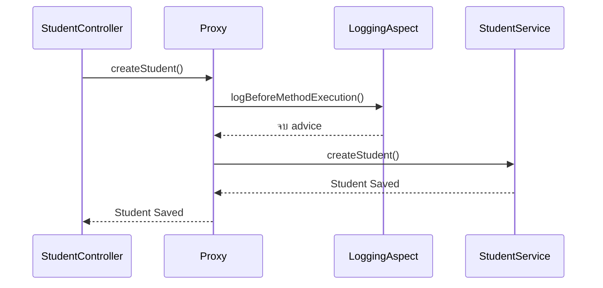
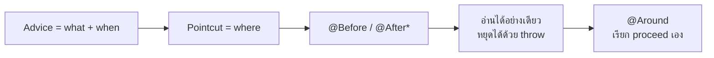

# #23 — ชนิดของ Advice ใน Spring AOP

> **วิดีโอ:** [Spring AOP Advice Types Explained | @Before, @After, @Around | Spring Boot Full Course #23](https://youtu.be/hMsALeV_uG0) — Coder Army, ~88 นาที
> **แหล่งที่ใช้สรุป:** ซับไตเติลภาษาฮินดีที่ YouTube สร้างอัตโนมัติ
> **เวอร์ชันในโค้ด:** Spring Boot 4.1 + Java 21 (ใส่หมายเหตุไว้ทุกจุดที่ Spring Boot 3.x ต่างกัน)

ตอนนี้ตอบคำถามเดียว: **advice แต่ละแบบทำงานเมื่อไร และทำอะไรกับ target method ได้บ้าง** ผู้สอนเริ่มจากคำถามสัมภาษณ์ว่า AOP หน้าตาเหมือน Decorator หรือ Proxy แล้วลงมือ intercept `StudentService` ด้วย `@Before`, `@AfterReturning`, `@AfterThrowing`, `@After` และ `@Around`

ส่วนที่ติดป้าย `💡 เพิ่มเติม` คือของที่ผมเติมเอง ไม่ได้อยู่ในวิดีโอ ส่วนที่ติด `⚠️ แก้จากวิดีโอ` คือจุดที่วิดีโอพูดคลาดเคลื่อน ส่วนที่ติด `⚠️ Boot 4 vs 3` คือจุดที่ Spring Boot 3.x / Spring Framework 6 เขียนหรือทำงานต่างจาก Boot 4 / Spring 7

---

## สารบัญ

| เวลา | หัวข้อ |
|---|---|
| [0:00](https://youtu.be/hMsALeV_uG0?t=0) | [1. ทบทวน AOP และคำถาม Decorator กับ Proxy](#1-ทบทวน-aop-และคำถาม-decorator-กับ-proxy) |
| [5:00](https://youtu.be/hMsALeV_uG0?t=300) | [2. โหลด dependency ของ AOP](#2-โหลด-dependency-ของ-aop) |
| [6:56](https://youtu.be/hMsALeV_uG0?t=416) | [3. โปรเจกต์ตั้งต้น Controller กับ Service](#3-โปรเจกต์ตั้งต้น-controller-กับ-service) |
| [10:34](https://youtu.be/hMsALeV_uG0?t=634) | [4. สร้าง LoggingAspect](#4-สร้าง-loggingaspect) |
| [14:01](https://youtu.be/hMsALeV_uG0?t=841) | [5. When, Where, What คือ Advice กับ Pointcut](#5-when-where-what-คือ-advice-กับ-pointcut) |
| [16:29](https://youtu.be/hMsALeV_uG0?t=989) | [6. @Before ตัวแรกที่ทำงาน](#6-before-ตัวแรกที่ทำงาน) |
| [19:00](https://youtu.be/hMsALeV_uG0?t=1140) | [7. คำศัพท์ Advice, Pointcut, Proxy, Target](#7-คำศัพท์-advice-pointcut-proxy-target) |
| [20:24](https://youtu.be/hMsALeV_uG0?t=1224) | [8. Controller คุยกับ Proxy](#8-controller-คุยกับ-proxy) |
| [24:44](https://youtu.be/hMsALeV_uG0?t=1484) | [9. Advice ห้าแบบวางบน try-catch-finally](#9-advice-ห้าแบบวางบน-try-catch-finally) |
| [31:54](https://youtu.be/hMsALeV_uG0?t=1914) | [10. @Before ใช้ทำอะไร และหยุด target ไม่ได้](#10-before-ใช้ทำอะไร-และหยุด-target-ไม่ได้) |
| [35:41](https://youtu.be/hMsALeV_uG0?t=2141) | [11. JoinPoint อ่าน argument ได้](#11-joinpoint-อ่าน-argument-ได้) |
| [37:48](https://youtu.be/hMsALeV_uG0?t=2268) | [12. @AfterReturning ทำงานเฉพาะตอนสำเร็จ](#12-afterreturning-ทำงานเฉพาะตอนสำเร็จ) |
| [46:10](https://youtu.be/hMsALeV_uG0?t=2770) | [13. ค่าที่ return จาก advice ไม่ไปถึง Controller](#13-ค่าที่-return-จาก-advice-ไม่ไปถึง-controller) |
| [48:01](https://youtu.be/hMsALeV_uG0?t=2881) | [14. แก้ field ของ object ที่ return ได้ แต่ไม่ควร](#14-แก้-field-ของ-object-ที่-return-ได้-แต่ไม่ควร) |
| [51:19](https://youtu.be/hMsALeV_uG0?t=3079) | [15. Pointcut ต้องตรง signature](#15-pointcut-ต้องตรง-signature) |
| [54:09](https://youtu.be/hMsALeV_uG0?t=3249) | [16. @AfterThrowing](#16-afterthrowing) |
| [57:28](https://youtu.be/hMsALeV_uG0?t=3448) | [17. กรองชนิด exception และกลืน exception ไม่ได้](#17-กรองชนิด-exception-และกลืน-exception-ไม่ได้) |
| [1:01:47](https://youtu.be/hMsALeV_uG0?t=3707) | [18. @After ทำงานทุกกรณี](#18-after-ทำงานทุกกรณี) |
| [1:04:34](https://youtu.be/hMsALeV_uG0?t=3874) | [19. @Around กับ ProceedingJoinPoint](#19-around-กับ-proceedingjoinpoint) |
| [1:07:54](https://youtu.be/hMsALeV_uG0?t=4074) | [20. กลืนค่า return เปลี่ยนค่า และไม่เรียก target](#20-กลืนค่า-return-เปลี่ยนค่า-และไม่เรียก-target) |
| [1:13:39](https://youtu.be/hMsALeV_uG0?t=4419) | [21. @Around ตัวเดียวที่รวม advice ทั้งห้า](#21-around-ตัวเดียวที่รวม-advice-ทั้งห้า) |
| [1:19:48](https://youtu.be/hMsALeV_uG0?t=4788) | [22. เปลี่ยน argument และเรียก proceed ซ้ำ](#22-เปลี่ยน-argument-และเรียก-proceed-ซ้ำ) |
| — | [23. สรุปท้ายตอน](#23-สรุปท้ายตอน) |

---

## 1. ทบทวน AOP และคำถาม Decorator กับ Proxy

[▶ 0:00](https://youtu.be/hMsALeV_uG0?t=0)

ตอนนี้ต่อจากบทนำ AOP ผู้สอนบอกว่าถ้ายังไม่ดูตอนที่แล้ว ให้ดูให้จบก่อน เพราะตอนนี้จะไม่ย้อนอธิบายว่า AOP คืออะไรตั้งแต่ต้น

สิ่งที่ทบทวนมีสามข้อ

1. AOP แยก **cross-cutting concern** ออกจาก business logic
2. ในระดับแนวคิด มันถูกประกอบแบบ **Decorator** คือมี object จริง แล้วเอา decorator ซ้อนกันเพื่อเพิ่มความสามารถ
3. ตัวอย่างเดิมคือ service ที่เซฟ student ลง database มี logging decorator กับ authentication decorator ซ้อนอยู่ข้างหน้า

ทิศทางของสายเรียกคือ Controller ไม่คุยกับ service ตรง ๆ Controller คุยกับ decorator ชั้นนอก decorator ชั้นนอกทำงานของตัวเองแล้วส่งต่อชั้นใน จนถึง service ตอนกลับ ค่า return เดินย้อนเส้นทางเดิมจาก service ขึ้นไปถึง Controller

### คำถามสัมภาษณ์: Decorator หรือ Proxy

[▶ 1:59](https://youtu.be/hMsALeV_uG0?t=119)

Spring เรียก decorator ที่เราเพิ่งนึกภาพนี้ว่า **proxy** คำนี้ชี้ไปที่ design pattern อีกตัวคือ Proxy ผู้สอนเคยอธิบายไว้ในซีรีส์ low-level design ของเขา

คำถามสัมภาษณ์คือ Spring ใช้ Proxy หรือ Decorator

คำตอบของเขาคือทั้งสอง pattern มีโครงสร้างเดียวกันในระดับ UML ภาพ class จึงหน้าตาใกล้กันมาก สิ่งที่ต่างคือ **intent**

| Pattern | Intent |
|---|---|
| Decorator | เพิ่มความสามารถให้ object เช่น service ที่เดิมแค่เซฟ student ถูกเสริมให้ log ได้ และถูกเสริมอีกชั้นให้ authenticate ได้ |
| Proxy | ควบคุมการเข้าถึง object ใครจะคุยกับ class นั้นต้องผ่าน proxy มีหลายชนิด เช่น remote proxy และ virtual proxy |

เขาบอกว่าตอบอย่างใดอย่างหนึ่งในสัมภาษณ์ได้ ทั้งคู่ถูกต้อง ถ้าอธิบายว่าโครงสร้างคล้ายกันและ intent คนละเรื่อง ถ้าตอบให้ตรงคำที่ Spring ใช้ ให้บอกว่า Spring เรียกมันว่า proxy ถ้ามองว่างานที่เราทำคือการเติม logging หรือ authentication เข้าไปที่ service ก็เรียกตาม intent ของ Decorator ได้ เพราะตอนเขียนโค้ด โครงสร้างแทบเหมือนกัน สิ่งที่ต้องรู้คือเราตั้งใจทำอะไร

วันนี้ยังไม่ลงรายละเอียดว่า Spring สร้าง proxy แบบไหน ผู้สอนบอกว่าจะกลับมาดูการทำงานภายในทีหลัง งานของตอนนี้คือดาวน์โหลด dependency แล้ว intercept method จริง

---

## 2. โหลด dependency ของ AOP

[▶ 5:00](https://youtu.be/hMsALeV_uG0?t=300)

โปรเจกต์ชื่อ AOP Demo เริ่มจาก `pom.xml` ที่มีแค่ `spring-boot-starter-webmvc` กับ `spring-boot-starter-webmvc-test` ผู้สอนเปิด Maven Central แล้วค้นคำว่า AOP ผลบนสุดสองรายการคือ Spring AOP กับ Spring Boot Starter AOP

เขาบอกว่าใน Boot 4 ชื่อ `spring-boot-starter-aop` ใช้ไม่ได้แล้ว ต้องค้น **Spring Boot Starter AspectJ** เขาเลือกเวอร์ชัน 4.1.0 จากหน้า Maven Central เพราะตอนบันทึกเป็นเวอร์ชันที่ขึ้นว่าใหม่และมีคนใช้มาก จากนั้นลบ `<version>` กับ `<scope>` ทิ้ง เหลือแค่ `groupId` กับ `artifactId` เพราะ parent เป็นคนกำหนดเวอร์ชัน

> ⚠️ **Boot 4 vs 3 — ชื่อ starter:** ใน Boot 3 artifact คือ `spring-boot-starter-aop` Boot 4 เปลี่ยนชื่อเป็น `spring-boot-starter-aspectj` เพื่อบอกขอบเขตให้ชัดว่า starter นี้คือ AspectJ. Guide บอกว่าถ้าเคยใส่ starter นี้เอง ให้ตรวจก่อนว่าแอปใช้ AspectJ จริงหรือไม่ แล้วค่อยเปลี่ยนชื่อ เกณฑ์คือมี annotation ในแพ็กเกจ `org.aspectj.lang.annotation` หรือไม่ เช่น `@Aspect` บางไลบรารีบน classpath ก็พึ่ง annotation นี้ ตัวอย่างใน guide คือ `@Timed` กับ `@Counted` ของ Micrometer starter สำหรับเทสต์คือ `spring-boot-starter-aspectj-test`
> ([Spring Boot 4.0 Migration Guide — AOP Starter POM](https://github.com/spring-projects/spring-boot/wiki/Spring-Boot-4.0-Migration-Guide#aop-starter-pom))

> 💡 **เพิ่มเติม:** โน้ตนี้ใช้ parent `spring-boot-starter-parent:4.1.1` จึงไม่ใส่เวอร์ชันใน dependency POM ของ `spring-boot-starter-aspectj` ซึ่งเวอร์ชัน 4.1.1 ดึง `spring-aop:7.0.9` กับ `aspectjweaver:1.9.25.1` มาให้ กลไกในตอนนี้ยังเป็น proxy ของ Spring AOP ไม่ใช่การ compile โค้ดด้วยคอมไพเลอร์ของ AspectJ ผู้สอนบอกว่า AspectJ เป็นไลบรารีแยก และจะคุยเรื่องมันทีหลัง

```xml
<dependency>
  <groupId>org.springframework.boot</groupId>
  <artifactId>spring-boot-starter-webmvc</artifactId>
</dependency>
<dependency>
  <groupId>org.springframework.boot</groupId>
  <artifactId>spring-boot-starter-aspectj</artifactId>
</dependency>
<dependency>
  <groupId>org.springframework.boot</groupId>
  <artifactId>spring-boot-starter-webmvc-test</artifactId>
  <scope>test</scope>
</dependency>
```

หลังให้ Maven โหลด dependency แล้ว โปรเจกต์มีสามตัวนี้ ชื่อเปลี่ยนจาก starter AOP มาเป็น starter AspectJ อย่างเดียว

---

## 3. โปรเจกต์ตั้งต้น Controller กับ Service

[▶ 6:56](https://youtu.be/hMsALeV_uG0?t=416)

ใน `src/main/java` มีแค่ `AopDemoApplication` ผู้สอนสร้างแพ็กเกจ `controller` กับ `service` และยังไม่สร้าง repository เพราะต้องการดู AOP อย่างเดียว

> 💡 **เพิ่มเติม:** ซับอ่านชื่อแพ็กเกจเพี้ยนเป็น `in.strike.demo`, `in.stries` และ `in.strikes` โค้ดด้านล่างใช้ `in.strikes.aopdemo` ให้เข้ากับ class `AopDemoApplication` และ group `in.strikes` ที่ใช้ในตอนก่อนของคอร์สนี้ ผู้สอนแก้ method เดิมซ้ำแล้ว comment advice เก่าทิ้ง โปรเจกต์ที่รันคู่กับโน้ตแยกแต่ละการทดลองเป็นคนละ method เพื่อให้ยิงซ้ำแล้วได้ output ชุดเดิม พอร์ตคือ `9023`

`StudentController` เป็น `@RestController` map ที่ `/api/students` มี endpoint เดียวตอนเริ่มคือ `POST` ที่สร้าง student เขายังไม่รับ body และยังไม่สร้าง DTO

```java
@RestController
@RequestMapping("/api/students")
public class StudentController {

  private final StudentService studentService;

  public StudentController(StudentService studentService) {
    this.studentService = studentService;
  }

  @PostMapping
  public ResponseEntity<String> createStudent() {
    String s = this.studentService.createStudent();
    return ResponseEntity.ok(s);
  }
}
```

`StudentService` เป็น `@Service` method `createStudent` ไม่รับ argument พิมพ์ `Student Saved` แล้ว return สตริงเดียวกัน เพื่อให้เห็นผลทั้งใน console และใน response

```java
@Service
public class StudentService {

  public String createStudent() {
    System.out.println("Student Saved");
    return "Student Saved";
  }
}
```

Dependency ถูก inject ทาง constructor เมื่อมี request เข้ามา Controller ส่งต่อให้ service เขาลองยิง Postman ที่ `/api/students` โดยไม่มี body ได้ข้อความ `Student Saved`

ผลจากแอปบนพอร์ต 9023:

```text
A student is going to be saved
Student Saved
```

บรรทัดแรกมาจาก advice ในหัวข้อถัดไป บรรทัดที่สองมาจาก service ตอนที่ยังไม่มี advice มีแค่บรรทัด `Student Saved` response คือ

```http
HTTP/1.1 200
Content-Type: text/plain;charset=UTF-8
Content-Length: 13

Student Saved
```

---

## 4. สร้าง LoggingAspect

[▶ 10:34](https://youtu.be/hMsALeV_uG0?t=634)

เขาอยากให้มีข้อความ `A student is going to be saved` โผล่ก่อนที่ service จะพิมพ์ `Student Saved` และไม่อยากเขียนบรรทัดนั้นใน service เพราะนั่นคือการปน infra logic กับ business logic

คลาส AOP ทั้งหมดอยู่คนละแพ็กเกจ เขาตั้งชื่อว่า `aspect` เพราะคลาสพวกนี้เรียกว่า **aspect** คลาสแรกชื่อ `LoggingAspect`

Aspect intercept ได้ทุก method ของ Java รวมถึง repository และ Controller แต่โดยทั่วไปใช้กับ service เพราะชั้น Controller มี interceptor อยู่แล้ว และทั้งสาย request มี filter อีกชั้น AOP ใช้กับ business logic จึงไปอยู่ที่ service เป็นหลัก ใช้กับชั้นอื่นได้

Aspect ต้องเป็น Bean เหมือน service จึงใส่ `@Component` เพื่อให้ IoC Container สร้างและจัดการมัน นอกจากนั้นต้องบอก Spring ว่าคลาสนี้มีหน้าที่ intercept method อื่น annotation นั้นคือ `@Aspect`

```java
import org.aspectj.lang.annotation.Aspect;
import org.springframework.stereotype.Component;

@Aspect
@Component
public class LoggingAspect {
}
```

> ⚠️ **แก้จากวิดีโอ:** ผู้สอนบอกว่าใน Boot 4 `@Aspect` มาจาก `org.aspectj.lang.annotation` และถ้าเป็น Boot 3 จะมาจาก `aop.lang.annotation` ที่ถูกคือ annotation นี้มาจาก AspectJ (`org.aspectj.lang.annotation.Aspect`) ทั้ง Boot 3 และ Boot 4 ไม่มีแพ็กเกจ `org.springframework.aop.lang.annotation` สิ่งที่ Boot 4 เปลี่ยนคือชื่อ starter ในหัวข้อที่ 2 ส่วน implementation ที่รัน advice ยังอยู่ใน `spring-aop` เช่น `org.springframework.aop.aspectj.AspectJMethodBeforeAdvice` ซึ่งโผล่ใน stack trace ตอน advice throw exception

เขาสร้าง method `logBeforeMethodExecution` ที่พิมพ์ `A student is going to be saved` แล้วบอกว่าถ้าแค่มี `@Aspect` กับ `@Component` แล้วรันแอปใหม่ ข้อความนี้จะยังไม่โผล่ เพราะยังไม่ได้ตอบว่าจะ intercept เมื่อไร ที่ไหน และทำอะไร

---

## 5. When, Where, What คือ Advice กับ Pointcut

[▶ 14:01](https://youtu.be/hMsALeV_uG0?t=841)

จากตอนที่แล้ว ทุก aspect ต้องตอบสามคำถาม

| คำถาม | ความหมายในตัวอย่างนี้ | สิ่งที่เขียนในโค้ด |
|---|---|---|
| **What** | ทำอะไร | ตัว method ที่พิมพ์ `A student is going to be saved` |
| **When** | ทำเมื่อไร | ก่อน `createStudent` ทำงาน |
| **Where** | ทำที่ method ไหน | path เต็มของ `StudentService.createStudent` |

**What กับ When รวมกันเรียกว่า advice** การบอกว่า "เมื่อไร" ใช้ annotation `@Before` นอกจาก before ยังมี `@After`, `@Around`, `@AfterReturning` และ `@AfterThrowing` เขาจะไล่ทั้งห้าแบบในตอนนี้ `@Around` หมายถึงมีงานทั้งก่อนและหลัง method คล้ายจังหวะของ filter

**Where คือ pointcut expression** เขายังไม่ลงรายละเอียดรูปแบบของ pointcut บอกว่าตอนหน้าจะสอนแยก และให้ดูสิ่งที่เขาพิมพ์ไปก่อน

รูปแบบที่เขาเขียนมีสี่ส่วน

1. `execution` แปลว่า intercept ตอน method ถูกเรียกให้ทำงาน
2. return type ของ method นั้น ตอนแรกคือ `String`
3. ชื่อเต็มของ method คือแพ็กเกจ ชื่อคลาส แล้วตามด้วย `createStudent`
4. วงเล็บ argument ถ้าว่างก็เขียน `()`

ทั้งก้อนนี้เรียกว่า **pointcut** ส่วน method ของ aspect บวกกับ `@Before` หรือ `@After` เรียกว่า **advice**

```java
@Before("execution(String in.strikes.aopdemo.service.StudentService.createStudent())")
public void logBeforeMethodExecution() {
  System.out.println("A student is going to be saved");
}
```

เขาบอกว่า pointcut เขียนได้หลายแบบ เช่น ถ้า service มี 20 method และอยากใช้ logic เดียวกันทั้ง 20 ตัว จะไม่มานั่งวาง path ทีละเส้น เรื่องนั้นอยู่ในตอนหน้า ตอนนี้ล็อกที่ `createStudent` ตัวเดียว

---

## 6. @Before ตัวแรกที่ทำงาน

[▶ 16:29](https://youtu.be/hMsALeV_uG0?t=989)

หลังใส่ `@Before` กับ pointcut แล้วเขารันแอปใหม่ แล้วยิง Postman อีกครั้ง response ยังเป็น `Student Saved` แต่ console ได้สองบรรทัดตามลำดับ

```text
A student is going to be saved
Student Saved
```

นี่คือผลจริงของ `POST /api/students` บนพอร์ต 9023 หลัง advice ทำงาน interception เริ่มแล้ว

เขาย้ำสองคำบนโค้ดอีกครั้ง ทั้ง method และ `@Before` คือ advice สตริง `execution(...)` คือ pointcut วันนี้โฟกัสที่ชนิดของ advice ตอนหน้าค่อยโฟกัสที่ pointcut

---

## 7. คำศัพท์ Advice, Pointcut, Proxy, Target

[▶ 19:00](https://youtu.be/hMsALeV_uG0?t=1140)

เขาสรุปคำที่ต้องจำจากภาพนี้

| คำ | ในตัวอย่าง |
|---|---|
| **Target** | `StudentService.createStudent` method ที่ถูก intercept |
| **Proxy** | ตัวที่แทรกอยู่หน้า target แล้วเรียก advice |
| **Pointcut** | นิพจน์ที่เลือก method ที่จะโดน |
| **Advice** | งานที่จะทำ และจังหวะที่จะทำ |

ประโยคของเขาคือ เรา intercept target ด้วย proxy และ proxy ตัวนั้นมี pointcut กับ advice

เขาบอกว่าจากภาพนี้พอเดาการทำงานภายในได้แล้ว ตอนที่ Controller ต้องการ Bean ของ `StudentService` Spring รู้ว่า object จริงคือ service แต่ส่งตัวนั้นตรง ๆ ไม่ได้ เพราะมี aspect พร้อมจะ intercept Spring จึงส่ง proxy ให้ Controller แทน เวลา Controller เรียก `createStudent` สิ่งที่ถูกเรียกคือ method ของ proxy ซึ่งไปเรียก `logBeforeMethodExecution` ก่อน แล้วค่อยเรียก service

---

## 8. Controller คุยกับ Proxy

[▶ 20:24](https://youtu.be/hMsALeV_uG0?t=1224)

เขาวาดคลาสสมมติชื่อ `StudentProxy` ให้มี method `createStudent` เหมือน service ความสัมพันธ์เป็นแบบ is-a คือ proxy เป็น subclass ของ service หรือทั้งคู่เป็น implementation ของ interface เดียวกัน ที่คุยไว้ตอนที่แล้ว ผลคือ Controller รับ proxy แทน service แล้วคอมไพเลอร์ยังมองว่าชนิดตรงกับที่ประกาศไว้

ใน `createStudent` ของ proxy เขาเขียนลำดับสมมติไว้สองขั้น

1. เรียก `LoggingAspect.logBeforeMethodExecution` ซึ่งพิมพ์ `A student is going to be saved`
2. เรียก `createStudent` ของ service ตัวจริง ผ่าน reference ที่ proxy ถือไว้

Controller กับ service จึงไม่ต่อกันตรง proxy ทำงานของตัวเองก่อน แล้วค่อยเรียก method หลัก ถ้ามี proxy หรือ decorator หลายชั้น จะซ้อนกันแบบนี้ เขาบอกว่าจะดูกรณีหลายชั้นทีหลัง



อีกประเด็นคือในมุมของเรา มี Bean ให้ใช้ตัวเดียว คือ `StudentService` proxy เป็นของ Spring เราไม่ได้ inject proxy เป็น Bean คนละตัว แล้วไปเรียกมันเอง

> 💡 **เพิ่มเติม:** Bean ที่ถูก inject คือ proxy อยู่แล้ว ไม่ได้มี Bean สองก้อนชื่อ service กับ proxy ใน stack trace ของแอปนี้ ชนิดตอนรันเป็น `StudentService$$SpringCGLIB$$0` เพราะ `StudentService` ไม่มี interface Spring จึงสร้าง subclass ด้วย CGLIB ซึ่งตรงกับที่เขาบอกว่า proxy เป็น subclass ได้ กรณีที่ service เป็น interface แล้ว proxy กับ service เป็นคนละ implementation จะอยู่ในตอนหน้าเรื่องชนิดของ proxy ถ้า method ใน service เรียก method อื่นของตัวเองผ่าน `this` สายเรียกนั้นไม่ผ่าน proxy advice จะไม่ทำงาน สายที่ทำงานคือสายที่เข้ามาจาก Bean อื่น เช่น Controller

---

## 9. Advice ห้าแบบวางบน try-catch-finally

[▶ 24:44](https://youtu.be/hMsALeV_uG0?t=1484)

advice มีห้าแบบ และทั้งห้าตอบคำถามเดียวกัน คือจะ intercept เมื่อไร

| Annotation | จังหวะ |
|---|---|
| `@Before` | ก่อน target ทำงาน |
| `@AfterReturning` | หลัง target return สำเร็จ |
| `@AfterThrowing` | หลัง target throw exception ออกมา |
| `@After` | หลัง target จบ ไม่ว่าจะสำเร็จหรือ throw |
| `@Around` | ล้อมทั้งก้อน และเป็นคนตัดสินใจว่าจะเรียก target เมื่อไร |

เขากลัวให้จำทีละตัวแบบลอย ๆ แล้วให้ดูภาพ `try-catch-finally` แทน ลำดับในภาพคือ

1. ทำ before logic ก่อนเข้า try มองเป็น `@Before`
2. ใน try เรียก target แล้วเก็บค่าที่ return ไว้ในตัวแปรชนิด `Object` เพราะ return type จริงเป็นอะไรก็ได้
3. หลัง target return ทำ after-returning logic มองเป็น `@AfterReturning` ตรงนี้ยังเอาค่าที่ return มาใช้ต่อได้
4. ถ้า target throw exception จะเข้า catch งานใน catch คือ `@AfterThrowing` แล้ว throw ต่อขึ้นไปหา Controller
5. `finally` ทำงานเสมอ ไม่ว่าจะมี exception หรือไม่ งานใน finally คือ `@After`

```mermaid
flowchart TD
    before["@Before"] --> call["เรียก target"]
    call -->|return| returning["@AfterReturning"]
    call -->|throw| throwing["@AfterThrowing"]
    returning --> afterBox["@After เหมือน finally"]
    throwing --> afterBox
    afterBox --> caller["ส่งค่าเดิมหรือ exception เดิมต่อให้ caller"]
```

`@Around` ล้อมภาพทั้งก้อน เพราะมันเป็นคนเรียก target เอง เขาจะกลับมาดูตอนท้าย

จุดที่คนสับสนคือตอนที่ target ไม่ throw อะไร `@AfterReturning` กับ `@After` จะดูเหมือนทำงานจังหวะเดียวกัน ทั้งคู่เกิดหลัง method จบแบบปกติ พอมี exception ทั้งสองทางจึงแยกกัน

- `@AfterReturning` ถูกเรียกเฉพาะเมื่อไม่มี exception หลุดออกจาก target
- `@AfterThrowing` ถูกเรียกเฉพาะเมื่อมี exception หลุดออกมา
- `@After` ถูกเรียกทุกกรณี
- `@Before` เกิดก่อน target เริ่ม

เขาย้ำว่าในเลกเชอร์นี้จะไม่เปลี่ยน pointcut จะเปลี่ยนแค่ชนิดของ advice

---

## 10. @Before ใช้ทำอะไร และหยุด target ไม่ได้

[▶ 31:54](https://youtu.be/hMsALeV_uG0?t=1914)

งานที่เหมาะกับ `@Before` คือสิ่งที่ต้องเกิดก่อน business method

- log ตอนเริ่ม
- ตรวจ authentication
- ตรวจ precondition ก่อนปล่อยให้ service ทำงาน

เขาบอกว่าของจริงควรใช้ Spring Security สำหรับ authentication และ authorization การเขียนตรวจสิทธิ์ใน `@Before` เหมาะกับแอปเล็ก ๆ ในลักษณะเดียวกับที่เคยทำใน filter หรือ interceptor

### `return` ไม่ได้หยุด target

คำถามคือ `@Before` สั่งไม่ให้ service ทำงานได้ไหม เขาบอกว่าไม่มีทาง return ออกจาก advice แล้วให้ target ถูกข้าม แม้ method ของ advice จะ `return` ทันที service ก็ยังถูกเรียก

```java
@Before("execution(String in.strikes.aopdemo.service.StudentService.createStudent())")
public void logBeforeMethodExecution() {
  System.out.println("A student is going to be saved");
  return;
}
```

`POST /api/students` ยังได้ทั้งสองบรรทัด และ response ยังเป็น `Student Saved`

```text
A student is going to be saved
Student Saved
```

### throw แล้ว target ไม่ถูกเรียก

ทางอ้อมคือ throw ออกจาก advice เขาเขียนเงื่อนไข `allowed = false` แล้ว throw `RuntimeException("Method execution not allowed")` เป็นภาพของเคส authentication ที่ไม่ผ่าน

```java
@Before("execution(* in.strikes.aopdemo.service.StudentService.createStudentGuarded())")
public void logBeforeGuarded() {
  System.out.println("A student is going to be saved");
  boolean allowed = false;
  if (!allowed) {
    throw new RuntimeException("Method execution not allowed");
  }
}
```

`POST /api/students/guarded` พิมพ์แค่บรรทัดของ advice ไม่มี `Student Saved` จาก service แล้วแอปตอบ 500 ข้อความของ exception อยู่ใน log

```text
A student is going to be saved
java.lang.RuntimeException: Method execution not allowed
```

```http
HTTP/1.1 500
Content-Type: application/json

{"timestamp":"2026-10-16T11:47:17.013Z","status":500,"error":"Internal Server Error","path":"/api/students/guarded"}
```

> 💡 **เพิ่มเติม:** body ของ error นี้เป็นรูปแบบ default ของ Boot มันมี status กับ path แต่ไม่มีข้อความ `Method execution not allowed` เพราะค่า default ของ `server.error.include-message` ไม่ใส่ message ลง response ข้อความนั้นอยู่ที่ console ตามที่ผู้สอนเปิดให้ดู

เงื่อนไขในวิดีโออ่านค่าจาก Controller แล้วตัดสินใจว่าจะปล่อยผ่านหรือ throw โครงเดียวกันใช้กับเหตุผลอื่นได้ ไม่ต้องเป็น authentication อย่างเดียว

---

## 11. JoinPoint อ่าน argument ได้

[▶ 35:41](https://youtu.be/hMsALeV_uG0?t=2141)

เขา comment ส่วน throw ทิ้ง แล้วบอกว่า advice อ่าน argument ของ target ได้ผ่าน **JoinPoint** คลาสนี้ถือข้อมูลของ target method เช่น `createStudent`

`joinPoint.getArgs()` คืน `Object[]` ของ argument ทั้งหมด method ที่ไม่มี parameter จะได้อาร์เรย์ว่าง เขาบอกว่าจาก `@Before` อ่านได้อย่างเดียว แก้ argument ไม่ได้ ถ้าจะแก้ต้องไป `@Around` และโดยทั่วไป `@Before`, `@After`, `@AfterReturning`, `@AfterThrowing` ไม่ใช่ที่สำหรับเปลี่ยน argument หรือค่าที่ return

> 💡 **เพิ่มเติม:** เขาบอกไว้โดยยังไม่ได้ยิงเคสที่มี argument เราลองแทนที่ช่องในอาร์เรย์จาก `@Before` แล้วดูว่า target เห็นค่าใหม่หรือไม่

```java
@Before("execution(* in.strikes.aopdemo.service.StudentService.echo(..))")
public void beforeEcho(JoinPoint joinPoint) {
  Object[] args = joinPoint.getArgs();
  System.out.println("before saw: " + args[0]);
  args[0] = "CHANGED";
}
```

`GET /api/students/echo` ให้ Controller ส่ง `"Aditya"` เข้า `echo` console และ response ยังเป็นค่าเดิม

```text
before saw: Aditya
echo received: Aditya
```

```http
HTTP/1.1 200
Content-Type: text/plain;charset=UTF-8
Content-Length: 6

Aditya
```

บน Spring Framework 7.0.9 การเขียนทับช่องในอาร์เรย์จาก `getArgs()` ไม่เปลี่ยนค่าที่ target ได้รับ ทางที่รองรับสำหรับส่ง argument คนละชุดคือ `ProceedingJoinPoint.proceed(Object[])` ในหัวข้อที่ 22

เขาบอกว่าไม่ต้องจำรายการ method ของ JoinPoint ทั้งหมดตอนนี้ จะมีในโน้ตและจะคุยต่อตอนหน้า สิ่งที่ต้องรู้ตอนนี้คือจะเปลี่ยน target ไปใช้ `@Around`

---

## 12. @AfterReturning ทำงานเฉพาะตอนสำเร็จ

[▶ 37:48](https://youtu.be/hMsALeV_uG0?t=2268)

เขา copy advice แล้วเปลี่ยน annotation เป็น `@AfterReturning` ชื่อ method เป็น `logAfterReturning` pointcut ยังชี้ method เดิม ข้างในพิมพ์ว่า method นี้ถูกเรียก

จังหวะคือหลัง target return สำเร็จ ลำดับที่เขาเห็นตอนยังเปิด `@Before` คู่กันคือ

```text
A student is going to be saved
Student Saved
log after returning method called
Target method returned: Student Saved
```

นี่คือผลของ `POST /api/students/both` สองบรรทัดท้ายมาจาก advice ตัวนี้ เขา comment `@Before` ทิ้งเพื่อไม่ให้ซ้ำตอนสาธิตตัวถัดไป

### ถ้า target throw แล้วไม่จับ `@AfterReturning` ไม่ทำงาน

เขาให้ `createStudent` พิมพ์ `Student Saved` แล้ว throw `RuntimeException` ทันที บรรทัด `return` กลายเป็น unreachable เขาจึงลบออก

exception เดินทางไปที่ proxy เพราะ proxy เป็นคนเรียก target ถ้า proxy ไม่มี catch ของ `@AfterReturning` exception จะขึ้นไปที่ Controller และ logic ของ after returning จะไม่ถูกพิมพ์

`POST /api/students/returning-throws` พิมพ์แค่ `Student Saved` ไม่มี `log after returning method called` แล้วตอบ 500

```text
Student Saved
```

```http
HTTP/1.1 500
Content-Type: application/json

{"timestamp":"2026-10-16T11:47:17.067Z","status":500,"error":"Internal Server Error","path":"/api/students/returning-throws"}
```

### ถ้า target จับ exception เอง advice ยังทำงาน

จากนั้นเขาหุ้ม throw ด้วย try-catch ใน service เอง แล้ว return `"Student Saved"` ตามเดิม proxy ไม่รู้ว่าเคยมี exception เพราะ exception ไม่หลุดออกจาก target `@AfterReturning` จึงทำงานปกติ และหน้าจอ client ก็ไม่เห็น exception

```java
public String createStudentCaught() {
  System.out.println("Student Saved");
  try {
    throw new RuntimeException("Some error occurred");
  } catch (RuntimeException ignored) {
    return "Student Saved";
  }
}
```

`POST /api/students/returning-caught`

```text
Student Saved
log after returning method called
```

```http
HTTP/1.1 200
Content-Type: text/plain;charset=UTF-8
Content-Length: 13

Student Saved
```

เขาลองคิดต่อว่าจะเขียน try-catch ใน `@AfterReturning` เพื่อจับ exception จาก service ได้ไหม แล้วตอบเองว่าทำไม่ได้ เพราะ advice ชนิดนี้ไม่มีทางเรียก target เอง จะเรียกเองได้ที่ `@Around` เท่านั้น เขาจึงเอา throw ออก แล้วให้ service return `"Student Saved"` เหมือนเดิม

---

## 13. ค่าที่ return จาก advice ไม่ไปถึง Controller

[▶ 46:10](https://youtu.be/hMsALeV_uG0?t=2770)

target return `"Student Saved"` ค่านี้กลับเข้า proxy เขาอยากหยิบสตริงนั้นมาดูใน advice

`@AfterReturning` มีแอตทริบิวต์ `returning` ค่าของมันคือชื่อ parameter ที่จะรับค่า return ชื่อนี้ต้องตรงกับ parameter ใน method ทุกตัวอักษร เขาใช้ชื่อ `result` พอมีแอตทริบิวต์ที่สอง pointcut ต้องใส่ชื่อ `value` ไม่งั้นคอมไพเลอร์ฟ้องให้ตั้งชื่อแอตทริบิวต์

```java
@AfterReturning(
    value = "execution(* in.strikes.aopdemo.service.StudentService.createStudentReturning())",
    returning = "result")
public String logAfterReturning(String result) {
  String s = "Target method returned: " + result;
  System.out.println(s);
  return s;
}
```

ชนิดของ `result` ต้องรับค่าที่ target return ได้ เขาใช้ `String` เพราะ service return `String` ในภาพ try-catch เขาใช้ `Object` เพราะอยากให้รับได้ทุกชนิด

`POST /api/students/returning` พิมพ์ค่าที่ต่อสตริงแล้ว

```text
Student Saved
Target method returned: Student Saved
```

จากนั้นเขาเปลี่ยน return type ของ advice เป็น `String` แล้ว `return` สตริงที่ต่อแล้ว โดยคิดว่า Controller จะได้ข้อความใหม่ ผลคือ Postman ยังได้ `Student Saved` ค่าที่ advice return ไม่ถูกส่งต่อ

response จริงยังเป็นค่าของ target

```http
HTTP/1.1 200
Content-Type: text/plain;charset=UTF-8
Content-Length: 13

Student Saved
```

เหตุผลของเขาคือ AOP ไม่ได้เอา return ของ `@AfterReturning` ไปให้ caller caller ในที่นี้คือ Controller และ Controller ส่งค่านั้นให้ client ต่อ Controller คาดหวังสิ่งที่ target return เขาจึงบอกว่าให้ advice ชนิดนี้เป็น `void` การใส่ return type แล้ว return ค่าใหม่ไม่ใช่วิธีที่ถูก ถ้าจะเปลี่ยนค่าที่ caller ได้ ให้ใช้ `@Around`

---

## 14. แก้ field ของ object ที่ return ได้ แต่ไม่ควร

[▶ 48:01](https://youtu.be/hMsALeV_uG0?t=2881)

เขามีทางที่เรียกว่า hacky สำหรับ object ที่ไม่ใช่ primitive เขาสร้าง `Student` มี `name` กับ `age` แล้ว generate getter กับ setter

```java
public class Student {

  private String name;
  private int age;

  public String getName() {
    return name;
  }

  public void setName(String name) {
    this.name = name;
  }

  public int getAge() {
    return age;
  }

  public void setAge(int age) {
    this.age = age;
  }
}
```

สายเรียกเปลี่ยนเป็นรับและคืน `Student` Controller ใส่ `@RequestBody` แล้วส่ง object เดิมกลับไปใน `ResponseEntity` service พิมพ์ `Student Saved` แล้ว return student ตัวที่รับมา body ใน Postman เป็น `name = Aditya`, `age = 28` และได้ก้อนเดิมกลับไปก่อนมี advice

จากนั้น advice ยังประกาศ `String result` อยู่ เขายิงแล้วเห็นแค่ `Student Saved` ข้อความของ aspect ไม่โผล่ เพราะ service ไม่ได้ return `String`

เขาเปลี่ยน parameter เป็น `Student` แล้ว `setName("Rohit")` กับ `setAge(21)` advice เป็น `void` ไม่ได้ return object ใหม่ มันแก้ field ของ object ใบเดิม

```java
@AfterReturning(
    value = "execution(* in.strikes.aopdemo.service.StudentService.createStudent(in.strikes.aopdemo.dto.Student))",
    returning = "result")
public void logAfterReturningStudent(Student result) {
  result.setName("Rohit");
  result.setAge(21);
  System.out.println("Intercepted createStudent");
}
```

รอบแรกยังไม่ติด เพราะ pointcut ยังเป็นคนละเรื่อง ดูหัวข้อถัดไป หลัง pointcut ตรงแล้ว `POST /api/students/dto` ด้วย body เดิมให้ผลนี้

```text
Student Saved
Intercepted createStudent
```

```http
POST /api/students/dto
Content-Type: application/json

{"name":"Aditya","age":28}
```

```http
HTTP/1.1 200
Content-Type: application/json

{"age":21,"name":"Rohit"}
```

เขาบอกว่าทำได้เพราะเป็น object ใบเดียวกันที่ถูกแก้ field แต่เป็นวิธีที่ไม่ดี ถ้าจะเปลี่ยนค่าที่ส่งกลับ ให้ใช้ `@Around` `@AfterReturning` ไม่ใช่ที่สำหรับงานนี้ สตริงทำแบบนี้ไม่ได้เพราะ immutable การ `return` สตริงใหม่จาก advice ไม่แทนที่ค่าเดิม ตามที่หัวข้อที่แล้วทดลองไว้

---

## 15. Pointcut ต้องตรง signature

[▶ 51:19](https://youtu.be/hMsALeV_uG0?t=3079)

หลังเปลี่ยน `createStudent` ให้รับ `Student` แล้ว advice เงียบ เขานึกก่อนว่าเป็นเพราะ parameter `result` ยังเป็น `String` พอเปลี่ยนเป็น `Student` แล้วยังเงียบอยู่ เขาจึงดู pointcut

pointcut เดิมบอกว่า method ไม่รับ argument และ return `String` signature ใหม่รับ `Student` หนึ่งตัว และ return `Student` เขาต้องเขียนชนิดของ argument เป็นชื่อเต็ม ไม่ใช่แค่คำว่า `Student` และต้องเปลี่ยน return type ใน pointcut ด้วย พอมีแอตทริบิวต์ `returning` เขาต้องตั้งชื่อ pointcut ว่า `value` ไม่งั้น error บอกให้ใส่ชื่อแอตทริบิวต์

ก้อนชื่อเต็มยาวมาก เขาเลยย่อ return type เป็น `*` และย่อ argument list เป็น `..` แล้วยิงซ้ำ ได้ age 21 กับชื่อ Rohit เหมือนเดิม เขาบอกว่าความหมายของ `*` กับ `..` จะอธิบายในตอน pointcut ตอนนี้ยังโฟกัสที่ advice

> ⚠️ **แก้จากวิดีโอ:** ตอนย่อเสร็จผู้สอนพูดว่า `*` แทน path ทั้งเส้นจนถึง method ที่ถูกคือในรูป `execution(return-type package.Class.method(args))` เครื่องหมาย `*` อยู่ตำแหน่ง return type และแปลว่า return type อะไรก็ได้ `..` ในวงเล็บแปลว่า argument กี่ตัวชนิดใดก็ได้ path ของคลาสยังต้องเขียนอยู่ ยกเว้นจะใช้ wildcard ในตำแหน่งนั้นแยกต่างหาก ประโยคก่อนหน้าของเขาที่บอกว่าเอา `*` แทน return type และเอา `..` แทน argument ตรงกับไวยากรณ์นี้

> 💡 **เพิ่มเติม:** โปรเจกต์นี้มี `createStudent()` กับ `createStudent(Student)` pointcut ที่ใช้ `..` จะตรงทั้งสอง overload advice ของ DTO จึงระบุชนิด argument ไว้ตรง ๆ เป็น `createStudent(in.strikes.aopdemo.dto.Student)` และใช้ `*` ที่ return type ในวิดีโอมี overload เดียว เขาจึงใช้ `createStudent(..)` ได้

นอกจาก pointcut แล้ว ชนิดของ parameter ที่ผูกด้วย `returning` ก็กรองอีกชั้น ถ้า method ตรง pointcut แต่ค่าที่ return ใส่ parameter ไม่ได้ advice จะไม่ถูกเรียก นี่คือเหตุที่ตอน `result` ยังเป็น `String` แต่ service return `Student` แล้วข้อความของ aspect ไม่โผล่

---

## 16. @AfterThrowing

[▶ 54:09](https://youtu.be/hMsALeV_uG0?t=3249)

advice ตัวที่สามคือ `@AfterThrowing` เขาล้างตัวเก่า เหลือ pointcut แบบ `execution(* ...method(..))` แล้วพิมพ์ `An exception occurred`

ถ้า service ไม่ throw อะไร advice นี้ไม่ทำงาน เขายิงแล้วยังได้ name กับ age กลับไป แต่ console มีแค่ `Student Saved`

จากนั้นเขา comment การ return ทิ้ง แล้วให้ service throw `RuntimeException("Some error happened")` หลังพิมพ์ `Student Saved` ข้อความคนละประโยคกับใน advice เพื่อแยกที่มา

ลำดับที่เกิดขึ้นคือ service พิมพ์ก่อน แล้ว throw เข้า proxy advice ของ after throwing ทำงาน แล้ว exception ถูกส่งต่อ

`POST /api/students/throwing` ด้วย body ของ student

```text
Student Saved
An exception occurred
java.lang.RuntimeException
Some error happened
```

client ได้ 500 ไม่ใช่ student ที่ส่งไป และได้ข้อความ `Some error happened` ใน log ซึ่งมาจาก service

เขากลับไปที่ภาพ try-catch อีกครั้ง target throw เข้า proxy งานใน catch คือ after throwing แล้ว exception ถูก throw ต่อขึ้น Controller

### ผูก exception ด้วย `throwing`

เหมือน `returning = "result"` ฝั่งนี้ใช้ `throwing = "exception"` ชื่อต้องตรงกับ parameter เขาเริ่มที่ `Throwable` ซึ่งเป็น parent ของ exception ทุกชนิด แล้วพิมพ์ `getClass().getName()` กับ `getMessage()`

```java
@AfterThrowing(
    value = "execution(* in.strikes.aopdemo.service.StudentService.failForThrowing(..))",
    throwing = "exception")
public String logAfterThrowing(RuntimeException exception) {
  System.out.println("An exception occurred");
  System.out.println(exception.getClass().getName());
  System.out.println(exception.getMessage());
  return "Done";
}
```

output ด้านบนคือรอบที่ parameter เป็น `RuntimeException` จึงรับ exception ที่ service throw ได้

---

## 17. กรองชนิด exception และกลืน exception ไม่ได้

[▶ 57:28](https://youtu.be/hMsALeV_uG0?t=3448)

เขาถามว่าจะ catch exception ใน advice นี้ได้ไหม แล้วลองเขียน `catch` ลอย ๆ IDE ฟ้องว่า catch ไม่มี try เขาจะเขียน try ก็ไม่ได้ เพราะใน try ต้องเป็นจุดที่เรียก service เอง ซึ่ง `@AfterThrowing` ไม่มีจุดนั้น จุดนั้นอยู่ที่ `@Around`

ดังนั้น after throwing อ่านข้อมูลของ exception ไป log หรือ audit ได้ แต่กลืน exception ไม่ได้ และหยุดไม่ให้มันเดินต่อไม่ได้

ชนิดของ parameter เป็นตัวกรอง ถ้าประกาศ `RuntimeException` จะรับ `RuntimeException` และคลาสลูก ถ้าเปลี่ยนไปประกาศ `NullPointerException` ทั้งที่ service throw `RuntimeException` ธรรมดา advice จะไม่ทำงาน เพราะ `NullPointerException` ไม่ใช่ parent ของ `RuntimeException` มันเป็นลูก

```java
@AfterThrowing(
    value = "execution(* in.strikes.aopdemo.service.StudentService.failForThrowingFiltered(..))",
    throwing = "exception")
public void logAfterThrowingFiltered(NullPointerException exception) {
  System.out.println("An exception occurred");
  System.out.println(exception.getClass().getName());
  System.out.println(exception.getMessage());
}
```

`POST /api/students/throwing-filtered` พิมพ์แค่ `Student Saved` ไม่มี `An exception occurred` แล้วตอบ 500

```text
Student Saved
```

เขายังลองเปลี่ยน return type ของ advice เป็น `String` แล้ว return `"Done"` หลังพิมพ์ exception ค่านี้ไม่ไปถึง client สิ่งที่ไปถึงคือ exception เดิม Controller ไม่ได้รับค่า return ของ proxy มันรับสิ่งที่ service คืน ไม่ว่าจะเป็นค่าปกติหรือ exception เขาจึงบอกว่าอย่าใส่ return type ให้เก็บเป็น `void` งานพวกนี้ถ้าอยากควบคุมจริงให้ไปทำที่ `@Around`

`logAfterThrowing` ในโค้ดที่รัน return `"Done"` จริง response ของ `POST /api/students/throwing` ยังเป็น 500 ไม่มีคำว่า Done ใน body

---

## 18. @After ทำงานทุกกรณี

[▶ 1:01:47](https://youtu.be/hMsALeV_uG0?t=3707)

`@After` ไม่รับ exception และไม่รับค่า return เขาพิมพ์ `Log After Method executed` แล้วลองสองรอบ

รอบที่ service throw `POST /api/students/after-fail` advice ยังทำงาน ก่อนที่ exception จะไปต่อ

```text
Student Saved
Log After Method executed
```

รอบที่ service return student ตามปกติ `POST /api/students/after` advice ก็ทำงานเหมือนกัน response เป็น student เดิม

```text
Student Saved
Log After Method executed
```

```http
HTTP/1.1 200
Content-Type: application/json

{"age":28,"name":"Aditya"}
```

ภาพในหัวของเขาคือ proxy ทำงานของตัวเองก่อน แล้วส่งต่อสิ่งที่ service ให้มา ถ้าเป็น exception ก็ส่ง exception ถ้าเป็นค่าปกติก็ส่งค่านั้น ทั้งกรณีสำเร็จและกรณีพัง advice นี้ทำงานตรงกลาง

เขาให้จำจากโปรแกรม try-catch-finally

- `@AfterReturning` คือกรณีสำเร็จ
- `@AfterThrowing` คือกรณีพัง
- `@After` คือทั้งสองกรณี เหมือน `finally`

งานที่ปกติเขียนใน `finally` จึงมาอยู่ที่นี่ เช่น ปล่อย lock คืน resource หรือเคลียร์ cache ทำไม่ว่าจะมี exception หรือไม่

ข้อจำกัดเหมือน after throwing คือเปลี่ยนค่าที่ caller ได้ไม่ได้ กลืน exception ไม่ได้ และไม่มีแอตทริบิวต์ให้รับตัว exception มาดู มันเฝ้าจังหวะจบได้อย่างเดียว

---

## 19. @Around กับ ProceedingJoinPoint

[▶ 1:04:34](https://youtu.be/hMsALeV_uG0?t=3874)

`@Around` เป็น advice ที่อำนาจเยอะสุด มันคุมทั้งก่อนและหลัง target และทำสิ่งที่สี่ตัวแรกทำไม่ได้ คือเปลี่ยน argument เปลี่ยนค่าที่ return กลืน exception และเรียก target กี่ครั้งก็ได้

ปัญหาคือถ้าพิมพ์สองบรรทัดใน advice เดียวกัน Spring ไม่รู้ว่าบรรทัดไหนอยู่ก่อน target และบรรทัดไหนอยู่หลัง เขาใช้ **ProceedingJoinPoint** ซึ่งเป็นลูกของ JoinPoint มันถือข้อมูลของ method เหมือน JoinPoint และเรียก target ได้เพราะเป็นจุดที่ "proceed" ได้

`joinPoint.proceed()` แปลว่าให้ target ทำงานตอนนี้ ลำดับจึงเป็น

1. พิมพ์ `Before target method`
2. `proceed()` ให้ service พิมพ์ `Student Saved` แล้ว return
3. พิมพ์ `After target method`

`proceed()` throw `Throwable` เขาให้ IDE เติม `throws Throwable` ที่ method ของ advice เหตุผลคือถ้า service throw exception ตัวนั้นจะโผล่ที่ `proceed()` การประกาศ `throws` คือทางให้มันเดินต่อ จะจับด้วย try-catch ก็ได้

```java
@Around("execution(* in.strikes.aopdemo.service.StudentService.aroundModify(..))")
public Student logAround(ProceedingJoinPoint joinPoint) throws Throwable {
  System.out.println("Before target method");
  Student student = (Student) joinPoint.proceed();
  student.setAge(31);
  student.setName("Rohit");
  System.out.println("After target method");
  return student;
}
```

`proceed()` return `Object` เพราะไม่รู้ว่า target จะคืนอะไร เขา cast เป็น `Student` แล้ว return student ตัวนั้นออกจาก advice พร้อมเปลี่ยน return type ของ advice เป็น `Student` รอบนี้ caller ได้ object จริง

`POST /api/students/around` ด้วย Aditya อายุ 28

```text
Before target method
Student Saved
After target method
```

```http
HTTP/1.1 200
Content-Type: application/json

{"age":31,"name":"Rohit"}
```

การแก้ field แบบนี้ทำใน `@AfterReturning` ก็ได้ และเขาเพิ่งบอกว่าไม่ควรทำที่นั่น เพราะพึ่งว่า object จะ mutable ถ้า target return `String` ทาง after returning เปลี่ยนตัวสตริงไม่ได้ แต่ `@Around` เปลี่ยนได้ เพราะเราเป็นคน return ค่าที่อยากให้ caller เห็น

---

## 20. กลืนค่า return เปลี่ยนค่า และไม่เรียก target

[▶ 1:07:54](https://youtu.be/hMsALeV_uG0?t=4074)

### ไม่รับค่าจาก `proceed()` แล้ว caller ได้ null

ถ้ารอบแรก advice เป็น `void` และเรียก `proceed()` โดยไม่เก็บค่า return ค่าที่ service คืนจะถูกกินไว้ advice ไม่ได้คืนอะไรให้ Controller Controller จึงส่ง null ต่อให้ client

```java
@Around("execution(* in.strikes.aopdemo.service.StudentService.aroundConsume(..))")
public void logAroundConsume(ProceedingJoinPoint joinPoint) throws Throwable {
  System.out.println("Before target method");
  joinPoint.proceed();
  System.out.println("After target method");
}
```

`POST /api/students/around-consume` พิมพ์ครบสามบรรทัด เพราะ target ถูกเรียก แต่ response ว่าง

```text
Before target method
Student Saved
After target method
```

```http
HTTP/1.1 200
Content-Length: 0

```

> 💡 **เพิ่มเติม:** ผู้สอนเห็นหน้า Postman ว่างและบอกว่าได้ null ผลจริงคือ HTTP 200 ที่ไม่มี body เพราะ Controller ห่อ null ด้วย `ResponseEntity.ok(...)` ไม่ใช่ status error

### ไม่เรียก `proceed()` แล้ว target ไม่ทำงาน

ถ้าไม่เรียก `proceed()` เลย service จะไม่ถูกเรียก advice จบเอง แล้วคืนค่าให้ Controller เขาวาดว่า Controller เรียก proxy แล้ว proxy return ทันที

```java
@Around("execution(* in.strikes.aopdemo.service.StudentService.aroundSkip(..))")
public void logAroundSkip(ProceedingJoinPoint joinPoint) {
  System.out.println("Before target method");
  System.out.println("After target method");
}
```

`POST /api/students/around-skip` ไม่มี `Student Saved` และ body ว่างเหมือนกัน

```text
Before target method
After target method
```

เขาสรุปว่าเรากำหนดเองได้ว่าจะเรียก `joinPoint.proceed()` เมื่อไร และจะ return อะไรกลับไป งานอย่างจับเวลาจึงทำตรงนี้ได้ เริ่มจับก่อน `proceed()` แล้วหยุดหลัง `proceed()` เขาบอกว่าเคยทำแบบนี้กับ filter และ interceptor แล้ว ให้ไปลองเอง โน้ตนี้ไม่ได้ใส่ตัวจับเวลาเพราะเขาไม่ได้รันในวิดีโอ

### exception ที่ไม่มีใครจับ จะข้ามบรรทัดหลัง `proceed()`

เขาให้ service throw หลังพิมพ์ `Student Saved` advice เรียก `proceed()` แล้วพิมพ์ `After target method` ต่อโดยไม่มี try

```java
@Around("execution(* in.strikes.aopdemo.service.StudentService.aroundBoom(..))")
public Student logAroundBoom(ProceedingJoinPoint joinPoint) throws Throwable {
  System.out.println("Before target method");
  Student student = (Student) joinPoint.proceed();
  System.out.println("After target method");
  return student;
}
```

`POST /api/students/around-boom` พิมพ์สองบรรทัดแรก แล้ว exception ขึ้นไปที่ Controller และไปถึง client บรรทัด `After target method` ไม่ทำงาน

```text
Before target method
Student Saved
```

เขาบอกว่า `@Around` อ่านง่ายที่สุด เพราะมันคือ method Java ธรรมดาที่เรียกอีก method หนึ่ง สิ่งที่คาดจากโปรแกรมปกติ ให้คาดแบบเดียวกันที่นี่ target คือ method ที่ถูกเรียกผ่าน `proceed()`

---

## 21. @Around ตัวเดียวที่รวม advice ทั้งห้า

[▶ 1:13:39](https://youtu.be/hMsALeV_uG0?t=4419)

เขาเขียน `@Around` ใหม่ให้เป็น method กลาง ๆ ไม่ผูกกับ `Student` รับ `proceed()` เป็น `Object` แล้ว return `Object` ต่อ

โครงคือ

1. ก่อน try พิมพ์ `Starting` ตามด้วย `joinPoint.getSignature().getName()` จังหวะนี้คือ `@Before`
2. ใน try เรียก `proceed()` เก็บผล แล้วพิมพ์ `Execution successful` แล้ว return ผลนั้น จังหวะนี้คือ `@AfterReturning`
3. ใน catch พิมพ์ `Execution failed` กับ `e.getMessage()` แล้ว throw ต่อ จังหวะนี้คือ `@AfterThrowing`
4. ใน finally พิมพ์ `Execution completed` จังหวะนี้คือ `@After`

```java
@Around("execution(* in.strikes.aopdemo.service.StudentService.aroundOk(..)) || execution(* in.strikes.aopdemo.service.StudentService.aroundFail(..))")
public Object logAroundGeneric(ProceedingJoinPoint joinPoint) throws Throwable {
  System.out.println("Starting " + joinPoint.getSignature().getName());
  try {
    Object result = joinPoint.proceed();
    System.out.println("Execution successful");
    return result;
  } catch (Throwable e) {
    System.out.println("Execution failed");
    System.out.println(e.getMessage());
    throw e;
  } finally {
    System.out.println("Execution completed");
  }
}
```

### กรณี service throw

ลำดับที่เขาคาดไว้คือ Starting พร้อมชื่อ method แล้ว `Student Saved` แล้วเข้า catch ได้ `Execution failed` กับ `Some error happened` สุดท้าย finally พิมพ์ `Execution completed` บรรทัด `Execution successful` ต้องไม่โผล่

`POST /api/students/around-fail` ได้ตามนี้ แล้ว client ได้ 500

```text
Starting aroundFail
Student Saved
Execution failed
Some error happened
Execution completed
```

`finally` ทำงานก่อน exception ออกจาก method ของ advice จึงเห็น `Execution completed` ก่อนที่ error จะไปถึง servlet

### กรณี service return ปกติ

ไม่เข้า catch ลำดับคือ Starting, `Student Saved`, `Execution successful`, `Execution completed` และค่าที่ service return ถูกส่งต่อ

`POST /api/students/around-ok`

```text
Starting aroundOk
Student Saved
Execution successful
Execution completed
```

```http
HTTP/1.1 200
Content-Type: application/json

{"age":28,"name":"Aditya"}
```

เขาสรุปว่า `@Around` หุ้ม method ทั้งก้อน ทำก่อนได้ ทำหลังสำเร็จได้ ทำตอน exception ได้ และทำตอนจบทุกกรณีได้ มันกลืน exception ได้ด้วย ถ้าใน catch ไม่ throw ต่อ แต่ `return null` Controller จะไม่รู้ว่าเคยมี exception เขาแสดงทางนี้ไว้ แล้วในโค้ดที่รันยัง throw ต่อ

แม้ `@Around` จะทำได้ทุกอย่าง เขาบอกว่าอย่าใช้มันทุกที่ ถ้าจะทำแค่ก่อน method ให้ใช้ `@Before` ถ้าจะทำหลัง ให้เลือกหนึ่งในสามตัวที่เหลือตามว่าสนใจกรณีสำเร็จ กรณี exception หรือทั้งคู่

---

## 22. เปลี่ยน argument และเรียก proceed ซ้ำ

[▶ 1:19:48](https://youtu.be/hMsALeV_uG0?t=4788)

เขาเพิ่ม `GET /api/students/get` ที่เรียก `dummyMethod` ของ service Controller สร้างสตริง `"Aditya"` แล้วส่งเข้าไป service ไม่ทำอะไรนอกจาก return สตริงเดิม

```java
@GetMapping("/get")
public ResponseEntity<String> dummy() {
  String s = "Aditya";
  return ResponseEntity.ok(this.studentService.dummyMethod(s));
}
```

```java
public String dummyMethod(String s) {
  System.out.println("dummy method called");
  return s;
}
```

`@Around` ชี้ `dummyMethod` pointcut ใช้ `*` กับ `..` จึงไม่ต้องเขียนชนิดของ argument ใหม่ `proceed()` ธรรมดาจะส่ง argument เดิมที่ Controller ใส่มาให้เอง เขาอยากเปลี่ยนก่อนที่ service จะเห็น

`getArgs()` ได้ `Object[]` มีหนึ่งช่องเพราะ method รับสตริงตัวเดียว เขา cast ช่อง 0 เป็น `String` เรียก `toUpperCase()` แล้วสร้างอาร์เรย์ใหม่ใส่สตริงนั้น เพราะ `proceed` ที่รับ argument ใหม่รับ `Object[]` ไม่ได้รับ `String` ตรง ๆ จากนั้น cast ค่าที่ return เป็น `String` ต่อท้ายด้วย ` string intercepted` แล้ว return สตริงใหม่นี้

```java
@Around("execution(* in.strikes.aopdemo.service.StudentService.dummyMethod(..))")
public Object logAroundDummy(ProceedingJoinPoint joinPoint) throws Throwable {
  Object[] arr = joinPoint.getArgs();
  String originalString = (String) arr[0];
  String modifiedString = originalString.toUpperCase();
  Object[] modifiedArr = new Object[] {modifiedString};
  String returnType = (String) joinPoint.proceed(modifiedArr);
  returnType = returnType + " string intercepted";
  return returnType;
}
```

`GET /api/students/get` ได้สตริงที่ถูกเปลี่ยนทั้งขาเข้าและขาออก service พิมพ์หนึ่งครั้ง

```text
dummy method called
```

```http
HTTP/1.1 200
Content-Type: text/plain;charset=UTF-8
Content-Length: 25

ADITYA string intercepted
```

เขาเทียบกับรอบที่ comment logic นี้ออก แล้วบอกว่าจะได้ `Aditya` แบบตัวพิมพ์เดิม รอบที่ logic ทำงานจึงเป็นตัวพิมพ์ใหญ่ และยังต่อข้อความที่ advice เติมได้ ซึ่ง `@AfterReturning` ทำกับ `String` ไม่ได้

### เรียก `proceed()` สองครั้ง

เขา comment ส่วนแปลงสตริงออก แล้วเรียก `proceed()` สองรอบ มีข้อความคั่นกลาง เก็บผลทั้งสองครั้ง แล้ว return ครั้งที่สอง service ถูกให้พิมพ์ `dummy method called` ทุกครั้งที่ถูกเรียก

```java
@Around("execution(* in.strikes.aopdemo.service.StudentService.dummyMethodTwice(..))")
public Object logAroundTwice(ProceedingJoinPoint joinPoint) throws Throwable {
  Object return1 = joinPoint.proceed();
  System.out.println("intercepted request calling again");
  Object return2 = joinPoint.proceed();
  return return2;
}
```

`GET /api/students/twice` body ยังเป็น `Aditya` เพราะ service คืนค่าเดิมทั้งสองรอบ แต่ console เห็นการเรียกสองครั้ง

```text
dummy method called
intercepted request calling again
dummy method called
```

```http
HTTP/1.1 200
Content-Type: text/plain;charset=UTF-8
Content-Length: 6

Aditya
```

เขาบอกว่าเรียกในลูปก็ได้ แต่ต้องระวัง method ที่ไม่ **idempotent** ถ้า target คือการจ่ายเงิน การเรียกสองครั้งคือจ่ายสองครั้ง ถ้า target คือการส่งอีเมล ก็จะส่งสองครั้ง ทำได้เมื่อตั้งใจควบคุมผลนั้น

### ตอนหน้า

[▶ 1:27:37](https://youtu.be/hMsALeV_uG0?t=5257)

เขาปิดตอนด้วยว่าเลกเชอร์นี้หนัก และตอนหน้าจะคุยเรื่อง pointcut ซึ่งคือ expression พวก `execution(...)` ว่าแก้รูปแบบได้อย่างไร และจะคุย method ของ JoinPoint ว่าเรียกอะไรได้บ้าง

---

## 23. สรุปท้ายตอน

### ลำดับความคิดของทั้งตอน



### ประเด็นที่ต้องจำ

1. Decorator กับ Proxy โครงสร้างใกล้กัน สิ่งที่ต่างคือ intent Spring เรียกตัวที่แทรกหน้า target ว่า proxy
2. **Advice** คือ what กับ when **Pointcut** คือ where ที่เลือก method
3. Aspect ต้องเป็น Bean (`@Component`) และต้องมี `@Aspect` annotation นี้อยู่ที่ `org.aspectj.lang.annotation`
4. ใน Boot 4 starter คือ `spring-boot-starter-aspectj` ไม่ใช่ `spring-boot-starter-aop`
5. `@Before` เกิดก่อน target `return` จาก advice ไม่ได้ข้าม target การ throw จาก advice ทำให้ target ไม่ถูกเรียก
6. `JoinPoint.getArgs()` อ่าน argument ได้ การส่ง argument คนละชุดต้องใช้ `proceed(Object[])` ใน `@Around`
7. `@AfterReturning` ทำงานเมื่อ target return โดยไม่มี exception หลุดออกมา ชื่อใน `returning` ต้องตรงกับ parameter และชนิดของ parameter ต้องรับค่านั้นได้
8. ค่าที่ `@AfterReturning` หรือ `@AfterThrowing` return ไม่ถูกส่งให้ caller การแก้ field ของ object ใบเดิมมองเห็นได้จาก caller แต่ไม่ใช่วิธีที่ควรใช้
9. `@AfterThrowing` ทำงานเมื่อ exception หลุดออกจาก target ชนิดของ parameter กรองได้ อ่านไป log ได้ แต่กลืนไม่ได้
10. `@After` ทำงานทุกกรณีเหมือน `finally` เหมาะกับปล่อย lock คืน resource หรือเคลียร์ cache
11. `@Around` เรียก target ผ่าน `ProceedingJoinPoint.proceed()` ไม่เรียกก็ได้ เรียกซ้ำก็ได้ เปลี่ยน argument และค่าที่ return ได้ และจับ exception ได้
12. ถ้า advice แบบ around ไม่คืนค่าของ `proceed()` caller ได้ null
13. อย่าใช้ `@Around` ทั้งที่ `@Before` หรือ `@After*` ตัวที่เฉพาะกว่าพอ และอย่าเรียก `proceed()` ซ้ำกับงานที่ไม่ idempotent

### คำถามทบทวน

1. ในสัมภาษณ์ ถ้าถูกถามว่า AOP ของ Spring เป็น Decorator หรือ Proxy ควรอธิบาย intent ของแต่ละแบบว่าอย่างไร
2. ในหนึ่ง advice อะไรคือ what อะไรคือ when และ pointcut ไปตอบคำถามข้อไหน
3. ทำไม `return` ใน `@Before` ยังเรียก target แต่การ throw จาก `@Before` ทำให้ target ไม่ทำงาน
4. target จับ exception ไว้ในตัวเอง แล้ว return ปกติ `@AfterReturning` ถูกเรียกหรือไม่
5. ทำไม `return` สตริงใหม่จาก `@AfterReturning` แล้ว Postman ยังได้ค่าเดิม แต่ `setName` บน `Student` แล้ว client เห็นชื่อใหม่
6. service throw `RuntimeException` แต่ parameter ของ `@AfterThrowing` เป็น `NullPointerException` ทำไมตัว advice ไม่ทำงาน
7. `@After` ต่างจาก `@AfterReturning` ตรงจังหวะไหน และงานแบบไหนควรวางใน `@After`
8. ถ้า `@Around` เรียก `proceed()` แต่ method ของ advice เป็น `void` client ได้อะไร และ status เป็นอะไร
9. จะเปลี่ยนสตริงที่ส่งเข้า target ก่อนที่ service จะเห็น ต้องเรียก method ไหนของ `ProceedingJoinPoint`
10. ทำไมการเรียก `proceed()` สองครั้งกับ method จ่ายเงินจึงอันตราย แม้ทั้งสองครั้งจะ return ค่าหน้าตาเดียวกัน

### ตอนถัดไป

[#24 — Spring AOP Pointcuts & Types of Proxies](./24-aop-pointcuts-and-proxies.md) ผู้สอนบอกว่าจะอธิบาย pointcut expression และ method ของ JoinPoint
