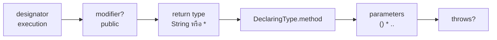
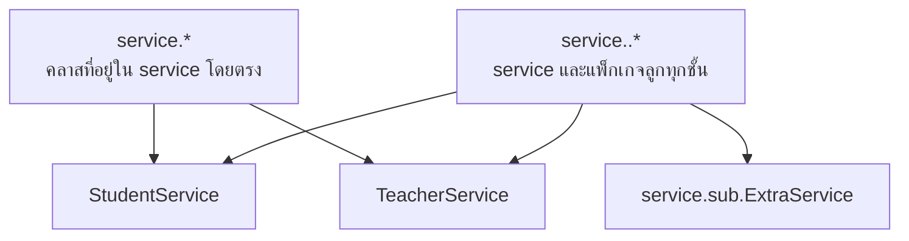
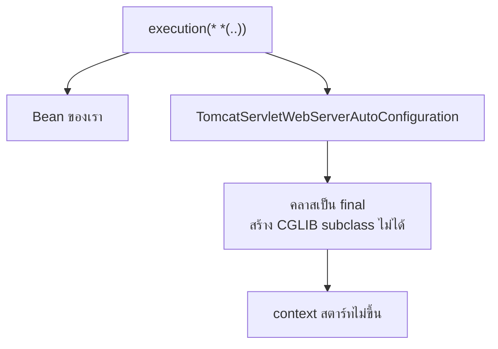
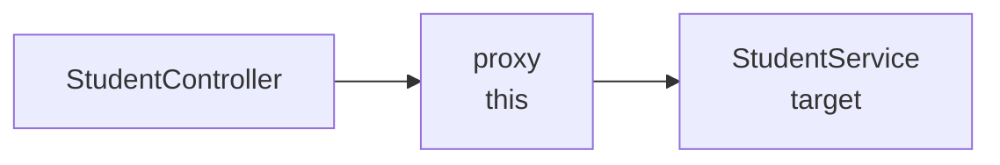
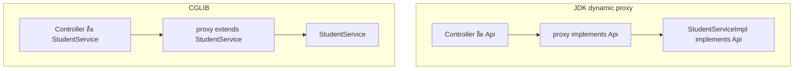

# #24 — Pointcut กับชนิดของ Proxy

> **วิดีโอ:** [Spring AOP Pointcuts & Types of Proxies | Spring Boot Full Course #24](https://youtu.be/Kf2V2QYikVY) — Coder Army, ~79 นาที
> **แหล่งที่ใช้สรุป:** ซับไตเติลภาษาฮินดีที่ YouTube สร้างอัตโนมัติ
> **เวอร์ชันในโค้ด:** Spring Boot 4.1 + Java 21 (ใส่หมายเหตุไว้ทุกจุดที่ Spring Boot 3.x ต่างกัน)

ตอนที่แล้วตอบไปแล้วว่า advice ทำงาน **เมื่อไร** และ **ทำอะไร** ตอนนี้ตอบคำถามที่เหลือ: advice จะไปทำงาน **ที่ method ไหน** คำตอบคือ **pointcut** จากนั้นผู้สอนไล่ designator ที่ใช้บ่อยกับที่ใช้ไม่บ่อย แล้วอธิบายว่า proxy ที่ Spring สร้างมีสองแบบ คือ **CGLIB** กับ **JDK dynamic proxy** เพราะ `this` กับ `target` จะให้ผลต่างกันก็ต่อเมื่อรู้ว่า proxy เป็นแบบไหน

ส่วนที่ติดป้าย `💡 เพิ่มเติม` คือของที่ผมเติมเอง ไม่ได้อยู่ในวิดีโอ ส่วนที่ติด `⚠️ แก้จากวิดีโอ` คือจุดที่วิดีโอพูดคลาดเคลื่อน ส่วนที่ติด `⚠️ Boot 4 vs 3` คือจุดที่ Spring Boot 3.x / Spring Framework 6 เขียนหรือทำงานต่างจาก Boot 4 / Spring 7

---

## สารบัญ

| เวลา | หัวข้อ |
|---|---|
| [0:00](https://youtu.be/Kf2V2QYikVY?t=0) | [1. คำถาม Where](#1-คำถาม-where) |
| [0:49](https://youtu.be/Kf2V2QYikVY?t=49) | [2. โปรเจกต์ตั้งต้น](#2-โปรเจกต์ตั้งต้น) |
| [2:57](https://youtu.be/Kf2V2QYikVY?t=177) | [3. โครงของ execution](#3-โครงของ-execution) |
| [4:16](https://youtu.be/Kf2V2QYikVY?t=256) | [4. จับ getStudent แบบระบุเป๊ะ](#4-จับ-getstudent-แบบระบุเป๊ะ) |
| [6:32](https://youtu.be/Kf2V2QYikVY?t=392) | [5. ช่องที่บังคับกับช่องที่ตัดได้](#5-ช่องที่บังคับกับช่องที่ตัดได้) |
| [8:23](https://youtu.be/Kf2V2QYikVY?t=503) | [6. createStudent ต้องเขียน path เต็มของ Student](#6-createstudent-ต้องเขียน-path-เต็มของ-student) |
| [11:05](https://youtu.be/Kf2V2QYikVY?t=665) | [7. Wildcard ดอกจัน](#7-wildcard-ดอกจัน) |
| [17:35](https://youtu.be/Kf2V2QYikVY?t=1055) | [8. Wildcard จุดจุดกับ subpackage](#8-wildcard-จุดจุดกับ-subpackage) |
| [23:01](https://youtu.be/Kf2V2QYikVY?t=1381) | [9. Pointcut กว้างเกินจนสตาร์ทไม่ขึ้น](#9-pointcut-กว้างเกินจนสตาร์ทไม่ขึ้น) |
| [25:03](https://youtu.be/Kf2V2QYikVY?t=1503) | [10. จำกัด base package แล้วโดนทั้งสองชั้น](#10-จำกัด-base-package-แล้วโดนทั้งสองชั้น) |
| [27:02](https://youtu.be/Kf2V2QYikVY?t=1622) | [11. Designator within](#11-designator-within) |
| [29:16](https://youtu.be/Kf2V2QYikVY?t=1756) | [12. Designator annotation](#12-designator-annotation) |
| [32:47](https://youtu.be/Kf2V2QYikVY?t=1967) | [13. ร่าง @Around วัดเวลา](#13-ร่าง-around-วัดเวลา) |
| [34:25](https://youtu.be/Kf2V2QYikVY?t=2065) | [14. Designator bean](#14-designator-bean) |
| [36:08](https://youtu.be/Kf2V2QYikVY?t=2168) | [15. รวม pointcut ด้วยตัวดำเนินการ](#15-รวม-pointcut-ด้วยตัวดำเนินการ) |
| [38:34](https://youtu.be/Kf2V2QYikVY?t=2314) | [16. Named pointcut](#16-named-pointcut) |
| [40:41](https://youtu.be/Kf2V2QYikVY?t=2441) | [17. คลาส ApplicationPointcuts](#17-คลาส-applicationpointcuts) |
| [46:02](https://youtu.be/Kf2V2QYikVY?t=2762) | [18. within กับ target แบบ annotation](#18-within-กับ-target-แบบ-annotation) |
| [53:35](https://youtu.be/Kf2V2QYikVY?t=3215) | [19. args กับ annotation บน argument](#19-args-กับ-annotation-บน-argument) |
| [59:36](https://youtu.be/Kf2V2QYikVY?t=3576) | [20. this คือ proxy และ target คือ object จริง](#20-this-คือ-proxy-และ-target-คือ-object-จริง) |
| [1:00:59](https://youtu.be/Kf2V2QYikVY?t=3659) | [21. CGLIB กับ JDK dynamic proxy](#21-cglib-กับ-jdk-dynamic-proxy) |
| [1:07:22](https://youtu.be/Kf2V2QYikVY?t=4042) | [22. this กับ target บน CGLIB](#22-this-กับ-target-บน-cglib) |
| [1:10:50](https://youtu.be/Kf2V2QYikVY?t=4250) | [23. สลับเป็น JDK proxy](#23-สลับเป็น-jdk-proxy) |
| — | [24. สรุปท้ายตอน](#24-สรุปท้ายตอน) |

---

## 1. คำถาม Where

[▶ 0:00](https://youtu.be/Kf2V2QYikVY?t=0)

ตอนนี้ต่อจาก advice โดยตรง ผู้สอนบอกว่าถ้ายังไม่ดูตอนที่แล้ว ให้ดูให้จบก่อน

ทุก aspect ต้องตอบสามคำถาม เมื่อไร ทำอะไร และที่ไหน สองข้อแรกคือ advice ตอนที่แล้วปิดไปแล้ว ข้อที่เหลือคือ **where** ซึ่งเขียนเป็น **pointcut** เขาจะซ้อมหลายรูปแบบ และบอกว่ามีแบบฝึกหัดให้ดาวน์โหลดจากช่องทางใน description

> 💡 **เพิ่มเติม:** ไฟล์แบบฝึกหัดนั้นไม่อยู่ในซับ ชุดคำถามท้ายโน้ตนี้ครอบคลุม pattern ที่เขาซ้อมในตอน

---

## 2. โปรเจกต์ตั้งต้น

[▶ 0:49](https://youtu.be/Kf2V2QYikVY?t=49)

เขาใช้โปรเจกต์เดิมจากตอน advice แล้วเคลียร์ aspect ให้ว่าง มีสามชิ้น

`Student` เป็น DTO สั้น ๆ มี `name` กับ `age` Controller อยู่ที่ `/api/students` มี `POST` ที่รับ student แล้วส่งต่อให้ service และ `GET` ที่เรียก `getStudent` แล้วคืนสตริงให้ client

`StudentService.createStudent` พิมพ์ `Student Saved` แล้วคืน student ที่รับมา `getStudent` พิมพ์ `All Student Data` แล้วคืนสตริงเดียวกัน ระหว่างทางเขายังเพิ่ม `dummyMethod` ที่ไม่รับ argument และคืน `0` เพื่อให้เห็นว่า pointcut แบบ `..` ครอบ method ที่ไม่มี parameter ด้วย

> 💡 **เพิ่มเติม:** ซับอ่านชื่อแพ็กเกจเพี้ยนเป็น `in.stries`, `in.strikes` และ `int.strings` โค้ดด้านล่างใช้ `in.strikes.aopdemo` ให้ตรงกับตอนที่ 23 พอร์ตของแอปคือ `9024` นิพจน์ที่ต้องยิงทีละแบบรันกับ `LabService` ซึ่งมี method ชื่อเดียวกันและพิมพ์ข้อความเดียวกัน ส่วนแอปที่ยิง HTTP ใช้ `StudentService` กับ named pointcut ในหัวข้อที่ 17 เพื่อไม่ให้ทุกแบบมารวมกันใน request เดียว

`pom.xml` ยังเป็นเว็บกับ AOP ตามตอนที่แล้ว

```xml
<parent>
  <groupId>org.springframework.boot</groupId>
  <artifactId>spring-boot-starter-parent</artifactId>
  <version>4.1.1</version>
</parent>

<properties>
  <java.version>21</java.version>
</properties>

<dependencies>
  <dependency>
    <groupId>org.springframework.boot</groupId>
    <artifactId>spring-boot-starter-webmvc</artifactId>
  </dependency>
  <dependency>
    <groupId>org.springframework.boot</groupId>
    <artifactId>spring-boot-starter-aspectj</artifactId>
  </dependency>
</dependencies>
```

> ⚠️ **Boot 4 vs 3 — ชื่อ starter:** ใน Boot 3 artifact คือ `spring-boot-starter-aop` Boot 4 เปลี่ยนชื่อเป็น `spring-boot-starter-aspectj` Guide บอกว่าถ้าเคยใส่ starter นี้เอง ให้ตรวจก่อนว่าแอปใช้ AspectJ จริงหรือไม่ แล้วค่อยเปลี่ยนชื่อ เกณฑ์คือมี annotation ในแพ็กเกจ `org.aspectj.lang.annotation` หรือไม่ เช่น `@Aspect`
> ([Spring Boot 4.0 Migration Guide — AOP Starter POM](https://github.com/spring-projects/spring-boot/wiki/Spring-Boot-4.0-Migration-Guide#aop-starter-pom))

```java
package in.strikes.aopdemo.dto;

public record Student(String name, int age) {}
```

```java
package in.strikes.aopdemo.service;

import in.strikes.aopdemo.dto.Student;
import org.springframework.stereotype.Service;

@Service
public class StudentService {

  public Student createStudent(Student student) {
    System.out.println("Student Saved");
    return student;
  }

  public String getStudent() {
    System.out.println("All Student Data");
    return "All Student Data";
  }

  public int dummyMethod() {
    System.out.println("dummy");
    return 0;
  }
}
```

```java
package in.strikes.aopdemo.controller;

import in.strikes.aopdemo.dto.Student;
import in.strikes.aopdemo.service.StudentService;
import org.springframework.web.bind.annotation.GetMapping;
import org.springframework.web.bind.annotation.PostMapping;
import org.springframework.web.bind.annotation.RequestBody;
import org.springframework.web.bind.annotation.RequestMapping;
import org.springframework.web.bind.annotation.RestController;

@RestController
@RequestMapping("/api/students")
public class StudentController {

  private final StudentService studentService;

  public StudentController(StudentService studentService) {
    this.studentService = studentService;
  }

  @PostMapping
  public Student createStudent(@RequestBody Student student) {
    return this.studentService.createStudent(student);
  }

  @GetMapping
  public String getStudent() {
    return this.studentService.getStudent();
  }
}
```

Aspect ยังชื่อ `LoggingAspect` ซับเรียกว่า login aspect ตอนต้นของวิดีโอเขายังไม่ได้ใส่ pointcut งานของครึ่งแรกคือเติมสตริงใน `@Before` ให้เลือก method ได้ตามที่ต้องการ method ของ advice พิมพ์ `Method intercepted`

---

## 3. โครงของ execution

[▶ 2:57](https://youtu.be/Kf2V2QYikVY?t=177)

คำแรกของ pointcut เรียกว่า **designator** ตอนที่แล้วใช้ `execution` และวันนี้ยังเริ่มที่ตัวนี้ก่อน designator อื่นมาทีหลัง

`execution` เลือกตอน method ถูกเรียกให้ทำงาน ข้างในวงเล็บมีหกช่อง เรียงจากซ้าย

| ช่อง | ตัวอย่าง | บังคับเมื่อใช้ execution หรือไม่ |
|---|---|---|
| access modifier | `public` | ไม่บังคับ |
| return type | `String` | บังคับ |
| ชื่อเต็ม คลาส.method | `in.strikes.aopdemo.service.StudentService.getStudent` | บังคับในความหมายว่าต้องมีชื่อ method แพ็กเกจจะย่อด้วย wildcard ได้ |
| parameters | `()` หรือ `(String)` | บังคับ ต้องมีวงเล็บ ถ้าว่างแปลว่าไม่มี argument |
| throws | `throws java.io.IOException` | ไม่บังคับ |



ทั้งก้อนในเครื่องหมายคำพูดของ `@Before` หรือ `@After` เรียกว่า **pointcut expression**

---

## 4. จับ getStudent แบบระบุเป๊ะ

[▶ 4:16](https://youtu.be/Kf2V2QYikVY?t=256)

method แรกที่เขาอยากหุ้มคือ `getStudent` modifier เป็น `public` return type เป็น `String` ไม่มี parameter และไม่ throw ดังนั้นช่องท้ายเว้นไว้

นิพจน์ที่รันแล้วติดคือ

```text
execution(public String in.strikes.aopdemo.lab.LabService.getStudent())
```

ลำดับบนคอนโซลตรงกับ `@Before` คือ advice ก่อน แล้ว method จริงค่อยพิมพ์

```text
Method intercepted
All Student Data
```

ในวิดีโอเขายิง `GET /api/students` จาก Postman ได้ body `All Student Data` แล้วใน log เห็นสองบรรทัดนี้ เขาย้ำว่าถ้าสลับเป็น `@After` ลำดับจะกลับกัน คือ `All Student Data` ก่อน แล้วค่อย `Method intercepted` เรื่องจังหวะนั้นจบไปแล้วในตอน advice วันนี้โฟกัสที่สตริง pointcut

ผลจริงของแอปบนพอร์ต 9024 หลังประกอบ named pointcut แล้ว อยู่ในหัวข้อที่ 17 รูปแบบ response เดียวกัน

---

## 5. ช่องที่บังคับกับช่องที่ตัดได้

[▶ 6:32](https://youtu.be/Kf2V2QYikVY?t=392)

เขาลบ `public` ออก แล้วยังจับ `getStudent` ได้ เพราะ modifier เป็นช่อง optional นิพจน์นี้ให้ผลชุดเดิม

```text
execution(String in.strikes.aopdemo.lab.LabService.getStudent())
```

```text
Method intercepted
All Student Data
```

เหตุผลที่เขาไม่เขียน modifier เป็นประจำคือ method ที่จะ intercept ใน service ส่วนใหญ่เป็น `public` อยู่แล้ว ถ้าต้องการเฉพาะ `protected` ค่อยเขียนคำนั้นลงไป ช่อง `throws` ก็ไม่ต้องเขียนถ้า method ไม่ได้ประกาศ exception

จากนั้นเขาทดลองให้ `getStudent` รับ `String` Controller ส่งสตริงนั้นเข้าไป pointcut ต้องเขียนชนิดในวงเล็บให้ตรง

```text
execution(* in.strikes.aopdemo.lab.LabService.getStudent(String))
```

เรียกแบบไม่มี argument แล้ว advice ไม่ทำงาน เรียกแบบส่ง `All Student Data` แล้ว advice ทำงาน

```text
All Student Data
```

```text
Method intercepted
All Student Data
```

> 💡 **เพิ่มเติม:** บน CGLIB การเรียก `protected` ผ่าน proxy จาก Bean อื่น advice ทำงาน ทดลองกับ `execution(* in.strikes.aopdemo.lab.LabService.hidden())` แล้วให้คลาสในแพ็กเกจเดียวกันเรียกผ่าน proxy ได้บรรทัด `Method intercepted` ตามด้วย `hidden` แต่ `callHidden()` ที่เรียก `hidden()` ผ่าน `this` ข้างในคลาสเดียวกันได้แค่ `callHidden` กับ `hidden` ไม่มีบรรทัดของ advice สาย `this` ไม่ผ่าน proxy เรื่องนี้ต่อจากตอนที่ 23

---

## 6. createStudent ต้องเขียน path เต็มของ Student

[▶ 8:23](https://youtu.be/Kf2V2QYikVY?t=503)

method ที่สองคืน `Student` และรับ `Student` เขียนคำว่า `Student` ลอย ๆ ใน pointcut ไม่ได้ เพราะ pointcut เป็นสตริง ไม่มี import ต้องใส่ชื่อเต็มทั้ง return type และ parameter

```text
execution(in.strikes.aopdemo.dto.Student in.strikes.aopdemo.lab.LabService.createStudent(in.strikes.aopdemo.dto.Student))
```

ยิงแล้วได้

```text
Method intercepted
Student Saved
```

ในวิดีโอเขาแยกสตริงนี้หลายบรรทัดเพราะยาว แล้ว POST body ที่ส่งไปถูก controller ส่งเข้า service service พิมพ์ `Student Saved` แล้วคืน object เดิมกลับไปเป็น JSON

เขาชี้ปัญหาทันที ถ้า service มี 20 method แล้วต้องเขียน path ยาวแบบนี้ทีละอัน ก็ต้องมี advice 20 ก้อน ทั้งที่งานที่อยากทำคือข้อความเดียวกันทุก method นั่นสวนทางกับเหตุผลของ AOP ที่อยากเขียน cross-cutting concern ครั้งเดียว Spring จึงมี wildcard สองตัว

---

## 7. Wildcard ดอกจัน

[▶ 11:05](https://youtu.be/Kf2V2QYikVY?t=665)

`*` แทน **หนึ่งช่อง** ช่องนั้นเป็นชนิดอะไรก็ได้ หรือชื่ออะไรก็ได้ แต่นับเป็นหนึ่งชิ้น

### Return type และ parameter

`*` ตรง return type แปลว่า method ชื่อนี้ return อะไรก็ได้ รวม `void` ด้วย เปลี่ยนจาก `String` เป็น `int` หรือ object แล้วยังเข้าเงื่อนไข

`*` หนึ่งตัวในวงเล็บ parameter แปลว่า **argument ตัวเดียว** ชนิดอะไรก็ได้ ไม่ได้แปลว่ากี่ตัวก็ได้

| วงเล็บ | ความหมาย | ผลกับ method ในแลบ |
|---|---|---|
| `()` | ไม่มี argument | ติด `getStudent()` และ `dummyMethod()` |
| `(String)` | argument เดียว เป็น `String` | ติด overload ที่รับ `String` |
| `(*)` | argument เดียว ชนิดใดก็ได้ | ติด `createStudent(Student)` ไม่ติด no-arg |
| `(*, *)` | สองตัวพอดี | ไม่ติด method ที่มีในแลบ |
| `(*, int)` | ตัวแรกชนิดใดก็ได้ ตัวที่สองเป็น `int` | เขาอธิบายรูปแบบนี้ไว้ |

นิพจน์ `execution(* in.strikes.aopdemo.lab.LabService.*(*))` กับ `createStudent`

```text
Method intercepted
Student Saved
```

นิพจน์เดียวกันกับ `getStudent()` ที่ไม่มี argument ไม่มีบรรทัด `Method intercepted` มีแต่ `All Student Data`

`execution(* in.strikes.aopdemo.lab.LabService.*(*, *))` กับ `createStudent` ก็ไม่ติด เพราะ method นั้นมี argument เดียว

> ⚠️ **แก้จากวิดีโอ:** ประโยคแรกพูดว่า `*` ในวงเล็บแปลว่า method รับ argument กี่ตัวก็ได้ แล้วเขาแก้เองในประโยคถัดไปว่า `*` หนึ่งตัวคือ argument ตัวเดียว ถ้ามีสองตัวต้องเขียน `*, *` ที่ถูกคือแบบหลัง

`*` ตรง return type จับ `dummyMethod` ที่คืน `int` ได้ ส่วนบังคับว่าต้องเป็น `String` แล้วไม่จับ

```text
execution(* in.strikes.aopdemo.lab.LabService.dummyMethod())
```

```text
Method intercepted
dummy
```

```text
execution(String in.strikes.aopdemo.lab.LabService.dummyMethod())
```

```text
dummy
```

### ชื่อ method และชื่อคลาส

[▶ 14:24](https://youtu.be/Kf2V2QYikVY?t=864)

เอา `getStudent` ออกแล้วใส่ `*` แทนชื่อ method จะจับทุก method ในคลาสนั้นที่เข้าเงื่อนไข parameter เขาใช้แบบนี้รวม `createStudent` กับ `getStudent` ไว้ที่ advice ก้อนเดียว แล้วยิงทั้ง POST และ GET ต่างก็เห็น `Method intercepted`

ชื่อ method ยังประกบกับตัวอักษรได้

| รูปแบบ | จับอะไร |
|---|---|
| `get*` | ชื่อที่ขึ้นต้นด้วย `get` |
| `*Student` | ชื่อที่ลงท้ายด้วย `Student` |

`execution(* in.strikes.aopdemo.lab.LabService.get*(..))` จับ `getStudent` และไม่จับ `createStudent`

```text
Method intercepted
All Student Data
```

```text
Student Saved
```

`*` ตรงชื่อคลาสแปลว่าคลาสใดก็ได้ **ในแพ็กเกจนั้นโดยตรง** เช่น `service.*` คือทุกคลาสที่อยู่ใน `service` ไม่รวมคลาสที่อยู่ในแพ็กเกจลูก เขาสมมติ `TeacherService` ไว้ข้าง `StudentService` ว่าจะโดนตัวเดียวกัน

ถ้าย่อจนเหลือ `execution(* *(..))` ความหมายคือ method ใดก็ได้ในแอป ทั้งแพ็กเกจ แพ็กเกจลูก และคลาส ขอแค่จำนวน argument เข้าเงื่อนไขวงเล็บ เขาบอกว่ารูปนี้กว้างเกิน และหัวข้อที่ 9 คือตอนที่มันพังจริง

---

## 8. Wildcard จุดจุดกับ subpackage

[▶ 17:35](https://youtu.be/Kf2V2QYikVY?t=1055)

`*` ไม่ลงไปใน subpackage เขาสร้างแพ็กเกจ `sub` ใต้ `service` แล้วใส่คลาส `Dummy` ไว้ข้างใน นิพจน์ `service.*` ไม่เห็นคลาสนั้น เพราะ `*` คือชื่อคลาสหนึ่งชื่อในแพ็กเกจนั้นพอดี

wildcard ตัวที่สองคือ `..` แปลว่า **ศูนย์ชิ้นขึ้นไป** ใช้ได้สองที่หลัก ๆ

1. ในวงเล็บ parameter `()` แปลว่า argument กี่ตัวก็ได้ รวมศูนย์ตัว
2. ในชื่อแพ็กเกจ แปลว่ามีแพ็กเกจคั่นกี่ชั้นก็ได้ รวมศูนย์ชั้น

ใช้แทน return type ไม่ได้ เพราะ method มี return type เดียวเสมอ ใช้แทนชื่อ method ทั้งก้อนแบบ `Class..()` ก็ไม่ได้ เพราะกำลังจะจับ method หนึ่งชื่อ ไม่ใช่ "มี method กี่ตัวก็ได้"

> ⚠️ **แก้จากวิดีโอ:** ประโยคแรกบอกว่า `..` ในวงเล็บคือศูนย์หรือหนึ่ง argument แล้วเขาแก้เองว่าสิบตัวก็ยังเข้า ที่ถูกคือศูนย์ตัวขึ้นไป `dummyMethod()` ที่ไม่มี argument เข้า `*(..)` จริง

ข้อความ error จริงตอนเขียนผิดที่

```text
IllegalArgumentException: Pointcut is not well-formed: expecting 'name pattern' at character position 10
execution(.. in.strikes.aopdemo.lab.LabService.getStudent())
          ^
```

```text
IllegalArgumentException: Pointcut is not well-formed: expecting 'name pattern cannot finish with ..' at character position 47
execution(* in.strikes.aopdemo.lab.LabService..())
                                               ^
```

`execution(* in.strikes.aopdemo.lab.LabService.*(..))` จับทั้ง no-arg, argument เดียว, และ `dummyMethod`

```text
Method intercepted
All Student Data
```

```text
Method intercepted
Student Saved
```

```text
Method intercepted
dummy
```

นี่คือรูปที่เขาบอกว่าเขียนครั้งเดียวแล้วครอบทั้งคลาส ไม่ว่าจะเพิ่ม method แบบไหนภายหลัง

### ลง subpackage

[▶ 21:30](https://youtu.be/Kf2V2QYikVY?t=1290)

`execution(* in.strikes.aopdemo.lab.*.*(*))` จับ `createStudent` ที่อยู่ใน `lab` โดยตรง และไม่จับ `ping` ของคลาสใน `lab.sub`

```text
Method intercepted
Student Saved
```

```text
extra
```

เปลี่ยนเป็น `execution(* in.strikes.aopdemo.lab..*.*(*))` แล้ว `ping` โดนด้วย

```text
Method intercepted
extra
```

`within` ใช้รูปสั้นกว่าเพราะมันรับ type pattern อย่างเดียว ไม่มีส่วนของ method

| นิพจน์ | `ExtraService` ใน subpackage |
|---|---|
| `within(in.strikes.aopdemo.lab.*)` | ไม่โดน มีแต่บรรทัด `extra` |
| `within(in.strikes.aopdemo.lab..*)` | โดน `Method intercepted` แล้วตามด้วย `extra` |

เขาบอกว่าสอง wildcard นี้คือวิธีใช้ AOP ให้คุ้ม เพราะ concern เดียวกันครอบหลาย method ได้โดยไม่เขียน path ทีละเส้น



---

## 9. Pointcut กว้างเกินจนสตาร์ทไม่ขึ้น

[▶ 23:01](https://youtu.be/Kf2V2QYikVY?t=1381)

เขาย่อจนเหลือ method ทุกตัวในแอป

```java
package in.strikes.aopdemo.broadexec;

import org.aspectj.lang.annotation.Aspect;
import org.aspectj.lang.annotation.Before;
import org.springframework.stereotype.Component;

@Aspect
@Component
public class BroadExecAspect {

  @Before("execution(* *(..))")
  public void logBefore() {
    System.out.println("Method intercepted");
  }
}
```

แอป Boot สตาร์ทไม่ขึ้น ความหมายของนิพจน์นี้คือ Spring จะพยายามสร้าง proxy ให้ทุก Bean ที่ method เข้าเงื่อนไข รวม Bean ภายในของ framework Bean บางตัวสร้าง subclass ไม่ได้

ข้อความจริงบน Boot 4.1.1

```text
Error creating bean with name 'org.springframework.boot.tomcat.autoconfigure.servlet.TomcatServletWebServerAutoConfiguration':
Could not generate CGLIB subclass of class org.springframework.boot.tomcat.autoconfigure.servlet.TomcatServletWebServerAutoConfiguration:
Common causes of this problem include using a final class or a non-visible class

Caused by: org.springframework.aop.framework.AopConfigException:
Could not generate CGLIB subclass of class org.springframework.boot.tomcat.autoconfigure.servlet.TomcatServletWebServerAutoConfiguration

Caused by: java.lang.IllegalArgumentException:
Cannot subclass final class org.springframework.boot.tomcat.autoconfigure.servlet.TomcatServletWebServerAutoConfiguration
```

เขาเล่าตรงกับที่เกิดขึ้น คือ auto-configuration ของ Tomcat ถูก pointcut กว้าง ๆ ดึงเข้าไป แล้วสร้าง proxy ไม่ได้ เพราะคลาสนั้นต้องมี method เป้าหมายให้เรียกต่อไม่ได้ในรูปของ subclass



> ⚠️ **Boot 4 vs 3 — คลาสใน stack trace:** Boot 4 แยก auto-configuration เป็นโมดูลย่อยและย้ายแพ็กเกจ คลาสที่ล้มใน Boot 4.1 คือ `org.springframework.boot.tomcat.autoconfigure.servlet.TomcatServletWebServerAutoConfiguration` ในโมดูล `spring-boot-tomcat` และประกาศเป็น `final` คลาสฝั่ง servlet web server ใน Boot 3 อยู่ที่ `org.springframework.boot.autoconfigure.web.servlet.ServletWebServerFactoryAutoConfiguration` ใน `spring-boot-autoconfigure` และไม่ได้ประกาศ `final` ชื่อใน log จึงไม่ตรงกันข้ามเวอร์ชัน
> ([Spring Boot 4.0 Migration Guide — modular design](https://github.com/spring-projects/spring-boot/wiki/Spring-Boot-4.0-Migration-Guide))

> 💡 **เพิ่มเติม:** CGLIB สร้าง proxy โดยการทำ subclass คลาสที่เป็น `final` หรือ method ที่เป็น `final` จึงถูก proxy แบบนี้ไม่ได้ error นี้เป็นผลจากการพยายาม proxy ของ Spring ไม่ใช่จาก business logic

---

## 10. จำกัด base package แล้วโดนทั้งสองชั้น

[▶ 25:03](https://youtu.be/Kf2V2QYikVY?t=1503)

ทางแก้ของเขาคือใส่ base package ของโค้ดเราเอง อย่างน้อย `in.strikes.aopdemo` แล้วตามด้วย `..` เพื่อให้ครอบ controller, service, dto และแพ็กเกจลูก

```java
package pointcutlab.doublehit;

import org.aspectj.lang.annotation.Aspect;
import org.aspectj.lang.annotation.Before;

@Aspect
public class DoubleAspect {

  @Before("execution(* in.strikes.aopdemo..*(..))")
  public void logBefore() {
    System.out.println("Method intercepted");
  }
}
```

แอปสตาร์ทได้ แล้วยิง `createStudent` ครั้งเดียวได้สองบรรทัดของ advice

```text
Method intercepted
Method intercepted
Student Saved
```

บรรทัดแรกคือ method ของ controller เพราะ pointcut ครอบทั้งแพ็กเกจ บรรทัดที่สองคือ `createStudent` ของ service แล้ว service ค่อยพิมพ์ `Student Saved` เขาสรุปว่า wildcard ใช้จับหลาย method ในครั้งเดียวได้ และต้องกันขอบเขตไว้ที่โค้ดของเรา

> 💡 **เพิ่มเติม:** aspect ก้อนนี้อยู่นอกแอปที่ยิงพอร์ต 9024 เพื่อไม่ให้ request ปกติโดนซ้ำ สองบรรทัดด้านบนมาจากการเรียก `StudentController.createStudent` ผ่าน context ที่มี aspect นี้ตัวเดียว

---

## 11. Designator within

[▶ 27:02](https://youtu.be/Kf2V2QYikVY?t=1622)

`execution` ทำงานระดับ method ต้องบอก return type ชื่อ และ parameter `within` ทำงานระดับคลาส ใส่ชื่อคลาสหรือ type pattern แล้วทุก method ในคลาสนั้นเข้าเงื่อนไข

```text
within(in.strikes.aopdemo.lab.LabService)
```

เรียก `dummyMethod` แล้วได้

```text
Method intercepted
dummy
```

รูปที่เขาใช้กับทั้ง service layer คือ `within` ตามด้วยแพ็กเกจและ `..*`

```text
within(in.strikes.aopdemo.service..*)
```

wildcard ใช้กับ `within` ได้แบบเดียวกับ `execution` แค่ไม่ต้องเขียนส่วน method `within(in.strikes.aopdemo.service.*)` คือคลาสในแพ็กเกจนั้นโดยตรง `within(in.strikes.aopdemo.service..*)` รวมแพ็กเกจลูก เขายิง POST แล้วเห็น `Method intercepted` ตามด้วย `Student Saved` เช่นกัน แล้วบอกว่าอันไหนที่เขียนด้วย `execution` ได้ ก็เขียนด้วย `within` ได้เมื่อต้องการทั้งคลาส แค่อ่านง่ายกว่า

---

## 12. Designator annotation

[▶ 29:16](https://youtu.be/Kf2V2QYikVY?t=1756)

`@annotation` ทำงานระดับ method มันถามว่า method นั้นติด annotation ที่ระบุหรือไม่ ถ้าติด ก็ intercept ได้ทุกที่ที่แปะ annotation นั้น ไม่ต้องลิสต์ชื่อ method

เขาแปะ `@Timestamp` จาก `jdk.jfr` บน `createStudent` แล้วเปิดแพ็กเกจด้านบนของ annotation ได้ `jdk.jfr` pointcut จึงเป็น

```text
@annotation(jdk.jfr.Timestamp)
```

method `timed` ที่ติด annotation นี้ถูกจับ method ที่ไม่ติดไม่ถูกจับ

```text
Method intercepted
timed
```

```text
All Student Data
```

เขาบอกว่าของที่มีมาใน JDK แบบนี้ยังไม่ค่อยมีประโยชน์ สิ่งที่อยากได้คือ annotation ที่เขียนเอง เช่น `@Authenticate` แปลว่าก่อน method ทำงานต้องมี logic ตรวจตัวตน และ logic นั้นอยู่ที่ aspect ไม่ได้อยู่ใน method ธุรกิจ หรือ `@Audit` สำหรับ metrics และ `@EvaluateTime` สำหรับจับเวลา แปะ annotation ที่ method ไหน aspect ที่ผูกกับ `@annotation` ของตัวนั้นก็ทำงานที่นั่น วิธีสร้าง annotation เองเขาเลื่อนไปตอนหน้า

> 💡 **เพิ่มเติม:** `jdk.jfr.Timestamp` ใช้สาธิตได้เพราะ retention เป็น `RUNTIME` และ target รวม `METHOD` กับ `TYPE` ถ้า annotation ที่สร้างเองเป็น `SOURCE` หรือ `CLASS` pointcut จะมองไม่เห็นตอนรัน

---

## 13. ร่าง @Around วัดเวลา

[▶ 32:47](https://youtu.be/Kf2V2QYikVY?t=1967)

เขาวาด aspect ใหม่สำหรับ `@EvaluateTime` เป็น `@Around` รับ `ProceedingJoinPoint` จดเวลาเริ่ม เรียก `proceed` แล้วจดเวลาจบ แล้วพิมพ์ผลต่าง รายละเอียดของ `@Around` อยู่ในตอนที่แล้ว วันนี้เขาใช้เป็นภาพว่า annotation หนึ่งตัวพา logic ทั้งก้อนก่อนและหลัง method ได้

ในวิดีโอยังไม่มี annotation ชื่อ `@EvaluateTime` ร่างด้านล่างจึงผูกกับ `@Timestamp` ที่มีอยู่แล้ว และจำกัด `within` ไว้ที่แพ็กเกจแลบ เพื่อไม่ให้ไปชนคลาสภายในของ Spring แบบหัวข้อที่ 9

```java
package in.strikes.aopdemo.lab;

import org.aspectj.lang.ProceedingJoinPoint;
import org.aspectj.lang.annotation.Around;
import org.aspectj.lang.annotation.Aspect;

@Aspect
public class EvaluateTimeAspect {

  @Around("@annotation(jdk.jfr.Timestamp) && within(in.strikes.aopdemo.lab..*)")
  public Object evaluateTime(ProceedingJoinPoint joinPoint) throws Throwable {
    long startTime = System.currentTimeMillis();
    try {
      return joinPoint.proceed();
    } finally {
      long endTime = System.currentTimeMillis();
      System.out.println("elapsed=" + (endTime - startTime));
    }
  }
}
```

```text
timed
elapsed=0
```

`elapsed=0` เพราะ method คืนทันที `currentTimeMillis` มีความละเอียดระดับมิลลิวินาที เขาบอกว่าจะกลับมาทำแบบนี้ด้วย annotation ของเราเองในตอนหน้า แล้วทิ้ง `@Timestamp` ไว้เป็นตัวอย่างไปก่อน

---

## 14. Designator bean

[▶ 34:25](https://youtu.be/Kf2V2QYikVY?t=2065)

`bean` รับชื่อ Bean แล้วจับทุก method ของ Bean นั้น `@Component`, `@Service`, `@Controller` และ `@Repository` เป็น Bean ที่ IoC Container ดูแล ชื่อ default ของ `StudentService` คือ `studentService` เพราะตัวแรกถูกทำเป็นตัวเล็ก

```text
bean(labService)
```

เรียก `getStudent` แล้ว advice ทำงาน ชื่อที่ขึ้นต้นด้วยตัวใหญ่ไม่ทำงาน ทดลองใส่ `bean(LabService)` คู่กับชื่อที่ถูก แล้วมีแต่บรรทัดของชื่อที่ถูก

```text
bean-hit
All Student Data
```

เขายิง GET ในวิดีโอแล้วเห็น `Method intercepted` ตามด้วย `All Student Data` และบอกว่า designator นี้ใช้เมื่ออยากระบุชื่อ Bean ตรง ๆ รวม Bean ที่สร้างด้วย `@Bean` ใน `@Configuration` สิ่งที่ถูกจับคือการเรียก method บน Bean ชื่อนั้น

สี่ตัวที่ใช้บ่อยที่เขาให้จำคือ `execution`, `within`, `@annotation` และ `bean` ที่เหลือมีไว้สำหรับกรณีพิเศษและคำถามสัมภาษณ์

---

## 15. รวม pointcut ด้วยตัวดำเนินการ

[▶ 36:08](https://youtu.be/Kf2V2QYikVY?t=2168)

pointcut สองก้อนรวมกันได้ด้วยตัวดำเนินการสามตัว

เขาอยากให้ advice ทำงานทั้งเมื่อ method อยู่ที่ `studentService` และเมื่ออยู่ที่ `studentController` กรณีนี้คือ "เข้าอันใดอันหนึ่ง" จากนั้นเขาแสดงอีกแบบที่เป็น intersection คือต้องอยู่ในการ service **และ** เป็น `public` เขาบอกเองว่าถ้าบังคับให้ method เดียวอยู่ทั้งใน service และใน controller พร้อมกัน จะไม่มี method ไหนเข้า

> ⚠️ **แก้จากวิดีโอ:** ซับสลับชื่อตัวดำเนินการ ช่วงที่บอกว่าเงื่อนไขใดเงื่อนไขหนึ่งเป็นจริงก็พอ ถูกเขียนด้วย `||` และคำว่า `or` ช่วง intersection ถูกเขียนด้วย `&&` และคำว่า `and` ตัวที่สามคือ `!` หรือ `not` ในวิดีโอคำว่า and ไปอยู่กับกรณี "อันใดอันหนึ่ง" และคำว่า end ไปอยู่กับ intersection

ตัวอย่างที่รัน

`bean(labService) || bean(extraService)` ยิงทั้งสอง Bean แล้วติดทั้งคู่ สองบรรทัด `or-hit`

`bean(labService) && bean(extraService)` ยิง `getStudent` แล้วไม่ติด เพราะ join point หนึ่งจุดเป็น Bean ได้ทีละชื่อ มีแต่ `All Student Data`

`within(in.strikes.aopdemo.lab.LabService) && execution(public * *(..))` ติด method ที่เป็น `public` ของคลาสนั้น

`within(in.strikes.aopdemo.lab.LabService) && !execution(* get*(..))` ยิง `getStudent` แล้วไม่ติด ยิง `dummyMethod` แล้วติด

```text
not-hit
dummy
```

เขาจะเอาเงื่อนไข "ทุก method ที่เป็น public ใน service" ไปใช้ซ้ำกับ `@Before`, `@After` และ `@Around` การก็อปสตริงยาว ๆ ทุกครั้งคือที่มาของ named pointcut

---

## 16. Named pointcut

[▶ 38:34](https://youtu.be/Kf2V2QYikVY?t=2314)

`@Pointcut` เก็บนิพจน์ไว้กับ method ที่ตัวว่าง ชื่อ method คือชื่อที่ advice จะอ้าง เขาตั้งว่า `logPublicServiceMethods` เพราะอ่านแล้วรู้ว่าหมายถึง public method ใน service

รูปแบบที่รันคือ method ว่างที่มี `@Pointcut` แล้ว `@Before` อ้างชื่อ method ตามด้วย `()`

```java
@Pointcut("execution(* in.strikes.aopdemo.lab.LabService.getStudent())")
public void studentRead() {
  System.out.println("pointcut-body");
}

@Before("studentRead()")
public void logBefore() {
  System.out.println("Method intercepted");
}
```

ผลคือ advice ทำงาน และบรรทัดในตัว method ของ `@Pointcut` ไม่โผล่

```text
Method intercepted
All Student Data
```

เขาบอกว่า method นี้ไม่ได้ถูกเรียกตอนรันแบบ method Java ทั่วไป มันเป็นที่เก็บนิพจน์ ชื่อควรบอกความหมาย เพื่อให้คนอ่าน advice รู้ทันทีว่ากำลังจับอะไร

> ⚠️ **แก้จากวิดีโอ:** เขาบอกว่า Java คลี่ method นี้ตอน compile ที่ถูกสำหรับ Spring AOP แบบ proxy คือ container อ่าน `@Pointcut` ตอนสร้าง context แล้วไม่เรียก method นั้น การ weave ตอน compile เป็นของคอมไพเลอร์ AspectJ (`ajc`) ซึ่ง starter ในโปรเจกต์นี้ไม่ได้เปิดใช้ หลักฐานคือบรรทัด `pointcut-body` ไม่ถูกพิมพ์

advice กี่ก้อนก็อ้างชื่อนี้ได้ แก้เงื่อนไขที่ method เดียว แล้วทุก advice ที่อ้างชื่อเดียวกันตามไปด้วย

---

## 17. คลาส ApplicationPointcuts

[▶ 40:41](https://youtu.be/Kf2V2QYikVY?t=2441)

ในงานจริงเขาไม่แปะนิพจน์ยาวไว้บน aspect ทุกตัว เขาสร้างคลาสรวม เช่น `ApplicationPointcuts` แล้วให้ logging, authentication หรือ evaluation อ้างชื่ออย่างเดียว pointcut ที่แคบและใช้ครั้งเดียวค่อยเขียนใกล้ advice

คลาสนี้เก็บชั้น controller, ชั้น service, method ที่เป็น public, ส่วนที่ตัดกันของสองอย่างหลัง และ method ที่ชื่อขึ้นต้นด้วย `get`

```java
package in.strikes.aopdemo.aspect;

import org.aspectj.lang.annotation.Aspect;
import org.aspectj.lang.annotation.Pointcut;
import org.springframework.stereotype.Component;

@Aspect
@Component
public class ApplicationPointcuts {

  @Pointcut("within(in.strikes.aopdemo.controller..*)")
  public void controllerLayer() {}

  @Pointcut("within(in.strikes.aopdemo.service..*)")
  public void serviceLayer() {}

  @Pointcut("execution(public * *(..))")
  public void allPublicMethods() {}

  @Pointcut("serviceLayer() && allPublicMethods()")
  public void allPublicServiceMethods() {}

  @Pointcut("allPublicMethods() && execution(* get*(..))")
  public void getterMethods() {}
}
```

`allPublicServiceMethods` รวมสองชื่อที่ประกาศไว้แล้วในคลาสเดียวกัน เขียนเป็น `serviceLayer() && allPublicMethods()` ไม่ต้องก็อปนิพจน์ยาว

aspect ที่ทำงานจริงอ้างชื่อเต็มของ method นั้น

```java
package in.strikes.aopdemo.aspect;

import org.aspectj.lang.annotation.Aspect;
import org.aspectj.lang.annotation.Before;
import org.springframework.stereotype.Component;

@Aspect
@Component
public class LoggingAspect {

  @Before("in.strikes.aopdemo.aspect.ApplicationPointcuts.allPublicServiceMethods()")
  public void logBefore() {
    System.out.println("Method intercepted");
  }
}
```

> 💡 **เพิ่มเติม:** `allPublicMethods` กับ `getterMethods` กว้างมากถ้านำไปใส่ `@Before` โดยตรง เพราะ `execution(public * *(..))` และ `execution(* get*(..))` ไม่ได้ล็อกแพ็กเกจ การประกาศ `@Pointcut` อย่างเดียวยังไม่สร้าง proxy พอ advice อ้าง `allPublicServiceMethods()` เงื่อนไขถูกตัดกับ `serviceLayer()` แอปจึงสตาร์ทได้

แอปบนพอร์ต 9024 ใช้คู่นี้ ยิง GET แล้ว POST

```text
proxyClass=in.strikes.aopdemo.service.StudentService$$SpringCGLIB$$0
Method intercepted
All Student Data
Method intercepted
Student Saved
```

`GET /api/students`

```http
HTTP/1.1 200
Content-Type: text/plain;charset=UTF-8
Content-Length: 16

All Student Data
```

`POST /api/students` ด้วย `{"name":"Ada","age":20}`

```http
HTTP/1.1 200
Content-Type: application/json
Content-Length: 23

{"name":"Ada","age":20}
```

มี `Method intercepted` บรรทัดเดียวต่อหนึ่ง method ของ service เพราะ pointcut ล็อกที่ `service..*` ไม่ได้ครอบ controller บรรทัด `proxyClass` มาจาก runner ที่พิมพ์ชนิดของ Bean ที่ถูก inject เพื่อให้เห็นว่าค่า default ของ Boot คือ CGLIB

> 💡 **เพิ่มเติม:** runner นั้นไม่มีในวิดีโอ เขาเพิ่งพิสูจน์ชนิด proxy ด้วยการเปลี่ยน `this`/`target` ในหัวข้อถัดไป ชนิด `StudentService$$SpringCGLIB$$0` คือ subclass ที่ Spring สร้างให้

---

## 18. within กับ target แบบ annotation

[▶ 46:02](https://youtu.be/Kf2V2QYikVY?t=2762)

นอกจากสี่ตัวที่ใช้บ่อย เขายังลิสต์ `@within`, `@target`, `target`, `args`, `@args` และ `this`

`@within` กับ `@target` ทำงานระดับคลาส ทั้งคู่รับ **annotation** ไม่ได้รับชื่อคลาส `@annotation` ดู annotation บน method สองตัวนี้ดู annotation บนคลาส ตัวอย่างของเขาคือ `@Service` ชื่อเต็ม `org.springframework.stereotype.Service` ใส่ `@Controller` แทนก็จะไปจับ method ของ controller

ถ้าระบบไม่มี inheritance สองตัวนี้ให้ผลเหมือนกัน ความต่างโผล่เมื่อ method ถูกประกาศไว้ที่คลาสแม่

```java
package pointcutlab.inherit;

public class BaseService {

  public String saveStudent() {
    System.out.println("SavedStudent");
    return "SavedStudent";
  }
}
```

```java
package pointcutlab.inherit;

import org.springframework.stereotype.Service;

@Service
public class ChildService extends BaseService {

  public String createStudent() {
    System.out.println("Student Saved");
    return "Student Saved";
  }
}
```

`saveStudent` ประกาศที่ `BaseService` ซึ่งไม่มี `@Service` `ChildService` สืบทอด method นั้นและตัวมันเองติด `@Service` `createStudent` ประกาศที่ลูก

| การเรียก | `@within(Service)` | `@target(Service)` |
|---|---|---|
| `saveStudent` ที่ประกาศบนแม่ | ไม่ทำงาน มีแต่ `SavedStudent` | ทำงาน |
| `createStudent` ที่ประกาศบนลูก | ทำงาน | ทำงาน |

ผลจริงของ `@target` กับ method ที่สืบทอดมา

```text
target-ann
SavedStudent
```

ผลของ `@within` กับ method เดียวกันมีแค่ `SavedStudent`

เขาอธิบายตรงกับที่รันได้ `@target` ดู object ที่ทำงานจริง ถ้าวัตถุนั้นเป็นคลาสที่ติด `@Service` method ที่สืบทอดมาก็เข้าเงื่อนไข `@within` ดูว่า method ถูกประกาศไว้ในคลาสไหน `saveStudent` อยู่ที่แม่ และแม่ไม่มี annotation นั้น จึงไม่เข้า ถ้าไม่ได้ใช้ inheritance สองแบบนี้ให้ผลเดียวกัน เขาแนะนำ `@target` เมื่อมี inheritance

---

## 19. args กับ annotation บน argument

[▶ 53:35](https://youtu.be/Kf2V2QYikVY?t=3215)

`args` ทำงานระดับ method มันดู **ชนิดของ argument ตอนรัน** ไม่ได้ดูชื่อ method

```text
args(in.strikes.aopdemo.dto.Student)
```

`createStudent(Student)` ติด `getStudent()` ไม่ติด

```text
Method intercepted
Student Saved
```

```text
All Student Data
```

ถ้านิพจน์มีแค่ `args(Student)` แล้วสตาร์ทแอป Boot ทั้งก้อน จะล้มแบบเดียวกับหัวข้อที่ 9 คือสร้าง CGLIB subclass ของ `TomcatServletWebServerAutoConfiguration` ไม่ได้ เขาอธิบายว่ามันกว้างกว่าที่ตาเห็น เพราะ method ภายในของ Spring จำนวนมากรับ `Object` และ `Student` เป็น `Object` ได้ Spring จึงพยายาม proxy Bean ที่ method รับชนิดที่ส่ง `Student` เข้าไปได้

ทางแคบที่เขาใช้คือต่อ `&& within(...)` ให้เหลือเฉพาะ service แล้วสตาร์ทผ่าน และ POST เห็น `Method intercepted` ตามด้วย `Student Saved` ส่วน GET ไม่เข้าเพราะไม่ได้ส่ง `Student`

[▶ 56:48](https://youtu.be/Kf2V2QYikVY?t=3408)

`@args` ดู annotation ที่ติดอยู่บน **คลาสของ argument** ไม่ใช่ annotation บน method เขาแปะ `@Timestamp` ที่คลาส `Student` แล้วเขียน

```text
@args(jdk.jfr.Timestamp)
```

```java
package in.strikes.aopdemo.lab;

import jdk.jfr.Timestamp;

@Timestamp
public record MarkedStudent(String name, int age) {}
```

method ที่รับ `MarkedStudent` ติด method ที่รับ `Student` ธรรมดาไม่ติด

```text
Method intercepted
accepted
```

```text
Student Saved
```

เขาบอกว่า `@args` อ่านแล้วยาวและเขาแทบไม่ใช้ แต่รูปแบบที่ขึ้นต้นด้วย `@` มีกติกาเดียวกัน

| Designator | มอง annotation ที่ไหน |
|---|---|
| `@annotation` | บน method |
| `@within`, `@target` | บนคลาส |
| `@args` | บนคลาสของ argument |

`@args` ล้วน ๆ ก็สตาร์ท Boot ไม่ขึ้นด้วยเหตุเดียวกับ `args` ที่กว้างเกิน ต้องตัดด้วย `within` ของแพ็กเกจเราเหมือนที่เขาทำ

---

## 20. this คือ proxy และ target คือ object จริง

[▶ 59:36](https://youtu.be/Kf2V2QYikVY?t=3576)

ก่อนถึง designator `this` กับ `target` เขาทบทวนภาพจากตอนที่แล้ว ถ้าไม่มี AOP controller ถือ reference ของ service ตรง ๆ พอมี aspect ที่จะ intercept method ของ service Spring ส่ง **proxy** ให้ controller แทน proxy ถือ object จริงไว้อีกที

object จริงเรียกว่า **target** proxy เรียกผ่าน designator `this`



สอง designator นี้รับชื่อประเภท แล้วถามว่า proxy หรือ object จริงเป็นประเภทนั้นหรือไม่ ผลขึ้นกับว่า Spring สร้าง proxy แบบไหน

---

## 21. CGLIB กับ JDK dynamic proxy

[▶ 1:00:59](https://youtu.be/Kf2V2QYikVY?t=3659)

Spring สร้าง proxy ได้สองแบบ

| แบบ | โครงสร้าง | เมื่อไหร่ที่ใช้ใน Boot |
|---|---|---|
| **CGLIB** | proxy เป็น subclass ของคลาสจริง แล้วเรียกของแม่ต่อ | ค่า default ของ Spring Boot |
| **JDK dynamic proxy** | proxy กับ service implement interface เดียวกัน proxy ถือ service ไว้ข้างใน | ต้องมี interface และปิด `proxy-target-class` |

### JDK dynamic proxy

เขาสมมติ interface ชื่อกลาง ๆ มี `saveStudent` ทั้ง proxy และ service implement interface นั้น method ของ proxy ทำงานของตัวเองก่อน เช่น log แล้วเรียก method ชื่อเดียวกันบน service จริง Controller เรียกที่ proxy เท่านั้น รูปแบบนี้คือ proxy หรือ decorator ที่ทั้งสองฝั่งแชร์ interface

เขาบอกว่าสถาปัตยกรรมต้องมี interface อยู่แล้ว Spring ไม่ได้สร้าง interface ให้

### CGLIB

[▶ 1:04:08](https://youtu.be/Kf2V2QYikVY?t=3848)

ถ้า service ไม่มี interface แบบ `StudentService` ในแอปแรก proxy ทำ subclass ของคลาสนั้น แล้ว override method เช่น `createStudent` ข้างในทำงานของ aspect ก่อน แล้วเรียกของคลาสแม่ด้วย `super` Controller ยังถือชนิด `StudentService` ได้ เพราะ proxy เป็น subclass



เขาบอกว่าค่า default ของ Spring Boot คือ CGLIB แม้จะสร้าง interface ไว้แล้ว Boot ก็ยังใช้ CGLIB จนกว่าจะเปลี่ยนค่า ถ้าใช้ Spring MVC หรือ Spring Core โดยไม่มี Boot เขาบอกว่า default คือ JDK dynamic proxy

> ⚠️ **แก้จากวิดีโอ:** ประโยคที่ว่า Spring ที่ไม่มี Boot ใช้ JDK dynamic proxy เป็นค่า default เสมอ กว้างไป `@EnableAspectJAutoProxy` มี `proxyTargetClass` เป็น `false` เป็นค่า default จึงเลือก JDK proxy เมื่อ Bean มี interface และเลือก CGLIB เมื่อไม่มี interface ทดลองกับคลาสที่ไม่มี interface โดยไม่ได้สั่ง subclass proxy ได้ชนิด `PlainService$$SpringCGLIB$$0` และ advice ยังทำงาน ส่วนประโยคหลังของเขาที่ว่าใน Boot ต้องมีทั้ง interface และปิด `proxy-target-class` จึงจะได้ JDK proxy ตรงกับที่รันได้

> 💡 **เพิ่มเติม:** `AopAutoConfiguration` ของ Boot 3.5 และ Boot 4.1 ตั้ง `spring.aop.proxy-target-class` ให้เป็น `true` เมื่อไม่ได้ระบุค่า จุดนี้จึงไม่ใช่ความต่างของ Boot 4 กับ Boot 3

บน CGLIB เขาบอกว่า `this`, `target` และ `within` ให้ผลใกล้กันเพราะ proxy เป็น subclass ของ service อยู่แล้ว ความต่างของ `this` กับ `target` จะชัดเมื่อสลับไป JDK

---

## 22. this กับ target บน CGLIB

[▶ 1:07:22](https://youtu.be/Kf2V2QYikVY?t=4042)

`target(ชื่อคลาส)` ถามว่า object จริงเป็นประเภทนั้นหรือไม่ `this(ชื่อคลาส)` ถามว่า proxy เป็นประเภทนั้นหรือไม่

กับ `StudentService` ที่ไม่มี interface ทั้งสองนิพจน์จับ `getStudent` ได้

```text
target(in.strikes.aopdemo.lab.LabService)
```

```text
Method intercepted
All Student Data
```

```text
this(in.strikes.aopdemo.lab.LabService)
```

```text
Method intercepted
All Student Data
```

เหตุผลของ `this` คือ proxy แบบ CGLIB สืบทอด `LabService` จึงเป็นประเภทนั้นด้วย เขายิงทั้ง POST และ GET แล้วทั้ง `target` และ `this` ให้ `Method intercepted` เหมือนกัน

จากนั้นเขาใส่ interface ให้ service แต่ยังไม่เปลี่ยน property Boot จึงยังสร้าง CGLIB ชนิดจริงคือ

```text
proxyClass=in.strikes.aopdemo.jdkdemo.StudentServiceImpl$$SpringCGLIB$$0
```

advice สามก้อนทำงานพร้อมกัน เพราะ proxy สืบทอด implementation และ implementation ก็เป็น interface นั้น

```text
target-impl
this-api
this-impl
Student Saved
```

| นิพจน์ | บน CGLIB |
|---|---|
| `target(StudentServiceImpl)` | ติด เพราะ object จริงเป็น implementation |
| `this(StudentServiceImpl)` | ติด เพราะ proxy เป็น subclass |
| `this(StudentServiceApi)` | ติด เพราะ subclass implement interface |

---

## 23. สลับเป็น JDK proxy

[▶ 1:10:50](https://youtu.be/Kf2V2QYikVY?t=4250)

เขาเปิด `application.properties` แล้วตั้งค่าที่ซับอ่านเพี้ยนเป็น `Spring.AOPProg.TargetClass` ชื่อจริงคือ

```properties
spring.aop.proxy-target-class=false
```

ค่า default ใน Boot คือ `true` ซึ่งบังคับ CGLIB การตั้งเป็น `false` คือขอ JDK dynamic proxy

สองเงื่อนไขต้องพร้อมกัน

1. มี interface และ controller หรือคนที่ inject รับเป็น interface ไม่ใช่คลาสลูก
2. `spring.aop.proxy-target-class=false`

มี interface อย่างเดียวแต่ไม่ตั้งค่านี้ Boot ยังใช้ CGLIB และยัง inherit คลาสลูก ตั้งค่านี้โดยไม่มี interface ก็ยังได้ CGLIB เพราะ JDK proxy สร้างจาก interface เท่านั้น Spring ไม่สร้าง interface ให้

### ฉีดคลาสลูกแล้วสตาร์ทไม่ขึ้น

[▶ 1:14:54](https://youtu.be/Kf2V2QYikVY?t=4494)

รอบแรกเขายังให้ controller รับ `StudentService` ซึ่งเป็นคลาสลูก แอปขึ้นไม่ขึ้น ข้อความจริงบน Boot 4.1

```text
The bean 'studentServiceImpl' could not be injected because it is a JDK dynamic proxy

The bean is of type 'jdk.proxy2.$Proxy66' and implements:
	in.strikes.aopdemo.jdkdemo.StudentServiceApi

Expected a bean of type 'in.strikes.aopdemo.jdkdemo.StudentServiceImpl' which implements:
	in.strikes.aopdemo.jdkdemo.StudentServiceApi

Bean named 'studentServiceImpl' is expected to be of type
'in.strikes.aopdemo.jdkdemo.StudentServiceImpl'
but was actually of type 'jdk.proxy2.$Proxy66'
```

JDK proxy implement แค่ interface มันไม่ใช่ subclass ของ `StudentServiceImpl` จึงส่งเข้า constructor ที่ขอคลาสลูกไม่ได้ เขาแก้โดยให้ฝั่งที่ inject รับ `StudentServiceApi` ตอนมี implementation เดียว container ส่งตัวนั้นให้เอง และตัวที่ส่งคือ proxy

พอรับเป็น interface แอปสตาร์ทได้ ชนิดของ Bean คือ `jdk.proxy2.$Proxy66`

### this ไม่ตรงคลาสลูก

[▶ 1:16:32](https://youtu.be/Kf2V2QYikVY?t=4592)

`target(StudentServiceImpl)` ยังติด เพราะ object จริงเป็นคลาสลูก `this(StudentServiceApi)` ก็ติด เพราะ proxy implement interface `this(StudentServiceImpl)` ไม่ติด เพราะ proxy ไม่ได้สืบทอดคลาสลูก

เรียก `createStudent` แล้ว `getStudent` บน JDK proxy

```text
proxyClass=jdk.proxy2.$Proxy66
target-impl
this-api
Student Saved
target-impl
this-api
All Student Data
```

ไม่มีบรรทัด `this-impl` เขายิง GET แล้วเห็นแค่ `All Student Data` และ POST เห็นแค่ `Student Saved` เมื่อ pointcut เป็น `this(StudentService)` แบบคลาสลูก นั่นคือภาพในวิดีโอที่ interception หายไป

บน CGLIB บรรทัด `this-impl` ยังอยู่ ตามหัวข้อที่ 22

[▶ 1:17:15](https://youtu.be/Kf2V2QYikVY?t=4635)

เขาบอกว่าของพวกนี้ใช้ในโปรเจกต์จริงไม่บ่อย แต่สำคัญต่อสัมภาษณ์ และสำคัญเมื่ออยากให้ proxy ผูกกับ interface เดียวกันกับที่มีหลาย implementation เช่น service เวอร์ชัน V1 V2 V3 ตอนนั้น JDK proxy ทำให้คนเรียกผูกกับ interface ได้หลวมขึ้น ส่วนใหญ่ถ้ายังใช้ CGLIB ตามค่า default ของ Boot `this` กับ `target` จะให้ผลใกล้กัน

แล้วเขาปิดตอนไว้แค่นี้

---

## 24. สรุปท้ายตอน

### Designator ทั้งชุด

| Designator | เลือกจากอะไร | ระดับ |
|---|---|---|
| `execution` | signature ของ method | method |
| `within` | ชื่อคลาสหรือ type pattern | คลาส |
| `@annotation` | annotation บน method | method |
| `bean` | ชื่อ Bean ตัวแรกเป็นตัวเล็ก | Bean |
| `@within` | annotation บนคลาสที่ประกาศ method | คลาส |
| `@target` | annotation บนชนิดของ object จริง | คลาส |
| `args` | ชนิด argument ตอนรัน | method |
| `@args` | annotation บนคลาสของ argument | method |
| `target` | object จริงเป็นประเภทนั้น | proxy |
| `this` | proxy เป็นประเภทนั้น | proxy |

`*` คือหนึ่งช่อง `..` คือศูนย์ชิ้นขึ้นไปใน parameter หรือในชื่อแพ็กเกจ รวมด้วย `&&`, `||` และ `!` เก็บนิพจน์ซ้ำไว้ที่ `@Pointcut`

### ประเด็นที่ต้องจำ

1. **Pointcut ตอบคำถาม where** ส่วน when กับ what คือ advice
2. ใน `execution` ช่อง return type, ชื่อ method และวงเล็บ parameter ต้องมี modifier กับ `throws` ตัดได้
3. ชนิดใน pointcut ต้องเป็นชื่อเต็ม เพราะสตริงนี้ไม่มี import
4. `*` คือหนึ่งช่อง `*` ในวงเล็บคือ argument หนึ่งตัว `..` คือกี่ตัวก็ได้ และ `..` ใช้เป็น return type ไม่ได้
5. `package.*` ไม่ลง subpackage `package..*` ลงได้
6. `execution(* *(..))` พยายาม proxy Bean ของ Spring เอง บน Boot 4.1 ล้มเพราะ `TomcatServletWebServerAutoConfiguration` เป็น `final`
7. จำกัดอย่างน้อยที่ base package ของแอป แล้ว method ของ controller กับ service โดนคนละครั้งใน request เดียว
8. `within` อ่านง่ายเมื่ออยากได้ทั้งคลาส `@annotation` อ่านง่ายเมื่ออยากเลือก method ด้วย annotation
9. ชื่อ Bean คือ `studentService` ไม่ใช่ `StudentService`
10. `@Pointcut` เป็น method ว่างที่ไม่ได้ถูกเรียก advice อ้างชื่อมันข้ามคลาสได้
11. `@target` จับ method ที่สืบทอดมาเมื่อ object จริงติด annotation `@within` จับเฉพาะ method ที่ประกาศในคลาสที่ติด annotation
12. `args` และ `@args` ที่ไม่จำกัดแพ็กเกจทำให้สตาร์ทไม่ขึ้นแบบเดียวกับ pointcut ที่กว้างเกิน
13. Boot ใช้ **CGLIB** เป็นค่า default แม้มี interface ต้องมี interface และตั้ง `spring.aop.proxy-target-class=false` จึงได้ **JDK dynamic proxy**
14. บน JDK proxy ฉีดคลาสลูกไม่ได้ และ `this(คลาสลูก)` ไม่ติด `target(คลาสลูก)` ยังติด

### คำถามทบทวน

1. ช่องไหนของ `execution` ละไว้ได้ และช่องไหนต้องมี
2. `getStudent(*)` ต่างจาก `getStudent(..)` อย่างไร
3. ทำไม `execution(* service..*(..))` ถึงเห็นคลาสใน subpackage แต่ `execution(* service.*.*(..))` ไม่เห็น
4. `execution(* *(..))` ทำให้ Boot สตาร์ทไม่ขึ้นเพราะอะไร
5. จะเขียน pointcut ให้ครอบทุก method ใน `StudentService` โดยไม่ระบุชื่อ method ได้อย่างไรบ้าง สองแบบ
6. `@within(Service)` กับ `@target(Service)` ต่างกันตรง method ที่ประกาศไว้ที่คลาสแม่อย่างไร
7. ทำไม `bean(StudentService)` ถึงไม่จับ `@Service class StudentService`
8. method ของ `@Pointcut` ควรว่าง เพราะอะไร และมันถูกเรียกตอนรันหรือไม่
9. อยากได้ JDK dynamic proxy ใน Boot ต้องมีอะไรครบ
10. บน JDK proxy ทำไม constructor ที่รับ `StudentServiceImpl` ถึงพัง และ `this(StudentServiceImpl)` ถึงไม่ทำงาน

### ตอนถัดไป

[Custom Annotations in Spring AOP | @annotation Binding & Proxies](./25-custom-annotations-aop.md) ต่อจาก `@annotation` ในตอนนี้ ผู้สอนจะสร้าง annotation เอง แล้วผูก pointcut กับมัน รวมถึงเรื่อง proxy ที่ยังค้างไว้
