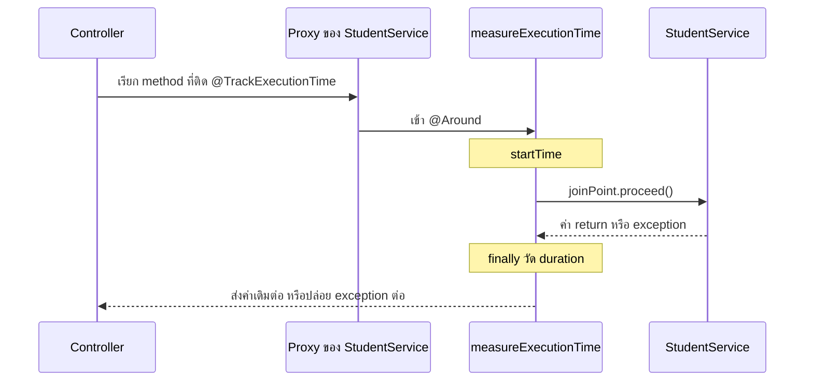
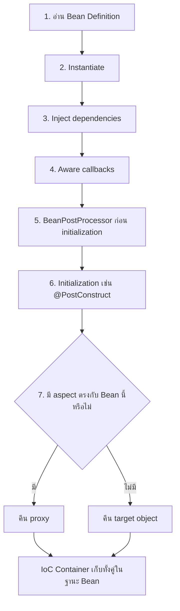
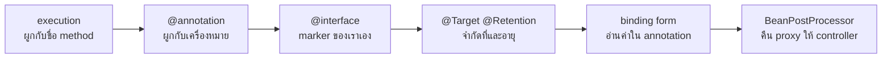

# #25 — Custom Annotation กับ @annotation ใน Spring AOP

> **วิดีโอ:** [Custom Annotations in Spring AOP | @annotation Binding & Proxies | Spring Boot Full Course #25](https://youtu.be/TT-b9ob-lN8) — Coder Army, ~43 นาที
> **แหล่งที่ใช้สรุป:** ซับไตเติลภาษาฮินดีที่ YouTube สร้างอัตโนมัติ
> **เวอร์ชันในโค้ด:** Spring Boot 4.1 + Java 21 (ใส่หมายเหตุไว้ทุกจุดที่ Spring Boot 3.x ต่างกัน)

ตอนนี้ตอบคำถามเดียว: **จะสร้าง annotation ของตัวเอง แล้วให้ Spring AOP ไป intercept เฉพาะ method ที่ติด annotation นั้นได้อย่างไร** รวมถึงส่งค่าที่เขียนไว้ใน annotation เข้า advice และตอนสร้าง Bean ตัว proxy ถูกสลับเข้ามาตรงขั้นไหน ผู้สอนปิดซีรีส์ AOP ด้วยเรื่องนี้ เขาบอกว่าถ้ายังไม่ดูตอน AOP ก่อนหน้า ให้ดูอย่างน้อยสองตอนแรกก่อน

ส่วนที่ติดป้าย `💡 เพิ่มเติม` คือของที่ผมเติมเอง ไม่ได้อยู่ในวิดีโอ ส่วนที่ติด `⚠️ แก้จากวิดีโอ` คือจุดที่วิดีโอพูดคลาดเคลื่อน ส่วนที่ติด `⚠️ Boot 4 vs 3` คือจุดที่ Spring Boot 3.x / Spring Framework 6 เขียนหรือทำงานต่างจาก Boot 4 / Spring 7

---

## สารบัญ

| เวลา | หัวข้อ |
|---|---|
| [0:00](https://youtu.be/TT-b9ob-lN8?t=0) | [1. ทำไม custom annotation ถึงใช้ในงานจริง](#1-ทำไม-custom-annotation-ถึงใช้ในงานจริง) |
| [0:35](https://youtu.be/TT-b9ob-lN8?t=35) | [2. โปรเจกต์ AOP Demo ที่ใช้ต่อ](#2-โปรเจกต์-aop-demo-ที่ใช้ต่อ) |
| [1:48](https://youtu.be/TT-b9ob-lN8?t=108) | [3. intercept ด้วย execution ก่อน](#3-intercept-ด้วย-execution-ก่อน) |
| [3:22](https://youtu.be/TT-b9ob-lN8?t=202) | [4. designator annotation แทน execution](#4-designator-annotation-แทน-execution) |
| [4:36](https://youtu.be/TT-b9ob-lN8?t=276) | [5. ประกาศงานแบบ declarative](#5-ประกาศงานแบบ-declarative) |
| [6:01](https://youtu.be/TT-b9ob-lN8?t=361) | [6. สร้าง annotation ด้วย interface พิเศษ](#6-สร้าง-annotation-ด้วย-interface-พิเศษ) |
| [8:39](https://youtu.be/TT-b9ob-lN8?t=519) | [7. Around วัดเวลาแล้วส่งค่า return ต่อ](#7-around-วัดเวลาแล้วส่งค่า-return-ต่อ) |
| [14:07](https://youtu.be/TT-b9ob-lN8?t=847) | [8. ยิงดูผลและจำลองงานช้า](#8-ยิงดูผลและจำลองงานช้า) |
| [15:26](https://youtu.be/TT-b9ob-lN8?t=926) | [9. annotation เดียวใช้ได้หลาย method](#9-annotation-เดียวใช้ได้หลาย-method) |
| [16:15](https://youtu.be/TT-b9ob-lN8?t=975) | [10. meta-annotation สองคำถาม](#10-meta-annotation-สองคำถาม) |
| [16:56](https://youtu.be/TT-b9ob-lN8?t=1016) | [11. Target กับ ElementType](#11-target-กับ-elementtype) |
| [19:40](https://youtu.be/TT-b9ob-lN8?t=1180) | [12. Retention กับ RetentionPolicy](#12-retention-กับ-retentionpolicy) |
| [22:11](https://youtu.be/TT-b9ob-lN8?t=1331) | [13. Documented และ annotation ของ Spring](#13-documented-และ-annotation-ของ-spring) |
| [23:25](https://youtu.be/TT-b9ob-lN8?t=1405) | [14. type-matching form กับ binding form](#14-type-matching-form-กับ-binding-form) |
| [25:04](https://youtu.be/TT-b9ob-lN8?t=1504) | [15. จาก marker เป็น configured annotation](#15-จาก-marker-เป็น-configured-annotation) |
| [28:19](https://youtu.be/TT-b9ob-lN8?t=1699) | [16. อ่านค่าแล้วเตือน method ที่ช้า](#16-อ่านค่าแล้วเตือน-method-ที่ช้า) |
| [33:58](https://youtu.be/TT-b9ob-lN8?t=2038) | [17. Bean lifecycle กับ BeanPostProcessor](#17-bean-lifecycle-กับ-beanpostprocessor) |
| [36:24](https://youtu.be/TT-b9ob-lN8?t=2184) | [18. หลัง initialization จึงคืน proxy หรือ target](#18-หลัง-initialization-จึงคืน-proxy-หรือ-target) |
| [41:29](https://youtu.be/TT-b9ob-lN8?t=2489) | [19. ตอนสตาร์ทเก็บ mapping ของ pointcut](#19-ตอนสตาร์ทเก็บ-mapping-ของ-pointcut) |
| — | [20. สรุปท้ายตอน](#20-สรุปท้ายตอน) |

---

## 1. ทำไม custom annotation ถึงใช้ในงานจริง

[▶ 0:00](https://youtu.be/TT-b9ob-lN8?t=0)

ผู้สอนบอกว่าตอนนี้สำคัญ เพราะงานจริงใช้แบบนี้บ่อย เป้าหมายมีสามอย่าง

1. สร้าง custom annotation ได้เอง
2. รู้ว่าข้างใน annotation มีอะไรได้บ้าง
3. เอา annotation นั้นไปคู่กับ AOP เพื่อ intercept method ไหนก็ได้ที่ติดมันไว้

เขาสมมติว่าผู้ชมรู้ AOP มาแล้วจากสองตอนแรกของชุดนี้ ตอนนี้จะไม่ย้อนว่า Aspect, Advice, Pointcut คืออะไรตั้งแต่ต้น

---

## 2. โปรเจกต์ AOP Demo ที่ใช้ต่อ

[▶ 0:35](https://youtu.be/TT-b9ob-lN8?t=35)

โปรเจกต์ยังชื่อ AOP Demo ตัวเดิมจากตอนที่แล้ว หน้าตาตอนเปิดคลิปมีสี่ชิ้น และยังไม่ได้ทำอะไรพิเศษ

| ชิ้น | ทำอะไร |
|---|---|
| `StudentController` | `@RequestMapping("/api/students")` มี `POST` สร้าง student กับ `GET` ดึง student |
| DTO `Student` | มีแค่ `name` กับ `age` |
| `StudentService` | `createStudent` พิมพ์ `Student saved` แล้วคืน student ตัวเดิม `getStudent` รับสตริง `All student data` พิมพ์มัน แล้วคืนสตริงเดิม |
| Aspect | มีคลาสอยู่แล้ว แต่ยังว่าง |

Controller ส่ง student ที่รับเข้ามาให้ service แล้วเอาค่าที่ service คืนส่งกลับให้ client ทั้งก้อน ไม่มี repository เพราะอยากดู AOP อย่างเดียว

> 💡 **เพิ่มเติม:** ซับอ่านแพ็กเกจเป็น `in.strikes.service` โค้ดด้านล่างใช้ `in.strikes.aopdemo` ให้ต่อจากตอน #23 ผู้สอนแก้ method เดิมแล้ว comment advice เก่าทิ้ง โปรเจกต์ที่รันคู่กับโน้ตแยกแต่ละขั้นเป็นคนละ method เพื่อยิงซ้ำแล้วได้ output ชุดเดิม พอร์ตคือ `9025` DTO ในวิดีโอไม่ได้โชว์ทั้งคลาส โน้ตใช้ record ของ Java 21

`pom.xml` ใช้ parent `spring-boot-starter-parent:4.1.1` และ Java 21 dependency ที่เกี่ยวกับตอนนี้คือสองตัวนี้

```xml
<parent>
  <groupId>org.springframework.boot</groupId>
  <artifactId>spring-boot-starter-parent</artifactId>
  <version>4.1.1</version>
</parent>

<properties>
  <java.version>21</java.version>
</properties>

<dependencies>
  <dependency>
    <groupId>org.springframework.boot</groupId>
    <artifactId>spring-boot-starter-webmvc</artifactId>
  </dependency>
  <dependency>
    <groupId>org.springframework.boot</groupId>
    <artifactId>spring-boot-starter-aspectj</artifactId>
  </dependency>
</dependencies>
```

> ⚠️ **Boot 4 vs 3:** โปรเจกต์นี้มี `@Aspect` จึงต้องมี starter ของ AspectJ ใน Boot 3 artifact คือ `spring-boot-starter-aop` Boot 4 เปลี่ยนชื่อเป็น `spring-boot-starter-aspectj` เพื่อบอกให้ชัดว่า starter นี้คือ AOP ที่ใช้ AspectJ guide บอกว่าถ้าเคยใส่ starter เอง ให้ตรวจก่อนว่าแอปใช้ AspectJ จริงหรือไม่ เกณฑ์คือมี annotation ในแพ็กเกจ `org.aspectj.lang.annotation` หรือไม่ เช่น `@Aspect` บางไลบรารีบน classpath ก็พึ่ง annotation นี้ ตัวอย่างใน guide คือ `@Timed` กับ `@Counted` ของ Micrometer starter สำหรับเทสต์คือ `spring-boot-starter-aspectj-test` ฝั่งเว็บ Boot 4 ใช้ `spring-boot-starter-webmvc` แทน `spring-boot-starter-web`
> ([Spring Boot 4.0 Migration Guide — AOP Starter POM](https://github.com/spring-projects/spring-boot/wiki/Spring-Boot-4.0-Migration-Guide#aop-starter-pom))

> 💡 **เพิ่มเติม:** parent 4.1.1 ไม่ต้องใส่เวอร์ชันใน dependency เอง jar ที่แพ็กออกมาดึง `spring-aop-7.0.9.jar` กับ `aspectjweaver-1.9.25.1.jar` กลไกในตอนนี้ยังเป็น proxy ของ Spring AOP ไม่ใช่การ compile ด้วยคอมไพเลอร์ของ AspectJ

`server.port=9025` อยู่ใน `application.properties`

```java
package in.strikes.aopdemo.dto;

public record Student(String name, int age) {}
```

```java
package in.strikes.aopdemo.controller;

import in.strikes.aopdemo.dto.Student;
import in.strikes.aopdemo.service.StudentService;
import org.springframework.web.bind.annotation.GetMapping;
import org.springframework.web.bind.annotation.PostMapping;
import org.springframework.web.bind.annotation.RequestBody;
import org.springframework.web.bind.annotation.RequestMapping;
import org.springframework.web.bind.annotation.RestController;

@RestController
@RequestMapping("/api/students")
public class StudentController {

  private final StudentService studentService;

  public StudentController(StudentService studentService) {
    this.studentService = studentService;
  }

  @GetMapping
  public String getStudent() {
    return studentService.getStudent("All student data");
  }

  @PostMapping
  public Student createStudent(@RequestBody Student student) {
    return studentService.createStudent(student);
  }
}
```

ในไฟล์จริงมี endpoint อื่นสำหรับแต่ละการทดลองด้านล่าง path หลักสองอันนี้คือของวิดีโอ

---

## 3. intercept ด้วย execution ก่อน

[▶ 1:48](https://youtu.be/TT-b9ob-lN8?t=108)

ก่อนเข้า custom annotation เขาย้อนของที่ทำเป็นแล้ว สมมติอยาก intercept `getStudent` ของ `StudentService` เขาเขียน advice ชื่อแนว `logBefore` ให้พิมพ์ `Method intercepted` แล้วใส่ `@Before` กับ pointcut แบบ `execution`

ลำดับใน expression คือสิ่งที่เคยใช้

1. designator `execution` คือจับตอน method ถูกเรียก
2. return type มาก่อน เขาใส่ชนิดที่ method คืน
3. ชื่อเต็มของ method คือแพ็กเกจ คลาส แล้ว `getStudent`
4. วงเล็บ argument เป็น `String` เพราะ method รับสตริงตัวเดียว

เขาย่อหน้าตา pointcut ประมาณนี้ แล้วสตาร์ทแอป ยิง `GET /api/students` จาก Postman ได้ข้อมูล student กลับมา และใน console มีทั้ง `Method intercepted` กับข้อความของ service เขาบอกว่าอันนี้เรารู้แล้ว ไม่ใช่ประเด็นของวันนี้

```java
@Before("execution(String in.strikes.aopdemo.service.StudentService.getStudentByExecution(String))")
public void logBefore() {
  System.out.println("Method intercepted");
}
```

> 💡 **เพิ่มเติม:** ในวิดีโอ pointcut ชี้ `getStudent` ตัวเดียวกับที่ใช้ต่อ เมื่อเขาเปลี่ยนไปใช้ `@annotation` เขา comment advice นี้ทิ้ง โปรเจกต์นี้ย้ายไปที่ `GET /api/students/execution` เพื่อให้ทั้งสองแบบยิงได้ในรอบเดียว

ผลจากพอร์ต 9025

```text
Method intercepted
All student data
```

```http
HTTP/1.1 200
Content-Type: text/plain;charset=UTF-8
Content-Length: 16

All student data
```

`@Before` ทำงานก่อนบรรทัดใน service ค่าที่ client ได้ยังเป็นสตริงที่ service คืน

---

## 4. designator annotation แทน execution

[▶ 3:22](https://youtu.be/TT-b9ob-lN8?t=202)

เขาบอกว่าพลังจริงของ AOP อยู่ที่ designator ชื่อ `@annotation` ไม่ใช่การไล่เขียน `execution` ทีละ method

`@annotation(...)` แปลว่า จับทุก method ที่มี annotation ชนิดที่ระบุแปะอยู่ ไม่ต้องเขียนชื่อคลาสหรือชื่อ method ใน pointcut

ตัวอย่างบนจอเขาเอา annotation ที่เรียกว่า `TimeStamp` ไปแปะบน `getStudent` แล้วก็อปชื่อเต็มรวมแพ็กเกจไปใส่ใน aspect

```java
@Before("@annotation(in.strikes.aopdemo.annotation.TimeStamp)")
public void logBeforeTimeStamp() {
  System.out.println("Method intercepted");
}
```

สตาร์ทใหม่แล้วยิงอีกครั้ง console ยังได้ `Method intercepted` กับข้อมูล student แปลว่า pointcut แบบนี้ใช้ได้

> 💡 **เพิ่มเติม:** ซับไม่ได้โชว์ซอร์สของ `TimeStamp` เขาพูดเหมือนเป็น annotation ที่มีอยู่แล้วจากตัวอย่างก่อนหน้า โปรเจกต์นี้สร้าง marker ชื่อเดียวกันไว้ที่ `in.strikes.aopdemo.annotation.TimeStamp` แล้วเปิดที่ `GET /api/students/timestamp` ผลตรงกับที่เขาอ่านจาก console

```text
Method intercepted
All student data
```

ข้อดีที่เขาเน้นคือ ไม่ต้องผูก pointcut กับชื่อ method อีกต่อไป ใครอยากให้ถูก intercept ก็แปะ annotation นั้น

---

## 5. ประกาศงานแบบ declarative

[▶ 4:36](https://youtu.be/TT-b9ob-lN8?t=276)

ขั้นต่อไปเขาไม่ได้อยากใช้ annotation สำเร็จรูป เขาอยากสร้างของตัวเอง แล้วให้แต่ละอันหมายถึงงาน infra คนละอย่าง งานพวกนี้อยู่คนละที่กับ business logic

ตัวอย่างที่เขาตั้งชื่อไว้

| Annotation ที่เขาอยากมี | ความหมายที่ประกาศบน method |
|---|---|
| `PerformLog` | ก่อน method ทำงาน ให้พิมพ์ log |
| `Authenticate` | ก่อน method ทำงาน ให้ตรวจสิทธิ์ |
| ตัวที่สร้างจริงในตอนนี้ | วัดว่า method ใช้เวลาเท่าไร |

พอแปะ annotation ลงไป method นั้นไม่ได้บรรจุ logic เอง logic ไปอยู่ใน method ของ aspect ที่ intercept มัน นี่คือ AOP แบบเดิม แต่ฝั่ง service เหลือแค่การประกาศ

เขาเรียกสิ่งนี้ว่า superpower เพราะเขียนได้แบบ declarative บรรทัด annotation แปลว่า "ก่อน method นี้ต้องมีงานแบบนี้" โดยไม่ต้องอ่านตัว method เพื่อหา `if` ของ log หรือของ authentication

คำถามที่ยังไม่เคยตอบในคอร์สคือ สร้าง annotation อย่างไร เขาลบตัวอย่างที่ยังไม่ได้สร้างทิ้ง แล้วเริ่มจากศูนย์

---

## 6. สร้าง annotation ด้วย interface พิเศษ

[▶ 6:01](https://youtu.be/TT-b9ob-lN8?t=361)

เขาเปิดแพ็กเกจใหม่ชื่อ `annotation` เพื่อรวม annotation ที่สร้างเองไว้ที่เดียว

งานแรกที่อยากได้ไม่ใช่ log เปล่า ๆ เขาอยากวัดเวลา แบบที่เคยทำกับ filter และ interceptor ว่า method เริ่มจนจบใช้กี่มิลลิวินาที ชื่อแรกที่พูดคือ `EvaluateTime` แล้วเปลี่ยนเป็น `TrackExecutionTime`

[▶ 7:32](https://youtu.be/TT-b9ob-lN8?t=452) จุดที่คนพลาดบ่อยคือ annotation ไม่ใช่ class มันเป็น interface และ Java ให้ syntax พิเศษ ต้องเขียน `@interface` ไม่ใช่ `interface` เปล่า ๆ คำว่า `@interface` บอกคอมไพเลอร์ว่านี่คือ annotation ชื่อ `TrackExecutionTime`

เขียนแค่นี้ก็สร้าง annotation ได้แล้ว มันยังไม่ต้องมี logic เพราะ annotation มักทำหน้าที่เป็นเครื่องหมายอย่างเดียว เขาเรียกแบบนี้ว่า **marker annotation** แปะไว้หน้า method ไหน แปลว่า method นั้นถูก mark ด้วย `TrackExecutionTime` แล้วค่อยให้โค้ด AOP ไปหาคนที่ถูก mark แล้วลงมือทำงาน

```java
package in.strikes.aopdemo.annotation;

public @interface TrackExecutionTime {
}
```

บล็อกด้านบนคือร่างแรกในวิดีโอ ยังไม่มี `@Target` ไม่มี `@Retention` และยังไม่มี member เขาเอาไปแปะหน้า method ใน service ได้ทันที แค่ import ให้ถูกแพ็กเกจ

---

## 7. Around วัดเวลาแล้วส่งค่า return ต่อ

[▶ 8:39](https://youtu.be/TT-b9ob-lN8?t=519)

เขาวาง `logBefore` ไว้ก่อน แล้วเขียน advice ใหม่ชื่อ `measureExecutionTime`

วัดเวลาต้องมีทั้งก่อนและหลัง method จึงใช้ `@Around` ไม่ใช่ `@Before` argument ตัวแรกคือ `ProceedingJoinPoint` เพราะต้องเรียก method เป้าหมายเองผ่าน `proceed()`

pointcut ตอนแรกเป็นแบบ type-matching คือใส่ชื่อเต็มของ annotation ในสตริง

```java
@Around("@annotation(in.strikes.aopdemo.annotation.TrackExecutionTime)")
```

ใครแปะ `@TrackExecutionTime` advice นี้ถูกเรียก

ลำดับใน method ตามที่เขาเขียน

1. จับ `startTime` ด้วย `System.currentTimeMillis()` ก่อนเรียก target
2. เรียก `joinPoint.proceed()` ใน `try`
3. ไม่เขียน `catch`
4. ใส่ `finally` เพื่อจับ `endTime` ลบเป็น `duration` แล้วพิมพ์ชื่อ method

### ทำไมต้องคืน Object

[▶ 10:26](https://youtu.be/TT-b9ob-lN8?t=626) `proceed()` อาจคืนอะไรก็ได้ `getStudent` คืน `String` `createStudent` คืน `Student` คนอื่นอาจคืน `long` หรือ `int` advice ต้องส่งค่านั้นกลับไปให้ client เหมือนเดิม ถ้า method ของ advice เป็น `void` ค่าจริงจะถูกกลืน และ client ได้ `null` เพราะ `@Around` คุมค่าที่เดินทางกลับได้

เขาจึงเปลี่ยน return type จาก `void` เป็น `Object` แล้ว `return joinPoint.proceed()`

### ทำไมไม่ catch

[▶ 11:23](https://youtu.be/TT-b9ob-lN8?t=683) method ที่ถูกวัดอาจ throw ได้ เขาไม่อยากให้ `measureExecutionTime` กลืน exception นั้น เพราะ advice นี้มีหน้าที่เดียวคือวัดเวลา exception เป็นเรื่องของคนอื่น อาจมี global exception handler หรือ aspect อีกตัวรออยู่

`proceed()` ประกาศว่า throw `Throwable` คอมไพเลอร์จึงฟ้องว่ายังไม่จัดการ เขาใส่ `throws Throwable` ที่ advice แทนการ catch ให้ exception เดินต่อ

### ทำไมต้องมี finally

[▶ 12:01](https://youtu.be/TT-b9ob-lN8?t=721) ถ้า target throw `finally` ยังทำงาน เขาอยากได้ `endTime` แม้ method จะล้ม ไม่งั้น method ที่พังจะไม่มีตัวเลขเวลา

ชื่อ method มาจาก `joinPoint.getSignature().getName()` เขาบอกว่า `JoinPoint` ถือข้อมูลของ target ข้อความที่พิมพ์คือเวลาที่ใช้ โดยมีชื่อ method นำหน้า

ร่างนี้คือ logic ก่อนจะมีค่า `warnAfter` กับ `operation` ร่างที่รันในโปรเจกต์อยู่ที่ [ส่วนที่ 16](#16-อ่านค่าแล้วเตือน-method-ที่ช้า) ซึ่งครอบของเดิมไว้ แล้วยัง fallback ไปชื่อ method เมื่อไม่ได้ส่ง `operation`



---

## 8. ยิงดูผลและจำลองงานช้า

[▶ 14:07](https://youtu.be/TT-b9ob-lN8?t=847)

เขาแปะ `@TrackExecutionTime` ที่ `getStudent` แล้วสตาร์ทรอบแรก method ไม่ได้ทำงานอะไรนอกจากพิมพ์สตริง console จึงบอกว่าเวลาเป็น 0 เพราะจบเกือบทันที

จากนั้นเขาอยากให้เห็นตัวเลขที่ไม่ใช่ศูนย์ จึงจำลองว่างานช้าด้วย `Thread.sleep(2000)` ใส่ใน `try` แล้ว `catch (InterruptedException)` โดยไม่ทำอะไรใน catch สตาร์ทใหม่ ยิง GET อีกครั้ง Postman ใช้เวลาประมาณ 2 วินาที ได้ `All student data` กลับมา

> ⚠️ **แก้จากวิดีโอ:** เขาบอกว่า sleep 2000 มิลลิวินาที และ Postman ใช้เวลาประมาณ 2 วินาที แต่ซับอ่านตัวเลขใน log ว่า `255 milliseconds` สองประโยคนี้ไปด้วยกันไม่ได้ รัน `Thread.sleep(2000)` ในโปรเจกต์นี้ได้ `Time taken by Get Student Data: 2006 ms` ตัวเลข 255 น่าจะเป็นซับฟังตัวเลขเพี้ยน

> 💡 **เพิ่มเติม:** catch ว่างตามวิดีโอทิ้งสถานะ interrupt ของเธรดไป โปรเจกต์นี้เรียก `Thread.currentThread().interrupt()` ใน catch เพื่อคืนสถานะนั้น ระยะเวลาที่วัดไม่เปลี่ยน

---

## 9. annotation เดียวใช้ได้หลาย method

[▶ 15:26](https://youtu.be/TT-b9ob-lN8?t=926)

เขาแปะ `@TrackExecutionTime` ที่ `createStudent` ด้วย โดยยังไม่ใส่ค่าอะไรเพิ่ม สตาร์ทใหม่แล้วยิง POST body ที่ส่งไปกลับมาเหมือนเดิม console มี `Student saved` แล้วตามด้วยเวลาของ `createStudent` เป็น 0 เพราะไม่มีงานช้า

ประเด็นของช่วงนี้ไม่ใช่ตัวเลข เขาอยากให้เห็นว่า annotation อันเดียวบอกได้ว่า method ไหนต้องถูกวัด โดยไม่ต้องแก้ pointcut เพิ่ม method ใหม่ก็แค่แปะ annotation เดิม

เขายกตัวอย่างว่าจะสร้างเพิ่มอีกกี่อันก็ได้ เช่น log, audit, authenticate แต่ละอันมี aspect ของตัวเอง ไม่ได้จำกัดว่าต้องมี annotation เดียวในทั้งแอป

---

## 10. meta-annotation สองคำถาม

[▶ 16:15](https://youtu.be/TT-b9ob-lN8?t=975)

marker ที่เพิ่งสร้างยังไม่มี metadata เขาบอกว่าตอนสร้าง annotation ควรถามสองข้อ

1. แปะที่ไหนได้
2. ข้อมูลของ annotation อยู่ได้นานแค่ไหน

เครื่องมือของทั้งสองข้อเป็น annotation ที่แปะบน annotation อีกที เขาเรียกว่า **meta-annotation** `TrackExecutionTime` เป็น annotation อยู่แล้ว ถ้าเอา `@Target` ไปไว้ข้างบนมัน `@Target` คือ meta-annotation

---

## 11. Target กับ ElementType

[▶ 16:56](https://youtu.be/TT-b9ob-lN8?t=1016)

`@Target` รับค่าจาก enum `ElementType` เพื่อบอกว่า `TrackExecutionTime` ไปอยู่บน element ชนิดไหนได้ เขาเปิด enum แล้วอ่านรายการที่มี

| ค่า | ความหมายตามที่เขาอธิบาย |
|---|---|
| `TYPE` | class, interface รวมถึง annotation interface, enum และ record |
| `FIELD` | ฟิลด์ |
| `METHOD` | method |
| `PARAMETER` | parameter |
| `CONSTRUCTOR` | constructor |
| `LOCAL_VARIABLE` | ตัวแปรท้องถิ่น |
| `ANNOTATION_TYPE` | แปะบน annotation ได้ จึงใช้ทำ meta-annotation เช่นตัว `@Target` เอง |
| `PACKAGE` | แพ็กเกจ |
| `TYPE_PARAMETER` | type parameter |
| `TYPE_USE` | จุดที่ใช้ type |
| `MODULE` | module |
| `RECORD_COMPONENT` | ส่วนประกอบของ record |

เขาลองใส่แค่ `ElementType.TYPE` แล้วกลับไปที่ service จุดที่เคยแปะบน method ขึ้น error เขาอ่านข้อความใน IDE ว่า `TrackExecutionTime is not applicable to method`

ถ้าอยากได้ทั้ง method และ class ส่งได้หลายค่า

```java
@Target({ElementType.METHOD, ElementType.TYPE})
```

งานวัดเวลาไม่มีประโยชน์ถ้าวัดทั้งคลาส เขาจึงเหลือแค่ `ElementType.METHOD`

ถ้าไม่เขียน `@Target` เลย annotation นั้นแปะได้ทุกที่ ทั้งคลาส method แพ็กเกจ และตัวแปร พอเขียน `@Target` แปลว่าตั้งใจจำกัด

> 💡 **เพิ่มเติม:** ไฟล์ `samples/WrongTarget.java` แปะ `@TrackExecutionTime` บนคลาส ทั้งที่ `@Target` มีแค่ `METHOD` ไฟล์นี้อยู่นอก `src/main/java` จึงไม่ทำให้ `mvn package` พัง compile ด้วย `javac` ได้ข้อความจริงนี้

```text
samples/WrongTarget.java:5: error: annotation interface not applicable to this kind of declaration
@TrackExecutionTime
^
1 error
```

ข้อความของ `javac` คนละประโยคกับที่ IntelliJ โชว์ แต่ความหมายเดียวกัน คือ element นี้ไม่ใช่ที่ที่ annotation อนุญาต

---

## 12. Retention กับ RetentionPolicy

[▶ 19:40](https://youtu.be/TT-b9ob-lN8?t=1180)

คำถามข้อสองใช้ `@Retention` ค่ามาจาก enum `RetentionPolicy` ซึ่งมีสามค่า เขาอ่านความหมายจากเอกสารใน IDE

| ค่า | อยู่ถึงไหน |
|---|---|
| `SOURCE` | คอมไพเลอร์ทิ้ง มีแค่ในซอร์ส พอ compile ข้อมูล annotation หาย |
| `CLASS` | อยู่ใน bytecode แต่ไม่พร้อมให้อ่านตอน runtime |
| `RUNTIME` | อยู่ใน bytecode และอ่านได้ตอนโปรแกรมรัน |

เขาเลือก `RUNTIME` เพราะ AOP จับคู่ pointcut ตอนแอปทำงาน ตอน Spring สตาร์ทและสร้าง Bean มันต้องมองเห็นว่า method ไหนติด `TrackExecutionTime` การจับคู่นั้นเกิดตอน runtime ไม่ใช่ตอนที่คนกำลังอ่านซอร์ส

[▶ 21:36](https://youtu.be/TT-b9ob-lN8?t=1296) เขาบอกเพิ่มว่า ไม่เขียน `@Retention` ก็ intercept ได้ตั้งแต่รอบแรก ดังนั้นค่า default น่าจะเป็น `RUNTIME` และถ้าไม่เขียน `@Target` จะแปะได้ทุกที่ ส่วนเรื่อง target เขายังอยากจำกัดไว้ที่ method เพราะวัดเวลาทั้งคลาสไม่มีความหมาย

> ⚠️ **แก้จากวิดีโอ:** ค่า default ของ `@Retention` คือ `RetentionPolicy.CLASS` ไม่ใช่ `RUNTIME` เอกสารของ `RetentionPolicy` เขียนไว้ว่า `CLASS` คือพฤติกรรม default annotation ถูกบันทึกลง class file แต่ VM ไม่จำเป็นต้องเก็บไว้ให้อ่านตอนรัน
> ([RetentionPolicy](https://docs.oracle.com/en/java/javase/21/docs/api/java.base/java/lang/annotation/RetentionPolicy.html))

ส่วนที่เขาจำได้ว่า "ไม่ใส่ `@Retention` ก็ยัง intercept ได้" ไม่ได้แปลว่า default เป็น `RUNTIME` มันแปลว่าแบบ type-matching ของ `@annotation` ใน Spring AOP อ่าน annotation จาก bytecode ได้แม้ retention จะเป็น `CLASS` ทดลองบนพอร์ต 9025 ได้แบบนี้

| Annotation | Retention | `Method.getAnnotations()` | type-matching `@annotation(ชื่อเต็ม)` | binding `@annotation(ชื่อparameter)` |
|---|---|---|---|---|
| `ClassOnly` | ไม่เขียน จึงเป็น `CLASS` | ว่าง | ทำงาน พิมพ์ `class-only intercepted` | ไม่ได้ทดลอง |
| `ExplicitClass` | `CLASS` | ว่าง | ทำงาน พิมพ์ `explicit-class intercepted` | ไม่ได้ทดลอง |
| `SourceOnly` | `SOURCE` | ว่าง | ไม่ทำงาน มีแค่บรรทัดของ method | ไม่ได้ทดลอง |
| `ClassConfigured` | `CLASS` และมี member `operation` | ว่าง | ทำงาน พิมพ์ `class-configured type-match intercepted` | ไม่ทำงาน ไม่มีบรรทัด `bound class-retention operation=...` |
| `TrackExecutionTime` | `RUNTIME` | เห็นค่า `operation` กับ `warnAfter` | ใช้ได้ | ใช้ได้ และอ่าน `operation()` ได้ |

`SOURCE` ถูกคอมไพเลอร์ทิ้งจริง ตามที่เขาอ่าน จึงจับไม่ได้ทั้งการสะท้อนและ pointcut

สิ่งที่ต้องใช้ `RUNTIME` จริง ๆ ในตอนนี้คือ **binding form** ที่จะอ่าน `warnAfter()` กับ `operation()` ในส่วนถัดไป แบบนั้นต้องได้ตัว annotation ตอน advice ทำงาน ถ้า retention เป็น `CLASS` advice ที่ผูก parameter ไม่ถูกเรียกเลย แม้ type-matching ของชื่อเต็มจะยังยิงได้

เขาเลยสรุปถูกที่งานนี้ต้องเขียน `@Retention(RetentionPolicy.RUNTIME)` เหตุผลที่คลาดคือ "เพราะมันเป็นค่า default" ที่ถูกคือ default เป็น `CLASS` และ `CLASS` ไม่พอสำหรับแบบที่ส่ง annotation เข้า parameter

---

## 13. Documented และ annotation ของ Spring

[▶ 22:11](https://youtu.be/TT-b9ob-lN8?t=1331)

meta-annotation อีกตัวที่เห็นบ่อยคือ `@Documented` มันไม่ได้เปลี่ยนพฤติกรรมตอนรัน มันบอกแค่ว่าตอนสร้าง Javadoc ภายหลัง ให้รวม annotation นี้ในเอกสารหรือไม่ ใส่หรือไม่ใส่ก็ไม่กระทบการ intercept เขาใส่ไว้ได้

จากนั้นเขาพาเปิด annotation ที่เคยใช้แล้ว เพื่อให้เห็นว่าของจริงก็ประกอบแบบเดียวกัน

[▶ 22:34](https://youtu.be/TT-b9ob-lN8?t=1354) `@RestController` มี `@Target` เป็น `TYPE` จึงอยู่ได้ที่ระดับ class หรือ interface แต่จะแปะบน method ไม่ได้ retention เป็น `RUNTIME` และมี `@Documented` ข้างในยังเป็น `@Controller` กับ `@ResponseBody` ตามที่เคยเรียน

`@Service` ก็มี `@Target`, `@Retention` เป็น runtime, ใช้กับ type ได้, มี `@Documented` และประกอบอยู่บน `@Component`

> 💡 **เพิ่มเติม:** ตรวจใน `spring-web-7.0.9.jar` กับ `spring-context-7.0.9.jar` แล้ว `@RestController` และ `@Service` ยังเป็น `RetentionPolicy.RUNTIME` และเป็น runtime-visible annotation จริง ตรงกับที่เขาเปิดใน IDE

ร่างสุดท้ายของตัว annotation หลังใส่ meta-annotation แล้ว แต่ยังไม่ใส่ member คือแบบนี้

```java
package in.strikes.aopdemo.annotation;

import java.lang.annotation.Documented;
import java.lang.annotation.ElementType;
import java.lang.annotation.Retention;
import java.lang.annotation.RetentionPolicy;
import java.lang.annotation.Target;

@Target(ElementType.METHOD)
@Retention(RetentionPolicy.RUNTIME)
@Documented
public @interface TrackExecutionTime {
}
```

---

## 14. type-matching form กับ binding form

[▶ 23:25](https://youtu.be/TT-b9ob-lN8?t=1405)

ถึงตรงนี้ pointcut ยังเป็นชื่อเต็มของ annotation เขาเรียกแบบนี้ว่า **type-matching form** เพราะกำลังเทียบชนิดทั้งก้อน ต้องเขียนทางเข้าไปจนถึงคลาส

อีกแบบคือส่งตัว annotation เข้ามาเป็น parameter ของ advice เขาเรียกว่า **binding form**

```java
@Around("@annotation(trackExecutionTime)")
public Object measureExecutionTime(
    ProceedingJoinPoint joinPoint, TrackExecutionTime trackExecutionTime) throws Throwable {
  // ...
}
```

ชื่อในวงเล็บของ `@annotation` ต้องตรงกับชื่อ parameter เขาเน้นคำว่าต้องตรง ไม่งั้นใช้ไม่ได้ `ProceedingJoinPoint` ยังอยู่ตัวแรกตามเดิม

เขาสตาร์ทใหม่ ทั้ง `getStudent` และ `createStudent` ติด annotation อยู่แล้วยิง GET ที่มี sleep แล้วยังได้เวลาของ `getStudent` แปลว่า binding form ทำงาน และเขาว่าเขียนสั้นกว่าเพราะไม่ต้องใส่แพ็กเกจใน pointcut

> 💡 **เพิ่มเติม:** ลองตั้งชื่อ parameter เป็น `otherName` ทั้งที่ pointcut ยังเขียน `trackExecutionTime` แอปสตาร์ทได้ ไม่มี error ตอนบูต แต่ advice ตัวที่ชื่อไม่ตรงไม่พิมพ์อะไร ส่วน advice ที่ชื่อ `trackExecutionTime` ตรงกับ parameter ยังพิมพ์ `Time taken by ...` ตามเดิม คลาสทดลองนั้นถูกลบออกแล้วเพื่อไม่ให้ค้างในโปรเจกต์

แบบ binding คือทางที่เขาต้องใช้ต่อจากนี้ เพราะจะเรียก method บนตัว annotation เพื่ออ่านค่าที่คนแปะไว้ type-matching บอกได้แค่ว่า "มี annotation ชนิดนี้" แต่ไม่ได้ส่งตัวนั้นเข้า advice

---

## 15. จาก marker เป็น configured annotation

[▶ 25:04](https://youtu.be/TT-b9ob-lN8?t=1504)

marker แค่ทำเครื่องหมายว่า method นี้ต้องถูกวัด เขายังอยากแนบข้อมูลเพิ่ม แล้วเรียกแบบที่มีข้อมูลว่า **configured annotation**

annotation เป็น interface จึงเพิ่มข้อมูลด้วยการประกาศ method ไม่ใช่ฟิลด์ เขาใส่สองตัว

`warnAfter` เป็น `long` ค่า default `2000` แปลว่าถ้า method ใช้เวลาถึงเกณฑ์นี้ ให้เตือนว่ามันช้า เขาตั้ง 2 วินาทีเป็นตัวอย่าง แล้วบอกเองว่าแม้ 1 วินาทีก็ถือว่าช้าแล้ว 2 วินาทียิ่งช้า เกณฑ์นี้มีไว้ให้คนดูแลรู้ว่า method ไหนควรกลับไปปรับทีหลัง เช่นตอน audit

`operation` เป็น `String` ค่า default เป็นสตริงว่าง ใช้อธิบายว่า method นี้กำลังทำอะไร ชื่อ method อย่างเดียวอาจไม่พอ

```java
package in.strikes.aopdemo.annotation;

import java.lang.annotation.Documented;
import java.lang.annotation.ElementType;
import java.lang.annotation.Retention;
import java.lang.annotation.RetentionPolicy;
import java.lang.annotation.Target;

@Target(ElementType.METHOD)
@Retention(RetentionPolicy.RUNTIME)
@Documented
public @interface TrackExecutionTime {

  long warnAfter() default 2000;

  String operation() default "";
}
```

เพราะมี default โค้ดเดิมที่เขียนแค่ `@TrackExecutionTime` ยังคอมไพล์ได้ ถ้าคนใช้ไม่ส่งค่า ก็ได้ 2000 กับสตริงว่าง เขาสตาร์ทแล้วยิงทั้ง GET และ POST ผลเดิมยังอยู่ ไม่พัง

จากนั้นเขาใส่ค่าคนละชุดที่ละ method

`getStudent` ใช้ `warnAfter = 1500` และ `operation` เป็นข้อความแนว get student data เพราะ method นี้ sleep อยู่ 2 วินาที ซึ่งเกิน 1500 เขาคาดว่าต้องมีคำเตือน

`createStudent` ใช้ `warnAfter = 2000` และ `operation` เป็นข้อความแนว creating a new student เขาบอกว่าตั้งใจปล่อยให้ถึง 2 วินาทีได้ เพราะรู้ว่างานนี้อาจช้าอยู่แล้ว เช่น database ช้า ถ้าเกินกว่านั้นค่อยเตือน

ไม่ส่งค่าก็ได้ เพราะ default มีอยู่แล้ว การส่งค่าคือการใส่ metadata เพิ่มบน method นั้น

---

## 16. อ่านค่าแล้วเตือน method ที่ช้า

[▶ 28:19](https://youtu.be/TT-b9ob-lN8?t=1699)

กลับมาที่ `measureExecutionTime` โครง `startTime`, `proceed()`, `endTime`, `duration` ยังเหมือนเดิม สิ่งที่เพิ่มคืออ่านค่าจาก parameter `trackExecutionTime`

1. `operation` มาจาก `trackExecutionTime.operation()`
2. ถ้าว่าง ใช้ `joinPoint.getSignature().getName()` แทน เพื่อให้ยังมีข้อความให้พิมพ์
3. `warningThreshold` มาจาก `trackExecutionTime.warnAfter()`
4. ถ้า `duration` มากกว่าหรือเท่ากับเกณฑ์ พิมพ์ `Slow operation alert` ก่อน แล้วค่อยพิมพ์เวลา
5. ถ้าไม่ถึงเกณฑ์ พิมพ์เวลาตามปกติ

เขาบอกว่าตอนนี้ยัง `System.out.println` อยู่ งานจริงอาจเปลี่ยนบรรทัดพิมพ์เป็น log แต่เงื่อนไขเหมือนกัน หน้าที่ของ advice ยังเป็นการเรียก method แล้วใน `finally` ตัดสินว่าจะขึ้นคำเตือนหรือพิมพ์ปกติ

```java
package in.strikes.aopdemo.aspect;

import in.strikes.aopdemo.annotation.TrackExecutionTime;
import org.aspectj.lang.ProceedingJoinPoint;
import org.aspectj.lang.annotation.Around;
import org.aspectj.lang.annotation.Aspect;
import org.springframework.stereotype.Component;

@Aspect
@Component
public class SimpleAspect {

  @Around("@annotation(trackExecutionTime)")
  public Object measureExecutionTime(
      ProceedingJoinPoint joinPoint, TrackExecutionTime trackExecutionTime) throws Throwable {
    long startTime = System.currentTimeMillis();
    try {
      return joinPoint.proceed();
    } finally {
      long endTime = System.currentTimeMillis();
      long duration = endTime - startTime;
      String operation = trackExecutionTime.operation();
      if (operation.isBlank()) {
        operation = joinPoint.getSignature().getName();
      }
      long warningThreshold = trackExecutionTime.warnAfter();
      if (duration >= warningThreshold) {
        System.out.println("Slow operation alert");
      }
      System.out.println("Time taken by " + operation + ": " + duration + " ms");
    }
  }
}
```

ในไฟล์จริงมี advice อื่นของขั้นทดลองก่อนหน้าอยู่ด้วย method นี้คือตัวสุดท้ายของวิดีโอ

service ที่เขาวัดมีสอง method นี้ `previewStudent` เป็นจุดที่ใช้ default เพื่อให้เห็น fallback ไปชื่อ method

```java
@TrackExecutionTime
public String previewStudent(String data) {
  System.out.println(data);
  return data;
}

@TrackExecutionTime(warnAfter = 1500, operation = "Get Student Data")
public String getStudent(String data) {
  try {
    Thread.sleep(2000);
  } catch (InterruptedException e) {
    Thread.currentThread().interrupt();
  }
  System.out.println(data);
  return data;
}

@TrackExecutionTime(warnAfter = 2000, operation = "Creating a new student")
public Student createStudent(Student student) {
  System.out.println("Student saved");
  return student;
}
```

[▶ 33:05](https://youtu.be/TT-b9ob-lN8?t=1985) เขายิง GET ก่อน เพราะเกณฑ์ 1500 แต่ sleep 2000 จึงต้องขึ้นคำเตือน แล้วยิง POST ซึ่งไม่มี sleep จึงไม่ขึ้นคำเตือน และข้อความที่พิมพ์เป็น `operation` ไม่ใช่ชื่อ method

ผลจริงบนพอร์ต 9025

`GET /api/students/quick` ใช้ default `operation` ว่าง และ `warnAfter` 2000 งานจบใน 0 ms จึงไม่มีคำเตือน และ fallback ไปชื่อ method

```text
preview
Time taken by previewStudent: 0 ms
```

`GET /api/students`

```text
All student data
Slow operation alert
Time taken by Get Student Data: 2006 ms
```

```http
HTTP/1.1 200
Content-Type: text/plain;charset=UTF-8
Content-Length: 16

All student data
```

`POST /api/students` ด้วย `{"name":"Aditya","age":21}`

```text
Student saved
Time taken by Creating a new student: 0 ms
```

```http
HTTP/1.1 200
Content-Type: application/json
Content-Length: 26

{"name":"Aditya","age":21}
```

body ที่ client ได้คือ student ตัวเดิม แปลว่า `return joinPoint.proceed()` ส่งค่ากลับจริง ไม่ได้กลืนเป็น `null` คำเตือนของ GET มาก่อนบรรทัดเวลา แล้ว POST ไม่มีคำว่า `Slow operation alert` ซับช่วงท้ายพูดถึงคำเตือนปนกับทั้งสอง request ลำดับบนจอคือคำเตือนอยู่ที่ GET ส่วน POST พิมพ์เวลาของ creating a new student อย่างเดียว

> 💡 **เพิ่มเติม:** เขาออกแบบ `finally` เพื่อให้ยังวัดเวลาแม้ target จะ throw แต่ไม่ได้ยิงเคสนี้ใน Postman `GET /api/students/fail` เรียก method ที่พิมพ์หนึ่งบรรทัดแล้ว throw `IllegalStateException` advice ไม่ได้ catch ผลคือเวลาถูกพิมพ์ก่อน แล้ว exception เดินต่อจน client ได้ 500

```text
failing lookup
Time taken by Failing student lookup: 0 ms
```

```http
HTTP/1.1 500
Content-Type: application/json

{"timestamp":"2026-10-16T12:13:40.758Z","status":500,"error":"Internal Server Error","path":"/api/students/fail"}
```

stack มี `SimpleAspect.measureExecutionTime` เรียก `ProceedingJoinPoint.proceed()` แล้วจึงเข้า `StudentService.failStudent` แปลว่าเวลาใน `finally` เกิดก่อน exception จะออกจาก advice

เขาสรุปช่วงโค้ดว่าสร้าง custom annotation ได้ทั้งแบบ marker และแบบที่ถือค่าไว้ข้างใน

---

## 17. Bean lifecycle กับ BeanPostProcessor

[▶ 33:58](https://youtu.be/TT-b9ob-lN8?t=2038)

ช่วงท้ายเขาปิดทั้งชุด AOP ด้วยคำถามว่า ตอนแอปสตาร์ทและ Bean ถูกสร้าง interception เข้ามาตรงขั้นไหน เขาเปิดกระดาน Bean lifecycle จากตอน #7 แล้วบอกว่ามีสองขั้นที่ตอนนั้นยังไม่พูด เพราะยังไม่ได้ใช้ AOP

ลำดับที่เขาวาดในตอนนี้

1. อ่าน Bean Definition
2. Instantiate สร้าง object
3. Inject dependency
4. Aware callbacks
5. BeanPostProcessor ก่อน initialization
6. initialization callback เช่น `@PostConstruct`
7. BeanPostProcessor หลัง initialization

ขั้น 5 กับขั้น 7 คือของที่เพิ่ม ขั้น 6 คือ `@PostConstruct` ที่รู้อยู่แล้ว

`BeanPostProcessor` เป็น interface มีสอง method

- `postProcessBeforeInitialization`
- `postProcessAfterInitialization`

ทั้งคู่รับ bean กับชื่อ bean แล้วคืน `Object` ซึ่งเป็น bean ที่จะถูกใช้ต่อ จึงคืนตัวเดิมก็ได้ หรือคืนคนละ object ก็ได้

> ⚠️ **แก้จากวิดีโอ:** เขาเรียก `BeanPostProcessor` ว่าเป็น interface พิเศษของ Java และเป็น class พิเศษด้วย ที่ถูกคือมันเป็น interface ของ Spring ชื่อ `org.springframework.beans.factory.config.BeanPostProcessor` ไม่ได้อยู่ใน JDK ใน `spring-beans-7.0.9` ทั้งสอง method เป็น default method ที่คืน bean ตัวเดิม ถ้าคลาสลูกไม่ override



---

## 18. หลัง initialization จึงคืน proxy หรือ target

[▶ 36:24](https://youtu.be/TT-b9ob-lN8?t=2184)

เขาโฟกัสที่ฝั่ง after initialization ก่อน เพราะเป็นขั้นที่ตัดสินเรื่อง proxy ลำดับที่เล่ากับ `StudentService` เป็นแบบนี้

1. สร้าง Bean `StudentService`
2. inject dependency ตอนนี้ service ไม่มี dependency ถ้ามี repository ขั้นนี้จะไม่ว่าง ตอนนี้จึงข้าม
3. ไม่ได้เขียน `@PostConstruct` จึงข้าม initialization
4. BeanPostProcessor ตรวจว่า service นี้ต้องมี proxy หรือไม่

วิธีตรวจคือดูว่ามี aspect ตรงกับ method ของมันหรือไม่ `measureExecutionTime` ตรงกับ method ที่ติด `@TrackExecutionTime` ดังนั้นคำตอบคือมี

- ถ้ามี aspect ให้คืน **proxy**
- ถ้าไม่มี ให้คืน **target object** คือ `StudentService` ตัวจริง

ทั้งสองทางค่าที่คืนยังเป็น bean ในสายตาของ IoC Container สิ่งที่อยู่ข้างในจะเป็น proxy หรือตัวจริง เป็นเรื่องที่ BeanPostProcessor ตัดสิน

[▶ 39:30](https://youtu.be/TT-b9ob-lN8?t=2370) เขากลับไปอธิบายขั้น before initialization ว่าไม่ได้ทำอะไรใหญ่ อาจเป็นการตั้งค่าเริ่มต้น ตรวจ หรือเตรียม bean และเขาบอกว่าขั้นนี้เตรียม bean ให้พร้อมสำหรับ interception หลังจากนั้น initialization อย่าง `@PostConstruct` จึงรัน พอ bean พร้อมแล้ว ขั้น after initialization ค่อยตัดสินว่าจะคืน proxy หรือคืนตัว bean

[▶ 40:58](https://youtu.be/TT-b9ob-lN8?t=2458) ผลที่ controller เห็นคือตอน autowire `StudentService` มันไม่ได้ตัว service ตรง ๆ มันได้ proxy ที่ BeanPostProcessor คืนมา ถ้าไม่มี aspect เลย controller ได้ target object จริง

> ⚠️ **แก้จากวิดีโอ:** งานสร้าง proxy ของ Spring AOP ไม่อยู่ใน `postProcessBeforeInitialization` คลาสที่ทำคือ `AnnotationAwareAspectJAutoProxyCreator` ซึ่งสืบทอด `AbstractAutoProxyCreator` ใน `spring-aop-7.0.9` คลาสนี้มี `postProcessAfterInitialization` แต่ไม่ได้ override `postProcessBeforeInitialization` ขั้น before ของตัวนี้จึงคืน bean เดิมตาม default method การตัดสินคืน proxy หรือ target อยู่หลัง initialization ตรงกับขั้นที่เขาเน้น ส่วนคำว่า before "เตรียม bean สำหรับ interception" เป็นคำสรุปของเขา ไม่ใช่สิ่งที่ auto-proxy creator ทำในขั้นนั้น BeanPostProcessor ตัวอื่นใช้ขั้น before ทำงานคนละอย่าง เช่น `@PostConstruct` ถูกเรียกจาก processor คนละตัวในช่วงนั้น ตามที่วัดไว้ในตอน #7

> 💡 **เพิ่มเติม:** `ProxyReport` พิมพ์ชนิดของ Bean ตอนสตาร์ท `StudentService` ที่ถูก inject เป็น subclass ที่ CGLIB สร้าง `PlainService` ไม่มี method ถูก aspect จับ จึงเป็นคลาสเดิม ตรงกับสองทางที่เขาวาด

```text
studentService class: in.strikes.aopdemo.service.StudentService$$SpringCGLIB$$0
studentService is AOP proxy: true
studentService is CGLIB proxy: true
plainService class: in.strikes.aopdemo.service.PlainService
plainService is AOP proxy: false
```

เขาพูดถึง proxy สองแบบคือ CGLIB กับ JDK dynamic proxy ว่าเคยดูแล้ว กรณีนี้ service เป็นคลาสไม่มี interface จึงได้ CGLIB ซึ่งสอดคล้องกับค่า default `spring.aop.proxy-target-class=true` ของ Boot 4.1

> 💡 **เพิ่มเติม:** การเรียก method ของ service ผ่าน `this` จากข้างในคลาสเดียวกันไม่ผ่าน proxy advice จึงไม่ทำงาน สายที่ทำงานคือสายจาก Bean อื่น เช่น Controller เรื่องนี้วัดไว้ในตอน #23

ใน stack ของเคสที่ throw มี `CglibAopProxy$DynamicAdvisedInterceptor.intercept` ก่อนจะถึง `AspectJAroundAdvice` แล้วจึงถึง `SimpleAspect` นี่คือตัว proxy ที่ controller คุยด้วย

---

## 19. ตอนสตาร์ทเก็บ mapping ของ pointcut

[▶ 41:29](https://youtu.be/TT-b9ob-lN8?t=2489)

คำถามปิดท้ายคือ พอสตาร์ทแอปแล้ว Bean ถูกสร้างทีละตัว Spring ต้องไล่หา aspect ทั้งแอปทุกครั้งที่สร้าง Bean หรือไม่ ถ้าทำแบบนั้นจะช้า

เขาตอบว่าไม่ทำแบบนั้น ตอนแอปเพิ่งสตาร์ท Spring เก็บ aspect กับ pointcut ลงโครงสร้างข้อมูลที่ค้นได้เร็ว โดยรู้แล้วว่า pointcut ไหนเข้ากับ method ไหน mapping นี้เกิดตอน startup

พอถึงเวลารัน เช่น `createStudent` ถูกเรียก มันไม่ค้นทั้งแอป มันดูแค่ว่า method นี้มี pointcut หรือไม่ ถ้ามีก็ทำ interception ถ้าไม่มีก็ไม่ทำ ไม่มีงานคำนวณหนักตอนถูกเรียก เพราะจับคู่ไว้แล้วตอนสตาร์ท

> 💡 **เพิ่มเติม:** ตัวที่รวบรวม aspect ตอนสตาร์ทคือ `AnnotationAwareAspectJAutoProxyCreator.findCandidateAdvisors()` พอถึง `postProcessAfterInitialization` ของ Bean ที่เข้าเงื่อนไข มันสร้าง proxy พร้อมสาย interceptor ของ method นั้นไว้เลย ตอน request เข้าจึงวิ่งเข้า `CglibAopProxy` ตาม stack ด้านบน ไม่ได้ไปเปิดทุก aspect ใหม่ทุกครั้งที่ method ถูกเรียก

เขาปิดว่าชุด AOP จบที่นี่ แล้วชวนกด like กับ comment

---

## 20. สรุปท้ายตอน

### ลำดับความคิดของทั้งตอน



### ประเด็นที่ต้องจำ

1. `@annotation(ชนิด)` จับทุก method ที่ติด annotation นั้น ไม่ต้องเขียน `execution` รายชื่อ method
2. custom annotation สร้างด้วย `@interface` แบบที่ไม่มี member คือ marker ใช้ประกาศว่า method นี้ต้องมีงาน infra โดย logic อยู่ที่ aspect
3. วัดเวลาก่อนและหลังต้องใช้ `@Around` กับ `ProceedingJoinPoint.proceed()` advice ต้องคืนค่าของ `proceed()` ถ้าเป็น `void` client ได้ `null`
4. อย่า catch exception ใน advice ที่ตั้งใจวัดเวลาอย่างเดียว ใส่ `throws Throwable` แล้วใช้ `finally` เพื่อให้ยังได้ duration แม้ target จะล้ม
5. `@Target(ElementType.METHOD)` จำกัดให้แปะได้แค่ method ไม่เขียน `@Target` แปลว่าแปะได้ทุกที่
6. `@Retention(RetentionPolicy.RUNTIME)` ทำให้ binding form อ่านค่าใน annotation ได้ ค่า default คือ `CLASS` ไม่ใช่ `RUNTIME` แบบ type-matching ยังจับ `CLASS` ได้ แต่แบบที่ส่ง annotation เข้า parameter จับไม่ได้ `SOURCE` ถูกคอมไพเลอร์ทิ้ง
7. `@Documented` มีผลแค่ Javadoc `@RestController` และ `@Service` ก็ใช้ `@Target`, `@Retention(RUNTIME)`, `@Documented` แบบเดียวกัน
8. type-matching ใส่ชื่อเต็มใน pointcut binding form ใช้ `@annotation(ชื่อparameter)` และชื่อนั้นต้องตรงกับ parameter ถึงจะอ่าน `warnAfter()` กับ `operation()` ได้
9. member ของ annotation ประกาศเป็น method และใส่ `default` ได้ method ที่ไม่ส่งค่าจึงยังใช้ marker เดิมได้
10. หลัง initialization ของ Bean ถ้ามี aspect ตรง method ของมัน BeanPostProcessor คืน proxy ถ้าไม่มีก็คืน target ทั้งคู่เป็น Bean ใน container controller ที่ inject service ได้ตัว proxy
11. การจับ pointcut กับ method ถูกเก็บตอนสตาร์ท ตอนเรียก method ไม่ได้ไล่ค้น aspect ทั้งแอปใหม่
12. Boot 4 เปิด AOP จาก annotation ของ AspectJ ด้วย `spring-boot-starter-aspectj` ไม่ใช่ `spring-boot-starter-aop`

### คำถามทบทวน

1. pointcut แบบ `execution` กับแบบ `@annotation` ผูกกับอะไรคนละอย่าง และแบบหลังช่วยอะไรตอนเพิ่ม method ใหม่
2. ทำไมไฟล์ของ annotation ต้องเป็น `@interface` และ marker annotation ต่างจาก configured annotation ตรงไหน
3. ถ้า `measureExecutionTime` เป็น `void` แล้ว `POST /api/students` จะส่งอะไรกลับไปที่ client
4. ทำไม advice ที่วัดเวลาถึงไม่ควรมี `catch` แต่ควรมี `finally` และต้องประกาศ `throws` อะไร
5. ใส่ `@Target(ElementType.TYPE)` อย่างเดียว แล้วแปะ annotation บน method ได้หรือไม่ ถ้าไม่เขียน `@Target` เลยล่ะ
6. ทำไม `@TrackExecutionTime` ของงานนี้ต้องเป็น `RUNTIME` ทั้งที่ type-matching ยังจับ annotation ที่เป็น `CLASS` ได้
7. ใน binding form ชื่อใน `@annotation(...)` ต้องสัมพันธ์กับอะไรใน signature ของ advice
8. `warnAfter` กับ `operation` ถูกประกาศอย่างไร และถ้าว่างทำไม log ยังมีชื่อ method
9. ตอนสร้าง `StudentService` BeanPostProcessor ตัดสินคืน proxy ที่ขั้นไหน และ controller ได้ object ชนิดไหน
10. ทำไม Spring ไม่ไล่เปิด aspect ทุกตัวใหม่ทุกครั้งที่ `createStudent` ถูกเรียก

### ตอนถัดไป

[#26 — JDBC in Java from Scratch | CRUD Operation with JDBC & MySQL](./26-jdbc-from-scratch.md)
