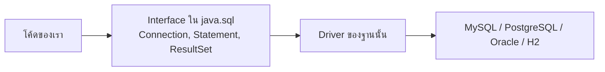
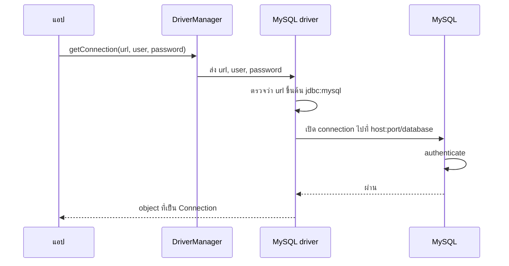
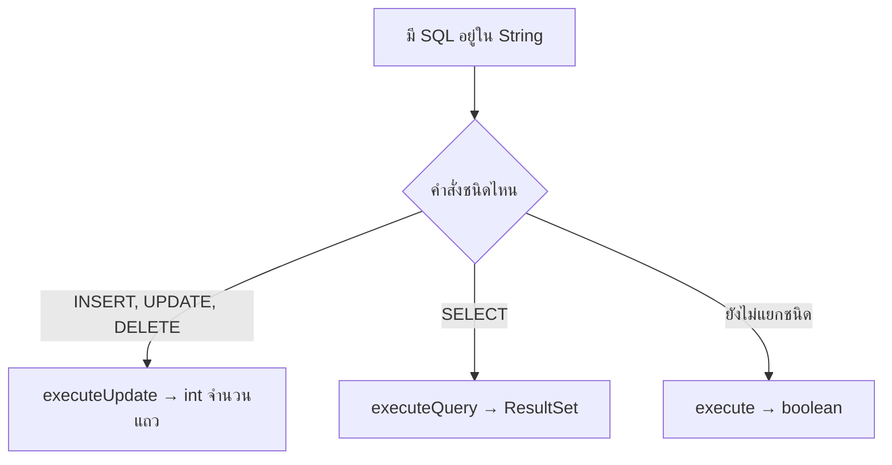
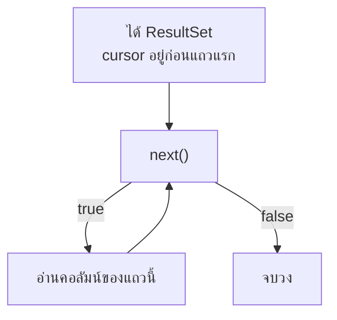
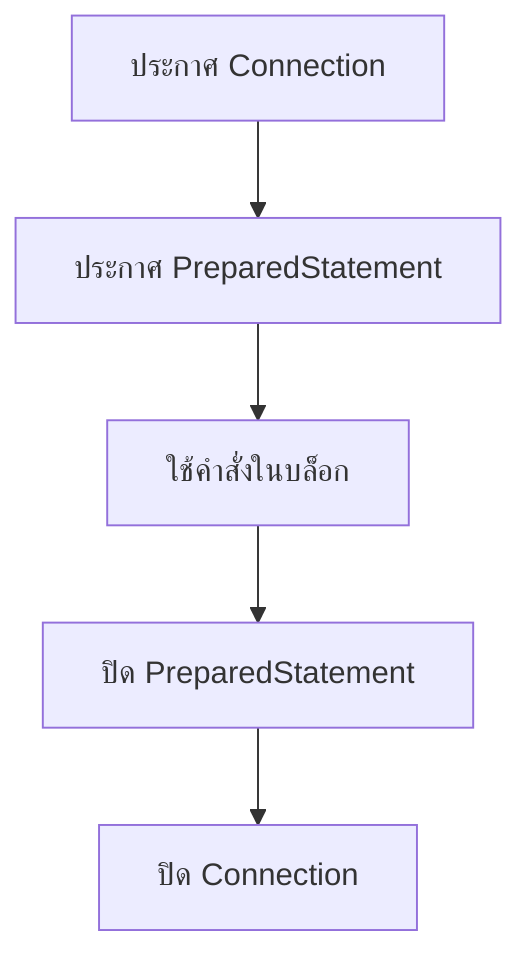
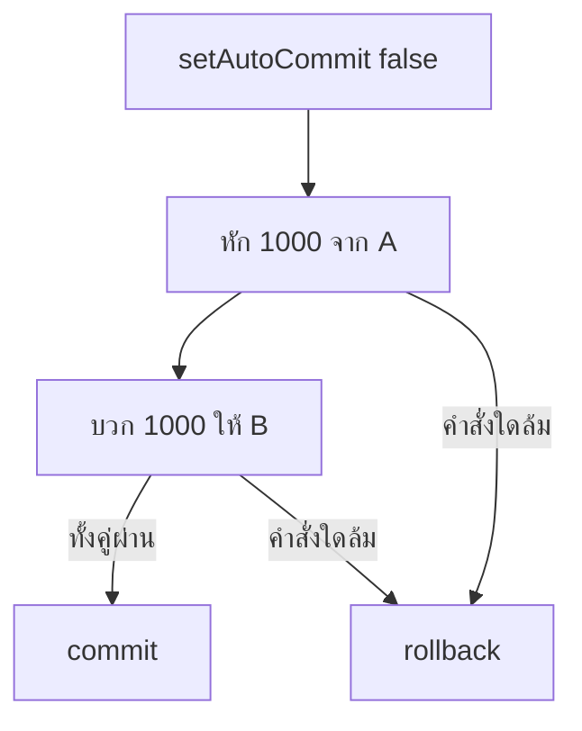

# #26 — JDBC จากศูนย์: CRUD ด้วย Java เปล่า

> **วิดีโอ:** [JDBC in Java from Scratch | CRUD Operation with JDBC & MySQL | Spring Boot Full Course #26](https://youtu.be/IbCHISQOMUA) — Coder Army, ~92 นาที
> **แหล่งที่ใช้สรุป:** ซับภาษาอังกฤษที่ YouTube สร้างอัตโนมัติ (en-US)
> **เวอร์ชันในโค้ด:** Spring Boot 4.1 + Java 21 (ใส่หมายเหตุไว้ทุกจุดที่ Spring Boot 3.x ต่างกัน)

ตอนนี้ถอยออกจาก Spring Boot ทั้งตอน เพื่อตอบคำถามที่อยู่ใต้ Spring JDBC, Hibernate และ JPA: **แอป Java เปล่าเชื่อมต่อฐานข้อมูลเชิงสัมพันธ์ แล้วทำ create, read, update, delete ด้วย JDBC ได้อย่างไร**

ส่วนที่ติดป้าย `💡 เพิ่มเติม` คือของที่ผมเติมเอง ไม่ได้อยู่ในวิดีโอ ส่วนที่ติด `⚠️ แก้จากวิดีโอ` คือจุดที่วิดีโอพูดคลาดเคลื่อน

> 💡 **เพิ่มเติม — วิดีโอใช้ MySQL โน้ตนี้ใช้ H2:** ผู้สอนติดตั้ง **MySQL** จริง ให้เซิร์ฟเวอร์ฟังพอร์ต **3306** สร้าง database `student_db` ผ่าน DBeaver แล้วต่อด้วย `jdbc:mysql://localhost:3306/student_db` โค้ดที่รันในโน้ตนี้เปลี่ยนมาใช้ **H2 in-memory** แทน เพื่อให้รันได้โดยไม่ต้องติดตั้ง MySQL ข้อมูลอยู่ในหน่วยความจำและหายเมื่อจบ process พฤติกรรมของ `DriverManager`, `Statement`, `PreparedStatement` และ `ResultSet` ยังเป็น JDBC ชุดเดียวกัน URL ของ H2 ใส่ `MODE=MySQL` เพื่อให้ `AUTO_INCREMENT` ใช้ได้ และใส่ `DB_CLOSE_DELAY=-1` เพื่อไม่ให้ฐานหายตอนปิด connection สุดท้ายของแต่ละเมธอด

---

## สารบัญ

| เวลา | หัวข้อ |
|---|---|
| [0:00](https://youtu.be/IbCHISQOMUA?t=0) | [1. เป้าหมายของตอน](#1-เป้าหมายของตอน) |
| [1:05](https://youtu.be/IbCHISQOMUA?t=65) | [2. แอปกับฐานข้อมูลอยู่คนละฝั่ง](#2-แอปกับฐานข้อมูลอยู่คนละฝั่ง) |
| [4:08](https://youtu.be/IbCHISQOMUA?t=248) | [3. คุยตรงกับทุกฐานข้อมูลไม่ได้](#3-คุยตรงกับทุกฐานข้อมูลไม่ได้) |
| [6:08](https://youtu.be/IbCHISQOMUA?t=368) | [4. JDBC กับ polymorphism](#4-jdbc-กับ-polymorphism) |
| [10:35](https://youtu.be/IbCHISQOMUA?t=635) | [5. JDBC Driver](#5-jdbc-driver) |
| [15:19](https://youtu.be/IbCHISQOMUA?t=919) | [6. โปรเจกต์ Maven และไดรเวอร์](#6-โปรเจกต์-maven-และไดรเวอร์) |
| [20:49](https://youtu.be/IbCHISQOMUA?t=1249) | [7. สร้าง database กับตาราง](#7-สร้าง-database-กับตาราง) |
| [23:33](https://youtu.be/IbCHISQOMUA?t=1413) | [8. คลาส Student](#8-คลาส-student) |
| [24:41](https://youtu.be/IbCHISQOMUA?t=1481) | [9. เปิด connection](#9-เปิด-connection) |
| [31:50](https://youtu.be/IbCHISQOMUA?t=1910) | [10. Statement และ executeUpdate](#10-statement-และ-executeupdate) |
| [40:28](https://youtu.be/IbCHISQOMUA?t=2428) | [11. Update กับ Delete](#11-update-กับ-delete) |
| [43:38](https://youtu.be/IbCHISQOMUA?t=2618) | [12. อ่านด้วย ResultSet](#12-อ่านด้วย-resultset) |
| [58:01](https://youtu.be/IbCHISQOMUA?t=3481) | [13. execute คืน boolean](#13-execute-คืน-boolean) |
| [1:02:43](https://youtu.be/IbCHISQOMUA?t=3763) | [14. ใส่ค่าด้วย text block](#14-ใส่ค่าด้วย-text-block) |
| [1:07:35](https://youtu.be/IbCHISQOMUA?t=4055) | [15. PreparedStatement](#15-preparedstatement) |
| [1:11:55](https://youtu.be/IbCHISQOMUA?t=4315) | [16. ปิดทรัพยากร](#16-ปิดทรัพยากร) |
| [1:15:48](https://youtu.be/IbCHISQOMUA?t=4548) | [17. Update, Delete, Get แบบรับพารามิเตอร์](#17-update-delete-get-แบบรับพารามิเตอร์) |
| [1:25:24](https://youtu.be/IbCHISQOMUA?t=5124) | [18. รัน CRUD ที่เขียนเสร็จ](#18-รัน-crud-ที่เขียนเสร็จ) |
| [1:28:56](https://youtu.be/IbCHISQOMUA?t=5336) | [19. งานที่ JDBC ยังต้องทำมือ และ Transaction](#19-งานที่-jdbc-ยังต้องทำมือ-และ-transaction) |
| — | [20. สรุปท้ายตอน](#20-สรุปท้ายตอน) |

---

## 1. เป้าหมายของตอน

[▶ 0:00](https://youtu.be/IbCHISQOMUA?t=0)

**JDBC** ย่อมาจาก **Java Database Connectivity** คือ API มาตรฐานของ Java สำหรับเชื่อมแอปกับฐานข้อมูล วันนี้ผู้สอนใช้แอป Java เปล่า ไม่ใช้ Spring Boot เพื่อให้คนที่ยังไม่รู้จัก Boot ตามได้

สิ่งที่จะทำในตอนนี้มีสามอย่าง คือเชื่อมต่อฐานข้อมูล เขียน query แล้วอ่านผลที่ฐานส่งกลับ เป้าหมายระยะนี้ยังแค่เก็บข้อมูลจากแอปลงฐานได้ ตอนถัด ๆ ไปค่อยดูว่า Spring JDBC เติมอะไรให้เหนือ JDBC แล้ว Hibernate กับ JPA เติมอะไรต่อ

> 💡 **เพิ่มเติม:** ใน JDK ทางเชื่อมฐานข้อมูลเชิงสัมพันธ์แบบ blocking คือแพ็กเกจ `java.sql` มี API คนละสายที่ไม่ได้ใช้ JDBC เช่น R2DBC สำหรับการเข้าถึงแบบ reactive ประโยคในวิดีโอที่ว่าแอปต้องใช้ JDBC ทุกครั้งที่คุยกับฐานข้อมูล จึงหมายถึงทางมาตรฐานของ JDBC ไม่ใช่ทางเดียวที่มีในระบบ Java

---

## 2. แอปกับฐานข้อมูลอยู่คนละฝั่ง

[▶ 1:05](https://youtu.be/IbCHISQOMUA?t=65)

ผู้สอนวาดแอป Java ไฟล์อย่าง `demo.java` อยู่ฝั่งหนึ่ง และฐานข้อมูลอยู่อีกฝั่ง ฐานเชิงสัมพันธ์อาจเป็น MySQL, Oracle, Microsoft SQL Server, H2 หรือตัวอื่น แอปส่ง query ไป ฐานตอบกลับว่าสำเร็จหรือไม่ และถ้าเป็น `SELECT` ก็ส่งแถวกลับมา

แอปรันบน JVM ฐานอาจอยู่เครื่องเดียวกับ JVM หรือคนละเครื่อง คนละเครือข่าย เขาเรียกเครื่องของแอปว่า server A และเครื่องของฐานว่า server B สองฝั่งจะคุยกันได้ต้องมี protocol ร่วมกัน แบบเดียวกับ client–server

งานที่แอปอยากทำกับฐานคือ **CRUD** คือ create, read, update และ delete กับฐานเชิงสัมพันธ์งานเหล่านี้เขียนเป็น SQL เช่น `SELECT` ทุกคอลัมน์จากตาราง `student` สมมติว่าตารางนี้มีอยู่แล้ว

SQL ที่เขียนใน Java ตอนแรกเป็นแค่ `String` ฐานข้อมูลเป็นฝ่ายประเมินสตริงนั้น ลำดับที่ต้องทำจึงเป็นแบบนี้

1. เปิด **connection** เพื่อให้มีช่องทางคุยกับฐาน
2. ส่ง query ไปที่ database server
3. รับคำตอบกลับมา แล้วแปลใหแอปเข้าใจ

จุดที่ต้องแปลคือ Java ทำงานกับ object แต่ฐานทำงานกับแถวและคอลัมน์ สองฝั่งไม่ได้ถือข้อมูลชนิดเดียวกันเอง

---

## 3. คุยตรงกับทุกฐานข้อมูลไม่ได้

[▶ 4:08](https://youtu.be/IbCHISQOMUA?t=248)

แอปคุยกับฐานตรง ๆ ไม่ได้ เพราะแต่ละผลิตภัณฑ์มีกฎของตัวเอง เขาไล่ MySQL, Oracle, Microsoft SQL Server, H2 และ PostgreSQL แล้วบอกว่าทุกตัวมาจากคนละ vendor จึงออกแบบ protocol คนละแบบ

กฎที่ต่างกันมีอย่างน้อยเท่านี้

| เรื่อง | แต่ละฐานทำไม่เหมือนกัน |
|---|---|
| Connection | วิธีเปิดช่องทางไม่ใช่ชุดคลาสเดียวกัน |
| Authentication | วิธีตรวจผู้ใช้ไม่เหมือนกัน |
| การห่อ SQL | วิธีแพ็ก query ก่อนส่งต่างกัน |
| ชนิดข้อมูล | เช่น MySQL ใช้ `VARCHAR` บางตัวใช้ชื่อชนิดอื่น |
| ผลลัพธ์ | รูปแบบแถวที่ส่งกลับไม่เหมือนกัน |
| Error | โครงสร้างข้อผิดพลาดไม่เหมือนกัน |
| Transaction | วิธีจัดการหน่วยของงานที่ต้องสำเร็จพร้อมกันไม่เหมือนกัน |

ถ้า JDK ต้องรู้จักทุกฐานเอง JDK จะต้องมีคลาสและ interface คนละชุดต่อหนึ่งผลิตภัณฑ์ และแอปก็ต้องจำคนละวิธี ตรงนี้คือเหตุผลที่ JDBC ไม่ได้ลงมือทำให้ทุกฐานเอง

---

## 4. JDBC กับ polymorphism

[▶ 6:08](https://youtu.be/IbCHISQOMUA?t=368)

JDBC คือ standard API ของ Java สำหรับคุยกับฐานข้อมูล เทียบกับ API อื่นใน JDK เช่น Collection framework และ Reflection ถ้าต้องการ interface กับคลาสของ JDBC ให้นำเข้าแพ็กเกจ `java.sql`

เขาใช้ Collection framework อธิบายว่าทำไม JDBC ถึงเป็น interface ไม่ใช่คลาสที่ผูกกับฐานใดฐานหนึ่ง

`Collection` เป็น interface ที่มีเมธอดร่วมอย่าง `add` และ `remove` คลาสจริงอย่าง `ArrayList`, `LinkedList` และ `HashSet` override เมธอดเหล่านี้คนละวิธี `ArrayList` ใส่ของต่อท้ายอาเรย์ `HashSet` ใส่ตามกฎของ set ฝั่งที่เรียกยังเรียก `add` ชื่อเดิม ไม่ต้องจำชื่อเมธอดคนละตัวต่อคลาส ระหว่าง `Collection` กับคลาสเหล่านี้ยังมี interface อย่าง `List` และ `Set` อีกชั้น เขาข้ามชั้นนั้นไปก่อนเพื่อโฟกัสที่คลาสจริง

> ⚠️ **แก้จากวิดีโอ — `LinkedList.add`:** เขาบอกว่า `LinkedList` override `add` โดยเดินจากโหนดแรกไปโหนดสุดท้ายแล้วค่อยสร้างโหนดใหม่ ที่ถูกคือ `java.util.LinkedList` เก็บตัวชี้ `last` ไว้แล้ว `add(E)` ผูกโหนดใหม่ต่อจากท้ายในเวลาคงที่ ไม่ได้เดินทั้งลิสต์ทุกครั้งที่เพิ่มท้าย

JDBC ใช้แนวเดียวกัน Java ประกาศ interface มาตรฐาน แล้วไม่ลงมือ implement ให้ทุกฐาน

| Interface | หน้าที่ที่เขาเล่า |
|---|---|
| `Connection` | ช่องทางที่เปิดไปยังฐาน |
| `Statement` | ห่อ SQL แล้วส่งผ่าน connection นั้น |
| `PreparedStatement` | รูปแบบของ statement ที่ใส่ค่าทีหลัง เขาจะเปิดตอนท้าย |
| `ResultSet` | แถวที่ `SELECT` ส่งกลับ |

โค้ดของเราเรียกเมธอดบน interface เหล่านี้ ไม่ว่าข้างใต้จะเป็น MySQL, PostgreSQL, Oracle หรือ H2 ใครเป็นคนใส่ตัวจริงของเมธอด คือ driver ของฐานนั้น



ภาพนี้เหมือน client ที่ถือตัวแปรชนิด `Collection` แล้วเรียก `add` ตัวแปรนั้นต้องชี้ไปที่คลาสจริง เช่น `ArrayList` เพราะสร้าง instance จาก interface ตรง ๆ ไม่ได้ JDBC ก็เช่นกัน เราถือ `Connection` แต่ object จริงมาจาก driver

---

## 5. JDBC Driver

[▶ 10:35](https://youtu.be/IbCHISQOMUA?t=635)

**JDBC Driver** คือไลบรารีที่ override เมธอดของ interface ใน JDBC ให้คุยกับฐานผลิตภัณฑ์นั้นได้ Driver ของ MySQL รู้วิธีเปิด connection ส่ง statement และพูดภาษากับ MySQL โดยเฉพาะ Driver ของ PostgreSQL และ Oracle ทำหน้าที่เดียวกันกับฐานของตัวเอง

ฝั่งแอปจึงไม่แตกเป็นคลาสคนละชื่อต่อฐาน เราคุยกับ `Connection` กับ `Statement` ส่วน driver รับกฎเรื่อง authentication, การแพ็ก SQL, ชนิดข้อมูล, error และ transaction ไปเอง

ชื่อที่เขาอ่านจากโน้ตของคอร์สมีสามตัว

| ฐาน | ชื่อที่เขาเรียก |
|---|---|
| MySQL | MySQL Connector/J |
| PostgreSQL | PostgreSQL JDBC Driver |
| Oracle | Oracle SQL JDBC driver |

> ⚠️ **แก้จากวิดีโอ — ชื่อไดรเวอร์ของ Oracle:** เขาเรียกว่า Oracle SQL JDBC driver ชื่อผลิตภัณฑ์คือ **Oracle JDBC driver** พิกัด Maven ที่ใช้กันคือ `com.oracle.database.jdbc:ojdbc11` (เลขท้ายตามรุ่นของ JDK) ของ PostgreSQL พิกัดที่ใช้กันคือ `org.postgresql:postgresql`

เขาบอกว่าชื่อที่เหลืออยู่ในโน้ตของวิดีโอ แล้วตัดเข้าการลงมือทำ CRUD บน MySQL ใครใช้ PostgreSQL หรือ Oracle ก็ได้เพราะฝั่ง JDBC ยังเรียก interface ชุดเดิม สิ่งที่เปลี่ยนคือ driver กับ URL

---

## 6. โปรเจกต์ Maven และไดรเวอร์

[▶ 15:19](https://youtu.be/IbCHISQOMUA?t=919)

ลำดับฝั่งเครื่องก่อนเขียนโค้ดคือติดตั้ง MySQL server แล้วติดตั้ง client สำหรับยิง SQL เขาบอกว่า client มีหลายตัว เช่น DBeaver, SQLyog และ MySQL Workbench ซึ่งเป็น client ทางการ เขาเลือก DBeaver เพราะหน้าตาเดียวกันบน Windows และ Mac ลิงก์ติดตั้งกับวิธีตั้ง username และ password อยู่ในโน้ตของวิดีโอ

จากนั้นเปิด IntelliJ แล้วสร้างโปรเจกต์ว่างชื่อ **JDBC Demo** ใช้ Maven เป็น build system เพราะเพิ่มไลบรารีภายนอกใน `pom.xml` ได้ตรง ๆ เขาติ๊ก Add sample code แล้วดู Advanced Settings เพื่อตั้ง **Group ID** กับ **Artifact ID** Group ID คือพิกัดที่ทำให้โปรเจกต์ไม่ชนกับคนอื่น Artifact ID คือชื่อโปรเจกต์ รายละเอียด Maven เขาให้กลับไปดูตอนที่ 3 ของซีรีส์ ตอนนี้แค่ใช้ Maven พอ

JDBC เองมากับ JDK อยู่แล้วใน `java.sql` สิ่งที่ไม่ได้มากับ JDK คือ driver ถ้าใช้ MySQL ต้องใส่ MySQL Connector/J ถ้าใช้ Postgres หรือ Oracle ก็ใส่ driver ของค่านั้น

เขาเปิด [Maven Repository](https://mvnrepository.com/) ค้น MySQL Connector/J เลือกเวอร์ชันที่ถือว่าเสถียร คือ **9.6.0** แล้ววางบล็อก dependency ลง `pom.xml` ใต้ `properties` บล็อกนั้นมี `groupId`, `artifactId`, `version` และ `scope` เขาลบคอมเมนต์ที่ติดมากับหน้าเว็บ แล้วโหลด Maven ใหม่

หลักฐานว่าโหลดแล้วมีสองที่ใน IntelliJ คือ External Libraries โชว์ MySQL Connector/J และแท็บ Maven ของโปรเจกต์ JDBC Demo ใต้ Dependencies เขาเห็น Google Protobuf ติดมาด้วย แล้วเดาว่า Connector/J ใช้ Protobuf ข้างใน จึงเป็น **transitive dependency** เขาไม่ได้ใช้ Protobuf ตรง ๆ

> 💡 **เพิ่มเติม:** พิกัดที่หน้า Maven Central ของ Connector/J 9.x คือ `com.mysql:mysql-connector-j` เวอร์ชัน 9 ใช้ Protobuf กับการคุยแบบ X Protocol จริง การที่ IntelliJ โชว์ Protobuf ใต้ dependency นี้จึงสอดคล้องกับที่เขาเห็นบนจอ โน้ตนี้ไม่ได้ดาวน์โหลด Connector/J เพราะเปลี่ยนไปใช้ H2

โครงโฟลเดอร์ที่ได้จาก Maven คือ `src/main/java` สำหรับโค้ด และ `src/test/java` สำหรับเทส เขาไม่ได้ใช้โฟลเดอร์เทส ใต้ `java` มีแพ็กเกจที่ซับได้ยินว่า `in.strikes` และคลาส `Main` เขาลบโค้ดตัวอย่างทิ้ง แล้วพิมพ์ `Hello World` เพื่อยืนยันว่าโปรเจกต์รันได้ หลังข้อความขึ้นจอเขาลบออก

> 💡 **เพิ่มเติม:** ซับได้ยินแพ็กเกจเป็น `in.strikes` ชัดครั้งเดียว ตอนอื่นของซีรีส์นี้ใช้ `in.coderarmy` โน้ตนี้ยึดตามเสียงในตอนนี้คือ `in.strikes` โปรเจกต์ตัวอย่างใช้ parent `spring-boot-starter-parent` 4.1.1 เพื่อล็อก Java 21 ตามคอร์ส ทั้งที่วิดีโอสร้าง Maven เปล่าและไม่ได้ดึง Spring เข้ามาแม้แต่คลาสเดียว

`pom.xml` ที่รันได้ในโน้ตนี้จึงเป็นแบบนี้

```xml
<parent>
  <groupId>org.springframework.boot</groupId>
  <artifactId>spring-boot-starter-parent</artifactId>
  <version>4.1.1</version>
</parent>

<groupId>in.strikes</groupId>
<artifactId>jdbc-demo</artifactId>
<version>1.0-SNAPSHOT</version>

<properties>
  <java.version>21</java.version>
</properties>

<dependencies>
  <dependency>
    <groupId>com.h2database</groupId>
    <artifactId>h2</artifactId>
    <scope>runtime</scope>
  </dependency>
</dependencies>
```

เวอร์ชันของ H2 ไม่ต้องเขียนเอง เพราะ parent ของ Boot 4.1.1 กำหนดให้ scope `runtime` พอ เพราะโค้ดอ้าง driver ผ่าน `java.sql` อย่างเดียว ไม่ได้ import คลาสของ H2

---

## 7. สร้าง database กับตาราง

[▶ 20:49](https://youtu.be/IbCHISQOMUA?t=1249)

ใน DBeaver เขาสร้าง connection ไปที่ MySQL หน้าจอให้เลือกต่อด้วย host หรือด้วย URL เขาคัดลอก URL เก็บไว้ใช้ในโค้ด แล้วกลับไปกรอก host

ค่าที่ขึ้นเองคือ host `localhost` และพอร์ต **3306** ซึ่งเป็นพอร์ต default ของ MySQL ช่อง database เขาว่างไว้เพราะยังไม่ได้สร้าง database username กับ password คือค่าที่ตั้งตอนติดตั้ง MySQL server ถ้าไม่ได้ตั้ง password ให้ปล่อยว่าง รหัสของเขาง่ายมาก ซับได้ยินครั้งแรกว่า `12345` แล้วภายหลังเขาพูดว่าน่าจะหกหลัก

> 💡 **เพิ่มเติม:** ซับให้รหัสผ่านสองแบบคือห้าหลักกับหกหลัก ไม่มีภาพรหัสบนจอในซับ โน้ตนี้ไม่ใช้รหัสนั้นเพราะ H2 ที่รันใช้ user `sa` และรหัสว่าง

เขากด Test connection จนขึ้นว่า connected แล้ว Finish จากนั้นสร้าง database ชื่อ **`student_db`** เข้าไปในตารางแล้วยังว่าง

ก่อนสร้างตารางเขารัน `USE student_db` เพื่อเลือก database นี้ แล้วสร้างตาราง `students` เขาระบุโครงไว้เป็นคำพูด ไม่ได้อ่านชนิดความยาวของสตริงทีละตัว

| คอลัมน์ | กฎที่เขาพูด |
|---|---|
| `id` | `BIGINT` เป็น primary key และ auto-increment |
| `name` | ไม่เป็น null |
| `email` | ไม่เป็น null และ unique |
| `age` | `INT` |

เขาบอกว่าถ้ายังไม่คุ้น SQL ให้ไปเรียน query พื้นฐานก่อน หลังรันคำสั่งแล้ว refresh จะเห็นตาราง `students` แท็บ Data ว่าง เขาจะไม่พิมพ์แถวจาก GUI แต่จะให้แอป Java เป็นคน insert

> 💡 **เพิ่มเติม — DDL ที่โน้ตนี้รัน:** ความยาว `VARCHAR` ไม่ถูกอ่านออกเสียง โน้ตใช้ 255 และสร้างตารางจาก Java เพราะไม่มี DBeaver ในขั้นตอนรัน H2 สร้าง database ตามชื่อใน URL เอง จึงไม่มีคำสั่ง `CREATE DATABASE` และไม่มี `USE`

```java
String sql = """
        CREATE TABLE IF NOT EXISTS students (
            id BIGINT PRIMARY KEY AUTO_INCREMENT,
            name VARCHAR(255) NOT NULL,
            email VARCHAR(255) NOT NULL UNIQUE,
            age INT
        )
        """;
```

เมธอด `init()` ใน `StudentRepository` เปิด connection แล้วยิงคำสั่งนี้ครั้งเดียวก่อน CRUD

---

## 8. คลาส Student

[▶ 23:33](https://youtu.be/IbCHISQOMUA?t=1413)

เขาสร้างแพ็กเกจ `model` แล้วสร้างคลาส **`Student`** ให้ตรงกับตาราง ฟิลด์เป็น `id`, `name`, `email` และ `age` เขา generate getter กับ setter ทุกฟิลด์ แล้วเรียกคลาสนี้ว่า POJO คือที่เก็บค่าหนึ่งแถวที่อยากบันทึก

ภายหลังตอนส่งค่าเข้า `create` เขา generate constructor จาก `name`, `email`, `age` โดยไม่ใส่ `id` เพราะ `id` ให้ฐานสร้างเอง และต้องมี constructor ว่างด้วย เพราะ `mapRow` สร้าง object เปล่าแล้วค่อย `set` ทีละฟิลด์ เขา generate `toString` จากสี่ฟิลด์ เพื่อให้ `println` แสดงค่าแทนที่อยู่ของ object เพราะ `println` เรียก `toString` ข้างใน

```java
package in.strikes.model;

public class Student {

    private Long id;
    private String name;
    private String email;
    private int age;

    public Student() {
    }

    public Student(String name, String email, int age) {
        this.name = name;
        this.email = email;
        this.age = age;
    }

    // getter และ setter ของ id, name, email, age

    @Override
    public String toString() {
        return "Student{" +
                "id=" + id +
                ", name='" + name + '\'' +
                ", email='" + email + '\'' +
                ", age=" + age +
                '}';
    }
}
```

> 💡 **เพิ่มเติม:** ชนิดของ `id` ที่เขาพูดคือ Long โน้ตใช้ `Long` เพื่อให้ค่าที่ยังไม่ถูก insert เป็น `null` ได้ `age` เป็น `int` ตามที่เขาใช้ `setInt` ทีหลัง รูปแบบ `toString` เป็นแบบที่ IntelliJ generate ซึ่งตรงกับคำว่า Student แล้วตามด้วย id, name, email, age ในวงเล็บ

---

## 9. เปิด connection

[▶ 24:41](https://youtu.be/IbCHISQOMUA?t=1481)

ก่อนคุยกับฐานต้องมีสามอย่าง คือ URL ของฐาน, username และ password ซึ่งเป็นสามช่องเดียวกับที่กรอกใน DBeaver

URL ในวิดีโอเป็น JDBC URL โครงสร้างที่เขาไล่มีสี่ส่วน

1. `jdbc:` บอกว่าเป็น URL ของ JDBC
2. `mysql` บอกว่า driver ที่จะรับ URL นี้คือ MySQL
3. `localhost:3306` คือ host กับพอร์ต ถ้าฐานอยู่เครื่องอื่น ตรงนี้เป็น IP ของเครื่องนั้น
4. `student_db` คือชื่อ database

สตริงเต็มในวิดีโอจึงเป็น `jdbc:mysql://localhost:3306/student_db` username คือ `root`

ในโค้ดเขาสร้างตัวแปรสามตัวนี้ใน `main` ก่อน แล้วค่อยย้ายไปชั้น repository

### Connection เป็น interface

[▶ 26:36](https://youtu.be/IbCHISQOMUA?t=1596)

ชนิดที่ใช้รับช่องทางคือ `java.sql.Connection` เขาเปิดดูแล้วบอกว่า interface นี้ extends `Wrapper` และ `AutoCloseable` จึงเขียน `new Connection()` ไม่ได้ ตัว implement มาจาก driver

คลาสยูทิลิตีที่ขอ connection ให้คือ `java.sql.DriverManager` เมธอดที่ใช้คือ `getConnection(url, username, password)` เขาสรุปหน้าที่ของ `DriverManager` ว่าเป็นตัวกลางที่คุยกับ driver ที่ลงทะเบียนไว้ ในกรณีของวิดีโอคือ driver ของ MySQL

ลำดับที่เขาเล่ามีดังนี้



Driver ตรวจว่า URL เป็นของตัวเองจาก prefix `jdbc:mysql` แล้วอ่าน host, พอร์ต และชื่อ database จากนั้นส่ง username กับ password ไปให้ฐานตรวจ แบบเดียวกับ Test connection ใน DBeaver ถ้าผ่าน จะได้ object ของ `Connection` กลับมาที่บรรทัด `getConnection` ถ้าไม่ผ่าน จะกระโดดไปที่ `catch`

> 💡 **เพิ่มเติม:** `DriverManager` ไม่ได้รู้จัก MySQL โดยเฉพาะ มันถาม driver ทุกตัวที่ลงทะเบียนไว้ผ่าน `Driver.acceptsURL` ตั้งแต่ JDBC 4 (Java 6) driver ลงทะเบียนเองผ่าน `ServiceLoader` ตอนมีไฟล์ `META-INF/services/java.sql.Driver` ใน jar จึงไม่ต้องเรียก `Class.forName("com.mysql.cj.jdbc.Driver")` แบบในบทความเก่า H2 ลงทะเบียนเองแบบเดียวกันเมื่อ jar อยู่บน classpath

`getConnection` โยน checked exception เขาไม่ใส่ `throws` ที่ `main` แต่ใช้ `try/catch` ข้อผิดพลาดจากฐานเขาจับเป็น `SQLException` แล้วพิมพ์ `Database connection failed` ตามด้วย `printStackTrace` ถ้าเปิดได้เขาพิมพ์ `Database connected successfully`

Connection เป็นทรัพยากรแพง เขาบอกว่าของแพงใน Java ต้องปิด เขาจึงเรียก `connection.close()` ทันทีในการทดลองแรก พอรันแล้วเห็นข้อความสำเร็จ เขาถือว่า driver เปิดช่องถึง MySQL และคืน object กลับมาจริง

> 💡 **เพิ่มเติม:** ถ้า `getConnection` ล้ม ตัวแปรที่ประกาศนอก `try` แล้วยังไม่ได้ถูกกำหนดจะเป็น `null` การเรียก `close()` ตรง ๆ ใน `finally` จะกลายเป็น `NullPointerException` เมธอดด้านล่างจึงเช็ก `null` ก่อนปิด วิดีโอไม่ได้พูดจุดนี้

```java
public void connectWithFinally() {
    Connection connection = null;
    try {
        connection = DriverManager.getConnection(URL, USER, PASSWORD);
        System.out.println("Database connected successfully");
    } catch (SQLException e) {
        System.out.println("Database connection failed");
        e.printStackTrace();
    } finally {
        if (connection != null) {
            try {
                connection.close();
            } catch (SQLException e) {
                e.printStackTrace();
            }
        }
    }
}
```

ค่าคงที่ที่เมธอดนี้ใช้ในโน้ตคือของ H2 ไม่ใช่ของ MySQL

```java
public static final String URL =
        "jdbc:h2:mem:student_db;MODE=MySQL;DB_CLOSE_DELAY=-1";
public static final String USER = "sa";
public static final String PASSWORD = "";
```

ผลตอนรันส่วนนี้คือ

```text
Database connected successfully
```

---

## 10. Statement และ executeUpdate

[▶ 31:50](https://youtu.be/IbCHISQOMUA?t=1910)

พอมี connection แล้ว งานต่อไปคือส่ง SQL เขาเรียก **`Statement`** ว่าห่อของ query สตริง SQL อยู่ใน Java แต่สิ่งที่ส่งข้าม connection คือ statement และ statement ทุกตัวผูกกับ connection ที่เปิดมัน `Statement` ก็เป็น interface ตัว implement มาจาก `connection.createStatement()`

เขาแยกชั้นใหม่ออกจาก `model` เป็นแพ็กเกจ **`repository`** คือชั้นที่คุยกับฐาน แล้วสร้าง `StudentRepository` ย้าย URL, username, password และ `try/catch` มาไว้ที่นี่ `main` เหลือหน้าที่ `new StudentRepository()` แล้วเรียกเมธอด

เมธอดแรกเขาตั้งชื่อ `createUser` ก่อน แล้วภายหลังเปลี่ยนทั้งชุดเป็น student คือ `createStudent`, `updateStudent`, `deleteStudent` และ `getStudentById` โน้ตใช้ชื่อท้ายนี้ตั้งแต่แรกในเมธอดที่เป็น `PreparedStatement` และใช้ชื่อ `createWithStatement` สำหรับรอบที่ SQL ยังฝังค่าตายตัว

### สามเมธอดที่ใช้ยิงคำสั่ง

[▶ 36:30](https://youtu.be/IbCHISQOMUA?t=2190)

บน `Statement` เขามีสามทาง

| เมธอด | ใช้เมื่อ | สิ่งที่คืน |
|---|---|---|
| `executeUpdate` | insert, update, delete | `int` จำนวนแถวที่โดน |
| `executeQuery` | `SELECT` | `ResultSet` |
| `execute` | ได้ทุกชนิด เขาเรียกว่า general purpose | `boolean` ดูหัวข้อ 13 |

เขาย้ำว่าชื่อ `executeUpdate` ไม่ได้แปลว่าใช้กับ `UPDATE` อย่างเดียว ใช้กับ insert และ delete ด้วย ช่วงหนึ่งเขาเผลอพูดว่าใช้กับ create, insert และ delete แล้วแก้เองเป็น create, update, delete

`executeUpdate` คืน `0` เมื่อไม่มีแถวเปลี่ยน และคืน `1` เมื่อคำสั่งนี้สร้างหรือแก้หรือลบหนึ่งแถว เขาเช็ก `result == 1` แล้วพิมพ์ `creation operation successful` ไม่งั้นพิมพ์ `creation failed`

> 💡 **เพิ่มเติม:** ค่าที่คืนคือจำนวนแถว ไม่ใช่แฟล็กสำเร็จแบบ boolean ถ้า `UPDATE` หรือ `DELETE` ตรงหลายแถว จะได้เลขมากกว่า 1 เงื่อนไข `== 1` ในวิดีโอจึงใช้ได้เพราะทุกคำสั่งตั้งใจให้โดนแถวเดียว

SQL รอบแรกเขาฝังค่าตายตัว คือชื่อ Aditya, อีเมล และอายุ 28 สตริงใน SQL ต้องใส่ single quote เพราะ double quote ถูกใช้หุ้มสตริงของ Java อยู่แล้ว ตารางที่เขาเขียนครั้งแรกคือ `student` พอรัน MySQL ตอบว่าตาราง `student_db.student` ไม่มีอยู่ เขาแก้เป็น `students` แล้วรันใหม่จนขึ้นว่าสำเร็จ จากนั้น refresh DBeaver แล้วเห็นหนึ่งแถว

> 💡 **เพิ่มเติม:** ซับสะกดอีเมลรอบแรกว่า `ad@gmail.com` และตอนสร้างซ้ำว่า `aditya@gmail.com` ไม่มีภาพยืนยันบนจอ โน้ตใช้ `ad@gmail.com`

```java
public void createWithStatement() {
    String sql = """
            INSERT INTO students (name, email, age)
            VALUES ('Aditya', 'ad@gmail.com', 28)
            """;
    try (Connection connection = DriverManager.getConnection(URL, USER, PASSWORD);
         Statement statement = connection.createStatement()) {
        int result = statement.executeUpdate(sql);
        if (result == 1) {
            System.out.println("creation operation successful");
        } else {
            System.out.println("creation failed");
        }
    } catch (SQLException e) {
        System.out.println("Database connection failed");
        e.printStackTrace();
    }
}
```

บล็อกนี้ปิด connection ด้วย try-with-resources ซึ่งเป็นแบบท้ายตอน ช่วงแรกของวิดีโอยังเรียก `close()` เองท้าย `try` ผลของเมธอดนี้คือ `creation operation successful`



---

## 11. Update กับ Delete

[▶ 40:28](https://youtu.be/IbCHISQOMUA?t=2428)

แถวที่เพิ่ง insert ได้ `id` จาก auto-increment การแก้หรือลบจึงต้องชี้แถวนั้นด้วย `id` เขาคัดลอกโครง `try/catch` เดิม แล้วเปลี่ยนเฉพาะ SQL กับข้อความ

Update ตั้งอายุจาก 28 เป็น 30 ที่แถว `id = 1`

```sql
UPDATE students
SET age = 30
WHERE id = 1
```

ถ้ามีหนึ่งแถวเปลี่ยน เขาพิมพ์ `update operation successful` ไม่งั้นพิมพ์ `updation failed` เขา comment `create` ใน `main` ทิ้งเพื่อไม่ให้ insert ซ้ำ แล้วรันเฉพาะ update จากนั้น refresh DBeaver แล้วอายุเป็น 30

Delete ใช้คำสั่งนี้

```sql
DELETE FROM students
WHERE id = 1
```

สำเร็จแล้วพิมพ์ `delete operation successful` ไม่สำเร็จพิมพ์ `deletion failed` เขา comment create กับ update ทิ้ง แล้วรัน delete จนแถวหายจากตาราง

ถึงจุดนี้ CRUD ผ่านมาแล้วสามตัว เหลือ read เมธอดในโน้ตที่รันสองคำสั่งนี้คือ `updateWithStatement` กับ `deleteWithStatement` โครงเดียวกับ `createWithStatement` ต่างกันที่ SQL กับข้อความ

ผลสามบรรทัดแรกของการรันทั้งไฟล์คือ

```text
creation operation successful
update operation successful
delete operation successful
```

`id` ของแถวแรกคือ 1 เพราะ H2 เพิ่งสร้างตาราง ในวิดีโอเขารัน insert หลายรอบก่อนถึงจุดอ่าน จึงเห็น `id` กระโดดไปที่ 7 auto-increment ไม่ย้อนเลขหลังลบแถว ทั้ง MySQL และ H2 ทำแบบนี้

---

## 12. อ่านด้วย ResultSet

[▶ 43:38](https://youtu.be/IbCHISQOMUA?t=2618)

การอ่านเขาเรียก get และหาด้วยคีย์ที่ไม่ซ้ำ ซึ่งในตารางนี้คือ `id` เมธอดชื่อ `getUserById` ก่อนจะถูกเปลี่ยนเป็น `getStudentById` ทางยิงคำสั่งเปลี่ยนจาก `executeUpdate` เป็น **`executeQuery`** เพราะ `SELECT` ไม่ได้คืนจำนวนแถวที่แก้ แต่คืนชุดแถว

เขาวาดแถวที่คาดว่าจะได้เป็นคอลัมน์ `id`, `name`, `email`, `age` เช่น `1, Aditya, a@gmail.com, 28` ถ้าไม่มี `WHERE` หรือใส่หลาย `id` จะได้หลายแถว แถวหนึ่งแถวคือ `Student` หนึ่งตัว หลายแถวควรเป็น `List<Student>` แต่ JDBC ไม่แปลงให้ สิ่งที่ได้คือ **`ResultSet`** ซึ่งเป็นวิธีที่ฐานส่งข้อมูลทีละแถว หน้าที่ของเราคือหยิบแถวแล้วประกอบเป็น `Student` เอง

### cursor เริ่มก่อนแถวแรก

[▶ 48:37](https://youtu.be/IbCHISQOMUA?t=2917)

`ResultSet` มี cursor เขาอ้างเอกสาร JDBC ว่าตอนได้รับ ResultSet ตัวชี้ยังไม่อยู่บนแถวแรก ต้องเรียก `next()` ก่อน `next()` คืน `true` ถ้าเลื่อนไปเจอแถว และคืน `false` ถ้าไม่มีแถวถัดไป จึงอ่านหลายแถวด้วย `while (resultSet.next())`



อ่านค่าได้สองแบบ แบบแรกส่งชื่อคอลัมน์ แบบที่สองส่งเลขลำดับ

| แบบ | ตัวอย่าง | ได้ค่าอะไร |
|---|---|---|
| ชื่อคอลัมน์ | `getLong("id")`, `getString("name")`, `getString("email")`, `getInt("age")` | ตามชื่อ |
| เลขลำดับ | `getLong(1)`, `getString(2)`, `getString(3)`, `getInt(4)` | ตามลำดับใน `SELECT` |

เลขลำดับเริ่มที่ **1** ไม่ใช่ 0 แบบอาเรย์ของ Java เขาเลือกใช้ชื่อคอลัมน์ใน `mapRow`

[▶ 51:19](https://youtu.be/IbCHISQOMUA?t=3079)

เขาห้ามเขียน `SELECT *` ในโค้ด Java เพราะดาวไม่บอกว่ามีคอลัมน์อะไรบ้าง คนอ่านต้องไปเปิดตารางเอง และบางครั้งก็ไม่อยากดึงทุกคอลัมน์ ให้เขียนชื่อตรง ๆ คือ `id, name, email, age` แม้จะดึงครบทุกคอลัมน์ก็ตาม

`mapRow` เป็นเมธอด private รับ `ResultSet` แล้วคืน `Student` มันสร้าง object ด้วย constructor ว่าง แล้ว `set` สี่ฟิลด์ `getLong` และเพื่อนโยน `SQLException` ได้ เขาจึงใส่ `throws SQLException` ที่เมธอดนี้ ผู้เรียกอยู่ใน `try` อยู่แล้ว

```java
private Student mapRow(ResultSet resultSet) throws SQLException {
    Student student = new Student();
    student.setId(resultSet.getLong("id"));
    student.setName(resultSet.getString("name"));
    student.setEmail(resultSet.getString("email"));
    student.setAge(resultSet.getInt("age"));
    return student;
}
```

ก่อนส่งเข้า `mapRow` ต้อง `next()` หนึ่งครั้ง เพื่อเลื่อน cursor ขึ้นแถวแรก ถ้า query ไม่มี `WHERE` เขาจะเปลี่ยน `if` เป็น `while` แล้วสะสมลง `List<Student>` ซึ่งเป็นเมธอด `getStudents` ในหัวข้อ 17

รอบอ่านแรกตารางว่างเพราะเพิ่ง delete เขา uncomment `create` เพื่อ insert Aditya อีกรอบ `id` ในวิดีโอกลายเป็น 7 แล้วเขาเปลี่ยนเงื่อนไขใน SQL จาก `id = 1` เป็น `id = 7` พอรัน `println` แสดง id, ชื่อ Aditya, อีเมล และอายุ 28

โน้ตแยกเมธอดอ่านรอบนี้เป็น `readWithStatement` เพราะยังใช้ `Statement` SQL ในวิดีโอฝังเลข `id` ตรง ๆ เมธอดด้านล่างรับ `id` แล้วฝังด้วย `%d` เพื่อให้ตัวรันส่ง `2` ได้หลังแถวแรกถูกลบไปแล้ว

```java
public void readWithStatement(long id) {
    String sql = """
            SELECT id, name, email, age
            FROM students
            WHERE id = %d
            """.formatted(id);
    try (Connection connection = DriverManager.getConnection(URL, USER, PASSWORD);
         Statement statement = connection.createStatement();
         ResultSet resultSet = statement.executeQuery(sql)) {
        if (resultSet.next()) {
            System.out.println(mapRow(resultSet));
        }
    } catch (SQLException e) {
        System.out.println("Database connection failed");
        e.printStackTrace();
    }
}
```

หลัง insert รอบสองแล้วอ่าน `id` 2 ได้บรรทัดนี้

```text
Student{id=2, name='Aditya', email='ad@gmail.com', age=28}
```

---

## 13. execute คืน boolean

[▶ 58:01](https://youtu.be/IbCHISQOMUA?t=3481)

เมธอดที่สามคือ `execute` เขาตั้งเมธอดสาธิตชื่อ `completeCrud` แล้วบอกว่าใช้ได้กับทุก CRUD แต่ไม่ได้ใช้มันเป็นทางหลักของโปรเจกต์

ความคิดแรกที่เขาปัดทิ้งคือ `true`/`false` ไม่ได้แปลว่าคำสั่งสำเร็จหรือล้ม เหตุผลที่คืน boolean คือ `executeUpdate` คืน `int` แต่ `executeQuery` คืน `ResultSet` เมธอดเดียวที่รับได้ทุกคำสั่งจึงคืนชนิดที่สาม แล้วค่อยให้เราไปดึงของจริงเอง

| `execute` คืน | ความหมายที่เขาอธิบาย | เมธอดที่ใช้ดึงของจริง |
|---|---|---|
| `true` | คำสั่งเป็น `SELECT` ผลคือ `ResultSet` | `getResultSet()` |
| `false` | ผลเป็นจำนวนแถว | `getUpdateCount()` |

จากนั้นถ้าได้ `ResultSet` ก็ไล่แถวแบบเดิม ถ้าได้จำนวนแถวก็ถือว่า `1` คือสำเร็จและ `0` คือไม่สำเร็จ เขาเขียนสาขา `SELECT` ไว้ในเมธอดนี้ แล้วบอกว่าปล่อยไว้เป็นการอธิบาย งานจริงเขาจะใช้ `executeUpdate` กับ `executeQuery` เป็นหลัก

> 💡 **เพิ่มเติม:** เอกสารของ `Statement.execute` บอกว่า `true` หมายถึงผลก้อนแรกเป็น `ResultSet` และ `false` หมายถึงผลก้อนแรกเป็น update count **หรือไม่มีผล** `getUpdateCount()` คืน `-1` เมื่อผลปัจจุบันไม่ใช่ update count กรณี DML ที่วิดีโอพูดถึงยังได้จำนวนแถวจริง ค่า `-1` โผล่กับคำสั่งที่ไม่มีแถวให้วัด เช่น DDL บางแบบ

โน้ตยิงทั้งสองสาขาใน `demonstrateExecute` สาขาแรกเป็น `SELECT` ของ `id` ที่ส่งมา สาขาที่สองเป็น `UPDATE` ที่ตั้งอายุเป็น 28 ซึ่งเป็นค่าเดิมของแถวนั้น จึงยังนับว่ามีหนึ่งแถวโดน และข้อมูลไม่เปลี่ยน

```text
execute select returned true
Student{id=2, name='Aditya', email='ad@gmail.com', age=28}
execute update returned false
rows affected 1
```

จุดที่เขาย้ำทีหลังและพลาดตอนลงมือคือ ถ้าสร้าง `PreparedStatement` โดยส่ง SQL เข้า `prepareStatement` แล้ว ห้ามส่ง SQL เดิมอีกครั้งใน `executeUpdate` ให้เรียก `executeUpdate()` ที่ไม่มี argument รอบที่เขาเผลอส่งซ้ำ MySQL ตอบว่า SQL syntax ผิด เพราะเครื่องหมาย `?` ไม่ใช่ SQL ที่ฐานรันตรง ๆ ได้

---

## 14. ใส่ค่าด้วย text block

[▶ 1:02:43](https://youtu.be/IbCHISQOMUA?t=3763)

ปัญหาของรอบแรกคือชื่อ อีเมล อายุ และ `id` ถูกฝังตายใน SQL เขาอยากให้ `create` รับ `Student` จาก `main` แล้วดึง `name`, `email`, `age` มาใส่

ทางแรกคือต่อสตริงด้วย `+` เขาบอกว่าอ่านยาก ทางที่สองคือ **text block** ซึ่งเป็นสตริงที่เปิดด้วย `"""` แล้วเรียก `formatted`

> ⚠️ **แก้จากวิดีโอ — รุ่นของ text block:** เขาบอกว่า text block มาใน Java 15 หรือ 16 ที่ถูกคือ text block เป็นมาตรฐานใน **Java 15** ตาม JEP 378 ก่อนหน้านั้นเป็น preview ใน Java 13 และ 14 ไม่ได้เริ่มที่ Java 16

เขาใส่ `%s` ให้ชื่อกับอีเมล และ `%d` ให้อายุ แล้วส่ง `student.getName()`, `getEmail()`, `getAge` ตามลำดับ จากนั้นเปลี่ยนชื่อเมธอดจาก user เป็น student ทั้งไฟล์ แล้วใน `main` สร้าง `new Student("Rohit", "rohit@gmail.com", 27)`

Constructor ยังไม่มีจึง error เขาสร้าง constructor สามฟิลด์โดยตัด `id` ออก และสร้าง constructor ว่างเพราะ `mapRow` ใช้ `new Student()` รันแล้ว DBeaver โชว์แถว Rohit

```java
public void createWithFormatted(Student student) {
    String sql = """
            INSERT INTO students (name, email, age)
            VALUES ('%s', '%s', %d)
            """.formatted(student.getName(), student.getEmail(), student.getAge());
    try (Connection connection = DriverManager.getConnection(URL, USER, PASSWORD);
         Statement statement = connection.createStatement()) {
        int result = statement.executeUpdate(sql);
        if (result == 1) {
            System.out.println("creation operation successful");
        } else {
            System.out.println("creation failed");
        }
    } catch (SQLException e) {
        System.out.println("Database connection failed");
        e.printStackTrace();
    }
}
```

เขาถามว่าถ้ารันได้ ทำไมไม่ใช้วิธีนี้ตลอด แล้วให้เหตุผลที่ text block แบบนี้ไม่พอ

- จัดการ `null` ได้ไม่ดี
- ส่งข้อมูล binary ไม่ถูกทาง
- อ่านยาก
- รูปแบบวันที่ของ SQL ใส่ไม่สะดวก
- คนเขียนต้องจำว่า `%s` คือสตริงและ `%d` คือจำนวนเต็ม

> 💡 **เพิ่มเติม:** เขาไม่ได้พูดถึง SQL injection การต่อค่าเข้า SQL ด้วย `formatted` หรือ `+` ทำให้ค่าที่มาจากผู้ใช้หลุดออกจากช่องข้อมูลได้ ถ้าชื่อมี single quote คำสั่งจะแตก และถ้ามีคนส่งชิ้นส่วน SQL มาในช่องนั้น ฐานจะรันชิ้นส่วนนั้นด้วยสิทธิของ connection นี่คือเหตุผลหลักที่ JDBC มี `PreparedStatement` นอกเหนือจากเรื่องชนิดข้อมูลที่เขาไล่

ช่วงหนึ่งเขาพูดว่าจะหุ้ม `%d` ด้วย single quote ด้วย MySQL มักแปลงสตริงตัวเลขให้เอง โน้ตไม่หุ้ม เพราะ `%d` เป็นจำนวนเต็มอยู่แล้ว

ผลของเมธอดนี้ในรอบรันคือ `creation operation successful` และแถว Rohit ได้ `id` 3

---

## 15. PreparedStatement

[▶ 1:07:35](https://youtu.be/IbCHISQOMUA?t=4055)

ของที่ JDBC ให้มาแทนการต่อสตริงคือ **`PreparedStatement`** เขาบอกว่าเป็นคลาส และจะเปลี่ยน CRUD ทั้งชุดมาใช้ตัวนี้ เพราะโดยทั่วไปไม่เลือก `Statement` ธรรมดาเมื่อต้องใส่ค่า

> ⚠️ **แก้จากวิดีโอ — `PreparedStatement` เป็น interface:** `java.sql.PreparedStatement` เป็น interface ที่ extends `Statement` ไม่ใช่คลาส คลาสจริงยังมาจาก driver เหมือน `Connection` กับ `Statement` ขอตัวมันจาก `connection.prepareStatement(sql)` ไม่ใช่ `new PreparedStatement()`

SQL เขียนเป็น template ช่องที่ยังไม่รู้ค่าใส่ `?` โดยไม่ต้องบอกว่าเป็น `%s` หรือ `%d`

```sql
INSERT INTO students (name, email, age)
VALUES (?, ?, ?)
```

เขาส่ง template นี้เข้า `prepareStatement` ตอนสร้าง object และย้ำว่าตอนนั้นยังไม่รันคำสั่ง การรันเกิดตอน `executeUpdate` จากนั้นใส่ค่าตามลำดับเครื่องหมาย คำถาม เลขเริ่มที่ 1

| ลำดับ | setter ในวิดีโอ | ค่า |
|---|---|---|
| 1 | `setString` | `student.getName()` |
| 2 | `setString` | `student.getEmail()` |
| 3 | `setInt` | `student.getAge()` |

`executeUpdate()` บน prepared statement รอบนี้ไม่มี argument เพราะ SQL ถูกส่งไปแล้วตอน `prepareStatement` ค่าที่คืนยังเป็นจำนวนแถว เขาเก็บในชื่อ `rowsAffected` แล้วพิมพ์ `create student successful` หรือ `create student failed`

เขาเปิดรายชื่อ setter ให้เห็นว่าไม่ต้องจำตัวอักษร format เอง มี `setInt`, `setString`, `setArray`, `setBigDecimal`, `setAsciiStream`, `setBinaryStream`, `setBoolean`, `setByte` และที่เขาเน้นคือ **`setNull`** สำหรับใส่ SQL `NULL` จริง ๆ

ใน `main` เขาส่งนักศึกษาคนใหม่ชื่อ Rohan อีเมล `rohan@gmail.com` อายุ 21 รันแล้วได้ `create student successful` และ refresh แล้วเห็นแถวใหม่

```java
public void createStudent(Student student) {
    String sql = """
            INSERT INTO students (name, email, age)
            VALUES (?, ?, ?)
            """;
    try (Connection connection = DriverManager.getConnection(URL, USER, PASSWORD);
         PreparedStatement preparedStatement = connection.prepareStatement(sql)) {
        preparedStatement.setString(1, student.getName());
        preparedStatement.setString(2, student.getEmail());
        preparedStatement.setInt(3, student.getAge());
        int rowsAffected = preparedStatement.executeUpdate();
        if (rowsAffected == 1) {
            System.out.println("create student successful");
        } else {
            System.out.println("create student failed");
        }
    } catch (SQLException e) {
        System.out.println("Database connection failed");
        e.printStackTrace();
    }
}
```

ผลบรรทัดนี้คือ `create student successful` แถว Rohan ได้ `id` 4

> 💡 **เพิ่มเติม:** `prepareStatement` ส่ง template ไปให้ฐานเตรียมแผนของคำสั่งไว้ แล้วค่าของ `?` ถูกส่งแยกจากข้อความ SQL ฐานจึงไม่ตีความค่าเหล่านั้นเป็นคำสั่ง นี่คือคนละเรื่องกับการที่ setter ช่วยเรื่องชนิดข้อมูล

---

## 16. ปิดทรัพยากร

[▶ 1:11:55](https://youtu.be/IbCHISQOMUA?t=4315)

แบบที่ปิด connection ท้าย `try` มีช่องโหว่ ถ้า `executeUpdate` โยน `SQLException` การทำงานจะกระโดดไป `catch` และบรรทัด `close()` จะไม่ถูกรัน

เขาเล่าทางแรกคือ `finally` เพราะ `finally` ทำงานเสมอ ไม่ว่าจะออกจาก `try` หรือ `catch` และไม่ว่าจะมี exception หรือไม่ `close()` เองก็โยน `SQLException` ได้ จึงต้องมี `try/catch` ซ้อนใน `finally` อีกชั้น ตัวแปร `connection` ต้องประกาศนอก `try` และเริ่มที่ `null` เพราะถ้าประกาศใน `try` บล็อก `finally` มองไม่เห็น

เขายังต้องปิด `PreparedStatement` ด้วย และต้องปิด statement ก่อน connection เพราะ statement เกิดจาก connection พอมี `ResultSet` ลำดับคือปิด ResultSet ก่อน แล้ว PreparedStatement แล้ว Connection เพราะ ResultSet เกิดจาก statement และ statement เกิดจาก connection `finally` จึงยาวขึ้นทุกครั้งที่เพิ่มของที่ต้องปิด

ทางที่เขาเลือกคือ **try-with-resources** เขาเคยอธิบายไว้ในวิดีโอ exception handling ของ Java สิ่งที่ประกาศในวงเล็บหลัง `try` จะถูกปิดให้อัตโนมัติตอนจบบล็อก ไม่ต้องเขียน `close()` และไม่ต้องเขียน `finally` สตริง SQL เขาย้ายออกนอก `try` เพราะการสร้างสตริงไม่โยน `SQLException`

ของที่อยู่ในวงเล็บต้องเป็น `AutoCloseable` ซึ่ง `Connection` เป็นอยู่แล้วตั้งแต่เขาเปิด interface ดูตอนต้น `PreparedStatement` และ `ResultSet` ก็เป็นเช่นกัน try-with-resources ปิดย้อนลำดับที่ประกาศ ดังนั้นให้ประกาศ connection ก่อน แล้วค่อย statement ผลคือ statement ถูกปิดก่อน connection



`createStudent` ในหัวข้อที่แล้วคือรูปหลังเปลี่ยนมาใช้ try-with-resources แล้ว เขาถือว่าเมธอดสร้างนักศึกษาตัวนี้จบ

---

## 17. Update, Delete, Get แบบรับพารามิเตอร์

[▶ 1:15:48](https://youtu.be/IbCHISQOMUA?t=4548)

### Update ทั้งแถวในคำสั่งเดียว

Update เดิมแก้แค่อายุ เขาบอกว่าไม่ควรแยกเมธอดต่อคอลัมน์ คำสั่งเดียวต้องตั้ง `name`, `email` และ `age` พร้อมเงื่อนไข `id` เมธอดจึงรับสองอย่าง คือ `Student` ที่ถือค่าใหม่ และ `long id` ของแถวที่จะแก้

```sql
UPDATE students
SET name = ?, email = ?, age = ?
WHERE id = ?
```

ลำดับพารามิเตอร์คือ 1 ชื่อ, 2 อีเมล, 3 อายุ, 4 `id` อายุใช้ `setInt` ส่วน `id` ใช้ `setLong` จากนั้น `executeUpdate()` ถ้าได้ 1 แถวพิมพ์ `update operation successful` ไม่งั้นพิมพ์ `update failed`

มีคนอาจคิดว่าควร `SELECT` ด้วย `id` ก่อน ถ้าไม่เจอแถวก็ไม่ต้อง `UPDATE` เขาไม่ทำแบบนั้น เพราะกลายเป็นสอง query ถ้ายิง `UPDATE` อย่างเดียวแล้ว `id` ไม่มีอยู่ `rowsAffected` จะเป็น 0 แล้วตกไปที่ข้อความว่า update ไม่สำเร็จ ถ้ามี exception จริงจะเข้า `catch` และ try-with-resources ปิดของให้เอง

> 💡 **เพิ่มเติม:** ช่องว่างระหว่าง `SELECT` กับ `UPDATE` ยังมีเรื่องเวลาอีกอย่าง แถวอาจถูกลบหรือถูกแก้โดย connection อื่นหลังอ่านแต่ก่อนเขียน การเช็กด้วยจำนวนแถวของ `UPDATE` ตัดช่องว่างนั้นออกไปด้วย วิดีโอพูดถึงจำนวน query เป็นหลัก

```java
public void updateStudent(Student student, long id) {
    String sql = """
            UPDATE students
            SET name = ?, email = ?, age = ?
            WHERE id = ?
            """;
    try (Connection connection = DriverManager.getConnection(URL, USER, PASSWORD);
         PreparedStatement preparedStatement = connection.prepareStatement(sql)) {
        preparedStatement.setString(1, student.getName());
        preparedStatement.setString(2, student.getEmail());
        preparedStatement.setInt(3, student.getAge());
        preparedStatement.setLong(4, id);
        int rowsAffected = preparedStatement.executeUpdate();
        if (rowsAffected == 1) {
            System.out.println("update operation successful");
        } else {
            System.out.println("update failed");
        }
    } catch (SQLException e) {
        System.out.println("Database connection failed");
        e.printStackTrace();
    }
}
```

### Delete

[▶ 1:20:14](https://youtu.be/IbCHISQOMUA?t=4814)

`deleteStudent` รับ `long id` คำสั่งคือ `DELETE FROM students WHERE id = ?` ใส่ค่าด้วย `setLong(1, id)` แล้วยิง `executeUpdate()` ข้อความคือ `delete operation successful` หรือ `deletion failed`

### Get ทีละแถว และทุกแถว

[▶ 1:21:15](https://youtu.be/IbCHISQOMUA?t=4875)

`getStudentById` ใช้ `SELECT id, name, email, age FROM students WHERE id = ?` ใส่ `id` ด้วย `setLong` แล้วยิง `executeQuery`

`ResultSet` ต้องถูกปิดเหมือนกัน และควรปิดก่อน statement เขาจึงซ้อน try-with-resources อีกชั้นรอบ `ResultSet` ชั้นในปิดก่อน แล้วชั้นนอกปิด prepared statement ก่อน connection

ถ้า `next()` เป็น `true` แปลว่ามีอย่างน้อยหนึ่งแถว เขาจึงค่อย `mapRow` แล้ว `println` ถ้าไม่มีแถว เขาไม่ทำอะไร รอบแรกเขาไม่ได้เช็กกรณีนี้

```java
public void getStudentById(long id) {
    String sql = """
            SELECT id, name, email, age
            FROM students
            WHERE id = ?
            """;
    try (Connection connection = DriverManager.getConnection(URL, USER, PASSWORD);
         PreparedStatement preparedStatement = connection.prepareStatement(sql)) {
        preparedStatement.setLong(1, id);
        try (ResultSet resultSet = preparedStatement.executeQuery()) {
            if (resultSet.next()) {
                Student student = mapRow(resultSet);
                System.out.println(student);
            }
        }
    } catch (SQLException e) {
        System.out.println("Database connection failed");
        e.printStackTrace();
    }
}
```

[▶ 1:24:07](https://youtu.be/IbCHISQOMUA?t=5047)

`getStudents` ไม่รับ `id` SQL ไม่มี `WHERE` เขาเปลี่ยน `if` เป็น `while` แล้วสะสมลง `List<Student>` ด้วย `ArrayList` ทุกครั้งที่ได้ `Student` เขาก็พิมพ์ และบอกว่าภายหลังอาจพิมพ์ทั้งก้อน list ได้

```java
public void getStudents() {
    String sql = """
            SELECT id, name, email, age
            FROM students
            """;
    List<Student> students = new ArrayList<>();
    try (Connection connection = DriverManager.getConnection(URL, USER, PASSWORD);
         PreparedStatement preparedStatement = connection.prepareStatement(sql);
         ResultSet resultSet = preparedStatement.executeQuery()) {
        while (resultSet.next()) {
            Student student = mapRow(resultSet);
            students.add(student);
            System.out.println(student);
        }
    } catch (SQLException e) {
        System.out.println("Database connection failed");
        e.printStackTrace();
    }
}
```

`students` ถูกเติมไว้ตามที่เขาทำบนจอ แต่เมธอดนี้ยังเป็น `void` และไม่ได้ `println` ทั้งก้อน ผลที่เห็นจึงเป็นทีละแถว

---

## 18. รัน CRUD ที่เขียนเสร็จ

[▶ 1:25:24](https://youtu.be/IbCHISQOMUA?t=5124)

เขามีสามแถวใน DBeaver แล้วลอง update แถวที่แปด ซึ่งเป็น Rohit ให้ชื่อเป็น `Rohit Negi` อีเมลเดิม อายุจาก 27 เป็น 26 และส่ง `id` เป็น `8L` เพราะพารามิเตอร์เป็น `long` ถ้าส่ง `8` เฉย ๆ จะไม่ตรงชนิด

รอบแรกล้มด้วย SQL syntax error เขากลับไปดู `update` แล้วเจอว่าเรียก `executeUpdate` โดยส่ง SQL เข้าไปอีกทั้งที่ `prepareStatement` รับ SQL ไปแล้ว เขาลบ argument นี้ออกจาก update, จากจุดอื่นที่เผลอส่ง และจาก delete แล้วรันใหม่ ได้ `update operation successful` refresh แล้วชื่อเป็น Rohit Negi และอายุเป็น 26

จากนั้นเขา comment update ทิ้ง แล้วเรียก `deleteStudent` ด้วย `id` 9 ซึ่งเป็นแถว Rohan ได้ `delete operation successful` เขาเปรียบเทียบกับการ comment สลับเมธอดใน `main` ว่าในแอปจริงจะยิงทีละคำขอ ไม่ได้ให้ create, update และ delete รันซ้อนใน `main` เดียวกัน

ต่อมา `getStudentById(8L)` ล้มด้วย `Column 'id' not found` เพราะ `SELECT` ลืมคอลัมน์ `id` ทั้งที่ `mapRow` เรียก `getLong("id")` เขาใส่ `id, name, email, age` แล้วรันใหม่ ได้แถวที่แปด แล้วเรียก `getStudents` ซึ่งก็ลืม `id` แบบเดียวกัน พอแก้แล้วได้สองแถวที่เหลือในตาราง

> 💡 **เพิ่มเติม:** เลข 7, 8 และ 9 ในวิดีโอมาจาก auto-increment ที่นับต่อหลังการทดลองหลายรอบ ฐาน H2 ของโน้ตเริ่มที่ 1 แถวแรกถูกสร้างแล้วถูกลบ จึงไม่โผล่ในผลอ่าน Aditya รอบสองได้ `id` 2, Rohit ได้ `id` 3, Rohan ได้ `id` 4 แล้วถูกลบ ลำดับงานตรงกับวิดีโอ เลข `id` ไม่ตรง

`main` ที่รันลำดับนี้คือ

```java
repository.init();
repository.connectWithFinally();

repository.createWithStatement();
repository.updateWithStatement();
repository.deleteWithStatement();
repository.createWithStatement();
repository.readWithStatement(2L);

repository.demonstrateExecute(2L);

repository.createWithFormatted(new Student("Rohit", "rohit@gmail.com", 27));
repository.createStudent(new Student("Rohan", "rohan@gmail.com", 21));
repository.updateStudent(new Student("Rohit Negi", "rohit@gmail.com", 26), 3L);
repository.deleteStudent(4L);
repository.getStudentById(3L);
repository.getStudents();

repository.demonstrateTransaction();
```

ผลตั้งแต่ update ของ Rohit จนถึงการอ่านทุกแถว คือ

```text
update operation successful
delete operation successful
Student{id=3, name='Rohit Negi', email='rohit@gmail.com', age=26}
Student{id=2, name='Aditya', email='ad@gmail.com', age=28}
Student{id=3, name='Rohit Negi', email='rohit@gmail.com', age=26}
```

สองแถวท้ายคือ `getStudents` คือ Aditya ที่ยังอยู่กับ Rohit Negi ที่เพิ่งแก้

---

## 19. งานที่ JDBC ยังต้องทำมือ และ Transaction

[▶ 1:28:56](https://youtu.be/IbCHISQOMUA?t=5336)

เขาปิดตอนด้วยความเจ็บของ JDBC ดิบ ทุกเมธอดต้องเปิด connection เอง สร้าง prepared statement เอง ใส่ค่าทีละช่องเอง และตอนอ่านต้องไล่ `ResultSet` แล้ว map เป็น `Student` เองก่อนจะพิมพ์ได้

จากนั้นเขาปูเรื่อง **transaction** ด้วยตัวอย่างโอนเงิน คน A โอน 1000 รูปีให้คน B ต้องหัก 1000 จาก A และบวก 1000 ให้ B ทั้งคู่ต้องสำเร็จพร้อมกัน หรือล้มพร้อมกัน ห้ามหักจาก A แล้วเงินไม่ถึง B เขาเรียกชุด query แบบนี้ว่า transaction ใน SQL ซึ่งเป็นสองคำสั่งคนละบรรทัด

ใน JDBC ต้องทำมือ แนวที่เขาวาดมีสี่ขั้น

1. `connection.setAutoCommit(false)` เพื่อไม่ให้แต่ละคำสั่งถูก commit เอง
2. รันคำสั่งหักเงิน แล้วรันคำสั่งบวกเงิน ใน `try` เดียวกัน
3. ถ้าทั้งคู่ผ่าน ให้ `connection.commit()`
4. ถ้าคำสั่งใดคำสั่งหนึ่งล้ม ให้เข้า `catch` แล้ว `connection.rollback()`

เขาแปล auto-commit ว่าโดยปกติพอรัน SQL แล้วคำสั่งนั้นถูกบันทึกทันที การ commit คือการบันทึกชุดนั้น การ rollback คือการกลับสู่สถานะก่อนหน้า เช่น คืน 1000 ให้ A ถ้า B ไม่ได้รับ

เขาบอกว่าจะลงรายละเอียด transaction ในตอนหลัง ตอนนี้แค่ให้เห็นว่า JDBC ต้องเขียนเอง ส่วนใน Spring ใส่ `@Transactional` ที่เมธอด แล้วทั้งเมธอดอยู่ใน transaction เดียวกัน ถ้าหักเงินแล้วอีกฝั่งไม่ได้รับ จะ rollback ให้อัตโนมัติ

> ⚠️ **แก้จากวิดีโอ — `@Transactional` ไม่ได้อยู่ใน JPA:** เขาบอกว่าใน Spring JPA มี transaction แบบ annotation และใส่ `@Transactional` แล้วทั้งเมธอดเป็น transactional annotation นี้คือ `org.springframework.transaction.annotation.Transactional` ของ Spring ไม่ใช่ของ JPA มันทำงานกับ transaction manager ที่ผูกกับ JDBC, JPA หรือตัวอื่นก็ได้ JPA มีบทบาทเรื่อง persistence ของ entity ไม่ใช่เจ้าของ annotation นี้

> 💡 **เพิ่มเติม — SQL ของตัวอย่างโอนเงิน:** วิดีโอวาดแค่ `setAutoCommit(false)`, `commit` และ `rollback` ไม่ได้เขียนตารางบัญชีหรือคำสั่งหักบวก โน้ตเพิ่มตาราง `accounts` และสองคำสั่ง `UPDATE` เพื่อให้รันเห็นผลจริง รอบแรกรันหักเงิน A แล้วโยน `SQLException` ก่อนบวกให้ B เพื่อให้เข้า `rollback` รอบสองปล่อยให้ทั้งคู่ผ่านแล้ว `commit`

```java
connection.setAutoCommit(false);
try (PreparedStatement debit = connection.prepareStatement(debitSql);
     PreparedStatement credit = connection.prepareStatement(creditSql)) {
    debit.setInt(1, 1000);
    debit.setString(2, "A");
    debit.executeUpdate();
    if (failCredit) {
        throw new SQLException("credit to B failed");
    }
    credit.setInt(1, 1000);
    credit.setString(2, "B");
    credit.executeUpdate();
    connection.commit();
} catch (SQLException e) {
    connection.rollback();
}
```



ผลที่รันได้คือยอดกลับไปที่เดิมหลัง rollback แล้วค่อยเปลี่ยนหลัง commit

```text
before A=5000, B=1000
rolled back: credit to B failed
after rollback A=5000, B=1000
committed
after commit A=4000, B=2000
```

เขาปิดคลิปด้วยการทบทวนว่า JDBC คืออะไร CRUD เขียนอย่างไร `PreparedStatement` ต่างจาก `Statement` อย่างไร และ connection เปิดอย่างไร แล้วบอกว่าเจอตอนถัดไป

ผลรันทั้งไฟล์ตามลำดับใน `main` คือ

```text
Database connected successfully
creation operation successful
update operation successful
delete operation successful
creation operation successful
Student{id=2, name='Aditya', email='ad@gmail.com', age=28}
execute select returned true
Student{id=2, name='Aditya', email='ad@gmail.com', age=28}
execute update returned false
rows affected 1
creation operation successful
create student successful
update operation successful
delete operation successful
Student{id=3, name='Rohit Negi', email='rohit@gmail.com', age=26}
Student{id=2, name='Aditya', email='ad@gmail.com', age=28}
Student{id=3, name='Rohit Negi', email='rohit@gmail.com', age=26}
before A=5000, B=1000
rolled back: credit to B failed
after rollback A=5000, B=1000
committed
after commit A=4000, B=2000
```

---

## 20. สรุปท้ายตอน

### ประเด็นที่ต้องจำ

1. **JDBC** คือ API มาตรฐานใน `java.sql` แอปเรียก interface เดียวกันไม่ว่าฐานจะเป็นผลิตภัณฑ์ใด
2. **Driver** คือไลบรารีของ vendor ที่ implement interface เหล่านั้น JDK ไม่ได้รู้จัก protocol ของทุกฐานเอง
3. เปิดช่องทางด้วย `DriverManager.getConnection(url, user, password)` URL บอกทั้งชนิดฐาน, host, พอร์ต และชื่อ database
4. `Statement` ห่อ SQL ที่ค่าถูกฝังในสตริงแล้ว `PreparedStatement` แยก template กับค่าที่ใส่ผ่าน `?` เลขลำดับเริ่มที่ 1
5. `executeUpdate` ใช้กับ insert, update, delete และคืนจำนวนแถว `executeQuery` ใช้กับ `SELECT` และคืน `ResultSet` `execute` คืน boolean แล้วค่อย `getResultSet` หรือ `getUpdateCount`
6. cursor ของ `ResultSet` เริ่มก่อนแถวแรก ต้อง `next()` ก่อนอ่าน และต้อง map แถวเป็น object เอง
7. อย่า `SELECT *` ในโค้ดแอป ให้เขียนชื่อคอลัมน์ที่จะดึง
8. connection, statement และ ResultSet เป็นทรัพยากรที่ต้องปิด try-with-resources ปิดย้อนลำดับที่ประกาศ จึงประกาศ connection ก่อน statement
9. การต่อค่าเข้า SQL ด้วย `formatted` พังเรื่องชนิดข้อมูลและเปิดทางให้ SQL injection `PreparedStatement` ส่งค่าแยกจากข้อความคำสั่ง
10. **Transaction** ใน JDBC ดิบคือ `setAutoCommit(false)` แล้ว `commit` ทั้งชุด หรือ `rollback` ทั้งชุด ห้ามให้คำสั่งหนึ่งบันทึกทั้งที่อีกคำสั่งล้ม

### คำถามทบทวน

1. ทำไม JDK ไม่ใส่คลาสเชื่อม MySQL, Oracle และ PostgreSQL มาให้ครบใน `java.sql`
2. ถ้าโค้ดถือตัวแปรชนิด `Connection` แล้ว object จริงมาจากไหน
3. `executeUpdate`, `executeQuery` และ `execute` ต่างกันที่ชนิดคำสั่งและชนิดค่าที่คืนอย่างไร
4. ทำไม `ResultSet` ที่เพิ่งได้จาก `executeQuery` ยังอ่านคอลัมน์ไม่ได้ทันที
5. เลข `1` ใน `setString(1, name)` กับใน `getLong(1)` นับจากไหน และต่างจาก index ของอาเรย์อย่างไร
6. การสร้าง SQL ด้วย `"""...""".formatted(...)` พังตรงไหนบ้างเมื่อค่ามาจากผู้ใช้
7. ทำไม `PreparedStatement.executeUpdate` รอบที่ใช้ `?` ต้องเรียกแบบไม่มี argument
8. ถ้าประกาศ `Connection` แล้วค่อยประกาศ `PreparedStatement` ใน try-with-resources ตัวไหนถูกปิดก่อน เพราะอะไร
9. ทำไมเขาไม่ `SELECT` หาก่อนแล้วค่อย `UPDATE` เมื่อต้องการแก้แถวตาม `id`
10. `setAutoCommit(false)` เปลี่ยนพฤติกรรมของคำสั่งถัดไปอย่างไร และ `rollback` ช่วยกรณีโอนเงินตรงไหน

### ตอนถัดไป

[#27 — Spring JDBC Complete Tutorial | JdbcTemplate, DataSource, HikariCP](./27-spring-jdbc.md) ผู้สอนจะดูว่า Spring JDBC รับงานเปิด connection, ใส่พารามิเตอร์ และ map แถว ที่ตอนนี้ต้องเขียนมือไปทำแทนตรงไหน
