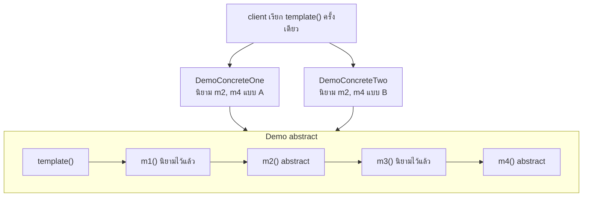
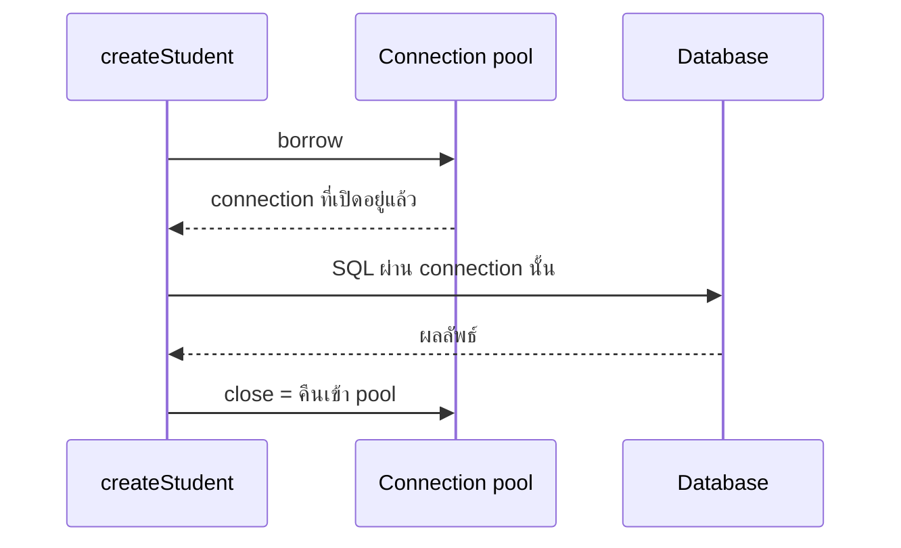
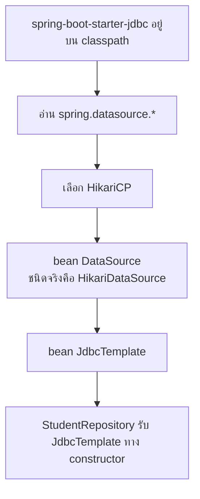
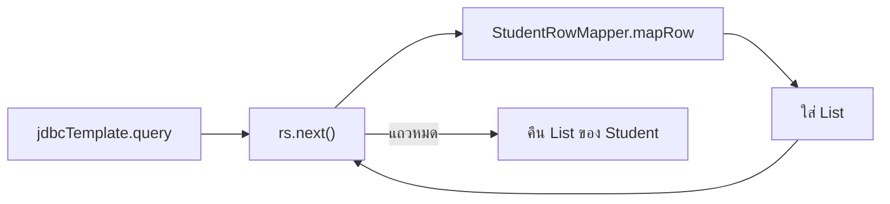
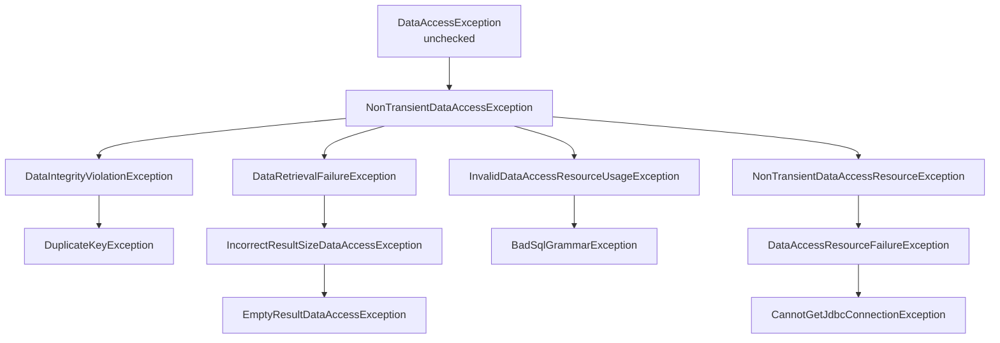

# #27 — Spring JDBC: JdbcTemplate, DataSource และ HikariCP

> **วิดีโอ:** [Spring JDBC Complete Tutorial | JdbcTemplate, DataSource, HikariCP | Spring Boot Full Course #27](https://youtu.be/OPjnbYbcb2E) — Coder Army, ~65 นาที
> **แหล่งที่ใช้สรุป:** ซับไตเติลภาษาอังกฤษที่ YouTube สร้างอัตโนมัติ (วิดีโอนี้มีซับ `en-US` สคริปต์ดึงมาเป็นภาษานี้)
> **เวอร์ชันในโค้ด:** Spring Boot 4.1 + Java 21 (ใส่หมายเหตุไว้ทุกจุดที่ Spring Boot 3.x ต่างกัน)

ตอนนี้ตอบคำถามว่า **Spring JDBC เอา boilerplate ของ raw JDBC ไปทำแทนตรงไหน** ผู้สอนเริ่มจาก repository ที่ยังเปิด `Connection` เองทุก method แล้วไล่ไปที่ Template Design Pattern, `DataSource`, connection pool ของ HikariCP และ `JdbcTemplate` จากนั้นเขียน CRUD ของ `students` ใหม่ด้วย `update`, `query`, `queryForObject` ปิดท้ายด้วยการแปล `SQLException` เป็น `DataAccessException`

ส่วนที่ติดป้าย `💡 เพิ่มเติม` คือของที่ผมเติมเอง ไม่ได้อยู่ในวิดีโอ ส่วนที่ติด `⚠️ แก้จากวิดีโอ` คือจุดที่วิดีโอพูดคลาดเคลื่อน

---

## สารบัญ

| เวลา | หัวข้อ |
|---|---|
| [0:00](https://youtu.be/OPjnbYbcb2E?t=0) | [1. ทำไมต้องมี Spring JDBC](#1-ทำไมต้องมี-spring-jdbc) |
| [0:51](https://youtu.be/OPjnbYbcb2E?t=51) | [2. โค้ด JDBC ที่ยกมาจากตอนที่แล้ว](#2-โค้ด-jdbc-ที่ยกมาจากตอนที่แล้ว) |
| [3:49](https://youtu.be/OPjnbYbcb2E?t=229) | [3. boilerplate ที่เขียนซ้ำทุก method](#3-boilerplate-ที่เขียนซ้ำทุก-method) |
| [6:58](https://youtu.be/OPjnbYbcb2E?t=418) | [4. งานที่เปลี่ยน กับงานที่คงที่](#4-งานที่เปลี่ยน-กับงานที่คงที่) |
| [9:17](https://youtu.be/OPjnbYbcb2E?t=557) | [5. Template Design Pattern](#5-template-design-pattern) |
| [16:47](https://youtu.be/OPjnbYbcb2E?t=1007) | [6. JdbcTemplate คือ template ของ JDBC](#6-jdbctemplate-คือ-template-ของ-jdbc) |
| [19:15](https://youtu.be/OPjnbYbcb2E?t=1155) | [7. DataSource](#7-datasource) |
| [20:38](https://youtu.be/OPjnbYbcb2E?t=1238) | [8. Connection เป็นของแพง](#8-connection-เป็นของแพง) |
| [22:48](https://youtu.be/OPjnbYbcb2E?t=1368) | [9. Connection pool](#9-connection-pool) |
| [26:09](https://youtu.be/OPjnbYbcb2E?t=1569) | [10. HikariCP](#10-hikaricp) |
| [28:11](https://youtu.be/OPjnbYbcb2E?t=1691) | [11. dependency และ Single Responsibility](#11-dependency-และ-single-responsibility) |
| [30:37](https://youtu.be/OPjnbYbcb2E?t=1837) | [12. spring.datasource](#12-springdatasource) |
| [32:41](https://youtu.be/OPjnbYbcb2E?t=1961) | [13. Boot สร้าง DataSource bean ให้](#13-boot-สร้าง-datasource-bean-ให้) |
| [36:12](https://youtu.be/OPjnbYbcb2E?t=2172) | [14. สาม method ของ JdbcTemplate](#14-สาม-method-ของ-jdbctemplate) |
| [37:17](https://youtu.be/OPjnbYbcb2E?t=2237) | [15. เขียน create, update, delete ใหม่](#15-เขียน-create-update-delete-ใหม่) |
| [41:55](https://youtu.be/OPjnbYbcb2E?t=2515) | [16. RowMapper กับ query](#16-rowmapper-กับ-query) |
| [49:46](https://youtu.be/OPjnbYbcb2E?t=2986) | [17. queryForObject](#17-queryforobject) |
| [53:08](https://youtu.be/OPjnbYbcb2E?t=3188) | [18. BeanPropertyRowMapper](#18-beanpropertyrowmapper) |
| [56:03](https://youtu.be/OPjnbYbcb2E?t=3363) | [19. แปล SQLException](#19-แปล-sqlexception) |
| [1:03:55](https://youtu.be/OPjnbYbcb2E?t=3835) | [20. เมื่อไหร่ควรไป Hibernate หรือ JPA](#20-เมื่อไหร่ควรไป-hibernate-หรือ-jpa) |
| — | [21. โค้ดที่รันได้](#21-โค้ดที่รันได้) |
| — | [22. สรุปท้ายตอน](#22-สรุปท้ายตอน) |

---

## 1. ทำไมต้องมี Spring JDBC

[▶ 0:00](https://youtu.be/OPjnbYbcb2E?t=0)

ตอนที่แล้วเขียน raw JDBC ผู้สอนบอกว่า Spring มี abstraction ซ้อนบน JDBC ที่ทำให้โค้ดสั้นลงมาก ถ้ายังไม่เห็น JDBC มาก่อน ควรดูตอนนั้นก่อน ถ้าเขียน JDBC อยู่แล้ว ข้ามไปเริ่ม Spring JDBC ได้เลย

เขาบอกเหตุผลที่ใช้ในงานจริงว่า ถ้าโปรเจกต์ Spring Boot **ไม่ต้องการ** JPA หรือ Hibernate ด้วยเหตุผลใดก็ตาม ให้ใช้ Spring JDBC แทน raw JDBC Spring JDBC ไม่ได้ลบ JDBC ทิ้ง มันหุ้ม JDBC ไว้ ข้างในยังเป็น `Connection`, `PreparedStatement` และ `SQLException` เหมือนเดิม ฝั่งที่เรียกใช้ไม่ต้องจับของสามอย่างนั้นตรง ๆ อีก

---

## 2. โค้ด JDBC ที่ยกมาจากตอนที่แล้ว

[▶ 0:51](https://youtu.be/OPjnbYbcb2E?t=51)

เขาเปิดโปรเจกต์ชื่อ Spring JDBC Demo แล้ว copy repository จากตอน JDBC มาวางในแอป Spring Boot โครงชั้นเป็นแบบนี้

| ชั้น | class | งาน |
|---|---|---|
| Controller | `StudentController` | endpoint ใต้ `/api/student` |
| Service | `StudentService` | รับ `StudentRepository` ทาง constructor แล้วส่งต่องาน |
| Repository | `StudentRepository` | SQL ยังเป็น raw JDBC |
| Model | `Student` | field `id`, `name`, `email`, `age` |

Repository ยังเก็บ URL, username และ password เป็น field แล้วทุก method ใช้ `PreparedStatement` กับ `executeUpdate` เหมือนตอนที่แล้ว มี `createStudent`, `updateStudent`, `deleteStudent`, `getStudentById`, `getStudents` และ private method `mapRow` ที่แปลง `ResultSet` เป็น `Student`

Controller วาง `@RequestMapping` ที่ `/api/student`

| งาน | สิ่งที่เขาเล่า | สิ่งที่คืนให้ Postman |
|---|---|---|
| สร้าง | `POST` เรียก service แล้วจบ | สตริง `Done` ไม่คืน object |
| อ่านทั้งหมด | `GET` ได้ `List<Student>` | JSON เป็น list |
| อ่านคนเดียว | `GET` ตาม id | `Student` หนึ่งตัว |
| แก้ | มี mapping ของ update | ไม่ได้ยิงให้ดูในรอบนี้ |
| ลบ | มี mapping ของ delete | รอบท้ายของตอนคืน `Done` |

> 💡 **เพิ่มเติม — path ที่ซับไม่ได้อ่านทีละตัว** เขาพูดชัดว่า prefix คือ `/api/student` (รูปเอกพจน์) และตอนเดโมอ่านคนเดียวเขาเปลี่ยนเลขท้าย URL เช่น `/api/student/12` ส่วน "get all" เขาพูดว่าทำ `all` ซึ่งฟังเป็นชื่อ request ใน Postman ได้ ไม่ได้สะกด path คำว่า update กับ delete ก็ไม่ได้บอกว่าเป็น `PUT` หรือ `DELETE` โค้ดด้านล่างใช้ `GET /api/student`, `GET /api/student/{id}`, `PUT /api/student/{id}` และ `DELETE /api/student/{id}` ตามที่เดโมอ่านและลบด้วย id

Service ไม่มี logic อื่น นอกจากเรียก method ชื่อเดียวกันของ repository Model มีสี่ field เท่าตาราง

ใน DBeaver เขามีแถวอยู่แล้วสองแถว เขาเปิดแอปแล้วยิง Postman

1. `POST /api/student` สร้าง Sohan อายุ 21 ได้ `Done` แล้ว refresh ตารางเห็นแถวใหม่
2. `GET` id `10` ได้ Aditya
3. ไม่ใส่ id แล้วดึงทุกคน ได้ list
4. เขาบอกว่า update กับ delete ใช้ได้เหมือนกัน แต่ยังไม่ได้ทำให้ดูทีละอัน

ตรงนี้ยังไม่มี Spring JDBC เขาใช้ช่วงนี้เป็นเส้นฐานว่า raw JDBC ใน Boot ยังทำงานได้

> 💡 **เพิ่มเติม — ตารางและ URL ของ MySQL มาจากตอน JDBC** ตอนที่แล้วสร้าง database `student_db` ตาราง `students` คอลัมน์ `id` เป็น `BIGINT` primary key แบบ auto-increment, `name` และ `email` เป็น `NOT NULL`, `email` เป็น `UNIQUE`, `age` เป็น `INT` URL ที่ย้ายเข้า properties ในตอนนี้คือ `jdbc:mysql://localhost:3306/student_db` username `root` password `123456` ตัวอย่างที่รันด้านล่างใช้ H2 ใน memory แทน MySQL เพราะเครื่องนี้ไม่ได้เปิด MySQL ของเขา

---

## 3. boilerplate ที่เขียนซ้ำทุก method

[▶ 3:49](https://youtu.be/OPjnbYbcb2E?t=229)

เขากลับไปที่ `createStudent` แล้วชี้สิ่งที่ทำทุกครั้ง

1. เขียน SQL
2. เปิด try-with-resources
3. เปิด `Connection` ผ่าน `DriverManager.getConnection`
4. สร้าง `PreparedStatement` แล้วส่ง SQL เข้าไป
5. ใส่ค่าด้วย `setString` / `setInt`
6. เรียก `executeUpdate` ได้จำนวนแถวที่กระทบ แล้วดูว่าเป็น 1 หรือ 0
7. `catch (SQLException)` แล้วบอกว่าการเชื่อม database อาจล้ม

`updateStudent` และ `deleteStudent` ทำโครงเดียวกัน เขาเขียนเป็นข้อว่า raw JDBC บังคับให้ทุก method ทำสี่อย่างนี้

| งานที่ซ้ำ | หมายเหตุที่เขาเน้น |
|---|---|
| เปิด connection | เรียก `DriverManager.getConnection` ทุกครั้ง |
| สร้าง statement | เขาชอบ `PreparedStatement` มากกว่า `Statement` |
| ปิด statement แล้วปิด connection | จะปิดมือหรือใช้ try-with-resources ก็ได้ ลำดับคือปิด statement ก่อน เพราะ statement เกิดจาก connection |
| จับ `SQLException` | เป็น checked exception ต้อง `catch` หรือ `throws` ต่อให้ service ไปจัดการ ต้องมีคนจัดการ |

`SQLException` เป็น checked exception จึงหนีไม่พ้น ถ้า repository ไม่จับ service ต้องจับต่อ

> 💡 **เพิ่มเติม — รูปของ `createStudent` ก่อนเปลี่ยน** ตอนนี้เขาเล่าโค้ดบนจอ ไม่ได้พิมพ์ใหม่ทั้งก้อน โครงด้านล่างประกอบจากสิ่งที่เขาชี้ในตอนนี้ กับ prepared statement ของตอน JDBC มัน compile ได้ในโปรเจกต์ตัวอย่าง แต่ไม่ได้ถูกเรียกจากแอป

```java
public void createStudent(Student student) {
  String sql = "INSERT INTO students (name, email, age) VALUES (?, ?, ?)";
  try (Connection connection = DriverManager.getConnection(url, username, password);
       PreparedStatement preparedStatement = connection.prepareStatement(sql)) {
    preparedStatement.setString(1, student.getName());
    preparedStatement.setString(2, student.getEmail());
    preparedStatement.setInt(3, student.getAge());
    int rowsAffected = preparedStatement.executeUpdate();
    if (rowsAffected == 1) {
      System.out.println("create student successful");
    } else {
      System.out.println("create student failed");
    }
  } catch (SQLException ex) {
    System.out.println("database connection might have failed: " + ex.getMessage());
  }
}
```

---

## 4. งานที่เปลี่ยน กับงานที่คงที่

[▶ 6:58](https://youtu.be/OPjnbYbcb2E?t=418)

เขาบอกว่าวิธีเปิด connection, วิธีสร้าง statement, วิธีใส่ค่า, วิธีจับ exception และวิธีปิด resource **ไม่เปลี่ยน** ตาม method ดังนั้น Spring รับช่วงนั้นไป ให้เราทำเฉพาะส่วนที่เปลี่ยนทุกครั้ง

| เปลี่ยนทุก method เราต้องบอก | ไม่เปลี่ยน Spring ทำให้ |
|---|---|
| SQL | เปิด connection |
| ค่า parameter | สร้าง statement และใส่ค่า |
| วิธี map ผลลัพธ์เป็น object | ปิด statement แล้วปิด connection |
| | จับ `SQLException` แล้วแปลเป็น exception ของ Spring |

`createStudent` ได้ผลเป็นจำนวนเต็ม แต่ `getStudentById` ได้ `Student` เขาเลยยก result mapping เป็นงานที่สามที่ต้องส่งจากข้างนอก ถ้า model เป็น user, order หรือ teacher วิธี map ก็คนละแบบ

เขาขีดเส้นว่า Spring JDBC คือการเสริม raw JDBC ไม่ใช่การทิ้ง JDBC ข้างในยังใช้ `Connection`, `PreparedStatement` และ `SQLException` โค้ดของเราเรียก method ของ Spring JDBC แทน

---

## 5. Template Design Pattern

[▶ 9:17](https://youtu.be/OPjnbYbcb2E?t=557)

เขาออกจาก JDBC ชั่วคราวเพื่ออธิบาย pattern ที่ทำให้การแบ่งงานแบบนั้นทำได้ ถ้ามี flow ที่ต้องเรียก `m1` แล้ว `m2` แล้ว `m3` แล้ว `m4` ทุกครั้ง สลับลำดับไม่ได้ และแต่ละขั้นอาจส่งผลให้ขั้นถัดไป

ถ้ายัดสี่ method ไว้ใน class `Demo` แล้วบอก client ว่าต้องเรียกเองตามลำดับ client จะ tightly coupled กับลำดับนั้น พรุ่งนี้แทรก `m5` ระหว่าง `m2` กับ `m3` client ทุกตัวต้องแก้

ทางที่ pattern บอกคือเพิ่ม method ชื่อ template ใน `Demo` ให้ template เรียก `m1` ถึง `m4` ตามลำดับเอง client เรียก template ที่เดียว ถ้าลำดับเปลี่ยน แก้ที่ template จุดเดียว client ยัง loosely coupled

ขั้นต่อไป บางขั้นคงที่ บางขั้นเปลี่ยนสมมติ `m1` กับ `m3` คงที่ แต่ `m2` กับ `m4` เปลี่ยนทุก use case ให้ `Demo` เป็น abstract class เขียนตัวของ `m1` กับ `m3` ไว้ ประกาศ `m2` กับ `m4` เป็น abstract แล้วให้ concrete class คนละตัวส่งนิยามของสอง method นั้น template ยังเรียกสี่ตัวตามลำดับเดิม client คุยกับ concrete class เพราะ abstract class สร้าง object ไม่ได้ concrete class ได้ `m2` กับ `m4` ของตัวเอง และได้ `m1` กับ `m3` จาก parent



เขาสรุปว่า client เรียก method เดียว ที่เหลือเรื่องลำดับเป็นหน้าที่ของ template ถ้ามีขั้นที่เปลี่ยนบ่อย ส่งนิยามนั้นเข้ามาจากข้างนอก

---

## 6. JdbcTemplate คือ template ของ JDBC

[▶ 16:47](https://youtu.be/OPjnbYbcb2E?t=1007)

เขาวาง pattern นี้ทับ JDBC ลำดับที่ Spring รู้ล่วงหน้าคือ

1. สร้าง `Connection`
2. สร้าง `PreparedStatement`
3. รับ SQL กับค่า parameter จากข้างนอก เทียบกับ `m2` / `m4` ที่ concrete class เป็นคนให้
4. ปิด statement ก่อน แล้วปิด connection
5. จับ `SQLException`

class ที่นิยามลำดับนี้ชื่อ `JdbcTemplate` เราไม่ต้อง subclass มันในโค้ดที่เขาเขียนต่อจากนั้น เราส่งสามอย่างเข้า method ของมัน

- SQL
- parameter
- วิธี map ผลลัพธ์เป็น object

ที่เหลือ `JdbcTemplate` ทำเอง

> ⚠️ **แก้จากวิดีโอ:** ช่วงหนึ่งเขาพูดว่า `JdbcTemplate` ใช้ "JDBC design pattern" ที่เขาหมายถึงคือ Template Design Pattern ที่อธิบายไปทั้งสิบนาที ไม่มี pattern ชื่อ JDBC design pattern

> 💡 **เพิ่มเติม — ในโค้ดจริงไม่ได้สืบทอด JdbcTemplate** กระดานของเขาใช้ abstract class กับ concrete subclass ซึ่งเป็นรูปคลาสสิกของ Template Method `JdbcTemplate` ใช้ลำดับคงที่ข้างในเหมือน template แต่ส่วนที่เปลี่ยนถูกส่งเป็น argument และ callback เช่น `RowMapper` ไม่ได้บังคับให้ repository `extends JdbcTemplate` โค้ดที่เขาพิมพ์หลังนาทีที่ 37 เป็นแบบ callback

---

## 7. DataSource

[▶ 19:15](https://youtu.be/OPjnbYbcb2E?t=1155)

ก่อนลงมือเขียน เขายก `DataSource` ขึ้นมา `DataSource` เป็น interface ใน Java หน้าที่หลักคือเอา `Connection` มาให้

เดิมทุก method เขียนแบบนี้

```java
Connection connection = DriverManager.getConnection(url, username, password);
```

กับ `DataSource` เหลือบรรทัดนี้ และไม่ต้องส่ง URL กับรหัสทุกครั้ง

```java
Connection connection = dataSource.getConnection();
```

URL, username และ password ย้ายไปอยู่ที่ `application.properties` ครั้งเดียว `DataSource` อ่านค่าพวกนั้นเองแล้วคืน connection ที่ใช้ได้

เขาเปิดใน IDE แล้วชี้ว่า type มาจาก `javax.sql.DataSource` พอเข้าไปใน interface จะเห็นว่ามันไม่มีตัวทำงาน ต้องมี class อื่นมา implement ตัวที่ Boot สร้างให้จะไปโผล่ตอนเขาทดลอง inject

> 💡 **เพิ่มเติม:** `javax.sql.DataSource` ยังอยู่ใน JDK ชื่อ package ไม่ย้ายไป `jakarta` ต่างจาก Servlet ที่กลายเป็น `jakarta.servlet` ตั้งแต่ Boot 3 อย่าเปลี่ยน import นี้ตอนอัปเกรด

---

## 8. Connection เป็นของแพง

[▶ 20:38](https://youtu.be/OPjnbYbcb2E?t=1238)

ในโค้ดเดิม ทุก method เปิด connection ใหม่ แล้ว try-with-resources ปิดมันตอน method จบ method ถัดไปก็เปิดใหม่ทั้งก้อน

เขาไล่สิ่งที่เกิดขึ้นตอนเปิด connection จริง

1. ต้องตั้งการเชื่อมเครือข่ายไปที่ database แม้เดโมนี้ database อยู่ใน localhost ใน production มักเป็นคนละเครื่อง
2. ส่ง username กับ password ผ่าน driver ในที่นี้คือ MySQL driver
3. database ตรวจตัวตน
4. สำเร็จแล้วจึงมี session แล้วค่อยส่งข้อมูล

ขั้นพวกนี้ใช้เวลา เขาเรียก connection ว่าเป็น resource แพง โปรเจกต์ฝึกที่มีแค่ CRUD สี่ตัวเปิดใหม่ทุกครั้งยังพอไหว แต่แอปที่รับหมื่น request ต่อวินาทีทำแบบนั้นไม่ได้ database มี throughput จำกัด เปิด connection ไม่จำกัดจะไปท่วม database

---

## 9. Connection pool

[▶ 22:48](https://youtu.be/OPjnbYbcb2E?t=1368)

ทางออกที่เขาเล่าชื่อ connection pool แนวเดียวกับ thread pool สร้างที่เก็บไว้ก่อน แล้ววาง connection ที่เปิดค้างไว้ในนั้น เขาวาดห้าตัวเป็นตัวอย่าง

ใครต้องการ connection ก็ขอจาก pool ได้เลย พอเรียก `connection.close()` ทั้งแบบมือและแบบ try-with-resources **close ในที่นี้ไม่ได้ตัดสายจริง** มันเอา connection คืนเข้า pool ให้คนอื่นยืมต่อ เขามีคำสองคำ

| คำ | ความหมายใน pool |
|---|---|
| borrow | ขอยืม connection ออกไปทำงาน |
| close | คืนเข้า pool ไม่ได้ปิดของจริง |

ถ้ายิงพร้อมกันหลาย request เช่น create, get, update และ delete แต่ละตัวยืมคนละ connection พอลบห้าตัวในรูปหมด ตัวที่หกต้องรอ จนกว่าจะมีคนคืน หรือจนหมดเวลาที่ตั้งไว้ แล้วระบบบอกว่า connection ไม่ว่าง

connection จึงถูกใช้ซ้ำ ไม่ได้สร้างใหม่ทุกรอบ แอปอาจรับหมื่น request พร้อมกันได้ แต่จำนวน request ที่ลง database พร้อมกันถูกจำกัดด้วยจำนวน connection ใน pool ใครมาทีหลังต้องรอ



> ⚠️ **แก้จากวิดีโอ:** ตอนเล่าว่าถ้า pool ว่างจะรอได้แค่ไหน เขาเรียกค่านั้นว่า idle time ของ Hikari สองค่าคนละเรื่อง `connectionTimeout` คือเวลารอสูงสุดตอนขอยืม ถ้าเกินแล้วยังไม่ได้ connection จะล้ม ค่า default ที่วัดจากแอปตัวอย่างคือ **30000 มิลลิวินาที** `idleTimeout` คือ connection ที่นั่งว่างใน pool จะถูกทิ้งหลังผ่านไปนานแค่ไหน ค่า default คือ **600000 มิลลิวินาที** และมีผลเมื่อ `minimumIdle` น้อยกว่า `maximumPoolSize` เท่านั้น

---

## 10. HikariCP

[▶ 26:09](https://youtu.be/OPjnbYbcb2E?t=1569)

เขาบอกว่า pool ที่ Spring Boot ใช้เป็นค่า default ชื่อ HikariCP เป็น connection pool ระดับ production ใส่ pool อื่นจากภายนอกได้ แต่ถ้าไม่ทำอะไร Boot เลือก Hikari

ตั้งจำนวน connection, timeout และ idle time ได้ที่ `application.properties` ใต้ `spring.datasource.hikari` เขาเตือนว่าอย่าสุ่มเลข 5 หรือ 10 แล้วคิดว่ายิ่งเยอะยิ่งดี connection เยอะขึ้นหมายถึงโหลดบน database มากขึ้น ขนาดที่ถูกมาจาก load test เขาเก็บเรื่องนั้นไว้เป็นเรื่องของ production

`dataSource.getConnection()` โดย default หยิบจาก pool ไม่ได้หมุน `DriverManager.getConnection` ใหม่ทุกครั้ง เขาบอกว่าจะสั่งให้ `DataSource` เปิดของจริงทุกครั้งแบบเดิมก็ได้ แต่ไม่ใช่แนวปฏิบัติที่ดี เหมาะกับแอปเล็ก ๆ

> ⚠️ **แก้จากวิดีโอ:** เขาพูดว่า "Java internally uses a connection pool called HikariCP" Java SE ไม่ได้พก HikariCP มาให้ HikariCP เป็นไลบรารี `com.zaxxer:HikariCP` ที่ `spring-boot-starter-jdbc` ดึงมาให้ ในตัวอย่างนี้เวอร์ชันคือ **7.0.2** คู่กับ Spring JDBC **7.0.9**

> 💡 **เพิ่มเติม — ตัวเลข default ที่ไม่ได้ตั้งในวิดีโอ** หลัง Boot สร้าง `HikariDataSource` แล้วอ่านจาก object ได้ `maximumPoolSize=10`, `minimumIdle=10`, `connectionTimeout=30000`, `idleTimeout=600000` รูปห้า connection บนกระดานเป็นตัวอย่าง ไม่ใช่ค่า default ถ้าต้องการเปิด connection ใหม่ทุกครั้งโดยไม่เข้า pool class ของ Spring คือ `org.springframework.jdbc.datasource.DriverManagerDataSource` ต้องประกาศ bean เอง Boot จะไม่เลือกตัวนี้ให้

---

## 11. dependency และ Single Responsibility

[▶ 28:11](https://youtu.be/OPjnbYbcb2E?t=1691)

ใน `pom.xml` เดิมมี starter ของเว็บ, starter test และ MySQL connector ที่ใช้ตั้งแต่ตอน JDBC raw JDBC มากับ JDK อยู่แล้ว แต่ Spring JDBC เป็น dependency ภายนอก

เขาเปิด Spring Initializr แล้วบอกว่าตอนสร้างโปรเจกต์เลือกแค่ MySQL driver กับ Spring Web ถ้าจะได้ JDBC ตั้งแต่แรก ให้ค้นคำว่า Spring JDBC บน Initializr เขาชี้รายการที่เห็นว่าเป็น Spring Data JDBC

จากนั้นเขาไม่ได้ใช้รายการนั้น เขาเปิด Maven Central ค้น Spring JDBC แล้วเลือก **Spring Boot Starter JDBC** ไม่ใส่ `<version>` และไม่ใส่ `<scope>` เพราะ parent เป็นคนจัดการ โหลด Maven แล้วใน dependency tree มี starter ของเว็บ, MySQL connector และ starter JDBC

> ⚠️ **แก้จากวิดีโอ:** รายการ Spring Data JDBC บน Initializr คือ `spring-boot-starter-data-jdbc` คนละโมดูลกับบทนี้ มันเป็น repository แบบ aggregate ของ Spring Data ตอนนี้ใช้ `JdbcTemplate` ซึ่งมากับ `spring-boot-starter-jdbc` เขา copy artifact ถูกตัวจาก Maven Central หลังจากชี้ชื่อบน Initializr สลับกัน

> ⚠️ **Boot 4 vs 3:** เขาบอกว่าโปรเจกต์มี Spring Boot starter web ใน Boot 3 ชื่อนั้นคือ `spring-boot-starter-web` ใน Boot 4 starter ของเว็บแบบ servlet คือ `spring-boot-starter-webmvc` ชื่อเดิมยังอยู่แต่ถูก deprecate
> ([Spring Boot 4.0 Migration Guide](https://github.com/spring-projects/spring-boot/wiki/Spring-Boot-4.0-Migration-Guide) ตาราง Deprecated Starters)

[▶ 29:54](https://youtu.be/OPjnbYbcb2E?t=1794)

เขาผูกเรื่องนี้กับ Single Responsibility งานของ repository คือ query ข้อมูลนักเรียน ไม่ใช่เปิด connection, ปิด connection, สร้าง statement และห่อ SQL เข้า statement เอง business logic ที่ควรเหลือคือจะรัน query ไหน โค้ดเดิมเลยทำเกินหน้าที่ เป้าหมายของที่เหลือในตอนคือเอาส่วนนั้นออก

---

## 12. spring.datasource

[▶ 30:37](https://youtu.be/OPjnbYbcb2E?t=1837)

เขา comment URL, username และ password ใน repository ทิ้ง แล้วย้ายไปที่ `application.properties` key ที่เขาพิมพ์มีสามตัว properties ไม่ต้องใส่เครื่องหมายคำพูดรอบค่า

```properties
spring.datasource.url=jdbc:mysql://localhost:3306/student_db
spring.datasource.username=root
spring.datasource.password=123456
```

เขาพิมพ์ `spring.datasource.hikari` ให้ IDE โชว์ key ต่อ เช่น allow-pool-suspension, auto-commit, catalog, connection-test-query, connection-timeout และ idle-timeout แล้วบอกว่าวันนี้ไม่ตั้งอะไร ใช้ default ของ pool

Hikari มาเองตอนใส่ `spring-boot-starter-jdbc` จะใช้ pool ตัวอื่นต้องเพิ่ม dependency ของตัวนั้นเอง

> 💡 **เพิ่มเติม — ตัวอย่างนี้ใช้ H2** วิดีโอต่อ MySQL ผ่าน DBeaver โปรเจกต์ด้านล่างเปลี่ยน driver เป็น H2 เพื่อให้รันได้โดยไม่ต้องมีเซิร์ฟเวอร์ MySQL ค่าที่ใช้คือ

```properties
server.port=9027
spring.datasource.url=jdbc:h2:mem:student_db
spring.datasource.driver-class-name=org.h2.Driver
spring.datasource.username=sa
spring.datasource.password=
```

พอร์ต `9027` เป็นของตัวอย่างนี้ วิดีโอใช้พอร์ต default ของ Boot ตารางสร้างด้วย `schema.sql` เพราะ H2 แบบ embedded ให้ Boot รันสคริปต์นั้นตอนสตาร์ท ของในวิดีโอสร้างตารางมือใน DBeaver

```sql
CREATE TABLE students (
  id BIGINT GENERATED BY DEFAULT AS IDENTITY PRIMARY KEY,
  name VARCHAR(255) NOT NULL,
  email VARCHAR(255) NOT NULL UNIQUE,
  age INT NOT NULL
);
```

`GENERATED BY DEFAULT AS IDENTITY` คือรูปของ H2 ที่ตรงกับ `AUTO_INCREMENT` ของ MySQL ที่เขาใช้ในตอนที่แล้ว

---

## 13. Boot สร้าง DataSource bean ให้

[▶ 32:41](https://youtu.be/OPjnbYbcb2E?t=1961)

เขาถามว่าแล้วใครสร้าง bean ของ `DataSource` กับ `JdbcTemplate` ลำดับที่เขาเขียนไว้คือ

1. Boot เห็น JDBC อยู่บน classpath เพราะมี `spring-boot-starter-jdbc`
2. อ่าน `spring.datasource.*` จาก `application.properties` คือ URL, username และ password
3. หา implementation ของ connection pool แล้วเลือก HikariCP เป็นค่า default
4. สร้าง object ของ `DataSource` แล้วลงทะเบียนเป็น bean ใน IoC container

`DataSource` เป็น interface จึงต้องมี class จริง เขาพิสูจน์ด้วยการ inject `DataSource` เข้า constructor ของ repository แล้วใช้ `@PostConstruct` พิมพ์ `dataSource.getClass()` ตอน bean ของ repository ถูกสร้าง

[▶ 34:51](https://youtu.be/OPjnbYbcb2E?t=2091)

แอปสตาร์ทแล้วบรรทัดที่โผล่คือ

```text
class com.zaxxer.hikari.HikariDataSource
```

นั่นคือ class จริงของ interface `DataSource` และมันคือ connection pool หลังทดลองเขาเอา field นี้ออกจาก repository เพราะจะไม่คุยกับ pool ตรง ๆ อีก `JdbcTemplate` ถือ `DataSource` ไว้ข้างใน แล้วไปขอ connection เอง

ตัวอย่างด้านล่างยัง inject `DataSource` ไว้เพื่อพิมพ์บรรทัดนี้ตอนสตาร์ท งาน CRUD ไม่ได้เรียก `getConnection()` เอง



> ⚠️ **แก้จากวิดีโอ:** เขาพูดว่า Boot "detect ว่า Spring JDBC driver อยู่บน classpath" สิ่งที่กระตุ้น auto-config ของ `DataSource` คือ starter JDBC ส่วน driver เป็น dependency อีกตัว ในวิดีโอคือ MySQL connector ในตัวอย่างนี้คือ H2 ไม่มี driver แอปต่อ database ไม่ได้ แม้จะมี starter แล้ว

> ⚠️ **Boot 4 vs 3:** class ที่สร้าง bean พวกนี้ย้าย package ตามการแยก module ของ Boot 4 ตรวจจาก jar จริงแล้ว Boot 3.5 อยู่ที่ `org.springframework.boot.autoconfigure.jdbc.DataSourceAutoConfiguration` และ `JdbcTemplateAutoConfiguration` Boot 4.1.1 อยู่ที่ `org.springframework.boot.jdbc.autoconfigure.DataSourceAutoConfiguration` กับ `JdbcTemplateAutoConfiguration` ชื่อ class เดิม package ใหม่ สอดคล้องกับกฎใน migration guide ว่าแต่ละ module ใช้ root package `org.springframework.boot.<ชื่อโมดูล>`
> ([Spring Boot 4.0 Migration Guide](https://github.com/spring-projects/spring-boot/wiki/Spring-Boot-4.0-Migration-Guide) หัวข้อ Module Dependencies)

> 💡 **เพิ่มเติม:** เขาเล่าถึง bean ของ `DataSource` เป็นหลัก bean ของ `JdbcTemplate` มาจาก `JdbcTemplateAutoConfiguration` เมื่อมี `DataSource` อยู่แล้ว จึง inject เข้า repository ได้โดยไม่ต้องเขียน `@Bean` เอง

---

## 14. สาม method ของ JdbcTemplate

[▶ 35:46](https://youtu.be/OPjnbYbcb2E?t=2146)

`JdbcTemplate` ขอ connection จาก `DataSource` เอง เขาเลือกสาม method ที่ใช้บ่อย

| method ของ JdbcTemplate | เทียบกับ JDBC | ใช้เมื่อ |
|---|---|---|
| `update` | `executeUpdate` | insert, update และ delete ได้จำนวนแถวที่กระทบ |
| `query` | `executeQuery` | select ที่ได้หลายแถว คืน `List` ใช้กับแถวเดียวก็ได้ แต่เขาให้เก็บไว้กับหลายแถว |
| `queryForObject` | select เช่นกัน | ต้องได้ **หนึ่งแถวพอดี** เช่น `getStudentById` |

`query` ที่ไม่เจอแถวคืน list ว่าง ไม่โยน exception `queryForObject` โยน รายละเอียดอยู่ส่วนที่ 17

เขามี constructor และ method ของ `JdbcTemplate` ให้ดูใน IDE เยอะ แต่บอกว่าให้เรียก method พวกนี้ ที่เหลือเรื่อง connection กับ statement อยู่ข้างใน

---

## 15. เขียน create, update, delete ใหม่

[▶ 37:17](https://youtu.be/OPjnbYbcb2E?t=2237)

เขาประกาศ field `JdbcTemplate` แล้วรับทาง constructor จากนั้นรื้อ `createStudent` เหลือ SQL กับเงื่อนไขจำนวนแถว ไม่มี try, ไม่มี catch, ไม่มี `Connection`, ไม่มี `PreparedStatement`

```java
public void createStudent(Student student) {
  String sql = "INSERT INTO students (name, email, age) VALUES (?, ?, ?)";
  int rowsAffected = jdbcTemplate.update(
      sql,
      student.getName(),
      student.getEmail(),
      student.getAge());
  if (rowsAffected == 1) {
    System.out.println("create student successful");
  } else {
    System.out.println("create student failed");
  }
}
```

ลำดับ parameter ตามที่เขาพิมพ์คือ name, email, age ให้ตรงกับ `?, ?, ?`

เขารันแอปแล้วยิง `POST` สร้าง Raman อายุ 19 ครั้งแรกเผลอเป็น `GET` เปลี่ยนเป็น `POST` แล้วได้ `Done` refresh DBeaver แล้วเห็นแถว Raman

[▶ 40:30](https://youtu.be/OPjnbYbcb2E?t=2430)

`updateStudent` ใช้ `update` เช่นกัน parameter สี่ตัวคือ name, email, age และ id

```java
String sql = "UPDATE students SET name = ?, email = ?, age = ? WHERE id = ?";
int rowsAffected = jdbcTemplate.update(
    sql,
    student.getName(),
    student.getEmail(),
    student.getAge(),
    student.getId());
```

ถ้า `rowsAffected` เป็น 1 เขาพิมพ์ว่า update สำเร็จ ไม่งั้นพิมพ์ว่าล้ม

[▶ 41:27](https://youtu.be/OPjnbYbcb2E?t=2487)

`deleteStudent` เหลือ SQL กับ id ตัวเดียว

```java
String sql = "DELETE FROM students WHERE id = ?";
int rowsAffected = jdbcTemplate.update(sql, id);
```

เขาลบ method ทดลองที่ค้างจากตอนที่แล้วออก และยังเก็บ `mapRow` เก่าไว้ก่อน เพราะยังไม่ถึงขั้นอ่าน

---

## 16. RowMapper กับ query

[▶ 41:55](https://youtu.be/OPjnbYbcb2E?t=2515)

งานอ่านเริ่มที่ `getStudents` SQL คือ `SELECT id, name, email, age FROM students` ใน raw JDBC ผลมาเป็น `ResultSet` แล้วเราวน `next` เอง แปลงทีละแถว ใส่ list แล้วคืน list

`JdbcTemplate` ยอมวนแถวและสะสม list ให้ แต่ยังไม่รู้ว่าแถวหนึ่งกลายเป็น `Student` อย่างไร เพราะตอนนี้ยังไม่มี JPA หรือ Hibernate เขาเทียบกับ CRUD ที่เคยทำด้วย JPA ว่าตรงนั้น object กับแถวแปลงกันได้เอง ที่นี่ต้องบอกกติกาเอง

กติกานั้นคือ interface `RowMapper` มันเป็น functional interface มี method เดียวชื่อ `mapRow`

```java
T mapRow(ResultSet rs, int rowNum) throws SQLException;
```

`ResultSet` คือแถวปัจจุบัน `rowNum` คือเลขแถว ค่าที่คืนคือ object ที่ต้องการ ในที่นี้คือ `Student` ข้างในใช้ generic `T` เพราะ interface ไม่รู้ว่าจะคืน type ไหน เราเป็นคน implement

> ⚠️ **แก้จากวิดีโอ:** เขาอธิบายว่าเราเป็นคนส่งเลขแถวเข้าไป แล้ว `mapRow` จะไปแปลงแถวนั้น ที่เกิดขึ้นจริงคือ `JdbcTemplate` เลื่อน `ResultSet` เองด้วย `rs.next()` แล้วเรียก `mapRow` โดยส่ง `ResultSet` ที่ชี้อยู่แถวนั้นแล้ว `rowNum` เป็นแค่ดัชนีเริ่มที่ 0 ตัว mapper มักไม่ใช้เลขนี้ในการไปหาแถว

> ⚠️ **แก้จากวิดีโอ:** ตอนเดาของข้างใน `query` เขาพูดว่าอาจเรียก "update query" แล้วได้ `ResultSet` การอ่านใช้ `executeQuery` ส่วน `executeUpdate` เป็นของ insert, update และ delete ไม่คืน `ResultSet`

[▶ 46:04](https://youtu.be/OPjnbYbcb2E?t=2764)

เขาสร้าง class `StudentRowMapper` ใน package repository ให้ `implements RowMapper<Student>` แล้วกด implement method เนื้อในยกจาก `mapRow` เก่าของ repository มา ตัวแปรเขาเปลี่ยนเป็น `rs`

```java
@Override
public Student mapRow(ResultSet rs, int rowNum) throws SQLException {
  Student student = new Student();
  student.setId(rs.getLong("id"));
  student.setName(rs.getString("name"));
  student.setEmail(rs.getString("email"));
  student.setAge(rs.getInt("age"));
  return student;
}
```

จากนั้น `getStudents` เหลือเท่านี้

```java
String sql = "SELECT id, name, email, age FROM students";
List<Student> students = jdbcTemplate.query(sql, new StudentRowMapper());
return students;
```

`query` คืน `List` ของ type ที่ mapper ประกาศ เราไม่ต้องสร้าง list เอง เขาเดาของข้างในว่ามีวง `while (rs.next())` เรียก `mapRow` แล้ว `students.add` ซึ่งตรงกับที่ Spring ทำ



---

## 17. queryForObject

[▶ 49:46](https://youtu.be/OPjnbYbcb2E?t=2986)

`getStudentById` ใช้ `queryForObject` เพราะต้องการหนึ่งแถว ลำดับ argument ที่เขาเน้นคือ SQL แล้ว `RowMapper` แล้วค่อย parameter ตัว mapper ต้องมาก่อนค่า `?`

```java
String sql = "SELECT id, name, email, age FROM students WHERE id = ?";
return jdbcTemplate.queryForObject(sql, rowMapper, id);
```

เขาบอกว่าใช้ `query` กับ id ก็ได้ จะได้ list ที่มีหนึ่งตัวหรือ list ว่าง แต่ `queryForObject` มีกติกาเพิ่ม ถ้าไม่เจอแถวนั้นเลย เช่น id `15` ที่ไม่มีอยู่ มันโยน `EmptyResultDataAccessException` เอาไปจับใน global exception handler ได้ ถ้าไม่อยากได้ exception ให้ใช้ `query` list ว่างไม่โยนอะไร

[▶ 51:24](https://youtu.be/OPjnbYbcb2E?t=3084)

เขาไม่อยาก `new StudentRowMapper()` ทุกครั้งที่เรียก จึงสร้าง field เดียวไว้ใน repository แล้วส่งตัวเดิมทุก method เขาให้เหตุผลว่า mapper ไม่มี state ส่งตัวเดิมไม่เปลี่ยนผล

[▶ 52:05](https://youtu.be/OPjnbYbcb2E?t=3125)

เขารันแล้วลองใน Postman

| สิ่งที่ยิง | ผลในวิดีโอ |
|---|---|
| `GET` id 12 | ได้ Sohan |
| `GET` id 13 | ได้แถวที่ 13 |
| ดึงทั้งหมด | ได้ทุกรายการ |
| ลบ id 13 ซึ่งเป็น Raman | ได้ `Done` แล้วแถวหายจาก DBeaver |

เขาลบ field URL, username และ password ที่เหลือออก เพราะ `JdbcTemplate` ไปเอา connection จาก `DataSource` เอง เทียบกับ repository ของตอนที่แล้ว โค้ดสั้นลงมาก

---

## 18. BeanPropertyRowMapper

[▶ 53:08](https://youtu.be/OPjnbYbcb2E?t=3188)

ถ้าไม่อยากเขียน `StudentRowMapper` เอง และชื่อตรงกันอยู่แล้ว ทั้ง class `Student` และตารางมี `id`, `name`, `email`, `age` เขาใช้ class `BeanPropertyRowMapper`

```java
private final RowMapper<Student> rowMapper = new BeanPropertyRowMapper<>(Student.class);
```

`RowMapper` ยังเป็น interface ตัวนี้คือ implementation สำเร็จรูป มัน implement `RowMapper` เหมือน `StudentRowMapper` แต่จับคู่ชื่อให้เอง `id` เข้า `id`, `name` เข้า `name` ถ้าคอลัมน์เป็น `full_name` และ property เป็น `fullName` แบบ camel case มันจับให้ได้เหมือนกัน

เขาเปลี่ยนทุกจุดที่ส่ง mapper ให้ใช้ field นี้ ลบการใช้ `StudentRowMapper` ออก แล้วบอกว่าลบ class ทิ้งก็ได้ แต่เขา comment ไว้เพื่อสลับกลับ รันแล้ว `GET` id 10 ยังได้ `Student` อยู่

เมื่อไหร่ต้องเขียน mapper เอง เขาบอกว่าเมื่อชื่อคอลัมน์กับชื่อ property คนละแบบจนตัวสำเร็จรูปจับไม่ได้ หรือเมื่ออยากควบคุมการแปลงเอง

> ⚠️ **แก้จากวิดีโอ:** เขาเรียก `BeanPropertyRowMapper` ว่าเป็น class ใน Java มันเป็น class ของ Spring Framework ชื่อเต็ม `org.springframework.jdbc.core.BeanPropertyRowMapper` ไม่ได้อยู่ใน JDK

> 💡 **เพิ่มเติม — ตรวจคำว่า underscore แปลงเป็น camel case** ตัวอย่างนี้รัน `SELECT name AS full_name ...` ผ่าน `BeanPropertyRowMapper` ของ class ที่มี `setFullName` ผลที่ได้คือชื่อ `Aditya` กติกาที่เขาพูดจึงเกิดขึ้นจริง

---

## 19. แปล SQLException

[▶ 56:03](https://youtu.be/OPjnbYbcb2E?t=3363)

repository ใหม่ไม่มี `catch` สักก้อน ทั้งที่ JDBC โยน `SQLException` ซึ่งเป็น checked exception เขาเรียกสิ่งที่ Spring ทำให้ว่า exception translation

ปัญหาของ `SQLException` ตามที่เขาอธิบาย

- มันกว้างเกินไป database ต่อไม่ติดก็ตัวนี้, SQL ผิดไวยากรณ์ก็ตัวนี้, connection ล้มก็ตัวนี้
- จะแยกสาเหตุต้องเรียก `getSQLState()`, `getErrorCode()` และ `getMessage()`
- รหัสพวกนั้นเปลี่ยนตามผู้ขาย MySQL คนละรหัสกับ PostgreSQL แอปเลยผูกกับ database ตัวนั้น

เขาเปิด try/catch โชว์สาม method นี้แป๊บเดียวแล้วลบออก เป็นแค่ภาพอธิบาย

Spring จับ `SQLException` ข้างใน แล้วโยน `DataAccessException` ออกมา ตัวนี้เป็น unchecked ไม่บังคับให้ catch และเป็น parent ของ exception ที่บอกสาเหตุชัดกว่า "มีอะไรบางอย่างพังตอนเข้าถึงข้อมูล"

เขาบอกอย่าจับ exception ใน repository เพราะหน้าที่ repository คือ query ให้ exception ทะลุไปที่ service หรือ global exception handler ถ้ายังไม่ดูตอน handler เขาแนะนำให้ไปดู

[▶ 58:38](https://youtu.be/OPjnbYbcb2E?t=3518)

exception ที่เขาไล่ชื่อ มีลำดับชั้นจาก `DataAccessException` ตัวอย่างนี้ยิงของจริงแล้วพิมพ์ parent ตามที่ Spring Framework 7 จัดไว้

| exception ที่เขาพูด | เมื่อไหร่ | parent ที่รันแล้วเจอ |
|---|---|---|
| `DuplicateKeyException` | ชน key ที่ต้องไม่ซ้ำ เช่น email ที่เป็น unique | `DataIntegrityViolationException` |
| `DataIntegrityViolationException` | กลุ่มของการฝ่าฝืนความถูกต้องของข้อมูล เช่น foreign key หรือ `NOT NULL` | `NonTransientDataAccessException` |
| `BadSqlGrammarException` | SQL ผิดไวยากรณ์ | `InvalidDataAccessResourceUsageException` |
| `EmptyResultDataAccessException` | `queryForObject` ได้ 0 แถว | `IncorrectResultSizeDataAccessException` |
| `IncorrectResultSizeDataAccessException` | `queryForObject` ได้ไม่ใช่หนึ่งแถว กรณีมากกว่าหนึ่งแถวมาที่นี่ | `DataRetrievalFailureException` |
| `CannotGetJdbcConnectionException` | ขอ connection ไม่ได้ | `DataAccessResourceFailureException` |



`DuplicateKeyException` ไม่ได้เป็นพี่น้องกับ `DataIntegrityViolationException` มันเป็น subclass email ซ้ำจึงเป็นทั้งคู่ ถ้าจับ parent จะจับลูกได้ด้วย

กรณี `getStudentById` เขาบอกว่า primary key ไม่ควรทำให้ `queryForObject` ได้หลายแถว ถ้า id ไม่ใช่ primary key แล้ว query คืนมากกว่าหนึ่งแถว จะได้ `IncorrectResultSizeDataAccessException` ได้ศูนย์แถวเป็น `EmptyResultDataAccessException`

เขาโชว์ทาง map ต่อเป็น exception ของเราเอง ใน `createStudent` จับ `DuplicateKeyException` แล้ว `throw new EmailAlreadyExistsException` ให้ handler ไปตอบ client เขาเขียนชื่อ class นี้แต่ยังไม่สร้าง แล้วลบ try/catch ออก ตัวอย่างด้านล่างสร้าง exception นั้นไว้แล้วให้โค้ดช่วงสตาร์ทโยนให้เห็นชื่อ class

ทุกตัวเป็น unchecked จะจับเองก็ได้ จะปล่อยให้ handler จับก็ได้ เขาบอกว่าชื่อบอกปัญหาได้เลย ต่างจาก `SQLException` ก้อนเดียว

> 💡 **เพิ่มเติม — ตัวแปล exception** `JdbcTemplate` ใน Spring Framework 7 ใช้ `org.springframework.jdbc.support.SQLExceptionSubclassTranslator` เมื่อไม่ได้ใส่ไฟล์รหัส error เอง ตัวนี้แปลงรหัสของ H2 `23505` ซึ่งเป็น unique violation ให้กลายเป็น `DuplicateKeyException` จุดที่เขาอยากได้คือชื่อ exception ไม่ผูกกับรหัสของผู้ขาย database แม้ตัวอย่างจะเปลี่ยนจาก MySQL มาเป็น H2

> 💡 **เพิ่มเติม — ผลที่ยิงจริง** ตอนสตาร์ทตัวอย่างเรียกกรณีเหล่านี้แล้วได้ชื่อ class ตามตาราง `query` กับ id ที่ไม่มีอยู่ได้ `size=0` ไม่โยน exception `SELECT name AS full_name` ผ่าน `BeanPropertyRowMapper` ได้ `Aditya` ส่วน `StudentRowMapper` อ่าน id 1 ได้ `Aditya ad@gmail.com`

> ⚠️ **Boot 4 vs 3:** ถ้าอยากให้ JSON ตอน error โชว์ชื่อ exception กับ message ใน Boot 3 ใช้ `server.error.include-exception` และ `server.error.include-message` ใน Boot 4 สอง key นี้ถูก deprecate ตั้งแต่ 4.0.0 ตัวที่ยังทำงานคือ `spring.web.error.include-exception` กับ `spring.web.error.include-message` ตรวจจาก configuration metadata ของ `spring-boot-web-server` 4.1.1 ตัวอย่างเปิดสองคีย์นี้ไว้ ไม่งั้น body ของ 500 จะเหลือแค่ status กับ path

`GET /api/student/999` จึงตอบแบบนี้ เพราะไม่มี handler มารับ `EmptyResultDataAccessException`

```json
{
  "timestamp": "2026-10-16T12:15:26.372Z",
  "status": 500,
  "error": "Internal Server Error",
  "exception": "org.springframework.dao.EmptyResultDataAccessException",
  "message": "Incorrect result size: expected 1, actual 0",
  "path": "/api/student/999"
}
```

การจับแล้วแปลงเป็น status ที่อ่านรู้เรื่องอยู่ในตอน exception handling ของคอร์สนี้ ไฟล์ `17-exception-handling.md` วิดีโอบอกให้ไปดู global exception handler แต่ไม่ได้ระบุเลขตอน

---

## 20. เมื่อไหร่ควรไป Hibernate หรือ JPA

[▶ 1:03:55](https://youtu.be/OPjnbYbcb2E?t=3835)

เขาย้อนดู repository แล้วบอกว่าสั้นลงแล้ว แต่ยังต้องเขียน SQL เอง ถ้าเป็นแอปที่ไม่หนักเรื่องข้อมูล ไม่มี join ยาก ไม่มี transaction ยาก และทำแค่ CRUD ธรรมดา ขยับไป Hibernate หรือ JPA ได้ จะไม่ต้องเขียน query เอง เขาเคยโชว์ทางนั้นในโปรเจกต์ CRUD ที่เรียก method แล้วมี SQL เกิดขึ้นข้างใน ตอนต่อไปจะดูของข้างในนั้น

เขาไม่ทิ้ง Spring JDBC แอปที่ข้อมูลหนักและ query ซับซ้อน เขียนผ่าน JPA หรือ Hibernate จะกลายเป็น mapping ที่ยุ่งกว่าการวาง SQL ลงไปตรง ๆ Spring JDBC เหลือแค่เขียน query แล้วส่งค่า boilerplate ถูกเก็บไปแล้ว raw JDBC เลยถูกใช้น้อยลง เพราะมีตัวหุ้มนี้แล้ว

---

## 21. โค้ดที่รันได้

> 💡 **เพิ่มเติมทั้งส่วนนี้ในเรื่องฐานข้อมูล** โครง class, SQL และ method ตามที่เขาเขียน แต่ database เป็น H2 ไม่ใช่ MySQL และพอร์ตเป็น `9027` แถวตั้งต้นสองแถวใส่ผ่าน `data.sql` คือ Aditya กับ Rohan ตามชื่อที่โผล่ในตอน JDBC `Student` ต้องมี setter เพราะ `BeanPropertyRowMapper` ใช้ setter จับชื่อ property

`pom.xml` ส่วนที่เกี่ยวกับตอนนี้ parent คือ `spring-boot-starter-parent` **4.1.1** และ `java.version` เป็น 21

```xml
<dependencies>
  <dependency>
    <groupId>org.springframework.boot</groupId>
    <artifactId>spring-boot-starter-webmvc</artifactId>
  </dependency>
  <dependency>
    <groupId>org.springframework.boot</groupId>
    <artifactId>spring-boot-starter-jdbc</artifactId>
  </dependency>
  <dependency>
    <groupId>com.h2database</groupId>
    <artifactId>h2</artifactId>
    <scope>runtime</scope>
  </dependency>
</dependencies>
```

`StudentRepository` ตัวที่รัน ใช้ `BeanPropertyRowMapper` ตามจบตอน และยังพิมพ์ class ของ `DataSource` ตอนสตาร์ท

```java
@Repository
public class StudentRepository {

  private final JdbcTemplate jdbcTemplate;
  private final DataSource dataSource;
  private final RowMapper<Student> rowMapper = new BeanPropertyRowMapper<>(Student.class);

  public StudentRepository(JdbcTemplate jdbcTemplate, DataSource dataSource) {
    this.jdbcTemplate = jdbcTemplate;
    this.dataSource = dataSource;
  }

  @PostConstruct
  void logDataSource() {
    System.out.println(dataSource.getClass());
  }

  public void createStudent(Student student) {
    String sql = "INSERT INTO students (name, email, age) VALUES (?, ?, ?)";
    int rowsAffected = jdbcTemplate.update(
        sql,
        student.getName(),
        student.getEmail(),
        student.getAge());
    if (rowsAffected == 1) {
      System.out.println("create student successful");
    } else {
      System.out.println("create student failed");
    }
  }

  public void updateStudent(Student student) {
    String sql = "UPDATE students SET name = ?, email = ?, age = ? WHERE id = ?";
    int rowsAffected = jdbcTemplate.update(
        sql,
        student.getName(),
        student.getEmail(),
        student.getAge(),
        student.getId());
    if (rowsAffected == 1) {
      System.out.println("update operation successful");
    } else {
      System.out.println("update operation failed");
    }
  }

  public void deleteStudent(long id) {
    String sql = "DELETE FROM students WHERE id = ?";
    int rowsAffected = jdbcTemplate.update(sql, id);
    if (rowsAffected == 1) {
      System.out.println("delete operation successful");
    } else {
      System.out.println("delete operation failed");
    }
  }

  public List<Student> getStudents() {
    String sql = "SELECT id, name, email, age FROM students";
    return jdbcTemplate.query(sql, rowMapper);
  }

  public Student getStudentById(long id) {
    String sql = "SELECT id, name, email, age FROM students WHERE id = ?";
    return jdbcTemplate.queryForObject(sql, rowMapper, id);
  }
}
```

Controller คืน `Done` จากการสร้าง แก้ และลบ ตามที่เขาให้ Postman เห็น ส่วน service ส่งต่อเข้า repository ทุก method โดยไม่มีเงื่อนไขเพิ่ม

ตอนสตาร์ท log มีทั้ง Hikari และ class ที่ `@PostConstruct` พิมพ์

```text
HikariPool-1 - Added connection conn0: url=jdbc:h2:mem:student_db user=SA
HikariPool-1 - Start completed.
class com.zaxxer.hikari.HikariDataSource
Tomcat started on port 9027 (http) with context path '/'
```

ลำดับที่ยิงหลังสตาร์ท

`GET /api/student` ได้สองแถวที่ seed ไว้

```json
[
  {"age":28,"email":"ad@gmail.com","id":1,"name":"Aditya"},
  {"age":21,"email":"rohan@gmail.com","id":2,"name":"Rohan"}
]
```

`GET /api/student/1`

```json
{"age":28,"email":"ad@gmail.com","id":1,"name":"Aditya"}
```

`POST /api/student` ด้วย Sohan อายุ 21 ได้ body `Done` และ log `create student successful` จากนั้น `GET /api/student/4` ได้ Sohan id ไม่ใช่ 3

> 💡 **เพิ่มเติม:** ตอนสตาร์ทมี insert email ซ้ำเพื่อโชว์ `DuplicateKeyException` H2 จองเลข identity ก่อน แล้วค่อยปฏิเสธแถว เลข 3 จึงหายไป คนถัดไปได้ id 4 ของในวิดีโอเป็นคนละชุด เพราะตาราง MySQL ของเขามีแถวค้างจน Aditya เป็น id 10, Sohan เป็น 12 และ Raman เป็น 13

`PUT /api/student/4` เปลี่ยนอายุเป็น 22 ได้ `Done` และ log `update operation successful` อ่านกลับมาได้อายุ 22

`POST` Raman อายุ 19 แล้ว `DELETE /api/student/5` ได้ `Done` และ log `delete operation successful` list ที่เหลือไม่มี Raman

`DELETE /api/student/999` และ `PUT` id ที่ไม่มี **ยังได้ HTTP 200 และคำว่า `Done`** เพราะ controller ไม่ได้ดู `rowsAffected` log ฝั่ง repository เป็น `delete operation failed` กับ `update operation failed` ตามเงื่อนไขที่เขาเขียนไว้

`POST` email `ad@gmail.com` ซ้ำได้ 500 และชื่อ `org.springframework.dao.DuplicateKeyException` ข้อความข้างในมีรหัส H2 `23505`

> 💡 **เพิ่มเติม:** ลำดับ field ใน JSON เป็น `age`, `email`, `id`, `name` ตามที่ Jackson ใน Boot 4.1 เขียนออกมาจากรอบนี้ ไม่ได้เรียงตาม field ใน class

---

## 22. สรุปท้ายตอน

### ประเด็นที่ต้องจำ

1. Spring JDBC หุ้ม raw JDBC ไม่ได้แทนที่ `Connection` กับ `PreparedStatement` ยังอยู่ข้างใน
2. งานที่ซ้ำคือเปิด connection, สร้าง statement, ปิด resource และจับ `SQLException` งานที่เราเหลือคือ SQL, parameter และการ map ผลลัพธ์
3. `JdbcTemplate` คือที่ที่ลำดับคงที่ถูกรวบไว้ เราเรียก method ของมัน ไม่ได้สืบทอด class นี้ในโค้ดของตอน
4. `DataSource` เป็น interface หน้าที่คือ `getConnection()` Boot อ่าน `spring.datasource.*` แล้วใส่ bean ให้ ชนิดจริง default คือ `HikariDataSource`
5. เปิด connection ใหม่ทุกครั้งแพง เพราะมีทั้งเครือข่ายและการตรวจตัวตน connection pool เปิดไว้ก่อนแล้วให้ยืม `close` ใน pool แปลว่าคืน ไม่ได้ตัดสาย
6. HikariCP เป็น pool default ของ Spring Boot มาพร้อม `spring-boot-starter-jdbc` ขนาด pool ต้องดูโหลดของ database ไม่ใช่ยิ่งเยอะยิ่งดี
7. `update` ใช้กับ insert, update และ delete `query` คืนหลายแถวเป็น list `queryForObject` ต้องได้หนึ่งแถวพอดี
8. `RowMapper.mapRow` บอกวิธีแปลงแถวเป็น object ถ้าชื่อตรงกันใช้ `BeanPropertyRowMapper` ได้ และ `full_name` จับกับ `fullName`
9. `SQLException` ถูกแปลเป็น `DataAccessException` ซึ่งเป็น unchecked และมี subclass ที่ชื่อบอกสาเหตุ เช่น `DuplicateKeyException` กับ `EmptyResultDataAccessException`
10. อย่าจับ exception ใน repository ให้ไปที่ service หรือ global exception handler
11. query ยากและข้อมูลหนักยังอยู่กับ Spring JDBC ได้ ส่วน CRUD ธรรมดาเขาจะพาไป Hibernate และ JPA ในตอนถัดไป
12. dependency ของบทนี้คือ `spring-boot-starter-jdbc` ไม่ใช่ `spring-boot-starter-data-jdbc`

### คำถามทบทวน

1. สามอย่างที่ยังต้องส่งให้ `JdbcTemplate` เองคืออะไร และสี่อย่างที่มันทำให้คืออะไร
2. ทำไม repository ไม่ควรเปิด `Connection` เอง ถ้ามองจาก Single Responsibility
3. `Connection.close()` ใน Hikari ต่างจากปิด connection ที่ได้จาก `DriverManager` อย่างไร
4. `connectionTimeout` กับ `idleTimeout` คนละหน้าที่ตรงไหน
5. `query` กับ `queryForObject` ต่างกันอย่างไรเมื่อไม่เจอแถว และเมื่อเจอสองแถว
6. เมื่อไหร่ `BeanPropertyRowMapper` ไม่พอ ต้องเขียน `RowMapper` เอง
7. ทำไมการดู `getErrorCode()` ของ `SQLException` ถึงผูกแอปกับผู้ขาย database
8. `DuplicateKeyException` อยู่ใต้ `DataIntegrityViolationException` แปลว่าจับ parent แล้วจะเห็น email ซ้ำไหม
9. `spring-boot-starter-jdbc` ต่างจาก `spring-boot-starter-data-jdbc` อย่างไร
10. class auto-config ของ `DataSource` ใน Boot 3.5 กับ Boot 4 อยู่คนละ package ตรงไหน

### ตอนถัดไป

[#28 — Hibernate Fundamentals with Spring Boot | CRUD & Entity Mapping](./28-hibernate-fundamentals.md) ผู้สอนบอกว่า CRUD ที่ไม่ซับซ้อนจะไม่ต้องเขียน SQL เอง และจะดูว่า Hibernate กับ JPA ทำงานข้างในอย่างไร
