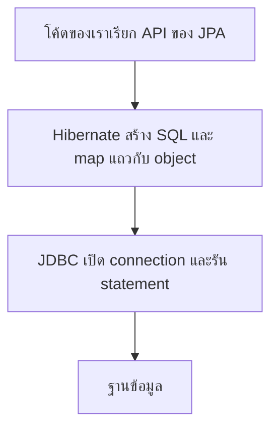
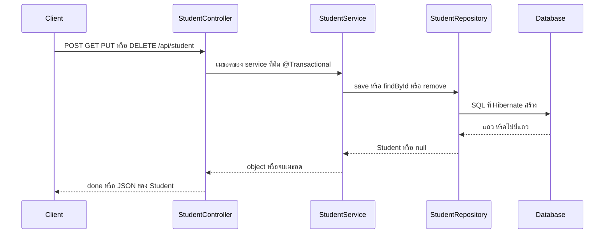
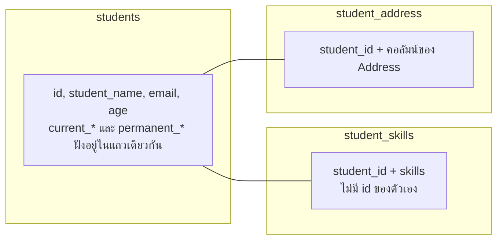
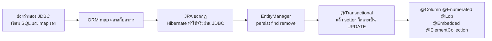

# #28 — Hibernate พื้นฐาน: CRUD กับ Entity Mapping

> **วิดีโอ:** [Hibernate Fundamentals with Spring Boot | CRUD & Entity Mapping | Spring Boot Full Course #28](https://youtu.be/XVQ27D8IIWU) — Coder Army, ~72 นาที
> **แหล่งที่ใช้สรุป:** ซับภาษาอังกฤษที่ YouTube สร้างอัตโนมัติ (en-US)
> **เวอร์ชันในโค้ด:** Spring Boot 4.1.1 + Java 21 (Hibernate ORM 7.4.5.Final ตาม BOM ของ parent นี้) ใส่หมายเหตุไว้ทุกจุดที่ Spring Boot 3.x ต่างกัน

ตอนนี้ตอบคำถามว่า **จะเก็บและดึง object ของ Java ลงตารางโดยไม่เขียน SQL เองได้อย่างไร** ผู้สอนเริ่มจากช่องว่างที่ JDBC บังคับให้เขียน query, ผูก parameter และ map `ResultSet` เอง แล้วให้ Hibernate รับงานนั้นผ่าน mapping ของ Entity จากนั้นเขาทำให้ CRUD ทั้งชุดทำงานด้วย `EntityManager` แล้วไล่ annotation ที่บอกว่าฟิลด์แต่ละแบบลงคอลัมน์หรือลงตารางอย่างไร

ส่วนที่ติดป้าย `💡 เพิ่มเติม` คือของที่ผมเติมเอง ไม่ได้อยู่ในวิดีโอ ส่วนที่ติด `⚠️ แก้จากวิดีโอ` คือจุดที่วิดีโอพูดคลาดเคลื่อน

> 💡 **เพิ่มเติม — วิดีโอใช้ MySQL โน้ตนี้ใช้ H2:** ผู้สอนใช้ **MySQL** ที่พอร์ต **3306** database ชื่อ `student_db` ดูตารางผ่าน DBeaver และต่อด้วย `jdbc:mysql://localhost:3306/student_db` พร้อม username กับ password ของเขา โค้ดที่รันในโน้ตนี้เปลี่ยนมาใช้ **H2 in-memory** (`jdbc:h2:mem:student_db`) ที่พอร์ต **9028** ข้อมูลหายเมื่อปิดแอป SQL ใน log จึงเป็นสำเนียงของ H2 เช่น `generated by default as identity` และ `@Lob` เป็น `clob` ส่วนในวิดีโอเขาเห็น `LONGTEXT` พฤติกรรมของ `persist`, `find`, `remove`, dirty checking และ annotation ยังเป็นของ Hibernate ชุดเดียวกัน

---

## สารบัญ

| เวลา | หัวข้อ |
|---|---|
| [0:00](https://youtu.be/XVQ27D8IIWU?t=0) | [1. ทำไมต้องมี Hibernate](#1-ทำไมต้องมี-hibernate) |
| [0:51](https://youtu.be/XVQ27D8IIWU?t=51) | [2. โปรเจกต์เริ่มจากของ JDBC](#2-โปรเจกต์เริ่มจากของ-jdbc) |
| [3:02](https://youtu.be/XVQ27D8IIWU?t=182) | [3. Object-Relational Impedance Mismatch](#3-object-relational-impedance-mismatch) |
| [6:26](https://youtu.be/XVQ27D8IIWU?t=386) | [4. ORM รับหน้าที่อะไร](#4-orm-รับหน้าที่อะไร) |
| [11:00](https://youtu.be/XVQ27D8IIWU?t=660) | [5. JPA คือ specification, Hibernate คือ implementation](#5-jpa-คือ-specification-hibernate-คือ-implementation) |
| [12:49](https://youtu.be/XVQ27D8IIWU?t=769) | [6. ชั้น JDBC อยู่ใต้ Hibernate](#6-ชั้น-jdbc-อยู่ใต้-hibernate) |
| [14:21](https://youtu.be/XVQ27D8IIWU?t=861) | [7. dependency ที่ต้องมี](#7-dependency-ที่ต้องมี) |
| [15:17](https://youtu.be/XVQ27D8IIWU?t=917) | [8. ต่อฐานข้อมูล](#8-ต่อฐานข้อมูล) |
| [17:07](https://youtu.be/XVQ27D8IIWU?t=1027) | [9. `ddl-auto`](#9-ddl-auto) |
| [19:22](https://youtu.be/XVQ27D8IIWU?t=1162) | [10. เปิด SQL ใน log](#10-เปิด-sql-ใน-log) |
| [20:30](https://youtu.be/XVQ27D8IIWU?t=1230) | [11. ทำให้คลาสเป็น Entity](#11-ทำให้คลาสเป็น-entity) |
| [21:56](https://youtu.be/XVQ27D8IIWU?t=1316) | [12. EntityManager: persist, find, remove](#12-entitymanager-persist-find-remove) |
| [24:31](https://youtu.be/XVQ27D8IIWU?t=1471) | [13. `@Transactional` กับการอัปเดตที่ไม่ได้เรียก update](#13-transactional-กับการอัปเดตที่ไม่ได้เรียก-update) |
| [29:27](https://youtu.be/XVQ27D8IIWU?t=1767) | [14. ลอง CRUD จริง รวมจุดที่พัง](#14-ลอง-crud-จริง-รวมจุดที่พัง) |
| [34:21](https://youtu.be/XVQ27D8IIWU?t=2061) | [15. `@Table` กับ `@Column`](#15-table-กับ-column) |
| [39:54](https://youtu.be/XVQ27D8IIWU?t=2394) | [16. ตัวเลขทศนิยม, วันที่, enum และ LOB](#16-ตัวเลขทศนิยม-วันที่-enum-และ-lob) |
| [44:55](https://youtu.be/XVQ27D8IIWU?t=2695) | [17. `@Transient` กับ AttributeConverter](#17-transient-กับ-attributeconverter) |
| [53:39](https://youtu.be/XVQ27D8IIWU?t=3219) | [18. ฝัง Address ด้วย `@Embeddable`](#18-ฝัง-address-ด้วย-embeddable) |
| [59:19](https://youtu.be/XVQ27D8IIWU?t=3559) | [19. สองที่อยู่กับ `@AttributeOverrides`](#19-สองที่อยู่กับ-attributeoverrides) |
| [1:02:45](https://youtu.be/XVQ27D8IIWU?t=3765) | [20. เก็บ collection ด้วย `@ElementCollection`](#20-เก็บ-collection-ด้วย-elementcollection) |
| — | [21. สรุปท้ายตอน](#21-สรุปท้ายตอน) |

---

## 1. ทำไมต้องมี Hibernate

[▶ 0:00](https://youtu.be/XVQ27D8IIWU?t=0)

ผู้สอนบอกว่า Hibernate คือเรื่องที่ต้องรู้ถ้าจะเก็บข้อมูลจากแอป Java ลงฐานข้อมูล ข้างในมันใช้โมเดล **ORM** ซึ่งย่อมาจาก **Object-Relational Mapping**

ถ้าเคยเขียน JDBC มาก่อน Hibernate จะทำให้สั้นลงอีก และถึงไม่เคยเขียน JDBC ก็ใช้ได้ เพราะไม่ต้องเขียน SQL เองแบบที่ทำใน JDBC หรือ Spring JDBC เรียก method ไม่กี่ตัวก็สร้าง อ่าน ลบ และแก้ข้อมูลได้

---

## 2. โปรเจกต์เริ่มจากของ JDBC

[▶ 0:51](https://youtu.be/XVQ27D8IIWU?t=51)

เขาเปิดโปรเจกต์ชื่อ **Hibernate Demo** โครงไม่ได้ว่าง มี `StudentController`, `StudentService` และ model `Student` ซึ่งเป็นคลาสชุดเดียวกับตอน JDBC ใครไม่ได้ดูตอนนั้นก็ตามได้จากที่เขาอธิบายในตอนนี้

Controller เปิดที่ `/api/student` มีสี่เมธอดคือ create, get by id, update และ delete คือ CRUD Service รับ `StudentRepository` แล้วส่งต่องานสี่อย่างนี้ ตอนเปิดมากเมธอดยังว่าง `create` คืน `null` เพราะต้องคืน `Student` แต่ยังไม่มีของจะคืน `update` กับ `delete` เป็น `void` และไม่ทำอะไร เพราะ repository ยังว่าง ทั้งตอนนี้คือการเติม logic ของ Hibernate ลง repository นั้น

[▶ 1:13](https://youtu.be/XVQ27D8IIWU?t=73)

เขาเปิดโปรเจกต์ Spring JDBC เทียบให้ดู โครงชั้นเดียวกัน แต่ตอน JDBC มี `getAll` ด้วย ซึ่งเดโม Hibernate ครั้งนี้ไม่ได้ทำ repository ตอน JDBC เขียน SQL เองทั้ง insert, update และ delete ส่ง parameter เอง เช่น `jdbcTemplate.update` ที่ส่ง name, email, age และมี `StudentRowMapper` ที่รับเลขแถวกับ `ResultSet` แล้วประกอบเป็น `Student`

ผลจาก JDBC มาเป็น `ResultSet` คือข้อมูลหนึ่งแถว Java ไม่รู้เองว่าจะแปลงแถวนั้นเป็น `Student` อย่างไร เขาจึงดึง `id` แบบ long ใส่ฟิลด์ id ดึง name ใส่ฟิลด์ name ไปทีละคอลัมน์ Spring JDBC ช่วยวนแถวให้ แต่การ map ยังเป็นหน้าที่ของเรา

Model ใน Java มีสี่ฟิลด์ `id`, `name`, `email`, `age` ตาราง `students` ใน DBeaver ก็มีสี่คอลัมน์ชื่อเดียวกัน คลาสคือพิมพ์เขียวที่ใช้สร้าง object ได้หลายตัว ตารางคือวิธีเก็บเรื่องเดียวกันใน SQL

---

## 3. Object-Relational Impedance Mismatch

[▶ 5:06](https://youtu.be/XVQ27D8IIWU?t=306)

ด้านหนึ่งเป็น object ของ Java ชื่อ `Student` อีกด้านเป็นตาราง `students` ทั้งสองฝั่งอยากพูดถึงนักเรียนคนเดียวกัน แต่ภาษาคนละแบบ

| ฝั่ง Java | ฝั่ง SQL |
|---|---|
| class, inheritance, polymorphism, object | table, row, column |
| ฟิลด์ของ object | คอลัมน์ของแถว |
| — | primary key, foreign key |

[▶ 5:35](https://youtu.be/XVQ27D8IIWU?t=335)

ชื่อของช่องว่างนี้คือ **Object-Relational Impedance Mismatch** คือความต่างระหว่างการแทน entity หนึ่งตัว (เช่นนักเรียน) ด้วย POJO กับการแทนด้วยตาราง ความต่างนี้ทำให้ต้องเขียน query เอง ผูก parameter เอง และบอกเองว่า `ResultSet` กลายเป็น `Student` อย่างไร หรือจะส่งฟิลด์ของ `Student` เข้า query อย่างไร นักพัฒนา Java จึงถูกบังคับให้เขียน SQL และแอปผูกกับฐานข้อมูลแน่น

---

## 4. ORM รับหน้าที่อะไร

[▶ 6:26](https://youtu.be/XVQ27D8IIWU?t=386)

ORM บอกว่าของที่แทนคือสิ่งเดียวกัน ทำไมเราจะ map object กับตารางเองไม่ได้ คลาสชื่อ `Student` ตารางชื่อ `students` ฟิลด์ `id`, `name`, `email`, `age` คือคอลัมน์สี่ตัว object หนึ่งตัวมีค่าสี่ค่า แถวหนึ่งแถวก็มีค่าสี่ค่าเหมือนกัน

กฎที่เขาตั้งไว้คือ ให้คิดว่าจะเก็บ Java object ตามรูปที่มีอยู่ คลาสกลายเป็นชื่อตาราง ฟิลด์กลายเป็นคอลัมน์ object ใหม่ที่เซฟกลายเป็นแถวใหม่ ทำ mapping ครั้งเดียว แล้วใช้กับ CRUD ทั้ง insert, update และ delete

[▶ 8:08](https://youtu.be/XVQ27D8IIWU?t=488)

เขาเขียนหน้าที่ของ ORM ไว้บนจอเป็นข้อ ๆ

1. **Mapping metadata** ชื่อคลาสเป็นชื่อตาราง ฟิลด์เป็นชื่อคอลัมน์
2. **สร้าง SQL ให้** รูปประโยคของ SQL คงที่ มีแค่ชื่อตาราง ชื่อคอลัมน์ และค่าที่เปลี่ยน เขาเทียบกับ insert ของ JDBC ที่ขึ้นต้น `INSERT INTO` เสมอ ตามด้วยชื่อตาราง รายชื่อคอลัมน์ และค่า และเทียบกับ `UPDATE student` ที่ขึ้นต้น `UPDATE` ตามด้วยชื่อตาราง คำว่า `SET` แล้วเป็นฟิลด์ของคลาส เครื่องหมาย `?` คือค่าจาก object ส่วน `WHERE` ใช้ id จากฟิลด์และจาก object
3. **Parameter binding** ค่าที่ใส่ลง `?` มาจากฟิลด์ของ object
4. **Result set mapping** แถวที่ SQL คืนมา ใส่กลับเข้าฟิลด์ของ `Student` ได้เพราะรู้แล้วว่าคอลัมน์ไหนคือฟิลด์ไหน
5. **ความสัมพันธ์** เช่นมีคลาส `Address` อยู่ข้างใน `Student` จะ map อย่างไร เขาจะทำให้ดูท้ายตอน
6. **Caching** ไม่ยิง SQL เข้าฐานข้อมูลทุกครั้ง เพราะทุกครั้งที่เรียกฐานข้อมูล latency เพิ่ม ถ้า cache query ไว้ได้ งานเบาลง รายละเอียดอยู่ในตอนถัดไป
7. **Transaction** ให้ชุดงานสำเร็จทั้งก้อนหรือไม่สำเร็จเลย เขาเคยเห็นแนวนี้ตอน JDBC และจะใช้ในตอนนี้ แต่ยังไม่แกะกลไกทั้งหมด



---

## 5. JPA คือ specification, Hibernate คือ implementation

[▶ 11:00](https://youtu.be/XVQ27D8IIWU?t=660)

ORM ที่จะใช้วันนี้ชื่อ Hibernate เขาบอกว่าไม่ใช่ตัวเดียวในโลก มี ORM อื่นอีก

> ⚠️ **แก้จากวิดีโอ:** ผู้สอนบอกว่า ORM ทางการของ Spring คือ Hibernate และ Spring ใช้ Hibernate ข้างในเอง Hibernate ไม่ใช่โปรเจกต์ของ Spring มันเป็น ORM แยกต่างหาก สิ่งที่ตรงคือ Spring Boot เลือก Hibernate เป็น implementation เริ่มต้นของ JPA เมื่อใส่ `spring-boot-starter-data-jpa`

จากนั้นเขาโยงกับโปรเจกต์ CRUD ก่อนหน้านี้ ที่เก็บข้อมูลลง SQL ด้วย **JPA** ชื่อเดิมคือ Java Persistence API ตอนนี้ชื่อ **Jakarta Persistence API** ถ้าสร้างโปรเจกต์จาก Spring Initializr แล้วเลือกฐานข้อมูล จะได้ JPA มาด้วย

หลายคนคิดว่า JPA เป็นตัวที่เซฟและอ่านข้อมูลเอง เขาบอกว่าไม่ใช่ JPA เป็น specification มันบอกว่าควรเกิดอะไรขึ้น มี interface และกฎ แต่ไม่ได้เป็นตัวที่ไปคุยกับฐานข้อมูล ตัวที่ทำคือ Hibernate ซึ่งเป็น implementation ของ JPA ไม่จำเป็นว่า JPA ต้องใช้ Hibernate เสมอ ทาง Boot ใช้ Hibernate เป็นค่าเริ่มต้น และเปลี่ยนไปใช้ ORM อื่นได้

ในทางปฏิบัติชั้นที่เราเรียกคือ API ของ JPA เราใช้คำของ JPA เช่น entity แต่ข้างในเป็น Hibernate เขาบอกว่าโดยทั่วไปไม่เขียน raw Hibernate ทั้งก้อน ถ้าอยากใช้โดยไม่ผ่าน JPA ก็ทำได้

---

## 6. ชั้น JDBC อยู่ใต้ Hibernate

[▶ 12:49](https://youtu.be/XVQ27D8IIWU?t=769)

คำถามต่อคือ Hibernate สร้าง query ได้แล้ว ใครเป็นคนเอา query นั้นไปส่งถึงฐานข้อมูล คำตอบคือ JDBC ที่เรียนไปแล้ว JDBC เปิด connection รัน statement และ prepared statement Hibernate เรียก JDBC ข้างในอีกที

ลำดับที่เขาให้จำคือ เราเรียก JPA, JPA ถูกทำให้เป็นจริงโดย Hibernate, Hibernate คุยกับฐานข้อมูลผ่าน JDBC

---

## 7. dependency ที่ต้องมี

[▶ 14:21](https://youtu.be/XVQ27D8IIWU?t=861)

ใน `pom.xml` เขามี `spring-boot-starter-webmvc` อยู่แล้ว แล้วเพิ่ม **Spring Boot Starter Data JPA** เขาบอกว่า starter นี้ดึงตัว test ของ JPA มาด้วย และพอมี starter นี้ก็ได้ Hibernate ตามมา เพราะ Hibernate คือ implementation ทางการของ JPA ในชุดนั้น

> 💡 **เพิ่มเติม:** ใน Boot 4.1.1 พิกัด test คือ `spring-boot-starter-data-jpa-test` scope `test` ไม่ได้ถูกประกาศอัตโนมัติแค่เพราะมี starter หลัก โน้ตใส่ทั้งสองก้อนให้ตรงกับที่เขาบอกว่าเห็นใน pom ตัว driver ของ MySQL ที่เขาเพิ่มทีหลังถูกแทนด้วย H2

```xml
<?xml version="1.0" encoding="UTF-8"?>
<project xmlns="http://maven.apache.org/POM/4.0.0"
         xmlns:xsi="http://www.w3.org/2001/XMLSchema-instance"
         xsi:schemaLocation="http://maven.apache.org/POM/4.0.0 https://maven.apache.org/xsd/maven-4.0.0.xsd">
  <modelVersion>4.0.0</modelVersion>

  <parent>
    <groupId>org.springframework.boot</groupId>
    <artifactId>spring-boot-starter-parent</artifactId>
    <version>4.1.1</version>
    <relativePath/>
  </parent>

  <groupId>com.example</groupId>
  <artifactId>hibernate-demo</artifactId>
  <version>0.0.1-SNAPSHOT</version>
  <name>hibernate-demo</name>

  <properties>
    <java.version>21</java.version>
  </properties>

  <dependencies>
    <dependency>
      <groupId>org.springframework.boot</groupId>
      <artifactId>spring-boot-starter-webmvc</artifactId>
    </dependency>
    <dependency>
      <groupId>org.springframework.boot</groupId>
      <artifactId>spring-boot-starter-data-jpa</artifactId>
    </dependency>
    <dependency>
      <groupId>org.springframework.boot</groupId>
      <artifactId>spring-boot-starter-data-jpa-test</artifactId>
      <scope>test</scope>
    </dependency>
    <dependency>
      <groupId>com.h2database</groupId>
      <artifactId>h2</artifactId>
      <scope>runtime</scope>
    </dependency>
  </dependencies>

  <build>
    <plugins>
      <plugin>
        <groupId>org.springframework.boot</groupId>
        <artifactId>spring-boot-maven-plugin</artifactId>
      </plugin>
    </plugins>
  </build>
</project>
```

---

## 8. ต่อฐานข้อมูล

[▶ 14:56](https://youtu.be/XVQ27D8IIWU?t=896)

ก่อนเขียน repository เขาลบตารางเก่าใน DBeaver ด้วย `DROP TABLE students` แล้ว refresh จนไม่เหลือตาราง

[▶ 15:17](https://youtu.be/XVQ27D8IIWU?t=917)

`application.properties` ของเดโม Hibernate เริ่มว่าง เขาเปิดของโปรเจกต์ JDBC แล้วคัดค่า datasource มา สามค่านี้บอกว่าจะต่อแหล่งข้อมูลที่ไหน URL ขึ้นต้น `jdbc:mysql` เพราะข้างใต้ยังเป็น JDBC และฐานข้อมูลเป็น MySQL ตามด้วย `localhost:3306` และชื่อ database `student_db` จากนั้นเป็น `spring.datasource.username` กับ `spring.datasource.password`

พอใส่ URL แล้ว IDE ฟ้องว่าหา MySQL driver class ไม่เจอ เขาเปิด pom ของโปรเจกต์ JDBC ให้ดูว่ามี MySQL driver แล้วบอกว่า Hibernate ก็ยังต้องการ driver เพราะ JDBC ข้างใต้ต้องการ เขาใส่ dependency นั้น แล้ว reload Maven จน error หาย

> 💡 **เพิ่มเติม:** โน้ตนี้ไม่ใส่ MySQL driver ใส่ H2 แทน username คือ `sa` และรหัสว่าง ซึ่งเป็นค่าของ H2 ไม่ใช่รหัสในวิดีโอ

---

## 9. `ddl-auto`

[▶ 17:07](https://youtu.be/XVQ27D8IIWU?t=1027)

เขาตั้ง `spring.jpa.hibernate.ddl-auto` ค่านี้บอกว่าให้รันคำสั่ง **DDL** (Data Definition Language) อย่างการสร้างหรือลบตารางอย่างไร เขาเลื่อน autocomplete แล้วอ่านค่าประมาณว่า update, create, create-drop และ none แล้วอธิบายทีละตัว รวม `validate` ที่พูดถึงทีหลัง

| ค่า | ความหมายตามที่เขาอธิบาย |
|---|---|
| `create` | ทุกครั้งที่แอปสตาร์ท Hibernate สร้างตารางจาก Entity ใหม่ ตารางเก่าถูกทิ้ง ข้อมูลเก่าหาย |
| `update` | ถ้า schema เปลี่ยน เช่นวันหลังเพิ่มฟิลด์ address ใน `Student` มันพยายามปรับตารางให้ตรง โดยเพิ่มคอลัมน์ ข้อมูลเก่ายังอยู่ |
| `none` | ไม่รัน DDL เราไปสร้างตารางใน SQL เอง แอปแค่ insert ค่า |
| `validate` | ตรวจว่า schema ที่มีอยู่ตรงกับฟิลด์ของ Entity หรือไม่ ตรงก็ทำงานต่อ ไม่ตรงก็ขว้าง error |

เขาเลือก `update` เพื่อให้ schema ตาม Entity ระหว่างเรียน ถ้าใช้ `create` ทุกครั้งที่รีสตาร์ทข้อมูลหาย

[▶ 19:06](https://youtu.be/XVQ27D8IIWU?t=1146)

เขาบอกว่าโปรดักชันไม่ใช้ `ddl-auto` ไปยุ่งกับฐานข้อมูลแบบนี้ มีเครื่องมือเฉพาะอย่าง **Flyway** กับ **Liquibase** ค่านี้มีประโยชน์ตอน staging หรือตอนอธิบาย

> ⚠️ **แก้จากวิดีโอ:** ผู้สอนอ่านค่าใน autocomplete รวมกันเป็นคำว่า only-drop ไม่มีค่าชื่อนี้ ใน Hibernate 7.4.5 ค่าของ `hibernate.hbm2ddl.auto` คือ `none`, `create-only`, `drop`, `create`, `create-drop`, `validate`, `update`, `truncate` และ `populate` สองคำที่เขาหลอมรวมคือ `create-only` กับ `drop`

> ⚠️ **Boot 4 vs 3:** `populate` เพิ่มใน Hibernate 7.0 คลาส `org.hibernate.tool.schema.Action` ของ `hibernate-core` 7.4.5.Final ระบุ `@since 7.0` ที่ค่านี้ และ BOM `spring-boot-dependencies` 4.1.1 ล็อก `hibernate.version` ไว้ที่ `7.4.5.Final` Boot 3.5.16 ล็อก Hibernate ที่ `6.6.53.Final` จึงยังไม่มีค่านี้ ค่าที่วิดีโอใช้คือ `update` ซึ่งมีทั้งสองสาย

> 💡 **เพิ่มเติม:** เขาพูดชื่อ `create-drop` แต่ไม่ได้แยกให้ชัดว่ามัน drop ตอนสตาร์ทแล้วสร้างใหม่ และ drop อีกครั้งตอนปิด `SessionFactory` ส่วนคำว่า `create` ของ Hibernate แปลว่า drop แล้วสร้างใหม่ ไม่ใช่คำว่า create ของสเปก JPA ที่หมายถึงสร้างอย่างเดียว (`create-only`) metadata ของ Boot 4.1.1 ยังบอกว่าถ้าไม่ตั้ง property นี้เอง ค่าเริ่มต้นคือ `create-drop` เมื่อใช้ฐานข้อมูล embedded อย่าง H2 และเป็น `none` เมื่อไม่ใช่

ตอนเขาเปลี่ยนชื่อตารางหรือคอมเมนต์ฟิลด์ทิ้ง แล้วรีสตาร์ทด้วย `update` คอลัมน์เก่าไม่ถูกลบ และตารางชื่อเก่าไม่ถูก rename เขารีเฟรชแล้วเห็นคอลัมน์ใหม่ถูกเพิ่มข้างคอลัมน์เก่า ทางแก้ที่เขาใช้คือลบตารางเองใน DBeaver แล้วสตาร์ทใหม่ ให้ Hibernate รัน `CREATE TABLE` ทั้งก้อน

> 💡 **เพิ่มเติม:** H2 แบบ in-memory เริ่มว่างทุกครั้งที่เปิดแอป จึงเห็น `CREATE TABLE` ทุกรอบ และโชว์เรื่อง "รีสตาร์ทแล้วยังมีแถวเดิม" ของ `update` บน MySQL ไม่ได้ พฤติกรรมที่รันยืนยันด้านล่างคือการสร้าง schema ครั้งแรกและการเขียนข้อมูลในกระบวนการเดียว

---

## 10. เปิด SQL ใน log

[▶ 19:22](https://youtu.be/XVQ27D8IIWU?t=1162)

เขาอยากเห็น SQL ที่ Hibernate สร้าง ตั้ง `spring.jpa.show-sql=true` ค่าเริ่มต้นคือ `false` แล้วตั้ง `spring.jpa.properties.hibernate.format_sql=true` ไม่งั้นทั้งประโยคอยู่บรรทัดเดียว อ่านยาก

ไฟล์ที่รันจริงคือชุดนี้

```properties
server.port=9028

spring.datasource.url=jdbc:h2:mem:student_db
spring.datasource.driver-class-name=org.h2.Driver
spring.datasource.username=sa
spring.datasource.password=

spring.jpa.hibernate.ddl-auto=update
spring.jpa.show-sql=true
spring.jpa.properties.hibernate.format_sql=true
```

คลาสหลักไม่มีอะไรนอกจากจุดสตาร์ท

```java
package com.example.hibernatedemo;

import org.springframework.boot.SpringApplication;
import org.springframework.boot.autoconfigure.SpringBootApplication;

@SpringBootApplication
public class HibernateDemoApplication {

  public static void main(String[] args) {
    SpringApplication.run(HibernateDemoApplication.class, args);
  }
}
```

---

## 11. ทำให้คลาสเป็น Entity

[▶ 20:30](https://youtu.be/XVQ27D8IIWU?t=1230)

ก่อนเขียน repository เขาทำให้ model ผูกกับตาราง ใส่ `@Entity` ความหมายคือคลาสนี้จะถูก map เป็นตารางในฐานข้อมูล พอใส่แล้ว IDE ฟ้องว่า persistent entity `Student` ต้องมี primary key เขาใส่ `@Id` ที่ฟิลด์ `id`

จากนั้นอยากให้ id เพิ่มเองเป็น 1, 2, 3 ในตาราง ใส่ `@GeneratedValue(strategy = GenerationType.IDENTITY)` เขาแปล `IDENTITY` ว่าให้สร้างเลขเพิ่มเอง ฟิลด์ที่เหลือตอนนั้นคือ `name`, `email`, `age` คลาสมี constructor เปล่า constructor แบบรับค่า และ getter กับ setter อยู่แล้ว เขาบอกว่าเท่านี้พอสำหรับขั้นแรก รายละเอียด annotation อื่นอยู่หัวข้อ 15 เป็นต้นไป และคลาสเต็มที่รันอยู่ท้ายหัวข้อ 17

เขาเคยทำแบบนี้ในตอน JPA แล้ว แต่ตอนนั้นยังไม่ได้แกะความหมาย วันนี้จะลงรายละเอียด

---

## 12. EntityManager: persist, find, remove

[▶ 21:56](https://youtu.be/XVQ27D8IIWU?t=1316)

Repository ต้องได้ `EntityManager` เขาวางฟิลด์นี้แล้วใส่ `@PersistenceContext` เขาบอกว่าทั้ง EntityManager และ annotation นี้จะอธิบายทีหลัง ตอนนี้แค่ใช้

> 💡 **เพิ่มเติม:** `@PersistenceContext` คือวิธีของ JPA ในการฉีด `EntityManager` ที่ผูกกับ persistence context ของงานปัจจุบัน กลไกที่ทำให้ object ที่โหลดมาแล้ว "รู้ตัว" ว่าถูกแก้ อยู่ในตอนถัดไป ตอนนี้จำแค่ว่าไม่มี annotation นี้ Spring จะไม่ส่ง `EntityManager` ให้ฟิลด์นี้

[▶ 22:19](https://youtu.be/XVQ27D8IIWU?t=1339)

เมธอดเซฟชื่อ `save` รับ `Student` แล้วเรียก `entityManager.persist(student)` บรรทัดเดียว เขาเทียบกับ JDBC ที่ต้องเขียน `INSERT INTO` เรียก `update` แล้วดูผลเอง

[▶ 23:06](https://youtu.be/XVQ27D8IIWU?t=1386)

อ่านชื่อ `findById` รับ `Long id` เพราะจะหาด้วย primary key เรียก `entityManager.find` สองอาร์กิวเมนต์ อันแรกคือคลาส `Student.class` เขาเรียกว่า reflection ของ `Student` เพื่อบอกว่าแถวที่ได้นั้นต้องกลายเป็น object ชนิดนี้ อันที่สองคือ id คืน object นั้นกลับไปที่ service

[▶ 23:57](https://youtu.be/XVQ27D8IIWU?t=1437)

ลบชื่อ `remove` รับ id ตอนแรกเขาลอง `remove` โดยส่ง id แล้ว IDE ฟ้อง เพราะเมธอดเป็น `void` และชนิดที่รับไม่ใช่ id เขาเลยเปลี่ยนให้รับ `Student` ทั้งก้อน

> ⚠️ **แก้จากวิดีโอ:** ผู้สอนเรียกแบบที่รับ `Student` ว่าเป็น overload ของ `remove` ที่รับ id `EntityManager.remove` มีเมธอดเดียว รับ entity ไม่มีเมธอดที่รับแค่ id ตอนส่ง id เข้าไปจึงคอมไพล์ไม่ผ่าน ไม่ใช่การเลือก overload ผิดตัว

ใน service เขาไม่เรียก `remove` ด้วย id ตรง ๆ เขา `findById` ก่อน ถ้าได้ `null` เพราะไม่มีแถวนั้น เขา `throw new RuntimeException("student not found")` เขาบอกว่าปกติจะจับ exception นี้ใน global exception handler แต่ตอนนี้ขว้างตรง ๆ พอมี object แล้วค่อย `remove` object นั้น เขาบอกว่าแบบส่งทั้ง object ดีกว่า และจะบอกเหตุผลทีหลัง ซึ่งตอนนี้ยังไม่ได้บอก

```java
package com.example.hibernatedemo.repository;

import com.example.hibernatedemo.model.Student;
import jakarta.persistence.EntityManager;
import jakarta.persistence.PersistenceContext;
import org.springframework.stereotype.Repository;

@Repository
public class StudentRepository {

  @PersistenceContext
  private EntityManager entityManager;

  public void save(Student student) {
    entityManager.persist(student);
  }

  public Student findById(Long id) {
    return entityManager.find(Student.class, id);
  }

  public void remove(Student student) {
    entityManager.remove(student);
  }
}
```

ตอนสตาร์ท log บอกว่า `Finished Spring Data repository scanning` แล้ว `Found 0 JPA repository interfaces` เพราะคลาสนี้เป็น `@Repository` ที่เราเขียนเอง ไม่ใช่ interface ของ Spring Data ที่ตอน CRUD ก่อนหน้าใช้

---

## 13. `@Transactional` กับการอัปเดตที่ไม่ได้เรียก update

[▶ 24:31](https://youtu.be/XVQ27D8IIWU?t=1471)

Service เรียก repository ทีละเมธอด ตอน create เขาเรียก `save` แล้วคาดว่า `persist` จะเก็บแถว เขาใส่ `@Transactional` จาก `jakarta.transaction` บนเมธอด ความหมายที่เขาให้ตอนนี้คือสร้าง transaction งานต้องสำเร็จทั้งก้อนหรือล้มทั้งก้อน ห้ามสำเร็จครึ่งเดียว เหตุผลที่ต้องมีจะคุยทีหลัง เขาใส่บน `getStudentById` ด้วย แล้วบอกว่าใส่ได้ ไม่เป็นไร

[▶ 25:37](https://youtu.be/XVQ27D8IIWU?t=1537)

Update เป็นจุดที่เขาตั้งใจไม่สร้างเมธอด update ใน repository ขั้นตอนคือ

1. รับ `id` จาก `@PathVariable` ของ controller คู่กับ body ที่เขาเรียก `studentRequest` เขาแยก id ออกมาเพราะตอนอัปเดตมักส่ง id มากับ path
2. `findById(id)` ได้ `Student` ตัวที่อยู่ในฐานข้อมูลแล้ว เขาตั้งชื่อตัวแปรว่า `studentOne`
3. ถ้าไม่เจอ เขาบอกว่าทำแบบเดียวกับ delete ได้ คือขว้าง `RuntimeException` แล้วใช้ตัวแปร `studentOne` ในเงื่อนไขนั้น
4. `setName`, `setAge`, `setEmail` จาก request
5. เมธอดจบ โดยไม่เรียก repository อีก

เขาบอกว่าแค่โหลดมาแล้วเซ็ตค่า แถวในฐานข้อมูลจะถูกอัปเดตเอง ทั้งที่ไม่ได้สั่งให้รัน update และยังไม่มีเมธอดนั้น เขาให้ดูผลก่อน แล้วค่อยอธิบายว่าเวทมนตร์นี้ทำงานอย่างไร

> 💡 **เพิ่มเติม:** สิ่งที่เกิดขึ้นคือ `find` ได้ entity ที่ถูกจัดการอยู่ใน persistence context ของ transaction นั้น พอ setter เปลี่ยนฟิลด์ Hibernate เห็นว่าค่าต่างจากตอนโหลด และตอน commit ของ `@Transactional` มันจึงเขียน `UPDATE` ให้เอง ถ้าไม่มี transaction รอบเมธอด การเซ็ตค่าค้างอยู่แค่ใน object ไม่มีจังหวะ commit ให้เขียนลงฐานข้อมูล ตอนถัดไปจะแกะ persistence context กับ cache ชั้นนี้

Controller ของ create, update และ delete คืนข้อความ `done` เขาไม่ได้คืน object ของนักเรียนจาก HTTP ตอน POST เขาบอกว่าแค่พิมพ์ done ส่วน GET คืน `Student` ที่ service ได้มา

```java
package com.example.hibernatedemo.service;

import com.example.hibernatedemo.model.Student;
import com.example.hibernatedemo.repository.StudentRepository;
import jakarta.transaction.Transactional;
import org.springframework.stereotype.Service;

@Service
public class StudentService {

  private final StudentRepository studentRepository;

  public StudentService(StudentRepository studentRepository) {
    this.studentRepository = studentRepository;
  }

  @Transactional
  public Student createStudent(Student student) {
    studentRepository.save(student);
    return student;
  }

  @Transactional
  public Student getStudentById(Long id) {
    return studentRepository.findById(id);
  }

  @Transactional
  public void updateStudent(Long id, Student studentRequest) {
    Student studentOne = studentRepository.findById(id);
    if (studentOne == null) {
      throw new RuntimeException("student not found");
    }
    studentOne.setName(studentRequest.getName());
    studentOne.setAge(studentRequest.getAge());
    studentOne.setEmail(studentRequest.getEmail());
  }

  @Transactional
  public void deleteStudent(Long id) {
    Student student = studentRepository.findById(id);
    if (student == null) {
      throw new RuntimeException("student not found");
    }
    studentRepository.remove(student);
  }
}
```

```java
package com.example.hibernatedemo.controller;

import com.example.hibernatedemo.model.Student;
import com.example.hibernatedemo.service.StudentService;
import org.springframework.web.bind.annotation.DeleteMapping;
import org.springframework.web.bind.annotation.GetMapping;
import org.springframework.web.bind.annotation.PathVariable;
import org.springframework.web.bind.annotation.PostMapping;
import org.springframework.web.bind.annotation.PutMapping;
import org.springframework.web.bind.annotation.RequestBody;
import org.springframework.web.bind.annotation.RequestMapping;
import org.springframework.web.bind.annotation.RestController;

@RestController
@RequestMapping("/api/student")
public class StudentController {

  private final StudentService studentService;

  public StudentController(StudentService studentService) {
    this.studentService = studentService;
  }

  @PostMapping
  public String createStudent(@RequestBody Student student) {
    studentService.createStudent(student);
    return "done";
  }

  @GetMapping("/{id}")
  public Student getStudentById(@PathVariable Long id) {
    return studentService.getStudentById(id);
  }

  @PutMapping("/{id}")
  public String updateStudent(@PathVariable Long id, @RequestBody Student studentRequest) {
    studentService.updateStudent(id, studentRequest);
    return "done";
  }

  @DeleteMapping("/{id}")
  public String deleteStudent(@PathVariable Long id) {
    studentService.deleteStudent(id);
    return "done";
  }
}
```

> 💡 **เพิ่มเติม:** เขาฉีด repository ที่มีอยู่แล้วเข้า service โน้ตใช้ constructor ซึ่งทำงานเหมือนกัน import ของ `@Transactional` ตามที่เขาชี้คือ `jakarta.transaction.Transactional` และตัวนี้ถูก Spring มองเห็นจริง ใน stack ตอนรันมี `TransactionInterceptor` ของ `spring-tx` annotation อีกตัวที่เจอบ่อยคือ `org.springframework.transaction.annotation.Transactional` ซึ่งมี attribute เพิ่มอย่าง `rollbackFor` ตอนนี้ทั้งสองแบบครอบเมธอดนี้ได้

เส้นทางของ request เป็นแบบนี้



---

## 14. ลอง CRUD จริง รวมจุดที่พัง

[▶ 29:27](https://youtu.be/XVQ27D8IIWU?t=1767)

เขาสตาร์ทแอป แล้วเห็น Hibernate รัน `CREATE TABLE` ของ `student` มี id, age, email, name และ primary key ที่ id เขาดีใจที่ query ถูกสร้างจากฟิลด์เอง DBeaver refresh แล้วมีตารางว่าง

> 💡 **เพิ่มเติม:** SQL ด้านล่างมาจาก Entity ที่รวม mapping ท้ายตอนไว้แล้ว จึงมีคอลัมน์มากกว่าสี่ฟิลด์ที่เขามีตอนยิง POST ครั้งแรก ในวิดีโอเขาใส่ `@Column`, enum, ที่อยู่ และ collection ทีหลัง แล้วคอมเมนต์ชุดเก่าออกเป็นช่วง ๆ โน้ตรวมไว้ในคลาสเดียวเพื่อให้ยิงครั้งเดียวเห็นทุกแบบ ตารางจึงชื่อ `students` ตาม `@Table` ไม่ใช่ `student` แบบตอนที่เขายังไม่ได้ตั้งชื่อ

ตอนสตาร์ท H2 ได้ schema นี้

```text
Hibernate:
    create table student_address (
        student_id bigint not null,
        city varchar(255),
        house_number varchar(255),
        pin_code varchar(255),
        state varchar(255),
        street varchar(255)
    )
Hibernate:
    create table student_skills (
        student_id bigint not null,
        skills varchar(255)
    )
Hibernate:
    create table students (
        id bigint generated by default as identity,
        age integer,
        created_at timestamp(6),
        current_city varchar(255),
        current_house_number varchar(255),
        current_pin_code varchar(255),
        current_state varchar(255),
        current_street varchar(255),
        date_of_birth date,
        email varchar(150) not null,
        is_monitor varchar(255) check ((is_monitor in ('No','Yes'))),
        student_name varchar(100) not null,
        percentage numeric(5,2),
        permanent_city varchar(255),
        permanent_house_number varchar(255),
        permanent_pin_code varchar(255),
        permanent_state varchar(255),
        permanent_street varchar(255),
        profile_description clob,
        status enum ('ACTIVE','INACTIVE','SUSPENDED'),
        primary key (id)
    )
```

จากนั้นมี unique ของ email, unique ของ `(student_id, skills)`, unique ของคอลัมน์ที่อยู่ใน `student_address` และ foreign key จากทั้งสองตารางลูกกลับไปที่ `students`

[▶ 30:13](https://youtu.be/XVQ27D8IIWU?t=1813)

เขาเปิด Postman ยิง `POST /api/student` คนแรกชื่อ Raman อีเมล `raman@gmail.com` อายุ 19 ได้ข้อความ done คนที่สองชื่อ Aditya อายุ 29 ได้ done เช่นกัน refresh ตารางแล้วมีสองแถว id เพิ่มเอง อายุ อีเมล และชื่อตรงกับที่ส่ง GET id 1 ได้ Raman GET id 2 ได้ Aditya

ผลจากแอปนี้ พอร์ต 9028

```text
POST /api/student
{"name":"Raman","email":"raman@gmail.com","age":19}

HTTP/1.1 200
Content-Type: text/plain;charset=UTF-8

done
```

```text
POST /api/student
{"name":"Aditya","email":"aditya@gmail.com","age":29}

done
```

```text
GET /api/student/1

{"addresses":[],"age":19,"createdAt":null,"currentAddress":null,"dateOfBirth":null,"displayName":null,"email":"raman@gmail.com","id":1,"isMonitor":null,"name":"Raman","percentage":null,"permanentAddress":null,"profileDescription":null,"skills":[],"status":null}
```

ฟิลด์ที่เป็น null หรือลิสต์ว่างคือ mapping ที่ยังไม่ได้ส่งมาใน body ไม่ได้แปลว่า POST ล้ม

SQL ของการ insert ครั้งนี้เป็นรูปนี้ ค่าจริงถูกส่งเป็น `?`

```text
Hibernate:
    insert
    into
        students
        (age, created_at, current_city, current_house_number, current_pin_code, current_state, current_street, date_of_birth, email, is_monitor, student_name, percentage, permanent_city, permanent_house_number, permanent_pin_code, permanent_state, permanent_street, profile_description, status, id)
    values
        (?, ?, ?, ?, ?, ?, ?, ?, ?, ?, ?, ?, ?, ?, ?, ?, ?, ?, ?, default)
```

`id` ใช้ `default` เพราะ `IDENTITY` ให้ฐานข้อมูลเป็นคนสร้าง

[▶ 31:20](https://youtu.be/XVQ27D8IIWU?t=1880)

เขาจะ PUT เปลี่ยนอายุของ Aditya จาก 29 เป็น 28 โดยส่ง id 2 ใน path ได้ **405 Method Not Allowed** เพราะ `@PutMapping` ยังไม่มี `/{id}` path จึงไม่ผูกกับตัวแปร id เขาใส่ `/{id}` แล้วรีสตาร์ท

[▶ 31:51](https://youtu.be/XVQ27D8IIWU?t=1911)

ตอนรีสตาร์ท query สร้างตารางไม่รันซ้ำ เพราะใช้ `update` ไม่ใช่ `create` และตารางมีอยู่แล้ว refresh แล้วข้อมูลเก่ายังอยู่ นี่คือประโยชน์ของ `update` ที่เขาอยากให้เห็น

จากนั้น PUT อีกครั้ง ได้ done แต่ refresh แล้วอายุยัง 29 ใน log มีแค่ `SELECT` ไม่มี `UPDATE` เขาเปิด service แล้วเห็นว่าลืม `@Transactional` บน update เขาใส่ให้ทั้ง update และ delete รีสตาร์ท แล้ว PUT อีกครั้งโดยเปลี่ยนอายุเป็น 25 ครั้งนี้ได้ done และในตารางเป็น 25 จริง log มี `SELECT` ก่อน แล้วตามด้วย `UPDATE` ทั้งที่ใน service ไม่มีคำสั่ง update มีแค่ `findById` กับ setter

แอปนี้เจอ 405 แบบเดียวกันเมื่อยิง PUT ที่ path ไม่มี id

```text
PUT /api/student
HTTP/1.1 405
Allow: POST

{"timestamp":"2026-10-16T12:14:19.426Z","status":405,"error":"Method Not Allowed","path":"/api/student"}
```

เมื่อมี `@Transactional` บน `updateStudent` แล้ว PUT id 2 อายุ 25

```text
PUT /api/student/2
{"name":"Aditya","email":"aditya@gmail.com","age":25}

done
```

```text
Hibernate:
    select
        s1_0.id,
        ...
        s1_0.student_name,
        ...
        s1_0.status
    from
        students s1_0
    where
        s1_0.id=?
Hibernate:
    update
        students
    set
        age=?,
        ...
        student_name=?,
        ...
        status=?
    where
        id=?
```

GET หลัง PUT ได้ `"age":25` ฟิลด์อื่นของแถวนั้นไม่ถูก setter แตะ จึงยังเป็นค่าเดิม

จากนั้นเอา `@Transactional` ออกจาก `updateStudent` อย่างเดียว แล้วสตาร์ทใหม่ ยิง POST ได้ Aditya อายุ 29 ที่ id 1 แล้ว PUT อายุ 25 ได้ข้อความ done แต่ GET ยังได้ `"age":29` ใน log มีแต่ `select` ไม่มี `update` ตรงกับที่เขาเจอตอนลืม annotation โค้ดในโน้ตใส่ annotation กลับแล้ว เพราะนั่นคือรูปที่เขาใช้ตอนอัปเดตสำเร็จ

[▶ 33:33](https://youtu.be/XVQ27D8IIWU?t=2013)

เขาลบ id 2 ด้วย DELETE ได้ done แล้วแถวนั้นหายจาก DBeaver เขาปิดท้ายช่วง CRUD ว่าใช้แค่ EntityManager, `@PersistenceContext` และ `@Transactional` บน service

ในแอปนี้ DELETE id 2 ได้ `done` และ SQL ลบตารางลูกก่อนแล้วจึงลบแถวหลัก เพราะ entity มี collection

```text
Hibernate:
    delete
    from
        student_address
    where
        student_id=?
Hibernate:
    delete
    from
        student_skills
    where
        student_id=?
Hibernate:
    delete
    from
        students
    where
        id=?
```

PUT id ที่ไม่มี เช่น 99 ได้ HTTP 500 และใน log มี `java.lang.RuntimeException: student not found` body ที่ client เห็นไม่มีข้อความนั้น

```text
PUT /api/student/99
HTTP/1.1 500

{"timestamp":"2026-10-16T12:14:19.514Z","status":500,"error":"Internal Server Error","path":"/api/student/99"}
```

GET id ที่ไม่มีคืน 200 และ body ว่าง เพราะ `find` ได้ `null` แล้ว controller คืนค่านั้นตรง ๆ เขาไม่ได้ขว้าง exception บนเส้นทางอ่าน

อีเมลซ้ำชน unique แล้วได้ 500 เช่นกัน log เป็น `DataIntegrityViolationException` สาเหตุจาก H2 คือ unique index บน `EMAIL` มีค่า `raman@gmail.com` อยู่แล้ว เขาบอกไว้ตอนใส่ `@Column(unique = true)` ว่า Hibernate จะขว้าง exception ให้เอง

---

## 15. `@Table` กับ `@Column`

[▶ 34:21](https://youtu.be/XVQ27D8IIWU?t=2061)

เขากลับมาที่ Entity `@Entity` บอกว่าคลาส `Student` นี้จะไปอยู่ในฐานข้อมูล ชื่อตารางเริ่มต้นคือชื่อคลาสแต่ทำให้ตัวแรกเป็นตัวเล็ก เขาเปิดฐานข้อมูลแล้วเห็นตาราง `student`

`@Table` เป็นคนละเรื่อง มันบอกว่าจะ map กับตารางชื่ออะไร เขาตั้ง `name = "students"` แล้วบอกว่าไม่บังคับ ถ้ามี `@Entity` แต่ไม่มี `@Table` จะได้ตารางตามชื่อคลาสแบบตัวเล็ก ถ้ามีทั้งคู่ ชื่อใน `@Table` ชนะ

[▶ 35:44](https://youtu.be/XVQ27D8IIWU?t=2144)

ใน Java ฟิลด์ยังชื่อ `name` แต่ใน SQL เขาอยากได้ `student_name` เพราะนิยมขีดล่าง เขาใส่ `@Column(name = "student_name")` ฟิลด์ในคลาสไม่เปลี่ยน มีแต่ชื่อคอลัมน์ที่เปลี่ยน

บน `@Column` เขายังโชว์ attribute อื่น

| attribute | ความหมายที่เขาให้ |
|---|---|
| `name` | ชื่อคอลัมน์ในฐานข้อมูล |
| `unique` | ห้ามมีแถวอื่นที่ใช้ค่านี้ซ้ำ เขาเผลอใส่ที่ name แล้วบอกว่าผิด ควรอยู่ที่ email |
| `nullable` | `false` แปลว่าคอลัมน์นี้เป็น `NOT NULL` |
| `length` | ความยาวสูงสุดของสตริง เขาตั้ง name ที่ 100 และ email ที่ 150 |
| `insertable` | คอลัมน์นี้ร่วมในประโยค INSERT หรือไม่ ค่าเริ่มต้น `true` |
| `updatable` | คอลัมน์นี้ร่วมในประโยค UPDATE หรือไม่ ค่าเริ่มต้น `true` |

`insertable` กับ `updatable` เป็น `true` อยู่แล้ว เลยเป็นสีเทาใน IDE เอาออกก็ไม่เปลี่ยนอะไร ถ้าตั้งเป็น `false` ฟิลด์นั้นจะไม่ไปอยู่ใน INSERT หรือ UPDATE เขาลองพูดถึงการปิดที่ age

เขารีสตาร์ทหลังเปลี่ยนชื่อตารางและข้อจำกัด แล้วเห็น `CREATE TABLE` อีกครั้งเพราะนิยามเปลี่ยน email เป็น `varchar` แบบ `not null` เพราะ `nullable = false` ชื่อคอลัมน์เป็น `student_name` ความยาว 100 และ `not null` DBeaver มีตารางใหม่ชื่อ `students` คอลัมน์เป็น id, age, email, `student_name` ใน properties ความยาว email เป็น 150 ความยาวชื่อเป็น 100 และ email เป็น unique

ใน DDL ของ H2 ด้านบนเห็นครบทั้ง `email varchar(150) not null`, `student_name varchar(100) not null`, `numeric(5,2)` และ unique constraint ของ email ที่รันตามหลัง `CREATE TABLE`

---

## 16. ตัวเลขทศนิยม, วันที่, enum และ LOB

[▶ 40:12](https://youtu.be/XVQ27D8IIWU?t=2412)

เขาเพิ่มเปอร์เซ็นต์ของนักเรียน และอยากกำหนดหลักทศนิยม เขาใช้ `BigDecimal` แล้วบน `@Column` ตั้ง `precision = 5` กับ `scale = 2` precision 5 คือมีได้อย่างมากห้าหลัก scale 2 คือทศนิยมสองตำแหน่ง เขาอธิบายว่าคะแนนเต็ม 100 เขียนเป็น `100.00` ได้พอดี ห้าหลักรวมจุดทศนิยมสองตำแหน่ง

[▶ 41:10](https://youtu.be/XVQ27D8IIWU?t=2470)

วันเกิดใช้ `LocalDate` เขาบอกว่าในฐานข้อมูลชนิดนี้กลายเป็น `DATE` แบบที่สตริงใน Java กลายเป็น `VARCHAR` ถ้าใช้ `LocalTime` จะได้ชนิด `TIME` เขาไม่ได้เก็บฟิลด์เวลาล้วน ๆ เปลี่ยนไปใช้ `LocalDateTime createdAt` แล้วบอกว่าใน SQL จะเป็น `TIMESTAMP`

ใน H2 คอลัมน์จริงคือ `date_of_birth date` กับ `created_at timestamp(6)`

> 💡 **เพิ่มเติม:** ชื่อคอลัมน์เป็น snake case ทั้งที่ฟิลด์ใน Java เป็น `dateOfBirth` กับ `createdAt` เพราะ Spring Boot ใส่ `SpringPhysicalNamingStrategy` ให้เอง เขาไม่ได้ตั้ง `@Column(name = ...)` ที่สองฟิลด์นี้

[▶ 42:12](https://youtu.be/XVQ27D8IIWU?t=2532)

เขาเก็บสถานะนักเรียนเป็น enum `StudentStatus` ในแพ็กเกจ model มีสามค่า `ACTIVE`, `INACTIVE`, `SUSPENDED` แล้วถามว่า enum จะกลายเป็นคอลัมน์อย่างไร เขาใส่ `@Enumerated(EnumType.STRING)` เพื่อเก็บเป็นสตริง อีกทางคือ `EnumType.ORDINAL`

> ⚠️ **แก้จากวิดีโอ:** ผู้สอนบอกว่า ordinal คือ index และนับ ACTIVE, INACTIVE, SUSPENDED เป็น 1, 2, 3 `Enum.ordinal()` เริ่มที่ 0 ดังนั้นสามค่านี้เป็น 0, 1 และ 2 เขาพูดถูกที่ ordinal ไม่ค่อยมีประโยชน์ เพราะอ่านในตารางแล้วไม่รู้ว่าเลขไหนคือสถานะอะไร และควรใช้ `STRING`

บน H2 คอลัมน์ออกมาเป็น `status enum ('ACTIVE','INACTIVE','SUSPENDED')` ซึ่งตรงกับที่เขาเปิด properties ใน DBeaver แล้วเห็นว่าค่าเป็นได้แค่ ACTIVE, INACTIVE หรือ SUSPENDED

[▶ 43:54](https://youtu.be/XVQ27D8IIWU?t=2634)

เขาอยากเก็บของก้อนใหญ่ สมมติว่าเป็นคำอธิบายโปรไฟล์ที่ยาวมาก ใส่ `@Lob` เขาย่อว่า Large Object mapping เพื่อบอกฐานข้อมูลว่าคอลัมน์นี้จะเก็บของใหญ่ และให้เตรียมชนิดที่รับได้ ของก้อนนั้นอาจเป็นข้อความยาวหรือ binary ก็ได้

เขาบอกว่าจริง ๆ ไม่ควรเก็บของที่กินที่เยอะไว้ในฐานข้อมูล ควรฝากที่ bucket ของบุคคลที่สามแล้วเก็บแค่ URL แต่ตอนสาธิตยังใส่ `@Lob` ไว้

ในวิดีโอเขาเปิด properties แล้วเห็น profile description เป็น long text บน H2 คอลัมน์นี้เป็น `profile_description clob`

enum ที่ใช้คือ

```java
package com.example.hibernatedemo.model;

public enum StudentStatus {
  ACTIVE,
  INACTIVE,
  SUSPENDED
}
```

---

## 17. `@Transient` กับ AttributeConverter

[▶ 44:55](https://youtu.be/XVQ27D8IIWU?t=2695)

เขามีฟิลด์ `displayName` ที่อยากให้อยู่ใน object ของ Java เพื่ออ่านค่าบางอย่าง แต่ไม่ให้ออกมาเป็นคอลัมน์ ใส่ `@Transient` เขาบอกว่ามีประโยชน์ตอน POJO มีฟิลด์ที่ไม่ได้เป็นส่วนของตาราง

[▶ 47:12](https://youtu.be/XVQ27D8IIWU?t=2832)

เขาเพิ่ม `boolean isMonitor` ว่านักเรียนคนนี้เป็นหัวหน้าห้องหรือไม่ ใน Java อยากได้ true หรือ false แต่ในฐานข้อมูลอยากได้ Yes หรือ No เพราะ 0 กับ 1 อ่านแล้วงง ถ้าไม่แปลง อะไรก็ได้ระหว่าง true/false หรือ 0/1 และฐานข้อมูลจะเก็บเป็น bit

เขาเขียนคลาส `BooleanToStringConverter` ที่ `implements AttributeConverter<Boolean, String>` ต้องทำสองเมธอด

- `convertToDatabaseColumn` รับ boolean แล้วคืนสตริงที่จะลงฐานข้อมูล เขาเขียนว่าถ้าเป็น true ให้คืน `Yes` ไม่ใช่ให้คืน `No`
- `convertToEntityAttribute` รับสตริงแล้วคืน boolean ถ้าสตริงเท่ากับ `Yes` ให้คืน true ไม่ใช่ให้คืน false

เขายังพูดถึงกรณี null ทั้งสองทาง ถ้าค่าที่เข้ามาเป็น null ให้คืน null แล้วเขากด simplify ใน IDE จนเหลือรูปสั้น ๆ

> ⚠️ **แก้จากวิดีโอ:** รูปสั้นที่เขาเหลือไว้ฝั่งเขียนลงฐานข้อมูลคือ `return value ? "Yes" : "No"` ถ้า `value` เป็น null บรรทัดนี้ขว้าง `NullPointerException` เช็ก null ที่เขาเขียนก่อนกด simplify จึงยังจำเป็น ฝั่งอ่านกลับ รูป `"Yes".equals(db)` ไม่ระเบิดเมื่อ `db` เป็น null แต่จะคืน false แทนที่จะคืน null โค้ดด้านล่างเก็บเช็ก null ทั้งสองทางตามที่เขาเขียนก่อนย่อ

บนฟิลด์ `isMonitor` เขาใส่ `@Convert(converter = BooleanToStringConverter.class)`

> 💡 **เพิ่มเติม:** `@Converter` บนคลาสไม่บังคับเมื่อฟิลด์ชี้คลาสด้วย `@Convert` อยู่แล้ว ค่า `autoApply` ของ `@Converter` เป็น false จึงไม่ไปแปลง boolean ตัวอื่นในแอป

```java
package com.example.hibernatedemo.model;

import jakarta.persistence.AttributeConverter;
import jakarta.persistence.Converter;

@Converter
public class BooleanToStringConverter implements AttributeConverter<Boolean, String> {

  @Override
  public String convertToDatabaseColumn(Boolean value) {
    if (value == null) {
      return null;
    }
    return value ? "Yes" : "No";
  }

  @Override
  public Boolean convertToEntityAttribute(String db) {
    if (db == null) {
      return null;
    }
    return "Yes".equals(db);
  }
}
```

เขาสร้าง constructor ที่รับทุกฟิลด์ใหม่ และสร้าง getter กับ setter ใหม่ทั้งชุด แล้วรันอีกครั้ง มี `ALTER TABLE` เพิ่มคอลัมน์ `isMonitor` และเขาชี้ว่ามีเช็กค่า yes กับ no

บน H2 เช็กนั้นอยู่ในบรรทัดสร้างตาราง ไม่ใช่ ALTER เพราะฐานเริ่มว่าง

```text
is_monitor varchar(255) check ((is_monitor in ('No','Yes')))
```

เขาเตรียม body ใน Postman ให้ครบ name, email, age, percentage และฟิลด์ที่เพิ่ม ยิง `POST /api/student` ได้ done ใน log มี `insert into students` ใน DBeaver ค่า `isMonitor` ที่ส่งเป็น true ถูกเก็บเป็น Yes `displayName` ไม่ปรากฏทั้งที่ส่งมา เพราะเป็น transient

แอปนี้ยิง body ก้อนเดียวกันในแนวคิดนั้น

> 💡 **เพิ่มเติม:** แถวนี้ได้ id 4 ใน H2 เลข 3 ถูกกินไปตอน insert ที่อีเมลซ้ำแล้ว transaction rollback ตัวนับ identity ของ H2 ไม่ย้อนกลับ วิดีโอไม่ได้เจอช่องว่างของเลขนี้

```text
POST /api/student
{
  "name": "Raman Full",
  "email": "raman.full@gmail.com",
  "age": 19,
  "percentage": 99.50,
  "dateOfBirth": "2007-04-12",
  "status": "ACTIVE",
  "createdAt": "2026-10-16T10:00:00",
  "profileDescription": "A long profile description stored as a large object.",
  "displayName": "Raman Display",
  "isMonitor": true,
  "currentAddress": {"houseNumber":"12A","street":"MG Road","city":"Pune","state":"MH","pinCode":"411001"},
  "permanentAddress": {"houseNumber":"9","street":"Park Street","city":"Kolkata","state":"WB","pinCode":"700016"},
  "skills": ["Spring Boot", "Java"],
  "addresses": [{"houseNumber":"1","street":"Lake","city":"Delhi","state":"DL","pinCode":"110001"}]
}

done
```

> 💡 **เพิ่มเติม:** เขาไม่ได้อ่าน JSON ทั้งก้อนออกเสียง โน้ตประกอบ body นี้ให้ครบฟิลด์ที่เขาพูดถึง ที่อยู่กับ skills เป็นของหัวข้อถัดไป แต่ยิงในคำขอเดียวกันเพราะคลาสถูกรวมไว้ก้อนเดียว

```text
GET /api/student/4

{"addresses":[{"houseNumber":"1","street":"Lake","city":"Delhi","state":"DL","pinCode":"110001"}],"age":19,"createdAt":"2026-10-16T10:00:00","currentAddress":{"houseNumber":"12A","street":"MG Road","city":"Pune","state":"MH","pinCode":"411001"},"dateOfBirth":"2007-04-12","displayName":null,"email":"raman.full@gmail.com","id":4,"isMonitor":true,"name":"Raman Full","percentage":99.50,"permanentAddress":{"houseNumber":"9","street":"Park Street","city":"Kolkata","state":"WB","pinCode":"700016"},"profileDescription":"A long profile description stored as a large object.","skills":["Java","Spring Boot"],"status":"ACTIVE"}
```

`isMonitor` กลับมาเป็น `true` เพราะ converter อ่าน `Yes` กลับเป็น boolean `displayName` เป็น null เพราะไม่ได้ถูกเซฟ `@Transient` ไม่ได้บอก Jackson ให้ตัดฟิลด์ออกจาก JSON มันแค่ไม่ให้ฟิลด์เป็นคอลัมน์ ตอน POST ฟิลด์นี้ถูกอ่านเข้า object ได้ ตอน GET ไม่มีค่าในแถวให้ใส่กลับ

พร้อมกับ insert ของแถวหลักยังมี insert ของตารางลูก

```text
Hibernate:
    insert
    into
        student_address
        (student_id, city, house_number, pin_code, state, street)
    values
        (?, ?, ?, ?, ?, ?)
Hibernate:
    insert
    into
        student_skills
        (student_id, skills)
    values
        (?, ?)
Hibernate:
    insert
    into
        student_skills
        (student_id, skills)
    values
        (?, ?)
```

คลาส Entity ทั้งก้อนที่ทำให้ SQL เหล่านี้เกิดคือไฟล์นี้ getter กับ setter ครบทุกฟิลด์ตามที่เขากด generate

```java
package com.example.hibernatedemo.model;

import jakarta.persistence.AttributeOverride;
import jakarta.persistence.AttributeOverrides;
import jakarta.persistence.CollectionTable;
import jakarta.persistence.Column;
import jakarta.persistence.Convert;
import jakarta.persistence.ElementCollection;
import jakarta.persistence.Embedded;
import jakarta.persistence.Entity;
import jakarta.persistence.EnumType;
import jakarta.persistence.Enumerated;
import jakarta.persistence.GeneratedValue;
import jakarta.persistence.GenerationType;
import jakarta.persistence.Id;
import jakarta.persistence.JoinColumn;
import jakarta.persistence.Lob;
import jakarta.persistence.Table;
import jakarta.persistence.Transient;
import java.math.BigDecimal;
import java.time.LocalDate;
import java.time.LocalDateTime;
import java.util.HashSet;
import java.util.Set;

@Entity
@Table(name = "students")
public class Student {

  @Id
  @GeneratedValue(strategy = GenerationType.IDENTITY)
  private Long id;

  @Column(name = "student_name", nullable = false, length = 100)
  private String name;

  @Column(unique = true, nullable = false, length = 150)
  private String email;

  private Integer age;

  @Column(precision = 5, scale = 2)
  private BigDecimal percentage;

  private LocalDate dateOfBirth;

  @Enumerated(EnumType.STRING)
  private StudentStatus status;

  private LocalDateTime createdAt;

  @Lob
  private String profileDescription;

  @Transient
  private String displayName;

  @Convert(converter = BooleanToStringConverter.class)
  private Boolean isMonitor;

  @Embedded
  @AttributeOverrides({
    @AttributeOverride(name = "houseNumber", column = @Column(name = "current_house_number")),
    @AttributeOverride(name = "street", column = @Column(name = "current_street")),
    @AttributeOverride(name = "city", column = @Column(name = "current_city")),
    @AttributeOverride(name = "state", column = @Column(name = "current_state")),
    @AttributeOverride(name = "pinCode", column = @Column(name = "current_pin_code"))
  })
  private Address currentAddress;

  @Embedded
  @AttributeOverrides({
    @AttributeOverride(name = "houseNumber", column = @Column(name = "permanent_house_number")),
    @AttributeOverride(name = "street", column = @Column(name = "permanent_street")),
    @AttributeOverride(name = "city", column = @Column(name = "permanent_city")),
    @AttributeOverride(name = "state", column = @Column(name = "permanent_state")),
    @AttributeOverride(name = "pinCode", column = @Column(name = "permanent_pin_code"))
  })
  private Address permanentAddress;

  @ElementCollection
  @CollectionTable(name = "student_skills", joinColumns = @JoinColumn(name = "student_id"))
  @Column(name = "skills")
  private Set<String> skills = new HashSet<>();

  @ElementCollection
  @CollectionTable(name = "student_address", joinColumns = @JoinColumn(name = "student_id"))
  private Set<Address> addresses = new HashSet<>();

  public Student() {}

  public Long getId() {
    return id;
  }

  public void setId(Long id) {
    this.id = id;
  }

  public String getName() {
    return name;
  }

  public void setName(String name) {
    this.name = name;
  }

  public String getEmail() {
    return email;
  }

  public void setEmail(String email) {
    this.email = email;
  }

  public Integer getAge() {
    return age;
  }

  public void setAge(Integer age) {
    this.age = age;
  }

  public BigDecimal getPercentage() {
    return percentage;
  }

  public void setPercentage(BigDecimal percentage) {
    this.percentage = percentage;
  }

  public LocalDate getDateOfBirth() {
    return dateOfBirth;
  }

  public void setDateOfBirth(LocalDate dateOfBirth) {
    this.dateOfBirth = dateOfBirth;
  }

  public StudentStatus getStatus() {
    return status;
  }

  public void setStatus(StudentStatus status) {
    this.status = status;
  }

  public LocalDateTime getCreatedAt() {
    return createdAt;
  }

  public void setCreatedAt(LocalDateTime createdAt) {
    this.createdAt = createdAt;
  }

  public String getProfileDescription() {
    return profileDescription;
  }

  public void setProfileDescription(String profileDescription) {
    this.profileDescription = profileDescription;
  }

  public String getDisplayName() {
    return displayName;
  }

  public void setDisplayName(String displayName) {
    this.displayName = displayName;
  }

  public Boolean getIsMonitor() {
    return isMonitor;
  }

  public void setIsMonitor(Boolean isMonitor) {
    this.isMonitor = isMonitor;
  }

  public Address getCurrentAddress() {
    return currentAddress;
  }

  public void setCurrentAddress(Address currentAddress) {
    this.currentAddress = currentAddress;
  }

  public Address getPermanentAddress() {
    return permanentAddress;
  }

  public void setPermanentAddress(Address permanentAddress) {
    this.permanentAddress = permanentAddress;
  }

  public Set<String> getSkills() {
    return skills;
  }

  public void setSkills(Set<String> skills) {
    this.skills = skills;
  }

  public Set<Address> getAddresses() {
    return addresses;
  }

  public void setAddresses(Set<Address> addresses) {
    this.addresses = addresses;
  }
}
```

---

## 18. ฝัง Address ด้วย `@Embeddable`

[▶ 53:39](https://youtu.be/XVQ27D8IIWU?t=3219)

เขาบอกว่าฟิลด์พิเศษเริ่มกินที่ เลยคอมเมนต์ของที่เพิ่งเพิ่มทิ้งชั่วคราว เหลือ id, name, email, age และข้อจำกัดของ `@Column` ที่ชื่อกับอีเมล แล้วเพิ่มฟิลด์ `Address address` ซึ่งเป็น object ไม่ใช่ค่าธรรมดา

เขาสร้างคลาส `Address` มีห้าฟิลด์ เป็น `String` ทั้งหมด คือ `houseNumber`, `street`, `city`, `state`, `pinCode` แล้ว generate constructor, getter, setter และ constructor เปล่า

[▶ 55:17](https://youtu.be/XVQ27D8IIWU?t=3317)

เขาถามว่าที่อยู่ดำรงอยู่ได้เองในชีวิตจริงไหม คำตอบคือไม่ได้ มันมีความหมายเมื่ออยู่ในนักเรียน นักเรียนเป็น entity ที่อยู่ได้เอง และนักเรียนมีที่อยู่ ถ้าเล่าด้วยหลัก low-level design นี่คือความสัมพันธ์แบบ composition ที่อยู่เป็นส่วนหนึ่งของนักเรียน ลบนักเรียนแล้วที่อยู่ไม่ควรเหลือเป็นของตัวเอง

ดังนั้นเขาไม่ใส่ `@Entity` ที่ `Address` และไม่ต้องการตาราง address แยก เขาอยากให้ฟิลด์ของที่อยู่ไปอยู่ตารางนักเรียนเดียวกับ id, name, email, age ตามด้วย house number, street, city, state, pin code

ทำได้ด้วย `@Embeddable` บน `Address` แปลว่าคลาสนี้ฝังเข้าตารางอื่นได้ และ `@Embedded` บนฟิลด์ address ใน `Student`

เขารันแล้วเห็น `ALTER TABLE` เพิ่มคอลัมน์ city, house number, pin code, state, street คอลัมน์เก่าจากทดลองรอบก่อนไม่ถูกลบ เขาบอกว่า Hibernate ไม่ได้รันคำสั่งลบคอลัมน์ให้ และไม่ได้รู้เองว่าเราลบฟิลด์ทิ้ง เขาลบตาราง `students` และตารางเก่าที่ไม่ได้ใช้เอง แล้วสตาร์ทรอบใหม่ จึงได้ `CREATE TABLE` สะอาด มี id, city, house number, pin code, state, street, age, email, student name

เขาเรียกแบบนี้ว่าความสัมพันธ์ embeddable ฝัง object ใหม่เข้าไปใน object เดิม เพราะที่อยู่ไม่มีชีวิตของตัวเอง

[▶ 58:31](https://youtu.be/XVQ27D8IIWU?t=3511)

เขาเทียบกับแผนก นักเรียนอยู่แผนก Computer Science, IT หรือ Machine Learning แผนกอยู่ได้เอง ไม่ขึ้นกับนักเรียนคนหนึ่ง เรื่องนี้เขาโยงกับ UML ใน low-level design ถ้าใส่แผนกในนักเรียน เขาจะไม่ embed เพราะ embed แปลว่าลบนักเรียนแล้วแผนกต้องหายไปด้วย แผนกควรเหลืออยู่ วิธีที่เขาว่าคือสร้างสองตาราง ตารางนักเรียนกับตารางแผนก แล้วค่อย map ทีหลัง ตอนนี้ยังทำแค่ embeddable

> ⚠️ **แก้จากวิดีโอ:** ผู้สอนบอกว่าจะเก็บ student id เป็น foreign key ในตาราง department ความสัมพันธ์ที่เขายกคือนักเรียนหลายคนสังกัดแผนกเดียวที่อยู่ได้เอง foreign key มักอยู่ฝั่งนักเรียน เป็นคอลัมน์ `department_id` ในตาราง student ไม่ใช่ student id ในตารางแผนก เขาย้ำเองว่า mapping นี้ยังไม่ทำให้ดูในตอนนี้

```java
package com.example.hibernatedemo.model;

import jakarta.persistence.Embeddable;

@Embeddable
public class Address {

  private String houseNumber;
  private String street;
  private String city;
  private String state;
  private String pinCode;

  public Address() {}

  public Address(String houseNumber, String street, String city, String state, String pinCode) {
    this.houseNumber = houseNumber;
    this.street = street;
    this.city = city;
    this.state = state;
    this.pinCode = pinCode;
  }

  public String getHouseNumber() {
    return houseNumber;
  }

  public void setHouseNumber(String houseNumber) {
    this.houseNumber = houseNumber;
  }

  public String getStreet() {
    return street;
  }

  public void setStreet(String street) {
    this.street = street;
  }

  public String getCity() {
    return city;
  }

  public void setCity(String city) {
    this.city = city;
  }

  public String getState() {
    return state;
  }

  public void setState(String state) {
    this.state = state;
  }

  public String getPinCode() {
    return pinCode;
  }

  public void setPinCode(String pinCode) {
    this.pinCode = pinCode;
  }
}
```

---

## 19. สองที่อยู่กับ `@AttributeOverrides`

[▶ 59:19](https://youtu.be/XVQ27D8IIWU?t=3559)

เขาเปลี่ยนฟิลด์เดียวเป็นสองฟิลด์ชนิด `Address` ชื่อ `currentAddress` กับ `permanentAddress` ปัญหาคือทั้งคู่จะพาคอลัมน์ house number, street, city, state, pin code เข้าตารางเดียวกัน ชื่อชนกัน

เขาอยากให้ฝั่งปัจจุบันนำหน้าด้วย current และฝั่งถาวรนำหน้าด้วย permanent เช่น `current_house_number` กับ `permanent_house_number` เครื่องมือคือ `@AttributeOverrides` ซึ่งเป็นอาเรย์ของ `@AttributeOverride` ทีละฟิลด์

แต่ละตัวบอกชื่อฟิลด์ใน `Address` เช่น `houseNumber` แล้วใน `column` ตั้ง `@Column(name = "current_house_number")` เขาทำครบห้าฟิลด์ของที่อยู่ปัจจุบัน แล้วคัดลอกไปที่อยู่ถาวรโดยเปลี่ยนคำนำหน้าเป็น permanent จากนั้น generate constructor กับ getter setter ใหม่

รีสตาร์ทแล้วมี alter เพิ่มคอลัมน์อีกชุด เขายังเห็น city กับ house number เก่าปนอยู่ เลยลบตารางแล้วสตาร์ทใหม่ `CREATE TABLE` ครั้งนี้มี id, age, current city, current house number, current pin code, current state, current street แล้วตามด้วยชุด permanent

เขาบอกว่าถ้าไม่ override สองที่อยู่จะทับชื่อคอลัมน์กัน ใน DDL ของโน้ตนี้ชุด `current_*` กับ `permanent_*` อยู่ในตาราง `students` เดียวกัน และ GET id 4 ด้านบนคืนทั้งสองก้อนแยกกัน

---

## 20. เก็บ collection ด้วย `@ElementCollection`

[▶ 1:02:45](https://youtu.be/XVQ27D8IIWU?t=3765)

เขาคอมเมนต์ที่อยู่ออกเพราะกินที่ในตาราง แล้วโชว์ของใหม่ เป็น `Set<String> skills` คือทักษะของนักเรียน เขาถามว่าเซ็ตของสตริงเก็บลงคอลัมน์เดียวได้ไหม คำตอบคือไม่ได้ ไม่มีชนิดคอลัมน์ที่รับเซ็ตทั้งก้อน ทางที่เหลือคือบอกให้สร้างตารางใหม่สำหรับ skills แล้วใส่ student id เป็น foreign key

annotation คือ `@ElementCollection` เขาแปลว่านี่คือ collection ของสมาชิก แล้วให้สร้าง collection table ชื่อ `student_skills` การ join ใช้ `@JoinColumn` ชื่อ `student_id` ซึ่งจะเป็น foreign key ในตารางทักษะ

เขาเขียนภาพบนจอก่อน ตาราง student มี id กับ name ตาราง skills มี skill id ของตัวเอง, student id ที่เป็น foreign key และชื่อทักษะ เช่นคน id 1 มี Spring Boot, Java และ Python คนเดียวมีได้หลายทักษะ student id จึงซ้ำได้ นี่คือ one-to-many หนึ่งนักเรียนมีหลายทักษะ เขาบอกว่า mapping แบบหนึ่งต่อกลุ่มจะลงรายละเอียดตอนหลัง ตอนนี้ขอให้เห็นว่า primary key ของนักเรียนไปโผล่เป็น foreign key ในตารางทักษะ

[▶ 1:06:51](https://youtu.be/XVQ27D8IIWU?t=4011)

เขาลบตารางแล้วสตาร์ทใหม่ ได้ `CREATE TABLE` สองคำสั่ง ตารางนักเรียนมี id, age, email, student name ไม่มีคอลัมน์ skills อีกตารางมี `student_id` กับ skills เขาเปิด properties แล้วบอกว่าตารางทักษะไม่มี primary key ของตัวเอง ตามภาพที่เขาวาดไว้จะมี skill id แต่ของที่ Hibernate สร้างให้ไม่มี ถ้าอยากได้ primary key ของตัวเองต้องทำให้เป็น `@Entity` แยก เขาปล่อยไว้แบบนี้ได้ เพราะมันเป็นตารางที่ขึ้นกับนักเรียน

ใน H2 ไม่มีคอลัมน์ id ของตารางนี้เหมือนที่เขาเห็น แต่มี unique ของคู่ `(student_id, skills)` เพื่อไม่ให้ทักษะเดียวกันซ้ำในนักเรียนคนเดียว และมี foreign key ชี้ `students` นั่นคือรูปของ `Set` ไม่ใช่ primary key แบบคอลัมน์เดียวที่เขาวาดบนไวท์บอร์ดก่อน

[▶ 1:08:05](https://youtu.be/XVQ27D8IIWU?t=4085)

เขาบอกว่าเก็บ collection ของ object ก็ได้ ไม่ใช่แค่สตริง เขาคอมเมนต์ skills แล้วใส่ `Set<Address> addresses` เพราะนักเรียนมีได้หลายที่อยู่ ใช้ annotation ชุดเดิม `@ElementCollection` กับ collection table เขาตั้งชื่อประมาณ `student_address` และ `@JoinColumn(name = "student_id")` ลบตารางทั้งคู่แล้วสตาร์ทใหม่ ได้สอง `CREATE TABLE` ตารางนักเรียนไม่มีคอลัมน์ address ตารางที่สองมี student id เป็น foreign key ตามด้วย city, house number, pin code, state, street และไม่มี id ของตัวเอง เขาบอกว่านี่เป็นตารางที่ขึ้นกับนักเรียน จึงไม่จำเป็นต้องมี primary key ของตัวเอง นักเรียนหนึ่งคนมีได้หลายที่อยู่

[▶ 1:10:53](https://youtu.be/XVQ27D8IIWU?t=4253)

ไม่จำเป็นต้องเป็น `Set` จะเป็น `List` หรือ `LinkedList` ก็ได้ ประเด็นคือมี collection ของที่อยู่จึงต้องมีตารางใหม่ ใช้ได้ทั้ง collection ของ object และของค่าพื้นฐานอย่างสตริงหรือจำนวนเต็ม

เขาปิดตอนว่าตอนแรกเรารู้ Entity แค่ผิว ๆ ตอนนี้ควรเห็นแล้วว่าจะ map ของใน Java ลงฐานข้อมูลได้อย่างไร ไม่ว่าจะเป็นชนิดพื้นฐาน ชนิดที่ไม่ใช่พื้นฐาน หรือของที่ฝังไว้ ตอนหน้าจะดู one-to-one, one-to-many, many-to-one และ many-to-many ที่สร้างคนละ Entity และจะดูการทำงานข้างในของ Hibernate ว่าทำไม CRUD ถึงอัปเดตได้ทั้งที่ไม่มีเมธอด update รวมถึง EntityManager, factory ของมัน และคลาสอื่นที่ต้องรู้จัก เขาให้ไปลองสร้างตารางหลายแบบและยิง POST, GET, PUT, DELETE กับ CRUD ที่มีอยู่แล้ว



> 💡 **เพิ่มเติม:** `@ElementCollection` เป็น lazy ตามค่าเริ่มต้น ตอน GET แอปนี้ยังอ่าน skills กับ addresses ได้ เพราะ log เตือนว่า `spring.jpa.open-in-view` เปิดอยู่เป็นค่าเริ่มต้น session จึงยังไม่ปิดตอน Jackson เขียน JSON ถ้าตั้ง property นี้เป็น `false` แล้วคืน entity ตรง ๆ จาก controller มีโอกาสได้ `LazyInitializationException` เขาไม่ได้พูดถึง property นี้

---

## 21. สรุปท้ายตอน

### ลำดับของทั้งตอน



### ประเด็นที่ต้องจำ

1. Object-Relational Impedance Mismatch คือการที่เรื่องเดียวกันต้องเขียนเป็น object ใน Java แต่เป็นตาราง แถว และคอลัมน์ใน SQL
2. ORM map ชื่อคลาสเป็นตาราง ฟิลด์เป็นคอลัมน์ และ object เป็นแถว แล้วสร้าง SQL, ผูก parameter และ map ผลลัพธ์ให้
3. JPA เป็น specification Hibernate เป็น implementation ที่ Boot ใช้เป็นค่าเริ่มต้น และ Hibernate เรียก JDBC อีกชั้น
4. `spring.jpa.hibernate.ddl-auto=update` ปรับตารางให้ตาม Entity โดยไม่ทิ้งข้อมูลเก่า แต่ไม่ลบคอลัมน์ที่เราเอาออกจากคลาส และโปรดักชันควรใช้ Flyway หรือ Liquibase
5. `@Entity` บังคับ `@Table` ไม่บังคับ `@Id` คือ primary key `@GeneratedValue(IDENTITY)` ให้ฐานข้อมูลรันเลขให้
6. เขียนเองแค่ `persist`, `find` และ `remove` ที่รับ entity ไม่มีเมธอด update ใน repository
7. การแก้ฟิลด์ของ entity ที่เพิ่ง `find` มา จะกลายเป็น `UPDATE` ก็ต่อเมื่อเมธอดอยู่ใน `@Transactional` ถ้าไม่มี annotation นี้ จะมีแต่ `SELECT` และค่าในตารางไม่เปลี่ยน
8. `@Column` กำหนดชื่อ, `nullable`, `length`, `unique`, `insertable`, `updatable` และสำหรับ `BigDecimal` ใช้ `precision` กับ `scale`
9. `LocalDate` เป็นวันที่ `LocalDateTime` เป็น timestamp `@Enumerated(EnumType.STRING)` เก็บชื่อค่า ส่วน ordinal เริ่มที่ 0
10. `@Lob` คือของก้อนใหญ่ `@Transient` ไม่เป็นคอลัมน์ `AttributeConverter` แปลงค่าคนละชนิดระหว่าง Java กับคอลัมน์ เช่น boolean กับ Yes/No
11. ของที่อยู่ไม่ได้เองใช้ `@Embeddable` กับ `@Embedded` คอลัมน์ไปอยู่ในตารางเจ้าของ ถ้ามีสองก้อนชนิดเดียวกันต้อง `@AttributeOverrides` ไม่งั้นชื่อคอลัมน์ชน
12. `Set` หรือ `List` เก็บในคอลัมน์เดียวไม่ได้ ใช้ `@ElementCollection` สร้างตารางใหม่ที่มี foreign key กลับมาที่เจ้าของ และตารางนั้นไม่จำเป็นต้องมี id ของตัวเอง

### คำถามทบทวน

1. Object-Relational Impedance Mismatch ทำให้ตอนเขียน JDBC ต้องลงมือทำอะไรเองบ้าง
2. ถ้าโปรเจกต์มีแค่ JPA บน classpath โดยไม่มี Hibernate หรือ implementation อื่น ข้อมูลจะถูกลงตารางไหม
3. `ddl-auto` ค่า `create`, `update`, `validate` และ `none` ต่างกันอย่างไร และทำไมเขาไม่ให้ใช้ในโปรดักชัน
4. ทำไม `PUT` ครั้งแรกถึงได้ 405 และทำไมครั้งที่ path ถูกแล้วอายุยังไม่เปลี่ยนจนกว่าจะใส่ `@Transactional`
5. `@Entity` กับ `@Table` คนละหน้าที่กันอย่างไร ถ้าไม่ใส่ `@Table` ตารางจะชื่ออะไร
6. ถ้าเก็บ `StudentStatus` ด้วย `EnumType.ORDINAL` สามค่าจะลงฐานข้อมูลเป็นเลขอะไร
7. `@Transient` ต่างจาก `@Column(insertable = false, updatable = false)` อย่างไร
8. ทำไม `Address` ในตอนนี้ไม่ใส่ `@Entity` แล้วสองฟิลด์ชนิด `Address` ในคลาสเดียวต้องทำอะไรเพิ่ม
9. `@ElementCollection` ของ `Set<String>` สร้างตารางแบบไหน และทำไมเขาบอกว่ายังไม่มี primary key ของตัวเอง
10. `EntityManager.remove` รับอะไร และทำไมเขาต้อง `find` ก่อนลบ

### ตอนถัดไป

[Hibernate Internals | Persistence Context, L1 Cache & Transactions](29-hibernate-internals.md)

ตอนหน้าจะลงไปที่กลไกที่วันนี้ยังพักไว้ ว่าทำไมแก้ฟิลด์แล้วมี `UPDATE` ทั้งที่ไม่มีเมธอด update และ `EntityManager` กับ factory ของมันทำงานอย่างไร
