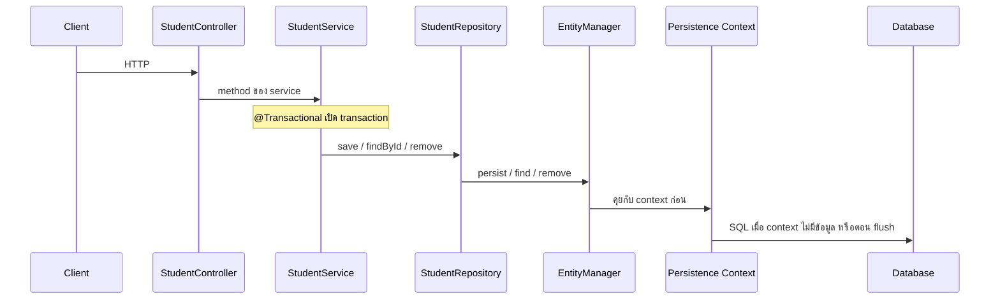
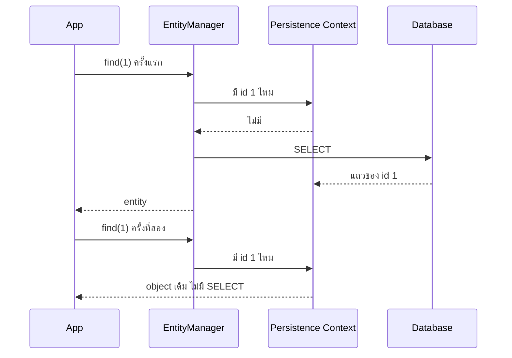
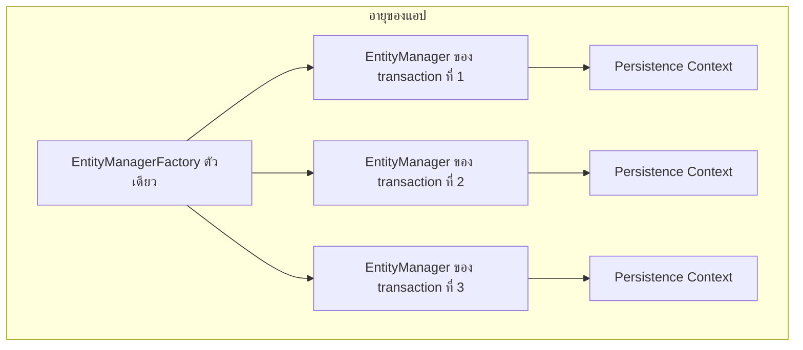
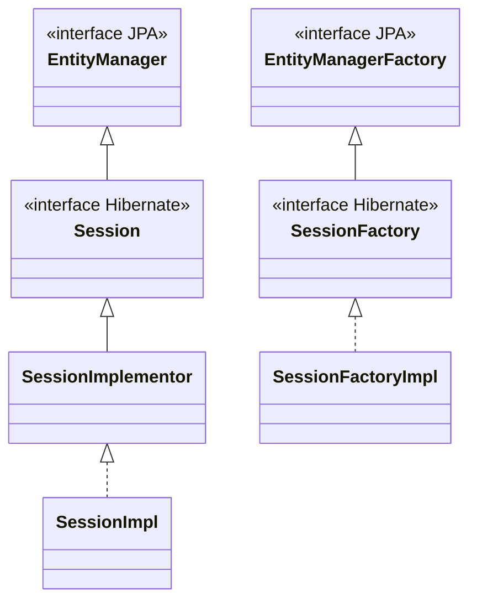
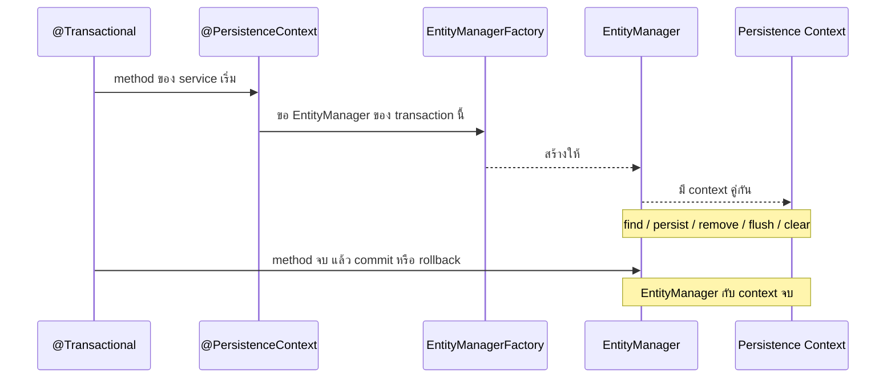
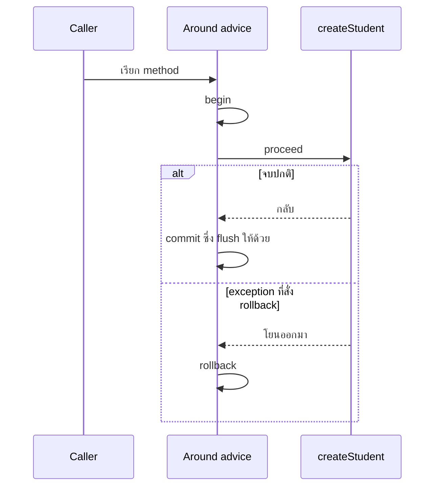
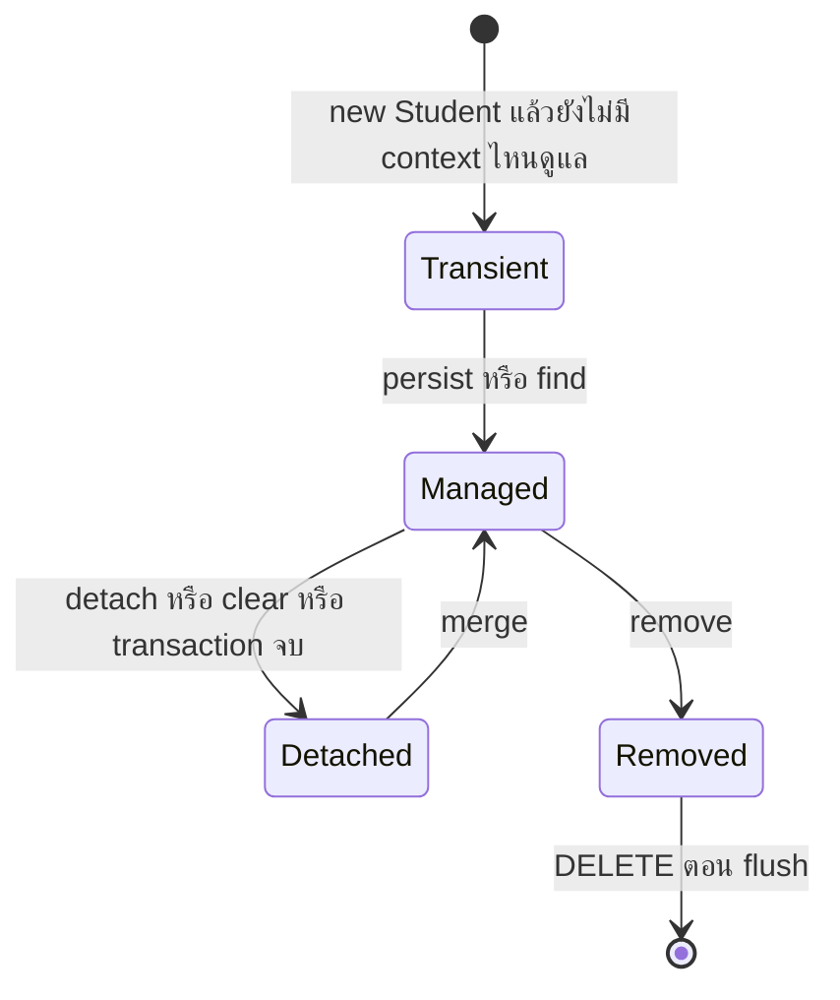
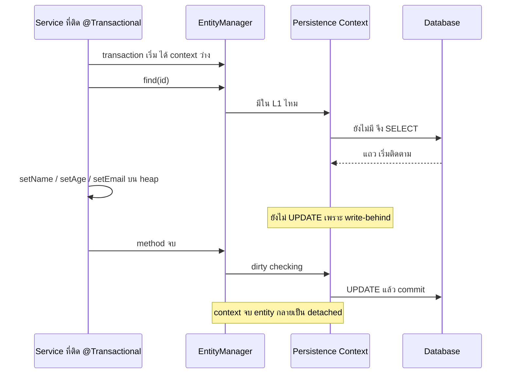

# #29 — ภายใน Hibernate: Persistence Context, cache ชั้นแรก และ Transaction

> **วิดีโอ:** [Hibernate Internals | Persistence Context, L1 Cache & Transactions | Spring Boot Full Course #29](https://youtu.be/0Ko1Ux1otqE) — Coder Army, ~73 นาที
> **แหล่งที่ใช้สรุป:** ซับภาษาอังกฤษที่ YouTube สร้างอัตโนมัติ (en-US)
> **เวอร์ชันในโค้ด:** Spring Boot 4.1 + Java 21 (ใส่หมายเหตุไว้ทุกจุดที่ Spring Boot 3.x ต่างกัน)

ตอนนี้ยังไม่ได้เพิ่มความสัมพันธ์ระหว่างตาราง ผู้สอนเปิดโปรเจกต์ CRUD ของ `Student` ที่เรียก `EntityManager` ตรง ๆ แล้วตอบคำถามว่า **`persist`, `find` และ `remove` ไปคุยกับฐานข้อมูลทันทีจริงหรือ** คำตอบของเขาคือทั้งสาม method คุยกับ Persistence Context ก่อน ฐานข้อมูลถูกแตะเมื่อ context นั้นไม่มีข้อมูล หรือเมื่อถึงจังหวะ flush ท้าย transaction

ส่วนที่ติดป้าย `💡 เพิ่มเติม` คือของที่ผมเติมเอง ไม่ได้อยู่ในวิดีโอ ส่วนที่ติด `⚠️ แก้จากวิดีโอ` คือจุดที่วิดีโอพูดคลาดเคลื่อน

> 💡 **เพิ่มเติม — วิดีโอใช้ MySQL โน้ตนี้ใช้ H2:** ผู้สอนเปิด DBeaver ดู database `student_db` บน MySQL แล้วให้ Hibernate สร้างตาราง `student` โค้ดที่รันในโน้ตนี้ใช้ **H2 in-memory** และให้แอปฟังพอร์ต **9029** ข้อมูลหายเมื่อปิดแอป SQL จึงเป็นสำเนียงของ H2 พฤติกรรมของ Persistence Context, dirty checking, flush และ `@Transactional` ยังเป็นของ Hibernate ชุดเดียวกัน

---

## สารบัญ

| เวลา | หัวข้อ |
|---|---|
| [0:00](https://youtu.be/0Ko1Ux1otqE?t=0) | [1. เป้าหมายของตอน](#1-เป้าหมายของตอน) |
| [0:39](https://youtu.be/0Ko1Ux1otqE?t=39) | [2. โปรเจกต์ที่เปิดค้างไว้](#2-โปรเจกต์ที่เปิดค้างไว้) |
| [3:19](https://youtu.be/0Ko1Ux1otqE?t=199) | [3. properties แล้วสร้างแถวแรก](#3-properties-แล้วสร้างแถวแรก) |
| [4:47](https://youtu.be/0Ko1Ux1otqE?t=287) | [4. สี่ชิ้นที่ต้องแยกให้ออก](#4-สี่ชิ้นที่ต้องแยกให้ออก) |
| [5:21](https://youtu.be/0Ko1Ux1otqE?t=321) | [5. Persistence Context เก็บและติดตาม](#5-persistence-context-เก็บและติดตาม) |
| [12:40](https://youtu.be/0Ko1Ux1otqE?t=760) | [6. find สองครั้ง ได้ SELECT ครั้งเดียว](#6-find-สองครั้ง-ได้-select-ครั้งเดียว) |
| [13:53](https://youtu.be/0Ko1Ux1otqE?t=833) | [7. EntityManager คือ API ของ context](#7-entitymanager-คือ-api-ของ-context) |
| [16:39](https://youtu.be/0Ko1Ux1otqE?t=999) | [8. EntityManagerFactory อยู่เท่าอายุแอป](#8-entitymanagerfactory-อยู่เท่าอายุแอป) |
| [19:10](https://youtu.be/0Ko1Ux1otqE?t=1150) | [9. JPA กับ Hibernate: Session อยู่ใต้ EntityManager](#9-jpa-กับ-hibernate-session-อยู่ใต้-entitymanager) |
| [23:44](https://youtu.be/0Ko1Ux1otqE?t=1424) | [10. `@PersistenceContext` inject proxy](#10-persistencecontext-inject-proxy) |
| [28:47](https://youtu.be/0Ko1Ux1otqE?t=1727) | [11. Transaction คือหน่วยที่สำเร็จหรือล้มทั้งก้อน](#11-transaction-คือหน่วยที่สำเร็จหรือล้มทั้งก้อน) |
| [32:34](https://youtu.be/0Ko1Ux1otqE?t=1954) | [12. จาก begin/commit สู่ `@Transactional`](#12-จาก-begincommit-สู่-transactional) |
| [35:50](https://youtu.be/0Ko1Ux1otqE?t=2150) | [13. Update เกิดจาก dirty checking](#13-update-เกิดจาก-dirty-checking) |
| [46:01](https://youtu.be/0Ko1Ux1otqE?t=2761) | [14. วาง `@Transactional` ที่ Service](#14-วาง-transactional-ที่-service) |
| [48:06](https://youtu.be/0Ko1Ux1otqE?t=2886) | [15. สี่สถานะของ Entity](#15-สี่สถานะของ-entity) |
| [57:09](https://youtu.be/0Ko1Ux1otqE?t=3429) | [16. `merge` กับ `contains`](#16-merge-กับ-contains) |
| [1:02:46](https://youtu.be/0Ko1Ux1otqE?t=3766) | [17. Flush กับ write-behind](#17-flush-กับ-write-behind) |
| [1:06:27](https://youtu.be/0Ko1Ux1otqE?t=3987) | [18. Batch คือ flush แล้ว clear](#18-batch-คือ-flush-แล้ว-clear) |
| [1:10:09](https://youtu.be/0Ko1Ux1otqE?t=4209) | [19. First-level cache](#19-first-level-cache) |
| [1:11:47](https://youtu.be/0Ko1Ux1otqE?t=4307) | [20. `refresh` ดึงแถวจากฐานกลับเข้า context](#20-refresh-ดึงแถวจากฐานกลับเข้า-context) |
| — | [21. สรุปท้ายตอน](#21-สรุปท้ายตอน) |

---

## 1. เป้าหมายของตอน

[▶ 0:00](https://youtu.be/0Ko1Ux1otqE?t=0)

ผู้สอนบอกว่า JPA ใช้ Hibernate ข้างใน ดังนั้นถ้าเข้าใจภายในของ Hibernate จะเข้าใจภายในของ Spring Data ทั้งก้อน เป้าหมายคือเลิกเรียก `save` หรือ `find` โดยไม่รู้ว่าเกิดอะไร และให้ตอบสัมภาษณ์ได้ว่าสถาปัตยกรรมด้านล่างเป็นอย่างไร

> ⚠️ **แก้จากวิดีโอ:** ประโยคนี้กว้างเกิน Spring Data มีหลายโมดูล Spring Data JPA เป็นตัวที่ใช้ JPA แล้ว Hibernate เป็น implementation ที่ Boot เลือกเป็นค่า default Spring Data JDBC, Spring Data MongoDB หรือ Spring Data Redis ไม่ได้วิ่งผ่าน Hibernate การเข้าใจ Persistence Context อธิบาย Spring Data JPA ได้ ไม่ได้อธิบาย Spring Data ทั้งตระกูล

เขาบอกให้ดูตอน Hibernate ก่อนหน้าถ้ายังไม่เคยเขียน method พวกนี้ โปรเจกต์ชื่อ Hibernate Internal Demo มีของอยู่แล้ว ไม่ได้เริ่มจากโปรเจกต์ว่าง

---

## 2. โปรเจกต์ที่เปิดค้างไว้

[▶ 0:39](https://youtu.be/0Ko1Ux1otqE?t=39)

เขาเดินสี่ชั้นที่มีอยู่แล้ว แล้วบอกว่าจนถึงตอนนี้เราแค่เรียก method ยังไม่รู้ว่า `EntityManager` กับ Persistence Context คืออะไร

| ชั้น | สิ่งที่อยู่ในโปรเจกต์นี้ |
|---|---|
| `StudentController` | รับ HTTP ที่ prefix `/api/student` แล้วส่งต่อให้ service |
| `StudentService` | มี `@Transactional` แล้วส่งต่องานให้ repository |
| `StudentRepository` | class ธรรมดาที่ถือ `EntityManager` ไม่ใช่ interface ของ Spring Data |
| `Student` | Entity สี่ฟิลด์ |

> 💡 **เพิ่มเติม:** เขาไม่ได้อ่านชื่อ package ออกเสียง โน้ตนี้ใช้ `com.example.hibernateinternal` และไม่ได้เปิด `pom.xml` ในคลิป dependency ที่ทำให้มีทั้งเว็บ, JPA และ H2 คือชุดด้านล่าง

```xml
<parent>
  <groupId>org.springframework.boot</groupId>
  <artifactId>spring-boot-starter-parent</artifactId>
  <version>4.1.1</version>
</parent>

<properties>
  <java.version>21</java.version>
</properties>

<dependencies>
  <dependency>
    <groupId>org.springframework.boot</groupId>
    <artifactId>spring-boot-starter-webmvc</artifactId>
  </dependency>
  <dependency>
    <groupId>org.springframework.boot</groupId>
    <artifactId>spring-boot-starter-data-jpa</artifactId>
  </dependency>
  <dependency>
    <groupId>com.h2database</groupId>
    <artifactId>h2</artifactId>
    <scope>runtime</scope>
  </dependency>
</dependencies>
```

> ⚠️ **Boot 4 vs 3:** starter ของเว็บใน Boot 4 คือ `spring-boot-starter-webmvc` ชื่อเดิม `spring-boot-starter-web` ถูกเปลี่ยนมาเป็นชื่อนี้ ใน Boot 3.x ใช้ `spring-boot-starter-web` ส่วน `spring-boot-starter-data-jpa` ชื่อเดิมทั้งสองรุ่น ([Spring Boot 4.0 Migration Guide](https://github.com/spring-projects/spring-boot/wiki/Spring-Boot-4.0-Migration-Guide) ตารางเปลี่ยนชื่อ starter)

### Entity

[▶ 1:20](https://youtu.be/0Ko1Ux1otqE?t=80)

`Student` มี `id`, `name`, `email`, `age` เขาบอกว่า id ถูก generate ให้อัตโนมัติ มี constructor เปล่า constructor ที่รับค่า และ getter กับ setter

> 💡 **เพิ่มเติม:** เขาไม่ได้บอก strategy ของ `@GeneratedValue` โน้ตนี้ใช้ `GenerationType.IDENTITY` เพราะนั่นคือรูปที่ MySQL แบบ auto increment ใช้ และใช้ `Long` เพื่อให้แถวใหม่มี id เป็น `null` ก่อน `persist` อีเมลของแถวแรกเขาไม่ได้อ่านออกเสียง ตัวอย่างใช้ `aditya@gmail.com`

> ⚠️ **แก้จากวิดีโอ:** ตอนเขาวาด object ใน heap ภายหลัง มีคำว่า roll number โผล่มาหนึ่งครั้ง class ที่เขาเปิดตอนต้นมีสี่ฟิลด์ ไม่มี roll number โน้ตนี้ไม่ใส่ฟิลด์นั้น

```java
package com.example.hibernateinternal.entity;

import jakarta.persistence.Entity;
import jakarta.persistence.GeneratedValue;
import jakarta.persistence.GenerationType;
import jakarta.persistence.Id;

@Entity
public class Student {

  @Id
  @GeneratedValue(strategy = GenerationType.IDENTITY)
  private Long id;

  private String name;
  private String email;
  private int age;

  public Student() {}

  public Student(String name, String email, int age) {
    this.name = name;
    this.email = email;
    this.age = age;
  }

  public Long getId() {
    return id;
  }

  public void setId(Long id) {
    this.id = id;
  }

  public String getName() {
    return name;
  }

  public void setName(String name) {
    this.name = name;
  }

  public String getEmail() {
    return email;
  }

  public void setEmail(String email) {
    this.email = email;
  }

  public int getAge() {
    return age;
  }

  public void setAge(int age) {
    this.age = age;
  }
}
```

### Controller

[▶ 1:38](https://youtu.be/0Ko1Ux1otqE?t=98)

`@RequestMapping` คือ `/api/student` มี post, get, put และ delete ทุกเส้นทางรับหรือหา `Student` แล้วเรียก service ถ้าสร้างหรือแก้หรือลบสำเร็จ เขาคืนสตริง `"Done"` ไม่คืน entity กลับไป เส้นทางอ่านคืน entity ทั้งก้อน

```java
package com.example.hibernateinternal.controller;

import com.example.hibernateinternal.entity.Student;
import com.example.hibernateinternal.service.StudentService;
import org.springframework.web.bind.annotation.DeleteMapping;
import org.springframework.web.bind.annotation.GetMapping;
import org.springframework.web.bind.annotation.PathVariable;
import org.springframework.web.bind.annotation.PostMapping;
import org.springframework.web.bind.annotation.PutMapping;
import org.springframework.web.bind.annotation.RequestBody;
import org.springframework.web.bind.annotation.RequestMapping;
import org.springframework.web.bind.annotation.RestController;

@RestController
@RequestMapping("/api/student")
public class StudentController {

  private final StudentService studentService;

  public StudentController(StudentService studentService) {
    this.studentService = studentService;
  }

  @PostMapping
  public String createStudent(@RequestBody Student student) {
    studentService.createStudent(student);
    return "Done";
  }

  @GetMapping("/{id}")
  public Student getStudentById(@PathVariable Long id) {
    return studentService.getStudentById(id);
  }

  @PutMapping("/{id}")
  public String updateStudent(@PathVariable Long id, @RequestBody Student student) {
    studentService.updateStudent(id, student);
    return "Done";
  }

  @DeleteMapping("/{id}")
  public String deleteStudent(@PathVariable Long id) {
    studentService.deleteStudent(id);
    return "Done";
  }
}
```

> 💡 **เพิ่มเติม:** เขาไม่ได้พูดชื่อ annotation ของ class ออกเสียง โน้ตนี้ใส่ `@RestController` เพราะ response เป็นข้อความกับ JSON ไม่มี view

### Service

[▶ 1:57](https://youtu.be/0Ko1Ux1otqE?t=117)

Service ไม่ทำธุรกิจเอง มันส่งต่อให้ repository ทุก method ที่เขาชี้มี `@Transactional`

- `createStudent` เรียก `save`
- `getStudentById` เรียก `findById`
- `updateStudent` ไม่มี method ชื่อ update เขา `findById` แล้ว `setName`, `setAge`, `setEmail` บน object เดิม
- `deleteStudent` หาแถวก่อน ถ้าไม่ใช่ `null` จึงเรียก `remove`

```java
@Transactional
public void createStudent(Student student) {
  studentRepository.save(student);
}

@Transactional
public Student getStudentById(Long id) {
  return studentRepository.findById(id);
}

@Transactional
public void updateStudent(Long id, Student request) {
  Student student = studentRepository.findById(id);
  if (student != null) {
    student.setName(request.getName());
    student.setAge(request.getAge());
    student.setEmail(request.getEmail());
  }
}

@Transactional
public void deleteStudent(Long id) {
  Student student = studentRepository.findById(id);
  if (student != null) {
    studentRepository.remove(student);
  }
}
```

เขาบอกว่าเรื่อง update อัตโนมัติถูกอธิบายในตอนที่แล้ว วันนี้จะดูว่าทำไมการ set ค่าบน object ถึงไปถึงฐานข้อมูล

### Repository

[▶ 2:46](https://youtu.be/0Ko1Ux1otqE?t=166)

Repository เป็น class มีฟิลด์ `EntityManager` ติด `@PersistenceContext` เขาบอกว่าจะอธิบาย annotation นี้วันนี้

สาม method ตอนเปิดคลิปทำอย่างนี้

| Method ใน repository | คำสั่งบน EntityManager |
|---|---|
| `save` | `persist(student)` |
| `findById` | `find(Student.class, id)` |
| `remove` | `remove(student)` |

```java
@Repository
public class StudentRepository {

  @PersistenceContext
  private EntityManager entityManager;

  public void save(Student student) {
    entityManager.persist(student);
  }

  public Student findById(Long id) {
    return entityManager.find(Student.class, id);
  }

  public void remove(Student student) {
    entityManager.remove(student);
  }
}
```

> 💡 **เพิ่มเติม:** เขาเรียกมันว่า class และ inject เข้า service โน้ตนี้ใส่ `@Repository` เพื่อให้เป็น Bean method อื่นที่เขาพิมพ์ทีหลัง (`detach`, `merge`, `flush`, `clear`, `contains`, `refresh`) อยู่ใน class เดียวกันในโปรเจกต์ตัวอย่าง จะโผล่ในหัวข้อที่เขาเริ่มใช้



---

## 3. properties แล้วสร้างแถวแรก

[▶ 3:19](https://youtu.be/0Ko1Ux1otqE?t=199)

ใน DBeaver database `student_db` ยังไม่มีตาราง `application.properties` ชี้ URL ไปที่ database นี้ ตั้ง username กับ password แล้วตั้งค่าอีกสามอย่าง

- `ddl-auto=update` เขาบอกว่าเมื่อ data definition หรือ entity เปลี่ยน จะมีการสร้างตารางใหม่
- `show-sql=true` เพื่อเห็น SQL
- `format-sql=true` เพื่อให้ SQL จัดบรรทัด

> ⚠️ **แก้จากวิดีโอ:** `spring.jpa.hibernate.ddl-auto=update` สร้างตารางที่ยังไม่มี และเติมคอลัมน์ที่ entity มีแต่ตารางยังไม่มี มันไม่ drop ตารางเดิมแล้วสร้างใหม่ทุกครั้งที่ entity เปลี่ยน และไม่ลบคอลัมน์ที่ถอดออกจาก class แล้ว ในคลิปนี้เอง พอเขารันรอบถัดไปก็ไม่มี `CREATE TABLE` ซ้ำ เพราะตารางมีอยู่แล้ว

> 💡 **เพิ่มเติม:** เขาเรียกคีย์ว่า format-sql คีย์ที่ Hibernate อ่านคือ `spring.jpa.properties.hibernate.format_sql` username กับ password ของ MySQL ในคลิปนี้เขาไม่ได้อ่านค่าออกเสียง

รูปที่เขาตั้งบน MySQL มีโครงแบบนี้

```properties
spring.datasource.url=jdbc:mysql://localhost:3306/student_db
spring.datasource.username=<username>
spring.datasource.password=<password>
spring.jpa.hibernate.ddl-auto=update
spring.jpa.show-sql=true
spring.jpa.properties.hibernate.format_sql=true
```

ไฟล์ที่รันจริง

```properties
server.port=9029

spring.datasource.url=jdbc:h2:mem:student_db
spring.datasource.driver-class-name=org.h2.Driver
spring.datasource.username=sa
spring.datasource.password=

spring.jpa.hibernate.ddl-auto=update
spring.jpa.show-sql=true
spring.jpa.properties.hibernate.format_sql=true
spring.jpa.open-in-view=false
```

`spring.jpa.open-in-view=false` ไม่ได้อยู่ในคลิป เหตุผลอยู่ใน[หัวข้อที่ 10](#10-persistencecontext-inject-proxy)

### สตาร์ทแล้วได้ตาราง

[▶ 3:46](https://youtu.be/0Ko1Ux1otqE?t=226)

เขารันแอป แล้ว Hibernate ยิง `CREATE TABLE` มีคอลัมน์ id, age, email, name และให้ id เป็น primary key จากนั้นยิง Postman สร้างนักศึกษา ชื่อ Aditya อายุ 29 อีเมลตามที่อยู่บนจอ ได้ข้อความ `Done` ซึ่งมาจาก `return "Done"` ใน controller พอ refresh ตารางใน DBeaver มีแถว id 1

log ตอนสตาร์ทของโน้ตนี้

```text
Hibernate ORM core version 7.4.5.Final
Database JDBC URL [jdbc:h2:mem:student_db]
Database driver: H2 JDBC Driver
Database dialect: H2Dialect
Database version: 2.4.240

Hibernate:
    create table student (
        id bigint generated by default as identity,
        age integer not null,
        email varchar(255),
        name varchar(255),
        primary key (id)
    )

Tomcat started on port 9029 (http) with context path '/'
Started HibernateInternalApplication in 1.462 seconds
```

> ⚠️ **Boot 4 vs 3:** บรรทัด Tomcat มาจาก `org.springframework.boot.tomcat.TomcatWebServer` เพราะ Boot 4 แยก module แล้ว root package ของแต่ละ module เป็น `org.springframework.boot.<module>` ([Spring Boot 4.0 Migration Guide](https://github.com/spring-projects/spring-boot/wiki/Spring-Boot-4.0-Migration-Guide) หัวข้อ Modularization) BOM ของ Boot 4.1.1 ล็อก Hibernate ที่ **7.4.5.Final** และ Tomcat ที่ **11.0.24** BOM ของ Boot 3.5.16 ล็อก Hibernate **6.6.53.Final** และ Tomcat **10.1.55**

> 💡 **เพิ่มเติม:** บน H2 คอลัมน์ id เป็น `bigint generated by default as identity` บน MySQL ของคลิป ชนิดนี้จะเป็น auto increment ชื่อคอลัมน์เรียง age, email, name เพราะ naming ของ Boot จัดฟิลด์ที่เหลือตามชื่อ

เขายิง `POST /api/student` ด้วย body ด้านล่าง ได้ `Done` แล้ว `GET /api/student/1` คืน JSON

```http
POST /api/student HTTP/1.1
Content-Type: application/json

{"name":"Aditya","email":"aditya@gmail.com","age":29}
```

```http
HTTP/1.1 200
Content-Type: text/plain;charset=UTF-8
Content-Length: 4

Done
```

```http
HTTP/1.1 200
Content-Type: application/json
Content-Length: 60

{"name":"Aditya","email":"aditya@gmail.com","age":29,"id":1}
```

SQL ของสองคำขอ

```text
Hibernate:
    insert
    into
        student
        (age, email, name, id)
    values
        (?, ?, ?, default)

Hibernate:
    select
        s1_0.id,
        s1_0.age,
        s1_0.email,
        s1_0.name
    from
        student s1_0
    where
        s1_0.id=?
```

> ⚠️ **Boot 4 vs 3 — Jackson:** body ของ GET ถูกแปลงโดย Jackson 3 (`tools.jackson`) ซึ่งเป็นค่า default ของ Boot 4 Boot 3 ใช้ Jackson 2 (`com.fasterxml.jackson`) โค้ดตอนนี้ไม่ได้สร้าง `ObjectMapper` เอง ถ้าต้องสร้าง mapper เองใน Boot 4 ให้ใช้ `JsonMapper` ([Spring Boot 4.0 Migration Guide](https://github.com/spring-projects/spring-boot/wiki/Spring-Boot-4.0-Migration-Guide) หัวข้อ Upgrading Jackson)

> 💡 **เพิ่มเติม:** `GET` ของ id ที่ไม่มีแถว คืน `200` และ body ว่าง เพราะ controller คืน `null` คลิปไม่ได้ลองกรณีนี้

เขาสรุปว่าจนถึงจุดนี้เรารู้แค่ชื่อ `persist`, `find`, `remove` ยังไม่รู้ว่าข้างในทำงานอย่างไร

---

## 4. สี่ชิ้นที่ต้องแยกให้ออก

[▶ 4:47](https://youtu.be/0Ko1Ux1otqE?t=287)

เขาบอกว่าถ้ารู้สี่อย่างนี้ สถาปัตยกรรมภายในของ Hibernate ถือว่าชัด

| ชิ้น | บทบาทที่เขาปูไว้ |
|---|---|
| Persistence Context | ที่เก็บ entity ที่กำลังถูกติดตาม ทำหน้าที่เป็น cache |
| EntityManager | API ที่เราเรียกเพื่อคุยกับ context นั้น |
| EntityManagerFactory | โรงงานที่สร้าง EntityManager ใช้แนว factory |
| Transaction | ขอบเขตที่งานทั้งก้อนต้องสำเร็จหรือถูกยกเลิกพร้อมกัน |

เขาเริ่มที่ Persistence Context

---

## 5. Persistence Context เก็บและติดตาม

[▶ 5:21](https://youtu.be/0Ko1Ux1otqE?t=321)

เมื่อเรียก `find` เราอยากได้แถวจากฐานเข้าแอป เมื่อเรียก `persist` เราอยากเก็บ `Student` ลงฐาน เขาให้ภาพว่า Hibernate สร้าง workspace หรือ container แล้วเอาข้อมูลที่เพิ่งอ่านหรือกำลังจะเก็บ ไปไว้ในนั้น มันทำงานเหมือน cache

`findById` เรียก `entityManager.find(Student.class, id)` เขาคาดว่าข้างในเป็น `SELECT` ทุกคอลัมน์จากตาราง student ที่ id ตรงกับค่าที่ส่ง ผลลัพธ์ถูก map เป็น entity เพราะนี่คือ ORM

ลำดับที่เขาวาด

1. แอปเรียก `find` ด้วย id 1
2. ยังไม่ไปฐานทันที ไปถาม Persistence Context ก่อน
3. ตอนแอปเพิ่งเริ่ม context ว่าง จึงตอบว่าไม่มี
4. Hibernate แปลงเป็น `SELECT` ผ่าน JDBC เขาเขียน `SELECT *` บนกระดาน แต่บอกเองว่าของจริงไม่ใช้ดอกจัน มันเขียนชื่อคอลัมน์ครบ
5. ฐานคืนทั้งแถว
6. แอปเก็บแถวนั้นไว้ใน Persistence Context แล้วเริ่มติดตาม
7. ถ้าใน EntityManager เดียวกัน หรือ transaction เดียวกัน มี `find` id 1 อีกครั้ง context ตอบจากของที่มีอยู่ ไม่ยิง `SELECT` ซ้ำ

คำว่าติดตามหมายถึง ถ้าฟิลด์ของ object นี้เปลี่ยน Hibernate รู้ และจะสะท้อนการเปลี่ยนนั้นลงฐานให้เอง รายละเอียดของการสะท้อนอยู่ใน[หัวข้อที่ 13](#13-update-เกิดจาก-dirty-checking)

เขาย้ำหลายรอบว่า `find` กับ `persist` ไม่ได้ถูกสร้างมาเพื่อคุยกับฐานโดยตรง มันคุยกับ Persistence Context ถ้าค่าไม่อยู่ใน context จึงค่อยไปเอาจากฐาน

ช่วงหนึ่งเขาพูดว่าพอ method `findById` จบ Persistence Context จบด้วย และถ้าเรียก method คนละครั้ง EntityManager ก็เป็นคนละตัว

> ⚠️ **แก้จากวิดีโอ:** ประโยคนั้นผูกอายุของ context กับ method ของ repository ตอนอธิบาย `updateStudent` เขาแก้เองว่าขอบเขตจริงคือ transaction ของ service ตราบใดที่ยังอยู่ใน method ที่ติด `@Transactional` แม้ `findById` จะ return ไปแล้ว EntityManager กับ Persistence Context ยังเป็นตัวเดิม การ set ฟิลด์หลัง `find` จึงยังถูกติดตาม

---

## 6. find สองครั้ง ได้ SELECT ครั้งเดียว

[▶ 12:40](https://youtu.be/0Ko1Ux1otqE?t=760)

เขาแก้ `findById` ชั่วคราวให้เรียก `find` สองครั้ง เก็บใน `s1` กับ `s2` แล้วคืน `s2` ความคาดหมายแรกของเขาคือ `SELECT` ควรยิงสองครั้ง

```java
public Student findTwice(Long id) {
  Student s1 = entityManager.find(Student.class, id);
  Student s2 = entityManager.find(Student.class, id);
  if (s1 != s2) {
    throw new IllegalStateException("second find returned a different instance");
  }
  return s2;
}
```

> 💡 **เพิ่มเติม:** สองบรรทัด `find` คือสิ่งที่เขาพิมพ์ การเทียบ `s1 != s2` เป็นของโน้ต เพื่อยืนยันว่าครั้งที่สองได้ object ตัวเดียวกันใน heap ไม่ใช่แค่ได้ข้อมูลชุดเดียวกัน

เขารันแอปใหม่ ยิงเอาแถว id 1 ใน log มี `SELECT` ครั้งเดียว เหตุผลคือครั้งแรก context ว่าง จึงไปฐาน แล้วเก็บแถวไว้ ครั้งที่สอง context คืนให้เอง

การวัดในโปรเจกต์นี้ได้ `FIND_TWICE_PREPARES=1` คือ JDBC prepare statement ครั้งเดียวต่อการ `find` สองครั้งใน transaction เดียวกัน

จากนั้นเขาแยกอีกกรณี ถ้าเรียกคนละ transaction การ `find` id เดิมต้องไปฐานใหม่ เพราะ EntityManager คนละตัวมี Persistence Context คนละก้อน การวัดข้ามสองครั้งของ `getStudentById` ได้ `SELECT` อีกหนึ่งครั้ง และ object ไม่ใช่ตัวเดียวกับรอบแรก (`SECOND_TRANSACTION_PREPARES=1`)



---

## 7. EntityManager คือ API ของ context

[▶ 13:53](https://youtu.be/0Ko1Ux1otqE?t=833)

เราเรียก Persistence Context ตรง ๆ ไม่ได้ ต้องผ่าน object ที่ชื่อ EntityManager เขาให้จำว่ามันเป็น API ทุกครั้งที่เรียก `find` หรือ `persist` เรากำลังคุยกับ context ไม่ได้กำลังคุยกับฐาน

[▶ 15:55](https://youtu.be/0Ko1Ux1otqE?t=955)

method ที่เขาเขียนบนกระดานว่าเรียกผ่าน `entityManager.`

| Method | สิ่งที่เขาจะใช้มันทำในตอนนี้ |
|---|---|
| `find` | เอา entity เข้า context ถ้ายังไม่มีก็อ่านจากฐาน |
| `persist` | เอา entity ใหม่เข้า context แล้วให้ถูกเก็บลงฐานตอน flush |
| `remove` | บอก context ว่าแถวนี้ต้องถูกลบตอน flush |
| `flush` | สั่งให้สถานะใน context กับฐานตรงกันเดี๋ยวนี้ |
| `clear` | เอาทุก entity ออกจาก context |

`detach`, `merge`, `contains` และ `refresh` เขายกมาทีหลังในหัวข้อสถานะของ entity

เขาเตือนว่าทั้งหมดนี้อยู่ใน EntityManager ตัวเดียว หรือ transaction เดียว ถ้าดึงนักศึกษาคนที่สองและคนที่สามใน transaction เดียวกัน ทั้งสามถูกเก็บใน context เดียวกัน

---

## 8. EntityManagerFactory อยู่เท่าอายุแอป

[▶ 16:39](https://youtu.be/0Ko1Ux1otqE?t=999)

ตัวที่สร้าง EntityManager คือ EntityManagerFactory เขาเทียบกับ factory pattern ขอโรงงานทุกครั้งที่ต้องการ EntityManager ใหม่

อายุของโรงงานเท่ากับอายุแอป ตราบใดที่แอปยังรัน โรงงานยังอยู่ ส่วน EntityManager ถูกสร้างแล้วทิ้งซ้ำ ๆ ตามแต่ละครั้งที่มีงานใหม่



เขาเดินจาก controller ไป service ไป repository เพื่อผูกภาพนี้กับโค้ด

1. Request สร้างนักศึกษาเข้า `createStudent` ซึ่งติด `@Transactional`
2. พอเข้า repository มีการใช้ EntityManager เขาให้ถือว่านี่คือตัวที่โรงงานเพิ่งสร้าง และมี Persistence Context อยู่กับมัน
3. `persist` เก็บแถวลงฐาน และติดตามมันใน context
4. พอ method ของ transaction จบ EntityManager กับ context จบตาม
5. Request ถัดไปเช่น `getStudentById` ได้ EntityManager ใหม่และ context ใหม่ ทำ query แล้วทิ้งอีกครั้ง

เขาย้ำว่าหนึ่ง transaction มีหนึ่ง EntityManager

---

## 9. JPA กับ Hibernate: Session อยู่ใต้ EntityManager

[▶ 19:10](https://youtu.be/0Ko1Ux1otqE?t=1150)

เขาหยุดเล่าสถาปัตยกรรมเพื่อตอบว่าทำไมต้องลงลึกขนาดนี้

- annotation ที่เคยใช้เช่น `@Entity`, `@Id` และ method ของ repository อยู่ใต้ JPA ซึ่งย่อจาก Jakarta Persistence
- เขาเรียก JPA ว่าเป็น interface ที่วางกฎว่าอะไรควรเกิด แล้วให้ Hibernate เป็นตัวทำให้กฎนั้น
- Spring ใช้ Hibernate ในการเก็บและอ่านข้อมูล
- Hibernate ไม่ได้ถูก Spring สร้าง มันเป็นเฟรมเวิร์กอิสระที่มีมาก่อน เขียนแอป Hibernate โดยไม่มี Spring Boot และไม่มี JPA ได้
- เมื่อ JPA มาทีหลัง มันกำหนด class และ interface มาตรฐาน ส่วนข้างในยังเป็นของ Hibernate

> ⚠️ **แก้จากวิดีโอ:** JPA ไม่ได้เป็น interface เดียว JPA คือ specification Jakarta Persistence `EntityManager` เป็น interface หนึ่งใน spec นั้น Hibernate เป็น implementation ของ spec ภาพที่ถูกคือแอปเรียก API ของ JPA แล้ว Hibernate ทำให้จริง ไม่ใช่ JPA เป็นคนไปเรียก Hibernate เป็นไลบรารีลูกของตัวเอง

> 💡 **เพิ่มเติม:** Boot เลือก Hibernate เป็น JPA provider ค่า default สเปกเองไม่ได้บังคับว่าต้องเป็น Hibernate มี provider อื่นเช่น EclipseLink คลิปไม่ได้พูดถึงตัวเลือกนั้น

### EntityManager กับ Session

[▶ 20:40](https://youtu.be/0Ko1Ux1otqE?t=1240)

เขาวาดสองชั้น

| ชั้นที่เราเรียก | ของ Hibernate ที่อยู่ใต้ |
|---|---|
| `EntityManager` เป็น interface ของ JPA | `Session` เป็น interface ของ Hibernate |
| `EntityManagerFactory` เป็น interface ของ JPA | `SessionFactory` เป็น interface ของ Hibernate |

เขาบอกว่า `Session` extend `EntityManager` ดังนั้นงานที่ทำด้วย EntityManager ทำด้วย Session ได้ และ class ที่ทำให้จริงชื่อ `SessionImpl` ฝั่งโรงงานชื่อ `SessionFactoryImpl` เราไม่เรียก class พวกนี้เอง เราเรียกแค่ `EntityManager` กับ `EntityManagerFactory`



> 💡 **เพิ่มเติม:** ตรวจจาก `hibernate-core-7.4.5.Final` แล้ว `org.hibernate.Session` extend `jakarta.persistence.EntityManager` จริง `org.hibernate.SessionFactory` extend `jakarta.persistence.EntityManagerFactory` จริง class ที่ทำงานคือ `org.hibernate.internal.SessionImpl` กับ `org.hibernate.internal.SessionFactoryImpl` `SessionImpl` implement `Session` ผ่าน `SessionImplementor` ไม่ได้เขียน `implements Session` ตรง ๆ ที่หัว class ภาพบนกระดานของเขาจึงถูกในเชิงชนิด แค่ข้าม interface ชั้นกลาง

> ⚠️ **แก้จากวิดีโอ:** เขาเรียก `persist`, `find`, `remove` ว่าเป็น Hibernate method ที่ interface เปลี่ยนจาก `Session` มาเป็น `EntityManager` method ทั้งสามถูกประกาศบน `jakarta.persistence.EntityManager` `Session` มีพวกมันเพราะมัน extend `EntityManager` API รุ่นเก่าของ Hibernate ใช้ `save`, `update`, `delete` และ `get` คนละชุด

ช่วงท้ายเขาทดลองเปลี่ยนฟิลด์ใน repository จาก `entityManager` เป็น `session` แล้วบอกว่า method ยังชื่อ `persist`, `find`, `remove` เหมือนเดิม แอปยังอัปเดตได้ เขายังคงเลือกคุยกับ EntityManager แล้วเปลี่ยนกลับ

เขาทวนก่อนเดินต่อ

- EntityManager คือ API ที่คุยกับ Persistence Context
- EntityManagerFactory สร้าง EntityManager และมีชีวิตเท่าแอป
- ทุกครั้งที่เกิด EntityManager จะมี Persistence Context คู่กัน
- EntityManager คนละตัวเกิดตามแต่ละครั้งที่ transaction ใหม่เริ่ม

---

## 10. `@PersistenceContext` inject proxy

[▶ 23:44](https://youtu.be/0Ko1Ux1otqE?t=1424)

ใน repository เขาประกาศ `EntityManager` โดยไม่ใช้ `@Autowired` และไม่ใช้ constructor injection เขาใส่ `@PersistenceContext`

เหตุผลที่เขายกมาจาก Spring Core คือ Bean เป็น singleton เป็นค่า default `StudentRepository` จึงเป็น singleton ถ้า inject EntityManager เข้าฟิลด์แบบ dependency ปกติ EntityManager จะกลายเป็น singleton ตาม repository ซึ่งอันตรายเพราะ EntityManager ไม่ thread-safe ถ้าหลาย thread เรียก `persist`, `find`, `remove` พร้อมกันบนตัวเดียวกัน query จะปนกัน

`@PersistenceContext` จึงถูกใช้เพื่อไม่ให้ได้ EntityManager ตัวเดิมแบบ singleton

เขาอธิบายลึกลงอีกนิด แล้วยอมรับว่าไม่จำเป็นต้องจำรายละเอียดเท่านี้

- annotation นี้ทำให้ Spring inject **proxy** ของ EntityManager เข้า repository ไม่ใช่ตัวจริงตั้งแต่ตอนสร้าง Bean
- proxy คล้ายของที่เคยใช้ตอน circular dependency และตอน AOP
- จนกว่าจะมีการเรียก method ผ่าน `@Transactional` ยังไม่มีการสร้าง EntityManager ของ transaction นั้น
- พอ transaction ใหม่เริ่ม ต้องมี EntityManager ใหม่ และ Persistence Context ใหม่ตามมา
- ตัวที่สร้าง EntityManager คือ EntityManagerFactory ส่วน `@PersistenceContext` เป็นคนบอกว่าต้องเอาตัวใหม่มาให้

เขาเตือนไม่ให้สับสนชื่อ annotation กับ container

| ชื่อ | คืออะไร |
|---|---|
| `@PersistenceContext` | annotation ที่บอกให้ inject EntityManager แบบผูกกับ transaction |
| Persistence Context | container ที่เก็บและติดตาม entity |

มีจังหวะบนกระดานที่เขาเผลอพูดว่า "persistence context ทำให้ได้ EntityManager ใหม่" ทั้งที่หมายถึง annotation เขาแก้เองในประโยคถัดไป

> 💡 **เพิ่มเติม:** proxy ที่ Spring ใส่ให้มาจาก `SharedEntityManagerCreator` ฟิลด์ใน repository ซึ่งเป็น singleton จึงชี้ proxy ตัวเดิมตลอด แต่ทุกครั้งที่เรียก method บน proxy มันไปหา EntityManager ที่ถูกผูกกับ transaction ของ thread นั้น EntityManager ตัวจริงยังไม่ thread-safe สิ่งที่ฉีดเข้า singleton แล้วเรียกจากหลาย request ได้คือ proxy

> 💡 **เพิ่มเติม — `spring.jpa.open-in-view`:** ค่า default ของ Boot คือ `true` มันเปิด EntityManager ค้างไว้จน HTTP request จบ ไม่ใช่จน transaction ของ service จบ ภาพในคลิปที่ว่าพอ method จบแล้ว context จบด้วย จะตรงเมื่อปิดค่านี้ โปรเจกต์ตัวอย่างจึงตั้ง `spring.jpa.open-in-view=false` คลิปไม่ได้พูดถึง property นี้

ลำดับที่เขาล็อกไว้ก่อนเข้าเรื่อง transaction



---

## 11. Transaction คือหน่วยที่สำเร็จหรือล้มทั้งก้อน

[▶ 28:47](https://youtu.be/0Ko1Ux1otqE?t=1727)

เขาบอกว่า transaction เป็นแนวคิดของ SQL งานบางอย่างมีประโยชน์เมื่อสำเร็จทั้งก้อน หรือล้มทั้งก้อน ถ้าสำเร็จครึ่งเดียวจะพัง

ตัวอย่างเดิมคือคน A โอน 1000 รูปีให้คน B มีสอง `UPDATE` บนตาราง `accounts`

```sql
UPDATE accounts
SET balance = balance - 1000
WHERE id = 1;

UPDATE accounts
SET balance = balance + 1000
WHERE id = 2;
```

ถ้ายอดของ A ถูกหักแล้ว ฐานล่มก่อนบวกให้ B เงินหายจาก A โดยไม่ถึง B เขาจึงเอาสองคำสั่งนี้ไว้ใน transaction เดียวกัน ถ้าคำสั่งที่สองพัง คำสั่งแรกถูก rollback คือบวก 1000 คืนให้ A

[▶ 31:22](https://youtu.be/0Ko1Ux1otqE?t=1882)

รูปใน SQL ที่เขาเขียน

```sql
BEGIN;
UPDATE A ...;
UPDATE B ...;
COMMIT;
```

ถ้ามี error ระหว่างทาง จะไม่ `COMMIT` แต่เป็น `ROLLBACK` สิ่งที่สำเร็จไปแล้วถูกย้อนด้วย

เขาเรียกทุกอย่างที่อยู่ระหว่าง `BEGIN` กับ `COMMIT` หรือ `ROLLBACK` ว่า **Unit of Work** เพราะถือเป็นหนึ่งหน่วย ต้องสำเร็จทั้งหมดหรือไม่เกิดเลย

> 💡 **เพิ่มเติม:** ในเอกสารของ Hibernate คำว่า unit of work ยังถูกใช้กับ `Session` หรือ Persistence Context เอง คือก้อนที่สะสมการเปลี่ยนแปลงไว้จนถึง flush ความหมายสองแบบนี้ไปด้วยกัน context คือที่สะสมงาน ส่วน transaction คือขอบเขตที่งานก้อนนั้นถูก commit หรือ rollback

ทั้ง Hibernate และ Spring ต้องทำให้แนวคิดนี้ได้ เขาโชว์สองแบบต่อกัน

---

## 12. จาก begin/commit สู่ `@Transactional`

[▶ 32:34](https://youtu.be/0Ko1Ux1otqE?t=1954)

แบบ Hibernate ดิบใช้ `Session` ซึ่งเขาเทียบเท่า EntityManager ของ JPA โครงบนสไลด์คือเปิด session แล้ว `beginTransaction` ซึ่งตรงกับ `BEGIN` ใน SQL จากนั้น `persist` แล้ว `commit` ถ้ามี exception ใน `try` ให้ `rollback`

```java
package com.example.hibernateinternal;

import com.example.hibernateinternal.entity.Student;
import org.hibernate.Session;
import org.hibernate.SessionFactory;
import org.hibernate.Transaction;

public class RawHibernateTransaction {

  private final SessionFactory sessionFactory;

  public RawHibernateTransaction(SessionFactory sessionFactory) {
    this.sessionFactory = sessionFactory;
  }

  public void save(Student student) {
    Session session = sessionFactory.openSession();
    Transaction transaction = session.beginTransaction();
    try {
      session.persist(student);
      transaction.commit();
    } catch (Exception ex) {
      transaction.rollback();
    } finally {
      session.close();
    }
  }
}
```

> 💡 **เพิ่มเติม:** `finally` ที่ปิด session ไม่ได้อยู่ในสไลด์ ใส่ไว้เพื่อไม่ให้ session ค้าง class นี้คอมไพล์ได้แต่ไม่ได้ถูกเรียกจากแอป แอปใช้ `@Transactional` แทน

[▶ 33:46](https://youtu.be/0Ko1Ux1otqE?t=2026)

Spring ให้เขียนแค่ `@Transactional` เหนือ method เช่น `createStudent` เขาให้มองว่าทั้ง method อยู่ใน `try` ส่วน `begin`, `commit` และ `rollback` ถูกทำให้โดย AOP

จากตอน AOP เขาย้อนว่า pointcut จับ annotation ได้ ของ `@Transactional` ใช้ around advice

1. ก่อนเรียก method จริง เปิด transaction
2. `proceed` เข้า method
3. ถ้าจบปกติ ให้ commit
4. ถ้ามี exception ให้ rollback



> 💡 **เพิ่มเติม:** ค่า default ของ `@Transactional` ใน Spring Framework 7 (`DefaultTransactionAttribute.rollbackOn`) rollback เมื่อเป็น `RuntimeException` หรือ `Error` เท่านั้น checked exception ไม่ทำให้ rollback เอง ต้องใส่ `rollbackFor` ถ้าต้องการ สไลด์ Hibernate ดิบของเขาจับ `Exception` กว้างกว่าค่า default นี้ และในสไลด์นั้น exception ถูกกลืนหลัง rollback ส่วน `@Transactional` rollback แล้วยังปล่อย exception ออกไปให้คนเรียกเห็น

พอมี `@Transactional` บน method ของ service การเรียก `save` จะได้ EntityManager ใหม่ของ transaction นั้น `@PersistenceContext` เป็นคนจัดให้ โรงงานเป็นคนสร้าง พอ EntityManager เกิด context เกิดตาม แล้ว `find`, `persist`, `remove`, `flush`, `clear` คุยกับ context นั้น

---

## 13. Update เกิดจาก dirty checking

[▶ 35:50](https://youtu.be/0Ko1Ux1otqE?t=2150)

repository ไม่มี method ชื่อ update มีแค่ create, read และ delete แต่ `updateStudent` ยังแก้แถวได้ เขาบอกว่าถ้าเข้าใจ method นี้ จะเข้าใจว่า SQL เกิดตอนไหน

`updateStudent` ติด `@Transactional` พอ transaction เริ่ม มี EntityManager ใหม่และ Persistence Context ใหม่ แม้ `findById` จะ return กลับมาที่ service แล้ว ตราบใดที่ยังไม่พ้น method นี้ context เดิมยังอยู่

ลำดับใน `updateStudent`

1. `findById` เรียก `entityManager.find` ด้วย id
2. EntityManager ถาม context ว่ามี id นี้ไหม ตอนเพิ่งเริ่ม context ว่าง
3. จึงต้องอ่านจากฐาน เขาเรียกตัวที่เปิด connection แล้วคุยกับฐานว่า data store และบอกว่าเคยคุยในตอน JDBC
4. Hibernate เขียน `SELECT` เอง ฐานคืนแถว
5. แถวถูกเก็บใน Persistence Context และมี object อยู่ใน heap ด้วย เขาสมมติแถวของ Aditya อายุ 29
6. `setName`, `setAge`, `setEmail` เปลี่ยนค่าบน object ใน heap เช่นชื่อเป็น Rohit อีเมลเป็น `rohit@gmail.com` อายุเป็น 25
7. พอ method กำลังจะจบ transaction กำลังจะจบ context กำลังจะปิด
8. ก่อนปิด มันเทียบของที่ติดตามไว้กับของใน heap แล้วเห็นว่าไม่ตรงกัน
9. จึงทำ flush คือเอาของที่เปลี่ยนไปเขียนลงฐาน เป็น `UPDATE` ที่เกิดขึ้นเอง
10. พอ method จบ EntityManager, Persistence Context และ transaction จบตามกัน

> ⚠️ **แก้จากวิดีโอ:** เขาเรียกตัวที่เปิด connection ว่า data store ใน JDBC ชนิดนั้นคือ `javax.sql.DataSource` ในแอปนี้ Boot สร้าง Hikari เป็น DataSource แล้ว Hibernate ขอยืม connection จากมันไปส่ง SQL

> ⚠️ **แก้จากวิดีโอ:** ตอนเห็นว่าชื่อ อีเมล และอายุเปลี่ยน เขาเรียกเหตุการณ์นี้ว่า dirty read ใน SQL dirty read หมายถึงการอ่านแถวที่ transaction อื่นยังไม่ commit สิ่งที่ Hibernate ทำตรงนี้ชื่อ **dirty checking** คือเทียบ snapshot ตอนโหลดเข้า context กับค่าปัจจุบันใน heap แล้วสร้าง `UPDATE` ตอน flush ช่วงท้ายคลิปเขาเรียก entity ที่เปลี่ยนแล้วว่า dirty entity ซึ่งเป็นคำที่ตรง

> 💡 **เพิ่มเติม:** อีเมลของ Rohit เขาพูดทั้ง `rohit@gmail.com` และ `rohit@it.com` ตอนพิมพ์ โน้ตนี้ใช้ `rohit@gmail.com`

การวัดใน transaction เดียวกันได้ `UPDATES_AFTER_SETTER=0` หลัง `setName` ยังไม่มี `UPDATE` พอเรียก `flush` ได้ `UPDATES_AFTER_FLUSH=1`

SQL จริงของ `PUT /api/student/1` ที่เปลี่ยน Aditya เป็น Rohit

```text
Hibernate:
    select
        s1_0.id,
        s1_0.age,
        s1_0.email,
        s1_0.name
    from
        student s1_0
    where
        s1_0.id=?
Hibernate:
    update
        student
    set
        age=?,
        email=?,
        name=?
    where
        id=?
```

```http
HTTP/1.1 200
Content-Type: text/plain;charset=UTF-8
Content-Length: 4

Done
```

จากนั้น `GET /api/student/1` ได้

```json
{"name":"Rohit","email":"rohit@gmail.com","age":25,"id":1}
```

> 💡 **เพิ่มเติม:** `UPDATE` ตั้ง age, email และ name ทุกครั้ง ไม่ใช่เฉพาะฟิลด์ที่เปลี่ยน Hibernate ทำแบบนี้เป็นค่า default ถ้าต้องการเฉพาะคอลัมน์ที่เปลี่ยนต้องใส่ `@DynamicUpdate` คลิปไม่ได้ใช้ annotation นั้น

เขาทดลองใน Postman กับ IntelliJ แล้วเห็นสอง query คือ `SELECT` ตามด้วย `UPDATE` จากนั้น DBeaver เปลี่ยนเป็นค่าใหม่ เขาให้กลับไปดูแผนภาพแอป ฐาน และ Persistence Context อีกครั้งถ้ายังงง และสรุปว่า

- `persist` กับ `find` มีไว้คุยกับ context
- ถ้า context ไม่มีค่า จึงไปฐาน
- หลัง `find` แถวนั้นถูกติดตาม
- ถ้า object เปลี่ยนระหว่างที่ยังอยู่ใน context จะมี `UPDATE` เองตอน flush

[▶ 43:25](https://youtu.be/0Ko1Ux1otqE?t=2605) คือจังหวะที่เขากดส่งแล้วดู log คู่กับ DBeaver เขาเปลี่ยน Rohit กลับเป็น Aditya อายุ 29 อีกครั้งภายหลัง ตอนทดลองใช้ `Session` แทน EntityManager ผลยังเป็น `SELECT` แล้ว `UPDATE`

---

## 14. วาง `@Transactional` ที่ Service

[▶ 46:01](https://youtu.be/0Ko1Ux1otqE?t=2761)

เขาย้อนตอนที่แล้วว่าเคยลืมใส่ transaction ให้ update กับ delete แล้ว update ไม่เกิดเลย เพราะไม่มี transaction มากำกับ entity ที่ `find` มา

- การอ่านอย่าง `getStudentById` ไม่ได้เปลี่ยนฐาน จึงไม่มีอะไรให้ rollback จะไม่ใส่ `@Transactional` ก็ได้ แต่ใส่ไว้ก็ไม่เสียหาย และในโค้ดเขาใส่ไว้
- จะแปะ `@Transactional` ที่ repository ก็ทำงานได้ แต่เขาไม่ให้ทำ เพราะหน้าที่ของ repository คือ query
- transaction เป็น annotation ที่ AOP ดัก และที่เขาดัก AOP คือชั้น service
- ถ้าแปะที่ repository ขอบเขตจะแคบเกิน หนึ่ง service method อาจเรียก repository หลายครั้งแล้วต้องการให้เป็นหน่วยเดียวกัน

```java
@Service
public class StudentService {

  private final StudentRepository studentRepository;

  public StudentService(StudentRepository studentRepository) {
    this.studentRepository = studentRepository;
  }

  @Transactional
  public void updateStudent(Long id, Student request) {
    Student student = studentRepository.findById(id);
    if (student != null) {
      student.setName(request.getName());
      student.setAge(request.getAge());
      student.setEmail(request.getEmail());
    }
  }
}
```

---

## 15. สี่สถานะของ Entity

[▶ 48:06](https://youtu.be/0Ko1Ux1otqE?t=2886)

เขาบอกว่า entity มีสี่เฟส ได้แก่ Transient, Managed, Detached และ Removed



### Transient

[▶ 48:35](https://youtu.be/0Ko1Ux1otqE?t=2915)

`new Student(...)` แล้วตั้ง id, name, email, age อยู่ใน heap อย่างเดียว ยังไม่มี Persistence Context ไหนจัดการ เขาวาดแถวสมมติของ Aditya อายุ 29 ไว้ในสถานะนี้

### Managed

[▶ 49:29](https://youtu.be/0Ko1Ux1otqE?t=2969)

เมื่อส่ง object นั้นเข้า `createStudent` หรือ `updateStudent` จึงเรียก method ของ EntityManager สถานะย้ายจาก transient ไป **managed** นี่คือสถานะที่ context ดูแล object

ทางเข้าที่เขาบอก

- `persist` ใส่เข้า context ก่อน แล้วจึงถูกเก็บลงฐาน
- `find` ถ้า context ยังไม่มี ก็อ่านจากฐานแล้วใส่เข้า context

ทั้งสองทางจบที่การถูกติดตาม ถ้า heap เปลี่ยน ตอน flush ต้องมี `UPDATE` กลับลงฐาน

> ⚠️ **แก้จากวิดีโอ:** เขากล่าวว่า `persist` แค่ใส่เข้า context แล้วรอ flush จึงค่อย `INSERT` การวัดกับ id แบบ `IDENTITY` ในโปรเจกต์นี้ได้ `INSERTS_DURING_PERSIST=1` คือ `INSERT` เกิดระหว่าง `persist` ก่อน method จะ commit เพราะ Hibernate ต้องได้ค่า id จากฐานทันที SQL คือ `insert into student (age, email, name, id) values (?, ?, ?, default)` เรื่องที่ยังจริงคือหลัง `persist` แล้ว entity อยู่ในสถานะ managed และถูกติดตามต่อจนจบ transaction

### Detached

[▶ 50:59](https://youtu.be/0Ko1Ux1otqE?t=3059)

Detached คือ context ไม่ได้ดูแล object นั้นแล้ว เขาให้สองสาเหตุ

1. transaction จบ เช่น `updateStudent` ทำ `find` ตั้งค่า แล้ว `UPDATE` ไปแล้ว พอ method จบ entity หลุดออกจาก context
2. เรียก `detach` เอง

เขาแก้ `find` ให้เก็บผลใน `s1` แล้วเรียก `entityManager.detach(s1)` ก่อนคืนค่า ความหมายคือโหลดเข้า context แล้วเอาออก จากนั้น service ยัง `setName`, `setAge`, `setEmail` ได้ แต่ไม่มี context ไหนเห็นการเปลี่ยน จึงไม่มี `UPDATE`

```java
@Transactional
public void updateDetached(Long id, Student request) {
  Student student = studentRepository.findById(id);
  if (student == null) {
    return;
  }
  studentRepository.detach(student);
  student.setName(request.getName());
  student.setAge(request.getAge());
  student.setEmail(request.getEmail());
}
```

[▶ 52:45](https://youtu.be/0Ko1Ux1otqE?t=3165)

เขาทดลองเปลี่ยนชื่อเป็น Rohan และอายุเป็น 21 แล้วกดส่ง ได้ `Done` แต่ DBeaver ยังเป็นค่าเดิม ใน IntelliJ มีแต่ `SELECT` ไม่มี `UPDATE`

การวัดแบบเดียวกันในโน้ตนี้ หลัง `updateDetached` ที่พยายามเปลี่ยน Rohit เป็น Rohan แถวยังเป็น Rohit อายุ 25 และ log ของ method นั้นมี `SELECT` อย่างเดียว

[▶ 53:22](https://youtu.be/0Ko1Ux1otqE?t=3202)

อีก method คือ `clear` มันย้ายทุก object ที่ context กำลังดูแลไปสถานะ detached `detach` เอาออกทีละตัว `clear` เอาออกทั้งหมด และไม่ต้องส่ง argument

```java
public void detach(Student student) {
  entityManager.detach(student);
}

public void clear() {
  entityManager.clear();
}
```

### Removed

[▶ 53:51](https://youtu.be/0Ko1Ux1otqE?t=3231)

Removed ออกจากสถานะ managed ไม่ได้ออกจาก detached เขาบอกว่าถ้าหลุดจาก context ไปแล้ว จะ `remove` ไม่ได้

`deleteStudent` ทำสามขั้น

1. `findById` เพื่อให้แถวเข้า context
2. ตรวจ `null`
3. `studentRepository.remove` ซึ่งเรียก `entityManager.remove`

`remove` บอก context ว่า object นี้ต้องถูกลบออกจากฐาน มันยังไม่ยิง `DELETE` ทันที `DELETE` เกิดตอน flush ซึ่งคือตอน transaction กำลังจบ ยิ่ง transaction ยาว `DELETE` ยิ่งมาทีหลัง แต่เมื่อมันเกิด แถวออกจากฐาน

```java
public void remove(Student student) {
  entityManager.remove(student);
}
```

การวัดได้ `DELETES_AFTER_REMOVE=0` และ `CONTAINS_AFTER_REMOVE=false` ทันทีหลัง `remove` พอ `flush` ได้ `DELETES_AFTER_FLUSH=1` สถานะใน context เปลี่ยนตอนเรียก `remove` ส่วน SQL รอ flush

```text
Hibernate:
    select
        s1_0.id,
        s1_0.age,
        s1_0.email,
        s1_0.name
    from
        student s1_0
    where
        s1_0.id=?
Hibernate:
    delete
    from
        student
    where
        id=?
```

`DELETE /api/student/1` ตอบ `Done` เหมือนเส้นทางอื่น

เขาสรุปภาพสี่สถานะอีกครั้ง

- สร้าง `new Student` แล้วยัง transient
- `persist` หรือ `find` แล้วย้ายไป managed
- จาก managed ไป detached ได้สองทาง คือ context จบเอง หรือเรียก `detach` หรือ `clear`
- จาก managed เรียก `remove` แล้วย้ายไป removed

---

## 16. `merge` กับ `contains`

[▶ 57:09](https://youtu.be/0Ko1Ux1otqE?t=3429)

เขาบอกว่า `merge` ไม่ค่อยได้ใช้ ใช้เมื่อ entity ถูก detach ไปแล้ว แล้วอยากให้ EntityManager กลับมาดูแลอีกครั้ง

ลำดับที่เขาพิมพ์ใน service

1. `findById` ได้ `student1` ซึ่งยัง managed
2. เรียก `detach` แถวนั้นหลุด
3. เรียก method ที่เขาตั้งชื่อ `attachAgain` ซึ่งข้างในคือ `entityManager.merge`
4. `merge` คืน object เขาจึงเอาค่าที่คืนมาใส่กลับเข้าตัวแปร
5. จากนั้นจึง set ชื่อ อีเมล และอายุ

```java
public Student merge(Student student) {
  return entityManager.merge(student);
}

@Transactional
public void updateMerged(Long id, Student request) {
  Student student = studentRepository.findById(id);
  if (student == null) {
    return;
  }
  studentRepository.detach(student);
  student = studentRepository.merge(student);
  student.setName(request.getName());
  student.setAge(request.getAge());
  student.setEmail(request.getEmail());
}
```

> 💡 **เพิ่มเติม:** `merge` ไม่ได้เปลี่ยนตัวที่ส่งเข้าไปให้กลับมาเป็น managed มันคืน instance ที่ managed ซึ่งอาจเป็นคนละตัว ต้องใช้ค่าที่ return แบบที่เขาทำ ถ้า set บนตัวเดิมที่ detach ไว้ การเปลี่ยนนั้นไม่อยู่ในการติดตาม

เขาทดลองเปลี่ยนชื่อเป็น Mohit แล้ว merge กลับ ก่อน set DBeaver เปลี่ยนเป็น Mohit และ log มี `SELECT` กับ `UPDATE` ของ Hibernate

พอเขาเอาบรรทัด merge ออก เหลือแค่ detach แล้วเปลี่ยนชื่อเป็น Arun แถวไม่เปลี่ยน และเหลือแค่ `SELECT`

การวัดของ `updateMerged` ในโน้ตนี้มี `SELECT` สองครั้งก่อน `UPDATE` ครั้งแรกคือ `find` ครั้งที่สองเกิดตอน `merge` เพราะหลัง `detach` แล้ว context ไม่มีตัว managed ให้คัดลอกทับ มันจึงโหลดแถวอีกครั้งแล้วคัดลอกสถานะจากตัวที่หลุดไปลงบนตัวใหม่ จากนั้น setter ทำให้ตัวใหม่ dirty และ commit ยิง `UPDATE` ชื่อกลายเป็น Mohit ตามที่ทดสอบ

### contains

[▶ 1:00:26](https://youtu.be/0Ko1Ux1otqE?t=3626)

`entityManager.contains(entity)` คืน `boolean` ว่า context ปัจจุบันดูแล entity นั้นอยู่หรือไม่ เขาบอกว่าปกติไม่ได้ใช้ แค่ให้รู้ว่ามีไว้ตรวจ

```java
public boolean contains(Student student) {
  return entityManager.contains(student);
}
```

การวัดใน transaction เดียวได้ `CONTAINS_AFTER_FIND=true` และ `CONTAINS_AFTER_DETACH=false`

---

## 17. Flush กับ write-behind

[▶ 1:01:24](https://youtu.be/0Ko1Ux1otqE?t=3684)

เขาสรุปประโยชน์ของ Persistence Context สองข้อ

1. ไม่ยิง SQL ซ้ำ ถ้าแถวของ id 1 อยู่ใน context แล้ว `find` ครั้งถัดไปเอาจาก context
2. ตอน update แค่แก้ object ใน heap context ที่ติดตามอยู่เห็นว่ามัน dirty แล้วสร้าง SQL ให้ ไม่ต้องเขียน `UPDATE` เอง

[▶ 1:02:12](https://youtu.be/0Ko1Ux1otqE?t=3732)

เขากลับไปที่ตัวอย่างชื่อ Aditya เป็น Rohit และอายุ 29 เป็น 25 ตอน context กำลัง flush มันเห็นว่า entity dirty จากนั้นจึงรัน `UPDATE` ให้ค่าในฐานตรงกับ heap

### ความหมายของ flush

[▶ 1:02:46](https://youtu.be/0Ko1Ux1otqE?t=3766)

flush คือการทำให้ Persistence Context กับฐานตรงกัน ถ้า context เปลี่ยน ฐานต้องเปลี่ยนตาม เขาเรียกพฤติกรรมปกติว่า **write-behind**

write-behind หมายถึง context ยังไม่ flush ตราบใดที่มันยังไม่ใกล้จบ ใน `updateStudent` มี `setName` แล้ว `setAge` แล้ว `setEmail` ไม่มี flush ระหว่างทาง พอ method จบจึงตรวจครั้งเดียว ถ้า entity dirty จึง flush เป็น query ก้อนเดียว

ถ้า flush ทุกครั้งที่ set จะคุยกับฐานสามครั้ง เขาไม่ต้องการแบบนั้น

flush เกิดเองตอนจบ method ได้ และเรียกเองก็ได้

```java
public void flush() {
  entityManager.flush();
}
```

[▶ 1:04:30](https://youtu.be/0Ko1Ux1otqE?t=3870)

เขาใส่ `flush` หลัง set แต่ละฟิลด์ รวมสามครั้ง และเอา `detach` ออก แล้วเปลี่ยนทั้งชื่อ อีเมล และอายุใน Postman เป็น Smita ผลใน DBeaver เปลี่ยนครบ และใน IntelliJ มี `SELECT` หนึ่งครั้งตามด้วย `UPDATE` สามครั้ง เขาบอกว่านี่คือการดึงพฤติกรรม write-behind ออก แล้วทำเอง ถ้า flush ครั้งเดียวท้าย method จะเหลือการคุยกับฐานครั้งเดียว

```java
@Transactional
public void updateFlushEach(Long id, Student request) {
  Student student = studentRepository.findById(id);
  if (student == null) {
    return;
  }
  student.setName(request.getName());
  studentRepository.flush();
  student.setAge(request.getAge());
  studentRepository.flush();
  student.setEmail(request.getEmail());
  studentRepository.flush();
}
```

log ของการเรียกนี้มี `SELECT` หนึ่งครั้งแล้ว `UPDATE` สามครั้ง แต่ละครั้งตั้ง age, email และ name ทั้งสามคอลัมน์ แถวจบที่ชื่อ Smita อีเมล `smita@gmail.com` อายุ 22

> 💡 **เพิ่มเติม:** อีเมลกับอายุของ Smita ในคลิปเขาพูดว่าอีเมลเป็น Smita และอายุ 25 โน้ตใช้ `smita@gmail.com` กับอายุ 22 ตอนวัด จำนวน `UPDATE` ไม่ได้ขึ้นกับค่าสองอย่างนี้

---

## 18. Batch คือ flush แล้ว clear

[▶ 1:06:27](https://youtu.be/0Ko1Ux1otqE?t=3987)

เขาตอบว่า `flush` มีประโยชน์ตอนไหน คำตอบคือ batch ถ้า `saveAll` รับ list หลักล้านแล้ว `persist` ทุกรอบใน method เดียว context จะติดตามหลักล้าน object แล้วแอปช้า เพราะที่เก็บของ context มีจำกัด

วิธีที่เขาเสนอคือทำทีละกลุ่ม เขาพูดก่อนว่ากลุ่มละ 1000 แล้วตอนลงโค้ดใช้ตัวหาร 100

โครงที่เขาพูด

- มี `counter` เริ่มที่ 0
- วน `persist` แล้วเพิ่ม counter
- เมื่อ counter หารด้วย 100 ลงตัว ให้ `flush` แล้ว `clear`
- กลุ่มถัดไปเริ่มสะสมใหม่

`persist` ในความหมายที่เขาต้องการคือใส่เข้า context ก่อน ยังไม่ลงฐาน จนกว่าจะ flush และเพราะ write-behind method ที่ยังไม่จบจะยังไม่ flush เอง ถ้าไม่สั่งกลางทาง หลักล้านแถวจะกองใน context จนจบ method

`flush` เขียนกลุ่มนั้นลงฐาน `clear` ปล่อย context ให้ว่าง ฐานเองก็ไม่ควรถูกสั่งให้รับหลักล้านแถวในคำสั่งเดียว เขาจึงมองว่านี่คือการ insert เป็นชุด ชุดละ 100

```java
public void saveAll(List<Student> students, int batchSize) {
  int counter = 0;
  for (Student student : students) {
    entityManager.persist(student);
    counter++;
    if (counter % batchSize == 0) {
      entityManager.flush();
      entityManager.clear();
    }
  }
}
```

> ⚠️ **แก้จากวิดีโอ:** ลำดับบนกระดานสลับไปมา เขายก `if (counter % 100 == 0)` ขึ้นก่อน แล้วบอกว่าก่อนหน้านั้นให้ `persist` กับ `counter++` ถ้าเช็คตอน counter ยังเป็น 0 รอบแรกจะ flush context ว่าง โค้ดด้านบน `persist` ก่อนแล้วค่อยเช็ค ซึ่งตรงกับความตั้งใจที่เขาอธิบายทีหลัง กลุ่มท้ายที่จำนวนไม่ลงตัวกับขนาด batch ยังไม่ถูก flush ในลูป มันไปกับ write-behind ตอน transaction จบ เขาไม่ได้พูดส่วนที่เหลือนี้

> ⚠️ **แก้จากวิดีโอ:** กับ `GenerationType.IDENTITY` ภาพที่ว่า `persist` ยังไม่ `INSERT` จนถึง `flush` ไม่เกิด การรัน 4 แถวด้วย `batchSize` 2 ได้ `BATCH_INSERTS=4` และ log เป็น `INSERT` สี่ครั้งทันทีที่ `persist` ไม่มีการรอจน `flush` `flush` ของแถวที่ insert ไปแล้วจึงไม่ได้ยิง SQL เพิ่ม `clear` ยังมีประโยชน์ตรงที่ปล่อย object ออกจาก context เพื่อไม่ให้กองในหน่วยความจำ แต่ไม่ได้ทำให้ `INSERT` ของ identity เลื่อนไปทีหลัง

> 💡 **เพิ่มเติม:** เขาพูดขนาดกลุ่ม 1000 ก่อน แล้วเขียนตัวหาร 100 โปรเจกต์รับ `batchSize` เป็นพารามิเตอร์เพื่อให้ทดลองกับ 4 แถวได้ โดยไม่เปลี่ยนโครงลูป

---

## 19. First-level cache

[▶ 1:10:09](https://youtu.be/0Ko1Ux1otqE?t=4209)

เขากลับมาที่กล่องที่เก็บหลายแถวไว้ ถ้า `find` แล้วของนั้นอยู่ในกล่อง จะคืนจากกล่องโดยไม่เขียน SQL เขาเรียกการทำงานแบบ cache นี้ว่า **first-level cache** หรือ L1 cache Persistence Context คือ first-level cache

มันกันไม่ให้เรียกฐานซ้ำ ในขอบเขตของ EntityManager ตัวนั้น

เขากล่าวถึง second-level cache ว่ามี และจะดูทีหลัง แล้วไม่ได้ลงรายละเอียด

> 💡 **เพิ่มเติม:** first-level cache ไม่ได้ใช้ร่วมกันทั้งแอป มันตายไปพร้อม Persistence Context ของ transaction นั้น การ `find` id เดิมจาก request ถัดไปจึงมี `SELECT` ใหม่ ตามที่วัดไว้ใน[หัวข้อที่ 6](#6-find-สองครั้ง-ได้-select-ครั้งเดียว)

เขาปิดภาพรวมว่านี่คือภายในของ Hibernate ทั้งก้อน ถ้ายังงงให้ดูช้า ๆ วาดแผนภาพเอง แล้วลอง flush กับ clear จนเห็นว่า query เกิดกี่ครั้ง เขาบอกว่าคนที่แค่ใช้ Spring Data JPA ผิว ๆ อาจไม่ต้องรู้ขนาดนี้ แต่ถ้าทำ batch หรือเจอ query ที่ไม่ยิง ทั้งที่คิดว่าควรยิง ต้องรู้ว่า entity อยู่ในสถานะไหน เป็น dirty หรือหลุดไปเป็น detached แล้วหรือยัง

---

## 20. `refresh` ดึงแถวจากฐานกลับเข้า context

[▶ 1:11:47](https://youtu.be/0Ko1Ux1otqE?t=4307)

จนถึงตอนนี้การเปลี่ยนเกิดจากแอป เขาสมมติว่ามีคนเข้าไปแก้ฐานตรง ๆ เปลี่ยนชื่อ Smita เป็น Arun ใน DBeaver Persistence Context ไม่รู้ เพราะมันติดตาม object ใน heap ไม่ได้ติดตามการแก้ที่เกิดนอกแอป

Hibernate มี `refresh` เรียกบน EntityManager พร้อมส่ง student เข้าไป ความหมายคือดึงข้อมูลที่อยู่ในฐานกลับเข้า context

```java
public void refresh(Student student) {
  entityManager.refresh(student);
}
```

เขาบอกว่ามันมีประโยชน์เมื่อรู้ว่ารายการอาจถูกแก้ตรงที่ฐาน แต่ในแอป production ที่ผูกกับ JPA หรือ Hibernate อยู่แล้ว ปกติไม่เข้าไปแก้ตารางตรง ๆ เขาจึงคอมเมนต์บรรทัดนี้ออกไว้

> 💡 **เพิ่มเติม:** ในโปรเจกต์ตัวอย่างไม่มี DBeaver จึงจำลองการแก้ตรง ๆ ด้วย native query แล้วเรียก `refresh` ใน transaction เดียวกัน ผลที่วัดได้คือ `REFRESH=Smita -> Arun` log มี `UPDATE` ของ native query ตามด้วย `SELECT` ของ `refresh` ค่าใน heap กลายเป็น Arun `refresh` ทับค่าที่ค้างในหน่วยความจำของ entity นั้น และเรียกได้เมื่อ entity ยัง managed อยู่

```java
public int overwriteName(Long id, String name) {
  return entityManager
      .createNativeQuery("update student set name = :name where id = :id")
      .setParameter("name", name)
      .setParameter("id", id)
      .executeUpdate();
}
```

[▶ 1:13:04](https://youtu.be/0Ko1Ux1otqE?t=4384)

เขาปิดตอนด้วยการให้ฝึกจากโน้ต ลองเล่นกับโค้ด แล้วไว้เจอกันตอนหน้า

---

## 21. สรุปท้ายตอน

### ลำดับของหนึ่ง request ที่แก้แถว



### ประเด็นที่ต้องจำ

1. `find`, `persist` และ `remove` คุยกับ Persistence Context ผ่าน EntityManager การไปฐานเกิดเมื่อ context ไม่มีข้อมูล หรือเมื่อ flush
2. Persistence Context ของ transaction หนึ่งคือ first-level cache `find` ซ้ำใน transaction เดียวกันไม่ยิง `SELECT` ข้าม transaction ต้องอ่านใหม่
3. EntityManagerFactory มีชีวิตเท่าแอป มันสร้าง EntityManager ได้เรื่อย ๆ EntityManager ไม่ thread-safe
4. `@PersistenceContext` inject proxy ที่ไปเอา EntityManager ของ transaction ปัจจุบัน ไม่ใช่การทำให้ EntityManager เป็น singleton
5. `@Transactional` คือ around advice ที่ begin ก่อน method แล้ว commit หรือ rollback ทีหลัง ขอบเขตนี้คือหน่วยของ Persistence Context ในแอป Spring
6. การ set ฟิลด์บน entity ที่ยัง managed ทำให้เกิด dirty checking แล้ว `UPDATE` ตอน flush จึงไม่ต้องมี method ชื่อ update
7. Entity มีสี่สถานะ คือ transient, managed, detached และ removed `detach` หรือ `clear` หยุดการติดตาม `remove` นัด `DELETE` ไว้ตอน flush
8. `merge` นำ entity ที่หลุดกลับเข้าสถานะ managed และต้องใช้ instance ที่มันคืนมา
9. write-behind คือการเลื่อน flush ไปตอนท้าย transaction การเรียก `flush` เองทำให้ SQL เกิดทันที กี่ครั้งก็ได้ตามจำนวนรอบที่เรียก
10. `flush` แล้ว `clear` เป็นคู่ที่ใช้ปล่อย context ระหว่าง batch
11. กับ id แบบ identity `persist` ยิง `INSERT` ทันทีเพื่อเอา id ไม่ได้รอ flush
12. `refresh` โหลดแถวจากฐานทับค่าใน context เมื่อมีคนแก้ฐานนอกแอป

### คำถามทบทวน

1. ทำไม `find` สองครั้งใน `@Transactional` เดียวกันถึงมี `SELECT` ครั้งเดียว แต่ยิง `GET` สอง request แล้วมีสองครั้ง
2. EntityManager กับ Persistence Context ใครเป็น API และใครเป็นที่เก็บ
3. ทำไมฟิลด์ `EntityManager` ใน repository ที่เป็น singleton ถึงใส่ `@PersistenceContext` แทน `@Autowired`
4. `Session` กับ `EntityManager` อยู่คนละชั้นอย่างไร และทำไมเรียก method ชุดเดียวกันได้
5. ถ้าลืม `@Transactional` บน `updateStudent` แล้ว `find` กับ `setName` ยังอยู่ การเปลี่ยนจะลงฐานไหม
6. `detach` ก่อน `setName` ต่างจาก `remove` อย่างไร ทั้งคู่ทำให้ `UPDATE` ไม่เกิด แต่ผลกับแถวไม่เหมือนกัน
7. write-behind ช่วยอะไรตอน set สามฟิลด์ และจะเสียอะไรถ้า `flush` หลังทุก setter
8. ทำไม `persist` ของ `@GeneratedValue(strategy = IDENTITY)` ถึงมี `INSERT` ก่อน commit
9. ในลูป batch ทำไมต้อง `clear` หลัง `flush` ไม่ใช่ `flush` อย่างเดียว
10. `contains` คืนอะไรหลัง `find` และหลัง `detach` ใน transaction เดียวกัน

### ตอนถัดไป

[#30 — JPA Relationships | @OneToMany, @ManyToOne, @OneToOne & @ManyToMany](./30-jpa-relationships.md)
