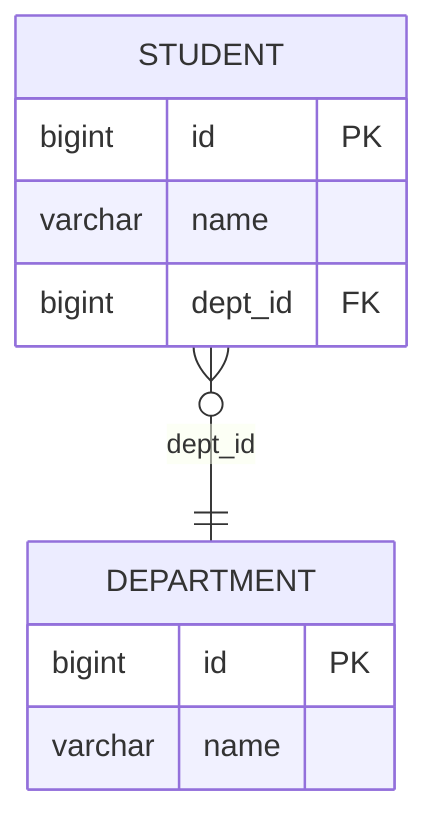
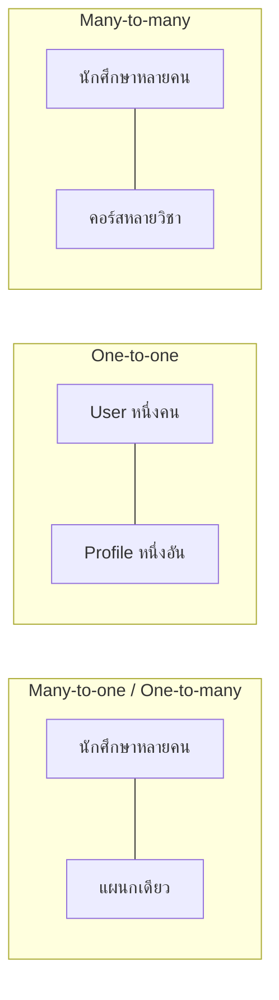
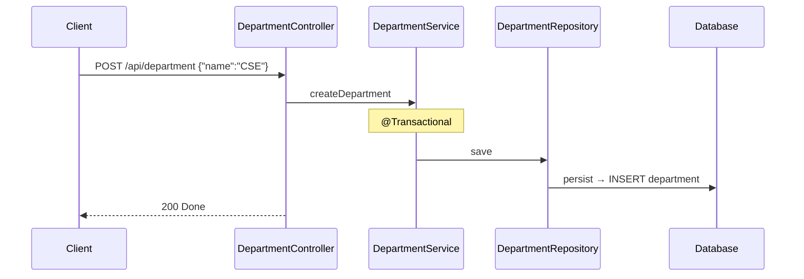
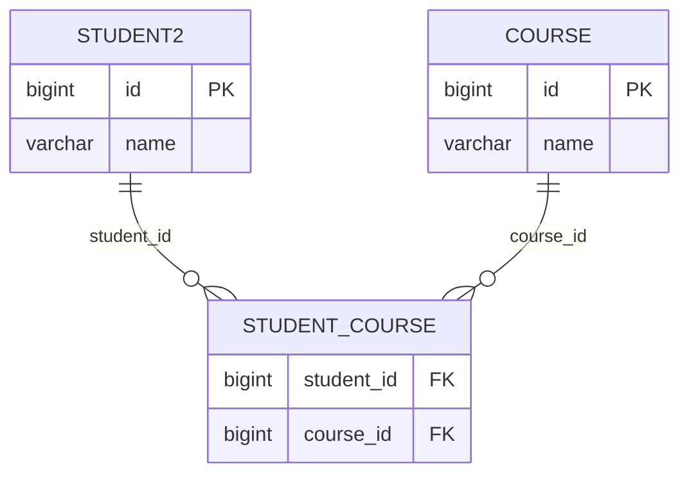
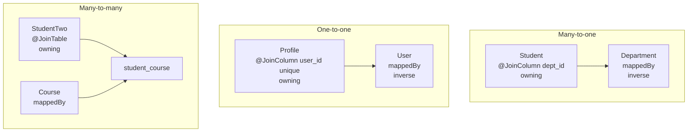

# #30 — JPA Relationships: OneToMany, ManyToOne, OneToOne, ManyToMany

> **วิดีโอ:** [JPA Relationships | @OneToMany, @ManyToOne, @OneToOne & @ManyToMany | Spring Boot Full Course #30](https://youtu.be/cMwR23y85qk) — Coder Army, ~84 นาที
> **แหล่งที่ใช้สรุป:** ซับภาษาอังกฤษที่ YouTube สร้างอัตโนมัติ (en-US)
> **เวอร์ชันในโค้ด:** Spring Boot 4.1.1 + Java 21 (Hibernate ORM 7.4.5) ใส่หมายเหตุไว้ทุกจุดที่ Spring Boot 3.x ต่างกัน

ตอนที่แล้วทำ CRUD ด้วย Hibernate และดูสถาปัตยกรรมข้างใน ตอนนี้ตอบคำถามต่อจากนั้น: **ถ้า Entity หนึ่งถือ Entity อีกตัว หรือถือเป็นลิสต์ จะเก็บลงตาราง relational อย่างไร** ตัวอย่างตลอดตอนคือนักศึกษาอยู่แผนกหนึ่ง แล้วต่อด้วย user กับ profile และนักศึกษาที่ลงได้หลายคอร์ส

ส่วนที่ติดป้าย `💡 เพิ่มเติม` คือของที่ผมเติมเอง ไม่ได้อยู่ในวิดีโอ ส่วนที่ติด `⚠️ แก้จากวิดีโอ` คือจุดที่วิดีโอพูดคลาดเคลื่อน

> 💡 **เพิ่มเติม — วิดีโอใช้ MySQL โน้ตนี้ใช้ H2:** ผู้สอนต่อ **MySQL** ผ่าน DBeaver ดูตารางและ ER diagram โค้ดที่รันในโน้ตนี้ใช้ **H2 in-memory** ที่พอร์ต **9030** ข้อมูลหายเมื่อปิดแอป SQL ใน log จึงเป็นสำเนียงของ H2 (`generated by default as identity`, `values (?, default)`) พฤติกรรมของ foreign key, unique และ join table ยังเป็นของ Hibernate ชุดเดียวกัน

---

## สารบัญ

| เวลา | หัวข้อ |
|---|---|
| [0:00](https://youtu.be/cMwR23y85qk?t=0) | [1. ต่อจาก Hibernate](#1-ต่อจาก-hibernate) |
| [0:41](https://youtu.be/cMwR23y85qk?t=41) | [2. โครงโปรเจกต์เริ่มต้น](#2-โครงโปรเจกต์เริ่มต้น) |
| [2:31](https://youtu.be/cMwR23y85qk?t=151) | [3. Lombok](#3-lombok) |
| [5:17](https://youtu.be/cMwR23y85qk?t=317) | [4. Object ใน Java กับคอลัมน์ใน SQL](#4-object-ใน-java-กับคอลัมน์ใน-sql) |
| [9:12](https://youtu.be/cMwR23y85qk?t=552) | [5. ถ้าไม่มี ORM ต้อง query สองรอบ](#5-ถ้าไม่มี-orm-ต้อง-query-สองรอบ) |
| [11:18](https://youtu.be/cMwR23y85qk?t=678) | [6. Cardinality สี่แบบ](#6-cardinality-สี่แบบ) |
| [14:34](https://youtu.be/cMwR23y85qk?t=874) | [7. Unidirectional กับ Bidirectional](#7-unidirectional-กับ-bidirectional) |
| [16:55](https://youtu.be/cMwR23y85qk?t=1015) | [8. ManyToOne กับ JoinColumn](#8-manytoone-กับ-joincolumn) |
| [22:24](https://youtu.be/cMwR23y85qk?t=1344) | [9. Owning side กับ Inverse side](#9-owning-side-กับ-inverse-side) |
| [22:53](https://youtu.be/cMwR23y85qk?t=1373) | [10. nullable กับ optional](#10-nullable-กับ-optional) |
| [24:54](https://youtu.be/cMwR23y85qk?t=1494) | [11. ddl-auto สร้างตาราง](#11-ddl-auto-สร้างตาราง) |
| [26:39](https://youtu.be/cMwR23y85qk?t=1599) | [12. บันทึกแผนก แล้วบันทึกนักศึกษาที่อ้างแผนกเดิม](#12-บันทึกแผนก-แล้วบันทึกนักศึกษาที่อ้างแผนกเดิม) |
| [39:35](https://youtu.be/cMwR23y85qk?t=2375) | [13. สร้างแผนกใหม่พร้อมนักศึกษา](#13-สร้างแผนกใหม่พร้อมนักศึกษา) |
| [44:41](https://youtu.be/cMwR23y85qk?t=2681) | [14. OneToMany คือมุมกลับของตารางเดิม](#14-onetomany-คือมุมกลับของตารางเดิม) |
| [48:07](https://youtu.be/cMwR23y85qk?t=2887) | [15. ซิงก์สองฝั่งกับ Persistence Context](#15-ซิงก์สองฝั่งกับ-persistence-context) |
| [1:01:12](https://youtu.be/cMwR23y85qk?t=3672) | [16. Helper method บน Entity](#16-helper-method-บน-entity) |
| [1:03:21](https://youtu.be/cMwR23y85qk?t=3801) | [17. OneToOne กับ unique constraint](#17-onetoone-กับ-unique-constraint) |
| [1:12:01](https://youtu.be/cMwR23y85qk?t=4321) | [18. ManyToMany กับ Join Table](#18-manytomany-กับ-join-table) |
| [1:21:50](https://youtu.be/cMwR23y85qk?t=4910) | [19. Foreign key อยู่ฝั่งไหน](#19-foreign-key-อยู่ฝั่งไหน) |
| — | [20. สรุปท้ายตอน](#20-สรุปท้ายตอน) |

---

## 1. ต่อจาก Hibernate

[▶ 0:00](https://youtu.be/cMwR23y85qk?t=0)

ผู้สอนบอกว่าต้องดูตอน Hibernate CRUD ก่อน อย่างน้อยต้องรู้ว่าบันทึกและอ่าน Entity อย่างไร ตอนนี้จะเลย CRUD ที่ฟิลด์เป็นค่าธรรมดา ไปสู่ความสัมพันธ์ระหว่าง Entity เช่นนักศึกษากับแผนก นักศึกษากับโปรไฟล์

เขาบอกด้วยว่าจะพูดถึง **N+1 problem** ช่วงต้นคลิป แต่เนื้อที่เหลือของตอนนี้ไม่ได้กลับไปที่เรื่องนั้น การโหลดแบบ lazy, N+1 และ `EntityGraph` อยู่ในตอนถัดไป

โปรเจกต์บนจอชื่อ JPA Relationship Demo มี controller, service, repository ว่าง ๆ มี endpoint ของนักศึกษาและ constructor ที่รับ service แล้ว service รับ repository `Student` เหลือแค่ `id` กับ `name` ส่วนฟิลด์อื่นเขาลบออกเพื่อจะสร้างความสัมพันธ์ใหม่ในตอนนี้

---

## 2. โครงโปรเจกต์เริ่มต้น

[▶ 0:41](https://youtu.be/cMwR23y85qk?t=41)

ชั้นข้อมูลในตอนนี้ยังไม่ใช่ interface ของ Spring Data ที่สร้าง query จากชื่อ method เขาฉีด `EntityManager` เข้า repository ด้วย `@PersistenceContext` แล้วเรียก `persist` กับ `find` เอง นี่คือชั้น Hibernate ที่ตอนที่แล้วใช้

Dependency ที่เขาอ่านจาก `pom.xml` คือ Spring Boot Starter JPA, Web MVC, MySQL Connector/J และ test ของ Starter JPA กับ Web MVC

> ⚠️ **Boot 4 vs 3:** ชื่อที่ตรงกับของบนจอคือ `spring-boot-starter-data-jpa` กับ `spring-boot-starter-webmvc` test แยกเป็น `spring-boot-starter-data-jpa-test` และ `spring-boot-starter-webmvc-test` ชื่อ `spring-boot-starter-data-jpa` เหมือน Boot 3 ใน Boot 3 เว็บใช้ `spring-boot-starter-web` และ test รวมอยู่ใน `spring-boot-starter-test` ก้อนเดียว
> ([Spring Boot 4.0 Migration Guide](https://github.com/spring-projects/spring-boot/wiki/Spring-Boot-4.0-Migration-Guide))

`pom.xml` ที่รันในโน้ตนี้ใช้ parent `4.1.1` ใส่ H2 แทน MySQL และใส่ Lombok ตามที่เขาเพิ่มในหัวข้อถัดไป ด้านล่างคือส่วน dependency ไฟล์เต็มมี `spring-boot-maven-plugin` และตั้ง annotation processor ของ Lombok บน `maven-compiler-plugin` เพื่อให้ `mvn package` สร้าง getter ได้ ซึ่งตรงกับที่เขาเปิด Enable annotation processing ใน IntelliJ

```xml
<parent>
  <groupId>org.springframework.boot</groupId>
  <artifactId>spring-boot-starter-parent</artifactId>
  <version>4.1.1</version>
</parent>

<properties>
  <java.version>21</java.version>
</properties>

<dependencies>
  <dependency>
    <groupId>org.springframework.boot</groupId>
    <artifactId>spring-boot-starter-webmvc</artifactId>
  </dependency>
  <dependency>
    <groupId>org.springframework.boot</groupId>
    <artifactId>spring-boot-starter-data-jpa</artifactId>
  </dependency>
  <dependency>
    <groupId>com.h2database</groupId>
    <artifactId>h2</artifactId>
    <scope>runtime</scope>
  </dependency>
  <dependency>
    <groupId>org.projectlombok</groupId>
    <artifactId>lombok</artifactId>
    <optional>true</optional>
  </dependency>
</dependencies>
```

> 💡 **เพิ่มเติม:** ในวิดีโอ driver คือ `com.mysql:mysql-connector-j` ไม่มีเวอร์ชัน เพราะ parent จัดการให้ โน้ตนี้ไม่ใส่ dependency นั้น

---

## 3. Lombok

[▶ 2:31](https://youtu.be/cMwR23y85qk?t=151)

เขาไม่อยากคลิก Generate getter, setter และ constructor เอง จึงใช้ **Lombok** เปิด Maven Central เลือก Project Lombok แล้วบอกว่าไม่ต้องเขียนเวอร์ชัน เพราะ Spring Boot parent จัดการให้ ลบ scope `compile` กับเวอร์ชันทิ้ง เหลือ `groupId` กับ `artifactId`

Annotation ที่เขาใส่บน Entity และผลที่ได้

| Annotation | สิ่งที่สร้าง |
|---|---|
| `@Getter` | `getId`, `getName`, `getDepartment` ตามชื่อฟิลด์ |
| `@Setter` | `setId`, `setName`, `setDepartment` |
| `@NoArgsConstructor` | constructor ว่าง JPA ต้องมีตัวนี้ตอนโหลดแถวขึ้นมาเป็น object |
| `@AllArgsConstructor` | constructor ที่รับทุกฟิลด์ |
| `@Data` | รวม getter, setter, `toString`, `equals`, `hashCode` และ constructor ของฟิลด์ที่จำเป็น |
| `@Builder` | สร้าง object แบบ builder |

เขาบอกว่าของที่ต้องใช้จริงในตอนนี้คือ getter, setter, no-args และ all-args สี่ตัวนี้สร้างจาก annotation ได้ทั้งชุด

> 💡 **เพิ่มเติม — `@Data` ไม่ได้แทน `@NoArgsConstructor`:** `@Data` รวม `@RequiredArgsConstructor` ซึ่งสร้าง constructor เฉพาะฟิลด์ `final` หรือฟิลด์ที่ติด `@NonNull` ไม่ได้สร้าง constructor ว่าง ถ้าจะให้ JPA สร้าง object ตอนอ่านแถว ต้องมี `@NoArgsConstructor` แยกอยู่ดี บนความสัมพันธ์สองทาง `toString`, `equals` และ `hashCode` ที่ `@Data` สร้างให้จะเดินไปอีกฝั่งแล้ววนไม่จบ โน้ตนี้จึงไม่ติด `@Data` บน Entity

ตอนยิงสร้างแผนกครั้งแรก ชื่อลงฐานเป็น `null` เพราะ `Department` ยังไม่มี setter Jackson แปลง JSON ไม่เข้าฟิลด์ เขาใส่ `@Getter`, `@Setter`, `@NoArgsConstructor` แล้วลบตาราง สตาร์ทใหม่ ชื่อ `CSE` จึงถูกบันทึก

---

## 4. Object ใน Java กับคอลัมน์ใน SQL

[▶ 5:17](https://youtu.be/cMwR23y85qk?t=317)

ใน Java การให้ `Student` ถือ `Department` เป็นเรื่องปกติ เพราะถือ reference ของ object อีกตัวได้ แต่ตาราง relational ใส่ object ทั้งก้อนลงคอลัมน์เดียวไม่ได้

แบบที่ SQL ทำคือแยกตาราง แล้วเก็บเฉพาะ id ของแผนกไว้ในแถวนักศึกษา id นั้นเป็น **foreign key** ชี้ไปที่ primary key ของตารางแผนก

เขาเขียนตัวอย่างบนกระดานประมาณนี้

| student | | | |
|---|---|---|---|
| id | name | dept_id | |
| 1 | Aditya | 1001 | |
| 2 | Rohit | 102 | |

| department | |
|---|---|
| id | name |
| 1001 | CSE |
| 102 | Physics |

`student.getDepartment()` ใน Java คือการไปหาแถวที่ `student.dept_id` เท่ากับ `department.id` แล้วอ่านชื่อแผนกของ Aditya ได้ CSE ของ Rohit ได้ Physics



ความสัมพันธ์แบบนี้เจอบ่อย ออเดอร์มีหลายรายการ และรายการเองก็เป็น object ตารางเก็บได้แค่ key ไม่ได้เก็บ object

---

## 5. ถ้าไม่มี ORM ต้อง query สองรอบ

[▶ 9:12](https://youtu.be/cMwR23y85qk?t=552)

ถ้าไม่มี Hibernate แล้วใช้ JDBC ฟิลด์ใน `Student` จะเป็น `deptId` ไม่ใช่ object `Department` ขั้นตอนที่ต้องเขียนเองมีสอง query

1. เอา id นักศึกษาไปถาม student repository ได้แถวนักศึกษา และได้ `deptId` ออกมา
2. เอา `deptId` นั้นไปถาม department repository ได้แถวแผนก

เขาอยากให้โมเดลใน Java เป็นแบบที่ธุรกิจคิด คือนักศึกษามีแผนก เรียก `student.getDepartment()` แล้วให้ Hibernate ไปทำสองขั้นนั้นเอง ความสัมพันธ์ของ JPA ในตอนนี้วางอยู่บน Hibernate

> ⚠️ **แก้จากวิดีโอ:** เขาบอกว่า cardinality สี่แบบนี้อยู่ใน Spring Framework ที่ถูกคือ `@ManyToOne`, `@OneToMany`, `@OneToOne` และ `@ManyToMany` เป็น annotation ของ **Jakarta Persistence** ซึ่งเป็น specification Hibernate เป็น implementation Spring Data JPA เป็นชั้นที่ห่อ JPA อีกที Spring ไม่ได้เป็นคนนิยาม cardinality นี้

---

## 6. Cardinality สี่แบบ

[▶ 11:18](https://youtu.be/cMwR23y85qk?t=678)

Cardinality คือจำนวนฝั่งซ้ายต่อจำนวนฝั่งขวา เขาวาดสี่แบบ

| ความสัมพันธ์ | ความหมายในตัวอย่างของเขา |
|---|---|
| Many-to-one | นักศึกษาหลายคนอยู่แผนกเดียว |
| One-to-many | แผนกเดียวมีนักศึกษาหลายคน มองจากฝั่งแผนกของความสัมพันธ์เดียวกัน |
| One-to-one | user คนหนึ่งมี profile เดียว และ profile หนึ่งเป็นของ user คนเดียว |
| Many-to-many | นักศึกษาคนหนึ่งลงได้หลายคอร์ส และคอร์สหนึ่งมีนักศึกษาได้หลายคน |

Many-to-one กับ one-to-many ของนักศึกษากับแผนกเป็นความสัมพันธ์ชุดเดียวกัน ต่างกันที่มองจากฝั่งไหน มองจากนักศึกษาเป็น many-to-one มองจากแผนกเป็น one-to-many

One-to-one ของเขาคือ `User` กับ `Profile` Many-to-many คือ `Student` กับ `Course` เขาเขียนว่าเด็ก n คนมีคอร์สได้ m คอร์ส และอ่านกลับทางก็เป็น many-to-many เช่นกัน



---

## 7. Unidirectional กับ Bidirectional

[▶ 14:34](https://youtu.be/cMwR23y85qk?t=874)

อีกแกนหนึ่งไม่เกี่ยวกับจำนวน แต่เกี่ยวกับทิศทางในโค้ด Java

**Unidirectional** คือมีฟิลด์ความสัมพันธ์ฝั่งเดียว `Student` มี `department` แต่ `Department` ไม่มีลิสต์นักศึกษา ลูกศรชี้ทางเดียว

**Bidirectional** คือมีทั้งสองฝั่ง `Student.department` และ `Department.students` อ่านได้ทั้งจากนักศึกษาไปแผนก และจากแผนกไปรายชื่อนักศึกษา

กฎที่เขาใช้ทั้งตอน

- ฝั่ง "to one" เก็บเป็น object เดียว เช่น `Department department`
- ฝั่ง "to many" เก็บเป็น collection เขาใช้ `List` แล้วบอกว่าใช้ `Set` หรือ collection อื่นก็ได้

เขาทดลองใส่ `List<Student>` ใน `Department` เพื่อให้เห็นว่าความสัมพันธ์กลายเป็นสองทาง แล้วลบออกก่อน เพื่อสอน many-to-one ทางเดียวให้จบก่อน

One-to-one ก็เลือกได้เหมือนกัน จะให้มีฟิลด์ฝั่งเดียวหรือทั้งสองฝั่ง

---

## 8. ManyToOne กับ JoinColumn

[▶ 16:55](https://youtu.be/cMwR23y85qk?t=1015)

เขากลับมาที่ตารางนักศึกษาสามคอลัมน์ `id`, `name`, `dept_id` และตารางแผนก `id`, `name` นักศึกษาหลายคนชี้แผนกเดียวกันได้ เพราะ foreign key ซ้ำได้ primary key ของแต่ละตารางยังไม่ซ้ำ

บนฟิลด์ `department` เขาใส่สอง annotation

```java
@ManyToOne
@JoinColumn(name = "dept_id")
private Department department;
```

`@ManyToOne` บอก cardinality `@JoinColumn` บอกชื่อคอลัมน์ที่จะใช้ join เขาเริ่มจากชื่อ `department_id` แล้วเปลี่ยนเป็น `DEPT_ID` โน้ตนี้ใช้ `dept_id` ซึ่งเป็นชื่อที่ Hibernate สร้างจริงบน H2

Hibernate รู้เองว่าค่าในคอลัมน์นี้คือ primary key ของ `Department` ไม่ต้องบอกชื่อคอลัมน์ปลายทาง ถ้าจะเปลี่ยนปลายทางจึงค่อยใช้ `referencedColumnName` เขาไม่ได้ใส่

`Department` ต้องเป็น `@Entity` มี `@Id` และให้ id สร้างอัตโนมัติ ไม่งั้น Hibernate ไม่รู้ว่าจะเอา key อะไรมาเป็น foreign key พอทำให้แผนกเป็น Entity แล้ว error บนฟิลด์ `department` หายไป error เดิมที่เขาชี้คือ Hibernate ไม่ยอมให้ฟิลด์ที่เป็น Entity โผล่เป็น basic attribute โดยไม่มี annotation ความสัมพันธ์

> ⚠️ **แก้จากวิดีโอ:** ตอนจะใส่ annotation เขาพูดว่าความสัมพันธ์นี้เป็น one-to-many แล้วบรรทัดที่เขียนคือ `@ManyToOne` บน `Student.department` ฝั่งนักศึกษาถูกแล้วที่เป็น `@ManyToOne` เพราะนักศึกษาหลายคนต่อแผนกเดียว `@OneToMany` เป็นฝั่งแผนก ซึ่งเขาเพิ่งใส่ทีหลัง

> 💡 **เพิ่มเติม:** `@GeneratedValue(strategy = GenerationType.IDENTITY)` เป็นแบบที่คอร์สนี้ใช้กับ id อัตโนมัติมาก่อน เขาบอกแค่ให้ generate อัตโนมัติแล้วก็อปจาก `Student` บน H2 คอลัมน์เลยเป็น `bigint generated by default as identity`

---

## 9. Owning side กับ Inverse side

[▶ 22:24](https://youtu.be/cMwR23y85qk?t=1344)

ตอนความสัมพันธ์ยังทางเดียว เขาเรียก `Student` ว่า **owning side** เพราะถือ `dept_id` และเรียก `Department` ว่า **inverse side** เพราะไม่มีฟิลด์ชี้กลับ

คำนี้กลับมาสำคัญตอนทำให้เป็นสองทาง กฎที่ใช้ได้ทั้งตอนมีดังนี้

- ฝั่งที่มี `@JoinColumn` หรือ `@JoinTable` คือ owning side Hibernate เขียน foreign key จากฝั่งนี้
- ฝั่งที่มี `mappedBy` คือ inverse side `mappedBy` ใส่**ชื่อฟิลด์ Java** ของ owning side ไม่ใช่ชื่อตาราง

ในคู่ชุดนี้ owning side คือ `Student.department` inverse side คือ `Department.students` ที่เขียน `mappedBy = "department"`

---

## 10. nullable กับ optional

[▶ 22:53](https://youtu.be/cMwR23y85qk?t=1373)

เขาถามว่านักศึกษามีแผนกเป็น `null` ได้ไหม ถ้ายอมได้ ความสัมพันธ์เป็น nullable เช่นแถว Raman ที่ `dept_id` ว่าง

ถ้าทุกนักศึกษาต้องมีแผนก เขาให้ตั้งสองที่

```java
@ManyToOne(optional = false)
@JoinColumn(name = "dept_id", nullable = false)
private Department department;
```

เขาแยกความหมายไว้แบบนี้

- `nullable = false` บน `@JoinColumn` สั่งตอนสร้างตาราง ให้คอลัมน์ `dept_id` เป็น `NOT NULL`
- `optional = false` บน `@ManyToOne` บอกฝั่ง Entity ว่านักศึกษาทุกคนต้องมีแผนก

จากนั้นเขาเอาทั้งสองค่าออกก่อนรัน เพื่อให้ทดลองแบบ nullable ต่อได้ ตารางที่สร้างจริงในโน้ตนี้จึงให้ `dept_id` เป็น null ได้ ตาม DDL ด้านล่าง

---

## 11. ddl-auto สร้างตาราง

[▶ 24:54](https://youtu.be/cMwR23y85qk?t=1494)

`application.properties` ในวิดีโอใช้ชุดเดิมจากตอนที่แล้ว คือ URL ของ MySQL, username, password, `ddl-auto=update`, `show-sql=true` และจัดรูปแบบ SQL

`update` แปลว่าพอ Entity เปลี่ยน Hibernate จะปรับตารางให้ตาม สตาร์ทครั้งแรกบนฐานว่างจึงเป็น `CREATE TABLE` เขาเปิด DBeaver แล้วยังไม่มีตาราง พอสตาร์ทแอปจึงเห็น `create table department`, `create table student` และ `alter table student` ที่ใส่ foreign key

ไฟล์ที่รันในโน้ตนี้

```properties
server.port=9030

spring.datasource.url=jdbc:h2:mem:studentdb
spring.datasource.driver-class-name=org.h2.Driver
spring.datasource.username=sa
spring.datasource.password=

spring.jpa.hibernate.ddl-auto=update
spring.jpa.show-sql=true
spring.jpa.properties.hibernate.format_sql=true
```

DDL ของคู่ many-to-one หลังสตาร์ท (ตัดให้เหลือตารางนี้ สตาร์ทจริงสร้างตารางของ one-to-one และ many-to-many พร้อมกันเพราะ Entity อยู่โปรเจกต์เดียวกัน)

```sql
create table department (
    id bigint generated by default as identity,
    name varchar(255),
    primary key (id)
)

create table student (
    id bigint generated by default as identity,
    name varchar(255),
    dept_id bigint,
    primary key (id)
)

alter table student
   add constraint FKo2y1ex8ef3nqg0c42de3n9caj
   foreign key (dept_id)
   references department
```

`dept_id` ไม่มี `not null` เพราะเขาเอา `nullable = false` ออกแล้ว ใน DBeaver เขาเปิดแท็บ diagram แล้วเห็นนักศึกษาชี้ไปแผนกแบบ many-to-one

---

## 12. บันทึกแผนก แล้วบันทึกนักศึกษาที่อ้างแผนกเดิม

[▶ 26:39](https://youtu.be/cMwR23y85qk?t=1599)

เขาแยก controller ของแผนกออกจากนักศึกษา แล้วบอกว่าแต่ละ Entity ควรมี controller ของตัวเอง

เส้นทางสร้างแผนก

1. `POST /api/department` รับ body เป็น `Department` มีแค่ชื่อ เพราะ id สร้างให้
2. Service ติด `@Transactional` แล้วเรียก repository
3. Repository เรียก `entityManager.persist(department)`
4. Controller ตอบข้อความ `Done` ไม่คืน Entity



`DepartmentRepository` ทั้งคลาส

```java
@Repository
public class DepartmentRepository {

  @PersistenceContext
  private EntityManager entityManager;

  public void save(Department department) {
    entityManager.persist(department);
  }

  public Department getDepartmentById(long id) {
    return entityManager.find(Department.class, id);
  }
}
```

`StudentRepository` เป็นแบบเดียวกัน เปลี่ยนชนิดเป็น `Student` และมี `findById`

เขายิง Postman ที่ `localhost:8080/api/department` body `{"name":"CSE"}` ได้ `Done` แล้วเพิ่ม Physics กับ History ชื่อลงตารางได้หลังใส่ setter แล้ว

จากนั้นสร้างนักศึกษาที่อ้างแผนกที่มีอยู่แล้ว เขาเริ่มจาก `@PathVariable` ที่ path `/{deptId}` แล้วยอมว่า request parameter สื่อกว่า จึงเปลี่ยนเป็น `@RequestParam long deptId` โน้ตนี้ใช้แบบหลัง

Service ไม่ให้ repository ไปรู้จักการหาแผนก งานนั้นอยู่ที่ service

1. `departmentRepository.getDepartmentById(deptId)` ได้แผนกที่อยู่ใน persistence context แล้ว
2. ใส่แผนกนั้นเข้านักศึกษา และใส่นักศึกษากลับเข้าลิสต์ของแผนก (หลังทำให้เป็นสองทาง)
3. `studentRepository.save(student)` อย่างเดียว

Body มีแค่ชื่อ แผนกไม่ได้มาจาก JSON

```bash
curl -s -w "\nHTTP %{http_code}\n" -X POST "http://localhost:9030/api/department" \
  -H 'Content-Type: application/json' -d '{"name":"CSE"}'
curl -s -w "\nHTTP %{http_code}\n" -X POST "http://localhost:9030/api/department" \
  -H 'Content-Type: application/json' -d '{"name":"History"}'
curl -s -w "\nHTTP %{http_code}\n" -X POST "http://localhost:9030/api/student?deptId=1" \
  -H 'Content-Type: application/json' -d '{"name":"Aditya"}'
curl -s -w "\nHTTP %{http_code}\n" -X POST "http://localhost:9030/api/student?deptId=1" \
  -H 'Content-Type: application/json' -d '{"name":"Rohit"}'
curl -s -w "\nHTTP %{http_code}\n" -X POST "http://localhost:9030/api/student?deptId=2" \
  -H 'Content-Type: application/json' -d '{"name":"Sohan"}'
```

ทุกคำสั่งตอบ `Done` และ HTTP 200 SQL ของการสร้าง Aditya เป็นแบบที่เขาอ่านจาก log คือ select แผนกก่อน แล้ว insert นักศึกษา

```sql
select
    d1_0.id,
    d1_0.name
from
    department d1_0
where
    d1_0.id=?

insert
into
    student
    (dept_id, name, id)
values
    (?, ?, default)
```

แถวที่ได้คือ Aditya กับ Rohit ชี้ `dept_id = 1` (CSE) และ Sohan ชี้ `dept_id = 2` (History) foreign key ซ้ำที่แถวนักศึกษาได้ โดย primary key ของแผนกไม่ซ้ำ

> 💡 **เพิ่มเติม:** วิดีโอตรวจใน DBeaver โน้ตนี้เพิ่ม `GET /api/student/{id}` กับ `GET /api/department/{id}` ที่คืนข้อความสั้น ๆ เพื่อดูทั้งสองทิศโดยไม่ให้ Jackson วนลูปบนกราฟสองทาง ผลหลังใส่ Aditya กับ Rohit ใน CSE คือ `id=1 name=Aditya departmentId=1 departmentName=CSE` และ `id=1 name=CSE students=[Aditya, Rohit]`

---

## 13. สร้างแผนกใหม่พร้อมนักศึกษา

[▶ 39:35](https://youtu.be/cMwR23y85qk?t=2375)

กรณีที่สองคือยังไม่มีแผนกนั้นในฐาน client ส่งชื่อแผนกมาใหม่ เขา overload `createStudent` ให้รับ `departmentName` แทน `deptId`

ลำดับใน service

1. `new Department()` แล้ว `setName`
2. `persist` แผนก เพื่อให้ได้ id
3. ผูกแผนกเข้ากับนักศึกษาทั้งสองฝั่ง
4. `persist` นักศึกษา

เขาเจอปัญหาตอนสตาร์ท เพราะมี `POST /api/student` สองเมธอด Spring ไม่รู้จะส่ง request ไปเมธอดไหน แค่ชนิดของ request parameter ต่างกันไม่พอ เขาจึงแยก path เป็น `/with_department`

```bash
curl -s -w "\nHTTP %{http_code}\n" \
  -X POST "http://localhost:9030/api/student/with_department?departmentName=Political%20Science" \
  -H 'Content-Type: application/json' -d '{"name":"Monica"}'
```

ตอบ `Done` SQL เป็น insert สองคำสั่ง ไม่มี update ตามหลัง เพราะแผนกถูก persist ก่อน แล้วค่อยผูก ก่อน insert นักศึกษา

```sql
insert into department (name, id) values (?, default)
insert into student (dept_id, name, id) values (?, ?, default)
```

บนฐานที่มี CSE, History และ Political Science อยู่ก่อนแล้ว แผนก Political Science ก้อนใหม่ได้ id 4 และ Monica ชี้ไปที่ id นั้น `GET /api/student/4` ได้ `id=4 name=Monica departmentId=4 departmentName=Political Science`

> ⚠️ **แก้จากวิดีโอ:** เขาบอกว่าถ้าเปลี่ยน department id ของนักศึกษา ตารางแผนกควรอัปเดตตาม ที่ถูกคือการเปลี่ยนความสัมพันธ์เขียนที่คอลัมน์ `student.dept_id` เท่านั้น แถวในตาราง `department` ไม่ได้ถูกแก้ชื่อหรือ id นักศึกษาแค่ไปชี้แถวแผนกอีกแถวหนึ่ง หรือแถวที่เพิ่ง insert

เขาสรุปว่า Hibernate จัดการให้ทั้งกรณียิงอ้างแผนกเดิมและกรณีสร้างแผนกใหม่ แล้วให้ผู้ดูไปลอง update แผนกของนักศึกษาเอง

---

## 14. OneToMany คือมุมกลับของตารางเดิม

[▶ 44:41](https://youtu.be/cMwR23y85qk?t=2681)

เขาย้ายฟิลด์ไปอยู่ฝั่งแผนกเป็น `List<Student>` แล้วถามว่าตารางควรมีคอลัมน์ student id ในตารางแผนกไหม

ตอบคือไม่ได้ ถ้า CSE มีทั้ง Aditya และ Rohit จะต้องมีสองแถวที่ id แผนกเป็น 1001 ซึ่งทำให้ primary key ซ้ำ สิ่งที่ทำได้คือเก็บ `dept_id` ซ้ำในตารางนักศึกษาแบบเดิม primary key ทั้งสองตารางไม่ซ้ำ มีแต่ foreign key ที่ซ้ำ

ดังนั้น many-to-one กับ one-to-many สร้างตารางชุดเดียวกัน เปลี่ยนแค่มุมใน Java

ฝั่งแผนกเขาใส่

```java
@OneToMany(mappedBy = "department")
private List<Student> students = new ArrayList<>();
```

`mappedBy = "department"` แปลว่าฟิลด์ `Student.department` เป็นคนถือ `@JoinColumn` อยู่แล้ว ฝั่งนี้ไม่สร้างคอลัมน์เพิ่ม เขาสตาร์ทใหม่หลังลบตาราง แล้วยืนยันใน DBeaver ว่า `department` ยังมีแค่ `id` กับ `name` และ `student` ยังมี `id`, `name`, `dept_id`

พอเป็นสองทาง จะอ่านลิสต์นักศึกษาจากแผนกได้ และอ่านแผนกจากนักศึกษาได้

---

## 15. ซิงก์สองฝั่งกับ Persistence Context

[▶ 48:07](https://youtu.be/cMwR23y85qk?t=2887)

ความสัมพันธ์สองทางไม่ได้อัปเดตให้ทั้งสองฝั่งเอง ถ้าสร้าง Rohan แล้วใส่แผนก Computer Science ให้เขา แต่ไม่เอา Rohan ใส่เข้า `department.students` วันหลังโหลดแผนกจะไม่เห็น Rohan ทั้งที่โหลด Rohan แล้วยังเห็นแผนก CSE เขาเรียกนี้ว่าปัญหา data integrity ในกราฟ object

ใน service เขาจึงทำทั้งสองบรรทัดทุกครั้งที่ผูกของใหม่

```java
student.setDepartment(department);
department.getStudents().add(student);
```

แล้วถามว่าต้อง `departmentRepository.save(department)` อีกครั้งไหม กรณีแผนกถูก `find` มาแล้ว เขาตอบว่าไม่ต้อง เพราะแผนกอยู่ใน persistence context อยู่แล้ว และนักศึกษาเป็น owning side

> ⚠️ **แก้จากวิดีโอ:** ประโยคที่ว่าการ save นักศึกษาจะไปกระตุ้นการ save แผนกเอง ทำให้คลาดเคลื่อนสองจุด
>
> 1. แผนกที่ **ยังไม่เคย persist** ต้อง `persist` เอง ตอนนี้ยังไม่มี cascade ถ้าผูกนักศึกษากับ `new Department()` แล้ว `persist` แค่นักศึกษา Hibernate โยน `TransientPropertyValueException` ข้อความจริงจากการยิง `POST /api/student/unsaved-department` คือ `Persistent instance of 'Student' references an unsaved transient instance of 'Department' (persist the transient instance before flushing)` คำตอบ HTTP คือ 500 cascade เป็นเรื่องของตอนถัดไป
> 2. ฝั่งที่เขียนลงฐานคือ owning side คือคอลัมน์ `student.dept_id` การ `add` เข้าลิสต์ของแผนกทำให้กราฟในหน่วยความจำครบ แต่ไม่ได้อัปเดตคอลัมน์ของตาราง `department` แผนกที่ `find` มาแล้วจึงไม่ต้อง `persist` ซ้ำ เพราะมันถูกจัดการอยู่แล้ว ไม่ใช่เพราะการแก้ลิสต์ไปสั่ง update แถวแผนก

เขายังทำเส้นทางกลับ คือสร้างแผนกพร้อมชื่อนักศึกษาใหม่ที่ `POST /api/department/with-student` ลำดับที่ทำให้ SQL ตรงกับที่เขาอ่านจาก log คือ insert นักศึกษาตอนที่ยังไม่มีแผนก แล้ว insert แผนก แล้วค่อยผูก ความผูกเกิดหลังทั้งสองตัวอยู่ใน persistence context จึงมี update ตามมา

```sql
insert into student (dept_id, name, id) values (?, ?, default)
insert into department (name, id) values (?, default)
update student set dept_id=?, name=? where id=?
```

บนฐานว่าง คำสั่งนี้สร้าง Anamika กับ Physics แล้วอ่านกลับได้ `id=1 name=Anamika departmentId=1 departmentName=Physics` และ `id=1 name=Physics students=[Anamika]` สามคำสั่งนี้คือที่เขาเล่าว่า insert นักศึกษา แล้ว insert แผนก แล้ว update นักศึกษาให้ชี้ id แผนกที่เพิ่งได้

[▶ 59:29](https://youtu.be/cMwR23y85qk?t=3569)

ครั้งแรกที่เรียก `getStudents().add` บนแผนกที่สร้างด้วย `new` เขาได้ 500 เพราะลิสต์เป็น `null` เขาจึงกำหนดค่าเริ่มต้นเป็น `new ArrayList<>()` โน้ตนี้เจอ exception เดียวกันเมื่อลิสต์เป็น null

```text
java.lang.NullPointerException: Cannot invoke "java.util.List.add(Object)"
because the return value of "Department.getStudents()" is null
```

ลิสต์ที่โหลดจากฐานไม่เป็น null เพราะ Hibernate ใส่ collection ของตัวเองให้ แต่แผนกที่ `new` ขึ้นมาใช้ค่าที่เราตั้งในฟิลด์ ถ้าไม่ตั้งไว้จะเป็น null

---

## 16. Helper method บน Entity

[▶ 1:01:12](https://youtu.be/cMwR23y85qk?t=3672)

เขาไม่อยากให้ทุก service จำเองว่าต้องผูกสองฝั่ง จึงย้ายไปไว้ที่ Entity ชื่อเมธอดใช้ `addDepartment` ไม่ใช่ `setDepartment` เพื่อไม่ชนกับ setter ของ Lombok

```java
public void addDepartment(Department department) {
  this.department = department;
  department.getStudents().add(this);
}
```

เขาพูดถึง `removeDepartment` ด้วย แต่ comment ทิ้งไว้ไม่ได้ยิง ลำดับที่เขาพูดคือเซ็ต `this.department = null` ก่อน แล้วค่อย `remove` บน `this.department` แบบนั้นเรียกเมธอดบน null

> ⚠️ **แก้จากวิดีโอ:** ต้องจำแผนกไว้ก่อน เอาตัวเองออกจากลิสต์ แล้วค่อยเคลียร์ฟิลด์ เมธอดที่รันในโน้ตนี้เป็นแบบนี้ และเขาไม่ได้รันเวอร์ชันที่พูดบนจอ

```java
public void removeDepartment() {
  if (this.department != null) {
    this.department.getStudents().remove(this);
    this.department = null;
  }
}
```

`DELETE /api/student/2/department` หลัง Rohit อยู่ CSE ตอบ `Done` SQL ที่เกี่ยวกับการเขียนคือ

```sql
update student set dept_id=?, name=? where id=?
```

จากนั้น `GET /api/student/2` ได้ `id=2 name=Rohit department=null` และ `GET /api/department/1` ได้ `id=1 name=CSE students=[Aditya]` ลิสต์ในหน่วยความจำกับคอลัมน์ `dept_id` ตรงกัน เพราะ owning side ถูกเคลียร์ตอนอยู่ใน persistence context

`Student` ทั้งคลาสหลังจบฝั่งนี้

```java
@Getter
@Setter
@NoArgsConstructor
@AllArgsConstructor
@Entity
public class Student {

  @Id
  @GeneratedValue(strategy = GenerationType.IDENTITY)
  private Long id;

  private String name;

  @ManyToOne
  @JoinColumn(name = "dept_id")
  private Department department;

  public void addDepartment(Department department) {
    this.department = department;
    department.getStudents().add(this);
  }

  public void removeDepartment() {
    if (this.department != null) {
      this.department.getStudents().remove(this);
      this.department = null;
    }
  }
}
```

`Department` ทั้งคลาส

```java
@Getter
@Setter
@NoArgsConstructor
@Entity
public class Department {

  @Id
  @GeneratedValue(strategy = GenerationType.IDENTITY)
  private Long id;

  private String name;

  @OneToMany(mappedBy = "department")
  private List<Student> students = new ArrayList<>();
}
```

> 💡 **เพิ่มเติม:** เขาไม่ได้ใส่ `@AllArgsConstructor` บน `Department` โน้ตนี้ก็ไม่ใส่ ถ้ามี constructor ที่รับลิสต์ แล้ว Jackson เลือก constructor นั้นตอนอ่าน JSON `{"name":"CSE"}` ลิสต์จะถูกส่งเข้ามาเป็น null ทับ `new ArrayList<>()` แล้ว `add` จะ NPE อีกครั้ง ทั้งที่ฟิลด์มีค่าเริ่มต้น

---

## 17. OneToOne กับ unique constraint

[▶ 1:03:21](https://youtu.be/cMwR23y85qk?t=3801)

เขาเปิดคู่ใหม่ `User` กับ `Profile` user มี `id` กับ `name` profile มี `id` กับ `bio` คนหนึ่งมี profile เดียว

Foreign key วางฝั่งไหนก็ได้ เพราะทั้งสองฝั่งเป็น "หนึ่ง"

- วาง `profile_id` ในตาราง user แล้ว join `user.profile_id = profile.id`
- วาง `user_id` ในตาราง profile แล้ว join `profile.user_id = user.id` เขาเลือกแบบนี้ในโค้ด

ถ้าไม่มีข้อจำกัดเพิ่ม แถว profile สองแถวใส่ `user_id` เดียวกันได้ primary key ของ profile ยังไม่ซ้ำ ฐานไม่ขัด เพราะยังไม่ได้บอกว่าคอลัมน์นี้ห้ามซ้ำ ความสัมพันธ์จะกลายเป็น user คนเดียวมีหลาย profile ซึ่งเป็น one-to-many ไม่ใช่ one-to-one

เขาจึงบอกว่า one-to-one ต้องการสองอย่างบนคอลัมน์เดียวกัน

1. **Foreign key** ชี้ไปที่ user
2. **Unique** เพื่อไม่ให้ user id ซ้ำในตาราง profile

[▶ 1:07:44](https://youtu.be/cMwR23y85qk?t=4064)

โค้ดฝั่ง profile เป็น owning side

```java
@OneToOne
@JoinColumn(name = "user_id")
private User user;
```

ฝั่ง user ตอนแรกไม่มีฟิลด์ profile เป็นทางเดียว จากนั้นเขาทำให้เป็นสองทางด้วย `@OneToOne(mappedBy = "user")` สตาร์ทอีกครั้งแล้วไม่มีตารางใหม่ เพราะ inverse side ไม่ได้ถือคอลัมน์ profile ยังมี `id`, `bio`, `user_id` และ user ยังมี `id`, `name`

เขาเตือนว่าสองทางไม่ได้ดีกว่าเสมอไป เพราะต้องคอยซิงก์ทั้งสองฝั่งและต้องมี helper แบบฝั่งแผนก ถ้าใช้แค่ "จาก profile ไปหา user" ก็ให้เป็นทางเดียวได้

DDL จริงของ unique กับ foreign key

```sql
create table profile (
    id bigint generated by default as identity,
    bio varchar(255),
    user_id bigint,
    primary key (id)
)

alter table profile
   add constraint UKc1dkiawnlj6uoe6fnlwd6j83j unique (user_id)

alter table profile
   add constraint FKs14jvsf9tqrcnly0afsv0ngwv
   foreign key (user_id)
   references users
```

> 💡 **เพิ่มเติม — ชื่อตาราง `user` ใช้ไม่ได้บน H2:** class ชื่อ `User` ทำให้ Hibernate สร้าง `create table user` แล้ว H2 ปฏิเสธ เพราะ `user` เป็นคำสงวน ข้อความจริงคือ `Syntax error in SQL statement "create table user ..."; expected "identifier"` แอปยังสตาร์ทต่อ เพราะ `ddl-auto=update` ไม่ทำให้สตาร์ทล้มเมื่อ DDL คำสั่งหนึ่งพัง แต่ตาราง user ไม่เกิด โน้ตนี้จึงใส่ `@Table(name = "users")` MySQL ก็สงวนคำว่า `USER` เช่นกัน

คลาสที่รัน

```java
@Getter
@Setter
@NoArgsConstructor
@Entity
@Table(name = "users")
public class User {

  @Id
  @GeneratedValue(strategy = GenerationType.IDENTITY)
  private Long id;

  private String name;

  @OneToOne(mappedBy = "user")
  private Profile profile;
}
```

```java
@Getter
@Setter
@NoArgsConstructor
@Entity
public class Profile {

  @Id
  @GeneratedValue(strategy = GenerationType.IDENTITY)
  private Long id;

  private String bio;

  @OneToOne
  @JoinColumn(name = "user_id")
  private User user;

  public void addUser(User user) {
    this.user = user;
    user.setProfile(this);
  }
}
```

> 💡 **เพิ่มเติม:** เขาให้ผู้ดูเขียน create, update, remove ของคู่นี้เอง โน้ตนี้เลยมี `POST /api/user` และ `POST /api/profile?userId=` ที่ `persist` user ก่อน แล้วค่อยผูก profile `addUser` ซิงก์ทั้งสองฝั่งแบบ helper ของนักศึกษา

```bash
curl -s -w "\nHTTP %{http_code}\n" -X POST http://localhost:9030/api/user \
  -H 'Content-Type: application/json' -d '{"name":"Aditya"}'
curl -s -w "\nHTTP %{http_code}\n" -X POST "http://localhost:9030/api/profile?userId=1" \
  -H 'Content-Type: application/json' -d '{"bio":"likes spring"}'
```

ทั้งคู่ตอบ `Done` อ่าน user ได้ `id=1 name=Aditya bio=likes spring` ซึ่งมาจากฝั่ง inverse ได้ เพราะมี `mappedBy` และซิงก์ไว้

ยิง profile ที่สองให้ user คนเดิม

```bash
curl -s -o /dev/null -w "HTTP %{http_code}\n" \
  -X POST "http://localhost:9030/api/profile?userId=1" \
  -H 'Content-Type: application/json' -d '{"bio":"second bio"}'
```

ได้ HTTP 500 และ

```text
Unique index or primary key violation:
PUBLIC.UKC1DKIAWNLJ6UOE6FNLWD6J83J ON PUBLIC.PROFILE(USER_ID ...) VALUES (1)
```

นี่คือ unique ที่ `@OneToOne` ให้มาเองโดยที่ไม่ได้เขียน `unique = true` ถ้าไม่มี unique แถวที่สองจะเข้าได้ และ cardinality จะไม่ใช่ one-to-one อีกต่อไป

---

## 18. ManyToMany กับ Join Table

[▶ 1:12:01](https://youtu.be/cMwR23y85qk?t=4321)

คู่สุดท้ายคือนักศึกษาหลายคนกับคอร์สหลายวิชา ทั้งสองตารางมีแค่ `id` กับ `name` เขาใช้คลาส `StudentTwo` เพื่อไม่ชนกับ `Student` ของแผนก และให้ฝั่งนักศึกษาเป็น owning side จึงถือ `List<Course>`

เขาลองถามว่าจะใส่ `course_id` ในตารางนักศึกษาได้ไหม ไม่ได้ เพราะ Aditya ลงทั้ง Spring และ MERN จะต้องมีสองแถวที่ id นักศึกษาเป็น 1 primary key ซ้ำ ใส่ `student_id` ในตารางคอร์สก็ไม่ได้ด้วยเหตุผลเดียวกัน Spring ถูกหยิบโดยทั้ง Aditya และ Rohit

ทางออกคือตารางที่สาม เขาเรียก **join table** ตารางนี้เกิดเฉพาะ many-to-many ในตารางมีสอง foreign key `student_id` กับ `course_id` ไม่มีคอลัมน์ไหนเป็น primary key เดี่ยว ๆ แถวหนึ่งแถวคือคู่หนึ่งคู่ เช่น Aditya+Spring, Aditya+MERN, Rohit+Spring, Rohit+MERN คู่ `(student_id, course_id)` คนละคู่กัน



Annotation บน owning side ไม่ใช่ `@JoinColumn` แต่เป็น `@JoinTable` เพราะกำลัง join ทั้งตาราง

```java
@ManyToMany
@JoinTable(
    name = "student_course",
    joinColumns = @JoinColumn(name = "student_id"),
    inverseJoinColumns = @JoinColumn(name = "course_id"))
private List<Course> courses = new ArrayList<>();
```

`joinColumns` คือคอลัมน์ของฝั่งที่ถือ annotation นี้ `inverseJoinColumns` คือคอลัมน์ของอีกฝั่ง

ฝั่งคอร์สถ้าทำให้เป็นสองทาง

```java
@ManyToMany(mappedBy = "courses")
private List<StudentTwo> students = new ArrayList<>();
```

`mappedBy` ชี้ชื่อฟิลด์ `courses` บน `StudentTwo` เขาใส่ `new ArrayList<>()` ทั้งสองฝั่งด้วย

สตาร์ทแล้วได้ตาราง `student2`, `course` และ `student_course` จากนั้นมี `alter` ใส่ foreign key สองตัว เขาบอกให้ดู properties ว่าไม่มีคอลัมน์ไหนเป็น primary key เดี่ยว แต่คู่ของทั้งสองเป็น composite key

> ⚠️ **แก้จากวิดีโอ:** ตาราง `student_course` ที่เกิดจาก `List` ไม่มี primary key และไม่มี unique ของคู่คอลัมน์ DDL จริงมีแค่สองคอลัมน์ `not null` กับ foreign key สองตัว ที่ถูกคือ `List` ที่ไม่มี `@OrderColumn` ถูก Hibernate มองเป็น bag และ bag อนุญาตให้แถวซ้ำได้ จึงไม่สร้าง primary key คอมเมนต์ใน `org.hibernate.mapping.Bag` เขียนไว้ตรง ๆ ว่า since a bag permits duplicates, it has no primary key ถ้าใช้ `Set<Course>` Hibernate จะสร้าง primary key จาก `student_id` กับ `course_id` ตามที่เขาเล่าว่าเห็นใน DBeaver โค้ดที่เขาพิมพ์เป็น `List` กับ `new ArrayList` ซึ่งไม่ตรงกับ composite key ที่เขาอธิบาย

```sql
create table student2 (
    id bigint generated by default as identity,
    name varchar(255),
    primary key (id)
)

create table course (
    id bigint generated by default as identity,
    name varchar(255),
    primary key (id)
)

create table student_course (
    student_id bigint not null,
    course_id bigint not null
)

alter table student_course
   add constraint FKejrkh4gv8iqgmspsanaji90ws
   foreign key (course_id) references course

alter table student_course
   add constraint FK73u0ch7nub6m0mhkaa03whowk
   foreign key (student_id) references student2
```

> 💡 **เพิ่มเติม:** ไม่ใส่ `@Table(name = "student2")` แล้วชื่อตารางจากคลาส `StudentTwo` จะเป็น `student_two` ตาม naming ของ Spring เขาพูดถึงตารางนี้ว่า Student2 โน้ตนี้จึงตั้งชื่อไว้ตรง ๆ

เพิ่มคอร์สให้แล้วนักศึกษาไม่ได้อยู่ในตาราง `student2` หรือ `course` แถวใหม่ไปโผล่ที่ `student_course` เขาให้ผู้ดูเขียน create เอง โน้ตนี้สร้างคอร์สก่อน แล้วค่อยสร้างนักศึกษาพร้อม id ของคอร์สที่มีอยู่แล้ว ถ้าส่งคอร์สที่ยังไม่ persist จะเจอ transient exception แบบเดียวกับแผนก

```bash
curl -s -w "\nHTTP %{http_code}\n" -X POST http://localhost:9030/api/course \
  -H 'Content-Type: application/json' -d '{"name":"Spring"}'
curl -s -w "\nHTTP %{http_code}\n" -X POST http://localhost:9030/api/course \
  -H 'Content-Type: application/json' -d '{"name":"MERN"}'
curl -s -w "\nHTTP %{http_code}\n" \
  -X POST "http://localhost:9030/api/student-two?courseIds=1,2" \
  -H 'Content-Type: application/json' -d '{"name":"Aditya"}'
curl -s -w "\nHTTP %{http_code}\n" \
  -X POST "http://localhost:9030/api/student-two?courseIds=1,2" \
  -H 'Content-Type: application/json' -d '{"name":"Rohit"}'
```

SQL ของ Aditya ไม่มีคอลัมน์คอร์สในตารางนักศึกษา มีแต่ insert ลงตารางกลางสองแถว

```sql
insert into student2 (name, id) values (?, default)
insert into student_course (student_id, course_id) values (?, ?)
insert into student_course (student_id, course_id) values (?, ?)
```

อ่านกลับได้ทั้งสองทาง `GET /api/student-two/1` ได้ `id=1 name=Aditya courses=[Spring, MERN]` และ `GET /api/course/1` ได้ `id=1 name=Spring students=[Aditya, Rohit]` query ที่ดึงรายชื่อคอร์สของนักศึกษาเข้าตารางกลาง ไม่ได้อ่านจากตาราง `student2` โดยตรง

```sql
select c1_1.id, c1_1.name
from student_course c1_0
join course c1_1 on c1_1.id = c1_0.course_id
where c1_0.student_id = ?
```

สองทางจึงยังต้องซิงก์ในหน่วยความจำเหมือนเดิม เพิ่มคอร์สให้นักศึกษาแล้วต้องเพิ่มนักศึกษากลับเข้าลิสต์ของคอร์ส เขาบอกให้เขียน helper ถ้าเก็บความสัมพันธ์สองทาง เมธอดในโน้ตนี้คือ `StudentTwo.addCourse`

---

## 19. Foreign key อยู่ฝั่งไหน

[▶ 1:21:50](https://youtu.be/cMwR23y85qk?t=4910)

เขาสรุปกฎวางคอลัมน์ทั้งตอนไว้รอบเดียว

| Cardinality | ใครถือ foreign key |
|---|---|
| Many-to-one และ one-to-many | ฝั่ง many เสมอ ฝั่ง one ถือไม่ได้ เพราะ primary key จะซ้ำ |
| One-to-one | ฝั่งไหนก็ได้ แต่คอลัมน์นั้นต้อง unique ด้วย ไม่งั้นกลายเป็น one-to-many |
| Many-to-many | ไม่มีฝั่งไหนถือในตารางตัวเอง ได้ตาราง join ใหม่เสมอ |

Owning side คือฝั่งที่ถือ key นั้น ใน many-to-one คือฝั่ง many ใน one-to-one คือฝั่งที่เราเลือกวาง `@JoinColumn` ใน many-to-many คือฝั่งที่วาง `@JoinTable` อีกฝั่งใส่ `mappedBy`

ถ้าเป็นสองทาง การอ่านทำได้ทั้งสองทาง แต่ตอนเขียนต้องรักษาทั้งสองฝั่งใน object การสร้างและอัปเดตใช้แนวเดียวกับที่ทำไปแล้วกับแผนก เขาบอกว่าหลังจากนี้น่าจะเขียนความสัมพันธ์ที่ฟิลด์ไม่ใช่ค่าธรรมดาได้อีก โดยไม่ติดที่ CRUD แบบเดิม



---

## 20. สรุปท้ายตอน

### ประเด็นที่ต้องจำ

1. ตาราง relational เก็บ object ไม่ได้ เก็บ foreign key แล้วให้ Hibernate ประกอบกลับเป็น object
2. Cardinality มีสี่แบบ many-to-one กับ one-to-many ของคู่เดียวกันใช้ตารางชุดเดียว ต่างกันที่มองจากฝั่งไหน
3. Unidirectional มีฟิลด์ฝั่งเดียว Bidirectional มีทั้งสองฝั่ง และต้องซิงก์เองทั้งตอนเพิ่มและตอนเอาออก
4. Owning side คือฝั่งที่ถือ `@JoinColumn` หรือ `@JoinTable` Inverse side ใช้ `mappedBy` เป็นชื่อฟิลด์ของ owning side
5. `nullable = false` เป็นข้อจำกัดของคอลัมน์ `optional = false` เป็นข้อกำหนดฝั่ง Entity เขาเอาออกก่อนรันตัวอย่างหลัก
6. ฝั่ง many เป็นคนถือ foreign key ของ many-to-one เสมอ เพราะฝั่ง one ใส่ id ของอีกฝั่งซ้ำไม่ได้
7. แผนกที่ยังไม่ persist ต้อง `persist` ก่อนผูก ถ้ายังไม่ตั้ง cascade การ `persist` นักศึกษาที่ชี้แผนกก้อนใหม่จะได้ `TransientPropertyValueException`
8. ลิสต์ฝั่ง one ต้องมีค่าเริ่มต้นเป็น `new ArrayList<>()` ไม่งั้น `add` บน entity ที่ `new` เองจะ NPE
9. One-to-one ต้องการทั้ง foreign key และ unique บนคอลัมน์นั้น `@OneToOne` สร้าง unique ให้ และยิงซ้ำได้ HTTP 500
10. Many-to-many สร้าง join table สองฝั่งไม่มีคอลัมน์ของอีกฝั่งในตารางตัวเอง `List` ที่เขาใช้ทำให้ตารางนี้ไม่มี composite primary key ถ้าต้องการ key คู่นั้นให้ใช้ `Set`
11. เขาเกริ่น N+1 ไว้ต้นตอน แต่ยังไม่สอน cascade, lazy และ N+1 ในคลิปนี้

### คำถามทบทวน

1. นักศึกษาหลายคนอยู่แผนกเดียว ทำไมตารางแผนกถึงไม่มีคอลัมน์รายชื่อนักศึกษา
2. `mappedBy = "department"` คำว่า department หมายถึงชื่อตาราง ชื่อคอลัมน์ หรือชื่อฟิลด์
3. แผนกที่ `find` มาแล้ว ทำไมไม่ต้อง `persist` ซ้ำ แต่แผนกที่ `new` ต้อง `persist`
4. `nullable = false` กับ `optional = false` คนละชั้นกันอย่างไร
5. ถ้าเซ็ตแผนกให้นักศึกษา แต่ไม่ใส่นักศึกษาเข้าลิสต์ของแผนก ตอนอ่านจากแต่ละฝั่งจะเห็นอะไรไม่ตรงกัน
6. ทำไม one-to-one ที่ลืม unique ถึงกลายเป็น one-to-many ได้
7. ทำไม many-to-many ใส่ foreign key ในตารางนักศึกษาหรือตารางคอร์สไม่ได้
8. ทำไม `List` บน `@ManyToMany` ถึงไม่ได้ composite primary key ทั้งที่เขาบอกว่าคู่ของสองคอลัมน์เป็น key
9. `POST` สองเมธอดบน path เดียวกัน ต่างกันแค่ request parameter ทำไม Spring สตาร์ทไม่ผ่าน
10. class ชื่อ `User` โดยไม่มี `@Table` แล้วสตาร์ทบน H2 เกิดอะไรขึ้น

### ตอนถัดไป

[#31 — JPA Cascading, Lazy Loading & N+1 Problem | EntityGraph in Spring Boot](./31-jpa-cascading-lazy-n-plus-one.md) ต่อจากจุดที่ตอนนี้ยังต้อง `persist` เองทั้งสองฝั่ง และจาก N+1 ที่เขาเกริ่นไว้แต่ยังไม่ได้ลงรายละเอียด
