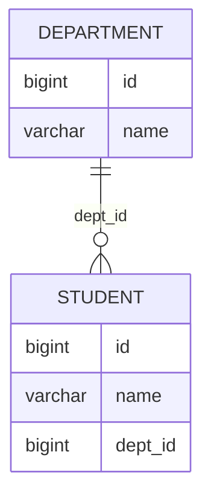
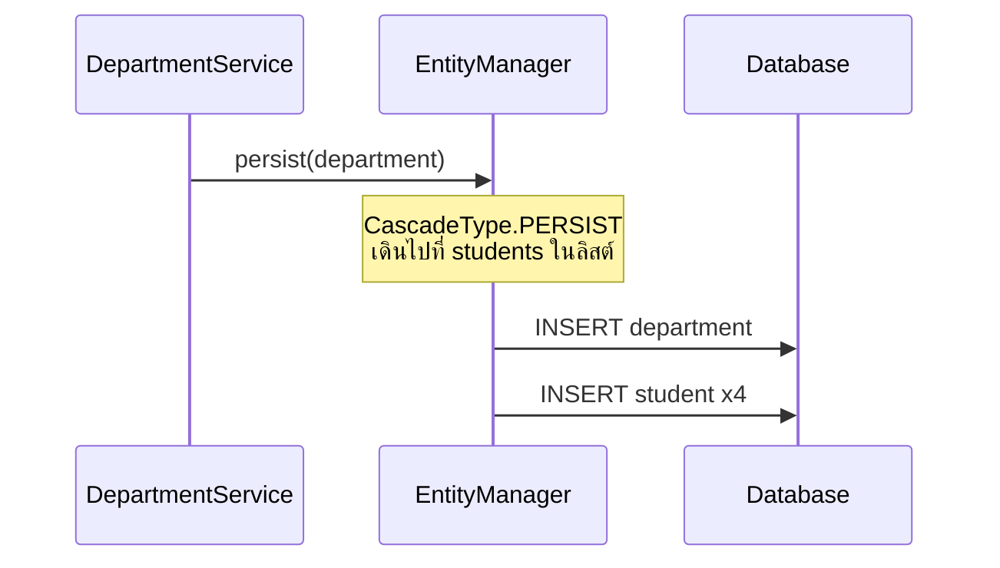
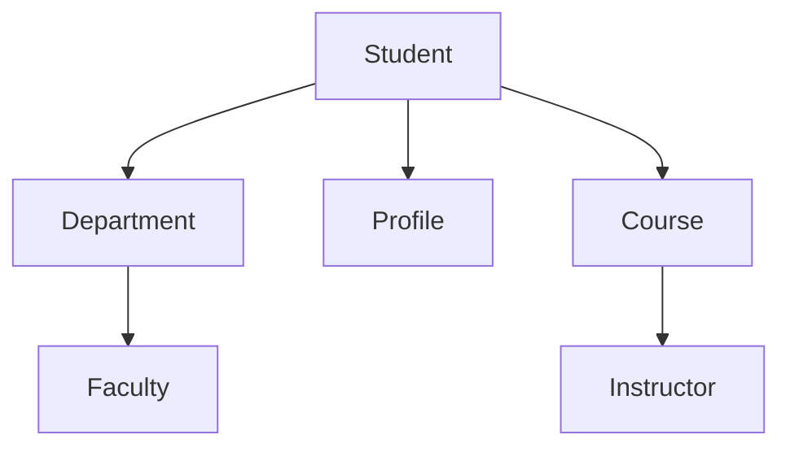
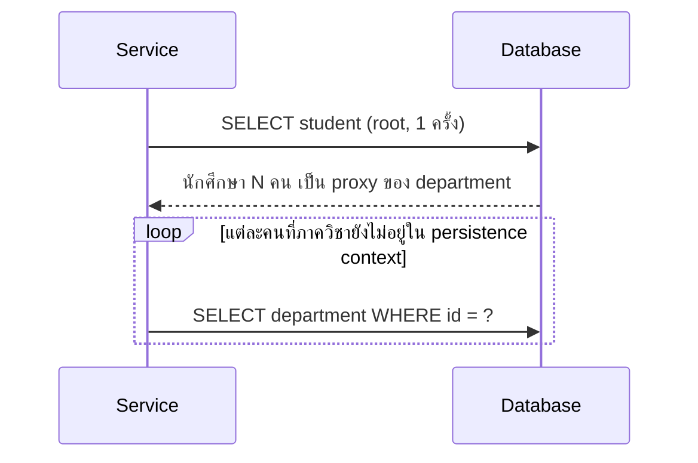
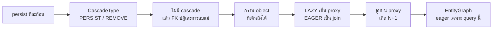

# #31 — JPA Cascading, Lazy Loading และปัญหา N+1

> **วิดีโอ:** [JPA Cascading, Lazy Loading & N+1 Problem | EntityGraph in Spring Boot | Spring Boot Full Course #31](https://youtu.be/mB4NMgaZE8U) — Coder Army, ~58 นาที
> **แหล่งที่ใช้สรุป:** ซับไตเติลภาษาอังกฤษที่ YouTube สร้างอัตโนมัติ
> **เวอร์ชันในโค้ด:** Spring Boot 4.1 + Java 21 (ใส่หมายเหตุไว้ทุกจุดที่ Spring Boot 3.x ต่างกัน)

ตอนนี้ปิดโมดูล JPA ของคอร์ส ผู้สอนต่อจากโปรเจกต์ความสัมพันธ์ Student กับ Department ของตอนที่แล้ว แล้วตอบสามคำถาม: จะให้การบันทึกหรือการลบของ entity แม่กระจายไปหา entity ลูกได้อย่างไร, ทำไมการดึง object ก้อนเดียวถึงไม่ควรลาก association ทั้งกราฟขึ้นมาพร้อมกัน, และทำไมลูปที่ดูเหมือนทำงานในหน่วยความจำถึงยิง query เพิ่มอีก N ครั้ง เครื่องมือที่เขาใช้ปิดท้ายคือ EntityGraph จากนั้นตอนถัดไปจะเข้า Spring Data JPA

ส่วนที่ติดป้าย `💡 เพิ่มเติม` คือของที่ผมเติมเอง ไม่ได้อยู่ในวิดีโอ ส่วนที่ติด `⚠️ แก้จากวิดีโอ` คือจุดที่วิดีโอพูดคลาดเคลื่อน

> 💡 **เพิ่มเติม — วิดีโอใช้ MySQL:** ผู้สอนเปิด DBeaver ต่อ MySQL แล้วให้ Hibernate สร้างตาราง `department` กับ `student` โน้ตนี้รันโปรเจกต์เดียวกันบน **H2 in-memory** ที่พอร์ต `9031` SQL, ข้อความ foreign key และ JSON ด้านล่างเป็นผลจาก H2 กับ Spring Boot 4.1.1 (Hibernate ORM 7.4.5) ที่รันจริง บน MySQL ในวิดีโอข้อความตอนลบ parent ที่ยังมีลูกอ้างถึงจะเป็น `Cannot delete or update a parent row: a foreign key constraint fails`

---

## สารบัญ

| เวลา | หัวข้อ |
|---|---|
| [0:00](https://youtu.be/mB4NMgaZE8U?t=0) | [1. เป้าหมายของตอน](#1-เป้าหมายของตอน) |
| [0:25](https://youtu.be/mB4NMgaZE8U?t=25) | [2. ทบทวน Student กับ Department](#2-ทบทวน-student-กับ-department) |
| [6:00](https://youtu.be/mB4NMgaZE8U?t=360) | [3. บันทึกทีละก้อนด้วยตัวเอง](#3-บันทึกทีละก้อนด้วยตัวเอง) |
| [13:28](https://youtu.be/mB4NMgaZE8U?t=808) | [4. CascadeType.PERSIST](#4-cascadetypepersist) |
| [17:43](https://youtu.be/mB4NMgaZE8U?t=1063) | [5. CascadeType.REMOVE และ ALL](#5-cascadetyperemove-และ-all) |
| [24:21](https://youtu.be/mB4NMgaZE8U?t=1461) | [6. ลบ parent โดยไม่มี cascade](#6-ลบ-parent-โดยไม่มี-cascade) |
| [26:16](https://youtu.be/mB4NMgaZE8U?t=1576) | [7. Reachable object graph](#7-reachable-object-graph) |
| [30:06](https://youtu.be/mB4NMgaZE8U?t=1806) | [8. Lazy กับ Eager](#8-lazy-กับ-eager) |
| [32:25](https://youtu.be/mB4NMgaZE8U?t=1945) | [9. เพิ่ม Profile แล้วบันทึก student](#9-เพิ่ม-profile-แล้วบันทึก-student) |
| [40:56](https://youtu.be/mB4NMgaZE8U?t=2456) | [10. JSON วนเพราะ bidirectional](#10-json-วนเพราะ-bidirectional) |
| [42:35](https://youtu.be/mB4NMgaZE8U?t=2555) | [11. Proxy ของ FetchType.LAZY](#11-proxy-ของ-fetchtypelazy) |
| [47:16](https://youtu.be/mB4NMgaZE8U?t=2836) | [12. ปัญหา N+1](#12-ปัญหา-n1) |
| [51:13](https://youtu.be/mB4NMgaZE8U?t=3073) | [13. Persistence context ช่วยเมื่อ department ซ้ำ](#13-persistence-context-ช่วยเมื่อ-department-ซ้ำ) |
| [54:34](https://youtu.be/mB4NMgaZE8U?t=3274) | [14. EntityGraph](#14-entitygraph) |
| [57:36](https://youtu.be/mB4NMgaZE8U?t=3456) | [15. จบโมดูล JPA](#15-จบโมดูล-jpa) |
| — | [16. สรุปท้ายตอน](#16-สรุปท้ายตอน) |

---

## 1. เป้าหมายของตอน

[▶ 0:00](https://youtu.be/mB4NMgaZE8U?t=0)

ผู้สอนบอกว่าวันนี้จะลงลึกความสัมพันธ์ของ JPA อีกชั้น สองเรื่องหลักคือ **cascading** กับปัญหา **N+1** ทั้งคู่เป็นหัวข้อที่เจอบ่อยตอน entity ผูกกัน หลังตอนนี้ส่วน JPA ของคอร์สจบ และตอนถัดไปจะเริ่ม Spring Data JPA

เขาใช้โปรเจกต์เดิมชื่อ JPA Relationship Demo ถ้ายังไม่ดูตอนความสัมพันธ์มาก่อน โค้ดชุดนี้จะอ่านไม่รู้เรื่อง เพราะวันนี้เขาไม่ได้สร้าง mapping ใหม่ตั้งแต่ศูนย์ เขาเอาของเดิมมาทำให้การบันทึก การลบ และการดึงข้อมูลทำงานถูกกับกราฟของ object

---

## 2. ทบทวน Student กับ Department

[▶ 0:25](https://youtu.be/mB4NMgaZE8U?t=25)

ในตอนที่แล้วเขาเหลือสอง model นักศึกษาหนึ่งคนอยู่ภาควิชาเดียว ภาควิชาหนึ่งมีนักศึกษาได้หลายคน

| ฝั่งที่มอง | ความสัมพันธ์ | ความหมาย |
|---|---|---|
| Student | `@ManyToOne` | นักศึกษาหลายคนชี้ไปภาควิชาเดียวกัน |
| Department | `@OneToMany` | ภาควิชาหนึ่งมีนักศึกษาได้หลายคน |

ตารางไม่เก็บ object ทั้งก้อน ฝั่ง student เก็บแค่รหัสภาควิชา เขาเรียกคอลัมน์นี้ว่า **DEPT ID** ในโค้ดของโปรเจกต์เดิมคือ `dept_id` ผ่าน `@JoinColumn` ส่วนตาราง department มีแค่ `id` กับ `name` รายชื่อนักศึกษาไม่ได้อยู่ในแถวของภาควิชา เพราะ foreign key อยู่ที่ตาราง student แล้ว



ตัวอย่างบนกระดาน: ภาควิชา `1001` ชื่อ Computer Science Engineering นักศึกษา id `1` ชื่อ Aditya ลงทะเบียนภาควิชานี้โดยเก็บ `1001` ไว้ในคอลัมน์ DEPT ID ตัวเลข `1001` เป็นตัวอย่างบนกระดาน ตอนรันแอป id ถูก generate ให้เอง

[▶ 3:43](https://youtu.be/mB4NMgaZE8U?t=223)

เขามี controller สองตัวที่เหลือ method เดียวต่อตัว `StudentController` มี `createStudent` ซึ่งรับ student กับ department id โดยสมมติว่าภาควิชาถูกสร้างไว้แล้ว `DepartmentController` มี `createDepartment` service และ repository ถูกทำให้ว่างไว้ก่อน เหลือแค่ `EntityManager` วันนี้เขาจะเขียน method เหล่านี้ใหม่

[▶ 5:05](https://youtu.be/mB4NMgaZE8U?t=305)

เขาสตาร์ทแอป Hibernate สร้างสองตาราง แล้ว `ALTER` ตาราง student เพื่อใส่ foreign key ของ `dept_id` ที่อ้าง `department.id` รีเฟรชใน DBeaver แล้วเห็นตาราง department (`id`, `name`) กับ student (`id`, `name`, `dept_id`)

ในโปรเจกต์ที่รันกับโน้ตนี้ Hibernate สร้างสามตารางตั้งแต่ต้น เพราะครึ่งหลังของวิดีโอเพิ่ม Profile เข้ามา log ตอนสตาร์ทเป็นแบบนี้

```sql
create table department (
    id bigint generated by default as identity,
    name varchar(255),
    primary key (id)
)
create table profile (
    id bigint generated by default as identity,
    bio varchar(255),
    primary key (id)
)
create table student (
    id bigint generated by default as identity,
    name varchar(255),
    dept_id bigint,
    profile_id bigint,
    primary key (id)
)
alter table student
   add constraint FKo2y1ex8ef3nqg0c42de3n9caj
   foreign key (dept_id) references department
alter table student
   add constraint FKrka4ao1s80dn9px2fllkmke03
   foreign key (profile_id) references profile
```

> 💡 **เพิ่มเติม:** `@OneToOne` ที่ฝั่ง student ถือ `profile_id` ทำให้ Hibernate ใส่ unique constraint บน `profile_id` ด้วย ผู้สอนไม่ได้พูดถึงบรรทัดนั้น constraint นี้แปลว่าโปรไฟล์หนึ่งแถวผูกกับนักศึกษาได้คนเดียว

[▶ 5:46](https://youtu.be/mB4NMgaZE8U?t=346)

ความสัมพันธ์นี้เป็น **bidirectional** ในโค้ด student ถือ department และ department ถือ `List<Student>` ตารางยังมี foreign key แค่ฝั่งเดียว ฝั่งที่ถือ `@JoinColumn` คือฝั่งที่เขียนคอลัมน์จริง เรียกว่า owning side ฝั่ง department ใช้ `mappedBy = "department"` เพื่อบอกว่าตัวเองไม่ได้เก็บ mapping ซ้ำ แค่เดินย้อนจากฟิลด์ `department` ของ Student

```java
@ManyToOne(fetch = FetchType.LAZY)
@JoinColumn(name = "dept_id")
private Department department;
```

```java
@OneToMany(
    mappedBy = "department",
    cascade = {CascadeType.PERSIST, CascadeType.REMOVE},
    fetch = FetchType.LAZY)
private List<Student> students = new ArrayList<>();
```

`cascade` กับ `FetchType.LAZY` เป็นของที่เพิ่มในตอนนี้ ส่วน `mappedBy` มากับโปรเจกต์เดิม รายละเอียดของสองอย่างนี้อยู่ในหัวข้อถัดไป

> 💡 **เพิ่มเติม:** ต้อง `new ArrayList<>()` ให้ฟิลด์ `students` ตั้งแต่ประกาศ ภาควิชาที่เข้ามาจาก JSON มีแค่ชื่อ ลิสต์จึงยังว่าง ถ้าปล่อยเป็น `null` แล้วเรียก `getStudents().addAll(...)` จะได้ `NullPointerException`

---

## 3. บันทึกทีละก้อนด้วยตัวเอง

[▶ 6:00](https://youtu.be/mB4NMgaZE8U?t=360)

คำถามแรกของ cascading คือ ถ้าสร้างภาควิชาใหม่พร้อมนักศึกษาที่ลงทะเบียนอยู่แล้ว ควรต้องบันทึกทีละคนเองหรือไม่

เขายังไม่ใส่ cascade เริ่มจากบันทึกเฉพาะภาควิชา `DepartmentService` เรียก repository แล้ว repository เรียก `entityManager.persist`

```java
@Transactional
public void save(Department department) {
  entityManager.persist(department);
}
```

Endpoint คือ `POST /api/department` body ของภาควิชามี id, name และ students แต่ id generate ให้ และตอนนี้เขายังไม่ส่งนักศึกษา เขาจึงส่งแค่ชื่อ Computer Science กดส่งได้คำว่า done รีเฟรชตาราง department แล้วเห็นแถวใหม่ ตาราง student ยังว่าง เพราะไม่มีใครถูก persist

[▶ 8:24](https://youtu.be/mB4NMgaZE8U?t=504)

จากนั้นเขาจำลองว่าภาควิชา Physics มีนักศึกษาสี่คนสมัครอยู่แล้ว ชื่อ Aditya, Rohit, Rohan และ Sonika ทุกคน `setDepartment` เป็นภาควิชาที่รับเข้ามา แล้วเอาทั้งสี่คนใส่ `department.getStudents()`

เขาใช้ Lombok อยู่แล้ว จึงมี getter, setter และ constructor เปล่า ไม่ได้เขียนมือ persistence context ยังไม่รู้จัก object เหล่านี้ เพราะเพิ่ง `new` ขึ้นมา ต้อง persist เองทั้งหมด ลำดับที่เขาทำคือ

1. บันทึก department
2. บันทึก student ทีละคนอีกสี่ครั้ง ผ่าน `StudentRepository.save` ซึ่งข้างในก็คือ `entityManager.persist`

```java
public void save(Student student) {
  entityManager.persist(student);
}
```

ซับเริ่มเล่าชิ้นนี้ขณะเปิด Department Controller แล้วไปจบที่ `DepartmentService` พร้อม constructor ที่รับ `StudentRepository` เพิ่ม method ที่ทำงานจริงจึงอยู่ที่ service

[▶ 12:41](https://youtu.be/mB4NMgaZE8U?t=761)

เขาสตาร์ทใหม่ แล้วยิง `POST /api/department` ด้วยชื่อ Physics ได้ done ใน DBeaver ภาควิชา Physics ถูกเพิ่ม และนักศึกษาทั้งสี่คนอยู่ภาควิชานั้น department id เป็น `2` เพราะแถว Computer Science ก่อนหน้าใช้ id `1` ไปแล้ว query ที่เขาเห็นคือ `INSERT` เข้า department หนึ่งครั้ง ตามด้วย `INSERT` เข้า student อีกสี่ครั้ง รวมห้ารอบ งานนี้ถูกต้อง แต่เขาต้องจำเองว่าลูกทุกตัวต้องถูก save

---

## 4. CascadeType.PERSIST

[▶ 13:28](https://youtu.be/mB4NMgaZE8U?t=808)

เขาไม่อยากเขียน persist ของลูกซ้ำทุกครั้ง สมมติของโมเดลนี้คือภาควิชาที่เพิ่งเปิดต้องมีนักศึกษาอยู่แล้ว นักศึกษาสี่คนก็เป็นของใหม่เช่นกัน พอบันทึกภาควิชา นักศึกษาในลิสต์ควรลงตารางเอง เขาเรียก persist ที่ต้องเขียนมือว่า child query

เขายกตัวอย่างอีกแบบซึ่งอ่านแล้วเห็นภาพกว่า Order หนึ่งใบมี OrderItem หลายแถว รายการสินค้าไม่มีใบสั่งซื้อของตัวเองไม่ได้ พอมี order ก็ต้องมี item พอมีภาควิชาในโมเดลวิทยาลัยของเขา ก็ควรมีนักศึกษา เขาบอกเองว่าบางภาควิชาอาจยังไม่มีนักศึกษา แต่ถ้าเขาออกแบบวิทยาลัยแล้วภาควิชาว่าง เขาจะไม่เก็บภาควิชานั้นไว้ cascade จึงเหมาะกับความสัมพันธ์ที่ของข้างบนมีความหมายเมื่อของข้างล่างถูกบันทึกไปด้วยกัน

[▶ 15:04](https://youtu.be/mB4NMgaZE8U?t=904)

บน `@OneToMany` ของ Department เขามี `mappedBy` อยู่แล้ว แปลว่า entity นี้ไม่ได้เก็บข้อมูลนักศึกษาลงตารางตัวเอง จากนั้นเขาเติมพารามิเตอร์ `cascade`

```java
@OneToMany(mappedBy = "department", cascade = CascadeType.PERSIST)
private List<Student> students;
```

`CascadeType.PERSIST` แปลว่าตอน `persist` department ให้ `persist` student ทุกตัวที่อยู่ในลิสต์นั้นด้วย เขาคอมเมนต์การเรียก `studentRepository.save` ทั้งสี่บรรทัดออก เหลือแค่บันทึก department แล้วลบข้อมูลเก่าเพื่อเริ่มใหม่

[▶ 16:39](https://youtu.be/mB4NMgaZE8U?t=999)

ยิง Physics อีกครั้ง ภาควิชาถูกเพิ่ม และ Aditya, Rohit, Rohan, Sonika ลงทะเบียนเอง ทั้งที่ไม่มีบรรทัด save ของ student เขาไม่ได้ไปเซฟสองก้อนนั้นมืออีกต่อไป เพราะ cascade ทำแทน

โค้ดที่รันกับโน้ตนี้ใส่ทั้ง `PERSIST` และ `REMOVE` พร้อมกันตั้งแต่ต้น เพื่อให้สาธิตสองทางใน process เดียว ผลของ persist เหมือนที่เขาโชว์

```sql
insert into department (name, id) values (?, default)
insert into student (dept_id, name, profile_id, id) values (?, ?, ?, default)
insert into student (dept_id, name, profile_id, id) values (?, ?, ?, default)
insert into student (dept_id, name, profile_id, id) values (?, ?, ?, default)
insert into student (dept_id, name, profile_id, id) values (?, ?, ?, default)
```

`POST /api/department` body `{"name":"Physics"}` ตอบ `Done` แล้ว `GET /api/student/department-names` ได้

```json
["Aditya -> Physics","Rohit -> Physics","Rohan -> Physics","Sonika -> Physics"]
```

`profile_id` เป็น null ในสี่แถวนี้ เพราะครึ่งแรกของวิดีโอยังไม่มี Profile คอลัมน์โผล่ใน SQL เพราะ entity สุดท้ายมีฟิลด์นี้อยู่



จุดที่ต้องทำให้ครบก่อน persist คือความสัมพันธ์สองทิศทางในหน่วยความจำ เขาทั้ง `student.setDepartment(department)` และเอา student ใส่ลิสต์ของภาควิชา cascade มองที่ลิสต์ของฝั่งที่ถูก persist ถ้าใส่แค่ฝั่ง student แต่ไม่ใส่ลิสต์ Hibernate จะไม่เห็นลูกตอน persist ภาควิชา

> 💡 **เพิ่มเติม:** `persist` ต้องอยู่ใน transaction ผู้สอนพูด `@Transactional` ตอน method ลบ แต่โปรเจกต์เดิมใส่ไว้ที่การสร้างอยู่แล้ว ถ้าเรียก `entityManager.persist` นอก transaction จะได้ `TransactionRequiredException` โค้ดนี้จึงใส่ `@Transactional` ที่ `createDepartment` ด้วย

---

## 5. CascadeType.REMOVE และ ALL

[▶ 17:43](https://youtu.be/mB4NMgaZE8U?t=1063)

`CascadeType.REMOVE` ทำตรงข้าม ถ้าลบภาควิชา ให้ลบนักศึกษาของภาควิชานั้นด้วย เหตุผลในโมเดลของเขาคือภาควิชาหายแล้วนักศึกษาในความสัมพันธ์นี้ไม่มีความหมายจะอยู่ต่อ

เขาหยุดคิดข้อโต้แย้งเอง ถ้านักศึกษาคนหนึ่งอยู่ได้หลายภาควิชา การลบภาควิชาแล้วลบตัวนักศึกษาจะผิด เพราะคนนั้นยังอยู่ภาควิชาอื่น แต่ mapping นี้ไม่ใช่แบบนั้น จากฝั่ง student เป็น many-to-one นักศึกษาหนึ่งคนมีภาควิชาเดียว จากฝั่ง department เป็น one-to-many ถ้าหลายคนอยู่ได้หลายภาควิชา จะต้องเป็น many-to-many ซึ่งเขาทำในตอนที่แล้วกับรายวิชา ในโมเดลปัจจุบันการลบภาควิชาแล้วลบนักศึกษาของภาควิชานั้นจึงสอดคล้องกับ foreign key

[▶ 18:50](https://youtu.be/mB4NMgaZE8U?t=1130)

เขาเพิ่ม `removeDepartment` ที่ service ตอนแรกส่ง id เข้า repository แล้วเรียก `entityManager.remove` ตรง ๆ จากนั้นเขาแก้ เพราะ `remove` รับ entity ไม่รับ id

```java
@Transactional
public void removeDepartment(Long id) {
  Department department = departmentRepository.findById(id);
  departmentRepository.remove(department);
}

public Department findById(Long id) {
  return entityManager.find(Department.class, id);
}

public void remove(Department department) {
  entityManager.remove(department);
}
```

[▶ 20:29](https://youtu.be/mB4NMgaZE8U?t=1229)

Controller ได้ `DELETE /api/department/{id}` รับ id จาก path แล้วตอบ OK ไม่มี body

[▶ 21:27](https://youtu.be/mB4NMgaZE8U?t=1287)

เขาใส่ `@Transactional` ที่ method ลบ แล้วบอกว่าเรารู้แล้วว่าทำไมต้องอยู่ใน transaction สาเหตุที่ใช้ตอนนี้คือ `find` กับ `remove` ต้องเห็น entity ตัวเดียวกันใน persistence context เดียวกัน ถ้า find จบ transaction ไปก่อน entity จะหลุดออกจาก context แล้ว `remove` จะไม่ลบก้อนที่เพิ่งโหลดมาแบบที่เขาต้องการ นอกจากนี้ cascade ยังต้องโหลดลิสต์นักศึกษาซึ่งเป็น lazy collection ระหว่างทาง การโหลดนั้นต้องเกิดขณะ session ยังเปิด

[▶ 22:41](https://youtu.be/mB4NMgaZE8U?t=1361)

ข้อมูลตอนยิงคือ Aditya, Rohit, Rohan, Sonika อยู่ภาควิชา Physics id `1` เขายิง `DELETE /api/department/1` ได้ done ภาควิชาหาย และนักศึกษาทั้งสี่คนหายด้วย เขาไม่ได้เขียนลูปลบลูกเอง

ลำดับ query ที่เขาเล่า และที่รันได้บน H2 คือ

1. `SELECT` department ตาม id
2. `SELECT` student ที่ `dept_id` ตรงกัน เพราะต้องโหลดลิสต์ก่อนลบ
3. `DELETE` student ทีละคน
4. `DELETE` department เป็นอันสุดท้าย

```sql
select d1_0.id, d1_0.name from department d1_0 where d1_0.id=?
select s1_0.dept_id, s1_0.id, s1_0.name, s1_0.profile_id
from student s1_0
where s1_0.dept_id=?
delete from student where id=?
delete from department where id=?
```

`DELETE` ของ student เกิดสี่ครั้ง ก่อนแถว department จะถูกลบ foreign key บน student ยังชี้มาที่ภาควิชา ถ้าลบแม่ก่อน ฐานข้อมูลจะปฏิเสธ cascade จึงเรียงลูกก่อนแล้วค่อยแม่

[▶ 23:57](https://youtu.be/mB4NMgaZE8U?t=1437)

ใน enum ยังมี `CascadeType.ALL` เขาอธิบายว่า ALL แปลว่า operation ที่ทำกับภาควิชา ให้ทำแบบเดียวกันกับนักศึกษาทุกคน สร้างก็สร้างไปด้วย ลบก็ลบไปด้วย เขาบอกว่าบางทีใช้ ALL ได้ แต่โดยทั่วไปเขาเลือกเฉพาะทาง เช่น persist อย่างเดียว หรือ remove อย่างเดียว โค้ดที่รันในโน้ตจึงระบุ `{PERSIST, REMOVE}` ซึ่งครอบคลุมสองทางที่เขาทดลองกับ ALL

> 💡 **เพิ่มเติม — ค่าที่เหลือใน enum**
> `CascadeType` ยังมี `MERGE`, `REFRESH` และ `DETACH` นอกจาก `PERSIST`, `REMOVE` และ `ALL` ที่เขาเปิดบนจอ `ALL` รวมทุกค่าเหล่านี้
> อีกตัวที่คนสับสนกับ `REMOVE` คือ `orphanRemoval = true` บน `@OneToMany` ค่านั้นลบลูกเมื่อลูกถูกดึงออกจากลิสต์ของแม่ด้วย ไม่ใช่แค่ตอนลบแม่ทั้งก้อน ผู้สอนไม่ได้ใช้สวิตช์นี้

เขาสตาร์ทใหม่ทั้งสองตารางว่าง ยิง Physics อีกครั้งด้วย ALL นักศึกษาถูกเพิ่มเอง id ของภาควิชาเป็น `2` เพราะ identity ของ MySQL นับต่อแม้แถวเก่าจะถูกลบ บน H2 พฤติกรรมเดียวกัน หลังลบภาควิชา id `1` แล้วสร้างใหม่ log บอก `second department id=2`

---

## 6. ลบ parent โดยไม่มี cascade

[▶ 24:21](https://youtu.be/mB4NMgaZE8U?t=1461)

เขาคอมเมนต์ `cascade` ออก เหลือแค่ one-to-many แล้วลบภาควิชา id `2` โดยใน service มีแค่ find แล้ว remove ไม่มีลูปลบนักศึกษา

> ⚠️ **แก้จากวิดีโอ:** ตอนคอมเมนต์ cascade เขาพูดว่าเหลือแค่ one-to-one mapping ความสัมพันธ์ที่เขาชี้บน Department คือ `@OneToMany` ของลิสต์นักศึกษา และฝั่ง student ไป department คือ `@ManyToOne`

ยิงลบแล้วพังใน IntelliJ ข้อความของ MySQL คือ

```text
Cannot delete or update a parent row: a foreign key constraint fails
```

ฐานข้อมูลปฏิเสธการลบแถวแม่ที่ยังมีแถวลูกอ้างผ่าน foreign key ทางแก้มีสองแบบ ใส่ cascade ให้ Hibernate ลบลูกก่อน หรือลบนักศึกษาของภาควิชานั้นมือ แล้วค่อยลบภาควิชา เขาบอกว่า cascade ลดงานมือ และลดโอกาสลืมแล้วได้ exception แบบนี้

บน H2 ถ้ายิง `DELETE FROM department WHERE id = ?` ทั้งที่ยังมี student ชี้มา ข้อความจริงคือ

```text
org.h2.jdbc.JdbcSQLIntegrityConstraintViolationException:
Referential integrity constraint violation:
"FKO2Y1EX8EF3NQG0C42DE3N9CAJ: PUBLIC.STUDENT FOREIGN KEY(DEPT_ID) REFERENCES PUBLIC.DEPARTMENT(ID) (CAST(2 AS BIGINT))"
SQL statement: delete from department where id = ? [23503-240]
```

> 💡 **เพิ่มเติม:** โปรเจกต์ที่รันเก็บ `CascadeType.REMOVE` ไว้ `entityManager.remove` จึงลบลูกให้เอง ไม่พังแบบในคลิป เพื่อให้เห็น constraint ตัวเดียวกัน โน้ตยิง SQL `delete from department where id = ?` ตรง ๆ ซึ่งเป็นคำสั่งที่ Hibernate ส่งเมื่อไม่มี cascade หลัง error แถวนักศึกษายังอยู่ครบสี่คน แล้ว `DELETE /api/department/2` ผ่าน cascade ลบได้จนตารางว่าง

---

## 7. Reachable object graph

[▶ 26:16](https://youtu.be/mB4NMgaZE8U?t=1576)

เรื่องถัดไปไม่ใช่การบันทึก แต่เป็นการโหลด ตอนนี้ Student มี association ที่เป็น object แค่ department เขาขยายบนกระดานว่าเว็บวิทยาลัยจริงนักศึกษาหนึ่งคนมี object ซ้อนได้อีกหลายก้อน

| Association | แบบที่เขาสมมติ |
|---|---|
| Department | many-to-one หลายคนอยู่ภาควิชาเดียว |
| Profile | one-to-one คนหนึ่งมีโปรไฟล์เดียว |
| Courses | many-to-many หลายคนเรียนได้หลายวิชา |

Department เองอาจมี Faculty ต่อ Course อาจมี Instructor ต่อ ฐานข้อมูลเก็บทั้งหมดนี้ด้วย foreign key ได้สบาย แต่พอโค้ดสั่งให้โหลดนักศึกษา id `1001`

```java
Student s1 = entityManager.find(Student.class, 1001L);
```

ถ้า Hibernate เดินตามทุก association ที่เอื้อมถึง มันต้องโหลด department, profile, courses แล้วจาก department ต่อไปหา faculty จาก course ต่อไปหา instructor เขาเรียกก้อนที่เดินถึงได้ทั้งชุดว่า **reachable object graph** ถ้าโหลดทั้งกราฟทุกครั้งที่ขอนักศึกษาหนึ่งคน ทั้งจำนวน query และเวลาของฐานข้อมูลจะบานโดยที่ผู้เรียกอาจไม่ได้ใช้ faculty หรือ instructor เลย



เขาลองวางฟิลด์ profile กับ `List<Course>` ลงใน Student พร้อม `@OneToOne` และ `@ManyToMany` แล้วถอด course ออก เพราะ many-to-many จะสร้างตารางเชื่อมเพิ่ม และตัวอย่างจะอ่านยาก เหลือสอง association คือ department กับ profile เพื่อให้เห็นปัญหาเดียวกันในขนาดที่ตามทัน เขาบอกให้คิดว่าของจริงมี association แบบนี้ได้เป็นสิบ ๆ ก้อน

---

## 8. Lazy กับ Eager

[▶ 30:06](https://youtu.be/mB4NMgaZE8U?t=1806)

Hibernate กับ JPA จึงมี **lazy loading** กับ **eager loading** ตอน `find` นักศึกษา ฟิลด์ธรรมดาอย่าง id, ชื่อ, ตัวเลข และ boolean ถูกอ่านมาทันที เพราะมันอยู่ในแถวของตาราง student อยู่แล้ว ส่วน association ที่เป็น object จะไม่ถูกโหลดทั้งก้อนในทันที ถ้าตั้งให้ lazy

เขาเขียนภาพนี้

```java
Student s1 = entityManager.find(Student.class, 1001L);
s1.getDepartment();
s1.getProfile();
```

ก่อนถึง `getDepartment` หรือ `getProfile` เขาบอกว่า query ของสองก้อนนั้นยังไม่รัน พอเรียก getter ตัวไหน query ของตัวนั้นจึงเกิด อย่างละหนึ่งครั้ง แทนที่จะดึงทั้งกราฟในคำสั่งเดียว เขาบอกว่าแบบนี้ประหยัดการคำนวณ เพราะของที่ไม่ได้ใช้ก็ไม่ต้องถามฐานข้อมูล

[▶ 31:53](https://youtu.be/mB4NMgaZE8U?t=1913)

การเลือกทำที่ annotation ของความสัมพันธ์ ผ่าน `fetch`

```java
@ManyToOne(fetch = FetchType.LAZY)
@JoinColumn(name = "dept_id")
private Department department;

@OneToOne(fetch = FetchType.LAZY)
@JoinColumn(name = "profile_id")
private Profile profile;
```

`FetchType` มีสองค่า คือ `LAZY` กับ `EAGER` เขาเปิด enum ให้ดู แล้วใส่ `LAZY` ที่ department, profile และตอนที่ยังมี course อยู่ จากนั้นเขาเอา `LAZY` ออกก่อนการทดลองแรก เพื่อดูพฤติกรรมตอนไม่ได้ระบุ fetch

> 💡 **เพิ่มเติม — ค่า default ตาม Jakarta Persistence**
> `@ManyToOne` กับ `@OneToOne` เป็น `EAGER` ถ้าไม่เขียน `fetch` `@OneToMany` กับ `@ManyToMany` เป็น `LAZY`
> นี่คือเหตุผลที่รอบแรกเขาเห็น left join ของ department กับ profile ทั้งที่ยังไม่ได้เขียน `EAGER` และเป็นเหตุผลที่ตอนลบภาควิชา Hibernate ยิง `SELECT` นักศึกษาแยกต่างหาก เพราะลิสต์ฝั่ง `@OneToMany` เป็น lazy อยู่แล้ว
> โค้ดที่รันกับโน้ตใส่ `LAZY` ที่ฝั่ง student ไว้ตรง ๆ เพื่อให้สาธิต proxy ได้ ส่วน SQL แบบ join ที่เขาเห็นตอนยังไม่ใส่ `LAZY` ถูกทำให้เกิดอีกครั้งด้วย `left join fetch` ในหัวข้อที่ 11

[▶ 33:07](https://youtu.be/mB4NMgaZE8U?t=1987)

เขาวาดตาราง student ที่จะเกิด คือ student id, name, department id และ profile id ตาราง department มี id กับ name ตาราง profile มี id กับ bio เขาลบตารางเก่าแล้วสตาร์ทใหม่ ได้สามตารางตรงแบบนี้ และบอกว่าใส่ cascade ไว้ทั้งสอง association แล้ว ยังไม่ได้ใส่ lazy หรือ eager

---

## 9. เพิ่ม Profile แล้วบันทึก student

[▶ 34:44](https://youtu.be/mB4NMgaZE8U?t=2084)

เขาจำลองการสร้างนักศึกษาใน `StudentService` ไม่ได้รับ department id จาก client แล้ว เพราะจะสร้างภาควิชากับโปรไฟล์ใน method นี้เลย งานจริงเขาบอกว่าควรมี controller ของ department กับ profile แยกกัน นี่เป็นแค่การจำลอง

ลำดับใน method

1. `new Department()` แล้ว `setName("Computer Science Department")`
2. `new Profile()` แล้ว `setBio(...)` id generate ให้
3. `student.setDepartment` กับ `student.setProfile`
4. บันทึก department บันทึก profile แล้วบันทึก student

เขาอธิบายว่า department กับ profile เพิ่งถูกสร้าง persistence context ยังไม่ติดตามพวกมัน ถ้าไม่ save ก่อน Student ที่ถือ foreign key จะอ้างแถวที่ยังไม่มี เขาจึงสร้าง `ProfileRepository.save` แบบเดียวกับ repository อื่น คือ `entityManager.persist` แล้วฉีด `DepartmentRepository` กับ `ProfileRepository` เข้า `StudentService` ผ่าน constructor เขาบอกว่า field injection ใช้ได้ แต่เขาเลือก constructor เพราะเป็นแนวที่เขาถือว่าดีกว่า แม้จะพิมพ์นานกว่า

```java
@Transactional
public void createStudent(Student student) {
  Department department = new Department();
  department.setName("Computer Science Department");
  Profile profile = new Profile();
  profile.setBio("Simple Bio");

  student.setDepartment(department);
  student.setProfile(profile);

  departmentRepository.save(department);
  profileRepository.save(profile);
  studentRepository.save(student);
}
```

> 💡 **เพิ่มเติม:** ตอนพิมพ์ bio เขาไม่ได้สะกดทั้งประโยคออกเสียง พอเปิดตารางเขาเรียกค่านี้ว่า Simple Bio โค้ดจึงใช้สตริงนั้น ชื่อภาควิชาตอน `setName` เขาพูดว่า Computer Science Department และตอนมองตารางมีจังหวะที่เขาเรียกย่อว่า CSE

[▶ 37:46](https://youtu.be/mB4NMgaZE8U?t=2266)

จากนั้นเขาเขียนทางอ่าน `fetchStudentById` ที่ service รับ `Long id` แล้วคืนค่าจาก `studentRepository.findById` ซึ่งคือ `entityManager.find(Student.class, id)` Controller ได้ `GET /api/student/{id}` คืน `ResponseEntity.ok(student)` ระหว่างทางเขาลืม `return` แล้วคอมไพเลอร์ฟ้อง missing return statement เขาเติมให้ก่อนรัน

[▶ 40:00](https://youtu.be/mB4NMgaZE8U?t=2400)

`POST /api/student` ส่งแค่ `{"name":"Aditya"}` เพราะ id generate ให้ และ department กับ profile ถูกสร้างใน service ได้ 200 กับคำว่า done ในฐานข้อมูลมีนักศึกษาชื่อ Aditya พร้อม department id กับ profile id ภาควิชาชื่อที่เขาตั้งไว้ และโปรไฟล์ bio คือ Simple Bio สาม `INSERT` เกิดตามลำดับ department, profile, student

```sql
insert into department (name, id) values (?, default)
insert into profile (bio, id) values (?, default)
insert into student (dept_id, name, profile_id, id) values (?, ?, ?, default)
```

---

## 10. JSON วนเพราะ bidirectional

[▶ 40:56](https://youtu.be/mB4NMgaZE8U?t=2456)

พอ `GET /api/student/2` เขาได้ response ที่เขาเรียกว่า infinite สาเหตุคือ Student มี Department และ Department ยังมี `List<Student>` Jackson เดินจากนักศึกษาไปภาควิชา แล้วเดินกลับเข้ารายชื่อนักศึกษา ไม่มีที่สิ้นสุด เขาลืมถอดลิสต์นี้ออกตอนจะคืน entity ให้ client

เขาเข้าไปที่ Department แล้วเอาลิสต์นักศึกษาออก เหลือ id กับ name จากนั้นลบตาราง สตาร์ทใหม่ ยิง POST อีกครั้ง แล้ว GET ด้วย id `1` รอบนี้ได้ข้อมูลครบ ชื่อ Aditya, ภาควิชา, และ bio ของโปรไฟล์

query ตอนยังไม่ได้ตั้ง `LAZY` เป็นการ select ที่ left join student กับ department แล้ว left join profile ต่อ คือโหลดสามก้อนในคำสั่งเดียว ซึ่งสอดคล้องกับ default `EAGER` ของ `@ManyToOne` และ `@OneToOne`

บน H2 คำสั่งแนวเดียวกับที่เขาเห็น ถูกยิงผ่าน `left join fetch` เพราะ mapping ในโปรเจกต์นี้ตั้ง `LAZY` ไว้แล้ว

```sql
select s1_0.id, d1_0.id, d1_0.name, s1_0.name, p1_0.id, p1_0.bio
from student s1_0
left join department d1_0 on d1_0.id = s1_0.dept_id
left join profile p1_0 on p1_0.id = s1_0.profile_id
where s1_0.id = ?
```

ผลคือชื่อ Aditya, ภาควิชา Computer Science Department และ bio Simple Bio โดยไม่มี query ตามหลัง

ถ้ายังคืนลิสต์นักศึกษาที่อยู่ในภาควิชา Jackson จะเขียน JSON วนจนชนเพดานความลึกของตัวเขียน ผลที่จับได้คือ body เริ่มซ้ำ `department` กับ `students` ยาวหลักหมื่นตัวอักษร แล้วตามด้วย

```text
HttpMessageNotWritableException: Could not write JSON:
Document nesting depth (501) exceeds the maximum allowed
(500, from `StreamWriteConstraints.getMaxNestingDepth()`)
```

นี่คือรูปจริงของสิ่งที่เขาเรียกว่า infinite response status ตอนนั้นยังเป็น 200 เพราะตัว response เริ่มส่งไปแล้วก่อนจะเขียนไม่ไหว

> 💡 **เพิ่มเติม:** วิดีโอลบฟิลด์ `students` ทิ้งเพื่อตัดวงจร โค้ดที่รันเก็บฟิลด์ไว้ เพราะ `CascadeType.REMOVE` ต้องมีลิสต์นี้เป็นที่เดิน แล้วใส่ `@JsonIgnore` ที่ `getStudents()` Jackson จึงไม่เดินย้อนกลับ แต่ Hibernate ยังโหลดลิสต์ได้ตอนลบภาควิชา

```java
@JsonIgnore
public List<Student> getStudents() {
  return students;
}
```

หลังใส่ ignore แล้ว `GET` ได้ JSON ก้อนเดียวจบ ไม่มีคีย์ `students`

---

## 11. Proxy ของ FetchType.LAZY

[▶ 42:35](https://youtu.be/mB4NMgaZE8U?t=2555)

เขากลับไปที่ Student แล้วตั้ง `FetchType.LAZY` ทั้ง department และ profile ลบข้อมูล สตาร์ทใหม่ สร้าง Aditya อีกครั้ง แล้ว GET

รอบนี้ response ยังมีข้อมูลของภาควิชาและโปรไฟล์ แต่ในก้อนนั้นมีข้อความ Hibernate Lazy Initializer เขาบอกว่านั่นคือ proxy ที่ Hibernate สร้างไว้ Jackson ต้องเดินทั้ง entity เพื่อทำ JSON จึงไปอ่าน department กับ profile อีกที เลยมี query แยก ไม่มี join ในคำสั่งแรก อีกต่อไป เขาเห็น select ของ student ก่อน แล้วตามด้วย select ของ department และ select ของ profile

[▶ 44:15](https://youtu.be/mB4NMgaZE8U?t=2655)

เพื่อให้เห็นจังหวะ เขาแทรก `System.out.println` คั่นกลาง

```java
@Transactional(readOnly = true)
public Student fetchStudentById(Long id) {
  Student s1 = studentRepository.findById(id);
  System.out.println("Lazily fetched student");
  Department d1 = s1.getDepartment();
  System.out.println("Lazily fetched department");
  Profile p1 = s1.getProfile();
  System.out.println("Lazily fetched profile");
  return s1;
}
```

เขาคาดตอนพิมพ์ว่า query ของ department จะเกิดที่บรรทัด `getDepartment` และ query ของ profile จะเกิดที่ `getProfile` พออ่าน log เขากลับเล่าว่าพิมพ์สามบรรทัดก่อน แล้วจึงค่อย select department แล้ว select profile

ลำดับที่รันได้บน Boot 4.1.1 เป็นแบบหลัง และตรงกับที่เขาอ่านจาก console

```text
select s1_0.id, s1_0.dept_id, s1_0.name, s1_0.profile_id
from student s1_0
where s1_0.id=?
Lazily fetched student
Lazily fetched department
Lazily fetched profile
department proxy=com.coderarmy.jparelationship.model.Department$HibernateProxy
profile proxy=com.coderarmy.jparelationship.model.Profile$HibernateProxy
select d1_0.id, d1_0.name from department d1_0 where d1_0.id=?
select p1_0.id, p1_0.bio from profile p1_0 where p1_0.id=?
```

> ⚠️ **แก้จากวิดีโอ:** ตอนเขียน `s1.getDepartment()` เขาบอกว่าบรรทัดนั้นจะยิง query ของภาควิชาทันที ที่เกิดขึ้นจริง และตรงกับ log ที่เขาอ่านเองในนาทีถัดไป คือ getter คืน proxy มาก่อน ยังไม่คุยกับฐานข้อมูล `SELECT` ของ department และ profile เกิดตอนมีคนอ่านฟิลด์ของ proxy ในที่นี้คือ Jackson ตอนเขียน JSON หลัง method return แล้ว

> 💡 **เพิ่มเติม:** สองบรรทัด `getClass()` ไม่ได้อยู่ในวิดีโอ ใส่ไว้เพื่อยืนยันชนิดของ proxy คือ `Department$HibernateProxy` กับ `Profile$HibernateProxy` การเรียก `getClass()` ไม่ทำให้โหลดฟิลด์
> query สองอันหลังเกิดได้ตอนเรนเดอร์ JSON เพราะค่า default `spring.jpa.open-in-view=true` เปิด session ค้างไว้ตลอด request log ตอนสตาร์ทเตือนว่า `spring.jpa.open-in-view is enabled by default. Therefore, database queries may be performed during view rendering` ถ้าปิดค่านี้แล้วแตะ association นอก transaction จะได้ `LazyInitializationException` แทน

JSON ที่ได้หลังโหลดผ่าน Jackson มีทั้งข้อมูลจริงและฟิลด์ของ proxy ซึ่งคือข้อความ Hibernate Lazy Initializer ที่เขาเห็น

```json
{
  "department": {
    "hibernateLazyInitializer": {},
    "id": 3,
    "name": "Computer Science Department"
  },
  "id": 9,
  "name": "Aditya",
  "profile": {
    "bio": "Simple Bio",
    "hibernateLazyInitializer": {},
    "id": 1
  }
}
```

id นักศึกษาเป็น `9` และ id ภาควิชาเป็น `3` เพราะใน process เดียวกันมีการสร้างแล้วลบนักศึกษาแปดคนกับภาควิชาสองภาควิชาก่อนหน้า identity ไม่รีเซ็ตเมื่อลบแถว สอดคล้องกับที่เขาบอกว่าลบแล้วยังได้ id `2` ในรอบ Physics ครั้งที่สอง ถ้ายิง `POST /api/student` บนฐานว่าง id จะเริ่มที่ `1` แบบในคลิปรอบที่เขาลบตารางทิ้ง

[▶ 46:58](https://youtu.be/mB4NMgaZE8U?t=2818)

เขาสรุปว่าถ้าเปลี่ยน `LAZY` กลับเป็น `EAGER` จะโหลดพร้อมกันแบบ join อีกครั้งแบบรอบแรก ประโยชน์ของ lazy คือกราฟลึกและชั้นเยอะ โหลดตอนใช้ดีกว่าโหลดทั้งก้อนทั้งที่บาง association ไม่ได้ถูกแตะ

---

## 12. ปัญหา N+1

[▶ 47:16](https://youtu.be/mB4NMgaZE8U?t=2836)

เขาเรียกปัญหาถัดไปว่า **N+1** ภาพคืออยากได้ข้อมูลนักศึกษาทุกคน ซึ่งข้างในควรเป็น query แนว `SELECT * FROM student` ผลไปอยู่ใน `List<Student>` จากนั้นใน service มีลูป

```java
@Transactional(readOnly = true)
public List<String> printDepartmentNames() {
  List<String> names = new ArrayList<>();
  for (Student student : studentRepository.findAll()) {
    String line = student.getName() + " -> " + student.getDepartment().getName();
    System.out.println(line);
    names.add(line);
  }
  return names;
}
```

`findAll` ของ repository นี้คือ `select s from Student s` ไม่มี join

เขาให้คิดว่าได้นนักศึกษามา 100 คน query แรกเป็น **root query** หนึ่งครั้ง ตอนโหลด 100 คนนั้น department ยังไม่ถูกดึงมา เพราะ lazy เก็บแค่ proxy พอในลูปเรียก `getDepartment().getName()` แต่ละคน Hibernate จึงยิง query ของภาควิชาอีกหนึ่งครั้ง รวมอีก 100 ครั้ง เขาเรียกกลุ่มนี้ว่า relationship query หนึ่งบวกหนึ่งร้อยคือ 101 ครั้งต่อการทำงานของ method เดียว นั่นคือ N+1 หนึ่งคือ root query และ N คือ query ของความสัมพันธ์ที่เกิดตามจำนวนแถว



คนที่เพิ่งเขียน Spring มักไม่เห็นปัญหานี้ เขาเขียน select นักศึกษาทั้งตาราง เก็บลงลิสต์ แล้วคิดว่าข้อมูลอยู่ในหน่วยความจำแล้ว จากนั้นลูปพิมพ์ชื่อภาควิชาหรือเอาไป log ในสายตาคนเขียนมีแค่ลูปบนลิสต์ แต่ละรอบที่อ่านชื่อภาควิชาคือการสั่งให้ฐานข้อมูลทำงานอีกครั้ง

ผลที่วัดกับนักศึกษาสี่คน สี่ภาควิชา คือ root หนึ่งครั้งตามด้วย department อีกสี่ครั้ง สลับกับบรรทัดพิมพ์

```text
select s1_0.id, s1_0.dept_id, s1_0.name, s1_0.profile_id from student s1_0
select d1_0.id, d1_0.name from department d1_0 where d1_0.id=?
Student 1 -> Department 1
select d1_0.id, d1_0.name from department d1_0 where d1_0.id=?
Student 2 -> Department 2
select d1_0.id, d1_0.name from department d1_0 where d1_0.id=?
Student 3 -> Department 3
select d1_0.id, d1_0.name from department d1_0 where d1_0.id=?
Student 4 -> Department 4
```

> 💡 **เพิ่มเติม:** ตัวเลข 100 กับ 101 เป็นตัวอย่างบนกระดาน เขาไม่ได้ยิง query ชุดนี้ในคลิป ผลด้านบนคือการรันลูปเดียวกันกับข้อมูลสี่แถว ภาระที่ฐานข้อมูลได้รับคือห้าคำสั่ง สำหรับงานที่คนเขียนคิดว่าเป็นลูปในหน่วยความจำ

[▶ 53:19](https://youtu.be/mB4NMgaZE8U?t=3199)

เขาเตือนว่าหลายคนเลยสรุปว่า lazy แย่ เพราะ select นักศึกษาทั้งตารางแล้วไม่ได้ของทั้งกราฟมาด้วย พอมาอ่านทีหลังถึงค่อยยิงทีละครั้ง เขามองว่าความเข้าใจนั้นมาจากการไม่เห็นกลไกข้างใน ถ้าคนเขียนรู้ว่าลูปบน entity แบบ lazy จะเกิด N+1 เขาจะไม่เขียน method แบบนี้ หรือจะใช้วิธีเลี่ยงที่กำลังจะพูด lazy ยังมีประโยชน์ตรงที่กราฟลึกควรโหลดตอนใช้ โหลดนักศึกษาแล้วไม่เคยอ่านภาควิชา ก็ไม่ควรมี query ของภาควิชา

> ⚠️ **แก้จากวิดีโอ:** เขาพูดว่า "n + 1 is not bad" แล้วเล่าว่ามันแก้ปัญหาการโหลดทั้งกราฟได้ ประโยคนั้นสลับชื่อ สิ่งที่ช่วยไม่ให้โหลด faculty กับ instructor ทั้งที่ไม่ได้ใช้คือ **lazy loading** ส่วน **N+1 คือปัญหา** ที่เกิดเมื่อหลังจากนั้นไปแตะ association ของทุกแถวในลูป lazy ไม่ได้แย่ และ N+1 ก็ไม่ได้เป็นผลดี มันเป็นต้นทุนที่ต้องรู้ตัวแล้วเลี่ยง

วิธีสังเกตที่เขาให้คือแอปช้าตรงใดตรงหนึ่ง เปิด log แล้วเห็นฟังก์ชันหนึ่งยิงเป็นร้อยครั้ง ตัวอย่างของเขาคือ root หนึ่งครั้งตามด้วยอีกร้อยครั้ง รวม 101 แสดงว่ามี N+1 อยู่แถวนั้น

---

## 13. Persistence context ช่วยเมื่อ department ซ้ำ

[▶ 51:13](https://youtu.be/mB4NMgaZE8U?t=3073)

เขาย้ำว่า first-level cache ของ Hibernate ซึ่งก็คือ persistence context ช่วยลด N+1 ได้มากในบางอัตราส่วน สมมตินักศึกษา 100 คนอยู่แค่สามภาควิชา ความสัมพันธ์เป็น many-to-one จึงเป็นไปได้

พอลูปเจอคนแรก ภาควิชาของเขาเป็นหนึ่งในสาม ถูกโหลดเข้า persistence context คนถัดไปที่อยู่ภาควิชาเดียวกันไม่ไปฐานข้อมูลอีก หยิบจาก context พอเจอภาควิชาที่สองและที่สาม จึงค่อย query อีกสองครั้ง พอครบสามภาควิชา นักศึกษาที่เหลืออ่านจาก context ได้ทั้งหมด เขาบอกว่าจาก 100 query ลงมาเหลือประมาณสาม query ปัญหา 1+100 กลายเป็น 1+3

เงื่อนไขที่เขาตั้งคืออัตราส่วนแบบนั้น ถ้านักศึกษา 100 คนอยู่ 99 หรือ 100 ภาควิชา แคชแทบไม่ช่วย N+1 กลับมาเต็ม ๆ และทั้งแอปกับฐานข้อมูลจะช้า

การวัดกับสี่คนที่อยู่ภาควิชา Physics เดียวกันได้ root หนึ่งครั้งกับ department หนึ่งครั้ง จากนั้นพิมพ์สี่บรรทัดโดยไม่มี `SELECT` คั่น

```text
select s1_0.id, s1_0.dept_id, s1_0.name, s1_0.profile_id from student s1_0
select d1_0.id, d1_0.name from department d1_0 where d1_0.id=?
Aditya -> Physics
Rohit -> Physics
Rohan -> Physics
Sonika -> Physics
```

> 💡 **เพิ่มเติม:** แคชนี้มีชีวิตเท่า persistence context ของ transaction นั้น ลูปในโน้ตอยู่ใน method เดียวที่ติด `@Transactional` จึงเห็นภาควิชา id เดิมซ้ำ ถ้าแต่ละคนถูกโหลดคนละ transaction ภาควิชาเดิมจะถูก select ซ้ำอีก ผู้สอนพูดถึง persistence context ในลูปเดียว ไม่ได้บอกขอบเขตข้าม transaction

เขายังไม่เรียกพฤติกรรมนี้ว่าทางแก้ถาวร เพราะมันขึ้นกับว่าข้อมูลซ้ำแค่ไหน ทางที่เขาจะใช้เมื่อรู้ล่วงหน้าว่า method นี้ต้องอ่านภาควิชาคือ EntityGraph

---

## 14. EntityGraph

[▶ 54:34](https://youtu.be/mB4NMgaZE8U?t=3274)

เขาบอกว่าอย่าทิ้ง lazy ทั้งแอปยังควรเป็น lazy อยู่ แล้วบอกเพิ่มเฉพาะที่ method ว่า association ไหนต้องถูก initialize แบบ eager สำหรับคำสั่งนี้

บน Student เขาตั้ง department และ profile เป็น lazy ทั้งคู่ พอถึง repository ตอนหา student เขาเขียน EntityGraph แล้วใส่ attribute path เป็น `"department"` ความหมายคือภาควิชานี้ให้มาแบบ eager ที่เหลือรวมถึง profile ยัง lazy

เขาตอบข้อสงสัยที่ว่า งั้นก็ตั้ง department เป็น eager ไปเลยไม่ดีกว่าหรือ โดยบอกว่าไม่ดีกว่า เพราะเกือบทั้งแอปภาควิชานี้ควรเป็น lazy มีแค่ method นี้ที่รู้ว่าผู้เรียกจะวนนักศึกษาแล้วอ่านภาควิชา ตอน method นี้ทำงานจึงค่อย eager เฉพาะทาง

ตอนแรกเขาพูดถึง `findById` แล้วบอกว่าตัวอย่างนั้นยังไม่ใช่ลูป เขาจึงย้าย annotation ไปที่ method ใหม่ที่คืน `List<Student>` ชื่อแนว `findAll` เพราะ service จะเอาลิสต์นี้ไปวนพิมพ์ภาควิชา ซึ่งคือลูปที่ก่อ N+1

```java
@EntityGraph(attributePaths = "department")
@Query("select s from Student s")
List<Student> findAllWithDepartment();
```

attribute path รับได้มากกว่าหนึ่งค่า เขาสาธิตว่าจะสั่งให้โหลดทั้ง department และ profile ในเคสนี้ก็ได้ ใส่ตัวที่รู้ว่าจะถูกใช้ผิดจังหวะลงใน `attributePaths` แล้วจบ

```java
@EntityGraph(attributePaths = {"department", "profile"})
@Query("select s from Student s")
List<Student> findAllWithDepartmentAndProfile();
```

SQL ของแบบที่ระบุแค่ department มี left join ไป department ครั้งเดียว และยังเลือก `profile_id` มาโดยไม่ join ตาราง profile พิมพ์ชื่อภาควิชาทั้งสี่คนแล้วไม่มี `SELECT` ตาม

```sql
select s1_0.id, d1_0.id, d1_0.name, s1_0.name, s1_0.profile_id
from student s1_0
left join department d1_0 on d1_0.id = s1_0.dept_id
```

แบบที่ระบุทั้งสอง path join ทั้ง department และ profile ในคำสั่งเดียว ลูปพิมพ์ชื่อได้โดยไม่ยิง query เพิ่ม

```sql
select s1_0.id, d1_0.id, d1_0.name, s1_0.name, p1_0.id, p1_0.bio
from student s1_0
left join department d1_0 on d1_0.id = s1_0.dept_id
left join profile p1_0 on p1_0.id = s1_0.profile_id
```

เขาปิดหัวข้อนี้ว่านี่เป็นทางที่ใช้ lazy ต่อไปได้ พร้อมกันกับไม่ให้ N+1 เกิดใน method ที่รู้ว่าจะต้องอ่าน association ไหน ปัญหานี้พบบ่อยมากตอนใช้ Hibernate หรือ Spring Data JPA ถ้าคนเขียนไม่ระวังทางเลี่ยงและไม่ระวังโค้ดที่วนแล้วไปแตะ proxy

> 💡 **เพิ่มเติม:** `@EntityGraph` แพ็กเกจ `org.springframework.data.jpa.repository` เป็น annotation ของ Spring Data JPA มันทำงานเมื่อแปะบน method ของ interface ที่ Spring Data ทำให้ เช่นตัวที่ `extends JpaRepository` repository ครึ่งแรกของตอนนี้เป็น class ที่เรียก `EntityManager` เอง การแปะ annotation นี้บน method ของ class นั้นไม่มีผล
> ทางที่เป็นมาตรฐาน JPA และรันบน `EntityManager` ได้ตรง ๆ คือสร้างกราฟแล้วส่ง hint `jakarta.persistence.fetchgraph` SQL ที่ได้กับข้อมูลชุดเดียวกันคือ left join สองตารางแบบเดียวกับ annotation ด้านบน

```java
public List<Student> findAllWithFetchGraph() {
  EntityGraph<Student> graph = entityManager.createEntityGraph(Student.class);
  graph.addAttributeNodes("department", "profile");
  return entityManager.createQuery("select s from Student s", Student.class)
      .setHint("jakarta.persistence.fetchgraph", graph)
      .getResultList();
}
```

`GET /api/student/graph` เรียก method ที่ติด `@EntityGraph` ทั้งสอง path หลังมีแค่นักศึกษา Aditya ในฐาน ได้ `["Aditya -> Computer Science Department"]` โดยไม่มี N+1 ตามหลัง

---

## 15. จบโมดูล JPA

[▶ 57:36](https://youtu.be/mB4NMgaZE8U?t=3456)

เขาบอกว่าโมดูล JPA จบที่ตอนนี้ ตอนถัดไปเป็น Spring Data JPA masterclass จะได้เห็นการเขียน query เอง เห็นว่า method ของ Spring Data JPA ถูกสร้างให้ได้อย่างไร ทั้งที่เราไม่ต้องเขียนตัว implementation แล้วยังเรียกใช้ได้

---

## 16. สรุปท้ายตอน

### ลำดับของทั้งตอน



### ประเด็นที่ต้องจำ

1. Foreign key ของ many-to-one อยู่ฝั่ง student คอลัมน์ `dept_id` ฝั่ง department ใช้ `mappedBy` และไม่เก็บลิสต์ลงตารางตัวเอง
2. `CascadeType.PERSIST` ให้ `persist` ของแม่กระจายไปลูกที่อยู่ในลิสต์ ต้องตั้งความสัมพันธ์ทั้งสองทิศทางในหน่วยความจำก่อน
3. `CascadeType.REMOVE` โหลดลูกแล้วลบลูกก่อน แล้วจึงลบแม่ เลยไม่ชน foreign key `CascadeType.ALL` กระจายทุก operation แต่เขาเลือกระบุเป็นอย่าง ๆ มากกว่า
4. ลบแม่ทั้งที่ลูกยังอ้างอยู่ โดยไม่มี cascade ฐานข้อมูลปฏิเสธ MySQL บอก `Cannot delete or update a parent row` H2 บอก referential integrity constraint violation
5. Reachable object graph คือทุก association ที่เดินต่อจาก entity หนึ่งตัวได้ การ `find` ไม่ควรโหลดทั้งกราฟทุกครั้ง
6. ฟิลด์ในแถวตัวเองมาทันที association แบบ `LAZY` ได้ proxy กลับไปก่อน query เกิดตอนอ่านฟิลด์ `@ManyToOne` กับ `@OneToOne` เป็น `EAGER` โดย default จึงกลายเป็น left join ถ้าไม่ระบุ fetch
7. คืน entity ที่มีทางเดินกลับ เช่น Department ถือลิสต์ Student ทำให้ Jackson เขียน JSON วนจนเกินความลึกที่กำหนด
8. N+1 คือ root query หนึ่งครั้ง บวก relationship query อีก N ครั้งตอนลูปไปแตะ association แบบ lazy persistence context ตัด query ที่ซ้ำเฉพาะ entity id เดิมใน transaction เดียวกัน
9. `@EntityGraph(attributePaths = ...)` บังคับให้ query นั้น initialize path ที่ระบุ ส่วน mapping ที่เหลือยัง lazy ได้ annotation นี้เป็นของ Spring Data ทางคู่ขนานบน `EntityManager` คือ hint `jakarta.persistence.fetchgraph`

### คำถามทบทวน

1. `CascadeType.PERSIST` กับ `CascadeType.REMOVE` เปลี่ยน SQL คนละแบบอย่างไร
2. ทำไมต้องทั้ง `setDepartment` และใส่ student เข้าลิสต์ของภาควิชา ก่อน persist ภาควิชา
3. ลบ department ทั้งที่ยังมี student ชี้ `dept_id` โดยไม่มี cascade แล้วฐานข้อมูลตอบอะไร
4. ทำไม `find` แล้ว `remove` ต้องอยู่ใน transaction เดียวกัน
5. `@ManyToOne` ที่ไม่ได้เขียน `fetch` จะโหลดแบบไหน และ `@OneToMany` ล่ะ
6. ทำไม `getDepartment()` ถึงยังไม่ยิง `SELECT` และ query ไปเกิดตอนไหนใน `GET /api/student/{id}`
7. ลูปพิมพ์ชื่อภาควิชาของนักศึกษา 100 คนที่อยู่ 100 ภาควิชา ยิงกี่คำสั่ง และถ้าอยู่แค่ 3 ภาควิชาใน transaction เดียวเหลือประมาณกี่คำสั่ง
8. `@EntityGraph` บน method หนึ่งต่างจากตั้ง `FetchType.EAGER` ที่ฟิลด์ทั้งแอปอย่างไร
9. ทำไมการแปะ `@EntityGraph` ลงบน class ที่เรียก `entityManager.find` เองถึงไม่มีผล
10. คืน Student ที่ข้างในมี Department และ Department มีลิสต์ Student แล้ว Jackson พังด้วย exception อะไร

### ตอนถัดไป

[#32 — Master Spring Data JPA in one video | JpaRepository, JPQL, Pagination](./32-spring-data-jpa.md) ผู้สอนบอกว่าจะดูว่า method ของ Spring Data JPA ถูกสร้างให้ได้อย่างไร ทั้งที่ไม่ได้เขียน implementation เอง และจะเขียน query ของเราเอง
