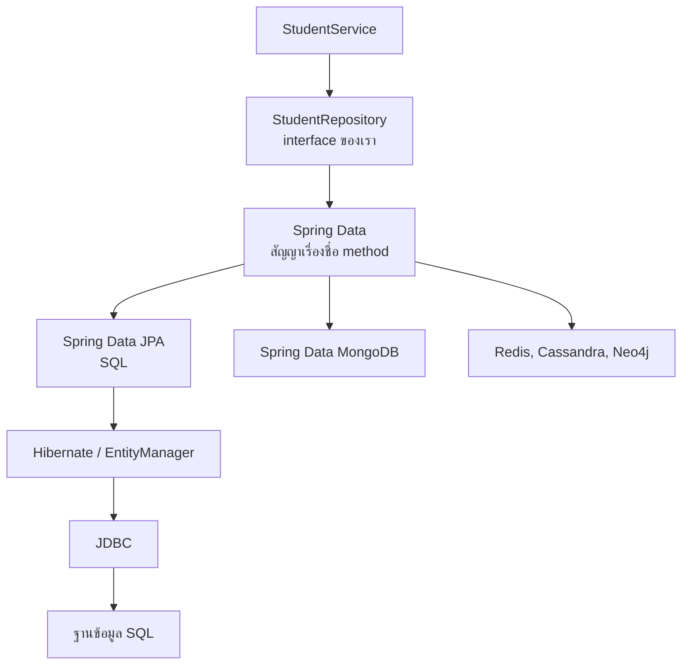
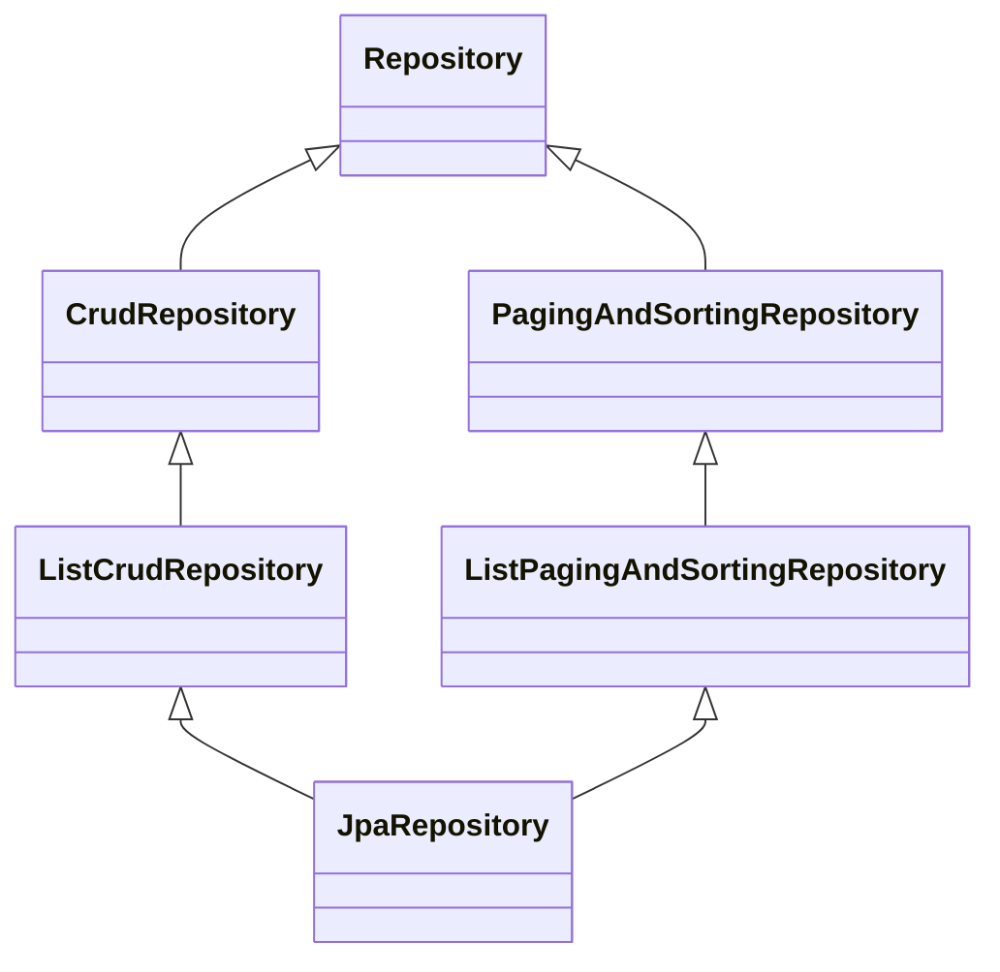
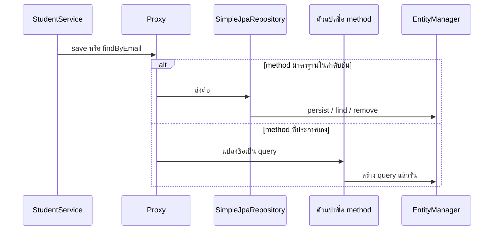
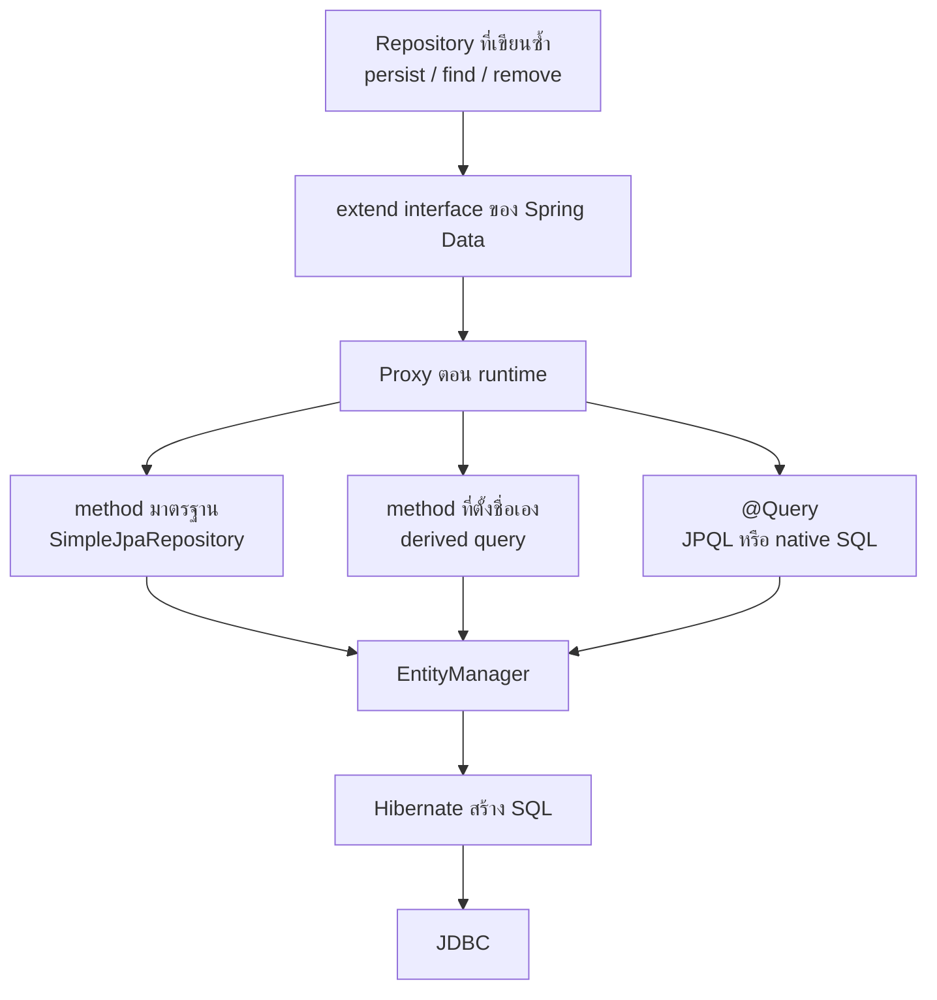

# #32 — Spring Data JPA: Repository, JPQL และ Pagination

> **วิดีโอ:** [Master Spring Data JPA in one video | JpaRepository, JPQL, Pagination | Spring Boot Full Course #32](https://youtu.be/xugZno16FgQ) — Coder Army, ~107 นาที
> **แหล่งที่ใช้สรุป:** ซับไตเติลภาษาอังกฤษที่ YouTube สร้างอัตโนมัติ
> **เวอร์ชันในโค้ด:** Spring Boot 4.1 + Java 21 (ใส่หมายเหตุไว้ทุกจุดที่ Spring Boot 3.x ต่างกัน)

ตอนนี้ตอบคำถามว่าทำไมเลิกเขียน Repository ที่เรียก `EntityManager` เองได้ แล้ว Spring Data JPA สร้าง implementation ให้ตอน runtime ได้อย่างไร ผู้สอนไล่จาก boilerplate ของ `save` / `findById` / `delete` ไปที่ลำดับชั้นของ `Repository` กลไก proxy กับ `SimpleJpaRepository` การตั้งชื่อ method ให้กลายเป็น query, `@Query` ทั้ง native SQL และ JPQL แล้วปิดด้วย `Sort` กับ pagination

ส่วนที่ติดป้าย `💡 เพิ่มเติม` คือของที่ผมเติมเอง ไม่ได้อยู่ในวิดีโอ ส่วนที่ติด `⚠️ แก้จากวิดีโอ` คือจุดที่วิดีโอพูดคลาดเคลื่อน

> 💡 **เพิ่มเติม — วิดีโอใช้ MySQL:** ผู้สอนเปิด DBeaver กับฐาน `student_db` แล้วให้ Hibernate สร้างตาราง `student` โน้ตนี้รันโปรเจกต์เดียวกันบน **H2 in-memory** ที่พอร์ต `9032` SQL, JSON และลำดับแถวด้านล่างเป็นผลจาก H2 2.4 กับ Spring Boot 4.1.1 (Hibernate ORM 7.4.5) ที่รันจริง บน MySQL ในวิดีโอคำสั่งสร้างตารางจะเป็น `AUTO_INCREMENT` และหน้าของ pagination จะเป็น `LIMIT` / `OFFSET` แทน `OFFSET … FETCH FIRST`

---

## สารบัญ

| เวลา | หัวข้อ |
|---|---|
| [0:00](https://youtu.be/xugZno16FgQ?t=0) | [1. เป้าหมายของตอน](#1-เป้าหมายของตอน) |
| [0:46](https://youtu.be/xugZno16FgQ?t=46) | [2. จาก Spring JDBC มาถึง EntityManager](#2-จาก-spring-jdbc-มาถึง-entitymanager) |
| [1:53](https://youtu.be/xugZno16FgQ?t=113) | [3. Repository ทุกตัวหน้าตาเหมือนกัน](#3-repository-ทุกตัวหน้าตาเหมือนกัน) |
| [5:08](https://youtu.be/xugZno16FgQ?t=308) | [4. ให้ Spring เขียน implementation](#4-ให้-spring-เขียน-implementation) |
| [7:04](https://youtu.be/xugZno16FgQ?t=424) | [5. Spring Data เป็นร่มของหลายโมดูล](#5-spring-data-เป็นร่มของหลายโมดูล) |
| [11:36](https://youtu.be/xugZno16FgQ?t=696) | [6. JPA กับ Spring Data คนละชั้น](#6-jpa-กับ-spring-data-คนละชั้น) |
| [12:30](https://youtu.be/xugZno16FgQ?t=750) | [7. โปรเจกต์ Spring Data JPA Demo](#7-โปรเจกต์-spring-data-jpa-demo) |
| [14:38](https://youtu.be/xugZno16FgQ?t=878) | [8. extend JpaRepository](#8-extend-jparepository) |
| [19:41](https://youtu.be/xugZno16FgQ?t=1181) | [9. ยิง POST กับ GET](#9-ยิง-post-กับ-get) |
| [21:22](https://youtu.be/xugZno16FgQ?t=1282) | [10. สิ่งที่แต่ละชั้นตัดออกไป](#10-สิ่งที่แต่ละชั้นตัดออกไป) |
| [24:32](https://youtu.be/xugZno16FgQ?t=1472) | [11. ลำดับชั้นของ Repository](#11-ลำดับชั้นของ-repository) |
| [26:36](https://youtu.be/xugZno16FgQ?t=1596) | [12. Marker interface กับ method ที่ประกาศเอง](#12-marker-interface-กับ-method-ที่ประกาศเอง) |
| [31:21](https://youtu.be/xugZno16FgQ?t=1881) | [13. CrudRepository กับ ListCrudRepository](#13-crudrepository-กับ-listcrudrepository) |
| [33:20](https://youtu.be/xugZno16FgQ?t=2000) | [14. PagingAndSortingRepository](#14-pagingandsortingrepository) |
| [36:35](https://youtu.be/xugZno16FgQ?t=2195) | [15. method เพิ่มของ JpaRepository](#15-method-เพิ่มของ-jparepository) |
| [37:47](https://youtu.be/xugZno16FgQ?t=2267) | [16. ห้าหน้าที่ของ Spring Data JPA](#16-ห้าหน้าที่ของ-spring-data-jpa) |
| [40:10](https://youtu.be/xugZno16FgQ?t=2410) | [17. Proxy กับ SimpleJpaRepository](#17-proxy-กับ-simplejparepository) |
| [52:09](https://youtu.be/xugZno16FgQ?t=3129) | [18. save คือ persist หรือ merge](#18-save-คือ-persist-หรือ-merge) |
| [56:16](https://youtu.be/xugZno16FgQ?t=3376) | [19. saveAll คือลูป](#19-saveall-คือลูป) |
| [57:53](https://youtu.be/xugZno16FgQ?t=3473) | [20. find, exists, count, delete](#20-find-exists-count-delete) |
| [1:01:50](https://youtu.be/xugZno16FgQ?t=3710) | [21. อัปเดตด้วย dirty checking](#21-อัปเดตด้วย-dirty-checking) |
| [1:04:16](https://youtu.be/xugZno16FgQ?t=3856) | [22. Subject กับ predicate](#22-subject-กับ-predicate) |
| [1:12:27](https://youtu.be/xugZno16FgQ?t=4347) | [23. ชื่อ method ที่ยาวเกิน](#23-ชื่อ-method-ที่ยาวเกิน) |
| [1:15:46](https://youtu.be/xugZno16FgQ?t=4546) | [24. @Query แบบ native](#24-query-แบบ-native) |
| [1:18:47](https://youtu.be/xugZno16FgQ?t=4727) | [25. JPQL](#25-jpql) |
| [1:21:40](https://youtu.be/xugZno16FgQ?t=4900) | [26. Join แบบ explicit กับ implicit](#26-join-แบบ-explicit-กับ-implicit) |
| [1:28:28](https://youtu.be/xugZno16FgQ?t=5308) | [27. HQL](#27-hql) |
| [1:29:00](https://youtu.be/xugZno16FgQ?t=5340) | [28. Sort](#28-sort) |
| [1:38:01](https://youtu.be/xugZno16FgQ?t=5881) | [29. Pageable กับ PageRequest](#29-pageable-กับ-pagerequest) |
| [1:44:57](https://youtu.be/xugZno16FgQ?t=6297) | [30. Page กับ Slice](#30-page-กับ-slice) |
| — | [31. สรุปท้ายตอน](#31-สรุปท้ายตอน) |

---

## 1. เป้าหมายของตอน

[▶ 0:00](https://youtu.be/xugZno16FgQ?t=0)

ผู้สอนเรียกตอนนี้ว่า masterclass ของ Spring Data JPA เขาจะเชื่อมของที่เรียนมาแล้วเข้าด้วยกัน คือ JDBC, Spring JDBC, Hibernate และ JPA ถ้ายังไม่ดูบทนำของ JDBC กับ Hibernate เขาแนะนำให้ดูอย่างน้อยตอนละหนึ่งคลิปก่อน เพราะวันนี้จะอธิบายว่า method ที่เรียกบน interface ว่าง ๆ ไปจบที่ SQL ได้อย่างไร

---

## 2. จาก Spring JDBC มาถึง EntityManager

[▶ 0:46](https://youtu.be/xugZno16FgQ?t=46)

บนจอช่วงแรกเป็นโค้ด Spring JDBC method หนึ่งเขียน SQL เอง แล้วเรียก `jdbcTemplate.queryForObject` พร้อม `RowMapper` และค่า id Spring JDBC ตัดงานเปิด `Connection` กับสร้าง statement ออกไปแล้ว แต่ยังต้องเขียน SQL

ถัดมาเป็น Hibernate ซึ่งเขาเรียกสลับกับ JPA เพราะ JPA เป็น specification และ Hibernate เป็น implementation ที่ Boot ใช้ ชั้นนี้เรียก `EntityManager` แล้ว Hibernate สร้าง SQL ให้ ไม่ต้องเขียน query เอง

ปัญหาที่เหลืออยู่คือชั้น Repository เอง ทุกโปรเจกต์เขียนชั้นนี้ซ้ำในรูปเดิม

---

## 3. Repository ทุกตัวหน้าตาเหมือนกัน

[▶ 1:53](https://youtu.be/xugZno16FgQ?t=113)

เขาเทียบ `StudentRepository` กับ `DepartmentRepository` ทั้งคู่มี `EntityManager` มี `save` ที่เรียก `persist` มี `findById` ที่เรียก `find` และมี `delete` ที่เรียก `remove` สิ่งที่เปลี่ยนมีแค่ชนิดของ entity ชื่อตัวแปร ชนิดของค่าที่ return และชนิดของ primary key นักศึกษาอาจใช้ `Long` ภาควิชาอาจใช้ `String` หรือ `Integer`

> ⚠️ **แก้จากวิดีโอ:** ช่วงนี้เขาเรียกก้อนโค้ด Repository ที่เขียนซ้ำว่า persistence context คำนี้ใน Hibernate หมายถึงที่เก็บ entity ที่กำลังถูกติดตามในหนึ่ง transaction ก้อนที่เขาชี้บนจอคือชั้น persistence (Repository) คนละอย่างกับ Persistence Context

เขาบอกว่าโค้ดนี้เขียนไม่ยาก แต่มันซ้ำทุกครั้งที่มี entity ใหม่ ถ้าต้องการแค่ `save`, `findById` และ `delete` Spring รู้คำจำกัดความอยู่แล้ว จึงไม่จำเป็นให้เราเขียนซ้ำ

---

## 4. ให้ Spring เขียน implementation

[▶ 5:08](https://youtu.be/xugZno16FgQ?t=308)

Spring ให้ interface ชื่อ `Repository` งานของเราคือสร้าง interface ของตัวเอง เช่น `StudentRepository` แล้ว **extend** ไม่ใช่ implement จากนั้น inject interface นั้นเข้า `StudentService` แล้วเรียก `save`, `findById`, `delete` ได้เลย

คำถามแรกคือเรียก method ที่ยังไม่มีตัวตนได้อย่างไร Spring บอกว่าไม่ต้องเขียน implementation เพราะมันรู้ว่า `save` คือ `entityManager.persist` ของ object ที่ส่งมา `findById` คือ `entityManager.find` ด้วย class ของ entity กับ primary key และ `delete` คือ `entityManager.remove` ตัว implementation จะถูกสร้างตอน runtime รายละเอียดของขั้นนั้นอยู่ที่ [หัวข้อ 17](#17-proxy-กับ-simplejparepository)

เขาย้อนไปโปรเจกต์ CRUD ของคอร์สที่ extend repository แล้วเรียก method โดยไม่ประกาศเอง วันนี้จะเปิดดูว่าเวทมนตร์นั้นทำงานอย่างไร

---

## 5. Spring Data เป็นร่มของหลายโมดูล

[▶ 7:04](https://youtu.be/xugZno16FgQ?t=424)

**Spring Data** เป็นชื่อร่ม มันสัญญาว่าไม่ว่าจะเก็บข้อมูลด้วยเทคโนโลยีอะไร จะได้รูปแบบ Repository แบบเดียวกัน สร้าง interface ของตัวเอง แล้ว extend interface ของ Spring Data ไม่ต้อง implement Spring จะให้ implementation ตอน runtime

เทคโนโลยีที่เขาไล่ชื่อคือ SQL, MongoDB, Redis, Cassandra และ Neo4j แต่ละตัวมีโมดูลของตัวเอง

| เทคโนโลยีข้างใต้ | โมดูล |
|---|---|
| SQL ผ่าน JPA | Spring Data JPA |
| MongoDB | Spring Data MongoDB |
| Redis | Spring Data Redis |
| Cassandra | Spring Data Cassandra |
| Neo4j | Spring Data Neo4j |

ประโยชน์คือชื่อ method อยู่ที่เดียวกัน `save` คือการเก็บ `findById` คือการดึงตาม id เทคโนโลยีข้างใต้สลับได้ Spring Data JPA รับชื่อ method แล้วไปที่ Hibernate ซึ่งใช้ `EntityManager` และ JDBC เพื่อสร้าง SQL ฝั่ง MongoDB ไม่มี SQL โมดูลนั้นแปลง `save` ไปเป็นคำสั่งที่เขียน document ใน collection

เขาสรุปว่า interface ร่วมคือ Spring Data ส่วน implementation ของ SQL คือ Spring Data JPA งานของเราคือ extend interface แล้วเรียกจาก service



---

## 6. JPA กับ Spring Data คนละชั้น

[▶ 11:36](https://youtu.be/xugZno16FgQ?t=696)

เขาย้ำให้แยกสองคำที่คนมักปนกัน

**JPA** (ตอนนี้ชื่อทางการคือ Jakarta Persistence) ให้ API สำหรับคุยกับ Persistence Context เช่น `EntityManager` และให้ annotation อย่าง `@Entity` กับ `@Column` นี่คือของที่บท Hibernate ใช้มาแล้ว

**Spring Data** เป็นโมดูลใหญ่ที่มีโมดูลย่อย ตัวมันเองให้ interface ของ Repository โมดูลย่อยเป็นคนให้ implementation ถ้าพูดถึง SQL โมดูลย่อยคือ Spring Data JPA ซึ่งใช้ JPA ข้างใน อีกชั้นหนึ่ง

---

## 7. โปรเจกต์ Spring Data JPA Demo

[▶ 12:30](https://youtu.be/xugZno16FgQ?t=750)

เขาเปิดโปรเจกต์เปล่าชื่อ Spring Data JPA Demo มีโครงโฟลเดอร์แล้ว `StudentController` map ที่ `/api/student` มี constructor injection ของ service และมีสอง method คือสร้างนักศึกษากับดึงตาม id ทั้งคู่เรียก service ต่อ ตอนเปิดโปรเจกต์ service ยังว่าง และยังไม่มีคลาส Repository เลย บรรทัดที่เรียก service จึง error

Entity `Student` มีสี่ฟิลด์ คือ `id`, `name`, `email`, `age` เขาตั้ง `id` เป็น primary key แบบ generate เอง เวลาสร้างจึงส่งแค่ชื่อ อีเมล และอายุ เขาใช้ Lombok เพื่อไม่เขียน getter กับ setter

`application.properties` ชี้ไปที่ฐาน `student_db` มี URL, username และ password ตารางใน DBeaver ยังว่าง

> 💡 **เพิ่มเติม:** โค้ดด้านล่างเป็นของที่รันในโน้ตนี้ ใช้ H2 ไม่ใช่ MySQL `@GeneratedValue(strategy = IDENTITY)` เป็นค่าที่เติมให้ตรงกับคำว่า auto-generate ที่เขาพูด `@NoArgsConstructor` จำเป็นเพราะทั้ง JPA และ Jackson ต้องสร้าง object เองได้ dependency ของเว็บใน Boot 4 คือ `spring-boot-starter-webmvc`

> ⚠️ **Boot 4 vs 3 — starter ของเว็บ:** ใน Boot 3 ใช้ `spring-boot-starter-web` Boot 4 เปลี่ยนชื่อเป็น `spring-boot-starter-webmvc` ชื่อ `spring-boot-starter-data-jpa` ยังใช้ได้เหมือนเดิม
> ([Spring Boot 4.0 Migration Guide](https://github.com/spring-projects/spring-boot/wiki/Spring-Boot-4.0-Migration-Guide))

```xml
<parent>
  <groupId>org.springframework.boot</groupId>
  <artifactId>spring-boot-starter-parent</artifactId>
  <version>4.1.1</version>
</parent>

<dependencies>
  <dependency>
    <groupId>org.springframework.boot</groupId>
    <artifactId>spring-boot-starter-webmvc</artifactId>
  </dependency>
  <dependency>
    <groupId>org.springframework.boot</groupId>
    <artifactId>spring-boot-starter-data-jpa</artifactId>
  </dependency>
  <dependency>
    <groupId>com.h2database</groupId>
    <artifactId>h2</artifactId>
    <scope>runtime</scope>
  </dependency>
</dependencies>
```

```properties
server.port=9032
spring.datasource.url=jdbc:h2:mem:student_db;DB_CLOSE_DELAY=-1
spring.datasource.username=sa
spring.datasource.password=
spring.jpa.hibernate.ddl-auto=update
spring.jpa.show-sql=true
```

```java
package com.coderarmy.springdatajpa.model;

import jakarta.persistence.Entity;
import jakarta.persistence.GeneratedValue;
import jakarta.persistence.GenerationType;
import jakarta.persistence.Id;
import lombok.Getter;
import lombok.NoArgsConstructor;
import lombok.Setter;
import lombok.ToString;

@Entity
@Getter
@Setter
@ToString
@NoArgsConstructor
public class Student {

  @Id
  @GeneratedValue(strategy = GenerationType.IDENTITY)
  private Long id;

  private String name;
  private String email;
  private Integer age;
}
```

ตอนสตาร์ต Hibernate สร้างตารางเอง บน H2 ได้คำสั่งนี้

```text
Hibernate: create table student (id bigint generated by default as identity, age integer, email varchar(255), name varchar(255), primary key (id))
```

---

## 8. extend JpaRepository

[▶ 14:38](https://youtu.be/xugZno16FgQ?t=878)

เขาสร้าง `StudentRepository` เป็น **interface** แล้ว extend `JpaRepository` ไม่ใช่ `Repository` ตัวบนสุดของลำดับชั้น เขาบอกว่าจะอธิบายลำดับชั้นทีหลัง `JpaRepository` ใช้ generics สองตัว ตัวแรกคือ entity ที่จะทำงานด้วย คือ `Student` ตัวที่สองคือชนิดของ primary key คือ `Long` สองค่านี้คือสิ่งเดียวที่เปลี่ยนระหว่าง repository แต่ละตัว

เขาบอกว่าไม่ต้องใส่ `@Repository` และไม่ต้องประกาศ method ใด ๆ ใน interface จากนั้นกลับไปที่ service ทำ constructor injection แล้วเรียก `studentRepository.save(student)` คอมไพเลอร์ไม่ฟ้อง ทั้งที่ `StudentRepository` ไม่มี method `save` เพราะ method นั้นอยู่บน `JpaRepository`

`fetchStudentById` เรียก `findById` ซึ่ง return `Optional<Student>` เพราะ id นั้นอาจมีแถวหรือไม่มีก็ได้ เขาอธิบายว่า `Optional` เป็นทางที่ปลอดภัยกว่าคืน `null` ในคลิปนี้เขาเดิน happy path จึงเรียก `.get()` โดยยังไม่ตรวจว่ามีค่า

```java
package com.coderarmy.springdatajpa.repository;

import com.coderarmy.springdatajpa.model.Student;
import java.util.Optional;
import org.springframework.data.jpa.repository.JpaRepository;

public interface StudentRepository extends JpaRepository<Student, Long> {

  Optional<Student> findByEmail(String email);
}
```

`findByEmail` เป็น method ที่เขาเพิ่มเองทีหลังใน [หัวข้อ 16](#16-ห้าหน้าที่ของ-spring-data-jpa) ใส่ไว้ใน interface เดียวกันเพราะโปรเจกต์ที่รันมี method นี้ด้วย method มาตรฐานอย่าง `save` กับ `findById` ไม่ต้องประกาศ

ส่วน service ช่วงแรกของคลิปมีแค่สอง method บรรทัด `BEFORE_SAVE` / `AFTER_SAVE` เป็นของที่โน้ตนี้ใส่เพื่อจับว่า INSERT เกิดตรงไหน

```java
public void createStudent(Student student) {
  System.out.println("BEFORE_SAVE");
  studentRepository.save(student);
  System.out.println("AFTER_SAVE id=" + student.getId());
}

public Student fetchStudentById(long id) {
  Optional<Student> studentOptional = studentRepository.findById(id);
  return studentOptional.get();
}
```

Controller คืนคำว่า `Done` ตอนสร้าง และคืน `Student` ตอนดึงตาม id เขาส่ง entity เข้ามาทั้งก้อน ไม่ได้ทำ DTO

```java
@PostMapping
public String createStudent(@RequestBody Student student) {
  studentService.createStudent(student);
  return "Done";
}

@GetMapping("/{id}")
public Student getStudent(@PathVariable long id) {
  return studentService.fetchStudentById(id);
}
```

> 💡 **เพิ่มเติม:** คลาสของ bean ที่ถูก inject ไม่ใช่ `StudentRepository` เพราะนั่นเป็น interface ตอนรัน `GET /api/student/repository-class` ได้ `jdk.proxy2.$Proxy121` เป็น JDK dynamic proxy ที่ Spring สร้างให้

---

## 9. ยิง POST กับ GET

[▶ 19:41](https://youtu.be/xugZno16FgQ?t=1181)

พอสตาร์ต แอป เขาเห็นคำสั่ง `create table student` ใน log รีเฟรช DBeaver แล้วมีตาราง `student` คอลัมน์ `id`, `age`, `email`, `name`

ใน Postman เขา `POST /api/student` ด้วย JSON ของชื่อ อีเมล และอายุ ตัวอย่างบนจอคือชื่อ Aditya อีเมล `mail.com` อายุ 29 ได้ `200` และข้อความ `Done` รีเฟรชตารางแล้วมีแถว id เป็น 1 และ log มี `INSERT`

จากนั้น `GET /api/student/1` ได้ก้อนนักศึกษาทั้งก้อนกลับมา เขาบอกว่า logic ทั้งเส้นทำงานทั้งที่ `StudentRepository` ว่าง

ผลบน H2 ของคำขอเดียวกัน

```text
BEFORE_SAVE
Hibernate: insert into student (age,email,name,id) values (?,?,?,default)
AFTER_SAVE id=1
```

```http
POST /api/student
{"name":"Aditya","email":"mail.com","age":29}

HTTP/1.1 200
Done
```

```text
Hibernate: select s1_0.id,s1_0.age,s1_0.email,s1_0.name from student s1_0 where s1_0.id=?
```

```http
GET /api/student/1

{"age":29,"email":"mail.com","id":1,"name":"Aditya"}
```

เขาสรุปเส้นทางที่เดินมา JDBC เขียน SQL เองและจัดการ connection เอง Spring JDBC ใช้ template จึงไม่ต้องเปิด connection หรือเขียน statement Hibernate สร้าง SQL ให้เมื่อเรียก method JPA เป็น specification ที่ Hibernate implement ปัญหา boilerplate ของ Repository ยังอยู่ จน Spring Data ให้ interface และ Spring Data JPA เติม implementation ตอน runtime

---

## 10. สิ่งที่แต่ละชั้นตัดออกไป

[▶ 21:22](https://youtu.be/xugZno16FgQ?t=1282)

เขาเขียนลำดับนี้บนกระดานเพื่อให้โฟกัสว่าแต่ละขั้นตัดงานอะไรออก

| ชั้น | สิ่งที่ยังต้องทำ | สิ่งที่ถูกตัด |
|---|---|---|
| JDBC | เขียน SQL, เปิด connection, สร้าง statement | — |
| Spring JDBC | เขียน SQL | connection, statement, try-with-resources |
| Hibernate | เรียก method ของ persistence | การเขียน SQL |
| JPA | เรียก API ของ specification | การผูกกับคลาสของ Hibernate โดยตรง |
| Spring Data JPA | extend interface | boilerplate ของ Repository |

> 💡 **เพิ่มเติม:** ลำดับบนกระดานคือลำดับที่เขาเลิกเขียนของบางอย่าง ลำดับตอน runtime สวนทางกันในช่วงล่าง service เรียก proxy ของ repository, `SimpleJpaRepository` เรียก `EntityManager`, Hibernate สร้าง SQL, JDBC ส่งไปที่ฐานข้อมูล JPA ไม่ได้เป็นชั้นที่วางทับ Hibernate หลังจาก Hibernate เกิดแล้ว JPA เป็น specification ที่ Hibernate implement

---

## 11. ลำดับชั้นของ Repository

[▶ 24:32](https://youtu.be/xugZno16FgQ?t=1472)

เขาเขียนลำดับชั้นบนกระดาน แล้วเปิดซอร์สใน IntelliJ ทีละตัว โครงที่เขาอธิบายตรงกับ Spring Data ใน Boot 4.1.1



`Repository` อยู่บนสุด เป็น interface ว่าง ไม่มี method เขาเรียกว่า marker หน้าที่คือบอกว่า domain ของ repository นี้คือ entity อะไร และ identifier เป็นชนิดอะไร

จาก `Repository` แยกสองกิ่ง `CrudRepository` กับ `PagingAndSortingRepository` แต่ละกิ่งมีรุ่นที่คืน `List` คือ `ListCrudRepository` กับ `ListPagingAndSortingRepository` `JpaRepository` extend ทั้งสองกิ่งนั้น จึงได้ CRUD, การเรียง, การแบ่งหน้า และ method ที่เกี่ยวกับ JPA โดยเฉพาะ

เขาบอกว่าตอน extend จะใส่อะไรในหกตัวนี้ก็ได้ ถ้าใส่ `JpaRepository` จะได้ method ของทั้งต้นไม้

> 💡 **เพิ่มเติม:** ในซอร์สของ Spring Data JPA 4.1.1 `JpaRepository` ยัง extend `QueryByExampleExecutor` ด้วย เขาไม่ได้พูดถึงกิ่งนี้ กิ่งนี้ใช้ค้นด้วย example object

---

## 12. Marker interface กับ method ที่ประกาศเอง

[▶ 26:36](https://youtu.be/xugZno16FgQ?t=1596)

เขาเปลี่ยน `StudentRepository` จาก `JpaRepository` ไปเป็น `Repository` เปล่า ๆ service ที่เรียก `save` กับ `findById` จึงคอมไพล์ไม่ผ่าน เพราะ marker ไม่มี method พวกนั้น

จากนั้นเขาประกาศสอง method เองใน interface แล้วไม่เขียน implementation

```java
void save(Student student);
Optional<Student> findById(Long id);
```

error ที่ service หาย เขาลบตาราง รีสตาร์ต แล้วยิง `POST /api/student` อีกครั้ง ได้ `Done` และมี `INSERT` เขาเรียกนี่ว่าเวทมนตร์ที่สอง แม้ interface แม่จะไม่มี method Spring ก็ยังรู้จากชื่อว่า `save` คือการ insert และ `findById` คือการ select ตาม id

ประโยชน์ของ marker ที่เขายกคือ service เรียกได้เฉพาะ method ที่เราประกาศ ถ้าไม่อยากให้ใครลบนักศึกษา ก็ไม่ประกาศ `delete` ข้อนี้มีแค่นี้

> ⚠️ **แก้จากวิดีโอ:** `save(Student)` กับ `findById(Long)` ที่ประกาศเองแล้วทำงานได้ ไม่ได้เกิดจากตัวแปลชื่อ method เป็น query คำว่า `save` ไม่ใช่ subject ที่ตัวแปลนั้นรู้จัก factory ของ Spring Data JPA ใช้ `SimpleJpaRepository` เป็น implementation ฐานของทุก repository รวมถึงตัวที่ extend แค่ `Repository` method ที่ชื่อและพารามิเตอร์ตรงกับ method บนคลาสนั้นจะถูกส่งต่อไปให้คลาสนั้น คืนค่าของ `save` จึงถูกทิ้งได้เพราะ interface ประกาศเป็น `void` ถ้าเปลี่ยนชื่อเป็น `store(Student)` แอปสตาร์ทไม่ขึ้น

ทดลองในโปรเจกต์นี้ ประกาศ `void store(Student student)` บน interface ที่ extend `Repository<Student, Long>` แล้วสตาร์ต ได้ exception นี้ จากนั้นเอา method นี้ออกเพื่อให้แอปที่เหลือรันได้

```text
QueryCreationException: Cannot create query for method
[MarkerStudentRepository.store(com.coderarmy.springdatajpa.model.Student)];
No property 'store' found for type 'Student'
```

ส่วน `save` กับ `findById` บน marker ยิงได้จริง

```text
Hibernate: insert into student (age,email,name,id) values (?,?,?,default)
Hibernate: select s1_0.id,s1_0.age,s1_0.email,s1_0.name from student s1_0 where s1_0.id=?
```

```http
POST /api/student/marker
{"name":"Aditya","email":"m@mail.com","age":19}

Done

GET /api/student/marker/1
{"age":19,"email":"m@mail.com","id":1,"name":"Aditya"}
```

interface ที่ใช้ทดลองคือ

```java
public interface MarkerStudentRepository extends Repository<Student, Long> {

  void save(Student student);

  Optional<Student> findById(Long id);
}
```

---

## 13. CrudRepository กับ ListCrudRepository

[▶ 31:21](https://youtu.be/xugZno16FgQ?t=1881)

`CrudRepository` extend `Repository` และประกาศงาน CRUD ให้แล้ว ไม่ต้องประกาศ `save` เอง method ที่เขาเปิดให้ดูคือ `save`, `saveAll`, `findById`, `existsById`, `findAll`, `findAllById`, `count`, `deleteById`, `delete`, `deleteAllById`, `deleteAll` implementation ยังมาตอน runtime

ปัญหาที่เขาชี้คืองานแบบ bulk คืน `Iterable` เพราะ Spring ไม่รู้ว่าควรใส่ `List` หรือ collection อื่น แปลงเองได้ แต่เขาไม่อยาก cast

`ListCrudRepository` extend `CrudRepository` แล้ว override เฉพาะสาม method คือ `saveAll`, `findAll` และ `findAllById` ให้คืน `List` method ที่เหลือได้มาจากแม่

---

## 14. PagingAndSortingRepository

[▶ 33:20](https://youtu.be/xugZno16FgQ?t=2000)

กิ่งนี้ extend `Repository` โดยตรง ไม่ได้ extend `CrudRepository` มี `findAll` สองแบบ แบบหนึ่งรับ `Sort` แล้วคืน `Iterable` อีกแบบรับ `Pageable` แล้วคืน `Page`

เขาอธิบาย pagination ด้วยภาพข้อมูลสองล้านแถว ถ้ายิง query ครั้งเดียวแล้วดึงทั้งหมดเข้าหน่วยความจำ ทั้งฐานข้อมูลและ API จะช้า pagination คือแบ่งก้อนนั้นเป็นหน้า สมมติหน้าละ 10,000 แถว ขอหน้าแรกก่อน แล้วค่อยขอหน้าถัดไป sorting คือให้ฐานข้อมูลเรียงให้ตอนดึง ไม่ใช่ดึงมาก่อนแล้วค่อยเรียงในแอป เพราะการเรียงในแอปมีต้นทุนเวลาแยก และต้องถือข้อมูลทั้งก้อน

`Sort` บอกว่าจะเรียงด้วยฟิลด์อะไร ทิศทางไหน `Pageable` บอกขนาดหน้ากับหมายเลขหน้า ผลลัพธ์หนึ่งครั้งคือหนึ่ง `Page` คือก้อนนั้น ไม่ใช่ทั้งสองล้านแถว รายละเอียดของคลาสอยู่ที่ [หัวข้อ 28](#28-sort) และ [หัวข้อ 29](#29-pageable-กับ-pagerequest)

`ListPagingAndSortingRepository` เปลี่ยน `findAll(Sort)` จาก `Iterable` เป็น `List` ตัวที่คืน `Page` ไม่ได้ถูกเปลี่ยน เพราะ `Page` ไม่ใช่ `Iterable` ที่เขากำลังจะเลี่ยง

---

## 15. method เพิ่มของ JpaRepository

[▶ 36:35](https://youtu.be/xugZno16FgQ?t=2195)

`JpaRepository` extend `ListCrudRepository` และ `ListPagingAndSortingRepository` จึงทำ CRUD กับการแบ่งหน้าได้ครบ แล้วมี method ที่เกี่ยวกับ JPA เพิ่ม

| Method | ความหมายที่เขาอธิบาย |
|---|---|
| `flush` | ดันสถานะใน Persistence Context ลงฐานข้อมูลทันที |
| `saveAndFlush` | `save` แล้ว `flush` ต่อ |
| `saveAllAndFlush` | แบบ bulk ของคู่ข้างบน |
| `deleteInBatch` | รับ `Iterable` แล้วลบทั้งก้อนใน query เดียว |
| `deleteAllInBatch` | ลบทั้งก้อนเช่นกัน |
| `deleteAllByIdInBatch` | ลบจากชุดของ id ใน query เดียว |

เขาบอกว่า method พวก `deleteInBatch` ใช้แทนการลบทีละตัวที่ซ้ำกับของ CRUD ได้

> 💡 **เพิ่มเติม:** ใน Spring Data JPA 4.1.1 `deleteInBatch` ถูก `@Deprecated` และตัว default ของมันเรียก `deleteAllInBatch(Iterable)` ต่อ ชื่อที่ยังไม่ถูกเลิกใช้คือ `deleteAllInBatch(Iterable)`, `deleteAllByIdInBatch` และ `deleteAllInBatch()` การเลิกใช้เริ่มมาก่อน Boot 4 แล้ว จึงไม่ใช่ความต่างของ Boot 4 กับ Boot 3 javadoc ของ method เหล่านี้บอกด้วยว่าการลบแบบ batch ไม่เดิน cascade ของ JPA และไม่ยิง lifecycle event และอาจทำให้ first-level cache กับฐานข้อมูลไม่ตรงกัน

---

## 16. ห้าหน้าที่ของ Spring Data JPA

[▶ 37:47](https://youtu.be/xugZno16FgQ?t=2267)

เขาสรุปหน้าที่ของโมดูลนี้เป็นห้าข้อ

1. มี operation ของ CRUD และมี implementation ของ repository
2. สร้าง implementation ของ interface เราตอน runtime หลังจากเรา extend interface ของมัน
3. สร้าง query จากชื่อ method
4. รัน query ที่เราเขียนเองผ่าน `@Query`
5. รองรับ pagination กับ sorting

ข้อ 3 เขาทำให้ดูด้วย `findByEmail` อีเมลไม่ใช่ primary key query จึงช้ากว่าการหาด้วย id แต่ชื่อ method พอให้ Spring สร้าง query ได้ ทุก method ใน interface เป็น `public` อยู่แล้ว จึงไม่ต้องเขียนคำว่า `public`

```java
Optional<Student> findByEmail(String email);
```

SQL ที่รันจริงเมื่อเรียก method นี้

```text
Hibernate: select s1_0.id,s1_0.age,s1_0.email,s1_0.name from student s1_0 where s1_0.email=?
```

```http
GET /api/student/email/mail.com

{"age":29,"email":"mail.com","id":1,"name":"Aditya"}
```

ไวยากรณ์ของชื่อ method อยู่ที่ [หัวข้อ 22](#22-subject-กับ-predicate)

---

## 17. Proxy กับ SimpleJpaRepository

[▶ 40:10](https://youtu.be/xugZno16FgQ?t=2410)

คำถามหลักของตอนคือ implementation มาจากไหน ทั้งที่เราเขียนแค่

```java
public interface StudentRepository extends JpaRepository<Student, Long> {}
```

แล้ว inject เข้า service เขาอธิบายเป็นสองขั้น

ขั้นแรก Spring สร้าง **proxy** ของ `StudentRepository` ตอน runtime แล้ว inject proxy นั้นเข้า `StudentService` แบบเดียวกับ proxy ของ AOP งานของ proxy ไม่ใช่การมีโค้ดของ `save` ทุกบรรทัดอยู่ในตัวมัน

ขั้นที่สองมีคลาสที่เขียนไว้ล่วงหน้าชื่อ `SimpleJpaRepository` คลาสนี้ implement ฝั่ง `JpaRepository` method อย่าง `save` กับ `findById` ถูกเขียนแบบ generic เพราะชนิดของ entity กับชนิดของ id เปลี่ยนได้ logic ที่เหลือเหมือนกันทุก repository

ภาพที่เขาเขียนสำหรับ `save` คือรับ `T entity` แล้วเรียก `entityManager.persist` สำหรับ `findById` คือเรียก `entityManager.find(T.class, id)` แล้วห่อด้วย `Optional` เขาบอกชัดว่านี่คือภาพแนวคิด ยังไม่ได้เปิดซอร์สของคลาสนั้น และ logic นี้ถูกเขียนไว้แบบ static ไม่ได้ถูก generate ใหม่ทุกครั้งที่สตาร์ตแอป เพราะแกนของ CRUD ไม่เปลี่ยน



กฎที่ proxy ใช้ตัดสินมีสองทาง

ถ้ารับ `save` หรือ `findById` มันตรวจว่าชื่อนี้มีอยู่ในลำดับชั้นของ `Repository` / `CrudRepository` / `PagingAndSortingRepository` หรือไม่ ถ้ามี `SimpleJpaRepository` มี implementation อยู่แล้ว จึงส่งต่อ ผลลัพธ์เดินกลับ proxy แล้วกลับไปที่ service

ถ้า service เรียก `findByEmail` ซึ่งเราประกาศเอง proxy รู้ว่านี่ไม่ใช่ method มาตรฐาน `SimpleJpaRepository` จึงไม่มี implementation ให้ มันส่งต่อไปอีกทาง เขาตั้งชื่อเล่นบนกระดานว่า M2Q คือชิ้นที่แปลงชื่อ method เป็น query เขาย้ำว่าคนละคลาสกับ `SimpleJpaRepository` คลาสแรกทำ CRUD มาตรฐาน อีกชิ้นทำ derived query สองชิ้นนี้ครอบคลุม method ที่ service เรียก

pagination กับ sorting อยู่ใน `SimpleJpaRepository` ด้วย เพราะ `JpaRepository` extend ทั้ง `ListCrudRepository` และ `ListPagingAndSortingRepository`

เขาเรียกชิ้นที่สองว่า query method parsing infrastructure ของ Spring เป็นโค้ด static ทั้งก้อน หน้าที่คืออ่านชื่อ method แล้วตัดสินว่าจะสร้าง query แบบไหน

ท้ายหัวข้อนี้เขาผูกกลับไปที่ Hibernate `SimpleJpaRepository` ใช้ `EntityManager` ดังนั้น Persistence Context, dirty checking และการ flush ยังทำงานอยู่ ไม่มีใครถูกแทนที่ มีแค่ชั้นที่เราไม่ต้องเขียนเอง

> 💡 **เพิ่มเติม:** คลาสจริง implement `JpaRepositoryImplementation` ซึ่ง extend `JpaRepository` อีกที ไม่ได้เขียนคำว่า `implements JpaRepository` ตรง ๆ พฤติกรรมที่เขาเล่าตรงกับซอร์สของ `SimpleJpaRepository` ใน Spring Data JPA 4.1.1 ชื่อ M2Q เป็นชื่อที่เขาตั้งบนกระดาน คลาสที่แปลงชื่อคือ `PartTree` กับ `PartTreeJpaQuery`

---

## 18. save คือ persist หรือ merge

[▶ 52:09](https://youtu.be/xugZno16FgQ?t=3129)

เขาไม่อยากให้นิยาม `save` แค่ว่า "เซฟลงฐานข้อมูล" งานของมันคือเรียก Hibernate ข้างใน ช่วงแรกเขาบอกว่าเรียก `entityManager.persist` และ `persist` ไม่ได้เขียนลงฐานข้อมูลทันที มันเอา entity เข้า Persistence Context พอ method จบจึง flush

จากนั้นเขาแก้เองว่านอกจาก `persist` ยังมี `merge` entity ใหม่ใช้ `persist` entity เก่าหรือตัวที่หลุดออกจาก Persistence Context (detached) ใช้ `merge` เพื่อเอากลับเข้า context วงจรชีวิตนี้มาจากบท Hibernate ถ้าเรียก `flush` ระหว่างทาง ค่าจะลงฐานข้อมูลตรงนั้น ไม่ต้องรอจบ method

เขาตอบคำถามสัมภาษณ์ที่เตรียมไว้ว่า `save` ไม่ได้เขียนลงฐานข้อมูลทันที

เหตุผลที่เขาผูกกับ Hibernate คือคอมเมนต์ที่บอกว่าไม่ต้องเรียน JDBC หรือ Hibernate เพราะเรียก `save` ก็จบ เขาแย้งว่า abstraction มีทุกชั้น ถ้าดูแค่ผิวก็ไม่ต้องเรียนอะไรเลย คนที่รู้ข้างในจะคุมโค้ดได้กว่า และเลี่ยงปัญหาอย่าง N+1 ที่มาจาก `find` ได้

> ⚠️ **แก้จากวิดีโอ:** เขาพูดก่อนว่า `save` เรียก `persist` อย่างเดียว แล้วแก้เองในอีกไม่กี่นาทีว่า entity ใหม่ใช้ `persist` และ entity ที่มีอยู่แล้วใช้ `merge` ซอร์สของ `SimpleJpaRepository.save` ตรวจ `entityInformation.isNew(entity)` ถ้าใหม่จึง `persist` ถ้าไม่ใหม่จึง `merge` กับ `@GeneratedValue` แบบ `Long` ตัวที่ id ยังเป็น `null` ถือว่าใหม่

ทดลองสองทางบน H2

entity ที่ยังไม่มี id ได้ INSERT ระหว่างสองบรรทัด log แปลว่า transaction ของ `save` จบตอน `save` return ไม่ได้รอจนบรรทัดถัดไปของ service

```text
BEFORE_SAVE
Hibernate: insert into student (age,email,name,id) values (?,?,?,default)
AFTER_SAVE id=1
```

`POST` ก้อนที่มี id อยู่แล้ว ได้ SELECT ตามด้วย UPDATE ซึ่งเป็นทางของ `merge`

```text
BEFORE_SAVE
Hibernate: select s1_0.id,s1_0.age,s1_0.email,s1_0.name from student s1_0 where s1_0.id=?
Hibernate: update student set age=?,email=?,name=? where id=?
AFTER_SAVE id=2
```

```http
POST /api/student
{"id":2,"name":"Aditya","email":"merged@mail.com","age":27}

GET /api/student/2
{"age":27,"email":"merged@mail.com","id":2,"name":"Aditya"}
```

> ⚠️ **แก้จากวิดีโอ:** เขาบอกว่าค่าจะลงฐานข้อมูลเมื่อ method จบ โดยหมายถึง method ของ service `save` บน `SimpleJpaRepository` มี `@Transactional` ของตัวเอง ถ้า service ไม่มี transaction ครอบ INSERT จึงเกิดตอน `save` return แล้ว บรรทัดหลัง `save` ใน service เห็นแถวในฐานข้อมูลแล้ว

---

## 19. saveAll คือลูป

[▶ 56:16](https://youtu.be/xugZno16FgQ?t=3376)

เขาเกริ่นความเข้าใจผิดว่า `saveAll` น่าจะรับลิสต์แล้วเขียน query เดียวที่เก็บทั้งลิสต์ ของจริงใน `SimpleJpaRepository` คือลูปเรียก `save` ทีละตัว เขาเขียนซูโดโค้ดประมาณ `for (Student s : students) save(s)`

เขาบอกว่าคนที่ไม่รู้ข้างในจะผิดหวัง เพราะอยากได้ bulk query แต่เนื่องจาก `save` ใส่เข้า Persistence Context ก่อน พอ flush หลายตัวอาจลงฐานข้อมูลพร้อมกันได้ เขาเรียกว่าเป็นการ batch ทางอ้อมจาก Persistence Context ไม่ใช่ batch โดยตรง และบอกว่า implementation ของ `saveAll` หน้าตาเป็นลูปแบบนั้น

> ⚠️ **แก้จากวิดีโอ:** ลูปเรียก `save` ทีละตัวถูก ซอร์สของ `saveAll` เป็น `for` ที่เรียก `save` จริง แต่การ flush ของ Persistence Context ไม่ได้รวมหลายแถวเป็น JDBC batch ให้เอง บน H2 โดยไม่ตั้ง `hibernate.jdbc.batch_size` นักศึกษาสองคนกลายเป็น INSERT สองคำสั่ง

```text
BEFORE_SAVE_ALL
Hibernate: insert into student (age,email,name,id) values (?,?,?,default)
Hibernate: insert into student (age,email,name,id) values (?,?,?,default)
AFTER_SAVE_ALL
```

```http
POST /api/student/bulk
[{"name":"Riya","email":"riya@mail.com","age":21},{"name":"Kabir","email":"kabir@mail.com","age":22}]

[{"age":21,"email":"riya@mail.com","id":5,"name":"Riya"},{"age":22,"email":"kabir@mail.com","id":6,"name":"Kabir"}]
```

> 💡 **เพิ่มเติม:** ถ้าต้องการให้ Hibernate ส่ง INSERT หลายคำสั่งในรอบเครือข่ายเดียว ต้องตั้ง `spring.jpa.properties.hibernate.jdbc.batch_size` เอง คลิปนี้ไม่ได้ตั้งค่านี้

---

## 20. find, exists, count, delete

[▶ 57:53](https://youtu.be/xugZno16FgQ?t=3473)

เขาไล่ method มาตรฐานที่เหลือ

`findById` เรียก `entityManager.find` ด้วย class กับ id แล้วห่อ `Optional` `findAll` ดึงทุกแถวโดยไม่รับ id

`existsById` ตรวจว่ามีแถวนั้นหรือไม่ โดยไม่ดึง entity ทั้งก้อน เขาบอกว่าข้างในเป็น query นับจำนวน

```sql
SELECT COUNT(*) FROM students WHERE id = ?
```

`count` นับจำนวน `delete` รับ entity แล้วลบ `deleteById` ลบจาก id `deleteAll` ลบทั้งชุด รายการบน `CrudRepository` ที่เขาอ่านจาก IntelliJ คือ `save`, `saveAll`, `findById`, `existsById`, `findAll`, `findAllById`, `count`, `deleteById`, `delete`, `deleteAllById`, `deleteAll`

method ที่เป็นของ `JpaRepository` โดยเฉพาะคือ `flush`, `saveAndFlush` และชุด `delete…InBatch` ที่พูดไปแล้ว ถ้าต้องการแบ่งหน้าให้ไปที่ `PagingAndSortingRepository`

> ⚠️ **แก้จากวิดีโอ:** แนวคิดที่ว่า `existsById` ไม่โหลด entity ทั้งก้อนถูก แต่ query ที่เขาเขียนใช้ตาราง `students` ตารางในคลิปและใน entity นี้ชื่อ `student` SQL ที่ Hibernate สร้างจริงคือ `select count(*) from student s1_0 where s1_0.id=?` JPQL ต้นทางใน `QueryUtils` คือ `select count(*) from Student x where x.id = :id`

```text
Hibernate: select count(*) from student s1_0 where s1_0.id=?
```

```http
GET /api/student/1/exists

true
```

---

## 21. อัปเดตด้วย dirty checking

[▶ 1:01:50](https://youtu.be/xugZno16FgQ?t=3710)

งานมาตรฐานอย่างอัปเดตเขาไม่ได้เพิ่ม method ชื่อ update เขาทำให้ดูบน service

1. `findById` เพื่อดึงนักศึกษาเข้า Persistence Context
2. `setAge`, `setName`, `setEmail` จากก้อนที่ request ส่งมา
3. ไม่เรียก `save` ซ้ำ
4. พอ method จบ Hibernate flush แล้วเขียนค่าใหม่ลงฐานข้อมูล

เขาข้ามการตรวจว่า `Optional` มีค่าหรือไม่ และบอกว่าถ้า client ต้องการก้อนที่อัปเดตแล้ว ให้ไป `GET` ตาม id อีกครั้ง

> ⚠️ **แก้จากวิดีโอ:** รูปแบบนี้ทำงานเมื่อ service method อยู่ใน transaction เดียวกับ `findById` เท่านั้น `findById` บน `SimpleJpaRepository` สืบทอด `@Transactional(readOnly = true)` ของคลาส transaction นั้นจบตอน `findById` return entity จึงหลุดจาก Persistence Context ก่อนถึงบรรทัด `setAge` ค่าที่แก้หลังจากนี้ไม่ถูก flush Boot เปิด `spring.jpa.open-in-view` เป็นค่าเริ่มต้น และ log ของแอปนี้ก็เตือนเรื่องนั้น แต่การเปิดค้าง EntityManager ตลอด request ก็ยังไม่ทำให้การแก้แบบนี้กลายเป็น UPDATE

เรียกแบบที่เขาเขียน คือไม่มี `@Transactional` ที่ service ได้คำว่า `Done` แต่แถวยังเป็นค่าเดิม และไม่มีคำสั่ง `UPDATE` ใน log

```http
PUT /api/student/1
{"name":"Aditya","email":"changed@mail.com","age":40}

Done

GET /api/student/1
{"age":29,"email":"mail.com","id":1,"name":"Aditya"}
```

method เดียวกันที่ใส่ `@Transactional` เขียนลงฐานข้อมูลตอน method return

```java
@Transactional
public void updateInTransaction(long id, Student studentRequest) {
  Student student = studentRepository.findById(id).get();
  student.setAge(studentRequest.getAge());
  student.setName(studentRequest.getName());
  student.setEmail(studentRequest.getEmail());
}
```

```text
Hibernate: select s1_0.id,s1_0.age,s1_0.email,s1_0.name from student s1_0 where s1_0.id=?
UPDATE_IN_TX_DONE
Hibernate: update student set age=?,email=?,name=? where id=?
```

```http
PUT /api/student/1/tx
{"name":"Aditya","email":"tx@mail.com","age":41}

GET /api/student/1
{"age":41,"email":"tx@mail.com","id":1,"name":"Aditya"}
```

`UPDATE` อยู่หลังบรรทัดที่ method ทำงานเสร็จ ซึ่งตรงกับที่เขาบอกว่า flush เกิดตอน transaction จบ ไม่ใช่ตอน `setAge`

---

## 22. Subject กับ predicate

[▶ 1:04:16](https://youtu.be/xugZno16FgQ?t=3856)

เขาแตก `findByEmail` เป็นสามส่วน

| ส่วน | ในชื่อ `findByEmail` | ความหมาย |
|---|---|---|
| Subject | `find` คำที่อยู่ก่อน `By` | จะทำอะไรกับผลลัพธ์ |
| ตัวคั่น | `By` | แยก subject ออกจากเงื่อนไข |
| Predicate | `email` คำที่อยู่หลัง `By` | เงื่อนไข |

Subject ที่เขาไล่คือ `find`, `exists`, `count`, `delete`, `findTop3` และ `findDistinct` คำพวกนี้เป็นชื่อตาม convention ของ Spring Data

Predicate อ่านจากฟิลด์ของ entity ที่ repository ผูกไว้ `Student` มี `id`, `name`, `email`, `age` ดังนั้น `findByEmail` กลายเป็น

```sql
SELECT * FROM student WHERE email = ?
```

ค่าหลัง `=` มาจากพารามิเตอร์ของ method `find` แปลว่าเป็น `SELECT` ส่วน `FROM student WHERE` เป็นโครงคงที่

เขาให้จับ subject กับ predicate สลับกันได้ เช่น `existsByEmail`, `countByEmail`, `deleteByEmail` ถ้า query ที่ได้ออกมาไม่มีข้อมูลที่ต้องการ นั่นเป็นความรับผิดชอบของคนตั้งชื่อ

ใน predicate ใส่ตัวดำเนินการได้อย่าง `And` กับ `Not` ตัวอย่าง `findByEmailAndAge` คือ

```sql
SELECT * FROM student WHERE email = ? AND age = ?
```

คำใน predicate ที่เขาอ่านจาก IntelliSense และจากกระดานมี `Like`, `GreaterThan`, `LessThan`, `Containing`, `StartsWith`, `EndsWith`, `In`, `NotIn`, `IsNull`, `IsNotNull`, `Between`, `True`, `False` และ `OrderBy` พอเริ่มพิมพ์ `findBy` IntelliJ แนะนำ `Email`, `Age`, `Id` และคำอย่าง `Like`, `LessThan`, `IgnoreCase` ให้เอง

`Like` เขาอธิบายด้วยอีเมลของ Aditya ที่มี `ty` และ `@gmail` อยู่ตรงกลาง จึงเขียนแพตเทิร์นที่มีเครื่องหมายเปอร์เซ็นต์หน้าและหลัง method คือ `findByEmailLike(String pattern)` query คือ `WHERE email LIKE ?`

> ⚠️ **แก้จากวิดีโอ:** เขาเรียกเครื่องหมาย `%` ว่า percentile เครื่องหมายใน `LIKE` คือ percent `%` ตัวหน้าแปลว่ามีอะไรข้างหน้าก็ได้ ตัวหลังแปลว่ามีอะไรข้างหลังก็ได้

`OrderBy` ใส่ต่อท้าย predicate ได้ เขาเขียน `findByEmailOrderByNameAsc` แล้วอ่านเป็น

```sql
SELECT * FROM student WHERE email = ? ORDER BY name ASC
```

SQL ที่ Hibernate สร้างจาก method นี้

```text
Hibernate: select s1_0.id,s1_0.age,s1_0.email,s1_0.name from student s1_0 where s1_0.email=? order by s1_0.name
```

เขาฝากให้ไปฝึกตั้งชื่อเองใน repository แล้วเรียกดูว่า subject กับ predicate จับคู่กันได้แค่ไหน IntelliJ จะแนะนำคำที่เติมได้

> 💡 **เพิ่มเติม:** subject ที่ตัวแปลชื่อรู้จักยังมี `read`, `get`, `query`, `search` และ `stream` นอกจาก `find` โปรเจกต์นี้ใช้ `readByAgeGreaterThan` ใน [หัวข้อ 30](#30-page-กับ-slice) เพื่อให้มี method คู่กับตัวที่คืน `Page` เพราะ Java แยก method จาก return type ไม่ได้

---

## 23. ชื่อ method ที่ยาวเกิน

[▶ 1:12:27](https://youtu.be/xugZno16FgQ?t=4347)

เขาถามว่าถ้าตั้งชื่อแล้วได้ query อยู่แล้ว ทำไมต้องเขียน query เอง คำตอบคือชื่อใช้ได้ตอนที่ query ยังสั้น `findByEmail` กับ `findByEmailOrderByNameAsc` อ่านออก

พอเงื่อนไขเยอะ ชื่อกลายเป็น method เดียวที่กินสามบรรทัด เขาอ่านชื่อนี้ทั้งก้อน

```text
findTop10ByNameContainingIgnoreCaseAndAgeGreaterThanAndActiveTrueAndDepartmentNameOrderByAdmissionDateDesc
```

เขาแตกให้ฟังทีละท่อน `find` คือ `SELECT` `Top10` คือเอาสิบแถว `NameContainingIgnoreCase` คือชื่อที่ประกอบคำนั้นโดยไม่สนตัวพิมพ์ `AgeGreaterThan` คืออายุมากกว่าค่าที่ส่งมา `ActiveTrue` คือ `active = true` `DepartmentName` คือชื่อภาควิชา `OrderByAdmissionDateDesc` คือเรียงตามวันเข้าแบบมากไปน้อย

เขาบอกว่าสร้าง query จากชื่อนี้ได้ แต่ไม่ควรใช้ในโปรดักชัน เพราะอ่านแทบไม่ได้ และไวยากรณ์ของ subject กับ predicate ผิดนิดเดียว query ที่ได้จะคนละความหมาย

อีกปัญหาคือ `DepartmentName` กำกวม อาจหมายถึงฟิลด์ `departmentName` บน `Student` หรือฟิลด์ `name` ข้างใน object `department` เขาบอกว่าเครื่องมืออาจเลือกทางใดทางหนึ่งเอง โดยเฉพาะเมื่อชื่อชนกัน ทางออกของเขาคือเลิกให้ชื่อเป็นคนสร้าง query แล้วเขียน query เอง

> ⚠️ **แก้จากวิดีโอ:** `Top10` คือการจำกัดจำนวนแถว (`LIMIT` หรือ `FETCH FIRST 10`) ไม่ใช่ `OFFSET` เขาพูดทั้งคำว่า offset และคำว่า limit ในประโยคเดียวกัน `OFFSET` คือการข้ามแถว ซึ่งเป็นคนละค่ากับจำนวนที่ต้องการ

> 💡 **เพิ่มเติม:** ตัวจับคู่ของ Spring Data ลองฟิลด์ตรงอย่าง `departmentName` ก่อน ถ้าไม่มีจึงเดินเข้า `department.name` ถ้ามีทั้งสองทาง การสตาร์ตจะล้มเพราะชื่อกำกวม ไม่ได้เลือกเงียบ ๆ

---

## 24. @Query แบบ native

[▶ 1:15:46](https://youtu.be/xugZno16FgQ?t=4546)

เขาใส่ `@Query` บน `findByEmail` แล้วเขียน SQL เอง พอมี annotation นี้ Spring ใช้ query ใน annotation ไม่ใช้ชื่อ method ชื่อจึงสั้นได้ แม้ query จะยาว เขาบอกว่าทางนี้คุ้มเมื่อมี join จำนวนมาก

เขาเขียนบนจอประมาณนี้ และบอกว่าชื่อตารางคือ `student` ไม่ใช่ `students`

```java
@Query(value = "SELECT * FROM student WHERE email = :email", nativeQuery = true)
Optional<Student> findByEmailNative(@Param("email") String email);
```

`nativeQuery = true` แปลว่าสตริงนี้เป็น SQL ของฐานข้อมูลนั้น ให้ส่งต่อไปที่ JDBC ได้เลย ไม่ต้องตีความเป็น JPQL

`:email` เป็น named parameter ต้องมี `@Param("email")` ที่อาร์กิวเมนต์ ลำดับของอาร์กิวเมนต์ไม่สำคัญ เพราะจับด้วยชื่อ

อีกแบบคือ positional parameter เขาเขียน `email = ?1` และ `name = ?2` ตัวเลขคือลำดับอาร์กิวเมนต์ เริ่มที่ 1 แบบนี้ลำดับสำคัญ

```java
@Query(value = "SELECT * FROM student WHERE email = ?1 AND name = ?2", nativeQuery = true)
Optional<Student> findByEmailAndNameNative(String email, String name);
```

ผลรันของทั้งสองแบบ SQL ที่โผล่ใน log คือสตริงที่เขียนไว้ ไม่ถูก Hibernate เติม alias `s1_0`

```text
Hibernate: SELECT * FROM student WHERE email = ?
Hibernate: SELECT * FROM student WHERE email = ? AND name = ?
```

```http
GET /api/student/email-native/mail.com
{"age":29,"email":"mail.com","id":1,"name":"Aditya"}

GET /api/student/email-native?email=mail.com&name=Aditya
{"age":29,"email":"mail.com","id":1,"name":"Aditya"}
```

เขาเปรียบเทียบว่าการกลับไปเขียน SQL เองเหมือนย้อนไปยุค JDBC แต่ได้เปรียบตรงที่ยังไม่ต้องจัดการ connection และใช้ได้เมื่อชื่อ method อ่านไม่ไหว

---

## 25. JPQL

[▶ 1:18:47](https://youtu.be/xugZno16FgQ?t=4727)

เขาถามว่ามี query แบบอื่นนอกจาก SQL หรือไม่ แล้วตอบว่ามี **JPQL** เขาพูดเต็มว่า Java Persistence Query Language ก่อน แล้วแก้เป็น Jakarta เพราะ Java Persistence ย้ายชื่อไป Jakarta แล้ว

เขาบอกว่าไม่ได้สร้างภาษาใหม่ทั้งก้อน หน้าตาเหมือน SQL สาเหตุที่มีภาษาที่สองคือ SQL พูดกับตารางและคอลัมน์ ถ้าคอลัมน์ในฐานเป็น `user_email` query ต้องเขียน `user_email` นักพัฒนาที่ถือ entity อยู่ในมืออยากพูดกับชื่อใน Java

JPQL ของ `findByEmail` ที่เขาแปลงจาก SQL

```sql
SELECT * FROM student WHERE email = :email
```

กลายเป็น

```sql
SELECT s FROM Student s WHERE s.email = :email
```

กฎที่เขาให้จำ

- `SELECT *` เปลี่ยนเป็นตัวแปร เช่น `s` อ่านว่าขอ object `s` ทุกตัวที่เข้าเงื่อนไข
- ชื่อหลัง `FROM` เป็นชื่อ entity `Student` ตัว `S` ใหญ่ตามคลาส ถ้า entity ชื่อ `Students` ก็ต้องเขียน `Students`
- ฝั่ง `WHERE` ใช้ชื่อฟิลด์ Java คือ `s.email` จะไม่สนใจว่าคอลัมน์ในตารางชื่อ `email` หรือ `user_email`
- `ORDER BY`, `GROUP BY` และ join ยังเขียนในรูปคล้าย SQL

ในโค้ด ไม่ต้องใส่ `nativeQuery = true` เพราะค่าเริ่มต้นของ `@Query` คือ JPQL

```java
@Query("SELECT s FROM Student s WHERE s.email = :email")
Optional<Student> findByEmailJpql(@Param("email") String email);
```

Hibernate แปล JPQL เป็น SQL ให้ JDBC ผลจึงหน้าตาเหมือน derived query ไม่ใช่สตริง JPQL ตรง ๆ

```text
Hibernate: select s1_0.id,s1_0.age,s1_0.email,s1_0.name from student s1_0 where s1_0.email=?
```

---

## 26. Join แบบ explicit กับ implicit

[▶ 1:21:40](https://youtu.be/xugZno16FgQ?t=4900)

ช่วง join เขาเขียนบนกระดาน ไม่ได้เพิ่มภาควิชาเข้าโปรเจกต์ที่รันอยู่ โมเดลสมมติคือ `Student` มีฟิลด์ `department` และ `Department` มี `id`, `name` กับ `active` เขาอยากได้นักศึกษาที่อยู่ภาควิชาที่ยัง active

ใน SQL เขาต้องจับ foreign key เอง ตาราง student เก็บ `department_id` แล้วเขียนเงื่อนไขว่า department id ของนักศึกษาเท่ากับ id ของภาควิชา ตัวอย่างบนกระดานคือนักศึกษา Aditya อยู่ภาควิชา `1001` ชื่อ Computer Science และ `active` เป็นจริง แถวจึงชนกันที่ `1001` เรื่อง owning side กับ foreign key นี้มาจากตอนความสัมพันธ์

JPQL ไม่มีฟิลด์ `departmentId` ให้เขียน เพราะใน entity มี object `department` เขาจึง join ที่ฟิลด์นั้น

**Explicit join** เขียนคำว่า `JOIN` ชัดเจน

```sql
SELECT s
FROM Student s
JOIN s.department d
WHERE d.active = true
```

**Implicit join** ไม่เขียน `JOIN` แต่เดินเข้าฟิลด์ซ้อน

```sql
SELECT s
FROM Student s
WHERE s.department.active = true
```

เขาบอกว่าทั้งสองแบบทำงานเดียวกัน Hibernate ต้องแปลเป็น SQL ก่อนถึงไดรเวอร์ และ Hibernate ไม่ได้ส่ง `SELECT *` มันไล่คอลัมน์ ภาพ SQL ที่เขาเขียนคือการ join ตาราง `department` แล้วจับ `department_id` ของ student กับ `id` ของ department

บนกระดานเขายังเขียน left join

```sql
SELECT s
FROM Student s
LEFT JOIN s.department d
WHERE d.active = true
```

ความหมายของ left join ที่เขาทวนคือแถวที่อยู่ทั้งสองตาราง รวมกับแถวที่อยู่ฝั่ง student แต่ไม่มีคู่ใน department ถ้ายังไม่คุ้นเขาให้ไปอ่าน join ของ SQL ก่อน แล้วบอกว่า inner join กับ left join ใน JPQL ใช้แบบเดียวกับ SQL ถ้าไม่อยากเขียน JPQL ก็กลับไป native query แล้วตั้ง `nativeQuery = true`

> ⚠️ **แก้จากวิดีโอ:** `WHERE d.active = true` หลัง `LEFT JOIN` ทิ้งแถวที่ `d` เป็น null เพราะ null ไม่เท่ากับ true ผลที่ได้จึงเหมือน inner join ถ้าต้องการนักศึกษาที่ไม่มีภาควิชาด้วย เงื่อนไขของฝั่งขวาต้องอยู่ใน `ON` หรือต้องเผื่อกรณี `d` เป็น null เขาอธิบายความหมายของ left join ถูก แต่ตัวอย่าง query นี้ไม่ได้ให้ผลแบบ left join

> 💡 **เพิ่มเติม:** ชื่อคอลัมน์บนกระดานสลับระหว่าง `department_id` กับ `dept_id` ทั้งคู่หมายถึง foreign key ฝั่ง student โปรเจกต์ที่รันในคลิปไม่มี entity `Department` จึงไม่มี SQL ของ join ให้จับจาก log

---

## 27. HQL

[▶ 1:28:28](https://youtu.be/xugZno16FgQ?t=5308)

เขาบอกว่า **HQL** (Hibernate Query Language) ไม่ได้ต่างจาก JPQL แค่เป็นชื่อที่ใช้ตอนเขียนกับ Hibernate โดยตรง ตอนนี้ภาษาถูกหุ้มด้วย Jakarta Persistence API และ Hibernate เป็นคน implement จึงเรียกว่า JPQL

> ⚠️ **แก้จากวิดีโอ:** สองภาษาเข้ากันได้ใน query ทั่วไปของคลิปนี้ แต่ไม่ใช่ภาษาเดียวกันทุกประโยค JPQL เป็นมาตรฐานของ Jakarta HQL เป็นภาษาของ Hibernate และมีส่วนขยายที่ JPQL ไม่มี ตอนสตาร์ตแอปนี้ log บอกว่า `Hibernate is in classpath; If applicable, HQL parser will be used` Spring Data JPA จึงให้ parser ของ Hibernate อ่านสตริง JPQL

---

## 28. Sort

[▶ 1:29:00](https://youtu.be/xugZno16FgQ?t=5340)

ถ้า query ไม่มี `ORDER BY` ลำดับแถวไม่ถูกกำหนด เขาไม่แนะนำให้ดึงมาก่อนแล้วค่อยเรียงในแอป เพราะต้องถือข้อมูลทั้งก้อนและเสียเวลาเรียงแยก ฐานข้อมูลใส่ `ORDER BY` ให้ได้ถ้าเราระบุฟิลด์กับทิศทาง `ASC` หรือ `DESC`

ใน Java เขาสร้าง object ของ `Sort` ได้สองแบบที่ความหมายเดียวกัน

```java
Sort.by("age");                         // ค่าเริ่มต้นคือจากน้อยไปมาก
Sort.by("age").descending();
Sort.by(Sort.Direction.ASC, "name");    // ทิศทางมาก่อน แล้วตามด้วยชื่อฟิลด์
```

เรียงมากกว่าหนึ่งฟิลด์ด้วย `and`

```java
Sort.by("name").ascending().and(Sort.by("age").descending());
```

SQL ของรูปนี้

```text
Hibernate: select s1_0.id,s1_0.age,s1_0.email,s1_0.name from student s1_0 order by s1_0.name,s1_0.age desc
```

หลังมี Aditya อายุ 29, Aditya อายุ 27 และ Zara อายุ 22 ผลคือชื่อเรียงก่อน แล้วอายุในชื่อเดียวกันเรียงจากมากไปน้อย

```json
[
  {"age":29,"email":"mail.com","id":1,"name":"Aditya"},
  {"age":27,"email":"adi1@mail.com","id":2,"name":"Aditya"},
  {"age":22,"email":"z@mail.com","id":3,"name":"Zara"}
]
```

ในคลิปเขาเพิ่ม endpoint สำหรับดึงนักศึกษาทั้งชุดแบบเรียง ขั้นแรกเขาตั้งใจรับอายุแล้วเรียงด้วยอายุ แล้วบอกเองว่าแบบนั้นไม่ถูก จึงเปลี่ยนมารับชื่อ แล้วเรียงด้วยอายุ เป้าหมายคือนักศึกษาชื่อ Aditya เรียงตามอายุจากน้อยไปมาก ค่าเริ่มต้นของ `Sort.by("age")` คือจากน้อยไปมาก

เขายิง `GET /api/student/Aditya` แล้วเจอ `IllegalStateException` เรื่อง ambiguous handler เพราะ `/api/student/{id}` มีอยู่แล้ว สตริง `Aditya` กับตัวเลข id แยกไม่ออก เขาเปลี่ยน path เป็น `/name/{name}` รีสตาร์ต แล้วยิงใหม่ ได้ Aditya สี่คนอายุ 24, 25, 27, 29 จากนั้นใส่ `.descending()` แล้วได้ 29, 27, 25, 24

ข้อมูลในตารางตอนนั้นมีสี่แถว ทั้งหมดชื่อ Aditya อายุ 29, 27, 25 และ 24 เขาเพิ่มทีหลังสามคนจากการ POST เดิม

> ⚠️ **แก้จากวิดีโอ:** method ที่เขาเขียนรับ `name` แต่เรียก `findAll(Sort)` ซึ่งไม่มีเงื่อนไขชื่อ พารามิเตอร์จึงไม่ถูกใช้ ผลในคลิปดูเหมือนกรองชื่อได้เพราะทุกแถวชื่อ Aditya ทั้งนั้น ทดลองเรียกด้วยชื่อ `Nobody` แล้วยังได้สี่แถวเดิม เรียงจากอายุมากไปน้อย

```text
Hibernate: select s1_0.id,s1_0.age,s1_0.email,s1_0.name from student s1_0 order by s1_0.age desc
NAME_PARAM_UNUSED name=Nobody rows=4
```

ทางที่กรองชื่อจริงคือ derived query ที่รับ `Sort` เป็นอาร์กิวเมนต์ที่สอง

```java
List<Student> findByName(String name, Sort sort);
```

```java
Sort sort = Sort.by(Sort.Direction.ASC, "age");
return studentRepository.findByName(name, sort);
```

```text
Hibernate: select s1_0.id,s1_0.age,s1_0.email,s1_0.name from student s1_0 where s1_0.name=? order by s1_0.age
```

`GET /api/student/by-name/Aditya` ได้สี่คนชื่อ Aditya อายุ 24, 25, 27, 29

---

## 29. Pageable กับ PageRequest

[▶ 1:38:01](https://youtu.be/xugZno16FgQ?t=5881)

pagination ใช้เมื่อข้อมูลมาก เขากลับไปที่ภาพสองล้านแถว ถ้า `findAll` คืนลิสต์ทั้งก้อน ทั้ง API และฐานข้อมูลรับโหลดพร้อมกัน เขาแบ่งเป็นสองค่าคือ **page number** กับ **page size**

`Pageable` เป็น interface method อย่าง `findAll` รับมันได้ เพราะเป็น interface จึงไม่ `new` เอง คลาสที่ implement คือ `PageRequest` สร้างด้วย `PageRequest.of(pageNumber, pageSize)`

เลขหน้าเริ่มที่ 0 เขาใช้ขนาด 2 เพราะในฐานมีสี่แถว ขนาด 2 จึงพอให้เห็นคนละหน้า

| `PageRequest.of` | ความหมาย |
|---|---|
| `(0, 2)` | ข้าม 0 แถว เอา 2 แถวแรก |
| `(1, 2)` | ข้าม 2 แถวแรก เอา 2 แถวถัดไป |
| `(4, 10)` | ข้าม 4 หน้า คูณหน้าละ 10 ได้ 40 แถว แล้วเอา 10 แถวตั้งแต่อันที่ 41 |

`findAll(Pageable)` คืน `Page` ไม่ใช่ `List` เขาเรียก `getContent()` เพื่อเอาเฉพาะลิสต์ของหน้านั้นไปคืนให้ client และไปวนพิมพ์

ในคลิปเขาฮาร์ดโค้ดหมายเลขหน้าก่อน หน้า 0 ได้สองแถวอายุ 29 กับ 27 โดยยังไม่เรียง หน้า 1 ได้อายุ 25 กับ 24 ตรงกับลำดับใน DBeaver จากนั้นเขาบอกว่าควรรับค่าจาก query string เช่น `page` กับ `size` แล้วบวกเลขหน้าจากฝั่ง client ทีละหน้า จะได้ไม่ดึงทั้งก้อน

ผลบน H2 ก่อนมีแถว Riya กับ Kabir และก่อนแถวแรกถูกอัปเดต

```text
Hibernate: select s1_0.id,s1_0.age,s1_0.email,s1_0.name from student s1_0 offset ? rows fetch first ? rows only
```

```http
GET /api/student/page?page=0&size=2
[{"age":29,"email":"mail.com","id":1,"name":"Aditya"},{"age":27,"email":"adi1@mail.com","id":2,"name":"Aditya"}]

GET /api/student/page?page=1&size=2
[{"age":25,"email":"adi2@mail.com","id":3,"name":"Aditya"},{"age":24,"email":"adi3@mail.com","id":4,"name":"Aditya"}]
```

> 💡 **เพิ่มเติม:** วิดีโอฮาร์ดโค้ด `PageRequest.of(0, 2)` แล้วค่อยพูดถึง query parameter โค้ดที่รันรับ `page` กับ `size` จาก query string ตามขั้นท้ายของเขา `OFFSET … FETCH FIRST` เป็นไวยากรณ์ที่ Hibernate สร้างให้ H2 ไม่ใช่ `LIMIT` ของ MySQL

`PageRequest.of` มี overload ที่รับ `Sort` ด้วย เขาบอกว่าของที่ใช้บ่อยสุดคือสองค่า คือเลขหน้ากับขนาดหน้า

---

## 30. Page กับ Slice

[▶ 1:44:57](https://youtu.be/xugZno16FgQ?t=6297)

เขาอ่าน method บน `Page` จากกระดาน

| Method | สิ่งที่ได้ |
|---|---|
| `getContent` | แถวในหน้านี้ |
| `getNumber` | เลขหน้า |
| `getSize` | ขนาดหน้าที่ขอ |
| `getNumberOfElements` | จำนวนแถวจริงในหน้านี้ |
| `getTotalElements` | จำนวนแถวทั้งหมดที่เข้าเงื่อนไข |
| `getTotalPages` | จำนวนหน้าทั้งหมด |
| `hasNext` / `hasPrevious` | มีหน้าถัดไปหรือหน้าก่อนหรือไม่ |
| `isFirst` / `isLast` | เป็นหน้าแรกหรือหน้าสุดท้ายหรือไม่ |

เขาบอกว่าส่วนใหญ่ใช้แค่ content ถ้าอยากรู้เลขหน้าหรือขนาดก็มี method ให้

จากนั้นเขาเปิดซอร์สให้ดูว่า `Page` extend `Slice` ทั้งคู่เป็น interface `Slice` ไม่มี `getTotalElements` กับ `getTotalPages`

เหตุผลคือ `Page` ต้องรู้จำนวนทั้งหมด จึงยิงสอง query ทุกครั้ง คือ query ดึงแถวของหน้านั้น กับ `COUNT` เพื่อรู้ว่ามีกี่แถว เขาสลับไปที่ log แล้วชี้สองคำสั่ง คือ select ของหน้า แล้วตามด้วย `select count` จาก `student` สองคำสั่งนี้เพิ่ม latency ถ้าไม่ต้องรู้จำนวนทั้งหมดให้ใช้ `Slice` จะเหลือ query เดียว และเร็วกว่า

> ⚠️ **แก้จากวิดีโอ:** เขาเรียก `Page` ว่า child class ของ `Slice` ทั้งคู่เป็น interface `Page` extend `Slice`

JSON ของ `Page` ตอนมีสี่แถว ขอหน้า 0 ขนาด 2 มีทั้ง `totalElements` และ `totalPages`

```json
{
  "content": [
    {"age":29,"email":"mail.com","id":1,"name":"Aditya"},
    {"age":27,"email":"adi1@mail.com","id":2,"name":"Aditya"}
  ],
  "number": 0,
  "size": 2,
  "numberOfElements": 2,
  "totalElements": 4,
  "totalPages": 2,
  "first": true,
  "last": false
}
```

log ของ `findAll(Pageable)` มีสองคำสั่งตามที่เขาชี้

```text
Hibernate: select s1_0.id,s1_0.age,s1_0.email,s1_0.name from student s1_0 offset ? rows fetch first ? rows only
Hibernate: select count(s1_0.id) from student s1_0
```

> 💡 **เพิ่มเติม:** เขาอธิบาย `Slice` บนซอร์ส แต่ไม่ได้เขียน method ที่คืน `Slice` ในโปรเจกต์ โน้ตนี้เพิ่มคู่เปรียบเทียบโดยใช้ `readBy…` เพราะมี `findByAgeGreaterThan` ที่คืน `Page` อยู่แล้ว

```java
Page<Student> findByAgeGreaterThan(int age, Pageable pageable);

Slice<Student> readByAgeGreaterThan(int age, Pageable pageable);
```

`Page` ได้ select ตามด้วย count

```text
Hibernate: select s1_0.id,s1_0.age,s1_0.email,s1_0.name from student s1_0 where s1_0.age>? fetch first ? rows only
Hibernate: select count(s1_0.id) from student s1_0 where s1_0.age>?
```

`Slice` ได้ select อย่างเดียว และ JSON ไม่มี `totalElements` กับ `totalPages`

```text
Hibernate: select s1_0.id,s1_0.age,s1_0.email,s1_0.name from student s1_0 where s1_0.age>? fetch first ? rows only
```

เขาสรุปว่าครบห้าหน้าที่ของ Spring Data JPA แล้ว ภาพรวมคือ Spring Data เป็นร่ม Spring Data JPA เป็นโมดูลของ SQL มันใช้ Hibernate ข้างใน และ Hibernate ใช้ JDBC คลิปยาวกว่าที่ตั้งใจ เขาบอกว่าพบกันคลิปหน้า

---

## 31. สรุปท้ายตอน

### ลำดับความคิดของทั้งตอน



### ประเด็นที่ต้องจำ

1. **Spring Data** เป็นร่มของรูปแบบ Repository ข้ามฐานข้อมูล **Spring Data JPA** เป็น implementation ฝั่ง SQL และใช้ Hibernate ข้างใน
2. เราเขียนแค่ interface ที่ extend `JpaRepository<Entity, Id>` ชนิดที่สองคือชนิดของ primary key ไม่ต้องใส่ `@Repository` และไม่ต้องเขียน implementation
3. ลำดับชั้นแยกกิ่ง CRUD ออกจากกิ่ง paging รุ่น `List*` เปลี่ยนค่าที่คืนของงาน bulk จาก `Iterable` เป็น `List` `JpaRepository` ได้ทั้งสองกิ่ง
4. `Repository` เปล่า ๆ เป็น marker service เรียกได้เฉพาะ method ที่ประกาศ `save` กับ `findById` ที่ประกาศเองทำงานเพราะไปที่ `SimpleJpaRepository` ไม่ใช่เพราะคำว่า `save` ถูกแปลเป็น query
5. proxy แยกทาง method มาตรฐานไปที่ `SimpleJpaRepository` และทางชื่อที่ตั้งเองไปที่ตัวแปลชื่อ method
6. `save` ของแถวใหม่คือ `persist` ของแถวที่มี id แล้วคือ `merge` ทั้งคู่เข้า Persistence Context ก่อน แล้ว flush ตอน transaction ของ `save` จบ
7. `saveAll` เรียก `save` ทีละตัว การรวม INSERT เป็น JDBC batch ต้องตั้งค่าเอง
8. การแก้ฟิลด์หลัง `findById` แล้วหวัง dirty checking ต้องมี `@Transactional` ครอบ service method
9. ชื่อ derived query แยกด้วย `By` ข้างหน้าคือ subject ข้างหลังคือ predicate ชื่อที่ยาวหรือกำกวมให้ย้ายไป `@Query`
10. `nativeQuery = true` คือ SQL ของตาราง JPQL ที่เป็นค่าเริ่มต้นพูดชื่อ entity กับชื่อฟิลด์
11. `Sort` ใส่ `ORDER BY` ให้ฐานข้อมูล `PageRequest.of(page, size)` เลขหน้าเริ่มที่ 0
12. `Page` ยิง query ข้อมูลกับ `COUNT` เพราะต้องรู้จำนวนทั้งหมด `Slice` ไม่มีสอง method นั้นและไม่ยิง `COUNT`

### คำถามทบทวน

1. Spring Data กับ Spring Data JPA อยู่คนละชั้นกันอย่างไร และ MongoDB เข้าภาพนี้ตรงไหน
2. ทำไม `JpaRepository` ต้องรับทั้งคลาสของ entity และชนิดของ id
3. extend `Repository` เปล่า ๆ แล้วประกาศ `void save(Student)` ทำไมถึง insert ได้ แต่ประกาศ `void store(Student)` ถึงสตาร์ตไม่ขึ้น
4. `save` ของ object ที่ id ยังเป็น `null` กับ object ที่ส่ง id มาแล้ว ไปคนละ method ของ `EntityManager` อย่างไร
5. ทำไม `saveAll` ของสองแถวจึงเห็น INSERT สองคำสั่ง ทั้งที่เขาเรียกมันว่าการ batch ทางอ้อม
6. แก้ `age` หลัง `findById` โดยไม่เรียก `save` ต้องมี annotation อะไรที่ service ถึงจะเกิด `UPDATE`
7. ในชื่อ `findByEmailOrderByNameAsc` อะไรคือ subject อะไรคือ predicate และ `By` ทำหน้าที่อะไร
8. `SELECT * FROM student` กับ `SELECT s FROM Student s` คนละภาษาตรงไหน และ `nativeQuery` ต้องเป็นค่าอะไร
9. `PageRequest.of(4, 10)` ข้ามกี่แถว และแถวแรกที่ได้คือแถวที่เท่าไหร่
10. ทำไม `Page` ถึงยิงสอง query และเมื่อไรควรคืน `Slice` แทน

### ตอนถัดไป

[#33 — Spring Transactions | ACID, @Transactional, Commit & Rollback](./33-spring-transactions.md)
