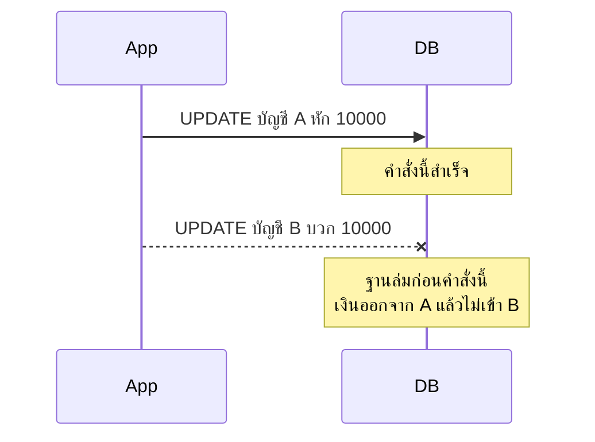
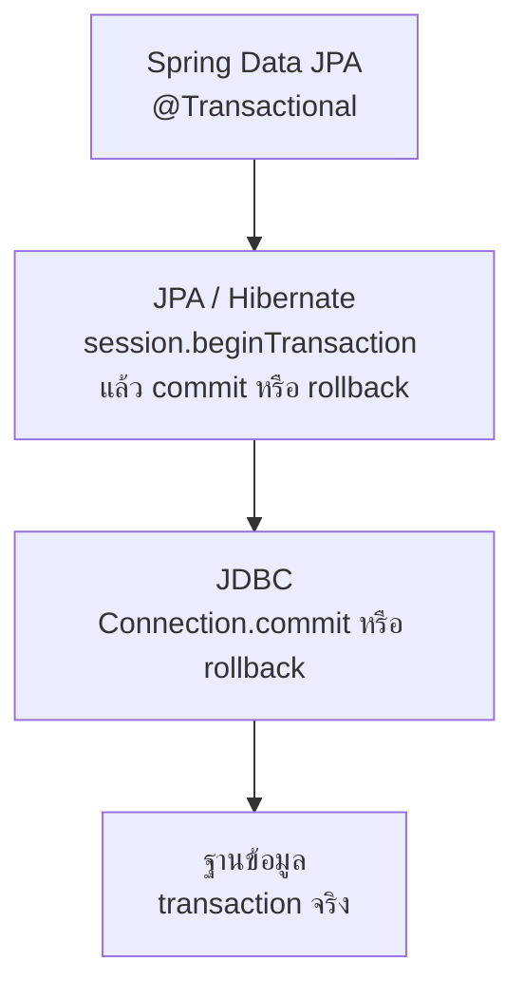
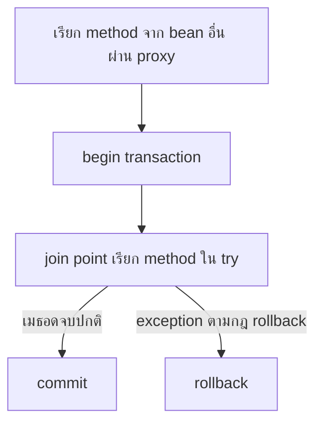
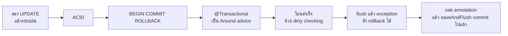

# #33 — Transaction: ACID, @Transactional, Commit และ Rollback

> **วิดีโอ:** [Spring Transactions | ACID, @Transactional, Commit & Rollback | Spring Boot Full Course #33](https://youtu.be/mpxdC8fKy1Y) — Coder Army, ~49 นาที
> **แหล่งที่ใช้สรุป:** ซับไตเติลภาษาอังกฤษที่ YouTube สร้างอัตโนมัติ (วิดีโอนี้มีซับ `en-US`)
> **เวอร์ชันในโค้ด:** Spring Boot 4.1 + Java 21 (ใส่หมายเหตุไว้ทุกจุดที่ Spring Boot 3.x ต่างกัน)

ตอนนี้ตอบคำถามว่า **งานหลายคำสั่งกับฐานข้อมูลจะสำเร็จทั้งก้อนหรือถูกยกเลิกทั้งก้อนได้อย่างไร** ผู้สอนเริ่มจากโอนเงินสองบัญชีที่ query แรกสำเร็จแล้วระบบล่ม จากนั้นไล่ ACID, คีย์เวิร์ด `BEGIN` / `COMMIT` / `ROLLBACK`, แล้วทำให้เห็นว่า `@Transactional` คือ Around advice ที่เปิด transaction ให้ทั้ง method สุดท้ายเขาเขียนโปรเจกต์ Transaction Demo โอนเงินจริง แล้วทดลองโยน exception ทั้งตอนมี annotation และตอนถอดออก

ส่วนที่ติดป้าย `💡 เพิ่มเติม` คือของที่ผมเติมเอง ไม่ได้อยู่ในวิดีโอ ส่วนที่ติด `⚠️ แก้จากวิดีโอ` คือจุดที่วิดีโอพูดคลาดเคลื่อน

> 💡 **เพิ่มเติม — วิดีโอใช้ MySQL โน้ตนี้ใช้ H2:** ผู้สอนต่อฐาน `student` ผ่าน DBeaver แบบตอนก่อน ๆ และยิง Postman ไปที่พอร์ต **8080** โน้ตนี้รันโปรเจกต์เดียวกันบน **H2 in-memory** (`jdbc:h2:mem:student_db`) ที่พอร์ต **9033** DDL จึงเป็นสำเนียงของ H2 เช่น `generated by default as identity` และ `numeric(38,2)` เวอร์ชันที่ได้จาก log คือ Spring Boot **4.1.1**, Hibernate ORM **7.4.5.Final**, Spring Framework **7.0.9** พฤติกรรมของ `@Transactional`, dirty checking, flush และ rollback ยังเป็นของชุดเดียวกัน

---

## สารบัญ

| เวลา | หัวข้อ |
|---|---|
| [0:00](https://youtu.be/mpxdC8fKy1Y?t=0) | [1. ทำไม transaction ถึงสำคัญ](#1-ทำไม-transaction-ถึงสำคัญ) |
| [0:40](https://youtu.be/mpxdC8fKy1Y?t=40) | [2. โอนเงินแล้วระบบล่มกลางทาง](#2-โอนเงินแล้วระบบล่มกลางทาง) |
| [2:48](https://youtu.be/mpxdC8fKy1Y?t=168) | [3. บล็อกที่สำเร็จทั้งก้อนหรือไม่เกิดเลย](#3-บล็อกที่สำเร็จทั้งก้อนหรือไม่เกิดเลย) |
| [3:45](https://youtu.be/mpxdC8fKy1Y?t=225) | [4. ACID](#4-acid) |
| [11:05](https://youtu.be/mpxdC8fKy1Y?t=665) | [5. BEGIN, COMMIT, ROLLBACK](#5-begin-commit-rollback) |
| [12:02](https://youtu.be/mpxdC8fKy1Y?t=722) | [6. เมธอด transfer กับ @Transactional](#6-เมธอด-transfer-กับ-transactional) |
| [14:23](https://youtu.be/mpxdC8fKy1Y?t=863) | [7. สามชั้นจาก JDBC ถึง Spring Data JPA](#7-สามชั้นจาก-jdbc-ถึง-spring-data-jpa) |
| [15:54](https://youtu.be/mpxdC8fKy1Y?t=954) | [8. ความหมายของ begin, commit, rollback](#8-ความหมายของ-begin-commit-rollback) |
| [20:57](https://youtu.be/mpxdC8fKy1Y?t=1257) | [9. Around advice](#9-around-advice) |
| [22:26](https://youtu.be/mpxdC8fKy1Y?t=1346) | [10. โปรเจกต์ Transaction Demo](#10-โปรเจกต์-transaction-demo) |
| [22:55](https://youtu.be/mpxdC8fKy1Y?t=1375) | [11. Entity Account กับ debit และ credit](#11-entity-account-กับ-debit-และ-credit) |
| [24:45](https://youtu.be/mpxdC8fKy1Y?t=1485) | [12. Entity TransferRecord](#12-entity-transferrecord) |
| [30:45](https://youtu.be/mpxdC8fKy1Y?t=1845) | [13. Repository และ TransferService](#13-repository-และ-transferservice) |
| [36:53](https://youtu.be/mpxdC8fKy1Y?t=2213) | [14. Controller](#14-controller) |
| [38:38](https://youtu.be/mpxdC8fKy1Y?t=2318) | [15. เดโมโอนสำเร็จ](#15-เดโมโอนสำเร็จ) |
| [42:15](https://youtu.be/mpxdC8fKy1Y?t=2535) | [16. Dirty checking และ flush](#16-dirty-checking-และ-flush) |
| [43:27](https://youtu.be/mpxdC8fKy1Y?t=2607) | [17. Exception หลัง flush](#17-exception-หลัง-flush) |
| [46:19](https://youtu.be/mpxdC8fKy1Y?t=2779) | [18. ถอด @Transactional](#18-ถอด-transactional) |
| [47:46](https://youtu.be/mpxdC8fKy1Y?t=2866) | [19. จับ exception ไว้ในเมธอด](#19-จับ-exception-ไว้ในเมธอด) |
| [48:03](https://youtu.be/mpxdC8fKy1Y?t=2883) | [20. Consistency เป็นหน้าที่ของแอป](#20-consistency-เป็นหน้าที่ของแอป) |
| — | [21. ผลที่รันได้](#21-ผลที่รันได้) |
| — | [22. สรุปท้ายตอน](#22-สรุปท้ายตอน) |

---

## 1. ทำไม transaction ถึงสำคัญ

[▶ 0:00](https://youtu.be/mpxdC8fKy1Y?t=0)

ผู้สอนบอกว่า transaction เป็นหัวข้อที่ต้องตั้งใจฟัง ตอน Hibernate เขาเคยบอกว่า EntityManager ถูกสร้างเมื่อมี transaction และเรียกฐานข้อมูลได้หลังจากนั้น ถ้ายังไม่ดูตอน Hibernate ก็เริ่มจากศูนย์ในตอนนี้ได้ เขาจะค่อย ๆ ลงรายละเอียด

> 💡 **เพิ่มเติม:** ในแอป Spring ที่รันด้านล่าง Bean ของ `EntityManager` เป็น proxy ที่ container สร้างไว้ตั้งแต่สตาร์ท สิ่งที่เปิดพร้อม transaction คือ **Persistence Context** ซึ่งเป็นที่เก็บ Entity ที่ Hibernate กำลังติดตาม และปิดเมื่อ transaction จบ คำที่เขาใช้ว่า EntityManager ถูกสร้างพร้อม transaction คือภาพจากตอน Hibernate ผลที่เห็นในเดโมตรงกับ Persistence Context แบบนี้

---

## 2. โอนเงินแล้วระบบล่มกลางทาง

[▶ 0:40](https://youtu.be/mpxdC8fKy1Y?t=40)

บนกระดานมีสองบัญชี บัญชี A กับบัญชี B งานคือโอน ₹10,000 จาก A ไป B ถ้าคิดเป็น SQL ล้วน ๆ มีสองคำสั่ง

1. `UPDATE` บัญชี A ให้หัก 10,000
2. `UPDATE` บัญชี B ให้บวก 10,000

เขาไม่ได้เขียน SQL เต็มบนกระดาน แค่ชี้ว่ามีสอง update

สมมติคำสั่งแรกสำเร็จ แล้วฐานข้อมูลล่มก่อนคำสั่งที่สอง เมื่อฐานกลับมา เงินออกจาก A แล้วแต่ไม่เข้า B ยอดรวมของสองบัญชีหายไป 10,000 เขาเรียกเหตุนี้ว่าหลักอนุรักษ์เงินใช้ไม่ได้ เพราะเงินถูกทำลายระหว่างทาง ทั้งที่ query หนึ่งสำเร็จและอีก query ไม่ได้รัน



เรื่องแบบนี้คือเหตุที่ SQL มี transaction

---

## 3. บล็อกที่สำเร็จทั้งก้อนหรือไม่เกิดเลย

[▶ 2:48](https://youtu.be/mpxdC8fKy1Y?t=168)

ความหมายที่เขาใช้คือ รวมทุก operation ที่ต้องเกิดด้วยกันเป็นบล็อกเดียว บล็อกนั้นชื่อ transaction ในตัวอย่างมีสอง operation จะมีห้าสิบ operation ก็ได้ ทุกตัวอยู่ใน transaction เดียวกัน

ผลที่มีได้มีสองแบบ ทั้งบล็อกสำเร็จ หรือทั้งบล็อกไม่สำเร็จ จะเกิดครึ่งทางไม่ได้ แบบที่คำสั่งแรกสำเร็จแล้วคำสั่งที่สองล้มเป็นสิ่งที่ transaction ห้าม

งานที่แตะทรัพยากรสำคัญ เช่น เงินที่ย้ายจากบัญชีหนึ่งไปอีกบัญชี เขาบอกให้ทำใน transaction เดียว เพราะภัยภายนอกอาจทำให้ครึ่งหนึ่งสำเร็จ

---

## 4. ACID

[▶ 3:45](https://youtu.be/mpxdC8fKy1Y?t=225)

เขาบอกว่า transaction นำคุณสมบัติ **ACID** มาให้ สี่คำนี้เป็นศัพท์ของ SQL ได้แก่ **Atomicity**, **Consistency**, **Isolation**, **Durability**

### Atomicity

[▶ 4:16](https://youtu.be/mpxdC8fKy1Y?t=256)

เขาเทียบกับอะตอมในเคมี ว่าเป็นหน่วยเล็กสุดที่แบ่งต่อไม่ได้ แล้วยอมรับว่ามีหน่วยที่เล็กกว่านั้นอย่าง quark แต่ในภาพใหญ่ยังใช้อะตอมเป็นหน่วยที่แบ่งไม่ได้อยู่ดี

Atomicity ของ transaction คือทั้งก้อนเกิดพร้อมกัน หรือไม่เกิดเลย จะมีส่วนหนึ่งเกิดและอีกส่วนไม่เกิดไม่ได้ ตัวอย่างโอนเงินที่ query แรกสำเร็จแล้ว query สองไม่เกิด คือสิ่งที่ atomicity ห้าม

### Consistency

[▶ 4:59](https://youtu.be/mpxdC8fKy1Y?t=299)

Consistency หมายถึง transaction ที่สำเร็จพาฐานข้อมูลจากสถานะที่ถูกต้องหนึ่งสถานะไปยังสถานะที่ถูกต้องอีกสถานะ

ตัวอย่างบนกระดาน บัญชี A มียอด ₹5,000 แล้วจะโอน ₹10,000 ถ้าไม่ตรวจยอดก่อน แล้วใช้สูตรหักจำนวนโอนออกจากยอด A จะเหลือ −5,000 และ B ได้ 10,000 ยอดติดลบเป็นสถานะที่ใช้ไม่ได้ เขายกสถานะตั้งต้นว่า A มี 5,000 และ B มี 0 ซึ่งผลรวมเป็นบวก แล้วเทียบกับสถานะที่ A เป็น −5,000

เขาย้ำว่า logic ที่รักษา consistency ไม่ได้อยู่ที่ฐานข้อมูลอย่างเดียว แอปต้องใส่ validation ด้วย เพื่อไม่ให้ข้อมูลเข้าสู่สถานะที่ไม่ถูกต้อง

### Isolation

[▶ 6:40](https://youtu.be/mpxdC8fKy1Y?t=400)

Isolation เกี่ยวกับ transaction ที่รันพร้อมกัน เขาใช้บัญชี C มียอด ₹6,000 มีสอง transaction

| Transaction | งาน |
|---|---|
| T1 | ถอน ₹2,000 จาก C |
| T2 | ถอน ₹3,000 จาก C |

ถ้าทั้งคู่เริ่มพร้อมกัน ทั้งคู่อาจอ่านยอด 6,000 T1 คำนวณ 6,000 − 2,000 แล้วเขียน 4,000 T2 คำนวณ 6,000 − 3,000 แล้วเขียน 3,000 ทับ ผลสุดท้ายเหลือ 3,000 ทั้งที่ถอนรวม 5,000 จาก 6,000 ควรเหลือ 1,000

ลำดับที่เขาบอกว่าถูกต้องคือ T1 อ่าน 6,000 หัก 2,000 แล้วเขียน 4,000 จากนั้น T2 อ่าน 4,000 หัก 3,000 แล้วเขียน 1,000

เขาบอกว่า isolation ไม่ได้แปลว่ามีได้ทีละ transaction ทั้งคู่เดินพร้อมกันได้ สิ่งที่ต้องตอบคือตอน T1 กำลังทำงาน T2 ควรอ่านค่าไหน เขาตอบว่าควรอ่านค่าที่ถูกต้องหลัง T1 อัปเดตแล้ว สถานะฐานข้อมูลและผลลัพธ์สุดท้ายต้องยังถูกต้อง

> ⚠️ **แก้จากวิดีโอ:** ช่วงท้ายของ ACID เขาบอกว่าใช้ SQL หรือ relational database แล้วจะได้ ACID ครบแน่นอน สองจุดนี้คลาดเคลื่อน ข้อแรก consistency แบบยอดห้ามติดลบไม่ได้เกิดเองจากฐานข้อมูล เขาเองเพิ่งบอกว่า validation เป็นหน้าที่ของแอป ข้อสอง ตัวอย่างบัญชี C เป็นการอ่านยอดมาคำนวณในแอปแล้วเขียนยอดใหม่ทั้งก้อน ทับกันได้แม้ฐานล็อกแถวตอนเขียน เพราะค่า 3,000 ถูกคำนวณจากยอดเก่าแล้ว Isolation ระดับที่ฐานใช้เป็นค่า default ไม่ได้กันกรณีนี้ให้เอง H2 ใน log ของโน้ตนี้รายงาน `READ_COMMITTED` การกัน lost update แบบนี้ต้องล็อกแถวตอนอ่าน ให้ SQL บวกลบในคำสั่งเดียว หรือใช้ version ระดับ isolation เป็นเรื่องของตอนถัดไป

### Durability

[▶ 9:42](https://youtu.be/mpxdC8fKy1Y?t=582)

Durability คือ transaction ที่สำเร็จแล้วต้องทนความล้มเหลวที่เกิดหลังจากนี้ สมมติโอน 10,000 จาก A ไป B สำเร็จครบ และสถานะยัง consistent แล้วฐานล่มทันทีที่ทำเสร็จ เมื่อฐานกลับมา A ต้องถูกหัก 10,000 และ B ต้องได้รับ 10,000 อยู่ จะย้อนเองเพราะระบบล่มหลังสำเร็จไม่ได้

เขาใช้คำว่า commit กับงานที่สำเร็จและจบแล้ว สิ่งที่ commit ไปแล้วไม่ถูกกระทบจากความล้มเหลวในอนาคต

สี่ข้อนี้รวมกันคือ ACID เขาบอกว่าเป็นคุณสมบัติที่มีมาใน SQL และใน relational database และแนวคิด transaction เป็นของ SQL ตอนเขียน query จะขึ้นต้นด้วย `BEGIN` ทำงาน แล้วจบด้วย `COMMIT` ถ้ามีอะไรไม่ถูกก็ `ROLLBACK`

---

## 5. BEGIN, COMMIT, ROLLBACK

[▶ 11:05](https://youtu.be/mpxdC8fKy1Y?t=665)

เขาแยกสองคำ

**Physical transaction** คือ transaction จริงที่ถูกสร้างในฐานข้อมูล ซึ่ง SQL รองรับ Spring Boot ถูกใช้เพื่อสร้าง physical transaction ชั้นนั้น

**Virtual transaction** คือ transaction ที่สร้างภายใน Spring Boot เขาบอกว่าจะอธิบายวิธีสร้างทีหลัง ตอนนี้แค่จำคำนี้ไว้

Spring จึงไม่ได้คิด transaction ขึ้นเองจากศูนย์ มันไปเปิด transaction ของฐานข้อมูล

---

## 6. เมธอด transfer กับ @Transactional

[▶ 12:02](https://youtu.be/mpxdC8fKy1Y?t=722)

บนกระดานมีเมธอด `transfer` รับสามค่า คือ id บัญชีต้นทาง, id บัญชีปลายทาง, และจำนวนเงินเป็น `BigDecimal` ข้างในทำสามอย่าง

1. `debitAccount` หักเงินจากบัญชีต้นทาง
2. `creditAccount` บวกเงินเข้าบัญชีปลายทาง
3. `recordTransfer` บันทึกการโอนลงฐานข้อมูลไว้เป็น audit

เหนือเมธอดมี `@Transactional` เขาบอกว่านี่คือวิธีสร้าง transaction ใน Spring ทั้งเมธอดรันในบล็อกเดียว สาม operation ต้องสำเร็จครบหรือล้มครบ จะสำเร็จหนึ่งหรือสองอย่างแล้วที่เหลือล้มไม่ได้

สามคำที่เขาจะใช้ต่อคือ **begin**, **commit**, และ **rollback** annotation เป็นของชั้น Spring ส่วนข้างในยังเป็นสามคำนี้

---

## 7. สามชั้นจาก JDBC ถึง Spring Data JPA

[▶ 14:23](https://youtu.be/mpxdC8fKy1Y?t=863)

เขาเริ่มเขียนสี่ชั้นว่า Spring JPA อยู่บน JPA, JPA อยู่บน Hibernate, Hibernate อยู่บน JDBC แล้วแก้เองให้เหลือสามชั้น เพราะ Hibernate คือ implementation ของ JPA จึงเขียนคู่กันเป็น JPA/Hibernate

เขาเรียกชั้นบนว่า Spring JPA ชื่อโมดูลในโปรเจกต์คือ **Spring Data JPA**

แต่ละชั้นประกาศ transaction แบบ abstract มากขึ้น

| ชั้น | วิธีที่เขาอธิบาย |
|---|---|
| SQL ในไคลเอนต์ของฐานข้อมูล | คีย์เวิร์ด `BEGIN`, `COMMIT`, `ROLLBACK` |
| JDBC | เขาบอกว่าใช้สามคีย์เวิร์ดนี้ |
| Hibernate / JPA | เรียกเป็น method |
| Spring Data JPA | annotation `@Transactional` ตัวเดียว |

> ⚠️ **แก้จากวิดีโอ:** API ของ JDBC ไม่ได้ประกาศ transaction ด้วยการพิมพ์คีย์เวิร์ด `BEGIN` / `COMMIT` / `ROLLBACK` คีย์เวิร์ดนั้นเป็น SQL ที่ส่งเข้าฐานข้อมูลโดยตรง โค้ด JDBC ใช้ `Connection.setAutoCommit(false)` แล้วเรียก `commit()` หรือ `rollback()` ช่วงที่เขาบอกว่าโค้ดจะยาวขึ้นและต้องเขียนคีย์เวิร์ด SQL เพราะกำลังเขียน query จริง เขาพูดว่าเป็นชั้น JPA ที่ตรงคือชั้น SQL และ JDBC ไม่ใช่ JPA



### รูปร่างของโค้ด Hibernate

[▶ 19:07](https://youtu.be/mpxdC8fKy1Y?t=1147)

เขาบอกว่าในวิดีโอ Hibernate สามคำนี้กลายเป็น method รูปร่างบนกระดานคือเปิด transaction ก่อน `try` ทำงานใน `try` ถ้าครบก็ commit ถ้ามี exception ก็เข้า `catch` แล้ว rollback งานที่ทำไปแล้วทุกแบบถูกย้อน ไม่ว่าจะ update, insert หรือ delete

ชื่อ method บนกระดานเป็นชื่อสมมติ เขาบอกเองว่ายังไม่ได้ใช้ชื่อจริง

```text
beginTransaction()
try {
    op1()
    op2()
    commitTransaction()
} catch (Exception e) {
    rollbackTransaction()
}
```

> 💡 **เพิ่มเติม:** API ของ Hibernate ที่ตรงกับภาพนี้คือ `session.beginTransaction()` ได้ `Transaction` แล้วเรียก `commit()` หรือ `rollback()` บน object นั้น แอปในโน้ตนี้ไม่ได้เรียก API นี้ตรง ๆ เพราะ `@Transactional` เรียกให้

เหนือชั้นนั้นแอปแค่แปะ `@Transactional`

---

## 8. ความหมายของ begin, commit, rollback

[▶ 15:54](https://youtu.be/mpxdC8fKy1Y?t=954)

**begin** คือขอบเขตเริ่มต้นของ transaction

**commit** คือบอกว่า operation ที่ทำไปแล้วให้ลงฐานข้อมูลให้สำเร็จ และจะไม่ทำ operation เพิ่มใน transaction นี้ สถานะทั้งก้อนเป็นสถานะที่ตรวจแล้ว

**rollback** คือมีปัญหาระหว่างทาง เช่น operation หนึ่งและสองสำเร็จ แล้ว operation สามโยน exception งานที่สำเร็จไปแล้วถูกพากลับสู่สถานะก่อน begin

ตัวอย่างตัวเลขบนกระดาน เขาให้สมมติว่าบัญชี A มียอด 15,000 ไม่ใช่ 5,000 ของตัวอย่าง consistency หัก 10,000 แล้ว A เหลือ 5,000 บัญชี B เริ่มที่ 0 บวก 10,000 แล้วเป็น 10,000 ทั้งสองคำสั่งสำเร็จจึง commit

ถ้าอัปเดต A จาก 15,000 เป็น 5,000 แล้วตอนอัปเดต B เกิด exception และยอด B ยังเป็น 0 rollback คือยกเลิกการอัปเดต A ให้กลับไป 15,000

[▶ 18:19](https://youtu.be/mpxdC8fKy1Y?t=1099)

เขาบอกว่าความเข้าใจผิดที่พบบ่อยคือ rollback แปลว่าเขียน `UPDATE` ย้อนกลับให้ operation ที่ทำไป เขาบอกว่าไม่ใช่ ฐานข้อมูลแบบ SQL เก็บสถานะไว้แล้ว rollback คือการ undo เขาเทียบกับ Ctrl+Z และกับ stack ที่ pop ของบนสุดออก โดยไม่มี operation จริงเกิดขึ้น

> ⚠️ **แก้จากวิดีโอ:** แอปไม่ได้ส่ง query ย้อนกลับเอง ข้อนี้ตรงกับที่เขาพูด ส่วนคำว่า rollback ไม่มีการทำงานกับฐานข้อมูลเลยคลาดเคลื่อน เครื่องยนต์ของฐานข้อมูลอ่าน **undo log** แล้วคืนแถวที่ยังไม่ commit InnoDB ใช้ undo log เพื่อ rollback transaction และใช้กับบางระดับของ isolation ด้วย ([InnoDB undo logs](https://dev.mysql.com/doc/refman/8.4/en/innodb-undo-logs.html)) ภาพ stack ใช้เข้าใจลำดับการย้อนได้ กลไกจริงคือการนำ undo record ไปใช้

---

## 9. Around advice

[▶ 20:57](https://youtu.be/mpxdC8fKy1Y?t=1257)

เขาเชื่อมกับ AOP ที่เรียนไปแล้ว `@Transactional` ทำงานแบบ aspect ที่จับ annotation เมธอดที่มี annotation นี้ถูก intercept

ภายในเป็น **Around advice** ทำบางอย่างก่อนเมธอด เรียกเมธอด แล้วทำบางอย่างหลังเมธอด ก่อนเมธอดคือ begin เรียกเมธอดผ่าน join point ข้างใน `try` ถ้าจบปกติก็ commit ถ้ามี exception ก็ rollback

เขาบอกว่าทดลองเองได้โดยเขียน Around advice แล้วใส่โค้ด Hibernate ลงไป หรือจะใช้ `@Transactional` อย่างเดียวก็ได้



[▶ 22:13](https://youtu.be/mpxdC8fKy1Y?t=1333)

เขาบอกว่าแปะได้ทั้งระดับ method และระดับ class ระดับ method ทำให้ทั้ง method อยู่ใน transaction ระดับ class เขาบอกว่าทั้ง class จะรันใน transaction เดียว

> ⚠️ **แก้จากวิดีโอ:** `@Transactional` ที่ระดับ class เป็นค่า default ของ method ใน class นั้น แต่ละครั้งที่เรียก method จากข้างนอกได้ transaction ของการเรียกนั้น method จบก็ commit หรือ rollback ของการเรียกนั้น ไม่ได้เปิด transaction เดียวค้างไว้ตลอดชีวิตของ object ([Using @Transactional](https://docs.spring.io/spring-framework/reference/data-access/transaction/declarative/annotations.html))

> 💡 **เพิ่มเติม:** advice นี้ทำงานเมื่อเรียกเข้ามาทาง proxy เท่านั้น Controller เรียก `TransferService` คนละ bean จึงโดน advice ถ้าเมธอดใน class เดียวกันเรียก `this.transfer(...)` การเรียกนั้นไม่ผ่าน proxy และไม่เปิด transaction ใหม่ เอกสาร Spring เรียกกรณีนี้ว่า self-invocation

> ⚠️ **แก้จากวิดีโอ:** เขาบอกว่าถ้ามี exception ใด ๆ Around advice จะ rollback ที่ถูกคือค่า default ของ `org.springframework.transaction.annotation.Transactional` rollback เมื่อเป็น `RuntimeException` หรือ `Error` เท่านั้น checked exception ที่หลุดออกจากเมธอดทำให้ transaction commit `DefaultTransactionAttribute.rollbackOn` ใน `spring-tx` 7.0.9 ที่มากับ Boot 4.1.1 เขียนเงื่อนไขนี้ไว้ตรง ๆ และ javadoc ของ annotation ก็บอกแบบเดียวกัน ([Rolling Back a Declarative Transaction](https://docs.spring.io/spring-framework/reference/data-access/transaction/declarative/rolling-back.html)) ผลรันของ checked exception อยู่ในหัวข้อ 21

---

## 10. โปรเจกต์ Transaction Demo

[▶ 22:26](https://youtu.be/mpxdC8fKy1Y?t=1346)

เขาเปิด IntelliJ โปรเจกต์ว่างชื่อ Transaction Demo ไม่มี controller, entity, repository หรือ service งานคือสร้างสถานการณ์โอนเงินจาก A ไป B ใน transaction ตั้งแต่ศูนย์ Lombok ถูกใส่ใน dependency ไว้แล้ว

> ⚠️ **Boot 4 vs 3:** starter ของเว็บใน Boot 4 คือ `spring-boot-starter-webmvc` ชื่อเดิม `spring-boot-starter-web` ถูกเปลี่ยนมาเป็นชื่อนี้ `spring-boot-starter-data-jpa` ชื่อเดิมทั้งสองรุ่น ([Spring Boot 4.0 Migration Guide](https://github.com/spring-projects/spring-boot/wiki/Spring-Boot-4.0-Migration-Guide) ตารางเปลี่ยนชื่อ starter)

```xml
<parent>
  <groupId>org.springframework.boot</groupId>
  <artifactId>spring-boot-starter-parent</artifactId>
  <version>4.1.1</version>
</parent>

<dependencies>
  <dependency>
    <groupId>org.springframework.boot</groupId>
    <artifactId>spring-boot-starter-webmvc</artifactId>
  </dependency>
  <dependency>
    <groupId>org.springframework.boot</groupId>
    <artifactId>spring-boot-starter-data-jpa</artifactId>
  </dependency>
  <dependency>
    <groupId>com.h2database</groupId>
    <artifactId>h2</artifactId>
    <scope>runtime</scope>
  </dependency>
  <dependency>
    <groupId>org.projectlombok</groupId>
    <artifactId>lombok</artifactId>
    <optional>true</optional>
  </dependency>
</dependencies>
```

`application.properties` ของเขาต่อฐาน student ไว้แล้ว เขาไม่ได้เปิดไฟล์อ่านทีละบรรทัด ไฟล์ที่รันในโน้ตนี้เป็นแบบนี้

```properties
server.port=9033

spring.datasource.url=jdbc:h2:mem:student_db;DB_CLOSE_DELAY=-1
spring.datasource.driver-class-name=org.h2.Driver
spring.datasource.username=sa
spring.datasource.password=

spring.jpa.hibernate.ddl-auto=update
spring.jpa.show-sql=true
spring.jpa.properties.hibernate.format_sql=true

logging.level.org.hibernate.SQL=DEBUG
logging.level.org.hibernate.orm.jdbc.bind=TRACE
```

> 💡 **เพิ่มเติม:** สองบรรทัด `logging.level` ทำให้ log ของ Hibernate 7 พิมพ์ SQL และค่าที่ bind ชั้น `org.hibernate.SQL` ยังเป็นชื่อ logger ใน Hibernate 7.4.5 `DB_CLOSE_DELAY=-1` เป็นของ H2 เพื่อไม่ให้ฐานในหน่วยความจำปิดเมื่อ connection ถูกคืนเข้า pool

---

## 11. Entity Account กับ debit และ credit

[▶ 22:55](https://youtu.be/mpxdC8fKy1Y?t=1375)

Entity ชื่อ `Account` ใช้ Lombok `@Getter`, `@Setter`, `@NoArgsConstructor` และ `@Entity` ฟิลด์มีสามตัว

| ฟิลด์ | ความหมาย |
|---|---|
| `id` | primary key สร้างให้อัตโนมัติ |
| `name` | ชื่อเจ้าของบัญชี |
| `balance` | ยอดเงิน เป็น `BigDecimal` |

`id` แปะ `@Id` กับ `@GeneratedValue(strategy = GenerationType.IDENTITY)` เขาพูดชนิดเป็น `long` โน้ตใช้ `Long` เพื่อให้ค่าที่ยังไม่ถูก generate เป็น null

ตารางนี้บอกแค่ว่าบัญชีของใคร และมียอดเท่าไร

[▶ 28:05](https://youtu.be/mpxdC8fKy1Y?t=1685)

เขาย้ายงาน debit กับ credit มาไว้บน entity เพราะเป็นพฤติกรรมของบัญชี

`debitAccount` รับ `BigDecimal` ถ้า amount เป็น null หรือ `signum()` น้อยกว่าหรือเท่ากับ 0 โยน `IllegalArgumentException` ข้อความ `Amount must be positive` เขาใช้ `signum` เพราะเทียบ `BigDecimal` กับศูนย์ตรง ๆ ไม่ได้ และบอกว่าหักศูนย์ไม่มีประโยชน์

จากนั้นเทียบยอดกับจำนวนที่จะหัก ด้วย `balance.compareTo(amount)` ถ้าน้อยกว่า 0 แปลว่าเงินไม่พอ เขาพูดถึงการสร้าง exception เฉพาะอย่าง `InsufficientAccountBalance` ที่ extends `RuntimeException` แล้วเลือกยังไม่ทำ โยน `RuntimeException` ข้อความ `Insufficient balance` แทน ถ้าผ่านก็ `balance = balance.subtract(amount)`

`creditAccount` ตรวจ amount แบบเดียวกัน แล้ว `balance = balance.add(amount)`

```java
package com.coderarmy.transaction.entity;

import jakarta.persistence.Entity;
import jakarta.persistence.GeneratedValue;
import jakarta.persistence.GenerationType;
import jakarta.persistence.Id;
import java.math.BigDecimal;
import lombok.Getter;
import lombok.NoArgsConstructor;
import lombok.Setter;

@Getter
@Setter
@NoArgsConstructor
@Entity
public class Account {

  @Id
  @GeneratedValue(strategy = GenerationType.IDENTITY)
  private Long id;

  private String name;

  private BigDecimal balance;

  public void debitAccount(BigDecimal amount) {
    if (amount == null || amount.signum() <= 0) {
      throw new IllegalArgumentException("Amount must be positive");
    }
    if (balance.compareTo(amount) < 0) {
      throw new RuntimeException("Insufficient balance");
    }
    balance = balance.subtract(amount);
  }

  public void creditAccount(BigDecimal amount) {
    if (amount == null || amount.signum() <= 0) {
      throw new IllegalArgumentException("Amount must be positive");
    }
    balance = balance.add(amount);
  }
}
```

> 💡 **เพิ่มเติม:** เขาพูดจังหวะตรวจ null ว่า `amount equals null` การเรียก `amount.equals(null)` จะ NPE เมื่อ amount เป็น null จริง เงื่อนไขที่ใช้คือ `amount == null` ซึ่งตรงกับความตั้งใจว่า amount ต้องเป็นบวก

---

## 12. Entity TransferRecord

[▶ 24:45](https://youtu.be/mpxdC8fKy1Y?t=1485)

ตารางบัญชีไม่พอสำหรับ audit เขาต้องการตารางที่บอกว่าใครโอนให้ใคร เมื่อไร และเท่าไร ชื่อที่เลือกสุดท้ายคือ `TransferRecord` ไม่ใช่ record transfer

ฟิลด์สุดท้ายมีห้าตัว

| ฟิลด์ | ความหมาย |
|---|---|
| `id` | primary key แบบ identity |
| `fromAccountId` | id บัญชีต้นทาง ชนิด `Long` |
| `toAccountId` | id บัญชีปลายทาง |
| `amount` | จำนวนที่โอน เป็น `BigDecimal` เขาพูดเป็น `long` ก่อนแล้วแก้ |
| `transferredAt` | วันที่โอน เป็น `LocalDate` เขาเคยพูด `createdAt` แล้วเปลี่ยนชื่อ |

เขาบอกว่าดูตอนความสัมพันธ์มาแล้ว จะเก็บ object `Account` ทั้งก้อนด้วยความสัมพันธ์ one-to-one ก็ได้ แต่ตารางจะดูซับซ้อน ทั้งที่ audit ต้องการแค่ id เขาจึงเก็บ id ตรง ๆ

> ⚠️ **แก้จากวิดีโอ:** แถวโอนหลายแถวอ้างบัญชีเดียวกันได้ ความสัมพันธ์ของ object ถ้าจะทำคือ `@ManyToOne` ไม่ใช่ one-to-one การเก็บ `Long` อย่างที่เขาทำใช้ได้ และ DDL ที่ Hibernate สร้างไม่มี foreign key constraint

เขากด `@AllArgsConstructor` ก่อน แล้วตอน `new TransferRecord(...)` คอมไพเลอร์ฟ้องเพราะ constructor รวม `id` ด้วย เขาเลยลบออก แล้ว generate constructor เฉพาะฟิลด์ที่เหลือ

ตอนแรกเขาส่ง `LocalDateTime.now()` แต่ฟิลด์เป็น `LocalDate` จึงเปลี่ยนเป็น `LocalDate.now()` เขาบอกว่าจะเก็บ datetime ในฐานข้อมูลก็ได้

[▶ 27:33](https://youtu.be/mpxdC8fKy1Y?t=1653)

เขารันแอปครั้งแรก Hibernate สร้างสองตาราง รีเฟรช DBeaver แล้วเห็น `account` กับ `transfer_record` เขาสะกดคอลัมน์ของตาราง audit ว่า id, balance, from, to, transferred at

> ⚠️ **แก้จากวิดีโอ:** ฟิลด์ที่เขาเขียนคือ `amount` ไม่ใช่ `balance` DDL จริงของ H2 มีคอลัมน์ `amount` คำว่า balance ในประโยคนั้นไม่ตรงกับ entity

```java
package com.coderarmy.transaction.entity;

import jakarta.persistence.Entity;
import jakarta.persistence.GeneratedValue;
import jakarta.persistence.GenerationType;
import jakarta.persistence.Id;
import java.math.BigDecimal;
import java.time.LocalDate;
import lombok.Getter;
import lombok.NoArgsConstructor;
import lombok.Setter;

@Getter
@Setter
@NoArgsConstructor
@Entity
public class TransferRecord {

  @Id
  @GeneratedValue(strategy = GenerationType.IDENTITY)
  private Long id;

  private Long fromAccountId;

  private Long toAccountId;

  private BigDecimal amount;

  private LocalDate transferredAt;

  public TransferRecord(
      Long fromAccountId, Long toAccountId, BigDecimal amount, LocalDate transferredAt) {
    this.fromAccountId = fromAccountId;
    this.toAccountId = toAccountId;
    this.amount = amount;
    this.transferredAt = transferredAt;
  }
}
```

DDL จาก log ตอนสตาร์ทพอร์ต 9033

```sql
create table account (
    id bigint generated by default as identity,
    balance numeric(38,2),
    name varchar(255),
    primary key (id)
)
create table transfer_record (
    id bigint generated by default as identity,
    amount numeric(38,2),
    from_account_id bigint,
    to_account_id bigint,
    transferred_at date,
    primary key (id)
)
```

---

## 13. Repository และ TransferService

[▶ 30:45](https://youtu.be/mpxdC8fKy1Y?t=1845)

Service ชื่อ `TransferService` มีเมธอด `transfer` เขาสะกดพารามิเตอร์รอบแรกว่า `fromTransactionId`, `toTransactionId` และ `balance` แล้วแก้เองเป็น `fromAccountId`, `toAccountId` และ `amount`

เมธอดถูกประกาศเป็น `@Transactional` เพื่อให้ทั้งก้อนอยู่ใน transaction

จากนั้นเขา `findById` สองครั้ง ผลเป็น `Optional` จึงต่อ `orElseThrow` ถ้าไม่พบเขาโยน `RuntimeException` ข้อความ `user not found` ระหว่างทางคอมไพเลอร์ฟ้องชนิดไม่ตรง เพราะ `JpaRepository` ยังไม่ได้ใส่ type argument เขาเติม `Account` กับ `Long` แล้วทำแบบเดียวกันกับ repository ของ transfer record ฟ้องนั้นหาย

[▶ 32:03](https://youtu.be/mpxdC8fKy1Y?t=1923)

Repository เป็น interface ที่ extends `JpaRepository` เขาไม่เขียน method เอง แล้ว constructor-inject ทั้งสองตัวเข้า service ชื่อ repository ของ audit คือ `TransferRepository` ไม่ใช่ชื่อ class ของ entity

```java
package com.coderarmy.transaction.repository;

import com.coderarmy.transaction.entity.Account;
import org.springframework.data.jpa.repository.JpaRepository;

public interface AccountRepository extends JpaRepository<Account, Long> {}
```

```java
package com.coderarmy.transaction.repository;

import com.coderarmy.transaction.entity.TransferRecord;
import org.springframework.data.jpa.repository.JpaRepository;

public interface TransferRepository extends JpaRepository<TransferRecord, Long> {}
```

ลำดับใน `transfer` ตรงกับกระดาน

1. โหลดบัญชีต้นทางและปลายทาง
2. `fromAccount.debitAccount(amount)`
3. `toAccount.creditAccount(amount)`
4. `transferRepository.save(new TransferRecord(fromAccountId, toAccountId, amount, LocalDate.now()))`

เขาไม่ได้เรียก `save` ของสองบัญชีในรุ่นนี้ การอัปเดตยอดอาศัย dirty checking ซึ่งเขาอธิบายหลังเดโมสำเร็จ

> 💡 **เพิ่มเติม:** ในไฟล์เขาเขียน `findById(...).orElseThrow(...)` สองครั้ง โน้ตดึงข้อความ `user not found` ไปไว้ที่ `requireAccount` ผลเหมือนกัน

เมธอดอื่นใน class ด้านล่างเป็นรุ่นที่เขาแก้ `transfer` ทีหลังในคลิป โปรเจกต์แยกเป็นคนละเมธอดเพื่อให้รันทั้งเส้นที่สำเร็จและเส้นที่ล้มได้พร้อมกัน รายละเอียดอยู่ในหัวข้อ 17 ถึง 19

```java
package com.coderarmy.transaction.service;

import com.coderarmy.transaction.entity.Account;
import com.coderarmy.transaction.entity.TransferRecord;
import com.coderarmy.transaction.repository.AccountRepository;
import com.coderarmy.transaction.repository.TransferRepository;
import java.math.BigDecimal;
import java.time.LocalDate;
import org.springframework.stereotype.Service;
import org.springframework.transaction.annotation.Transactional;

@Service
public class TransferService {

  private final AccountRepository accountRepository;
  private final TransferRepository transferRepository;

  public TransferService(
      AccountRepository accountRepository, TransferRepository transferRepository) {
    this.accountRepository = accountRepository;
    this.transferRepository = transferRepository;
  }

  @Transactional
  public void transfer(Long fromAccountId, Long toAccountId, BigDecimal amount) {
    Account fromAccount = requireAccount(fromAccountId);
    Account toAccount = requireAccount(toAccountId);
    fromAccount.debitAccount(amount);
    toAccount.creditAccount(amount);
    transferRepository.save(
        new TransferRecord(fromAccountId, toAccountId, amount, LocalDate.now()));
  }

  @Transactional
  public void transferFlushThenFail(Long fromAccountId, Long toAccountId, BigDecimal amount) {
    Account fromAccount = requireAccount(fromAccountId);
    Account toAccount = requireAccount(toAccountId);
    fromAccount.debitAccount(amount);
    accountRepository.saveAndFlush(fromAccount);
    toAccount.creditAccount(amount);
    accountRepository.saveAndFlush(toAccount);
    transferRepository.save(
        new TransferRecord(fromAccountId, toAccountId, amount, LocalDate.now()));
    transferRepository.flush();
    throw new RuntimeException("some error occurred");
  }

  @Transactional
  public void transferFailAfterDebit(Long fromAccountId, Long toAccountId, BigDecimal amount) {
    Account fromAccount = requireAccount(fromAccountId);
    fromAccount.debitAccount(amount);
    accountRepository.saveAndFlush(fromAccount);
    throw new RuntimeException("some error occurred");
  }

  @Transactional
  public void transferAndSwallow(Long fromAccountId, Long toAccountId, BigDecimal amount) {
    Account fromAccount = requireAccount(fromAccountId);
    Account toAccount = requireAccount(toAccountId);
    fromAccount.debitAccount(amount);
    toAccount.creditAccount(amount);
    transferRepository.save(
        new TransferRecord(fromAccountId, toAccountId, amount, LocalDate.now()));
    try {
      throw new RuntimeException("some error occurred");
    } catch (RuntimeException ex) {
      // exception does not leave the transactional method
    }
  }

  @Transactional
  public void transferThenChecked(Long fromAccountId, Long toAccountId, BigDecimal amount)
      throws Exception {
    Account fromAccount = requireAccount(fromAccountId);
    Account toAccount = requireAccount(toAccountId);
    fromAccount.debitAccount(amount);
    toAccount.creditAccount(amount);
    transferRepository.save(
        new TransferRecord(fromAccountId, toAccountId, amount, LocalDate.now()));
    throw new Exception("checked and not rolled back");
  }

  private Account requireAccount(Long id) {
    return accountRepository
        .findById(id)
        .orElseThrow(() -> new RuntimeException("user not found"));
  }
}
```

`transferThenChecked` ไม่ได้อยู่ในวิดีโอ มันใช้ตรวจคำแก้เรื่อง checked exception ในหัวข้อ 9

---

## 14. Controller

[▶ 36:53](https://youtu.be/mpxdC8fKy1Y?t=2213)

เขาสร้าง controller สองตัวและ service ของบัญชีเพิ่ม

`AccountController` ใช้ `@RequestMapping("/api/account")` มีเมธอดเดียว `createAccount` รับ `Account` ทั้งก้อนใน body เขาไม่ทำ DTO id ถูก generate ให้ รับแค่ name กับ balance `AccountService.createAccount` เรียก `accountRepository.save` แล้วตอบ client ว่าเสร็จ

`TransferController` เป็น `POST` เขาพูด path ยาวว่า `/api/transfer/transferRecord/transferAmount` ครั้งหนึ่ง แล้วตอนยิง Postman ใช้ `POST /api/transfer` พร้อม body ของ `TransferRecord` คือ `fromAccountId`, `toAccountId` และ `amount` id กับวันที่ถูกสร้างใน service request ที่ได้คำว่า done ในคลิปคือ path สั้น โน้ตจึงใช้ `POST /api/transfer`

Controller ดึงสามค่าจาก body แล้วเรียก `transfer` ตอบข้อความเสร็จเหมือนบัญชี เพื่อให้ไปดูผลในฐานข้อมูล

```java
package com.coderarmy.transaction.controller;

import com.coderarmy.transaction.entity.Account;
import com.coderarmy.transaction.service.AccountService;
import org.springframework.web.bind.annotation.PostMapping;
import org.springframework.web.bind.annotation.RequestBody;
import org.springframework.web.bind.annotation.RequestMapping;
import org.springframework.web.bind.annotation.RestController;

@RestController
@RequestMapping("/api/account")
public class AccountController {

  private final AccountService accountService;

  public AccountController(AccountService accountService) {
    this.accountService = accountService;
  }

  @PostMapping
  public String createAccount(@RequestBody Account account) {
    accountService.createAccount(account);
    return "Done";
  }
}
```

```java
package com.coderarmy.transaction.service;

import com.coderarmy.transaction.entity.Account;
import com.coderarmy.transaction.repository.AccountRepository;
import org.springframework.stereotype.Service;

@Service
public class AccountService {

  private final AccountRepository accountRepository;

  public AccountService(AccountRepository accountRepository) {
    this.accountRepository = accountRepository;
  }

  public void createAccount(Account account) {
    accountRepository.save(account);
  }
}
```

```java
package com.coderarmy.transaction.controller;

import com.coderarmy.transaction.entity.TransferRecord;
import com.coderarmy.transaction.service.TransferService;
import org.springframework.web.bind.annotation.PostMapping;
import org.springframework.web.bind.annotation.RequestBody;
import org.springframework.web.bind.annotation.RequestMapping;
import org.springframework.web.bind.annotation.RestController;

@RestController
@RequestMapping("/api/transfer")
public class TransferController {

  private final TransferService transferService;

  public TransferController(TransferService transferService) {
    this.transferService = transferService;
  }

  @PostMapping
  public String transferAmount(@RequestBody TransferRecord record) {
    transferService.transfer(
        record.getFromAccountId(), record.getToAccountId(), record.getAmount());
    return "Done";
  }
}
```

---

## 15. เดโมโอนสำเร็จ

[▶ 38:38](https://youtu.be/mpxdC8fKy1Y?t=2318)

เขาสตาร์ทใหม่ แล้วเปิด Postman

`POST localhost:8080/api/account` body เป็น JSON

| ครั้ง | name | balance | ผลที่เขาเห็น |
|---|---|---|---|
| 1 | Aditya | 15000 | ได้ข้อความ done และมีแถวในตาราง account |
| 2 | Rohit | 5000 | ได้ done เช่นกัน |

เขาพูดประโยคหนึ่งว่าตัวเองมี 1,000 และ Rohit มี 5,000 แล้วพูดต่อทันทีว่ามี 15,000 จะโอน 10,000 จึงควรเหลือ 5,000 และ Rohit ควรมี 15,000 ตัวเลขที่เข้ากับบัญชีที่สร้างและเข้ากับผลหลังโอนคือ 15,000 กับ 5,000

> ⚠️ **แก้จากวิดีโอ:** คำว่ามี 1,000 รูปี และช่วงก่อนโอนกลับที่พูดว่า Rohit มี 1,000 ไม่ตรงกับแถวที่เขาสร้าง หลังโอนสำเร็จเขาอ่าน DBeaver ได้ 5,000 กับ 15,000 ซึ่งเข้ากับ 15,000 − 10,000 และ 5,000 + 10,000

จากนั้น `POST /api/transfer`

```json
{
  "fromAccountId": 1,
  "toAccountId": 2,
  "amount": 10000
}
```

Aditya คือ id 1, Rohit คือ id 2 ได้ข้อความ done ตาราง audit มีแถวจำนวน 10,000 จากบัญชี 1 ไปบัญชี 2 พร้อมวันที่ ยอดเหลือ Aditya 5,000 และ Rohit 15,000

คำสั่งเดียวกันบนพอร์ต 9033 ได้ `HTTP/1.1 200` และ body `Done` ทั้งสามครั้ง SQL ของการโอนอยู่ในหัวข้อ 16

ยิงโอน 20,000 ต่อจากยอดที่เหลือ 5,000 ได้ `HTTP/1.1 500` และ log คือ `java.lang.RuntimeException: Insufficient balance` ไม่มี `UPDATE` ตามหลัง select ของสองบัญชี ยอดจึงไม่ขยับ กรณี id 9 ที่ไม่มีอยู่ log คือ `user not found` กรณียอด 0 log คือ `IllegalArgumentException: Amount must be positive`

```json
{"timestamp":"2026-10-16T12:53:49.665Z","status":500,"error":"Internal Server Error","path":"/api/transfer"}
```

---

## 16. Dirty checking และ flush

[▶ 42:15](https://youtu.be/mpxdC8fKy1Y?t=2535)

เขาย้อนดู `transfer` ว่า debit หักยอดในหน่วยความจำ และ credit บวกยอดในหน่วยความจำ แต่เขาไม่ได้เขียน `accountRepository.save` ของสองบัญชี แล้วยอดใน DBeaver ก็เปลี่ยน

เหตุผลที่เขาให้คือ dirty checking งานนี้อยู่ใน Persistence Context transaction เปิด Persistence Context ค่าถูกเก็บไว้ในนั้น และถูก flush ตอนท้ายจึงกลายเป็น `UPDATE` เขาพูดคำว่า dirty leads ซึ่งคือ dirty checking จากตอน Hibernate

SQL จริงของ `POST /api/transfer` จำนวน 10,000 ไม่มี `save` ของบัญชีใน service แต่ตอน commit มี `UPDATE` สองแถว ค่าที่ bind คือยอดใหม่

```text
select ... from account a1_0 where a1_0.id=?
binding parameter (1:BIGINT) <- [1]
select ... from account a1_0 where a1_0.id=?
binding parameter (1:BIGINT) <- [2]
insert into transfer_record
    (amount, from_account_id, to_account_id, transferred_at, id)
    values (?, ?, ?, ?, default)
binding parameter (1:NUMERIC) <- [10000]
binding parameter (2:BIGINT) <- [1]
binding parameter (3:BIGINT) <- [2]
binding parameter (4:DATE) <- [2026-10-16]
update account set balance=?, name=? where id=?
binding parameter (1:NUMERIC) <- [5000.00]
binding parameter (2:VARCHAR) <- [Aditya]
binding parameter (3:BIGINT) <- [1]
update account set balance=?, name=? where id=?
binding parameter (1:NUMERIC) <- [15000.00]
binding parameter (2:VARCHAR) <- [Rohit]
binding parameter (3:BIGINT) <- [2]
```

[▶ 43:16](https://youtu.be/mpxdC8fKy1Y?t=2596)

เขาแยก flush ออกจาก commit ยอดถูก flush ลงฐานข้อมูลได้ แต่ถ้า rollback เกิดตามมา แถวนั้นถูกเอาออกจากผลที่ commit อีกครั้ง flush คือการส่ง SQL ให้ตรงกับ Persistence Context commit คือการปิด transaction ให้ผลนั้นทนถาวร

---

## 17. Exception หลัง flush

[▶ 43:27](https://youtu.be/mpxdC8fKy1Y?t=2607)

เขาใส่ `throw new RuntimeException("some error occurred")` ท้าย `transfer` หลังจาก debit, credit และ save ของ audit แล้วอธิบาย Persistence Context ว่ามีสามอย่างอยู่ข้างใน

| ใน Persistence Context | สิ่งที่เปลี่ยน |
|---|---|
| account id 1 | ถูกหัก |
| account id 2 | ถูกบวก |
| transfer record | ถูก save เข้ามา |

exception เกิดก่อน EntityManager จบ จึง rollback ทั้งก้อน ไม่มีอะไรลงฐานข้อมูลในฐานะผลที่ commit

เพื่อให้เห็นว่า flush ไม่ใช่ commit เขาใส่ `saveAndFlush` หลัง debit และหลัง credit และเรียก `flush` ของ transfer repository ด้วย แล้วยังโยน exception ตัวเดิม

เขารีสตาร์ท แล้วให้ Rohit โอน 10,000 กลับมาหาเขา `fromAccountId` เป็น 2 และ `toAccountId` เป็น 1 Postman ได้ exception log คือ runtime exception ข้อความ some error occurred รีเฟรช DBeaver แล้วยอดยังเป็น 5,000 กับ 15,000 และไม่มีแถว audit ใหม่ ทั้งที่ทุกขั้นถูก flush แล้ว

ผลชุดเดียวกันจากเทสที่เรียก `transferFlushThenFail` บนยอดหลังโอนสำเร็จ

```text
Creating new transaction with name [com.coderarmy.transaction.service.TransferService.transferFlushThenFail]: PROPAGATION_REQUIRED,ISOLATION_DEFAULT
Participating in existing transaction
Initiating transaction rollback
TX_FLUSH_FAIL some error occurred
account id=1 name=Aditya balance=5000.00
account id=2 name=Rohit balance=15000.00
transfer id=1 from=1 to=2 amount=10000.00 at=2026-10-16
```

`findById` และ `saveAndFlush` ไม่ได้เปิด transaction ใหม่จน commit แยก มันเข้า transaction ที่ `@Transactional` ของ service เปิดไว้แล้ว บรรทัดใน log คือ `Participating in existing transaction` exception ทำให้ทั้งก้อน rollback รวม SQL ที่ flush ไปแล้ว

> 💡 **เพิ่มเติม:** เลข id ของแถว audit กระโดดจาก 1 ไป 3 ในขั้นถัดไป เพราะ `INSERT` ที่ถูก rollback ไปขอ identity ไว้แล้ว H2 ไม่คืนค่านั้นกลับมา InnoDB ก็ไม่นำค่า `AUTO_INCREMENT` ที่ rollback แล้วกลับมาใช้ซ้ำ ([InnoDB AUTO_INCREMENT counter handling](https://dev.mysql.com/doc/refman/8.4/en/innodb-auto-increment-handling.html)) แถวที่หายคือแถวที่ถูกยกเลิก ไม่ใช่แถวที่ commit แล้ว

[▶ 47:14](https://youtu.be/mpxdC8fKy1Y?t=2834)

เขาให้จินตนาการว่า exception เกิดหลัง debit ที่ `saveAndFlush` แล้ว และก่อน credit โค้ดหลัง exception ไม่รัน เงินถูกหักจากบัญชีหนึ่งแต่ไม่เข้าอีกบัญชี ถ้ามี `@Transactional` ทั้งงานถูก rollback กลับไปจุดเริ่ม

เทสเรียก `transferFailAfterDebit` ขณะ Aditya ยังมี 5,000 และ Rohit มี 15,000 โดยให้ Rohit เป็นต้นทาง ผลหลัง rollback ยังเป็นสองยอดเดิม และยังมีแถว audit แค่แถวแรก

---

## 18. ถอด @Transactional

[▶ 46:19](https://youtu.be/mpxdC8fKy1Y?t=2779)

เขา comment `@Transactional` ออก รีสตาร์ท แล้วยิงโอนกลับแบบเดิมอีกครั้ง คือ Rohit ส่ง 10,000 โดยยัง `saveAndFlush` ทุกขั้นและยังโยน exception ท้ายเมธอด ได้ exception ข้อความเดิมใน IntelliJ

รีเฟรชแล้วบัญชีเปลี่ยน Aditya เป็น 15,000 และ Rohit เป็น 5,000 แถว audit ถูกสร้างด้วย เขาสรุปว่า rollback ทำงานเฉพาะเมื่อมี transaction พอถอด annotation แล้ว exception ไม่ได้ย้อนงานที่ flush ไปแล้ว

> 💡 **เพิ่มเติม:** วิดีโอแก้เมธอดเดิมในที่ โปรเจกต์ใส่ body เดียวกันไว้ที่ `UntransactionalTransfer` ซึ่งเป็น bean คนละตัวและไม่มี `@Transactional` การเรียกจากเทสจึงเป็นการเรียกเข้า bean จริง ไม่ใช่ self-invocation

`SimpleJpaRepository` ใน Spring Data JPA 4.1.1 ติด `@Transactional(readOnly = true)` ที่ระดับ class และ `save` กับ `saveAndFlush` ติด `@Transactional` ของตัวเอง ถ้า service ไม่ได้เปิด transaction ค้างไว้ แต่ละ method ของ repository จึง commit ตอนตัวเองจบ log ของเคสนี้เป็นแบบนั้น ทุกก้อนกว่าจะถึง exception มี `Initiating transaction commit` ของตัวเองแล้ว

```text
Creating new transaction with name [...SimpleJpaRepository.saveAndFlush]: PROPAGATION_REQUIRED,ISOLATION_DEFAULT
Initiating transaction commit
Creating new transaction with name [...SimpleJpaRepository.saveAndFlush]: PROPAGATION_REQUIRED,ISOLATION_DEFAULT
Initiating transaction commit
Creating new transaction with name [...SimpleJpaRepository.save]: PROPAGATION_REQUIRED,ISOLATION_DEFAULT
Initiating transaction commit
Creating new transaction with name [...SimpleJpaRepository.flush]: PROPAGATION_REQUIRED,ISOLATION_DEFAULT
Initiating transaction commit
NO_TX_FLUSH_FAIL some error occurred
account id=1 name=Aditya balance=15000.00
account id=2 name=Rohit balance=5000.00
transfer id=1 from=1 to=2 amount=10000.00 at=2026-10-16
transfer id=3 from=2 to=1 amount=10000.00 at=2026-10-16
```

นี่คือภาพที่เขาเรียกว่า physical transaction ของฐานข้อมูลถูก commit ไปแล้วก่อน exception ส่วน transaction ชั้น Spring ที่จะหุ้มทั้งเมธอดไม่มีอยู่ เพราะถอด annotation

เคสเงินหายที่เขาเล่า ถ้า exception อยู่ระหว่าง debit กับ credit และไม่มี transaction ของ service เทสใช้บัญชีใหม่ Priya ยอด 8,000 โอน 3,000 ไป Neha ยอด 1,000 แล้วล้มหลัง `saveAndFlush` ของฝั่งหัก

```text
NO_TX_MID_FAIL some error occurred
account id=3 name=Priya balance=5000.00
account id=4 name=Neha balance=1000.00
```

Priya หายไป 3,000 Neha ไม่ได้เงิน ไม่มีแถว audit ของคู่นี้ ผลรวมของสองบัญชีลดลง นี่คือสถานการณ์ต้นตอนที่ไม่มี transaction หุ้ม

```java
package com.coderarmy.transaction.service;

import com.coderarmy.transaction.entity.Account;
import com.coderarmy.transaction.entity.TransferRecord;
import com.coderarmy.transaction.repository.AccountRepository;
import com.coderarmy.transaction.repository.TransferRepository;
import java.math.BigDecimal;
import java.time.LocalDate;
import org.springframework.stereotype.Service;

@Service
public class UntransactionalTransfer {

  private final AccountRepository accountRepository;
  private final TransferRepository transferRepository;

  public UntransactionalTransfer(
      AccountRepository accountRepository, TransferRepository transferRepository) {
    this.accountRepository = accountRepository;
    this.transferRepository = transferRepository;
  }

  public void transferFlushThenFail(Long fromAccountId, Long toAccountId, BigDecimal amount) {
    Account fromAccount = requireAccount(fromAccountId);
    Account toAccount = requireAccount(toAccountId);
    fromAccount.debitAccount(amount);
    accountRepository.saveAndFlush(fromAccount);
    toAccount.creditAccount(amount);
    accountRepository.saveAndFlush(toAccount);
    transferRepository.save(
        new TransferRecord(fromAccountId, toAccountId, amount, LocalDate.now()));
    transferRepository.flush();
    throw new RuntimeException("some error occurred");
  }

  public void transferFailAfterDebit(Long fromAccountId, Long toAccountId, BigDecimal amount) {
    Account fromAccount = requireAccount(fromAccountId);
    fromAccount.debitAccount(amount);
    accountRepository.saveAndFlush(fromAccount);
    throw new RuntimeException("some error occurred");
  }

  private Account requireAccount(Long id) {
    return accountRepository
        .findById(id)
        .orElseThrow(() -> new RuntimeException("user not found"));
  }
}
```

> 💡 **เพิ่มเติม:** log ตอนสตาร์ทมีคำเตือน `spring.jpa.open-in-view is enabled by default` ค่านี้ของ Boot เปิด Persistence Context ค้างตลอด HTTP request มันไม่ใช่ transaction และไม่ได้ทำให้ debit ที่แก้บน entity แบบไม่ save ถูก commit ให้เอง เดโมที่ถอด annotation แล้วยอดค้างเกิดจาก `saveAndFlush` ของ repository commit ของตัวเอง

---

## 19. จับ exception ไว้ในเมธอด

[▶ 47:46](https://youtu.be/mpxdC8fKy1Y?t=2866)

เขาบอกว่าถ้าโยน exception แล้วจับไว้ตรงนั้น transaction ยังสำเร็จและถูก commit เพราะ rollback เกิดเมื่อ exception หลุดออกจากเมธอดที่ติด `@Transactional` พอจับไว้ controller ไม่เห็น exception ข้อมูลจึงถูกเก็บ

เทสเรียก `transferAndSwallow` จาก Amit ยอด 7,000 ไป Sara ยอด 1,000 จำนวน 2,000 เมธอดจบปกติแม้จะมี `RuntimeException` ข้างใน `catch`

```text
account id=5 name=Amit balance=5000.00
account id=6 name=Sara balance=3000.00
transfer id=4 from=5 to=6 amount=2000.00 at=2026-10-16
```

> 💡 **เพิ่มเติม:** ถ้าต้องการ rollback ทั้งที่จับ exception ไว้ ต้องโยนต่อออกจากเมธอด หรือเรียก `TransactionAspectSupport.currentTransactionStatus().setRollbackOnly()` เขาไม่ได้พูด API นี้ เขาพูดแค่ให้ exception หลุดออกไป

checked exception ที่หลุดออกไปคนละแบบกับที่เขาพูดเรื่อง exception ทุกชนิด เทสเรียก `transferThenChecked` จาก Ravi 4,000 ไป Leela 1,000 จำนวน 1,000 แล้วเมธอดโยน `java.lang.Exception` ออกไป ยอดถูก commit

```text
CHECKED java.lang.Exception checked and not rolled back
account id=7 name=Ravi balance=3000.00
account id=8 name=Leela balance=2000.00
transfer id=5 from=7 to=8 amount=1000.00 at=2026-10-16
```

---

## 20. Consistency เป็นหน้าที่ของแอป

[▶ 48:03](https://youtu.be/mpxdC8fKy1Y?t=2883)

เขาให้ทดลองโยน exception คนละจุด เพื่อให้แน่ใจว่า transaction ไม่สำเร็จครึ่งทาง ถ้ามี transaction ทั้งก้อนสำเร็จ หรือไม่เกิดเลย

แล้วเขาบอกว่าหน้าที่ของเราคือทำตาม ACID ในส่วน consistency, isolation และ durability เขากลับไปที่ `debitAccount` กับ `creditAccount` ว่า validation พวกนี้ต้องใส่ให้ถูก จะได้ไม่เปิดฐานข้อมูลแล้วยอดติดลบ

[▶ 48:44](https://youtu.be/mpxdC8fKy1Y?t=2924)

ตอนถัดไปเขาจะลงลึก transaction เรื่อง propagation ซึ่งเขาบอกว่าสำคัญมาก และจะดู isolation level อีกนิด

---

## 21. ผลที่รันได้

`mvn -DskipTests package` จบด้วย exit 0 เทส `TransferTransactionTest` ผ่าน 1 เทส ไม่มี failure แอปบนพอร์ต 9033 ตอบ `Done` สำหรับการสร้าง Aditya, Rohit และการโอน 10,000

ลำดับยอดของ Aditya กับ Rohit ในเทสเดียวกัน

| ขั้น | Aditya | Rohit | แถว audit |
|---|---|---|---|
| สร้างบัญชี | 15000.00 | 5000.00 | ไม่มี |
| โอน 20000 เงินไม่พอ แล้ว rollback | 15000.00 | 5000.00 | ไม่มี |
| โอน 10000 สำเร็จ | 5000.00 | 15000.00 | id 1 |
| `@Transactional` แล้ว flush ทั้งก้อนจาก Rohit กลับไป Aditya แล้วโยน exception | 5000.00 | 15000.00 | ยังมีแค่ id 1 |
| `@Transactional` แล้วล้มหลัง debit ของ Rohit | 5000.00 | 15000.00 | ยังมีแค่ id 1 |
| ไม่มี `@Transactional` แล้ว flush ทั้งก้อนจาก Rohit กลับไป Aditya | 15000.00 | 5000.00 | id 1 และ id 3 |

Log ตอนโอนสำเร็จในเทสมี transaction เดียวของ service แล้ว repository เข้าร่วมก่อน commit

```text
Creating new transaction with name [com.coderarmy.transaction.service.TransferService.transfer]: PROPAGATION_REQUIRED,ISOLATION_DEFAULT
Participating in existing transaction
Initiating transaction commit
STATE after transfer 10000 Aditya -> Rohit
account id=1 name=Aditya balance=5000.00
account id=2 name=Rohit balance=15000.00
transfer id=1 from=1 to=2 amount=10000.00 at=2026-10-16
```

เคสเงินไม่พอใน transaction เดียวกันจบที่ rollback ไม่มี insert ของ audit

```text
Creating new transaction with name [com.coderarmy.transaction.service.TransferService.transfer]: PROPAGATION_REQUIRED,ISOLATION_DEFAULT
Participating in existing transaction
Initiating transaction rollback
INSUFFICIENT Insufficient balance
```

---

## 22. สรุปท้ายตอน

### ลำดับของทั้งตอน



### ประเด็นที่ต้องจำ

1. Transaction คือบล็อกของหลาย operation ที่สำเร็จครบหรือไม่เกิดเลย ตัวอย่างตั้งต้นคือหักบัญชีหนึ่งแล้วบวกอีกบัญชี
2. Atomicity คือทั้งก้อนเกิดหรือไม่เกิด Consistency คือไปจากสถานะที่ถูกไปสถานะที่ถูก ยอดห้ามติดลบเป็นกฎที่แอปต้องตรวจ Isolation ในคลิปคือสอง transaction ห้ามอ่านยอดเก่าแล้วเขียนทับกัน Durability คือผลที่ commit แล้วต้องอยู่หลังระบบล่ม
3. `BEGIN` เปิดขอบเขต `COMMIT` ทำให้ผลทนถาวร `ROLLBACK` ให้ฐานข้อมูลยกเลิกงานที่ยังไม่ commit ผ่าน undo log แอปไม่ได้ส่ง `UPDATE` ย้อนกลับเอง
4. `@Transactional` คือ Around advice บน proxy เรียก begin ก่อนเมธอด commit เมื่อเมธอดจบ และ rollback เมื่อ `RuntimeException` หรือ `Error` หลุดออกไป
5. Annotation ที่ระดับ class เป็นค่า default ต่อ method ไม่ใช่ transaction เดียวของทั้ง object การเรียก `this.method()` ใน class เดียวกันไม่ผ่าน proxy
6. ใน transaction เดียวกัน entity ที่ `findById` มาแล้วแก้ฟิลด์ จะถูก `UPDATE` ตอน flush โดยไม่ต้อง `save` ซ้ำ flush ส่ง SQL แล้ว commit จึงปิด transaction
7. `saveAndFlush` ขณะยังอยู่ใน `@Transactional` ของ service เข้าร่วม transaction นั้น exception หลัง flush จึง rollback ได้ พอถอด annotation แต่ละ method ของ `SimpleJpaRepository` commit ของตัวเองก่อน exception
8. จับ exception ไว้ในเมธอดแล้ว transaction commit checked exception ที่หลุดออกไปก็ commit ตามค่า default
9. ตอนถัดไปคือ propagation กับ isolation level คำว่า virtual transaction ที่เขาทิ้งไว้จะถูกอธิบายตรงนั้น

### คำถามทบทวน

1. โอน 10,000 โดยไม่มี transaction แล้วฐานล่มหลังหักบัญชีต้นทาง ยอดรวมของสองบัญชีเปลี่ยนอย่างไร
2. Atomicity กับ consistency ใช้ตัวอย่างคนละแบบในตอนนี้อย่างไร
3. บัญชี C มียอด 6,000 แล้ว T1 กับ T2 อ่านยอดเดียวกันก่อนจะถอน 2,000 กับ 3,000 ทำไมผลอาจเหลือ 3,000
4. หลัง commit แล้วฐานล่ม durability ต้องการให้เห็นอะไรเมื่อฐานกลับมา
5. `@Transactional` ไปถึง begin และ commit ผ่าน advice แบบไหน และทำไมเรียกจาก method ใน class เดียวกันถึงไม่เปิด transaction
6. ทำไม `debitAccount` แล้วไม่เรียก `save` ยอดในตารางถึงเปลี่ยนตอนเมธอดจบ
7. `saveAndFlush` แล้วโยน `RuntimeException` ออกจากเมธอดที่มี `@Transactional` ยอดที่ flush ไปแล้วอยู่หรือหาย
8. ทำไมถอด `@Transactional` ที่ service แล้วยัง `saveAndFlush` อยู่ ยอดถึงค้างทั้งที่เมธอดโยน exception
9. จับ `RuntimeException` ไว้ในเมธอดที่ติด `@Transactional` แล้วแถว audit ถูกบันทึกหรือไม่
10. checked exception ที่หลุดออกจาก `@Transactional` commit หรือ rollback และใครเป็นคนกันไม่ให้ยอดติดลบ

### ตอนถัดไป

[#34 — Spring @Transactional Propagation & Isolation Levels Explained](./34-transactional-propagation-isolation.md) ผู้สอนบอกว่าจะลงลึก propagation ของ transaction และดู isolation level
