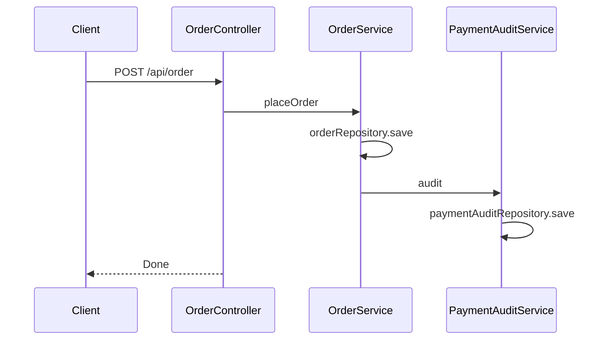
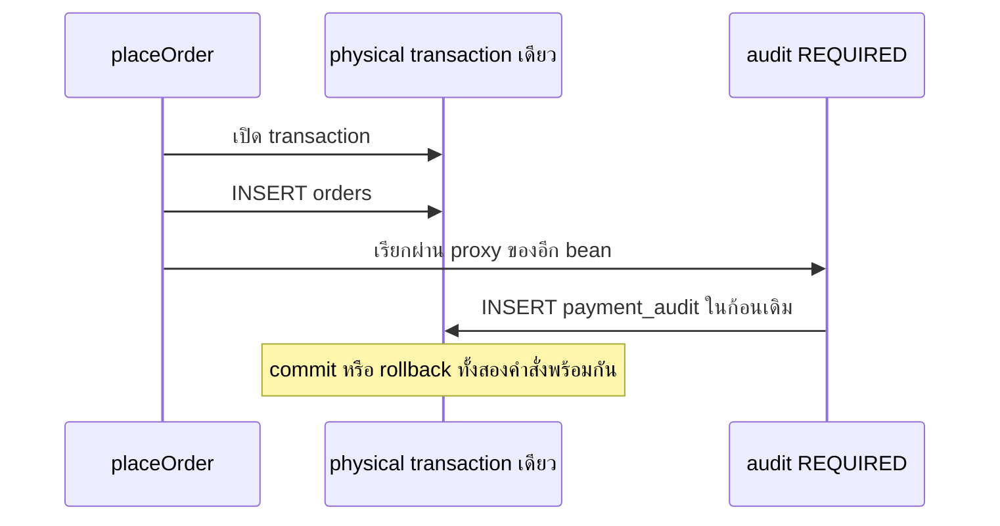
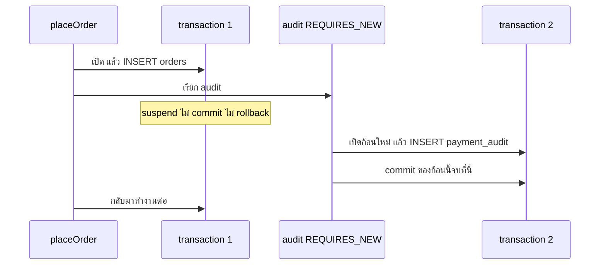
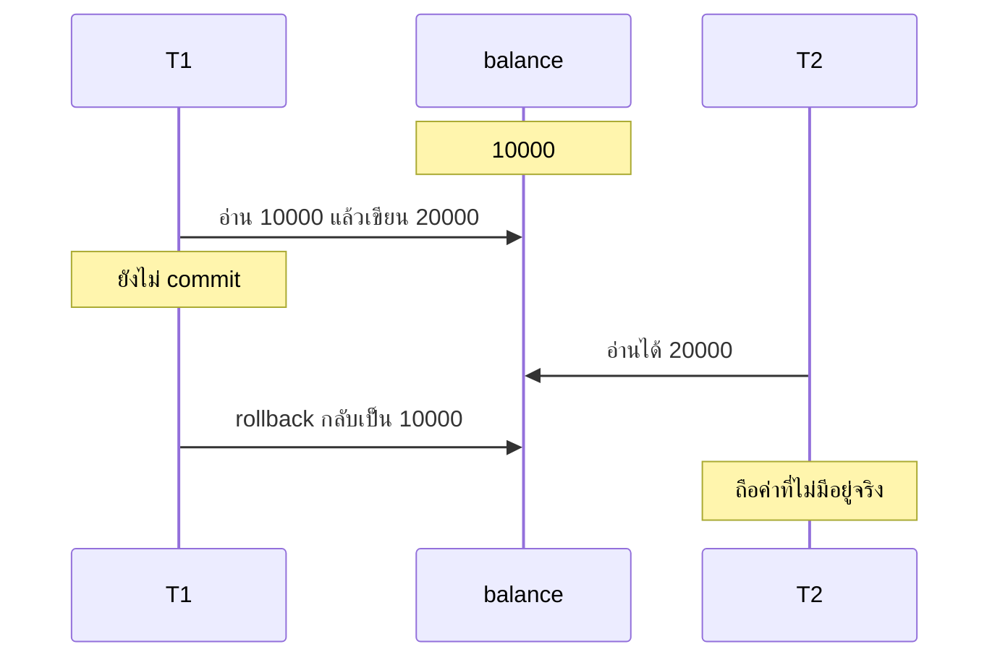
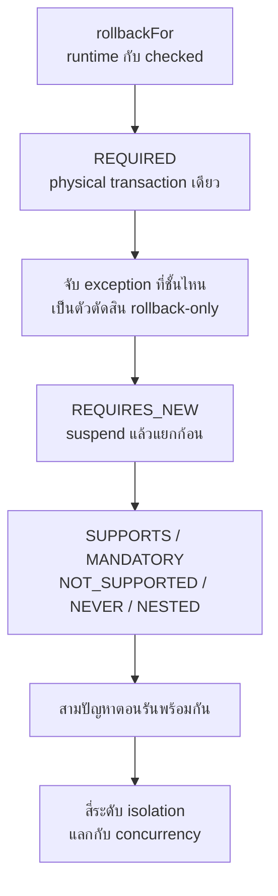

# #34 — Propagation และ Isolation ของ @Transactional

> **วิดีโอ:** [Spring @Transactional Propagation & Isolation Levels Explained | Spring Boot Full Course #34](https://youtu.be/E_Sb48BFoF0) — Coder Army, ~60 นาที
> **แหล่งที่ใช้สรุป:** ซับไตเติลภาษาอังกฤษที่ YouTube สร้างอัตโนมัติ
> **เวอร์ชันในโค้ด:** Spring Boot 4.1 + Java 21 (ใส่หมายเหตุไว้ทุกจุดที่ Spring Boot 3.x ต่างกัน)

ตอนนี้ตอบสองคำถามที่ `@Transactional` เปล่า ๆ ยังไม่ตอบ เมื่อ service หนึ่งเรียก method ของอีก service หนึ่ง transaction เดิมจะตามเข้าไปหรือไม่ และเมื่อมีหลาย transaction พร้อมกัน แต่ละตัวควรมองเห็นข้อมูลที่อีกตัวยังไม่ commit ได้แค่ไหน ผู้สอนใช้คำสั่งวางออเดอร์ที่ต้องบันทึกทั้งแถวออเดอร์และแถว audit การชำระเงิน แล้วสลับ propagation ทีละค่า จากนั้นอธิบาย isolation ผ่านปัญหา dirty read, non-repeatable read และ phantom read เขาปิดตอนด้วยการบอกว่าตอนถัดไปคือ Spring Security

ส่วนที่ติดป้าย `💡 เพิ่มเติม` คือของที่ผมเติมเอง ไม่ได้อยู่ในวิดีโอ ส่วนที่ติด `⚠️ แก้จากวิดีโอ` คือจุดที่วิดีโอพูดคลาดเคลื่อน

> 💡 **เพิ่มเติม — วิดีโอใช้ MySQL:** ผู้สอนเปิด DBeaver ต่อ MySQL แล้วให้ Hibernate สร้างตารางออเดอร์กับ payment audit โน้ตนี้รันโปรเจกต์เดียวกันบน **H2 in-memory** ที่พอร์ต `9034` SQL, ข้อความ exception และจำนวนแถวด้านล่างเป็นผลจาก H2 2.4.240 กับ Spring Boot 4.1.1 (Hibernate ORM 7.4.5) ที่รันจริง บน MySQL ในวิดีโอคอลัมน์ boolean `success` แสดงเป็น `1` บน H2 ค่าเดียวกันคือ `true`

---

## สารบัญ

| เวลา | หัวข้อ |
|---|---|
| [0:00](https://youtu.be/E_Sb48BFoF0?t=0) | [1. เป้าหมายของตอน](#1-เป้าหมายของตอน) |
| [0:23](https://youtu.be/E_Sb48BFoF0?t=23) | [2. ห้า attribute ของ @Transactional](#2-ห้า-attribute-ของ-transactional) |
| [2:20](https://youtu.be/E_Sb48BFoF0?t=140) | [3. rollbackFor กับ checked exception](#3-rollbackfor-กับ-checked-exception) |
| [4:13](https://youtu.be/E_Sb48BFoF0?t=253) | [4. โมเดล Order และ PaymentAudit](#4-โมเดล-order-และ-paymentaudit) |
| [6:04](https://youtu.be/E_Sb48BFoF0?t=364) | [5. placeOrder เรียก audit](#5-placeorder-เรียก-audit) |
| [11:33](https://youtu.be/E_Sb48BFoF0?t=693) | [6. REQUIRED กับ physical transaction](#6-required-กับ-physical-transaction) |
| [17:10](https://youtu.be/E_Sb48BFoF0?t=1030) | [7. ค่าบน method ที่ join ไม่ถูกใช้](#7-ค่าบน-method-ที่-join-ไม่ถูกใช้) |
| [18:48](https://youtu.be/E_Sb48BFoF0?t=1128) | [8. รันแอปและชื่อตาราง orders](#8-รันแอปและชื่อตาราง-orders) |
| [21:27](https://youtu.be/E_Sb48BFoF0?t=1287) | [9. จับ exception แล้วผล commit ไม่เหมือนกัน](#9-จับ-exception-แล้วผล-commit-ไม่เหมือนกัน) |
| [28:46](https://youtu.be/E_Sb48BFoF0?t=1726) | [10. REQUIRES_NEW](#10-requires_new) |
| [35:23](https://youtu.be/E_Sb48BFoF0?t=2123) | [11. SUPPORTS และ MANDATORY](#11-supports-และ-mandatory) |
| [40:51](https://youtu.be/E_Sb48BFoF0?t=2451) | [12. NOT_SUPPORTED, NEVER และ NESTED](#12-not_supported-never-และ-nested) |
| [44:18](https://youtu.be/E_Sb48BFoF0?t=2658) | [13. Dirty read, non-repeatable read, phantom read](#13-dirty-read-non-repeatable-read-phantom-read) |
| [52:19](https://youtu.be/E_Sb48BFoF0?t=3139) | [14. Isolation สี่ระดับ](#14-isolation-สี่ระดับ) |
| — | [15. สรุปท้ายตอน](#15-สรุปท้ายตอน) |

---

## 1. เป้าหมายของตอน

[▶ 0:00](https://youtu.be/E_Sb48BFoF0?t=0)

ผู้สอนบอกว่าจนถึงตอนนี้เราใส่ `@Transactional` แล้วปล่อยไว้เฉย ๆ annotation นี้รับ attribute เพิ่มได้ เขาจะไล่ห้าตัวที่ขึ้นบนสไลด์ก่อน แล้วลงลึกสามตัวที่เขาถือว่าสำคัญที่สุดคือ propagation, isolation และ `rollbackFor`

propagation ตอบคำถามว่า transaction ของ method นี้จะเดินเข้าไปใน method ของอีก service ที่มันเรียกอย่างไร isolation คือคุณสมบัติที่ตอนที่แล้วพูดไว้แล้วว่า transaction ที่รันพร้อมกันไม่ควรเห็นการเปลี่ยนแปลงที่อีกตัวยังไม่ commit ตอนนี้เขาจะไล่ระดับของมัน timeout บอกว่า transaction ควรจบภายในเวลาเท่าไร `readOnly` บอกว่า transaction นี้แค่อ่าน หรือทั้งอ่านและเขียน `rollbackFor` บอกว่า exception แบบไหนต้อง rollback

---

## 2. ห้า attribute ของ @Transactional

[▶ 0:23](https://youtu.be/E_Sb48BFoF0?t=23)

สไลด์เปิดตอนเป็น annotation ที่มีครบห้าค่า เขาเรียกสิ่งที่เห็นว่าเป็นค่า default

```java
@Transactional(
        propagation = Propagation.REQUIRED,
        isolation = Isolation.READ_COMMITTED,
        timeout = 5,
        readOnly = false,
        rollbackFor = IOException.class)
public void createOrder() {
}
```

> ⚠️ **แก้จากวิดีโอ:** ช่วงต้นเขาชี้ชุดนี้แล้วบอกว่าเป็นค่า default ทั้งก้อน โดยตั้ง isolation เป็น `READ_COMMITTED` และ timeout เป็น `5` ค่า default ของ `org.springframework.transaction.annotation.Transactional` ใน Spring Framework 7.0.9 คือ `propagation = REQUIRED`, `isolation = DEFAULT`, `timeout = -1` (`TransactionDefinition.TIMEOUT_DEFAULT` คือให้ระบบ transaction ข้างล่างใช้ค่าของมันเอง), `readOnly = false` และ `rollbackFor` ว่าง เขาอธิบาย `Isolation.DEFAULT` ได้ตรงตอนท้ายตอนว่าหมายถึงให้ใช้ isolation ของฐานข้อมูล ไม่ใช่การล็อกเป็น `READ_COMMITTED` ส่วน timeout `5` เป็นตัวเลขตัวอย่าง หน่วยเป็นวินาที ไม่ใช่ค่า default

`readOnly = false` บังเอิญตรงกับค่า default จริง เขาอธิบาย attribute นี้แค่คำถามว่า transaction นี้เป็นแบบอ่านอย่างเดียว หรือทั้งเขียนและอ่าน

> 💡 **เพิ่มเติม:** `readOnly = true` เป็นคำใบ้ ไม่ได้รับประกันว่าฐานข้อมูลจะปฏิเสธคำสั่งเขียน Spring ส่งธงนี้ไปที่ JDBC connection และ Hibernate ใช้โอกาสนี้เลิก flush จาก dirty checking งานที่ต้องเขียนยังควรเปิด transaction แบบเขียนตามปกติ

timeout คือเพดานเวลาของ transaction นั้น ถ้างานไม่จบในเวลาที่กำหนด transaction ถูก rollback เขาใช้เลข `5` กับ `30` เป็นตัวอย่างตอนเปรียบเทียบ method นอกกับ method ใน หน่วยของ attribute นี้คือวินาที

---

## 3. rollbackFor กับ checked exception

[▶ 2:20](https://youtu.be/E_Sb48BFoF0?t=140)

เขายก `createOrder` ที่ติด `@Transactional` แล้วแยก exception เป็นสองกลุ่ม

**RuntimeException** เป็น unchecked ไม่บังคับให้เขียน `try-catch` ถ้ามันหลุดออกจาก method ที่ติด `@Transactional` transaction rollback เสมอ ไม่ว่าจะเขียน `rollbackFor` ไว้หรือไม่

**Checked exception** สลับกัน ถ้าไม่ระบุอะไรเพิ่ม Spring commit transaction แล้วปล่อย exception นั้นเดินต่อ ถ้าใส่ class ของ checked exception นั้น หรือใส่ class แม่ของมัน ลงใน `rollbackFor` transaction จะ rollback เมื่อเจอ exception ชนิดนั้น

`rollbackFor = IOException.class` บนสไลด์เปิดตอนจึงแปลว่า เจอ `IOException` ให้ยกเลิกการเขียนของ transaction นี้

> 💡 **เพิ่มเติม:** กฎ default ที่เขียนใน javadoc ของ annotation นี้คือ rollback เมื่อเจอ `RuntimeException` และ `Error` checked exception ไม่ทำให้ rollback `Error` เป็นกลุ่มที่วิดีโอไม่ได้พูดถึง แต่ตกอยู่กฎเดียวกับ runtime exception

โน้ตนี้รันสอง method ที่บันทึกออเดอร์กับ audit แล้วโยน `IOException` ตัวแรกไม่ใส่ `rollbackFor` ตัวที่สองใส่

```java
@Transactional
public void placeOrderChecked(Order order) throws IOException {
    orderRepository.save(order);
    paymentAuditService.audit(order);
    throw new IOException("checked");
}

@Transactional(rollbackFor = IOException.class)
public void placeOrderCheckedRollback(Order order) throws IOException {
    orderRepository.save(order);
    paymentAuditService.audit(order);
    throw new IOException("checked");
}
```

ผลบน H2 ตรงกับกฎที่เขาอธิบาย ทั้งสองครั้ง caller ยังเห็น `IOException` แต่สถานะตารางคนละแบบ

```text
CASE checked IOException, no rollbackFor
  orders=[Checked amount=1]
  audits=[orderId=9 amount=1 success=true]
CASE checked IOException, rollbackFor=IOException
  orders=[]
  audits=[]
```

---

## 4. โมเดล Order และ PaymentAudit

[▶ 4:13](https://youtu.be/E_Sb48BFoF0?t=253)

เขาเปิดโปรเจกต์ชื่อ transaction demo ที่มี controller ตัวเดียวกับ entity สองตัว ยังไม่มี repository

`Order` มีสามฟิลด์คือ id, ชื่อสินค้า และจำนวนเงิน id สร้างเอง เขาจะให้ผู้ใช้ส่งแค่ชื่อสินค้ากับจำนวนเงิน

`PaymentAudit` เก็บว่าการจ่ายเงินของออเดอร์หนึ่งสำเร็จหรือไม่ เริ่มด้วย id, amount และ order id เขามองว่า order id ทำหน้าที่ชี้ไปที่ออเดอร์ แล้วระหว่างอธิบายก็เพิ่มฟิลด์ `success` เป็น boolean เพื่อเก็บว่าการจ่ายครั้งนั้นสำเร็จหรือล้มเหลว ไม่มี `@ManyToOne` ในตอนนี้ เป็นคอลัมน์ `orderId` ธรรมดา

> 💡 **เพิ่มเติม:** วิดีโอไม่บอกชื่อ package และไม่บอกชนิดของ amount โน้ตใช้ `com.coderarmy.tx` และใช้ `int` เพราะราคาที่เขาพิมพ์เป็นจำนวนเต็ม constructor ที่ไม่มี argument ต้องมีไว้ให้ JPA สร้าง object และให้ Jackson อ่าน JSON ของ `POST`

```java
@Entity
@Table(name = "orders")
public class Order {

    @Id
    @GeneratedValue(strategy = GenerationType.IDENTITY)
    private Long id;

    private String productName;
    private int amount;

    public Order() {
    }

    public Order(String productName, int amount) {
        this.productName = productName;
        this.amount = amount;
    }
}
```

```java
@Entity
public class PaymentAudit {

    @Id
    @GeneratedValue(strategy = GenerationType.IDENTITY)
    private Long id;

    private int amount;
    private Long orderId;
    private boolean success;

    public PaymentAudit() {
    }

    public PaymentAudit(int amount, Long orderId, boolean success) {
        this.amount = amount;
        this.orderId = orderId;
        this.success = success;
    }
}
```

`@Table(name = "orders")` ยังไม่ได้อยู่ในร่างแรก เขาใส่ทีหลังตอน MySQL ปฏิเสธชื่อตาราง `order` ดูหัวข้อ 8

Controller มีอยู่แล้ว แมปที่ `/api/order` มี method `placeOrder` ที่เรียก service แล้วคืนสตริง `"Done"` ฝั่ง payment audit ไม่มี controller เพราะไม่มีใครยิง audit ตรง ๆ audit เกิดตามการวางออเดอร์เท่านั้น

---

## 5. placeOrder เรียก audit

[▶ 6:04](https://youtu.be/E_Sb48BFoF0?t=364)

งานของ `placeOrder` มีสองขั้น บันทึก `Order` ลงตารางออเดอร์ แล้วให้ service ของ payment audit สร้างแถว audit ว่าจ่ายสำเร็จ

เขาเริ่มจาก `OrderRepository` ซึ่งเป็น interface ว่างที่ `extends JpaRepository<Order, Long>` method `save` ได้มาจาก Spring Data เขาตั้งชื่อไฟล์ผิดรอบหนึ่งแล้ว refactor เป็น `OrderRepository` จากนั้น inject เข้า `OrderService` ทาง constructor ฟิลด์เป็น `private`

จากนั้นสร้าง `PaymentAuditRepository extends JpaRepository<PaymentAudit, Long>` กับ `PaymentAuditService` แบบเดียวกัน `OrderService` รับ `PaymentAuditService` เพิ่มใน constructor แล้วหลัง `save` ของออเดอร์ก็เรียก `audit(order)`

`audit` สร้าง `PaymentAudit` จาก amount และ id ของออเดอร์ ตั้ง `success` เป็น `true` แล้ว `save` เขา generate constructor ของ entity โดยข้าม id

```java
public interface OrderRepository extends JpaRepository<Order, Long> {
}

public interface PaymentAuditRepository extends JpaRepository<PaymentAudit, Long> {
}
```

```java
@Service
public class OrderService {

    private final OrderRepository orderRepository;
    private final PaymentAuditService paymentAuditService;

    public OrderService(OrderRepository orderRepository, PaymentAuditService paymentAuditService) {
        this.orderRepository = orderRepository;
        this.paymentAuditService = paymentAuditService;
    }

    @Transactional
    public void placeOrder(Order order) {
        orderRepository.save(order);
        paymentAuditService.audit(order);
    }
}
```

```java
@Service
public class PaymentAuditService {

    private final PaymentAuditRepository paymentAuditRepository;

    public PaymentAuditService(PaymentAuditRepository paymentAuditRepository) {
        this.paymentAuditRepository = paymentAuditRepository;
    }

    @Transactional(propagation = Propagation.REQUIRED)
    public void audit(Order order) {
        paymentAuditRepository.save(new PaymentAudit(order.getAmount(), order.getId(), true));
    }
}
```

```java
@RestController
@RequestMapping("/api/order")
public class OrderController {

    private final OrderService orderService;

    public OrderController(OrderService orderService) {
        this.orderService = orderService;
    }

    @PostMapping
    public String placeOrder(@RequestBody Order order) {
        orderService.placeOrder(order);
        return "Done";
    }
}
```

> 💡 **เพิ่มเติม:** เขาพูดว่า autowire ผ่าน constructor Spring Boot inject constructor ตัวเดียวให้โดยไม่ต้องใส่ `@Autowired` โปรเจกต์จริงมี method เพิ่มอีกชุดหนึ่งต่อ class เพราะเขาแก้ annotation บน method เดิมซ้ำหลายรอบ โน้ตแยกแต่ละรอบเป็นคนละ method เพื่อให้รันทุกกรณีในโปรเจกต์เดียว แกนที่ตรงกับวิดีโอก่อนจะเริ่มโยน exception คือ `placeOrder` กับ `audit` ด้านบน

ลำดับตอน request เข้ามาคือ client ส่งชื่อสินค้ากับจำนวนเงินมาที่ controller, controller เรียก `OrderService.placeOrder`, service บันทึกออเดอร์ แล้วเรียก `PaymentAuditService.audit` ให้สร้างแถวในตาราง audit มี controller เดียว



---

## 6. REQUIRED กับ physical transaction

[▶ 11:33](https://youtu.be/E_Sb48BFoF0?t=693)

เขาใส่ `@Transactional` ที่ `placeOrder` แล้วตั้งคำถามว่า transaction นี้จะครอบ `audit` ด้วยหรือไม่ จากตอน Hibernate เขารู้อยู่แล้วว่า method ของ repository ที่ถูกเรียกจาก service ที่มี transaction จะทำงานใน transaction เดียวกัน ประเด็นของ propagation แคบกว่านั้น มันตอบเฉพาะตอนที่ class หนึ่งเรียก method ของอีก class หนึ่ง

เขาแบ่งสองชั้น `placeOrder` เป็น **outer method** `audit` เป็น **inner method** ค่า propagation เขียนที่ inner method เพราะคำถามอยู่ที่ method ถูกเรียก ไม่ได้อยู่ที่คนเรียก

[▶ 13:28](https://youtu.be/E_Sb48BFoF0?t=808)

ตอนพิมพ์ `@Transactional` IDE เสนอสองตัว เขาเลือกพลาดเป็นของ Jakarta บน `OrderService` แล้วแก้เป็นของ Spring

ใช้ `org.springframework.transaction.annotation.Transactional` ตัวของ `jakarta.transaction` ใช้ได้ แต่ตั้ง attribute ได้น้อยกว่า

> 💡 **เพิ่มเติม:** `jakarta.transaction.Transactional` มี `TxType` แค่ `REQUIRED`, `REQUIRES_NEW`, `MANDATORY`, `SUPPORTS`, `NOT_SUPPORTED`, `NEVER` ไม่มี `NESTED` ไม่มี isolation, timeout และ `readOnly` ชื่อ attribute ฝั่ง rollback คือ `rollbackOn` กับ `dontRollbackOn` ไม่ใช่ `rollbackFor`

[▶ 14:16](https://youtu.be/E_Sb48BFoF0?t=856)

ค่าแรกคือ `Propagation.REQUIRED` และมันเป็นค่า default การเขียน `propagation = REQUIRED` กับการไม่เขียน attribute นี้ได้ผลเดียวกัน

กฎคือ ถ้ามี transaction อยู่แล้ว ให้เข้า transaction นั้น ถ้ายังไม่มี ให้สร้างใหม่ แต่ต้องมี transaction

`placeOrder` เปิด transaction ไว้ก่อนเรียก `audit` ดังนั้น `audit` ที่เป็น `REQUIRED` ไม่สร้าง physical transaction ใหม่ มันเข้าก้อนเดียวกับคนเรียก

[▶ 15:40](https://youtu.be/E_Sb48BFoF0?t=940)

เขาเรียกก้อนนั้นว่า **physical transaction** หมายถึง transaction จริงในฐานข้อมูลที่มีได้หลายคำสั่ง `placeOrder` กับ `audit` เป็นสองคำสั่งของก้อนเดียวกัน ทั้งคู่ใช้ `EntityManager` ตัวเดียวกันและ persistence context เดียวกัน แบบที่ service กับ repository แชร์กันในตอน Hibernate

ผลที่ใช้ตัดสินใจคือ ถ้า `placeOrder` rollback `audit` ก็ rollback ถ้า `audit` rollback `placeOrder` ก็ rollback

เขาใช้ `REQUIRED` เมื่อ inner ขึ้นกับ outer ในตัวอย่างนี้ ออเดอร์สำเร็จจึงค่อยมี audit ถ้าออเดอร์ต้องถูกยกเลิก audit ต้องถูกยกเลิกด้วย เขาบอกว่านี่คือเหตุผลที่ `REQUIRED` เป็น default เพราะเป็นกรณีที่ใช้บ่อยที่สุด



> 💡 **เพิ่มเติม:** propagation มีผลเมื่อคำเรียกเดินผ่าน proxy ของ Spring การเรียก method อีกตัวในคลาสเดียวกันไม่ผ่าน proxy ค่า propagation บน method ภายในจึงไม่ทำงาน โครงของเขาแยก `OrderService` กับ `PaymentAuditService` จึงถูกทางอยู่แล้ว

---

## 7. ค่าบน method ที่ join ไม่ถูกใช้

[▶ 17:10](https://youtu.be/E_Sb48BFoF0?t=1030)

เขาลองตั้งค่าคนละชุด สมมติ `placeOrder` ใช้ `READ_COMMITTED` และ timeout `30` ส่วน `audit` ที่เป็น `REQUIRED` ตั้ง `SERIALIZABLE` และ timeout `5`

คำตอบของเขาคือค่าฝั่ง `audit` ไม่มีผล เพราะ `REQUIRED` บอกให้ใช้ transaction ที่มีอยู่แล้ว รวมถึงกฎของ transaction นั้น isolation ที่ใช้จริงคือ `READ_COMMITTED` และ timeout คือ `30` ของ outer method inner method ไม่ได้เปิด physical transaction ของตัวเอง จึงไม่มีที่ให้กฎของมันไปติด

เขาลบค่าทดเหล่านี้ทิ้งก่อนรันแอป เหลือ `@Transactional` ธรรมดา

> 💡 **เพิ่มเติม:** javadoc ของ `isolation` บน `@Transactional` บอกว่าค่านี้ใช้กับการเริ่ม transaction ใหม่ ซึ่งเกิดกับ `REQUIRED` และ `REQUIRES_NEW` ถ้า method แค่เข้าร่วม transaction เดิม ค่า isolation ที่เขียนทับจะไม่ถูกนำไปตั้ง ค่า default ของ `validateExistingTransaction` บน transaction manager คือ `false` จึงไม่โยน exception เมื่อค่าไม่ตรงกัน ถ้าเปิดธงนั้น Spring จะปฏิเสธการเข้าร่วมเมื่อ isolation ไม่ตรงกับก้อนที่มีอยู่

---

## 8. รันแอปและชื่อตาราง orders

[▶ 18:48](https://youtu.be/E_Sb48BFoF0?t=1128)

รันรอบแรก Hibernate สร้างตารางไม่ผ่าน MySQL ตอบว่า syntax ผิดใกล้คำว่า `order` เพราะ `ORDER` เป็นคำสงวน ตาราง `payment_audit` ถูกสร้างไปแล้ว เขาลบตารางนั้นทิ้ง แล้วใส่ `@Table(name = "orders")` บน entity จากนั้นรันใหม่ ทั้งสองตารางถูกสร้าง

ใน DBeaver เขาเห็นตารางออเดอร์มีคอลัมน์ id, amount, product name และตาราง payment audit มี id, amount, order id, success

> 💡 **เพิ่มเติม:** `ORDER` เป็นคำสงวนของ H2 ด้วย โน้ตนี้จึงใส่ `@Table(name = "orders")` ตั้งแต่แรก และตั้ง `spring.jpa.hibernate.ddl-auto=update` ให้ Hibernate สร้างตารางเองแบบที่แอปของเขาทำ DDL ที่ H2 2.4.240 สร้างจริงคือ

```sql
create table orders (
    id bigint generated by default as identity,
    amount integer not null,
    product_name varchar(255),
    primary key (id)
)
create table payment_audit (
    id bigint generated by default as identity,
    amount integer not null,
    order_id bigint,
    success boolean not null,
    primary key (id)
)
```

[▶ 20:03](https://youtu.be/E_Sb48BFoF0?t=1203)

เขายิง `POST /api/order` จาก Postman ด้วยสินค้า iPhone 17 Pro Max แล้วได้ `"Done"` log มี insert สองครั้ง ตารางออเดอร์มีแถวใหม่ และตาราง audit มีแถวที่ order id ตรงกัน `success` บน MySQL ขึ้นเป็น `1`

> 💡 **เพิ่มเติม:** เขาพูดจำนวนเงินของ iPhone ทั้งคำว่า "150" และ "1.5 lakhs" โน้ตใช้ `150000` ให้ตรงกับ 1.5 แสนที่เขาอ่านจากตาราง ราคารอบถัดไปที่พูดชัดคือ speaker `2000`, laptop `50000`, camera `90000` และ bottle `200`

`POST` เดียวกันบนพอร์ต `9034` ได้ `Done` ด้วยสถานะ 200 และ Hibernate ยิง insert สองคำสั่งใน request เดียว

```json
POST /api/order
{"productName":"iPhone 17 Pro Max","amount":150000}
```

```text
insert into orders (amount, product_name, id) values (?, ?, default)
insert into payment_audit (amount, order_id, success, id) values (?, ?, ?, default)
```

```text
CASE REQUIRED both commit
  orders=[iPhone 17 Pro Max amount=150000]
  audits=[orderId=6 amount=150000 success=true]
```

dependency ที่ใช้คือ `spring-boot-starter-webmvc` กับ `spring-boot-starter-data-jpa` และ H2 แทน driver ของ MySQL parent คือ `spring-boot-starter-parent` รุ่น `4.1.1`

> ⚠️ **Boot 4 vs 3:** starter ของเว็บใน Boot 4 คือ `spring-boot-starter-webmvc` ชื่อเดิม `spring-boot-starter-web` ยังใช้ได้แต่ถูก deprecate แล้ว ใน Boot 3.x ใช้ `spring-boot-starter-web` ส่วน `spring-boot-starter-data-jpa` ชื่อเดิมทั้ง Boot 3 และ Boot 4 ([Spring Boot 4.0 Migration Guide](https://github.com/spring-projects/spring-boot/wiki/Spring-Boot-4.0-Migration-Guide) ตาราง starter)

---

## 9. จับ exception แล้วผล commit ไม่เหมือนกัน

[▶ 21:27](https://youtu.be/E_Sb48BFoF0?t=1287)

เขาทดลองสามแบบบน propagation `REQUIRED` ชุดเดียวกัน สินค้าที่ใช้คนละรอบ แต่คำถามเดียวกันคือใครเห็น exception

### outer โยนหลังทั้งสองคำสั่ง

เขาให้ `placeOrder` บันทึกออเดอร์ เรียก `audit` จนแถว audit ถูกสั่ง insert แล้วค่อย `throw new RuntimeException("Some error occurred")` จากนั้นยิง speaker ราคา 2000

```java
@Transactional
public void placeOrderThenFail(Order order) {
    orderRepository.save(order);
    paymentAuditService.audit(order);
    throw new RuntimeException("Some error occurred");
}
```

log ยังมี insert สองครั้ง แล้วตามด้วย exception เพราะ runtime exception หลุดออกจาก outer method ทั้ง physical transaction จึง rollback รีเฟรชทั้งสองตารางแล้วไม่เจอแถว speaker

```text
CASE REQUIRED outer throws
  orders=[]
  audits=[]
```

### inner จับ exception ของตัวเอง

[▶ 24:03](https://youtu.be/E_Sb48BFoF0?t=1443)

เขาย้าย `throw` เข้าไปใน `audit` แล้วจับด้วย `catch` ว่าง ๆ ใน method นั้นเอง จากนั้นยิงซ้ำ ได้ `"Done"` และทั้งสองตารางมีแถว

เหตุผลคือ exception ไม่หลุดออกนอก `audit` proxy ของ method นั้นจึงไม่เห็นว่ามีอะไรผิดพลาด ทั้งสอง method จบแบบปกติและ commit

```java
@Transactional(propagation = Propagation.REQUIRED)
public void auditCatchOwnFailure(Order order) {
    paymentAuditRepository.save(new PaymentAudit(order.getAmount(), order.getId(), true));
    try {
        throw new RuntimeException("Something went wrong");
    } catch (RuntimeException ignored) {
    }
}
```

```text
CASE REQUIRED inner catches its own exception
  orders=[Speaker amount=2000]
  audits=[orderId=12 amount=2000 success=true]
```

### inner โยน แล้ว outer เป็นคนจับ

[▶ 25:10](https://youtu.be/E_Sb48BFoF0?t=1510)

แบบที่สาม `audit` โยน runtime exception โดยไม่จับ `placeOrder` เรียก `audit` ใน `try-catch` แล้วไม่ทำอะไรใน `catch` เขายิง laptop ราคา 50000

ความรู้สึกแรกคือไม่มีใครนอก `placeOrder` เห็น exception น่าจะ commit ได้ ผลกลับตรงข้าม Postman ได้ exception และทั้งสองตารางว่าง

```java
@Transactional(propagation = Propagation.REQUIRED)
public void auditFail(Order order) {
    paymentAuditRepository.save(new PaymentAudit(order.getAmount(), order.getId(), true));
    throw new RuntimeException("Something went wrong");
}

@Transactional
public void placeOrderCatchInner(Order order) {
    orderRepository.save(order);
    try {
        paymentAuditService.auditFail(order);
    } catch (RuntimeException ignored) {
    }
}
```

สิ่งที่เกิดขึ้นตามลำดับคือ `audit` โยน runtime exception ออกจาก method ของมัน proxy ของ `audit` จึง mark transaction ก้อนเดียวกันเป็น **rollback-only** exception เดินกลับไปที่ `placeOrder` และถูกจับไว้ที่นั่น พอ `placeOrder` จบแบบปกติ proxy ของ outer พยายาม commit แต่ก้อนนั้นถูก mark ไว้แล้ว Spring จึงโยน `UnexpectedRollbackException` ออกไปถึง client เขาอ่านข้อความใน log ว่า transaction ถูก rollback เงียบ ๆ เพราะถูก mark เป็น rollback-only

ข้อความที่ได้จากการรันชุดนี้คือ

```text
org.springframework.transaction.UnexpectedRollbackException: Transaction silently rolled back because it has been marked as rollback-only
CASE REQUIRED inner throws, outer catches
  orders=[]
  audits=[]
```

`catch` ใน `placeOrder` จับได้แค่ exception ของ `audit` มันจับ `UnexpectedRollbackException` ไม่ได้ เพราะ exception นั้นเกิดทีหลัง ตอน proxy ของ `placeOrder` กำลังปิด transaction

เขาสรุปรอบนี้ว่าแม้ไม่เขียน `Propagation.REQUIRED` ผลก็เหมือนกันเพราะมันเป็น default และถ้า `placeOrder` ไม่มี `@Transactional` เลย `audit` ที่เป็น `REQUIRED` จะเปิด transaction ของตัวเอง

กรณีที่ inner ขึ้นกับ outer ให้ใช้ `REQUIRED`

---

## 10. REQUIRES_NEW

[▶ 28:46](https://youtu.be/E_Sb48BFoF0?t=1726)

`Propagation.REQUIRES_NEW` ครึ่งแรกเหมือน `REQUIRED` ถ้าไม่มี transaction จากข้างนอก ก็สร้างเอง ครึ่งหลังต่างกัน ถ้ามี transaction อยู่แล้ว ให้ **suspend** ก้อนนั้นแล้วสร้าง physical transaction ใหม่เสมอ

suspend ไม่ใช่ commit และไม่ใช่ rollback มันแค่พักก้อนของคนเรียกไว้ พอ inner ทำงานจบ ค่อยทำก้อนที่ถูกพักต่อ

`placeOrder` จึงมี transaction ที่หนึ่ง `audit` มี transaction ที่สอง แต่ละก้อนมี `EntityManager` และ persistence context ของตัวเอง การ rollback ของก้อนหนึ่งไม่ดึงอีกก้อน



> 💡 **เพิ่มเติม:** เขากล่าวทั้งคำว่า physical connection และ physical transaction ช่วงนี้ สิ่งที่ตรงกับกลไกคือคนละ transaction ตอน suspend Spring ยังถือ connection ของก้อนนอกไว้ และยืม connection อีกเส้นจาก pool ให้ก้อนใน พอก้อนในจบจึงกลับไปใช้ connection เดิม

ถ้ายิงปกติโดยไม่โยน exception ผลภายนอกยังเหมือนเดิม ทั้งสองตารางมีแถว เขาลองกับ laptop แล้วเห็น insert สองครั้ง ความต่างอยู่ข้างในว่าคนละ physical transaction

[▶ 31:10](https://youtu.be/E_Sb48BFoF0?t=1870)

จากนั้นเขาให้ `audit` แบบ `REQUIRES_NEW` ทำงานจนจบ แล้วให้ `placeOrder` โยน runtime exception เขายิง camera ราคา 90000

`audit` commit ไปแล้วก่อนที่ outer จะพัง ดังนั้นแถว payment audit ของ camera อยู่ต่อ แถวออเดอร์หาย เขาบอกว่าแบบนี้อันตรายมากถ้ายอดสั่งซื้อกับการจ่ายเงินต้องไปด้วยกัน เพราะจะเหลือหลักฐานว่าจ่ายแล้วทั้งที่ไม่มีออเดอร์ เขาจึงลบแถว audit ที่ค้างนั้นทิ้ง

```java
@Transactional(propagation = Propagation.REQUIRES_NEW)
public void auditRequiresNew(Order order) {
    paymentAuditRepository.save(new PaymentAudit(order.getAmount(), order.getId(), true));
}

@Transactional
public void placeOrderRequiresNewThenFail(Order order) {
    orderRepository.save(order);
    paymentAuditService.auditRequiresNew(order);
    throw new RuntimeException("Something went wrong");
}
```

```text
CASE REQUIRES_NEW outer throws
  orders=[]
  audits=[orderId=2 amount=90000 success=true]
```

[▶ 32:58](https://youtu.be/E_Sb48BFoF0?t=1978)

สลับด้าน `audit` โยน runtime exception หลัง save และ `placeOrder` จับ exception นั้นไว้ เขายิง camera อีกรอบ ได้ `"Done"`

ก้อนของ `audit` rollback เพราะ exception หลุดออกจาก method ของมัน ก้อนของ `placeOrder` คนละก้อนและจบแบบปกติหลังจับ exception ได้ จึง commit เหลือแถว camera ในตารางออเดอร์ และไม่มีแถวในตาราง audit

```text
CASE REQUIRES_NEW inner throws, outer catches
  orders=[Camera amount=90000]
  audits=[]
```

เขาสรุปว่า `REQUIRES_NEW` เหมาะเมื่อ outer กับ inner เป็นอิสระจากกัน แต่ละก้อนรับผิดชอบ commit และ rollback ของตัวเอง สำหรับออเดอร์ที่ผูกกับการจ่ายเงิน เขายังถือว่า `REQUIRED` เหมาะกว่า

---

## 11. SUPPORTS และ MANDATORY

### SUPPORTS

[▶ 35:23](https://youtu.be/E_Sb48BFoF0?t=2123)

`Propagation.SUPPORTS` ถ้ามี transaction อยู่แล้ว ให้ join เหมือน `REQUIRED` ถ้าไม่มี อย่าสร้างใหม่ ให้ทำงานโดยไม่มี transaction

เมื่อ `placeOrder` มี `@Transactional` ผลจึงเหมือน `REQUIRED` ทั้งสอง method อยู่ใน physical transaction เดียว ใคร rollback อีกฝ่ายก็ถูกยกตาม เมื่อเขาให้ outer โยนหลังเรียก `audit` ทั้งสองตารางว่าง

```text
CASE SUPPORTS joins outer, outer throws
  orders=[]
  audits=[]
  supports inside outer tx=true
  supports without outer tx=false
```

ถ้าคนเรียกไม่มี transaction `SUPPORTS` ก็ไม่เปิดให้ เขามองว่ามันเหมาะกับ helper ที่ไม่ควรตัดสินเองว่าต้องมี transaction หรือไม่ มันตามคนเรียก ถ้าไม่มี ก็เป็นการเรียก method ธรรมดา เขาบอกว่า use case แคบ ใช้กับ helper เป็นหลัก

> 💡 **เพิ่มเติม:** บรรทัด `supports inside outer tx=true` กับ `supports without outer tx=false` มาจาก `TransactionSynchronizationManager.isActualTransactionActive()` ที่เรียกข้างใน method ที่เป็น `SUPPORTS` วิดีโอไม่ได้เปิดค่านี้ ให้ดูจากพฤติกรรม rollback อย่างเดียว

### MANDATORY

[▶ 37:19](https://youtu.be/E_Sb48BFoF0?t=2239)

`Propagation.MANDATORY` ถ้ามี transaction ให้ join เหมือน `REQUIRED` และ `SUPPORTS` ถ้าไม่มี ให้โยน exception มันไม่สร้างก้อนใหม่

เขายังใส่ `@Transactional` ที่ `placeOrder` แล้วยิง camera อีกครั้ง ทั้งสอง insert สำเร็จ เพราะมี transaction ให้ join

จากนั้นเขาเอา `@Transactional` ออกจาก `placeOrder` แล้วให้ `audit` เป็น `MANDATORY` ยิงสินค้า bottle ราคา 200 แล้วได้ exception เขาไล่ไปที่ root cause

```text
org.springframework.transaction.IllegalTransactionStateException: No existing transaction found for transaction marked with propagation 'mandatory'
```

`REQUIRED` หลวมกว่า เพราะไม่มีก้อนก็สร้างเอง `MANDATORY` บอกว่าไม่มีก้อนแล้วรันต่อไม่ถูก เขาใช้ตัวอย่างการ audit การจ่ายเงิน ถ้า order service ไม่ได้อยู่ใน transaction แล้วดันบันทึก audit ไป วันหลัง order service พัง audit จะไม่รู้และจะไม่ถูก rollback ตามไปด้วย `MANDATORY` จึงบังคับว่าคนเรียกต้องส่งงานมาใน transaction เท่านั้น ไม่งั้นไม่เขียนลงฐานข้อมูล

> 💡 **เพิ่มเติม:** เขาไม่ได้รีเฟรชตารางตอนยิง bottle ผลที่รันบน H2 คือแถวออเดอร์ถูก commit ไปแล้วก่อนถึง `audit` ส่วนแถว audit ไม่มี

```text
CASE MANDATORY without outer transaction
  orders=[Bottle amount=200]
  audits=[]
```

สาเหตุคือ `SimpleJpaRepository.save` ติด `@Transactional` ของตัวเองใน Spring Data JPA 4.1.1 เมื่อ `placeOrder` ไม่มี transaction `orderRepository.save` จึงเปิดก้อนสั้น ๆ แล้ว commit ทันที จากนั้น `audit` ที่เป็น `MANDATORY` จึงค่อยพบว่าไม่มี transaction ของคนเรียกและโยน `IllegalTransactionStateException` ประโยคที่เขาพูดว่า method นี้จะไม่เก็บแถว ตรงกับฝั่ง audit ไม่ได้ครอบแถวออเดอร์ที่ repository บันทึกไปแล้ว

```java
public void placeOrderNoTransactionMandatory(Order order) {
    orderRepository.save(order);
    paymentAuditService.auditMandatory(order);
}
```

---

## 12. NOT_SUPPORTED, NEVER และ NESTED

[▶ 40:51](https://youtu.be/E_Sb48BFoF0?t=2451)

เขาบอกว่าสามค่าที่เหลือถูกใช้น้อยกว่า แล้วอธิบายบนกระดานโดยไม่ได้ยิง Postman อีกรอบ

### NOT_SUPPORTED

`Propagation.NOT_SUPPORTED` อยากรันโดยไม่มี transaction ทุกครั้ง ถ้าคนเรียกมี transaction ให้ suspend ไว้ก่อน ถ้าไม่มี ก็รันต่อไปได้เลย มันอิสระกว่า `SUPPORTS` เพราะ `SUPPORTS` ยังยอม join เมื่อมีก้อนอยู่

ใช้กับ method ที่รู้ว่าต้องไม่อยู่ใน transaction

> 💡 **เพิ่มเติม:** วิดีโอไม่ได้รันค่านี้ บน H2 method ที่เป็น `NOT_SUPPORTED` มองไม่เห็น transaction ของคนเรียก (`notSupported inside outer tx=false`) แต่ `paymentAuditRepository.save` ยังติด `@Transactional` ของ Spring Data จึงเปิดก้อนของตัวเองแล้ว commit ทันที เมื่อ outer โยน exception หลังกลับมา แถวออเดอร์หาย แถว audit ยังอยู่ ผลภายนอกเลยคล้าย `REQUIRES_NEW` ในกรณีที่มีแค่ `save` ครั้งเดียว ความต่างจะโผล่เมื่อ inner มีหลายคำสั่ง `REQUIRES_NEW` ม้วนคำสั่งเหล่านั้นเป็นก้อนเดียว ส่วน `NOT_SUPPORTED` ไม่มีก้อนครอบ method ดังนั้นแต่ละครั้งที่ repository เปิด transaction จะ commit ของมันเอง

```text
CASE NOT_SUPPORTED outer throws
  orders=[]
  audits=[orderId=13 amount=800 success=true]
  notSupported inside outer tx=false
```

### NEVER

[▶ 41:43](https://youtu.be/E_Sb48BFoF0?t=2503)

`Propagation.NEVER` ก็อยากรันโดยไม่มี transaction แต่เข้มกว่า `NOT_SUPPORTED` ถ้าเห็นว่าคนเรียกมี transaction อยู่ มันโยน exception ทันที ไม่ suspend และไม่สร้างก้อนของตัวเอง

รันคู่กับ `placeOrder` ที่มี `@Transactional` ได้ข้อความนี้ และทั้งสองตารางว่าง เพราะ exception เกิดในก้อนของ outer ก่อนที่ audit จะได้เขียน

```text
org.springframework.transaction.IllegalTransactionStateException: Existing transaction found for transaction marked with propagation 'never'
CASE NEVER with outer transaction
  orders=[]
  audits=[]
```

### NESTED

[▶ 42:39](https://youtu.be/E_Sb48BFoF0?t=2559)

`Propagation.NESTED` ถ้ามี transaction ของคนเรียก ให้เข้า physical transaction เดียวกัน แล้วสร้าง **savepoint** เพิ่ม ถ้าไม่มี ให้สร้าง transaction ใหม่ กฎมีหรือไม่มีจึงเหมือน `REQUIRED` สิ่งที่เพิ่มคือ savepoint

เขายกตัวอย่างในฐานข้อมูลว่า `BEGIN` แล้วทำคำสั่งที่หนึ่งและสอง จากนั้นสร้าง savepoint แล้วทำคำสั่งที่สามและสี่ ถ้าต้อง rollback จะถอยไปที่ savepoint คำสั่งที่หนึ่งและสองไม่ต้องทำใหม่ เขาอธิบายบนกระดานและไม่ได้ยิง request นี้

> ⚠️ **แก้จากวิดีโอ:** ความหมายของ savepoint ในฐานข้อมูลเป็นอย่างที่เขาบอก แต่ `JpaTransactionManager` ที่ Spring Boot ใส่ให้กับแอป JPA นี้ไม่ทำ savepoint ให้ พอ `audit` เป็น `NESTED` และ `placeOrder` มี transaction อยู่แล้ว จะได้ `NestedTransactionNotSupportedException` ก่อนถึง `save` ของ audit ข้อความคือ `Transaction manager does not allow nested transactions by default - specify 'nestedTransactionAllowed' property with value 'true'` ถ้าไม่จับ exception ทั้งออเดอร์และ audit หายไปด้วยเพราะ exception หลุดออกจาก outer ถ้าจับไว้ จะเหลือแถวออเดอร์และไม่มีแถว audit ซึ่งหน้าตาคล้าย savepoint แต่คำสั่ง insert ของ audit ไม่ได้ถูกรัน

```text
EX org.springframework.transaction.NestedTransactionNotSupportedException: Transaction manager does not allow nested transactions by default - specify 'nestedTransactionAllowed' property with value 'true'
CASE NESTED with outer transaction, outer catches
  orders=[Tablet amount=40000]
  audits=[]
CASE NESTED with outer transaction, outer does not catch
  orders=[]
  audits=[]
```

> 💡 **เพิ่มเติม:** ตั้ง `nestedTransactionAllowed = true` บน `JpaTransactionManager` แล้วยังไม่ได้ savepoint รันได้ `NestedTransactionNotSupportedException: JpaDialect does not support savepoints - check your JPA provider's capabilities` เพราะ `HibernateJpaDialect` ใน Spring ORM 7.0.9 ไม่ได้ส่ง `SavepointManager` กลับมา ข้อความตรวจเดียวกันมีใน Spring ORM 6.2.19 จึงไม่ใช่จุดที่ Boot 4 เปลี่ยนจาก Boot 3 ทางที่ใช้ partial rollback บนสแตกนี้คือแยก bean แล้วใช้ `REQUIRES_NEW` ไม่ใช่ `NESTED`

### สรุปเจ็ดค่า

| Propagation | มี transaction ของคนเรียก | ไม่มี |
|---|---|---|
| `REQUIRED` | join ก้อนเดิม | สร้างใหม่ |
| `REQUIRES_NEW` | suspend แล้วสร้างก้อนใหม่ | สร้างใหม่ |
| `SUPPORTS` | join ก้อนเดิม | รันโดยไม่มี transaction |
| `MANDATORY` | join ก้อนเดิม | โยน `IllegalTransactionStateException` |
| `NOT_SUPPORTED` | suspend แล้วรันโดยไม่มี transaction | รันโดยไม่มี transaction |
| `NEVER` | โยน `IllegalTransactionStateException` | รันโดยไม่มี transaction |
| `NESTED` | เขาอธิบายว่า join แล้วตั้ง savepoint แต่ค่า default ของ `JpaTransactionManager` โยน `NestedTransactionNotSupportedException` | สร้างใหม่ เหมือน `REQUIRED` |

---

## 13. Dirty read, non-repeatable read, phantom read

[▶ 44:18](https://youtu.be/E_Sb48BFoF0?t=2658)

isolation ใช้ตอนมีหลาย transaction พร้อมกัน ก่อนถึงระดับ เขาปูสามปัญหา แล้วเรียงความรุนแรงจากมากไปน้อย dirty read หนักสุด non-repeatable read เบากว่า phantom read เบากว่านั้นอีก

### Dirty read

Transaction ที่หนึ่งอ่านค่า 50 แล้วเปลี่ยนเป็น 75 แต่ยังไม่ commit ค่า 75 อาจถูก flush ออกไปแล้ว Transaction ที่สองอ่าน 75 ไปทำงานต่อ ระหว่างนั้น transaction ที่หนึ่ง rollback ค่ากลับเป็น 50 transaction ที่สองจึงทำงานกับข้อมูลที่ไม่มีอยู่จริง

ตารางที่เขาเขียนตามหลังใช้ยอดเงิน เริ่มที่ 10000 transaction ที่หนึ่งอัปเดตเป็น 20000 โดยยังไม่ commit transaction ที่สองเริ่มแล้วนำ 20000 ไปใช้ จากนั้น transaction ที่หนึ่ง rollback ยอดกลับเป็น 10000



นี่คือการอ่านสิ่งที่อีก transaction ยังไม่ commit เขาถือว่าเป็นปัญหาที่ต้องกันไว้

> 💡 **เพิ่มเติม:** ตอนเล่าตารางเขาพูดทั้ง "อัปเดตเป็น 2000" และ "อัปเดตเป็น 20000" โดยยอดตั้งต้นคือ 10000 โน้ตใช้ 10000 กับ 20000 ตามตัวเลขที่เขาลงตัวในตาราง

### Non-repeatable read

[▶ 46:39](https://youtu.be/E_Sb48BFoF0?t=2799)

ปัญหาเกิดเมื่อ transaction อ่านแถวเดิมซ้ำแล้วได้คนละค่า เขายกแถว id `1001` ชื่อ Aditya ครั้งแรกอ่านได้ชื่อนั้น ครั้งถัดไปชื่อกลายเป็น Rohit

แบบด้วยยอดเงิน transaction ที่หนึ่งอ่าน balance ได้ 10000 transaction ที่สองอัปเดตเป็น 8000 แล้ว commit transaction ที่หนึ่งอ่านซ้ำได้ 8000 ค่าที่อ่านเป็นของที่ commit แล้ว จึงไม่รุนแรงเท่า dirty read แต่เขาชี้ว่า transaction ที่หนึ่งอาจทำงานไม่จบ เพราะทุกครั้งที่มีคนมาแก้แล้ว commit มันต้องอ่านใหม่เรื่อย ๆ

### Phantom read

[▶ 49:42](https://youtu.be/E_Sb48BFoF0?t=2982)

เขาเขียน query หาพนักงานที่เงินเดือนมากกว่า 1 แสน

```sql
select * from employee where salary > 100000
```

transaction ที่หนึ่งได้สามคนคือพนักงาน A, B และ C ระหว่างนั้น transaction ที่สอง insert พนักงานอีกคนที่เงินเดือนเกิน 1 แสน แล้ว commit transaction ที่หนึ่งรัน query เดิมได้สี่คน เพิ่มพนักงาน D

เขาเทียบกับ non-repeatable read ว่าอันนั้นค่าในแถวเดิมเปลี่ยน จาก 10000 เป็น 8000 อันนี้จำนวนแถวในผลลัพธ์เปลี่ยน จากสามคนเป็นสี่คน

---

## 14. Isolation สี่ระดับ

[▶ 52:19](https://youtu.be/E_Sb48BFoF0?t=3139)

บน `@Transactional` มี attribute `isolation` เป็น enum เหมือน propagation ค่าที่เขาใช้สอนมีสี่ตัว และมี `DEFAULT` อีกตัว

ระดับ isolation คือการเลือกว่าเมื่อหลาย transaction รันพร้อมกัน แอปยอมรับปัญหาข้อไหนได้บ้าง เขาตั้งเป็นข้อแลกเปลี่ยนระหว่าง concurrency กับ consistency ยิ่งให้รันพร้อมกันได้มาก ข้อมูลยิ่งมีทางเพี้ยน ยิ่งกันปัญหาได้มาก transaction ยิ่งรันพร้อมกันได้น้อย

| ระดับ | Dirty read | Non-repeatable read | Phantom read | ความเข้ม |
|---|---|---|---|---|
| `READ_UNCOMMITTED` | เกิดได้ | เกิดได้ | เกิดได้ | น้อยสุด |
| `READ_COMMITTED` | กันไว้ | เกิดได้ | เกิดได้ | |
| `REPEATABLE_READ` | กันไว้ | กันไว้ | ยังเกิดได้ และบางฐานอาจกันให้ | |
| `SERIALIZABLE` | กันไว้ | กันไว้ | กันไว้ | มากสุด |

`READ_UNCOMMITTED` เป็น isolation ที่อ่อนสุด เปิดทางให้ทั้งสามปัญหา เขาบอกว่าไม่มีใครใช้ใน production เพราะ dirty read ทำให้ข้อมูลไม่สอดคล้องทั้งก้อน

`READ_COMMITTED` กัน dirty read อย่างน้อย ยังยอมให้ non-repeatable read กับ phantom read เกิด concurrency ยังมี แต่อีก transaction จะไม่ได้อ่านของที่ยังไม่ commit

`REPEATABLE_READ` กันทั้ง dirty read และ non-repeatable read เหลือโอกาสของ phantom read เขาเขียนบนตารางว่าฐานข้อมูลจริงอาจกัน phantom read ให้ด้วย แต่เขายังไม่มั่นใจร้อยเปอร์เซ็นต์ว่าจะไม่เกิดเลย

`SERIALIZABLE` ไม่ยอมให้ทั้งสามปัญหา ผลที่ผู้ใช้เห็นเหมือน transaction เรียงกันทำทีละก้อน จบก้อนหนึ่งแล้วค่อยอีกก้อน เขาเตือนความเข้าใจผิดว่า `SERIALIZABLE` ไม่ได้แปลว่าฐานข้อมูลต้องฆ่า concurrency ทิ้งเสมอ ฐานอาจใช้ lock ข้างใน ให้หลาย transaction เดินพร้อมกันได้ แต่เข้าช่วงวิกฤตทีละรายการ ปัญหาทั้งสามก็ยังไม่เกิด

[▶ 56:48](https://youtu.be/E_Sb48BFoF0?t=3408)

เขาไม่ให้ใช้ `SERIALIZABLE` ทุกครั้ง เพราะแอปจะดูเหมือนไม่มีงานขนาน ทั้งที่งานสองก้อนที่ไม่ได้แตะข้อมูลเดียวกันควรรันพร้อมกันได้ ต้องแลกระหว่างระดับ isolation กับปัญหาที่ระบบรับได้

เขาเลือกใช้ `REPEATABLE_READ` หรือ `READ_COMMITTED` และบอกว่า `REPEATABLE_READ` ถูกใช้มากสุด เพราะปัญหาที่เหลือคือ phantom read ซึ่งเกิดไม่บ่อย ต้องเป็นการอ่านเป็นชุด แล้วมีคนแทรกแถว แล้วอ่านชุดเดิมอีกรอบ `READ_COMMITTED` ก็ใช้ได้ ถ้ายอมให้การอ่านซ้ำได้คนละค่า แต่ยังกัน dirty read ซึ่งเขาถือว่าแย่สุด `READ_UNCOMMITTED` ไม่ใช้

> 💡 **เพิ่มเติม:** ประโยคที่ว่าฐานข้อมูลจริงอาจกัน phantom read ภายใต้ `REPEATABLE_READ` ตรงกับ InnoDB ของ MySQL ซึ่งใช้ next-key lock กัน phantom ในหลายกรณี ทั้งที่มาตรฐาน SQL ไม่ได้บังคับให้ระดับนี้กัน phantom ตารางในวิดีโอจึงเขียนว่ายังมีโอกาส มากกว่าเขียนว่ากันแล้วทุกฐาน

### Isolation.DEFAULT

[▶ 59:01](https://youtu.be/E_Sb48BFoF0?t=3541)

`Isolation.DEFAULT` ไม่ได้ล็อกเป็นหนึ่งในสี่ค่าด้านบน มันหมายถึงให้ใช้ isolation ที่ฐานข้อมูลตัวนั้นตั้งไว้ เขาบอกว่าถ้าฐานเป็น MySQL ค่านี้คือ `REPEATABLE_READ` ถ้าเป็น PostgreSQL คือ `READ_COMMITTED` และมันเปลี่ยนไปตามฐาน

> 💡 **เพิ่มเติม:** H2 2.4.240 ที่โน้ตนี้รันรายงาน `Isolation level: READ_COMMITTED [default READ_COMMITTED]` และ `Connection.getTransactionIsolation()` คืน `2` ซึ่งคือ `TRANSACTION_READ_COMMITTED` ค่า default ของ H2 จึงอยู่ฝั่งเดียวกับ PostgreSQL ไม่ใช่ฝั่ง MySQL

เขากลับไปที่ `audit` แล้วบอกว่าการตั้ง `REPEATABLE_READ` บน inner method ที่เป็น `REQUIRED` ไม่ได้ทำให้งานนั้นมี isolation ของตัวเอง ถ้า `placeOrder` ไม่ได้ตั้ง isolation ไว้ ก้อนที่ใช้คือค่า default ของฐาน เพราะ `REQUIRED` ใช้ physical transaction เดิม อยากกำหนด isolation ต้องตั้งที่ outer method ที่เป็นคนเปิดก้อน

เขาปิดตอนว่าให้ฝึกสลับ propagation แล้วสังเกตว่าอะไรถูกเก็บลงฐาน และตอนถัดไปจะเริ่ม Spring Security

---

## 15. สรุปท้ายตอน

### ลำดับของทั้งตอน



### ประเด็นที่ต้องจำ

1. `@Transactional` ของ Spring อยู่ที่ `org.springframework.transaction.annotation` ค่า default คือ `REQUIRED`, `Isolation.DEFAULT`, timeout `-1`, `readOnly = false` และ rollback เมื่อเจอ `RuntimeException` หรือ `Error`
2. Checked exception ไม่ทำให้ rollback จนกว่า class นั้นหรือ class แม่จะอยู่ใน `rollbackFor` การทดลองด้วย `IOException` commit เมื่อไม่ใส่ attribute และ rollback เมื่อใส่
3. `REQUIRED` ให้ inner เข้า physical transaction เดิม ใช้ `EntityManager` กับ persistence context เดียวกัน ถ้าฝ่ายหนึ่ง rollback อีกฝ่ายถูกยกตาม ใช้เมื่อออเดอร์กับ audit ต้องสำเร็จหรือล้มพร้อมกัน
4. ถ้า inner จับ exception เอง ก้อนนั้นยัง commit ได้ ถ้า inner โยนออกมาแล้ว outer จับไว้ ก้อนถูก mark เป็น rollback-only และตอน outer จบจะได้ `UnexpectedRollbackException: Transaction silently rolled back because it has been marked as rollback-only`
5. `REQUIRES_NEW` พักก้อนของคนเรียกแล้ว commit ของตัวเอง แยกกันได้ทั้งสองทาง เหลือแถว audit ทั้งที่ออเดอร์หายได้ และเหลือออเดอร์ทั้งที่ audit หายได้
6. `SUPPORTS` join ถ้ามี และไม่สร้างถ้าไม่มี `MANDATORY` join ถ้ามี และโยน `IllegalTransactionStateException: No existing transaction found for transaction marked with propagation 'mandatory'` ถ้าไม่มี
7. `NOT_SUPPORTED` suspend แล้วรันนอก transaction `NEVER` โยน `IllegalTransactionStateException: Existing transaction found for transaction marked with propagation 'never'` เมื่อคนเรียกมี transaction `NESTED` ในคำอธิบายของเขาคือ savepoint ในก้อนเดิม แต่บน `JpaTransactionManager` ค่า default จะโยน `NestedTransactionNotSupportedException` ก่อนที่ inner จะได้เขียนแถว
8. ค่า isolation และ timeout บน method ที่แค่ join ไม่ถูกนำไปใช้ ต้องตั้งที่ method ที่เปิด physical transaction
9. Dirty read คือการอ่านค่าที่ยังไม่ commit Non-repeatable read คือแถวเดิมถูก commit ทับแล้วอ่านซ้ำได้คนละค่า Phantom read คือจำนวนแถวของ query เดิมเปลี่ยนเพราะมีคน insert แล้ว commit
10. `READ_UNCOMMITTED` ยอมทั้งสามปัญหา `READ_COMMITTED` กันแค่ dirty read `REPEATABLE_READ` กันสองปัญหาแรกและยังอาจเจอ phantom `SERIALIZABLE` กันครบ แต่ไม่ควรใช้ทุกครั้ง `Isolation.DEFAULT` ตามฐาน MySQL คือ `REPEATABLE_READ` PostgreSQL และ H2 ในการรันนี้คือ `READ_COMMITTED`
11. ชื่อ entity `Order` ใช้เป็นชื่อตารางตรง ๆ ไม่ได้ เพราะ `ORDER` เป็นคำสงวน เขาตั้งตารางเป็น `orders`

### คำถามทบทวน

1. `placeOrder` กับ `audit` อยู่คนละ class และทั้งคู่เป็น `REQUIRED` แล้วมีกี่ physical transaction ใคร rollback แล้วอีกฝ่ายได้รับผลอย่างไร
2. ทำไมการจับ runtime exception ไว้ใน `audit` เองยัง commit ได้ทั้งสองตาราง แต่การจับที่ `placeOrder` กลับได้ `UnexpectedRollbackException`
3. `REQUIRES_NEW` บน audit แล้ว `placeOrder` โยน exception หลังกลับมา จะเหลือแถวในตารางไหน และทำไมกรณีออเดอร์กับการจ่ายเงินถึงอันตราย
4. `SUPPORTS` ต่างจาก `REQUIRED` ตรงกรณีไหน และ `MANDATORY` ต่างจาก `REQUIRED` ตรงกรณีไหน
5. ถอด `@Transactional` ออกจาก `placeOrder` แล้วให้ `audit` เป็น `MANDATORY` จะได้ exception อะไร และทำไมแถวออเดอร์ยังอยู่ทั้งที่ audit ไม่มี
6. บน `JpaTransactionManager` ค่า default การตั้ง `NESTED` ที่ `audit` ขณะที่ `placeOrder` มี transaction อยู่แล้ว ได้ exception อะไร และทำไมแถวออเดอร์ยังอยู่ทั้งที่ไม่มีแถว audit ถ้า outer จับ exception นั้นไว้
7. ยอด 10000 ถูกเขียนเป็น 20000 โดยยังไม่ commit แล้วอีก transaction อ่านได้ 20000 เป็นปัญหาชื่ออะไร ถ้าผู้เขียน commit เป็น 8000 ก่อนที่คนอ่านจะอ่านซ้ำ เป็นปัญหาชื่ออะไร
8. `READ_COMMITTED` กันปัญหาใด และยังปล่อยปัญหาใด `REPEATABLE_READ` เหลือปัญหาใดที่ยังการันตีไม่ได้ทุกฐาน
9. `Isolation.DEFAULT` บน MySQL, PostgreSQL และ H2 หมายถึงระดับไหน และทำไมการตั้ง isolation ที่ `audit` ซึ่งเป็น `REQUIRED` ถึงไม่เปลี่ยนระดับของงานนั้น
10. ทำไม `rollbackFor = IOException.class` ถึงเปลี่ยนผลของ checked exception ทั้งที่ runtime exception ไม่ต้องใส่มันก็ rollback

### ตอนถัดไป

[#35 — Spring Security | Authentication, Authorization & SecurityContext](./35-spring-security.md) ผู้สอนบอกว่าเรื่อง transaction จบที่ตอนนี้ และหัวข้อถัดไปคือ Spring Security
