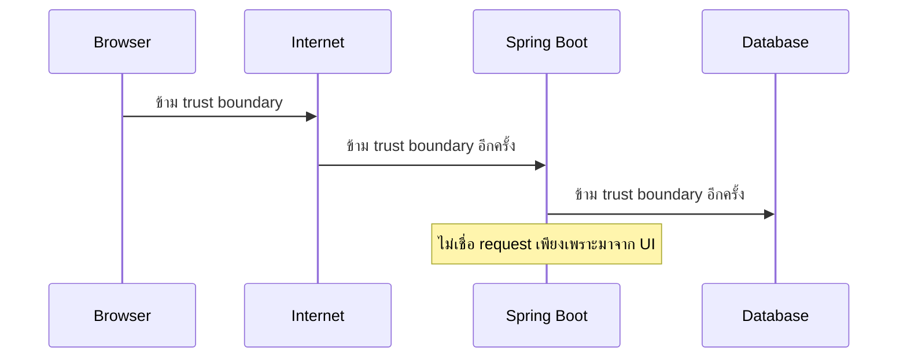
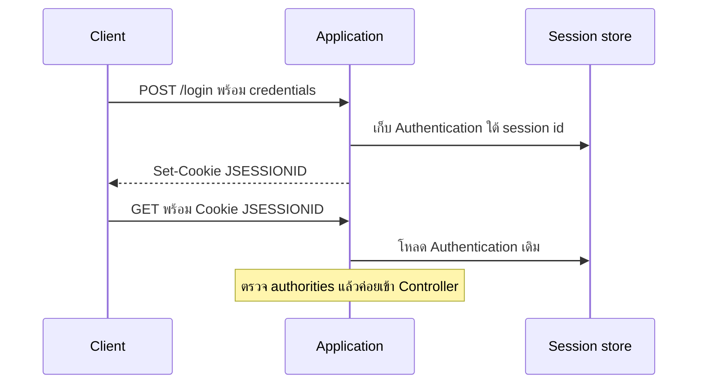
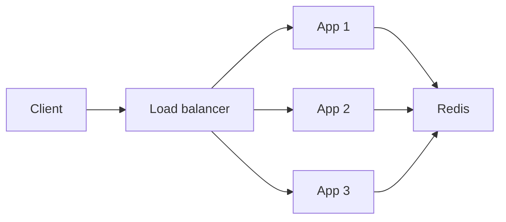
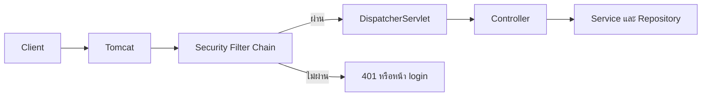
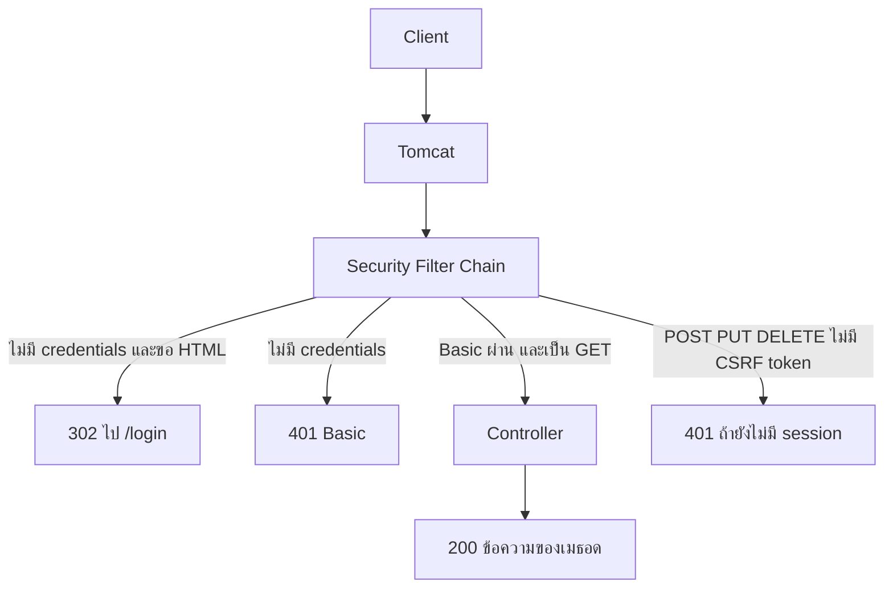

# #35 — Spring Security: Authentication, Authorization และ SecurityContext

> **วิดีโอ:** [Spring Security | Authentication, Authorization & SecurityContext | Spring Boot Full Course #35](https://youtu.be/KVJuG95JSpM) — Coder Army, ~80 นาที
> **แหล่งที่ใช้สรุป:** ซับภาษาอังกฤษที่ YouTube สร้างอัตโนมัติ (en-US)
> **เวอร์ชันในโค้ด:** Spring Boot 4.1.1 + Spring Security 7.1.1 + Java 21 (ใส่หมายเหตุไว้ทุกจุดที่ Spring Boot 3.x ต่างกัน)

ตอนนี้ตอบคำถามว่า แอปที่เปิด endpoint ไว้ทุกคนเรียกได้ จะเริ่มล็อกอย่างไรโดยยังไม่เขียน Security เอง ผู้สอนเริ่มจาก `GET /api/students` ที่ตอบทันที แล้วปูคำว่า asset, threat, trust boundary, Authentication, Authorization จากนั้นอธิบายว่า object `Authentication` ถูกเก็บใน `SecurityContext` และดึงผ่าน `SecurityContextHolder` เขาแยก stateful กับ stateless แล้วปิดด้วยการใส่ `spring-boot-starter-security` อย่างเดียว จนทุก endpoint ต้อง login และเมธอดที่เปลี่ยนข้อมูลติด CSRF

ส่วนที่ติดป้าย `💡 เพิ่มเติม` คือของที่ผมเติมเอง ไม่ได้อยู่ในวิดีโอ ส่วนที่ติด `⚠️ แก้จากวิดีโอ` คือจุดที่วิดีโอพูดคลาดเคลื่อน

---

## สารบัญ

| เวลา | หัวข้อ |
|---|---|
| [0:00](https://youtu.be/KVJuG95JSpM?t=0) | [1. API เปิดอยู่ก่อนใส่ Security](#1-api-เปิดอยู่ก่อนใส่-security) |
| [2:01](https://youtu.be/KVJuG95JSpM?t=121) | [2. ทำไมต้องถามเรื่อง security](#2-ทำไมต้องถามเรื่อง-security) |
| [3:04](https://youtu.be/KVJuG95JSpM?t=184) | [3. Asset, Threat, Vulnerability และ Attack](#3-asset-threat-vulnerability-และ-attack) |
| [7:26](https://youtu.be/KVJuG95JSpM?t=446) | [4. Trust boundary](#4-trust-boundary) |
| [10:04](https://youtu.be/KVJuG95JSpM?t=604) | [5. Authentication กับ Authorization](#5-authentication-กับ-authorization) |
| [12:25](https://youtu.be/KVJuG95JSpM?t=745) | [6. สามปัจจัยและ MFA](#6-สามปัจจัยและ-mfa) |
| [15:32](https://youtu.be/KVJuG95JSpM?t=932) | [7. Brute force และข้อความ error](#7-brute-force-และข้อความ-error) |
| [18:13](https://youtu.be/KVJuG95JSpM?t=1093) | [8. Identity, Credentials และ Principal](#8-identity-credentials-และ-principal) |
| [20:41](https://youtu.be/KVJuG95JSpM?t=1241) | [9. Authority, Role และ Permission](#9-authority-role-และ-permission) |
| [22:44](https://youtu.be/KVJuG95JSpM?t=1364) | [10. Authentication request กับ Authentication principal](#10-authentication-request-กับ-authentication-principal) |
| [26:25](https://youtu.be/KVJuG95JSpM?t=1585) | [11. interface Authentication](#11-interface-authentication) |
| [27:42](https://youtu.be/KVJuG95JSpM?t=1662) | [12. SecurityContext](#12-securitycontext) |
| [28:47](https://youtu.be/KVJuG95JSpM?t=1727) | [13. SecurityContextHolder กับ ThreadLocal](#13-securitycontextholder-กับ-threadlocal) |
| [33:03](https://youtu.be/KVJuG95JSpM?t=1983) | [14. HTTP ไม่จำ request ก่อนหน้า](#14-http-ไม่จำ-request-ก่อนหน้า) |
| [36:14](https://youtu.be/KVJuG95JSpM?t=2174) | [15. Stateful authentication](#15-stateful-authentication) |
| [42:23](https://youtu.be/KVJuG95JSpM?t=2543) | [16. หลาย server กับ session](#16-หลาย-server-กับ-session) |
| [45:52](https://youtu.be/KVJuG95JSpM?t=2752) | [17. Session theft และ session fixation](#17-session-theft-และ-session-fixation) |
| [47:14](https://youtu.be/KVJuG95JSpM?t=2834) | [18. Stateless authentication](#18-stateless-authentication) |
| [48:58](https://youtu.be/KVJuG95JSpM?t=2938) | [19. Self-contained, opaque และ bearer token](#19-self-contained-opaque-และ-bearer-token) |
| [57:38](https://youtu.be/KVJuG95JSpM?t=3458) | [20. Lifecycle ของ request สองแบบ](#20-lifecycle-ของ-request-สองแบบ) |
| [1:00:14](https://youtu.be/KVJuG95JSpM?t=3614) | [21. ใส่ starter-security แล้วทุก endpoint ต้อง login](#21-ใส่-starter-security-แล้วทุก-endpoint-ต้อง-login) |
| [1:04:55](https://youtu.be/KVJuG95JSpM?t=3895) | [22. Spring Security ทำงานที่ Filter](#22-spring-security-ทำงานที่-filter) |
| [1:07:01](https://youtu.be/KVJuG95JSpM?t=4021) | [23. Auto-configuration สองชุด](#23-auto-configuration-สองชุด) |
| [1:10:54](https://youtu.be/KVJuG95JSpM?t=4254) | [24. SecurityFilterChain และ user ค่าเริ่มต้น](#24-securityfilterchain-และ-user-ค่าเริ่มต้น) |
| [1:12:47](https://youtu.be/KVJuG95JSpM?t=4367) | [25. กำหนด username password และ role เอง](#25-กำหนด-username-password-และ-role-เอง) |
| [1:13:56](https://youtu.be/KVJuG95JSpM?t=4436) | [26. POST PUT DELETE ติด CSRF](#26-post-put-delete-ติด-csrf) |
| — | [27. สรุปท้ายตอน](#27-สรุปท้ายตอน) |

---

## 1. API เปิดอยู่ก่อนใส่ Security

[▶ 0:00](https://youtu.be/KVJuG95JSpM?t=0)

ผู้สอนบอกว่า Spring Security เป็น module สำคัญของ Spring Framework เพราะมันกำหนดว่าแอปที่เขียนมาตลอดซีรีส์จะถูกป้องกันอย่างไร ตอนนี้ยังเป็นบทนำว่ามันคืออะไรและทำงานอย่างไร

โปรเจกต์ใน IntelliJ ชื่อ Spring Security Demo มี Controller ตัวเดียว ยังไม่มี Service, Repository หรือ database

```java
package in.strikes.springsecuritydemo;

import org.springframework.web.bind.annotation.GetMapping;
import org.springframework.web.bind.annotation.RequestMapping;
import org.springframework.web.bind.annotation.RestController;

@RestController
@RequestMapping("/api/students")
public class StudentController {

    @GetMapping
    public String getStudent() {
        return "Student retrieved successfully";
    }
}
```

> 💡 **เพิ่มเติม:** ซับไม่บอก package ผู้สอนใช้โปรเจกต์ชื่อ Spring Security Demo โค้ดด้านล่างทั้งไฟล์อยู่ใน package `in.strikes.springsecuritydemo` วิดีโอใช้พอร์ต 8080 ตัวอย่างที่รันในโน้ตนี้ใช้พอร์ต 9035

`pom.xml` ช่วงต้นมีแค่ `spring-boot-starter-webmvc` เพื่อยิง Controller จาก Postman ได้ เขาสตาร์ตแอปแล้วยิง `GET /api/students` ได้ข้อความ `Student retrieved successfully`

งานของตอนนี้คือใส่ชั้น security บน API นี้ พอเรียก `/api/students` อีกครั้งต้องไม่ได้รับข้อความนั้นทันที ต้องบอกว่ายังไม่ authenticated และต้องใส่ username กับ password ก่อน

---

## 2. ทำไมต้องถามเรื่อง security

[▶ 2:01](https://youtu.be/KVJuG95JSpM?t=121)

เขาเขียน request ตัวอย่าง `GET /api/students` ที่ host `localhost` พอร์ต `8080` แล้วไล่ชั้นที่ request วิ่งผ่าน Controller, Service, Repository และ database ถ้ามี ก่อน Controller ยังมี DispatcherServlet และ Tomcat แต่ภาพกว้างคือ request ลงที่ Controller ก่อน

คำถามที่ยังไม่เคยถามกับ endpoint นี้คือ call นี้อนุญาตสำหรับ user คนนี้หรือไม่, endpoint นี้ public หรือไม่, authenticate แล้วหรือยัง, authorize แล้วหรือยัง ที่ผ่านมาทุก request ถูกปล่อยเข้าไป สมมติว่าทุก endpoint เป็น public ใครก็ fetch, delete หรือ update ได้

---

## 3. Asset, Threat, Vulnerability และ Attack

[▶ 3:04](https://youtu.be/KVJuG95JSpM?t=184)

เขาให้จำสามคำก่อนเดินต่อ คือ asset, threat และ trust boundary

**Asset** คือทรัพยากรที่มีค่าของบริษัท เขาแบ่งเป็นห้ากลุ่ม

| ชนิด | ความหมายในวิดีโอ | ตัวอย่าง |
|---|---|---|
| Data asset | ข้อมูลที่เกี่ยวกับผู้ใช้ | email, password, username, ข้อมูลธนาคาร |
| Operational asset | การกระทำที่แอปทำให้เกิด | สร้าง user, ลบ user, โอนเงิน, endpoint ที่เปลี่ยนข้อมูล |
| Security asset | ข้อมูลที่ใช้พิสูจน์ตัวตน | session id, JWT |
| Infrastructure asset | เครื่องและซอฟต์แวร์ที่รันระบบ | database, application, server |
| Availability asset | แอปยังเปิดให้ใช้ได้ | แอปล่มแล้วผู้ใช้ทำธุรกรรมหรือเก็บข้อมูลไม่ได้ |

[▶ 5:14](https://youtu.be/KVJuG95JSpM?t=314)

**Threat** คือความตั้งใจจะทำอันตรายต่อ asset ใด asset หนึ่ง

**Vulnerability** คือจุดอ่อนในแอปที่ attacker ใช้เพื่อสร้าง threat ได้

เขาสรุปสูตรสอนว่า threat บวก vulnerability กลายเป็น **attack**

ตัวอย่างบนกระดาน แอป Spring Boot รันอยู่ มี attacker ต้องการสิทธิ์ admin โดยเปิด `/admin` จุดอ่อนที่เจอคือแอปยอมให้ลอง password ได้ไม่จำกัด attacker เขียนสคริปต์ไล่ชุด password จนชุดหนึ่งเปิดสิทธิ์ admin ได้ ทั้งแอปจึงถูก compromise

> 💡 **เพิ่มเติม:** สูตร threat + vulnerability = attack เป็นภาพสอนของคลิปนี้ ในงาน security มักแยก threat (สิ่งที่อาจทำอันตราย), vulnerability (จุดอ่อน) และ attack (การลงมือใช้จุดอ่อน) ออกจากกันเป็นคนละคำ

---

## 4. Trust boundary

[▶ 7:26](https://youtu.be/KVJuG95JSpM?t=446)

เมื่อข้อมูลย้ายจากระดับหนึ่งไปอีกระดับ เขาเรียกว่าข้าม **trust boundary** เส้นทางในตัวอย่างคือ client (browser) ออกสู่อินเทอร์เน็ต เข้าแอป Spring Boot แล้วต่อไปยัง database ทุกครั้งที่ข้ามขอบนี้ งานของเราคือไม่เชื่อ request ที่เดินเข้ามา เพราะมีคนแก้ของกลางทางได้

เหตุที่เชื่อ client ไม่ได้คือโค้ดฝั่งหน้าเว็บรันบน browser ของเขา HTML, CSS และ JavaScript อยู่ที่นั่น โค้ด backend อยู่บน server ของเรา

เขาวาดหน้าแอดมินที่มีปุ่มซึ่งควรเห็นเฉพาะ admin ถ้า user ธรรมดา login ปุ่มถูกซ่อน แต่คนนั้นเปิดเครื่องมือของ browser แล้วแก้ HTML หรือ JavaScript ให้ปุ่มโผล่ได้ และไม่จำเป็นต้องเห็นปุ่มด้วยซ้ำ การกดปุ่มคือการยิง backend เช่น `/api/admin` ใครก็ยิง endpoint นั้นตรง ๆ ด้วย cURL หรือ Postman ได้ การซ่อนปุ่มจึงไม่ใช่การป้องกัน



---

## 5. Authentication กับ Authorization

[▶ 10:04](https://youtu.be/KVJuG95JSpM?t=604)

**Authentication** คือการอ้างตัวตน เขาอ้างว่าเป็น Aditya แล้วต้องมีคนตรวจคำอ้างนั้นด้วย credentials เช่น username กับ password ถ้าตรวจผ่าน คำอ้างถูกยอมรับ เขาเปรียบกับ รปภ. หน้าอาคาร พนักงานแสดงบัตร รปภ. ตรวจบัตรแล้วให้เข้า

[▶ 11:09](https://youtu.be/KVJuG95JSpM?t=669)

**Authorization** เริ่มหลังคำอ้างถูกยอมรับแล้ว มันตอบว่าเข้ามาแล้วเรียก endpoint ไหนได้ คุยกับส่วนไหนของแอปได้ เขามัดกับ role เช่น admin, user, manager แต่ละ role แตะคนละส่วนของแอป

ตัวอย่าง Instagram คนที่เป็นเจ้าของบัญชีลบรูปตัวเองหรือโพสต์ใหม่ได้ แต่โพสต์ในบัญชีเพื่อนไม่ได้ สิทธิ์นั้นมาจาก role

กลับไปที่อาคาร การผ่าน รปภ. ไม่ได้แปลว่าเดินเข้าห้อง CEO ได้ พนักงานเข้าได้เฉพาะโซนของตัวเอง ส่วนนั้นคือ authorization

เขาย้ำว่า public API ก็เป็นเรื่องของ authorization การบอกว่าทุกคนเรียกได้คือการกำหนด access ว่า public ถ้าวันหลังอยากปิด ก็เปลี่ยน access นั้นได้ ทุก API ควรมี access control แม้ตัวที่เปิดสาธารณะ

[▶ 15:10](https://youtu.be/KVJuG95JSpM?t=910)

ในแอปจริง Authentication มาก่อน Authorization เพราะต้องรู้ก่อนว่าคำอ้างตัวตนเป็นจริง แล้วค่อยดู role

---

## 6. สามปัจจัยและ MFA

[▶ 12:25](https://youtu.be/KVJuG95JSpM?t=745)

เขาแบ่งปัจจัยที่ใช้ authenticate เป็นสามกลุ่ม

| ปัจจัย | คืออะไร | ตัวอย่างในคลิป |
|---|---|---|
| Something you know | สิ่งที่ต้องจำ | password, PIN, คำตอบคำถามความปลอดภัย |
| Something you have | สิ่งที่ถืออยู่ | smart card, แอป authenticator เช่น Google Authenticator หรือ Microsoft Authenticator, cryptographic key |
| Something you are | ลักษณะทางชีวภาพ | ลายนิ้วมือ, ม่านตา, ใบหน้า |

[▶ 13:46](https://youtu.be/KVJuG95JSpM?t=826)

**MFA** หรือ Multi-Factor Authentication จะเรียกว่าแข็งแรงเมื่อปัจจัยมาจากคนละกลุ่ม ลำดับที่เขาถือว่าใช้ได้คือถาม password ก่อน แล้วถาม OTP จากแอป authenticator, จากอีเมล หรือจากโทรศัพท์ อีกคู่คือ password กับลายนิ้วมือ หรือ password กับใบหน้า รวมสองหรือสามปัจจัยจากคนละแหล่ง

ถ้าถาม password แล้วยังถาม PIN เขาบอกว่านั่นไม่ใช่ MFA ที่ดี เพราะทั้งคู่เป็น something you know ปัจจัยเดียวกัน

---

## 7. Brute force และข้อความ error

[▶ 15:32](https://youtu.be/KVJuG95JSpM?t=932)

เขาสมมติหน้า `/login` ที่รับ username กับ password ถ้า password ผิด ระบบให้ลองใหม่ได้ เพราะคนจริงก็พิมพ์ผิด ถ้าลองรหัสที่สาม สี่ และต่อไปเรื่อย ๆ โดยไม่มีเพดาน รูปแบบนั้นอาจเป็น attacker ที่ทำ **brute force** คือไล่ชุด password โดยหวังว่าชุดหนึ่งจะถูก

แอปจึงไม่ควรให้ลอง password ได้ไม่จำกัด จำนวนครั้งต้องสมดุลกับประสบการณ์ผู้ใช้ การผิดครั้งเดียวแล้วล็อกบัญชีทันทีก็ใช้ไม่ได้ ต้องให้โอกาสสองสามครั้ง แล้วถ้าเห็นรูปแบบว่ามีการไล่รหัสจำนวนมาก ให้ถือว่าอาจเป็นการโจมตี

[▶ 17:28](https://youtu.be/KVJuG95JSpM?t=1048)

เขาห้ามบอกรายละเอียดเกินจำเป็น ถ้า password ผิด อย่าตอบว่า password ผิด ให้ตอบแนว `username and password are incorrect` หรือ `invalid username and password` โดยไม่บอกว่าส่วนไหนผิด คนที่ใช้บัญชีจริงรู้อยู่แล้วว่า username ของตัวเองถูก ฝั่ง server เก็บบันทึกภายในได้ว่าผิดที่ username หรือ password แต่ไม่ส่งรายละเอียดนั้นให้ client เพราะมันทำให้ brute force ง่ายขึ้น ถ้ารู้แล้วว่า username ถูก ก็เหลือแค่เดา password

---

## 8. Identity, Credentials และ Principal

[▶ 18:13](https://youtu.be/KVJuG95JSpM?t=1093)

เขาเขียนชุดคำที่จะใช้ทั้ง Spring Security ได้แก่ identity, credentials, principal, authorities, roles, permissions, authentication, SecurityContext และ SecurityContextHolder

**Identity** คือหน่วยที่ระบบต้องจำการกระทำได้ ไม่จำกัดว่าเป็นคน อาจเป็น user, customer หรือ scheduled job ที่รันเป็นรอบ

[▶ 19:27](https://youtu.be/KVJuG95JSpM?t=1167)

เขาเตือนว่าใน Spring Security หลายคนเข้าใจว่า identity คือแถวในตาราง เช่น id `1001`, ชื่อ Aditya, อายุ 29 นั่นไม่ครบ identity อาจถูกแทนด้วย account แต่คนหนึ่งมีได้หลาย account identity เป็นคำเชิงแนวคิดว่า "ฉันคือ Aditya" แล้วเราตรวจคำอ้างนั้นด้วย credentials คนละวิธี

**Credentials** คือของที่ใช้พิสูจน์คำอ้างนั้น เช่น username, password หรือ OTP ตามปัจจัยด้านบน

[▶ 20:18](https://youtu.be/KVJuG95JSpM?t=1218)

**Principal** คือ identity ที่กำลังถูกพูดถึงอยู่ในระบบตอนนี้ ถ้าระบบกำลังตรวจ Aditya principal ของงานนั้นคือ Aditya เขาเรียกว่า active identity

---

## 9. Authority, Role และ Permission

[▶ 20:41](https://youtu.be/KVJuG95JSpM?t=1241)

**Authority** ใน Spring Security คือ permission หรือความสามารถที่ identity หรือ principal มี เช่น อ่านข้อมูลคอร์ส หรือลบ user

ข้อมูลชุด principal, credentials และ authorities ถูกเก็บใน object เดียว ชนิดของมันคือ interface `Authentication` authorities ถูกเก็บเป็น collection เพราะมีได้หลายอัน Spring เรียก authority หนึ่งรายการว่า `GrantedAuthority`

[▶ 21:48](https://youtu.be/KVJuG95JSpM?t=1308)

**Role** คือกลุ่มของ authority เขาให้ Admin เป็น role หนึ่งที่มีหลาย authority, User อีกชุด, Manager อีกชุด ตัวอย่างคือ Admin ลบ user ได้ แต่ User หรือ Manager ลบไม่ได้

**Permission** ในคลิปนี้เขาให้ถือว่าเป็นสิ่งเดียวกับ authority ช่วงที่พูดต่อมีซับขาดเป็นช่วง ๆ เขาเริ่มแยกว่า authority อาจกว้างกว่า และ permission อาจลงไปถึงว่า API ไหนถูกเรียกได้ แล้วปิดว่าในตอนนี้ให้ถือว่า permission กับ authority เป็นเรื่องเดียวกัน

> 💡 **เพิ่มเติม:** ใน API ของ Spring Security ทั้ง role และ permission เป็น `GrantedAuthority` การตรวจ role ชื่อ `ADMIN` จะมองหา authority ที่สตริงคือ `ROLE_ADMIN` ไม่มี collection ของ role แยกจาก authority

---

## 10. Authentication request กับ Authentication principal

[▶ 22:44](https://youtu.be/KVJuG95JSpM?t=1364)

คำว่า authentication มีสองชั้นในคลิป ชั้นแนวคิดคือการตรวจคำอ้างตัวตนด้วย credentials ชั้น API คือ interface `Authentication` ซึ่งมีคลาส concrete ที่สร้าง object ได้ เขาให้ object นี้สวมได้สองบท

**Authentication request** เกิดตอนมีคนมาขอให้ตรวจตัว ยังไม่ผ่าน เขาเติมค่าประมาณนี้

| ฟิลด์ | ค่าตอนยังไม่ผ่าน |
|---|---|
| principal | ชื่อที่อ้าง เช่น Aditya |
| credentials | password ดิบที่เพิ่งส่งมา |
| authorities | ว่าง เพราะยังไม่ถูกตรวจ |
| authenticated | `false` |

[▶ 24:26](https://youtu.be/KVJuG95JSpM?t=1466)

เมื่อคำอ้างผ่าน เขาบอกว่ารหัสใน database ถูกเก็บแบบเข้ารหัส แล้วนำรหัสที่ส่งมาไปเทียบ มีเทคนิค salt และ pepper ซึ่งจะดูทีหลัง พอเทียบผ่าน เขาเก็บผลลง object `Authentication` ก้อนใหม่ เรียกบทนี้ว่า **authentication principal** ชนิด object ยังเป็น `Authentication` เหมือนเดิม แต่ความหมายเปลี่ยน จากของที่รอตรวจ เป็นของที่ตรวจแล้ว

| ฟิลด์ | ค่าหลังผ่าน |
|---|---|
| principal | รายละเอียด user ทั้งก้อนที่ดึงจาก database ไม่ใช่แค่ชื่อ |
| credentials | `null` เพราะไม่ต้องเก็บต่อ |
| authorities | ชุดสิทธิ์ที่กำหนดแล้ว เช่น อ่านคอร์ส, อัปเดตคอร์ส |
| authenticated | `true` |

> ⚠️ **แก้จากวิดีโอ:** วิดีโอพูดว่ารหัสใน database ถูกเก็บแบบ encrypted การเข้ารหัสแบบนั้นย้อนกลับเป็นรหัสเดิมได้ รหัสผ่านที่เก็บอย่างปลอดภัยต้องเป็นค่า hash ทางเดียวพร้อม salt ไม่ใช่ ciphertext ที่ถอดกลับได้ เรื่อง salt กับ pepper เขาบอกเองว่าจะอธิบายในตอนถัด ๆ ไป

---

## 11. interface Authentication

[▶ 26:25](https://youtu.be/KVJuG95JSpM?t=1585)

เขาไล่เมธอดของ interface `Authentication` ตามที่ Spring Security ใช้

| เมธอด | สิ่งที่ได้ |
|---|---|
| `getPrincipal()` | principal |
| `getCredentials()` | credentials |
| `getAuthorities()` | collection ของ `GrantedAuthority` |
| `getDetails()` | รายละเอียดเพิ่ม เช่น session id หรือ token |
| `isAuthenticated()` | ตรวจผ่านแล้วหรือยัง |
| `getName()` | ชื่อของ authentication นี้ |

ภาพที่เขาให้จำคือ มี request ดิบ ตรวจ request นั้น เช่นเทียบ password กับ database แล้วได้ authentication principal ที่เก็บข้อมูลตามตารางด้านบน

> 💡 **เพิ่มเติม:** interface จริงยังมี `setAuthenticated(boolean)` ซึ่งคลิปไม่ได้พูดถึง `getName()` มาจาก `java.security.Principal` ที่ `Authentication` extend อยู่

---

## 12. SecurityContext

[▶ 27:42](https://youtu.be/KVJuG95JSpM?t=1662)

ใน Spring คำว่า context หมายถึง container `ApplicationContext` เก็บ Bean persistence context เก็บ entity **SecurityContext** เก็บ object `Authentication` ของคนที่เพิ่งถูกตรวจผ่าน คือ authentication principal ปัจจุบัน

เหตุที่แยก container นี้ออกมา คือถ้าส่ง `Authentication` เข้าทุกเมธอดเอง จะต้องร้อยพารามิเตอร์ทั้งแอป ใครต้องการ principal, credentials หรือ details ให้ถาม SecurityContext ตัวกลาง

---

## 13. SecurityContextHolder กับ ThreadLocal

[▶ 28:47](https://youtu.be/KVJuG95JSpM?t=1727)

**SecurityContextHolder** คือทางเข้าไปหา SecurityContext เขาเขียนบนกระดานประมาณนี้

```java
package in.strikes.springsecuritydemo;

import org.springframework.security.core.Authentication;
import org.springframework.security.core.context.SecurityContext;
import org.springframework.security.core.context.SecurityContextHolder;

public final class SecurityContextLookup {

    private SecurityContextLookup() {
    }

    public static Object currentPrincipal() {
        SecurityContext context = SecurityContextHolder.getContext();
        Authentication authentication = context.getAuthentication();
        return authentication.getPrincipal();
    }
}
```

จาก `Authentication` ที่ได้ เรียกต่อได้ทั้ง `getPrincipal()`, `getCredentials()`, `getAuthorities()`, `getDetails()`, `isAuthenticated()` และ `getName()` หลายค่ามีชนิดเป็น `Object` เขาบอกว่าจะอธิบายทีหลังว่าทำไม

> 💡 **เพิ่มเติม:** คลาสนี้ไม่มีในโปรเจกต์ที่เขารัน มันคือสามบรรทัดบนกระดานที่จัดให้คอมไพล์ได้ และไม่ได้ถูกเรียกจาก Controller `SecurityContextHolder` ไม่ได้ new context ใหม่ทุกครั้งที่เรียก `getContext()` มันอ่าน context ที่ผูกกับเธรดปัจจุบัน ถ้าเธรดนั้นยังไม่มี มันสร้าง context ว่างให้

[▶ 30:16](https://youtu.be/KVJuG95JSpM?t=1816)

กลไกข้างใต้คือ **ThreadLocal** ถ้ายังไม่เคยใช้ เขาให้ไปดูในซีรีส์ multi-threading ของช่อง แล้วข้ามช่วงนี้ได้

ในแอป Servlet เธรดหนึ่งตัวรับ request หนึ่งรายการ เขาให้ Thread 1 รับ Request 1 ของ user คนหนึ่ง แล้ววาง SecurityContext ของ user คนนั้นไว้ใน ThreadLocal ของเธรดนั้น ระหว่างที่เธรดนี้ทำงานในแอป ใครอยากได้ `Authentication` ให้อ่าน ThreadLocal ของเธรดปัจจุบัน

เมื่อเธรดทำงานเสร็จและกลับเข้า thread pool ต้องเคลียร์ context นี้ทิ้ง ไม่งั้นเธรดเดิมไปรับ Request 2 แล้วจะยังเห็น user ของ Request 1 เขาให้จำว่า SecurityContext อยู่ใน ThreadLocal ของเธรด เพื่อให้ที่ไหนในแอปก็อ่านได้ และของที่อ่านได้คือ `Authentication`

[▶ 32:08](https://youtu.be/KVJuG95JSpM?t=1928)

เขาสรุปตารางทั้งก้อนอีกครั้ง identity ถูกอ้างด้วย credentials เมื่อตรวจผ่านจึงมี `Authentication` ที่เก็บ principal, credentials, authorities และสถานะการตรวจ แม้ยังไม่ผ่านก็มี `Authentication` อยู่แล้ว ในชื่อ authentication request หลังผ่าน ฟิลด์เปลี่ยน principal เป็นรายละเอียดทั้งก้อน credentials เป็น `null` authorities ถูกตั้ง `authenticated` เป็น `true` จากนั้นเก็บ `Authentication` ลง SecurityContext และเข้าถึง context นั้นผ่าน SecurityContextHolder

---

## 14. HTTP ไม่จำ request ก่อนหน้า

[▶ 33:03](https://youtu.be/KVJuG95JSpM?t=1983)

เขายกสองแบบของการ authenticate ว่าเป็นคนละ **authentication state** คือ stateful กับ stateless

Client ส่ง HTTP request ไปที่แอป เขาพูดว่า HTTP ไม่มีข้อมูลของ call ก่อนหน้า call ปัจจุบันไม่รู้ว่าก่อนหน้านั้นคืออะไร

> ⚠️ **แก้จากวิดีโอ:** วิดีโอขยาย HTTPS ว่า Secure Transfer Protocol ชื่อเต็มคือ Hypertext Transfer Protocol Secure

สมมติ call แรกคือ `/login` ระบบสร้าง authentication principal และ authorize เสร็จแล้ว จากนั้น user ยิง call ใหม่เช่นสร้าง user แอปจะรู้ได้อย่างไรว่าคนนี้ login แล้ว ทั้งที่ HTTP call ใหม่ไม่รู้เรื่อง call login

ถ้าไม่มีความจำนี้ ทุกการกดในแอปเช่นกดไลก์ คอมเมนต์ หรืออัปโหลดรูป จะต้องกรอก username กับ password ใหม่ทุกครั้ง ซึ่งใช้ไม่ได้ ทั้ง stateful และ stateless มีหน้าที่เดียวกัน คือบอกแอปว่า call ที่เพิ่งมาถึงมาจาก user ที่ authenticate แล้ว

---

## 15. Stateful authentication

[▶ 36:14](https://youtu.be/KVJuG95JSpM?t=2174)

แบบ **stateful** เริ่มที่ login แอป authenticate แล้วสร้าง `Authentication` ที่เก็บ principal, credentials, authorities และชื่อ เมื่อส่ง HTTP response กลับ แอปเขียน session id ลง cookie ของ browser

เขาวาด request ประมาณ `/login` พร้อม username `Aditya` และ password `secret123` แล้วบอกเองว่าของจริงไม่ส่ง password แบบตัวอักษรเปิดในแบบนั้น ให้นึกแค่รูปร่างของ request response ที่สำเร็จส่ง header

```http
Set-Cookie: JSESSIONID=ABC123
```

แอปจำไว้ว่า cookie นี้คู่กับ `Authentication` ก้อนนั้น ครั้งถัดไป browser ส่ง request ใหม่พร้อม cookie เขาเปลี่ยนตัวอย่างเป็น `GET /get-user` เพื่อให้เป็น GET

```http
GET /get-user HTTP/1.1
Cookie: JSESSIONID=ABC123
```

แอปหา `Authentication` ที่ผูกกับ `ABC123` เจอ และ `isAuthenticated` เป็น `true` จึงถือว่าผ่าน จากนั้นงานที่ขอทำได้ก็ต่อเมื่อตกอยู่ใน authorities ของคนนี้

browser ได้แค่ session id ส่วนก้อน `Authentication` อยู่ฝั่ง server เขาเรียกก้อนนั้นว่า session state ที่เก็บ session state ได้อยู่ในแอปเอง ใน database หรือใน cache ในหน่วยความจำเช่น Redis

ข้อดีที่เขาไล่คือ หลัง authenticate ครั้งแรกไม่ต้องตรวจใหม่ทุก request, อยากทำให้ authentication เป็นโมฆะเมื่อไรก็ได้ เช่นแอปธนาคารบังคับให้ตรวจใหม่ทุก 15 นาที พอครบเวลาแล้วเจอ session id เดิมอีกครั้งก็ไม่เจอ authentication ที่ยังใช้ได้ และส่งกลับไปหน้า login, อ่านเวลาที่ใช้ล่าสุดได้เพราะเก็บ timestamp ไว้ได้



---

## 16. หลาย server กับ session

[▶ 42:23](https://youtu.be/KVJuG95JSpM?t=2543)

ข้อเสียก้อนแรกคือที่เก็บ ต้องเก็บ session ของทุก user ที่ไหนสักแห่ง แอปเครื่องเดียวไม่มีปัญหา แต่แอปสมัยใหม่ไม่ได้รันเครื่องเดียว เขาเรียกว่า distributed application มีการ replicate โค้ด Spring Boot ชุดเดียวกันไปหลายเครื่อง เพื่อให้เครื่องหนึ่งล่มแล้วเครื่องอื่นยังรับผู้ใช้ได้

ภาพคือ client ยิงมาที่ load balancer แล้ว load balancer เลือกเครื่องหนึ่งในสามเครื่องที่โค้ดเหมือนกัน ปัญหาของ stateful คือ login ไปตกที่เครื่องหนึ่ง เครื่องนั้นสร้าง `Authentication` แล้วใส่ session id ใน cookie request ถัดไป load balancer ส่งไปอีกเครื่อง ซึ่งไม่มี `Authentication` ก้อนนั้น เครื่องที่สองจึงบอกให้ login ใหม่

ทางหนึ่งคือให้ load balancer hash ตาม user id หรือ IP แล้วส่ง user คนเดิมไปเครื่องเดิมเสมอ เขาบอกว่าวิธีนี้ผิด เพราะโหลดจะไม่กระจายสม่ำเสมอ

ทางที่เขาใช้ต่อคือไม่เก็บ `Authentication` ในเครื่องแอป แต่เก็บใน database กลางหรือ cache กลางเช่น Redis ไม่ว่า request จะตกเครื่องไหน เครื่องนั้นถือ session id แล้วไปถาม Redis

> ⚠️ **แก้จากวิดีโอ:** ตอนอธิบายเครื่องแรกที่รับ login วิดีโอเรียกของที่ถูกสร้างว่า application context สองรอบ ทั้งที่ตอนต้นคลิปเขาแยกไว้แล้วว่า ApplicationContext คือ container ของ Bean ของที่ผูกกับ session id ในภาพนี้คือ Authentication หรือ SecurityContext



---

## 17. Session theft และ session fixation

[▶ 45:52](https://youtu.be/KVJuG95JSpM?t=2752)

ถ้า attacker ได้ session id จาก cookie แล้วส่ง id นั้นเข้าแอป แอปจะโหลด `Authentication` ตาม mapping แล้วถือว่าเป็น user จริง โดยไม่ตรวจ credentials ใหม่ session id ใน cookie จึงต้องถูกเก็บให้คนอื่นหยิบไปใช้ไม่ได้

[▶ 46:33](https://youtu.be/KVJuG95JSpM?t=2793)

เขาพูดถึง **session fixation** ว่าคือภาวะที่ session id คงที่กับ `Authentication` ก้อนนั้น ใครมาด้วย id เดิมจะไม่ถูก authenticate ซ้ำเพราะ object ถูกเก็บไว้แล้ว และบอกว่านักพัฒนาต้องทำให้ session ใช้ไม่ได้ เช่นทุก 24 ชั่วโมงให้ login ใหม่ อีกอย่างคือหลัง login ต้องเปลี่ยน session id เพื่อไม่ให้ id ที่ attacker รู้มาก่อนยังใช้ได้หลังเหยื่อ login

> ⚠️ **แก้จากวิดีโอ:** นิยามนั้นคือพฤติกรรมปกติของ session ที่ยังไม่หมดอายุ ไม่ใช่ session fixation การโจมตีชื่อนี้คือ attacker กำหนด session id ที่ตัวเองรู้ให้เหยื่อใช้ก่อน login พอเหยื่อ login เข้า id นั้น attacker ใช้ id เดิมเข้ามาในฐานะเหยื่อ การให้ login ใหม่ทุก 24 ชั่วโมงเป็นการจำกัดอายุ session ส่วนการเปลี่ยน session id ตอน login คือวิธีกัน fixation โดยตรง

> 💡 **เพิ่มเติม:** ใน Spring Security 7.1.1 ค่าเริ่มต้นของกลไกนี้คือ `ChangeSessionIdAuthenticationStrategy` มันเปลี่ยน session id เมื่อ authentication สำเร็จ ซึ่งตรงกับวิธีที่สองที่เขาพูดบนกระดาน

---

## 18. Stateless authentication

[▶ 47:14](https://youtu.be/KVJuG95JSpM?t=2834)

แบบ **stateless** ไม่ได้คำนวณ authentication ล่วงหน้าแล้วแจก session id พร้อม mapping แบบนั้นคืองานของ stateful ซึ่งเก็บ state ไว้แล้ว ไม่ว่าจะในแอปหรือใน cache กลาง

stateless ขอให้ทุก request ส่ง token มาด้วย แอปใช้ token นั้นสร้าง `Authentication` ใหม่ทุกครั้ง ไม่ไปเปิดของเก่า จึงไม่ต้องเก็บ state ของ user เขาทำซ้ำเป็นจังหวะเดียวกันทุก request สร้าง `Authentication` ใส่ SecurityContext แล้วปล่อยให้ทำงาน request ถัดไปก็สร้างใหม่ทั้งก้อน

[▶ 48:58](https://youtu.be/KVJuG95JSpM?t=2938)

Token คือ credential ที่ client ส่งมา งานของแอปคือดึง token จาก request แล้วตรวจ เขาบอกว่า token บางชนิดมีลายเซ็นของผู้ใช้, วันหมดอายุ, ผู้ออก token, authorities และ subject รายละเอียดของ **JWT** ซึ่งเป็นรูปแบบ token ที่ใช้กันมาก จะอยู่ในคลิปแยก token อื่นก็มีได้ แต่ตอนนี้ให้จำแค่ว่า request มาพร้อม token และ token มีข้อมูลพอให้สร้าง `Authentication` ใหม่ได้

---

## 19. Self-contained, opaque และ bearer token

[▶ 50:20](https://youtu.be/KVJuG95JSpM?t=3020)

เขาแบ่ง token เป็นสองชนิด

**Self-contained token** คือ signed token ที่มีข้อมูลอยู่ในตัวเอง มองที่ token แล้วรู้ได้ว่าเป็น user คนไหน ลายเซ็นคืออะไร และยังใช้ได้หรือไม่ JWT เป็น signed token ชนิดนี้ แอปสร้าง `Authentication` จาก token ได้เอง ไม่ต้องถามคนที่สาม ในภาพหลายเครื่อง ไม่ว่า request จะตกเครื่องไหนก็สร้าง object ใหม่จาก token ได้ ไม่ต้องอ่าน Redis และไม่ต้องเก็บของเก่าในแอป

**Opaque token** ไม่มีข้อมูลผู้ใช้อยู่ในตัว มันเป็นชุดอักขระที่เป็นตัวระบุ คล้าย session id แอปต้องเอา token ไปถาม token service หรือ authentication service ซึ่งเก็บ mapping จาก token ไปยัง `Authentication` เขาให้เรียกบริการนี้ว่า token service ก่อน

เขาตอบข้อสงสัยเองว่าแบบนี้เหมือน stateful มาก และคำตอบของเขาคือเกือบใช่ ถ้าต้องเอา token ไปแลก `Authentication` จากบริการอื่น มันหน้าตาเหมือน stateful แต่เขานิยามว่า token service มักไม่ใช่ส่วนหนึ่งของแอป จากมุมของแอปจึงเรียก stateless ได้ ส่วน Redis ในภาพก่อนหน้าเป็นส่วนหนึ่งของแอปจึงยังเรียก stateful เขาบอกว่านี่เป็นเรื่องนิยาม จะเรียกฝั่งไหนก็ได้ ประเด็นที่เขาต้องการคือ opaque token ไม่ได้พกข้อมูลผู้ใช้ครบ

[▶ 54:32](https://youtu.be/KVJuG95JSpM?t=3272)

**Bearer token** คือคำว่า `Bearer` ตามด้วยค่าหนึ่ง bearer แปลว่าผู้ที่ถือ token คนที่ส่ง token นี้มาคือคนที่ถือมันอยู่ เขาบอกว่าค่าที่ตามหลังมักเป็นข้อมูลแบบ self-contained อย่าง JWT จากคำว่า Bearer แอปรู้ว่าคนส่งคือเจ้าของ และจากค่าที่ตามมาสร้าง `Authentication` ได้โดยไม่ต้องมี token service หรือ cache กลาง

> ⚠️ **แก้จากวิดีโอ:** Bearer ไม่ได้พิสูจน์ว่าคนส่งคือเจ้าของเดิม มันหมายถึงใครถือ token นี้ไว้ก็ใช้สิทธิ์ของ token ได้ ดังนั้น token ที่หลุดไปก็ใช้ได้จนกว่าจะหมดอายุหรือถูกเพิกถอน และ bearer เป็นแค่รูปแบบการส่ง token ได้ทั้ง JWT และ opaque token

client ได้ token นี้จากไหน ครั้งแรกต้อง login หลัง login สำเร็จแอปคืน authentication token แล้วให้ client ส่ง token นั้นมากับทุก request เขาไม่ได้ให้ browser เก็บให้อัตโนมัติใน cookie แม้จะเก็บใน cookie ก็ได้ และยังเป็น stateless ได้ เพราะความเป็น stateless ไม่ได้ตัดสินจากว่าดึง token จาก cookie หรือจาก header สิ่งที่ตัดสินคือใช้ `Authentication` ก้อนเก่า หรือสร้างก้อนใหม่ทุกครั้ง ใช้ก้อนเก่าคือ stateful สร้างใหม่ทุกครั้งคือ stateless

[▶ 56:36](https://youtu.be/KVJuG95JSpM?t=3396)

เขาเปิดแท็บ Authorization ของ Postman ให้ดูตัวเลือก Bearer Token, JWT และ Basic Authentication ใน Basic Auth กรอก username กับ password เมื่อส่งจากแท็บนี้ ค่าจะถูกใส่ใน header แล้ว request เดินจาก client ไป server

> ⚠️ **แก้จากวิดีโอ:** วิดีโอเรียก HTTP Basic ว่าเป็นการส่ง authentication token แบบ bearer สองอย่างนี้คนละ scheme HTTP Basic คือ header `Authorization: Basic` ตามด้วย username กับ password ที่เข้ารหัสแบบ Base64 Bearer คือ header `Authorization: Bearer` ตามด้วย token ค่าเริ่มต้นของ starter ที่เขาเปิดหลังจากนี้คือ form login กับ HTTP Basic ไม่มี bearer token

เขากลับมาย้ำว่า cookie ไม่ได้แปลว่า stateful เสมอไป เก็บ token ไว้ใน cookie แล้วสร้าง `Authentication` จาก token นั้นได้ และนั่นยังเป็น stateless

---

## 20. Lifecycle ของ request สองแบบ

[▶ 57:38](https://youtu.be/KVJuG95JSpM?t=3458)

เขาสรุปวงจร stateful ทั้งเส้น

1. Client ส่ง login
2. แอปดึง username กับ password แล้วตรวจ credentials
3. สร้าง `Authentication` แล้วใส่ลง SecurityContext
4. เก็บ SecurityContext ไว้ใน HTTP session
5. ส่ง session cookie กลับไป เก็บเป็น session id ใน cookie ของ client
6. Request ถัดไปเช่น `GET /profile` ส่ง `JSESSIONID=ABC123` มาด้วย
7. แอปโหลด session จาก id นั้น ได้ SecurityContext แล้วได้ `Authentication`
8. วางลง SecurityContextHolder
9. ทำ authorization
10. request ถึง Controller แล้วต่อไป Service กับ Repository
11. เมื่อจบ request เคลียร์ SecurityContextHolder เพราะของนี้อยู่ใน ThreadLocal

[▶ 59:22](https://youtu.be/KVJuG95JSpM?t=3562)

วงจร stateless สำหรับ `GET /profile` ที่มาพร้อม authorization token หลังเคย login และได้ token กลับไปแล้ว

1. ดึง token
2. สร้าง `Authentication` จาก token ไม่ได้ไปโหลดของเก่า
3. สร้าง SecurityContext ใส่ `Authentication` แล้วให้อยู่ใน SecurityContextHolder
4. ทำ authorization แล้วจึงเข้า Controller
5. เสิร์ฟ request แล้วเคลียร์ SecurityContextHolder
6. ไม่มี `Authentication` ถูกเซฟลง HTTP session
7. request ถัดไปทำซ้ำทั้งเส้นด้วย credentials ที่มากับ request นั้น และสร้าง `Authentication` ใหม่เสมอ

เขาชี้ว่าทั้ง authentication และ authorization เกิดก่อน Controller รอบ ๆ DispatcherServlet ซึ่งเป็น Servlet ตัวที่รับงานในแอป Servlet ชั้นที่ทำแบบนี้ได้คือ Filter จากตอนก่อนหน้าในซีรีส์ เขาให้เดาไว้ก่อน แล้วยังไม่ลงรายละเอียด

---

## 21. ใส่ starter-security แล้วทุก endpoint ต้อง login

[▶ 1:00:14](https://youtu.be/KVJuG95JSpM?t=3614)

เขากลับมาที่แอป ปิด process เดิม แล้วบอกว่าต้องล็อก endpoint ที่มีอยู่ Spring Initializr มี dependency ชื่อ Security ให้เลือกตอนสร้างโปรเจกต์ โปรเจกต์นี้สร้างไปแล้ว เขาจึงเปิด Maven Central ค้น Spring Boot Starter Security คัดลอกเฉพาะ `groupId` กับ `artifactId` ตัด `version` กับ `scope` ทิ้ง เพราะ parent เป็นคนกำหนดเวอร์ชัน แล้ว reload Maven

```xml
<dependency>
  <groupId>org.springframework.boot</groupId>
  <artifactId>spring-boot-starter-security</artifactId>
</dependency>
```

> 💡 **เพิ่มเติม:** parent ของตัวอย่างนี้คือ `spring-boot-starter-parent` เวอร์ชัน 4.1.1 ซึ่งลาก Spring Security มาที่ 7.1.1 ชื่อ `spring-boot-starter-security` ยังเป็นชื่อเดิมใน Boot 4 ส่วน starter ฝั่งทดสอบถูกแยกเป็น `spring-boot-starter-security-test` ตาม [Spring Boot 4.0 Migration Guide](https://github.com/spring-projects/spring-boot/wiki/Spring-Boot-4.0-Migration-Guide) ตอนนี้ยังไม่ได้ใช้ชุดทดสอบ

[▶ 1:01:39](https://youtu.be/KVJuG95JSpM?t=3699)

เขายังไม่เขียนคลาสเพิ่ม แค่มี dependency แล้วสตาร์ตแอป จากนั้นยิง `GET /api/students` จาก Postman ได้ **401**

จากเครื่องที่รัน Boot 4.1.1 พอร์ต 9035 โดยยังไม่ตั้ง username เอง request ที่ไม่มี credentials ได้แบบนี้

```http
HTTP/1.1 401
WWW-Authenticate: Basic realm="Realm", charset="UTF-8"
Content-Length: 0
```

body ว่าง

> ⚠️ **แก้จากวิดีโอ:** วิดีโออ่าน 401 ว่า "I am not authorized" วลี Unauthorized เป็นชื่อ status ของ HTTP แต่ในคำศัพท์ของคลิปนี้ความล้มเหลวรอบนั้นคือ authentication ยังไม่ผ่าน authorization ที่ไม่ผ่านใช้ 403

ในล็อกมีรหัสที่ Boot สร้างให้ ข้อความจากรอบที่รันจริงคือ

```text
Using generated security password: a9d80bd9-f7d5-427f-ae1f-b6e386a4c54c

This generated password is for development use only. Your security configuration must be updated before running your application in production.
```

เขากรอก Basic Auth ใน Postman เป็น username `user` กับรหัสจากล็อก แล้วได้ `Student retrieved successfully` รอบที่รันจริงด้วยรหัสด้านบนก็ได้ 200 และ body เดียวกัน

```http
HTTP/1.1 200
Content-Type: text/plain;charset=UTF-8

Student retrieved successfully
```

รหัสผิดได้ 401 อีกครั้ง header `WWW-Authenticate` ชุดเดิม body ว่าง

[▶ 1:02:50](https://youtu.be/KVJuG95JSpM?t=3770)

พอเปิด URL เดียวกันใน browser แอปส่งไปหน้า login เอง เขากรอก `user` กับรหัสจากล็อก แล้วได้ข้อความของ `/api/students`

จากรอบที่รันจริง request ที่ส่ง `Accept: text/html` ได้

```http
HTTP/1.1 302
Location: http://localhost:9035/login
```

หน้า `/login` เป็น HTML หัวข้อ `Please sign in` มีช่อง `username`, `password` และปุ่ม Sign in พร้อมช่องซ่อน `_csrf`

เขาบอกว่าไม่จำกัดแค่ GET ทุก endpoint ทั้ง POST, PUT และ DELETE จะถาม username กับ password ก่อน ทาง HTML ได้หน้าฟอร์ม ทาง Postman ต้องส่ง Basic Auth

> 💡 **เพิ่มเติม:** Boot เลือก form login หรือ HTTP Basic จาก content negotiation ที่ header `Accept` ไม่ได้ผูกกับชื่อโปรแกรม browser ที่ขอ `text/html` ได้หน้า login ส่วน client ที่ไม่ได้ขอ HTML ได้ 401 พร้อม `WWW-Authenticate: Basic`

ทุกครั้งที่รีสตาร์ต รหัสในล็อกเปลี่ยน เขาทำให้ดูสองรอบ รหัสขึ้นต้นคนละชุด และบอกว่าชุดนี้มีไว้ทดสอบว่า authentication ทำงาน ล็อกเขียนไว้ตรง ๆ ว่าใช้ตอนพัฒนาเท่านั้น ก่อนขึ้น production ต้องเปลี่ยน security configuration

---

## 22. Spring Security ทำงานที่ Filter

[▶ 1:03:59](https://youtu.be/KVJuG95JSpM?t=3839)

เขาอธิบายว่า dependency ใน `pom.xml` เข้า classpath แล้ว auto-configuration ของ Spring Boot โหลดคลาสจาก classpath นั้น `spring-boot-starter-security` นำคลาสของ Spring Security เข้ามา จำนวนหนึ่งถูกสร้างเป็น Bean รวมถึง Filter จึงยังไม่เขียนคลาสเองแต่ทุก endpoint ถูกล็อก

[▶ 1:04:55](https://youtu.be/KVJuG95JSpM?t=3895)

ชั้นที่ Spring Security ทำงานคือ Filter client ส่ง request เข้า Tomcat ซึ่งเขาเรียกว่าจุดเข้าของแอป ถัดไปคือ DispatcherServlet ซึ่งโดยทั่วไปเป็น Servlet ตัวเดียวของแอป Spring Boot แม้จะสร้าง Servlet เพิ่มได้แต่ปกติไม่ทำ หลัง DispatcherServlet คือ Controller แล้วจึง Service กับ Repository

ระหว่าง Tomcat กับ DispatcherServlet คือชั้น Filter จากตอนที่ดูเรื่อง Filter มาแล้ว สร้าง Filter ได้หลายตัวเป็นโซ่ Spring Security ก็สร้าง Filter ของมันตรงนี้ request จึงวิ่งจาก client ไป Tomcat แล้วเข้าโซ่ Filter ที่นั่นมี authentication, authorization และงานอื่น ผ่านแล้วจึงไป Servlet แล้วไป Controller ถ้ายังไม่ authenticate หรือยังไม่ authorize request ถูกส่งกลับจากชั้น Filter ไม่ลงไปถึง Controller



> 💡 **เพิ่มเติม:** ล็อกของ Boot 4.1.1 ตอนสตาร์ตรอบนี้ขึ้นว่า `Apache Tomcat/11.0.24`

---

## 23. Auto-configuration สองชุด

[▶ 1:07:01](https://youtu.be/KVJuG95JSpM?t=4021)

เขาให้จำสองชื่อที่คุมสถาปัตยกรรมนี้ และบอกว่าจะลงลึกในคลิปหน้า

**Security Auto-Configuration** ตอบว่า request ไหนต้อง authenticate และใช้กลไกไหน ค่าเริ่มต้นคือทุก endpoint ต้องผ่าน และมีสองกลไก ถ้าเข้าทาง HTML ได้ form login ถ้าเข้าทาง Postman ได้ HTTP Basic

**UserDetailsService Auto-Configuration** ตอบว่าจะตรวจ user คนไหน และโหลด user จากไหน แอปนี้ไม่ได้ต่อ database และไม่มีตาราง user รหัสในล็อกกับ username `user` จึงมาจาก Spring Security เอง มันสร้าง user service แล้วสร้าง user หนึ่งคนไว้ทดสอบ รีสตาร์ตแล้วรหัสเปลี่ยนทุกครั้ง

เขาบอกว่า auto-configuration เป็นทางเลือก ถ้าเราสร้าง object ของ Security Auto-Configuration เอง หรือสร้าง user service เอง Spring จะเลิกสร้างของมัน ถ้าไม่ทำเอง มันจัดให้ แอป production จัดการเอง สองก้อนนี้มีไว้ทดสอบ

> ⚠️ **แก้จากวิดีโอ:** วิดีโอพูดว่าสร้างอย่างใดอย่างหนึ่งเองแล้ว Spring จะเลิกสร้าง object ของมัน ทั้งสองก้อนถอยคนละเงื่อนไข การประกาศ Bean `SecurityFilterChain` ปิดเฉพาะ filter chain ค่าเริ่มต้น user ในหน่วยความจำยังอยู่ จนกว่าจะมี Bean `UserDetailsService`, `AuthenticationProvider` หรือ `AuthenticationManager` เอกสาร Boot 4 เขียนไว้แบบนี้ และเงื่อนไขบนคลาส `UserDetailsServiceAutoConfiguration` ของ 4.1.1 ก็ตรวจ missing bean สามชนิดนั้น

> ⚠️ **Boot 4 vs 3:** ชื่อคลาสยังเป็น `SecurityAutoConfiguration` กับ `UserDetailsServiceAutoConfiguration` แต่ package ย้ายแล้ว Boot 3 อยู่ที่ `org.springframework.boot.autoconfigure.security.servlet` Boot 4.1.1 อยู่ที่ `org.springframework.boot.security.autoconfigure` ส่วน filter chain ค่าเริ่มต้นย้ายจาก `SpringBootWebSecurityConfiguration` ไปอยู่ที่ `org.springframework.boot.security.autoconfigure.web.servlet.ServletWebSecurityAutoConfiguration` ยืนยันจากคลาสใน `spring-boot-security-4.1.1.jar` และไฟล์เดียวกันของ Boot 3.4 บน GitHub

---

## 24. SecurityFilterChain และ user ค่าเริ่มต้น

[▶ 1:10:54](https://youtu.be/KVJuG95JSpM?t=4254)

เขาว่า configuration ค่าเริ่มต้นหน้าตาเป็น Bean ชื่อ `SecurityFilterChain` ที่ Spring สร้างให้ งานของมันคือให้ทุก request ต้อง authenticated และเปิดทั้ง form login กับ HTTP Basic ถ้าเราสร้าง `SecurityFilterChain` เอง Bean เดิมจะไม่ถูกใช้ เราจึงกำหนดได้ว่า endpoint ไหนต้องตรวจ และตรวจด้วยวิธีไหน

รูปร่างที่ตรงกับเมธอด `defaultSecurityFilterChain` ใน Boot 4.1.1 คือ

```java
package in.strikes.springsecuritydemo;

import org.springframework.security.config.Customizer;
import org.springframework.security.config.annotation.web.builders.HttpSecurity;
import org.springframework.security.web.SecurityFilterChain;

public final class DefaultFilterChainSketch {

    private DefaultFilterChainSketch() {
    }

    public static SecurityFilterChain chain(HttpSecurity http) throws Exception {
        http.authorizeHttpRequests(requests -> requests.anyRequest().authenticated());
        http.formLogin(Customizer.withDefaults());
        http.httpBasic(Customizer.withDefaults());
        return http.build();
    }
}
```

> 💡 **เพิ่มเติม:** คลาสนี้ไม่ถูกประกาศเป็น `@Configuration` และไม่มี `@Bean` แอปที่รันจึงยังใช้ chain จาก auto-configuration ถ้าใส่ `@Bean` คืนค่า `SecurityFilterChain` จริง chain ค่าเริ่มต้นจะถอยไป ตามที่เขาพูดในหัวข้อก่อน

> ⚠️ **Boot 4 vs 3:** `SecurityFilterChain` กับ `authorizeHttpRequests` ยังเป็น API ที่ Boot 4 ใช้ใน chain ค่าเริ่มต้น เหมือนที่เขาอธิบายบนกระดาน จุดที่ Security 7 ตัดออกคือเมธอดเก่า `authorizeRequests` และการต่อ config ด้วย `.and()` ตั้งแต่ Security 7 ต้องเขียนแบบ lambda ยืนยันจาก [Configuration Migrations ของ Spring Security 7](https://docs.spring.io/spring-security/reference/6.5/migration-7/configuration.html) ไบต์โค้ดของ `ServletWebSecurityAutoConfiguration` ใน Boot 4.1.1 เรียก `authorizeHttpRequests`, `formLogin(Customizer.withDefaults())` และ `httpBasic(Customizer.withDefaults())`

ฝั่ง user เขาบอกว่าคลาสที่ใช้คือ `InMemoryUserDetailsManager` สร้าง user ในหน่วยความจำ credentials ที่เขาวาดคือ username `user`, password ที่สุ่มให้, authorities ชื่อ `ROLE_USER` และสถานะ enabled เป็นจริง ของนี้ทับได้ถ้าสร้าง user เอง

> ⚠️ **แก้จากวิดีโอ:** วิดีโอวาดว่า user ค่าเริ่มต้นมี authority `ROLE_USER` ใน Boot 4.1.1 ถ้าไม่ตั้ง `spring.security.user.roles` รายการ role เริ่มเป็นลิสต์ว่าง `UserDetailsServiceAutoConfiguration` ส่งลิสต์นั้นเข้า `User.roles` ตรง ๆ รอบที่รันโดยยังไม่ตั้ง role แล้วอ่าน `Authentication.getAuthorities()` ได้แค่ `FactorGrantedAuthority` ชื่อ `FACTOR_PASSWORD` ไม่มี `ROLE_USER` แหล่งของ role ว่างคือ constructor ของ `SecurityProperties.User` ใน `spring-boot-security-4.1.1.jar` ซึ่งใส่ `new ArrayList<>()` และไฟล์ `SecurityProperties.java` ของ Boot 3.4 ก็เป็นลิสต์ว่างเช่นกัน จึงไม่ใช่ความต่างเฉพาะ Boot 4

> ⚠️ **Boot 4 vs 3:** `FactorGrantedAuthority` มีใน Spring Security 7.0.0 และไม่มีคลาสนี้ในซอร์สของ Security 6.5.5 การ login ด้วย password ใน Security 7 จึงได้ authority ปัจจัย `FACTOR_PASSWORD` เพิ่มจาก role ที่ตั้งไว้ Security 6 ไม่ใส่ปัจจัยนี้

> 💡 **เพิ่มเติม:** การอ่าน authorities ใช้ endpoint ชั่วคราวที่ไม่มีในโปรเจกต์ตัวอย่างแล้ว ถอดออกหลังจดค่า เพื่อไม่ให้ปนกับ Controller ของคลิป รหัสผ่านค่าเริ่มต้นถูกเติมนำหน้า `{noop}` เมื่อไม่มี Bean `PasswordEncoder` และรหัสยังไม่มี prefix แบบ `{...}` จึง login ด้วยตัวอักษรในล็อกได้ตรง ๆ `{noop}` แปลว่าไม่ได้ hash

---

## 25. กำหนด username password และ role เอง

[▶ 1:12:47](https://youtu.be/KVJuG95JSpM?t=4367)

เขาเปิด `application.properties` แล้วทับ username, password และ roles ที่ Boot ตั้งไว้ เขาตั้งชื่อเป็น Aditya, รหัส `secret123` และให้ role แบบ user กับ admin จากนั้นรีสตาร์ต ล็อกไม่พิมพ์รหัสสุ่มอีก ยิง Postman ด้วย Aditya และ `secret123` ได้ `Student retrieved successfully` ถ้ารหัสเป็น `secret12` ได้ 401

> ⚠️ **แก้จากวิดีโอ:** ซับพูดคีย์ของชื่อว่า `spring.security.username` คีย์ที่ใช้ได้คือ `spring.security.user.name` คีย์รหัสที่เขาพูดต่อมาถูกแล้ว คือ `spring.security.user.password`

```properties
server.port=9035
spring.security.user.name=Aditya
spring.security.user.password=secret123
spring.security.user.roles=USER,ADMIN
```

> 💡 **เพิ่มเติม:** `server.port` ไม่มีในคลิป ใส่เพื่อไม่ให้ชนกับตัวอย่างตอนอื่น ค่า role ในซับไม่ได้สะกดเป็นตัวอักษรบนจอ เขาพูดว่าให้ role แบบ user กับ admin `User.roles` เติม prefix `ROLE_` ให้เอง รอบที่ตั้ง `USER,ADMIN` แล้วอ่าน authorities ได้ `ROLE_ADMIN`, `ROLE_USER` และ `FACTOR_PASSWORD` ถ้าเขียน `ROLE_ADMIN` ลง property นี้ จะกลายเป็น `ROLE_ROLE_ADMIN`

หลังรีสตาร์ตด้วยไฟล์นี้ ล็อกไม่มีบรรทัด `Using generated security password` username `user` พร้อมรหัสเก่าได้ 401 ส่วน Aditya กับ `secret123` ได้ 200 และ body `Student retrieved successfully` รหัส `secret12` ได้ 401

---

## 26. POST PUT DELETE ติด CSRF

[▶ 1:13:56](https://youtu.be/KVJuG95JSpM?t=4436)

เขาสร้างเมธอดที่เหลือของ CRUD บน mapping เดิม

```java
package in.strikes.springsecuritydemo;

import org.springframework.security.web.csrf.CsrfToken;
import org.springframework.web.bind.annotation.DeleteMapping;
import org.springframework.web.bind.annotation.GetMapping;
import org.springframework.web.bind.annotation.PostMapping;
import org.springframework.web.bind.annotation.PutMapping;
import org.springframework.web.bind.annotation.RequestMapping;
import org.springframework.web.bind.annotation.RestController;

@RestController
@RequestMapping("/api/students")
public class StudentController {

    @GetMapping
    public String getStudent() {
        return "Student retrieved successfully";
    }

    @PostMapping
    public String createStudent() {
        return "Student created successfully";
    }

    @PutMapping
    public String updateStudent() {
        return "Student updated successfully";
    }

    @DeleteMapping
    public String deleteStudent() {
        return "Student deleted successfully";
    }

    @GetMapping("/csrf")
    public CsrfToken getToken(CsrfToken csrfToken) {
        return csrfToken;
    }
}
```

รีสตาร์ตแล้วยิง POST, PUT และ DELETE โดยไม่ใส่ username ได้ 401 ทั้งสาม เขาบอกว่าค่าเริ่มต้นของ auto-configuration ทำให้ทุก endpoint ต้อง authenticated

จากนั้นเขายิง POST อีกครั้งด้วย Aditya และ `secret123` ซึ่งถูกทั้งคู่ แต่ยังได้ 401 เหตุผลสั้น ๆ คือ Spring Security กันการโจมตีชื่อ **CSRF** หรือ Cross-Site Request Forgery รายละเอียดจะดูทีหลัง เขาอธิบายคร่าว ๆ ว่าข้อมูลอย่าง session id อยู่ใน cookie ของ browser หรืออาจเป็น authorization key ที่ส่งไป ระบบจึงสงสัยว่ามีการเอา session id ของอีกไซต์มาใช้กับไซต์นี้หรือไม่ endpoint ที่เปลี่ยนข้อมูลคือ POST, PUT และ DELETE จะถูกกันไว้ GET ไม่เปลี่ยนข้อมูล จึงยังผ่าน

> ⚠️ **แก้จากวิดีโอ:** ทิศของการโจมตีกลับกัน CSRF คือไซต์อื่นหลอกให้ browser ของเหยื่อยิง request ไปที่ไซต์ของเรา แล้ว browser แนบ cookie ของไซต์เราไปเอง ไม่ใช่การเอา session ของไซต์อื่นมาใช้บนไซต์เรา header `Authorization` ที่ client ตั้งเองก็ไม่ถูก browser แนบข้ามไซต์ให้แบบ cookie

รอบที่รันด้วย Basic Auth ที่ถูก แต่ไม่ส่ง CSRF token ได้ 401 จริง ตรงกับ Postman ในคลิป

```http
HTTP/1.1 401
WWW-Authenticate: Basic realm="Realm", charset="UTF-8"
Content-Length: 0
```

> 💡 **เพิ่มเติม:** ล็อกระดับ DEBUG ของเคส Basic Auth ที่ไม่ส่ง CSRF token เขียนว่า `Invalid CSRF token found` แล้ว `AccessDeniedHandlerImpl` ตอบ 403 จากนั้นคอนเทนเนอร์ dispatch `GET /error` และโซ่ Security กันหน้า error นั้นในฐานะ anonymous จึงจบที่ `BasicAuthenticationEntryPoint` client เลยเห็น 401 พร้อม `WWW-Authenticate` ซึ่งตรงกับ Postman ในคลิป หลัง form login จนมี session แล้ว POST โดยไม่ส่ง token client เห็น 403

[▶ 1:16:36](https://youtu.be/KVJuG95JSpM?t=4596)

เขาเพิ่ม GET เพื่อเอา CSRF token เพราะ GET ยังเรียกได้ เมธอดชื่อ `getToken` คืน token นั้น รอบแรกคอมไพล์ไม่ผ่านเพราะ `@GetMapping` ยังไม่มี path เขามี GET สองตัวแล้ว จึงใส่ path `/csrf` ได้ endpoint `GET /api/students/csrf`

> 💡 **เพิ่มเติม:** ซับไม่ได้เห็นชนิดคืนค่าบนจอ เขาพูดว่าคืน CSRF token ตัวอย่างนี้คืน `CsrfToken` ทั้งก้อน Jackson จึงเขียนเป็น JSON สามฟิลด์ ถ้าบนจอคืนแค่สตริงของ token รูปร่าง body จะต่างจากนี้

ยิง `GET /api/students/csrf` ด้วย Aditya และ `secret123` ได้ 200 ตัวอย่างจากรอบที่รัน

```json
{
  "headerName": "X-CSRF-TOKEN",
  "parameterName": "_csrf",
  "token": "bOxpUrvdaUgZFs46XC1PoZV8215IFui3RI2W7ylNUbl-WLCsDdlQMd_qWyw0Ia9ePgB7l_dF9mZ7L4macbvziRgpZoxNPdGb"
}
```

เขาคัดลอก token แล้วใส่ header ชื่อ `X-CSRF-TOKEN` จากนั้น POST ได้ `Student created successfully`, DELETE ได้ `Student deleted successfully`, PUT ได้ `Student updated successfully`

รอบที่รันจริงได้ body เดียวกันและ status 200 ทั้งสามเมธอด เมื่อส่ง header `X-CSRF-TOKEN` พร้อม cookie `JSESSIONID` ที่ได้จาก GET `/csrf`

> 💡 **เพิ่มเติม:** token ถูกเก็บใน HTTP session ค่าเริ่มต้นไม่ได้ส่ง token กลับมาเป็น cookie `XSRF-TOKEN` Postman จำ cookie ให้เอง ถ้ายิงใหม่แค่ header โดยไม่ส่ง `JSESSIONID` จาก response ของ GET `/csrf` จะได้ 401 อีกครั้ง token คนละ session ใช้แทนกันไม่ได้

[▶ 1:18:39](https://youtu.be/KVJuG95JSpM?t=4719)

เขาปิดว่าสิ่งที่ทำงานอยู่ตอนนี้คือ auto-configuration ภายใน ยังไม่ได้ตั้งค่าเอง คลิปหน้าจะเขียน security configuration และ Filter เอง ตอนนี้เขาต้องการให้อธิบายได้ว่า `Authentication` คืออะไร เก็บที่ SecurityContext, SecurityContextHolder คืออะไร และคำว่า principal, credentials, roles, responsibilities หมายถึงอะไร

การบ้านคือสร้างโปรเจกต์นี้เอง ดูให้เห็นว่าทุก endpoint ถูกล็อก และทับ username กับ password ค่าเริ่มต้น คลิปหน้าจะสร้าง user ของเราเองแล้ว authenticate คนนั้น

คลาสหลักของแอปที่ยังไม่ได้โชว์บนจอ แต่ต้องมีเพื่อสตาร์ต คือ

```java
package in.strikes.springsecuritydemo;

import org.springframework.boot.SpringApplication;
import org.springframework.boot.autoconfigure.SpringBootApplication;

@SpringBootApplication
public class SpringSecurityDemoApplication {

    public static void main(String[] args) {
        SpringApplication.run(SpringSecurityDemoApplication.class, args);
    }
}
```

`pom.xml` ทั้งไฟล์ของตัวอย่างที่แพ็กผ่านคือ

```xml
<?xml version="1.0" encoding="UTF-8"?>
<project xmlns="http://maven.apache.org/POM/4.0.0"
         xmlns:xsi="http://www.w3.org/2001/XMLSchema-instance"
         xsi:schemaLocation="http://maven.apache.org/POM/4.0.0 https://maven.apache.org/xsd/maven-4.0.0.xsd">
  <modelVersion>4.0.0</modelVersion>

  <parent>
    <groupId>org.springframework.boot</groupId>
    <artifactId>spring-boot-starter-parent</artifactId>
    <version>4.1.1</version>
    <relativePath/>
  </parent>

  <groupId>in.strikes</groupId>
  <artifactId>spring-security-demo</artifactId>
  <version>0.0.1-SNAPSHOT</version>
  <name>spring-security-demo</name>

  <properties>
    <java.version>21</java.version>
  </properties>

  <dependencies>
    <dependency>
      <groupId>org.springframework.boot</groupId>
      <artifactId>spring-boot-starter-webmvc</artifactId>
    </dependency>
    <dependency>
      <groupId>org.springframework.boot</groupId>
      <artifactId>spring-boot-starter-security</artifactId>
    </dependency>
  </dependencies>

  <build>
    <plugins>
      <plugin>
        <groupId>org.springframework.boot</groupId>
        <artifactId>spring-boot-maven-plugin</artifactId>
      </plugin>
    </plugins>
  </build>
</project>
```

---

## 27. สรุปท้ายตอน

### ลำดับหลังใส่ starter



### ประเด็นที่ต้องจำ

1. ก่อนมี Security ทุก endpoint ถูกถือว่า public งานของตอนนี้คือบังคับให้ authenticate ก่อนถึง Controller
2. Asset คือของที่มีค่า threat คือความตั้งใจจะทำอันตราย vulnerability คือจุดอ่อนที่ทำให้ลงมือได้
3. ทุกครั้งที่ข้อมูลข้าม trust boundary ห้ามเชื่อ client การซ่อนปุ่มบน HTML ไม่ได้กันการยิง endpoint
4. Authentication ตรวจคำอ้างตัวตน Authorization กำหนดว่าหลังผ่านแล้วทำอะไรได้ และ authentication มาก่อน
5. MFA ที่เขาเรียกว่าแข็งแรงต้องใช้คนละปัจจัย password กับ PIN อยู่ปัจจัยเดียวกัน
6. อย่าบอกว่า username หรือ password ส่วนไหนผิด และอย่าเปิดให้ลองรหัสไม่จำกัด
7. Identity เป็นคำเชิงแนวคิด principal คือ identity ที่กำลังใช้งาน credentials คือของที่ใช้พิสูจน์
8. `Authentication` เก็บ principal, credentials, authorities และสถานะ ก่อนผ่านกับหลังผ่านเป็นคนละบทของ interface เดียวกัน
9. SecurityContext เก็บ `Authentication` ปัจจุบัน SecurityContextHolder อ่าน context จาก ThreadLocal ของเธรด และต้องเคลียร์เมื่อ request จบ
10. HTTP ไม่จำ call ก่อนหน้า stateful เก็บ `Authentication` ฝั่ง server แล้วให้ client ถือแค่ session id stateless สร้าง `Authentication` ใหม่จาก token ทุก request
11. cookie ไม่ได้เป็นตัวตัดสิน stateful กับ stateless ตัวตัดสินคือใช้ object เก่า หรือสร้างใหม่
12. ใส่ `spring-boot-starter-security` อย่างเดียวแล้วทุก endpoint ต้อง login username ค่าเริ่มต้นคือ `user` รหัสถูกสุ่มใหม่ทุกครั้งที่สตาร์ตและพิมพ์ในล็อก
13. ทางที่ขอ HTML ได้ form login ทางอื่นได้ HTTP Basic ทั้งคู่เปิดอยู่พร้อมกัน
14. Spring Security ทำงานใน Filter ก่อน DispatcherServlet request ที่ไม่ผ่านถูกตอบจากชั้นนั้น
15. POST, PUT และ DELETE ติด CSRF แม้ Basic Auth จะถูก ต้องส่ง token ใน header `X-CSRF-TOKEN` ของ session เดียวกัน

### คำถามทบทวน

1. ทำไมการซ่อนปุ่มแอดมินบนหน้าเว็บไม่นับเป็นการ authorize
2. password กับ PIN พร้อมกันยังไม่เป็น MFA ตามนิยามในคลิป เพราะอะไร
3. ทำไมข้อความ error ของ login ไม่ควรบอกว่าผิดที่ password
4. authentication request กับ authentication principal ต่างกันที่ฟิลด์ไหนบ้าง
5. ทำไมต้องมี SecurityContext ทั้งที่ส่ง `Authentication` เป็นพารามิเตอร์ก็ได้
6. เธรดกลับเข้า thread pool แล้วไม่เคลียร์ SecurityContext จะเกิดอะไรกับ request ถัดไป
7. session id หลุดแล้ว attacker เข้าแอปได้โดยไม่รู้ password เพราะ stateful เก็บอะไรไว้ที่ server
8. self-contained token กับ opaque token ต่างกันตรงที่แอปต้องไปถามบริการภายนอกหรือไม่
9. ทำไมแค่เพิ่ม dependency แล้ว `GET /api/students` จาก Postman ได้ 401 ทั้งที่ยังไม่เขียนคลาส Security
10. ทำไม POST ที่ใส่ username กับ password ถูกแล้วยังได้ 401 และต้องส่งอะไรเพิ่มจาก GET `/api/students/csrf`

### ตอนถัดไป

[#36 — Spring Security DB Authentication & Password Security](./36-spring-security-db-authentication.md) ต่อจากจุดที่ตอนนี้ใช้ user ในหน่วยความจำและรหัสที่ Boot สร้างให้ คลิปหน้าจะสร้าง user ของเราเองแล้ว authenticate คนนั้น
