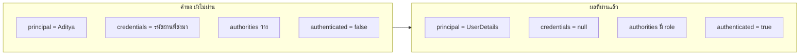
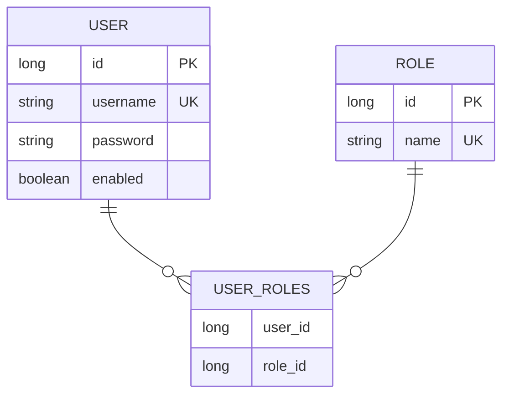
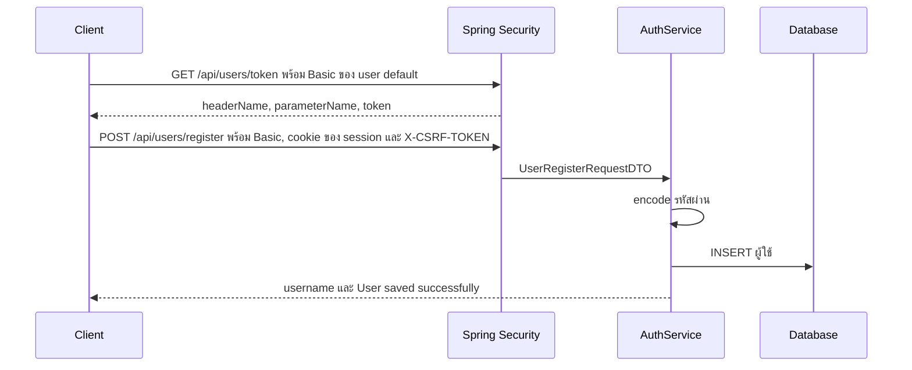
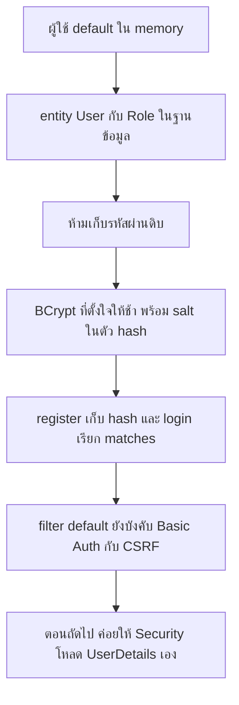

# #36 — ยืนยันตัวตนจากฐานข้อมูล และเก็บรหัสผ่านด้วย BCrypt

> **วิดีโอ:** [Spring Security DB Authentication & Password Security | Spring Boot Full Course #36](https://youtu.be/iF8KMT51QtY) — Coder Army, ~86 นาที
> **แหล่งที่ใช้สรุป:** ซับภาษาอังกฤษที่ YouTube สร้างอัตโนมัติ (ไฟล์ที่ได้เป็น `en-US` ไม่ใช่ซับฮินดี)
> **เวอร์ชันในโค้ด:** Spring Boot 4.1 + Java 21 (ใส่หมายเหตุไว้ทุกจุดที่ Spring Boot 3.x ต่างกัน)

ตอนนี้ยังไม่ได้ให้ Spring Security โหลดผู้ใช้จากฐานข้อมูลมาล็อกอินให้เอง ผู้สอนตอบคำถามที่อยู่ก่อนหน้านั้น: เก็บผู้ใช้และ role อย่างไร, ทำไมห้ามเก็บรหัสผ่านดิบ, hash แบบช้ากับ salt ทำงานอย่างไร, แล้วเขียน register กับ login เองโดยที่ filter ของ Spring Security ยังเป็นค่า default อยู่

ส่วนที่ติดป้าย `💡 เพิ่มเติม` คือของที่ผมเติมเอง ไม่ได้อยู่ในวิดีโอ ส่วนที่ติด `⚠️ แก้จากวิดีโอ` คือจุดที่วิดีโอพูดคลาดเคลื่อน

---

## สารบัญ

| เวลา | หัวข้อ |
|---|---|
| [0:00](https://youtu.be/iF8KMT51QtY?t=0) | [1. เป้าหมายของตอน](#1-เป้าหมายของตอน) |
| [0:44](https://youtu.be/iF8KMT51QtY?t=44) | [2. โปรเจกต์ใหม่](#2-โปรเจกต์ใหม่) |
| [1:57](https://youtu.be/iF8KMT51QtY?t=117) | [3. Authentication สองสถานะ](#3-authentication-สองสถานะ) |
| [4:59](https://youtu.be/iF8KMT51QtY?t=299) | [4. เคลมตัวตนกับรหัสผ่าน](#4-เคลมตัวตนกับรหัสผ่าน) |
| [7:42](https://youtu.be/iF8KMT51QtY?t=462) | [5. ผู้ใช้ default ของ Spring Security](#5-ผู้ใช้-default-ของ-spring-security) |
| [11:14](https://youtu.be/iF8KMT51QtY?t=674) | [6. UserDetails กับ UserDetailsService](#6-userdetails-กับ-userdetailsservice) |
| [16:59](https://youtu.be/iF8KMT51QtY?t=1019) | [7. Entity User และสถานะบัญชี](#7-entity-user-และสถานะบัญชี) |
| [21:36](https://youtu.be/iF8KMT51QtY?t=1296) | [8. Role แบบ Many-to-Many](#8-role-แบบ-many-to-many) |
| [31:00](https://youtu.be/iF8KMT51QtY?t=1860) | [9. Repository](#9-repository) |
| [35:01](https://youtu.be/iF8KMT51QtY?t=2101) | [10. ห้ามเก็บรหัสผ่านดิบ](#10-ห้ามเก็บรหัสผ่านดิบ) |
| [39:43](https://youtu.be/iF8KMT51QtY?t=2383) | [11. Hash ต้องช้า และ BCrypt](#11-hash-ต้องช้า-และ-bcrypt) |
| [45:04](https://youtu.be/iF8KMT51QtY?t=2704) | [12. PasswordEncoder](#12-passwordencoder) |
| [47:05](https://youtu.be/iF8KMT51QtY?t=2825) | [13. Rainbow table, salt และ pepper](#13-rainbow-table-salt-และ-pepper) |
| [56:29](https://youtu.be/iF8KMT51QtY?t=3389) | [14. สาธิต encode กับ bean ที่ทำให้ล็อกอินพัง](#14-สาธิต-encode-กับ-bean-ที่ทำให้ล็อกอินพัง) |
| [1:02:19](https://youtu.be/iF8KMT51QtY?t=3739) | [15. สมัครสมาชิก](#15-สมัครสมาชิก) |
| [1:14:07](https://youtu.be/iF8KMT51QtY?t=4447) | [16. CSRF และ endpoint ที่ยังไม่ public](#16-csrf-และ-endpoint-ที่ยังไม่-public) |
| [1:18:52](https://youtu.be/iF8KMT51QtY?t=4732) | [17. Login ที่เขียนเอง](#17-login-ที่เขียนเอง) |
| — | [18. สรุปท้ายตอน](#18-สรุปท้ายตอน) |

---

## 1. เป้าหมายของตอน

[▶ 0:00](https://youtu.be/iF8KMT51QtY?t=0)

ผู้สอนบอกว่าตอนนี้เป็นภาคปฏิบัติของ Spring Security มีผู้ใช้ที่เก็บในฐานข้อมูล และทุกครั้งที่มี API call จะตรวจว่าเป็นผู้ใช้นั้นจริง เขาจะดึง id กับรหัสผ่านจากฐานข้อมูล แล้วดูว่า class กับ interface ของ Spring Security ต่อกันอย่างไรข้างใน

เขาย้ำว่าจำชื่อ method อย่างเดียวไม่พอ ต้องรู้ว่า authentication ทำงานจริงอย่างไร จะได้อธิบายสถาปัตยกรรมตอนสัมภาษณ์ และสร้างระบบเองได้

ตอนนี้ยังไม่จบที่ให้ Spring Security จัดการ login ให้ เขาเขียน register และ login เองก่อน แล้วบอกว่าตอนถัดไปจะหุ้ม entity ด้วย `UserDetails` แล้วดู flow ข้างใน

---

## 2. โปรเจกต์ใหม่

[▶ 0:44](https://youtu.be/iF8KMT51QtY?t=44)

เขาเปิด Spring Initializr แล้วสร้างโปรเจกต์ใหม่ เสียงในซับคือชื่อแนว "In Dot Strikes" และชื่อแสดงผล "Spring Practical Demo" dependency ที่ติ๊กมีสี่อย่าง

| ในวิดีโอ | ใช้ทำอะไร |
|---|---|
| JPA | เก็บ entity ลงฐานข้อมูล |
| Web / WebMVC | เปิด HTTP endpoint |
| MySQL driver | ต่อ MySQL |
| Security | เปิด Spring Security |

ซับอ่าน dependency ใน `pom.xml` ว่ามี data JPA, security, WebMVC, MySQL connector และ test ของพวกนี้

> ⚠️ **Boot 4 vs 3:** starter ของเว็บใน Boot 4 คือ `spring-boot-starter-webmvc` ชื่อเดิม `spring-boot-starter-web` ยังใช้ได้แต่ถูก deprecate แล้ว ซับของตอนนี้พูดถึง WebMVC อยู่แล้ว ส่วน `spring-boot-starter-data-jpa` และ `spring-boot-starter-security` **ชื่อเดิม** ทั้ง Boot 3 และ Boot 4 สิ่งที่แยกออกมาใน Boot 4 คือ test slice เช่น `spring-boot-starter-security-test` ถ้าใช้ `@WithMockUser` หรือ `@WithUserDetails` ต้องมี starter นี้ ไม่งั้น annotation ทดสอบใช้ไม่ได้ ([Spring Boot 4.0 Migration Guide](https://github.com/spring-projects/spring-boot/wiki/Spring-Boot-4.0-Migration-Guide))

> 💡 **เพิ่มเติม:** วิดีโอใช้ MySQL จริง เขาบอกว่าใส่ URL, username, password ใน `application.properties` แต่ไม่ได้อ่านค่าออกเสียง โน้ตนี้ใช้ H2 ในหน่วยความจำ และฟังพอร์ต **9036** ไม่ใช่ 8080 ของวิดีโอ group `in.strikes` ใช้ตามโปรเจกต์ Security ของตอนก่อนในซีรีส์นี้

`application.properties` ที่รันจริง

```properties
server.port=9036

spring.datasource.url=jdbc:h2:mem:securitydb
spring.datasource.driver-class-name=org.h2.Driver
spring.datasource.username=sa
spring.datasource.password=

spring.jpa.hibernate.ddl-auto=update
spring.jpa.show-sql=true
spring.jpa.properties.hibernate.format_sql=true
spring.jpa.properties.hibernate.globally_quoted_identifiers=true
```

สี่ค่าที่เขาพูดถึงมีอยู่ครบ: URL ของ datasource, username, password, `ddl-auto=update` เพื่อให้ตารางตาม entity เมื่อแก้ class, `show-sql=true` และ `format_sql=true` เพื่อให้เห็น SQL ที่จัดบรรทัดแล้ว บรรทัด `globally_quoted_identifiers` เป็นของโน้ตนี้ อธิบายใน [ส่วนที่ 8](#8-role-แบบ-many-to-many)

dependency ของโปรเจกต์ตัวอย่าง parent คือ `spring-boot-starter-parent` เวอร์ชัน **4.1.1** และ Java 21

```xml
<dependencies>
  <dependency>
    <groupId>org.springframework.boot</groupId>
    <artifactId>spring-boot-starter-webmvc</artifactId>
  </dependency>
  <dependency>
    <groupId>org.springframework.boot</groupId>
    <artifactId>spring-boot-starter-data-jpa</artifactId>
  </dependency>
  <dependency>
    <groupId>org.springframework.boot</groupId>
    <artifactId>spring-boot-starter-security</artifactId>
  </dependency>
  <dependency>
    <groupId>com.h2database</groupId>
    <artifactId>h2</artifactId>
    <scope>runtime</scope>
  </dependency>
  <dependency>
    <groupId>org.projectlombok</groupId>
    <artifactId>lombok</artifactId>
    <optional>true</optional>
  </dependency>
</dependencies>
```

> 💡 **เพิ่มเติม:** วิดีโอใส่ `com.mysql:mysql-connector-j` โน้ตนี้ใส่ `com.h2database:h2` แทน Lombok เขาเพิ่มทีหลังตอนจะ generate getter กับ setter รันจริงได้ Boot 4.1.1, Spring Framework 7.0.9, Spring Security 7.1.1, Hibernate ORM 7.4.5, Tomcat 11.0.24, H2 2.4.240

ตอนสตาร์ทครั้งแรกเขายังไม่ใส่ properties ของฐานข้อมูล แอปพังเพราะมี JPA บน classpath แต่ไม่มี datasource เขาจึงใส่ค่าพวกนี้แล้วสตาร์ทผ่าน

---

## 3. Authentication สองสถานะ

[▶ 1:57](https://youtu.be/iF8KMT51QtY?t=117)

เขาย้อนตอนที่แล้ว: ใน Spring Security มี object ชื่อ `Authentication` ตัวเดียวใช้ได้สองจังหวะ เป็นคำขอให้ตรวจ และเป็นผลหลังตรวจผ่าน

สมมติ Postman ส่ง body ว่า username คือ Aditya และรหัสผ่านคือ secret123 Spring สร้าง `Authentication` ของคำขอประมาณนี้

| ฟิลด์ | ค่าตอนยังไม่ผ่าน |
|---|---|
| principal | ชื่อที่อ้าง คือ Aditya |
| credentials | รหัสผ่านที่ส่งมา |
| authorities | ว่าง เพราะยังไม่มี role |
| authenticated | `false` |

ถ้าเทียบรหัสผ่านแล้วตรง เขาบอกว่าจะสร้าง `Authentication` ตัวใหม่ ไม่ใช่แก้ตัวเดิม

| ฟิลด์ | ค่าตอนผ่านแล้ว |
|---|---|
| principal | `UserDetails` ของ Aditya |
| credentials | `null` เพราะผ่านแล้วไม่เก็บรหัสผ่านไว้ |
| authorities | role ที่ให้ เช่น User และมีได้หลาย role |
| authenticated | `true` |

ตัวที่ผ่านแล้วถูกเก็บใน `SecurityContext` ซึ่งดึงจาก `SecurityContextHolder` เขาบอกว่านี่คือของตอนที่แล้ว ถ้ายังไม่ดูให้ย้อนไปก่อน



> ⚠️ **แก้จากวิดีโอ:** ตอนอธิบายคำขอ เขาบอกว่า credentials ถูก hash ก่อนใส่เข้าไป คำขอที่ยังไม่ผ่านเก็บรหัสผ่านดิบไว้ใน credentials การ hash เกิดตอนเทียบกับค่าในฐานข้อมูล ไม่ได้เกิดตอนสร้างคำขอ ส่วนผลที่ผ่านแล้วเคลียร์ credentials จริง ตามที่เขาพูดทีหลัง

> 💡 **เพิ่มเติม:** class ที่ใช้บ่อยคือ `UsernamePasswordAuthenticationToken` ตัวที่ยังไม่ผ่านมี principal เป็น username และ credentials เป็นรหัสผ่านดิบ หลังสำเร็จ principal มักเป็น `UserDetails` และ `eraseCredentials()` ตั้ง credentials เป็น `null` ตอนนี้เขายังไม่ได้ new class นี้เอง

---

## 4. เคลมตัวตนกับรหัสผ่าน

[▶ 4:59](https://youtu.be/iF8KMT51QtY?t=299)

การพิสูจน์ตัวตนมีสองชิ้น

1. **สิ่งที่อ้างว่าเป็นใคร** ต้องไม่ซ้ำ จึงใช้ username หรือ email หรือเบอร์โทรได้ ชื่อจริงใช้ไม่ได้เพราะซ้ำกันได้
2. **หลักฐานว่ารหัสนั้นเป็นของคนนั้น** ในตอนนี้คือรหัสผ่าน

แอปต้องรู้รหัสผ่านที่ถูกของ username นั้นอยู่ก่อน เขาสมมติว่าอยู่ในฐานข้อมูล แล้วเทียบสองค่า

- รหัสที่ดึงจากฐานข้อมูลเข้า memory เขาเรียกว่า standard password
- รหัสที่มากับ request เขาเรียกว่า incoming password

ถ้าตรงกันถือว่า authenticated ถ้าไม่ตรงก็ไม่ผ่าน ตอนนี้เขายังสมมติว่ารหัสในฐานข้อมูลเป็นข้อความตรง ๆ แล้วบอกว่าเดี๋ยวจะแก้

รหัสที่ถูกอาจอยู่ที่ไหนก็ได้ ฐานข้อมูล, memory, หรือผู้ให้บริการภายนอก แต่มันต้องอยู่ที่ไหนสักที่เพื่อเอามาเทียบ

---

## 5. ผู้ใช้ default ของ Spring Security

[▶ 7:42](https://youtu.be/iF8KMT51QtY?t=462)

เขาสร้าง `UserController` เป็น `@RestController` ที่ `@RequestMapping("/api/users")` และมี `GET /hello` ที่คืนคำว่า `hello`

```java
package in.strikes.springpracticaldemo.controller;

import org.springframework.web.bind.annotation.GetMapping;
import org.springframework.web.bind.annotation.RequestMapping;
import org.springframework.web.bind.annotation.RestController;

@RestController
@RequestMapping("/api/users")
public class UserController {

  @GetMapping("/hello")
  public String hello() {
    return "hello";
  }
}
```

พอสตาร์ท ล็อกมีบรรทัดนี้ (รหัสเปลี่ยนทุกครั้งที่สตาร์ท ตัวอย่างจากการรันจริงรอบหนึ่ง)

```text
Using generated security password: 39b00d5d-7e6b-405d-94d3-869ee3c43d34

This generated password is for development use only. Your security configuration must be updated before running your application in production.
```

เขาไปที่ Postman ยิง `GET http://localhost:8080/api/users/hello` โดยไม่ใส่รหัส ได้ **401 Unauthorized** จากนั้นเปิด Authorization แบบ Basic Auth username คือ `user` รหัสคือค่าที่ล็อกพิมพ์มา แล้วได้ `hello`

การรันของโน้ตนี้พอร์ต 9036 ได้ผลเดียวกัน

```http
GET /api/users/hello HTTP/1.1
Host: localhost:9036
```

```http
HTTP/1.1 401
WWW-Authenticate: Basic realm="Realm", charset="UTF-8"
Content-Length: 0
```

```http
GET /api/users/hello HTTP/1.1
Host: localhost:9036
Authorization: Basic <user:รหัสที่ generate>
```

```http
HTTP/1.1 200
Content-Type: text/plain;charset=UTF-8
Content-Length: 5

hello
```

เขาอธิบายว่า Spring Security สร้างผู้ใช้คนนี้ให้เอง เก็บรหัสไว้ใน memory ไม่ได้ลงฐานข้อมูล พอเราส่งรหัสเดิมมา มันเทียบกับรหัสใน memory แล้วปล่อยเข้า `/hello`

> 💡 **เพิ่มเติม:** class ที่ทำเรื่องนี้ใน Boot 4.1.1 คือ `org.springframework.boot.security.autoconfigure.UserDetailsServiceAutoConfiguration` มันสร้าง `InMemoryUserDetailsManager` เมื่อยังไม่มี `UserDetailsService` ของเรา username ค่า default คือ `user` รหัสถูกสุ่มทุกครั้งที่สตาร์ท ล็อกเตือนว่าใช้ได้แค่ตอนพัฒนา

> ⚠️ **Boot 4 vs 3:** class เดียวกันใน Boot 3.5 อยู่ที่ `org.springframework.boot.autoconfigure.security.servlet.UserDetailsServiceAutoConfiguration` Boot 4 ย้าย auto-configuration ของ Security ไปโมดูล `spring-boot-security` ตามตาราง modularization ใน [Spring Boot 4.0 Migration Guide](https://github.com/spring-projects/spring-boot/wiki/Spring-Boot-4.0-Migration-Guide) ข้อความ `Using generated security password` และกติกาใส่ `{noop}` ข้างล่างยังเหมือน Boot 3.5

---

## 6. UserDetails กับ UserDetailsService

[▶ 11:14](https://youtu.be/iF8KMT51QtY?t=674)

ผู้ใช้ default คนเดียวรหัสเดิมทุกครั้งใช้จริงไม่ได้ แอปมี Aditya, Rohit, Rohan คนละรหัส และต้องอยู่ในฐานข้อมูล

เขาบอกว่าถ้าเราสร้างผู้ใช้เอง Spring จะไม่สร้างผู้ใช้ default ให้ แต่เราก็ไม่ต้องจัดการ authentication ทั้งก้อนเอง Spring เตรียม interface สองตัวไว้ เราแค่ map object ของเราเข้าไป

1. `UserDetails` คือตัวแทนผู้ใช้ที่ Security รู้จัก
2. `UserDetailsService` คือตัวที่ไปหา `UserDetails` ตอนต้องตรวจ

entity ของแอปจะชื่ออะไรก็ได้ customer, student, order หรือ user และมีกี่ฟิลด์ก็ได้ สิ่งที่ Security ต้องการคือให้หุ้มของนั้นด้วย `UserDetails`

[▶ 13:36](https://youtu.be/iF8KMT51QtY?t=816)

เขาไล่ method ของ `UserDetails` บนกระดาน

| Method | ความหมายที่เขาอธิบาย |
|---|---|
| `getUsername()` | คีย์ที่ไม่ซ้ำที่ใช้เคลมตัวตน |
| `getPassword()` | รหัสที่ใช้พิสูจน์ |
| `getAuthorities()` | สิทธิ์ ซึ่งเขาเทียบกับ role |
| `isAccountNonExpired()` | บัญชีหมดอายุหรือยัง |
| `isAccountNonLocked()` | บัญชีถูกล็อกชั่วคราวหรือยัง |
| `isCredentialsNonExpired()` | รหัสผ่านหมดอายุหรือยัง |
| `isEnabled()` | บัญชียังเปิดใช้หรือไม่ |

สาม method ที่เป็นรูปปฏิเสธ (`NonExpired`, `NonLocked`) เขาบอกว่าตั้งใจให้ค่าปกติคือ "ยังใช้ได้" เพราะคนนึกถึง `true` ง่ายกว่า `false`

แผนที่เขาวาดแต่ยังไม่เขียนในตอนนี้คือ repository ดึง entity แล้ว service แปลงเป็น `UserDetails` ด้วย getter ที่ชื่อตรงกัน เช่น `getUsername` ของ entity ไป `getUsername` ของ `UserDetails` เขาเรียก class แปลงนี้ว่า converter แล้วบอกว่าจะทำให้ดู

> 💡 **เพิ่มเติม:** ใน Spring Security 7.1 (และใน Security 6.4 แล้ว) สี่ method ที่คืน boolean เป็น default method ที่คืน `true` ดังนั้นตอน implement interface จะไม่ override ก็ได้ ถ้าธุรกิจไม่มีวันปิดบัญชี ล็อก หรือให้รหัสหมดอายุ `getUsername`, `getPassword` และ `getAuthorities` ยังต้องเขียนเอง `getAuthorities()` ห้ามคืน `null`

> 💡 **เพิ่มเติม:** `GrantedAuthority` กว้างกว่าคำว่า role `hasRole("USER")` มองหา authority ชื่อ `ROLE_USER` เขายังใช้คำว่า role กับ authority สลับกัน เพราะตอนนี้ยังไม่ได้ลง method security

---

## 7. Entity User และสถานะบัญชี

[▶ 16:59](https://youtu.be/iF8KMT51QtY?t=1019)

เขาบอกว่าจะสร้าง entity ชื่อ `User` แม้จะตั้งชื่ออื่นได้ สิ่งที่ Security บังคับในทางปฏิบัติมีอย่างน้อย username กับ password ถ้าใช้ email แทน username ก็ได้ เพราะ username ในที่นี้แปลว่าคีย์ที่ไม่ซ้ำ ไม่ได้แปลว่าต้องเป็นชื่อคอลัมน์นั้น

ฟิลด์ที่เขาใส่

| ฟิลด์ | ข้อจำกัด |
|---|---|
| `id` | `@Id` และ `@GeneratedValue(strategy = IDENTITY)` ให้ฐานข้อมูลรันเลข |
| `username` | `@Column(nullable = false, unique = true)` ว่างไม่ได้และซ้ำไม่ได้ |
| `password` | `nullable = false` แต่ไม่ unique เพราะคนละคนใช้รหัสเดียวกันได้ |
| `enabled` | `boolean` ค่าเริ่ม `true` |

[▶ 18:24](https://youtu.be/iF8KMT51QtY?t=1104)

เขายกตัวอย่างสี่ flag แล้วเลือกเก็บแค่ `enabled`

- **enabled = false** คือปิดบัญชีเพราะละเมิดนโยบาย ไม่ได้ลบแถว และไม่ให้เข้าใช้งาน
- **locked** คือล็อกชั่วคราว เช่น ใส่รหัสผิดหลายครั้ง แอปธนาคารล็อกครึ่งชั่วโมง ต่างจากปิดถาวร
- **account expired** คือบัญชีหมดอายุตามเวลา เช่น หมดวันที่ 31 ธันวาคม ตอนนั้น `isAccountNonExpired()` ต้องเป็น `false`
- **credentials expired** คือรหัสผ่านหมดอายุ เช่น บังคับเปลี่ยนทุกเดือน

เขาบอกว่าไม่จำเป็นต้องมีครบสี่อัน และไม่จำเป็นต้องมีเลยก็ได้ เลือกเฉพาะที่แอปใช้ แล้ว map เข้า method ของ `UserDetails` ตอนนี้เขาทิ้งสามอันหลังไว้เป็นค่า default

metadata อย่างเวลาสร้างหรือเวลาแก้เพิ่มใน entity ได้ Security ไม่ได้บังคับ

---

## 8. Role แบบ Many-to-Many

[▶ 21:36](https://youtu.be/iF8KMT51QtY?t=1296)

`getAuthorities()` เอาไว้ถือ role ถ้าทุกคนในแอปมี role เดียวกัน ไม่ต้องมีคอลัมน์ role ถ้าคนละคนทำได้ไม่เท่ากัน เช่น admin ลบผู้ใช้ได้แต่ user ลบตัวเองไม่ได้ ต้องเก็บ role

เขาสมมติผู้ใช้ Aditya, Rohit, Sohan และ role `ROLE_USER`, `ROLE_ADMIN`, `ROLE_MANAGER` คนหนึ่งมีได้หลาย role และ role หนึ่งมีได้หลายคน นี่คือ **many-to-many**

เขาพูดติดว่า one-to-many แล้วแก้เองในประโยคถัดไปว่าเป็น many-to-many

ทำไมยัด role เป็นคอลัมน์ในตาราง user ไม่ได้ เขาเขียนตารางสมมติ id เป็น primary key จึงซ้ำไม่ได้ Aditya id 1 มี role user แล้วจะเพิ่มแถว id 1 role admin อีกแถวไม่ได้ เพราะ id ซ้ำ ทางแก้คือแยกสามตาราง



ตัวอย่างบนกระดาน: Aditya เป็นทั้ง admin (role id 1001) และ user (role id 102) ตารางกลาง `user_roles` เก็บคู่ `user_id` กับ `role_id` ไม่มีคอลัมน์ไหนเป็น unique คนเดียว คู่สองคอลัมน์ต่างหากที่ห้ามซ้ำ เขาบอกว่าอันนี้เรียนไปแล้วตอน Hibernate

[▶ 26:48](https://youtu.be/iF8KMT51QtY?t=1608)

entity `Role` มี `id` แบบ identity และ `name` ที่ `nullable = false, unique = true` เขาเพิ่ม Lombok เพื่อ generate getter, setter และ constructor

ความสัมพันธ์อยู่ฝั่ง `User` เป็น owning side เพราะถือตาราง join ไม่ได้ทำ bidirectional เขายกเหตุผลว่าปกติถามว่า user คนนี้มี role อะไร ไม่ค่อยถามว่า role นี้มี user ใครบ้าง ถ้าต้องการฝั่งกลับต้องบาลานซ์ทั้งสองด้าน เขาเลือกทิศทางเดียวเพราะง่ายกว่า

```java
package in.strikes.springpracticaldemo.entity;

import jakarta.persistence.Column;
import jakarta.persistence.Entity;
import jakarta.persistence.GeneratedValue;
import jakarta.persistence.GenerationType;
import jakarta.persistence.Id;
import lombok.Getter;
import lombok.NoArgsConstructor;
import lombok.Setter;

@Entity
@Getter
@Setter
@NoArgsConstructor
public class Role {

  @Id
  @GeneratedValue(strategy = GenerationType.IDENTITY)
  private Long id;

  @Column(nullable = false, unique = true)
  private String name;
}
```

```java
package in.strikes.springpracticaldemo.entity;

import jakarta.persistence.Column;
import jakarta.persistence.Entity;
import jakarta.persistence.GeneratedValue;
import jakarta.persistence.GenerationType;
import jakarta.persistence.Id;
import jakarta.persistence.JoinColumn;
import jakarta.persistence.JoinTable;
import jakarta.persistence.ManyToMany;
import java.util.HashSet;
import java.util.Set;
import lombok.Getter;
import lombok.NoArgsConstructor;
import lombok.Setter;

@Entity
@Getter
@Setter
@NoArgsConstructor
public class User {

  @Id
  @GeneratedValue(strategy = GenerationType.IDENTITY)
  private Long id;

  @Column(nullable = false, unique = true)
  private String username;

  @Column(nullable = false)
  private String password;

  private boolean enabled = true;

  @ManyToMany
  @JoinTable(
      name = "user_roles",
      joinColumns = @JoinColumn(name = "user_id"),
      inverseJoinColumns = @JoinColumn(name = "role_id"))
  private Set<Role> roles = new HashSet<>();
}
```

เขาใช้ `Set` ไม่ใช่ `List` แต่บอกว่า `List` ก็ได้ ชื่อตาราง join คือ `user_roles` คอลัมน์ฝั่ง user คือ `user_id` คอลัมน์ฝั่ง role คือ `role_id` (`inverseJoinColumns`)

ตอนแรก IDE แดงเพราะ import `Role` ผิด class เขา rename ให้ชี้มาที่ entity ของตัวเอง

[▶ 30:52](https://youtu.be/iF8KMT51QtY?t=1852)

สตาร์ทแล้วเขาเห็น `CREATE TABLE` ของ role กับ user และใน DBeaver มีสามตาราง: role (`id`, `name`), user (`id`, `enabled`, `password`, `username`) และ user_roles (`user_id`, `role_id`) รหัส default ยังถูก generate อยู่ เพราะยังไม่ได้หุ้ม user ของเราด้วย `UserDetails`

DDL จริงจาก H2 ในโน้ตนี้

```text
create table "Role" (
    "id" bigint generated by default as identity,
    "name" varchar(255) not null,
    primary key ("id")
)
create table "User" (
    "id" bigint generated by default as identity,
    "enabled" boolean not null,
    "password" varchar(255) not null,
    "username" varchar(255) not null,
    primary key ("id")
)
create table "user_roles" (
    "user_id" bigint not null,
    "role_id" bigint not null,
    primary key ("user_id", "role_id")
)
```

จากนั้น Hibernate ใส่ unique ให้ `"name"` ของ role และ `"username"` ของ user แล้วใส่ foreign key จาก `user_roles` ไปทั้งสองตาราง

> 💡 **เพิ่มเติม:** `USER` เป็นคำสงวนของ H2 ถ้าระบุชื่อตารางโดยไม่ใส่ quote การสร้างตารางล้ม โน้ตนี้เปิด `hibernate.globally_quoted_identifiers=true` จึงได้ชื่อ `"User"` กับ `"Role"` ตามชื่อ class วิดีโอบน MySQL อ่านล็อกว่า `CREATE TABLE ROLE` กับ `CREATE TABLE USER` คอลัมน์ `varchar(255)` เป็นความยาว default ของ `String` ที่เขาไม่ได้กำหนด `@Column(length = ...)` hash ของ BCrypt ยาว 60 ตัวอักษร จึงยังอยู่ในคอลัมน์นี้ได้

---

## 9. Repository

[▶ 31:31](https://youtu.be/iF8KMT51QtY?t=1891)

เขาสร้าง package `repository` แล้วทำ interface สองตัวที่ extend `JpaRepository`

`UserRepository` สำคัญที่ `findByUsername` เพราะ client ส่งมาแค่ username กับรหัสผ่าน id สุ่มเองจึงใช้หาตอนล็อกอินไม่ได้ รหัสผ่านเอาไว้เทียบ ไม่ได้เอาไว้ค้น คืน `Optional` เพราะอาจไม่มี username นั้น

`RoleRepository` มี `findByName` ในลักษณะเดียวกัน ตอนนี้ยังไม่มีใครเรียก เขาเตรียมไว้

```java
package in.strikes.springpracticaldemo.repository;

import in.strikes.springpracticaldemo.entity.User;
import java.util.Optional;
import org.springframework.data.jpa.repository.JpaRepository;

public interface UserRepository extends JpaRepository<User, Long> {

  Optional<User> findByUsername(String username);
}
```

```java
package in.strikes.springpracticaldemo.repository;

import in.strikes.springpracticaldemo.entity.Role;
import java.util.Optional;
import org.springframework.data.jpa.repository.JpaRepository;

public interface RoleRepository extends JpaRepository<Role, Long> {

  Optional<Role> findByName(String name);
}
```

เขาวาดชั้นที่ขาด: entity อยู่กับ repository ที่คุยกับฐานข้อมูล แต่ยังไม่มี service ปกติจะมี `UserService` คู่กับ `UserRepository` เขาจะไม่ใช้ service ทั่วไปอย่างเดียว เพราะอยากให้ Security ดูแล user ผ่าน `UserDetailsService` รายละเอียดไว้ทีหลัง ก่อนนั้นเขาเบรกไปเรื่องรหัสผ่าน

---

## 10. ห้ามเก็บรหัสผ่านดิบ

[▶ 35:01](https://youtu.be/iF8KMT51QtY?t=2101)

สมัครสมาชิกคือ `POST /api/users` ที่ body มี username กับรหัสผ่าน ฝั่งหน้าเว็บอาจให้พิมพ์รหัสสองครั้งเพื่อกันพิมพ์ผิด แต่ backend ได้ครั้งเดียว

ถ้าเอา `secret123` ไปลงคอลัมน์ตรง ๆ ใครเปิดตารางได้ก็รู้รหัสของ Aditya และเอาไปเข้าบัญชีได้

ความคิดแรกคือเข้ารหัส (encryption) เขาปฏิเสธ เพราะ encryption ย้อนกลับได้ ต้องมีกุญแจ และต้องเก็บกุญแจไว้ที่ไหนสักที่

คำถามของระบบล็อกอินไม่ใช่ "รหัสเดิมคืออะไร" แต่คือ "รหัสที่พิมพ์มาตรงกับของคนนี้หรือไม่" จึงใช้ **hash** ซึ่งทางเดียว จาก `secret123` ได้ค่าสุ่มเช่น `er45@12` แต่จากค่านั้นย้อนกลับไปรหัสเดิมไม่ได้ แม้คนพัฒนาแอปก็ไม่ควรรู้รหัสของผู้ใช้ เขาบอกว่าอย่า log รหัสดิบ

ตอนเทียบ จึง hash รหัสที่ส่งมา แล้วเทียบกับ hash ในฐานข้อมูล ไม่ได้เทียบข้อความดิบ

> ⚠️ **แก้จากวิดีโอ:** เขาพูดว่า encryption เป็นเทคนิคที่แย่มาก encryption ไม่ได้แย่เสมอ มันเหมาะกับข้อมูลที่ต้องถอดกลับมาอ่านได้ อย่างเลขบัตรที่ระบบต้องใช้ค่าเดิม มันเป็นเครื่องมือผิดงานสำหรับรหัสผ่าน เพราะย้อนกลับได้และกุญแจที่ถอดได้ต้องอยู่ที่ไหนสักที่ รหัสผ่านใช้ hash ทางเดียว

> ⚠️ **แก้จากวิดีโอ:** ภาพ "hash รหัสที่ส่งมาแบบสุ่ม salt ใหม่ แล้วเทียบกับ hash เก่า" ใช้ไม่ได้เมื่อ salt ไม่ซ้ำกัน เขาแก้เองใน [ส่วนที่ 13](#13-rainbow-table-salt-และ-pepper) ว่าตอนล็อกอินต้องใช้ salt เดิม `PasswordEncoder.matches` ไม่ได้ hash รหัสในฐานข้อมูลซ้ำ มันอ่าน salt กับ cost จาก hash ที่เก็บไว้ แล้ว hash เฉพาะรหัสดิบด้วยค่าชุดนั้น

---

## 11. Hash ต้องช้า และ BCrypt

[▶ 39:43](https://youtu.be/iF8KMT51QtY?t=2383)

อัลกอริทึมที่เขายกเป็นตัวอย่างที่เร็วคือ SHA-256 (ซับพูดว่า SHAR 256) ความเคยชินคืออยากให้อัลกอริทึมเร็ว แต่กับรหัสผ่านเขาบอกว่าคิดแบบนั้นผิด ต้องตั้งใจให้ช้า

เหตุผลคือ brute force ผู้โจมตีรู้ username แล้วมีลิสต์รหัสที่คนใช้บ่อย ไฟล์ใหญ่ระดับหลาย GB มีรหัสนับล้านถึงพันล้าน เช่น `password`, ชื่อตามด้วย `123`, `12345` บอทยิงทีละตัวจนกว่าจะถูก

ถ้าระบบ hash เร็วระดับนาโนวินาที บอทลองได้มหาศาลในหนึ่งวินาที ถ้าทำให้การตรวจหนึ่งครั้งช้าลงมาระดับมิลลิวินาที คนรอไหว แต่บอทที่ต้องลองหลักพันล้านครั้งทำไม่ไหวในเวลาที่เป็นไปได้ เขาสมมติว่าถ้าตรวจได้แค่สองรหัสต่อวินาที จะได้ประมาณ 120 ครั้งต่อนาที ลิสต์ขนาดนั้นใช้เวลาเป็นวันหรือเป็นปี

เขาเทียบกับความรู้สึกตอนสมัครเว็บว่าขั้นตรวจรหัสช้ากว่าขั้นอื่นนิดหนึ่ง ความต่างระดับมิลลิวินาทีนั้นคนไม่รำคาญ แต่ทำให้ brute force แพง

อัลกอริทึมช้าที่เขาเลือก และที่ Spring Security ใช้ คือ **BCrypt**

> 💡 **เพิ่มเติม:** `new BCryptPasswordEncoder()` ใน Spring Security 7.1.1 ใช้ strength ค่า default คือ 10 ซึ่งคือ 2^10 รอบของ Blowfish และใช้เวอร์ชัน `$2a` strength อยู่ได้ระหว่าง 4 ถึง 31 ค่ายิ่งสูงยิ่งช้า เอกสารของ Spring แนะนำให้จูนบนเครื่องจริงให้การตรวจหนึ่งครั้งอยู่ราวหนึ่งวินาที โน้ตนี้ไม่ได้เปลี่ยนจากค่า default ตามที่เขา new โดยไม่ส่ง argument

---

## 12. PasswordEncoder

[▶ 45:04](https://youtu.be/iF8KMT51QtY?t=2704)

เขาให้มอง `PasswordEncoder` เป็น interface และ `BCryptPasswordEncoder` เป็น implementation ที่ใช้ในตอนนี้ มี method ที่ต้องรู้จักสองตัว และอีกตัวที่เขาบอกให้ข้ามได้

| Method | หน้าที่ตามที่เขาอธิบาย |
|---|---|
| `encode(rawPassword)` | hash รหัสดิบ เพื่อเอาไปเก็บ |
| `matches(raw, encoded)` | เทียบรหัสที่ผู้ใช้พิมพ์กับ hash ในฐานข้อมูล |
| `upgradeEncoding(encoded)` | บอกว่า hash เก่าควร encode ใหม่หรือไม่ เขาบอกว่าข้ามได้ |

`encode` ใช้ตอนสมัคร `matches` ใช้ตอนล็อกอิน ผู้ใช้พิมพ์ `secret123` ส่วนฐานข้อมูลมี hash ของรหัสนั้นอยู่แล้ว method คืน `true` หรือ `false`

> ⚠️ **แก้จากวิดีโอ:** ตอนพูดถึง `matches` เขาเรียง argument ว่าตัวแรกคือ hash ที่เก็บไว้ ตัวที่สองคือรหัสดิบ ลายเซ็นจริงคือ `matches(CharSequence rawPassword, String encodedPassword)` รหัสดิบมาก่อน hash ที่เก็บมาทีหลัง ตอนเขาเขียน login ใน [ส่วนที่ 17](#17-login-ที่เขียนเอง) เขาส่งลำดับถูกแล้ว คือรหัสจาก request ก่อน แล้วตามด้วย `user.getPassword()`

> ⚠️ **แก้จากวิดีโอ:** เขาบอกว่า `matches` เอาสองค่าไป encode แล้วเทียบกัน method ไม่ได้ hash ค่าในฐานข้อมูลซ้ำ Javadoc ของ Spring Security 7 บอกว่ามันตรวจว่ารหัสดิบหลังจาก encode แล้วตรงกับ hash จาก storage หรือไม่ และไม่ถอด hash ที่เก็บไว้กลับเป็นรหัสเดิม ถ้าค่าใดค่าหนึ่งเป็น `null` หรือสตริงว่าง ผลเป็น `false`

> 💡 **เพิ่มเติม:** `upgradeEncoding` เป็น default method ที่คืน `false` เสมอ ถ้าไม่ได้ override ใช้ตอนอยากรู้ว่า hash เก่าถูกสร้างด้วย cost ต่ำไปหรืออัลกอริทึมเก่า แล้วค่อย `encode` ใหม่หลังล็อกอินสำเร็จ ตอนนี้เขายังไม่ทำ

---

## 13. Rainbow table, salt และ pepper

[▶ 47:05](https://youtu.be/iF8KMT51QtY?t=2825)

เขาบอกว่าแค่ hash แล้วยังไม่พอ ผู้โจมตีรู้ว่านักพัฒนาใช้ hash ช้าไม่กี่ตัว มี BCrypt กับอีกสองสามตัว จึงสร้างตารางล่วงหน้า คอลัมน์หนึ่งเป็นรหัสดิบ ที่เหลือเป็น hash ของรหัสนั้นด้วยแต่ละอัลกอริทึม

ถ้าตารางผู้ใช้หลุด มีคนในส่ง hash ของ Aditya ออกไป ผู้โจมตีไม่ต้องย้อน hash แค่ค้นว่า hash นั้นอยู่ในตารางหรือเปล่า ถ้าเจอแถว ก็ได้รหัสดิบของแถวนั้น แล้วเอาไปล็อกอิน เขาเรียกตารางแบบนี้ว่า **rainbow table**

[▶ 51:23](https://youtu.be/iF8KMT51QtY?t=3083)

**salt** คือสตริงสุ่มที่แอปต่อท้ายรหัสดิบก่อน hash เขาสมมติความยาว 16 แล้วต่อเข้ากับ `secret123` จากนั้นค่อย BCrypt ผลลัพธ์ไม่ใช่ hash ของรหัสที่คนใช้บ่อยอีกต่อไป จึงไม่ไปโผล่ในตารางที่คำนวณจากรหัสดิบล้วน ๆ

ตอนล็อกอินต้องใช้ salt เดิม จึงต้องจำ salt ไว้ เขาบอกว่า BCrypt และ Spring Security จัดการการเก็บ salt ให้ เราไม่ต้องทำเอง

[▶ 54:50](https://youtu.be/iF8KMT51QtY?t=3290)

**pepper** คือสตริงคงที่ของทั้งแอป ไม่สุ่มต่อคน ซับได้ยินเป็นคำว่า Quart เขาบอกว่าเอาจากปุ่มต้นแป้นพิมพ์ เอาไปต่อรวมกับรหัสและ salt แล้ว hash ครั้งเดียว pepper ไม่ลงฐานข้อมูล เก็บใน environment variable หรือไฟล์ที่คนทั่วไปอ่านไม่ได้ เป็นแนวป้องกันชั้นสอง ถ้าฐานข้อมูลหลุดแต่ pepper ยังไม่หลุด ตาราง hash ที่ไม่มี pepper ก็ยังใช้ไม่ได้

เขาสรุปว่า BCrypt ทำ salt ให้ข้างในแล้ว เราเรียก `encode` กับ `matches` ก็พอ ไม่ต้องเขียน salt เอง และ pepper เป็นชั้นที่เพิ่มได้

> ⚠️ **แก้จากวิดีโอ:** salt ของ BCrypt ยาว **16 ไบต์** ซึ่งคือ 128 บิต ไม่ใช่ 16 บิต และไม่ใช่สตริงที่ผู้ใช้เห็นยาว 16 ตัวอักษร ค่าคงที่ใน Spring Security 7.1.1 คือ `BCRYPT_SALT_LEN = 16` ใน `org.springframework.security.crypto.bcrypt.BCrypt` ตอนเข้ารหัสลงสตริง salt ก้อนนี้กลายเป็น 22 ตัวอักษรแบบ radix-64 อยู่ข้างใน hash

> ⚠️ **แก้จากวิดีโอ:** ตารางที่เขาวาด คือรหัสดิบคู่กับ hash ที่คำนวณไว้ทั้งตาราง เรียกว่า lookup table หรือ dictionary ของ hash ที่คำนวณล่วงหน้า rainbow table เป็นโครงสร้างคนละแบบ มันเก็บโซ่ของ hash แบบบีบอัดเพื่อแลกหน่วยความจำกับเวลาค้น แต่เป้าหมายเดียวกันคือไม่ต้องเดารหัสทีละตัวตอนเจอ hash ที่หลุด ชื่อที่คนใช้เรียกมักปนกัน เทคนิค salt ที่เขาอธิบายกันทั้งสองแบบ

> 💡 **เพิ่มเติม:** `BCryptPasswordEncoder` ไม่ได้ใส่ pepper ให้ salt กับ cost ฝังอยู่ในสตริง hash จึงไม่มีคอลัมน์ salt แยก รูปแบบที่รันได้จริงด้านล่างขึ้นต้นด้วย `$2a$10$` แล้วตามด้วย salt 22 ตัว และ hash อีก 31 ตัว รวม 60 ตัวอักษร `$2a$` คือเวอร์ชัน `$10$` คือ strength 10 ซับอ่าน prefix ว่า `$2A$` เพราะตัวพิมพ์ในคำบรรยาย ส่วนบนจอและในเอาต์พุตจริงเป็น `$2a$`

---

## 14. สาธิต encode กับ bean ที่ทำให้ล็อกอินพัง

[▶ 56:29](https://youtu.be/iF8KMT51QtY?t=3389)

เขาสร้าง package `config` และ class `SecurityConfig` เป็น `@Configuration` แล้วประกาศ bean

```java
package in.strikes.springpracticaldemo.config;

import org.springframework.context.annotation.Bean;
import org.springframework.context.annotation.Configuration;
import org.springframework.security.crypto.bcrypt.BCryptPasswordEncoder;
import org.springframework.security.crypto.password.PasswordEncoder;

@Configuration
public class SecurityConfig {

  @Bean
  public PasswordEncoder passwordEncoder() {
    return new BCryptPasswordEncoder();
  }
}
```

ความหมายของ bean คือบอก container ว่าถ้ามีใครขอ `PasswordEncoder` ให้แจก `BCryptPasswordEncoder` ตัวนี้

จากนั้นเขาลองใน controller แบบ field injection เรียก `encode("secret123")` สองครั้ง อยากให้เห็นว่าสตริงเดียวกันได้ hash คนละค่า เพราะ salt สุ่มใหม่ทุกครั้ง IDE เตือนว่า field injection ไม่แนะนำ เขาบอกว่ารู้ และใช้แค่โชว์

พอ bean นี้ทำงาน การยิง Basic Auth ด้วยรหัสที่ล็อกพิมพ์มาได้ **401** ทั้งที่เมื่อกี้ผ่าน เขา comment bean ทิ้ง แล้ว new `BCryptPasswordEncoder` ใน controller ตรง ๆ จากนั้น Basic Auth กลับมาได้ `hello` และคอนโซลพิมพ์ hash สองค่าที่ prefix เหมือนกันแต่หางคนละอย่าง เขาชี้ว่าตรง `$2a$` เหมือนกัน หลังจากนั้นคนละตัวอักษร

แล้วเขาเรียก `matches("secret123", hash)` ได้ `true` จากนั้นลบโค้ดทดลองออก แล้วเอา bean กลับมาเพราะยังต้องใช้ แต่สุดท้ายของตอนนี้เขา comment bean อีกครั้ง แล้ว new encoder ใน service แทน เหตุผลอยู่ย่อหน้าถัดไป

> ⚠️ **แก้จากวิดีโอ:** เขาอธิบายว่า bean ทำให้ BCrypt ไป hash รหัส UUID ที่ generate แล้วเทียบกับสตริงสุ่มจึงไม่ตรง กลไกใน `UserDetailsServiceAutoConfiguration` ของ Boot 4.1.1 (logic เดียวกับ Boot 3.5) เป็นอีกแบบ ถ้ามี `PasswordEncoder` bean มันเก็บรหัสที่ generate ไว้ดิบ ๆ โดยไม่เติม prefix `{noop}` ถ้าไม่มี bean และรหัสไม่ได้ขึ้นต้นด้วย `{...}` มันเก็บเป็น `{noop}` ตามด้วยรหัสดิบ `DelegatingPasswordEncoder` ค่า default จึงเทียบรหัสนั้นแบบข้อความตรงได้ พอ bean เป็น `BCryptPasswordEncoder` ตัวเทียบจะพยายามอ่านค่าที่เก็บไว้เป็น hash ของ BCrypt UUID ไม่ใช่ hash แบบนั้น `matches` จึงคืน `false` และได้ 401 การรันจริงรอบที่มี bean ใช้รหัส `78395f4b-d4cc-465b-ac4d-dacf74e41e7c` แล้วยิง `GET /api/users/hello` ด้วย Basic Auth ได้ `HTTP/1.1 401` โปรเจกต์ที่รัน flow สมัครสมาชิกด้านล่างจึง comment `@Bean` ไว้อย่างตอนจบของวิดีโอ

> 💡 **เพิ่มเติม:** สามบรรทัดที่เขาพิมพ์ใน `hello()` แล้วลบ โน้ตนี้ย้ายไปเทสต์ `PasswordEncoderDemoTest` เพื่อไม่ให้ endpoint ท้ายตอนพิมพ์ hash ทุก request เอาต์พุตด้านล่างมาจากการรันเทสต์นั้นจริง `secret123` คือรหัสที่ซับพูดว่า "secret one two three"

```java
PasswordEncoder passwordEncoder = new BCryptPasswordEncoder();
String first = passwordEncoder.encode("secret123");
String second = passwordEncoder.encode("secret123");
System.out.println(first);
System.out.println(second);
System.out.println(passwordEncoder.matches("secret123", first));
System.out.println(passwordEncoder.matches("wrong", first));
```

```text
$2a$10$s/KIRR/NhHqPlg/9bSAyXOz4Z2eS5133Z/dQ4JCS1hwJ9Gt3rsKqi
$2a$10$1aEH0QVW1skTlemi4ckKce8ORkg84m3Ik3qpWJlvQsqKwxU5QafmW
true
false
```

สอง hash ไม่เท่ากัน ทั้งคู่ขึ้นต้น `$2a$10$` และ `matches` ของรหัสเดิมเป็น `true` รหัสคนละคำเป็น `false`

---

## 15. สมัครสมาชิก

[▶ 1:02:19](https://youtu.be/iF8KMT51QtY?t=3739)

ผู้ใช้ครั้งแรกคือการสมัคร ไม่ใช่การล็อกอิน หน้าเว็บส่ง username กับรหัสผ่าน อาจมีวันเกิดหรือเบอร์โทรด้วย แต่เขาสมมติว่าตอนนี้ใช้แค่สองฟิลด์ และเป็น `POST /api/users/register`

เขาไม่ map body เข้า entity ตรง ๆ เพราะนั่นไม่ใช่แนวที่เขาอยากใช้ในโปรเจกต์ จึงสร้าง request DTO เขาบอกว่าใส่ validation ได้ เช่น รหัสอย่างน้อยแปดตัว และ username ห้ามว่าง แต่ตอนนี้ยังไม่ใส่ dependency ของ validation

response ก็ไม่คืน entity เพราะไม่งั้นรหัสผ่านหลุดออกไปกับ response แม้จะเป็น hash แล้ว เขาใส่แค่ username กับข้อความ

```java
package in.strikes.springpracticaldemo.dto;

import lombok.Getter;
import lombok.Setter;

@Getter
@Setter
public class UserRegisterRequestDTO {

  private String username;
  private String password;
}
```

```java
package in.strikes.springpracticaldemo.dto;

import lombok.Getter;
import lombok.Setter;

@Getter
@Setter
public class UserRegisterResponseDTO {

  private String username;
  private String message;
}
```

controller ไม่ทำงานธุรกิจเอง มันส่ง DTO ต่อให้ service เขาตั้งใจแยก service ตามหน้าที่ ไม่ได้มี `UserService` ตัวเดียว ตัวนี้ชื่อ `AuthService` แล้ว inject ผ่าน constructor

ใน service เขาต้องการ `UserRepository` กับ `PasswordEncoder` ตอนท้ายเขาเอา encoder ออกจาก constructor แล้ว new `BCryptPasswordEncoder` ในฟิลด์ เพราะ bean ถูก comment

ลำดับใน `register`

1. `new User()`
2. ใส่ username จาก DTO
3. `encode` รหัสจาก DTO แล้วค่อย `setPassword` ห้ามใส่รหัสดิบ
4. `setEnabled(true)`
5. ยังไม่ใส่ role เขาบอกว่าจะมี role service แยก
6. `userRepository.save(user)`
7. สร้าง response ที่ username คือของ user ที่เซฟ และ message คือ `User saved successfully`

```java
package in.strikes.springpracticaldemo.service;

import in.strikes.springpracticaldemo.dto.UserRegisterRequestDTO;
import in.strikes.springpracticaldemo.dto.UserRegisterResponseDTO;
import in.strikes.springpracticaldemo.entity.User;
import in.strikes.springpracticaldemo.repository.UserRepository;
import java.util.Optional;
import org.springframework.security.crypto.bcrypt.BCryptPasswordEncoder;
import org.springframework.security.crypto.password.PasswordEncoder;
import org.springframework.stereotype.Service;

@Service
public class AuthService {

  private final UserRepository userRepository;
  private final PasswordEncoder passwordEncoder = new BCryptPasswordEncoder();

  public AuthService(UserRepository userRepository) {
    this.userRepository = userRepository;
  }

  public UserRegisterResponseDTO register(UserRegisterRequestDTO request) {
    User user = new User();
    user.setUsername(request.getUsername());
    String encodedPassword = passwordEncoder.encode(request.getPassword());
    user.setPassword(encodedPassword);
    user.setEnabled(true);
    userRepository.save(user);

    UserRegisterResponseDTO response = new UserRegisterResponseDTO();
    response.setUsername(user.getUsername());
    response.setMessage("User saved successfully");
    return response;
  }

  public boolean login(UserRegisterRequestDTO request) {
    Optional<User> userOptional = userRepository.findByUsername(request.getUsername());
    User user = userOptional.get();
    return passwordEncoder.matches(request.getPassword(), user.getPassword());
  }
}
```

method `login` อยู่ส่วนถัดไป ใส่รวมใน class นี้เพราะเป็นสถานะตอนจบของวิดีโอ

controller ช่วงท้ายของตอน มี hello, register, token และ login

```java
package in.strikes.springpracticaldemo.controller;

import in.strikes.springpracticaldemo.dto.UserRegisterRequestDTO;
import in.strikes.springpracticaldemo.dto.UserRegisterResponseDTO;
import in.strikes.springpracticaldemo.service.AuthService;
import org.springframework.http.ResponseEntity;
import org.springframework.security.web.csrf.CsrfToken;
import org.springframework.web.bind.annotation.GetMapping;
import org.springframework.web.bind.annotation.PostMapping;
import org.springframework.web.bind.annotation.RequestBody;
import org.springframework.web.bind.annotation.RequestMapping;
import org.springframework.web.bind.annotation.RestController;

@RestController
@RequestMapping("/api/users")
public class UserController {

  private final AuthService authService;

  public UserController(AuthService authService) {
    this.authService = authService;
  }

  @GetMapping("/hello")
  public String hello() {
    return "hello";
  }

  @PostMapping("/register")
  public ResponseEntity<UserRegisterResponseDTO> register(
      @RequestBody UserRegisterRequestDTO request) {
    return ResponseEntity.ok(authService.register(request));
  }

  @GetMapping("/token")
  public CsrfToken getToken(CsrfToken csrfToken) {
    return csrfToken;
  }

  @PostMapping("/login")
  public boolean login(@RequestBody UserRegisterRequestDTO request) {
    return authService.login(request);
  }
}
```

เขาบอกว่าหลัง `encode` แล้ว ถ้าไม่ได้ log รหัสจาก DTO ไว้ระหว่างทาง คนที่เห็นแต่ฐานข้อมูลจะไม่รู้ว่ารหัสเดิมคือ `secret123` ยกเว้นเอา debugger ไปจับ request ตอนมันยังเป็นรหัสดิบ salt ที่เขาพูดถึงทำให้ hash ยาว

---

## 16. CSRF และ endpoint ที่ยังไม่ public

[▶ 1:14:07](https://youtu.be/iF8KMT51QtY?t=4447)

เขายังไม่ได้บอก Spring Security ว่า endpoint ไหนไม่ต้องล็อกอิน ค่า default คือทุก endpoint ต้องผ่านการตรวจ รวมถึง `POST /register`

นั่นขัดกับความหมายของการสมัคร คนที่มาครั้งแรกยังไม่มีรหัสของแอป แต่ระบบดันไปขอรหัสของ user default ที่ generate มา เขาบอกว่าสถานะนี้ยังไม่สมเหตุสมผล งานแรกคือเลิกบังคับล็อกอินแบบนี้ งานที่สองคือให้ Security จัดการ login จริง ทั้งคู่ยังไม่ทำในตอนนี้ เขาเลยยังใช้ user default เรียก register ไปก่อน

นอกจากนั้น `POST` โดน CSRF เขาบอกว่าเคยทำในคาบที่แล้ว และจะปิด CSRF ทีหลัง ตอนนี้เขาเพิ่ม `GET /token` ที่รับ `CsrfToken` แล้วคืนมันออกไป



การรันจริงรอบที่ comment bean แล้ว รหัสในล็อกคือ `39b00d5d-7e6b-405d-94d3-869ee3c43d34`

`GET /api/users/token` ด้วย Basic Auth ได้

```json
{"headerName":"X-CSRF-TOKEN","parameterName":"_csrf","token":"IE-6T6p6FX-HBs9ZxyG-57q_hGIyNSXZkHIUhfI_z7Y8Omk7Q3_Ze5pIIB6qYKs6pAyK1NmLqVtTUEb08xci58QK-9AMXlsK"}
```

`POST /api/users/register` ที่ใส่ Basic Auth แต่ไม่ใส่ header นี้ ได้ `HTTP/1.1 401` และ body ว่าง

`POST` เดิมที่ใส่ header `X-CSRF-TOKEN` ด้วยค่า `token` และส่ง cookie ของ session เดิมกลับไป ได้

```http
HTTP/1.1 200
Content-Type: application/json

{"message":"User saved successfully","username":"Aditya"}
```

ล็อก SQL ของการ insert

```text
insert
into
    "User"
    ("enabled", "password", "username", "id")
values
    (?, ?, ?, default)
```

เขาเปิด DBeaver แล้วเห็นแถว enabled เป็นจริง username เป็น Aditya และรหัสผ่านเป็นสตริงยาวมาก ไม่ใช่ `secret123` โน้ตนี้ไม่ได้เปิดหน้าจอตาราง แต่ `matches` ในส่วนถัดไปคืน `true` ก็ต่อเมื่อค่าที่ insert เป็น hash ของ `secret123` และรูปแบบของ hash คือแบบใน [ส่วนที่ 14](#14-สาธิต-encode-กับ-bean-ที่ทำให้ล็อกอินพัง)

> 💡 **เพิ่มเติม:** token ของ CSRF ผูกกับ HTTP session Postman เก็บ cookie ให้เอง ถ้ายิงด้วย curl ต้องส่ง `JSESSIONID` จาก response ของ `GET /token` กลับไปพร้อม header `X-CSRF-TOKEN` ชื่อ header ไม่ได้เดา มันคือฟิลด์ `headerName` ใน JSON ค่า token เปลี่ยนทุก session

---

## 17. Login ที่เขียนเอง

[▶ 1:18:52](https://youtu.be/iF8KMT51QtY?t=4732)

เขาบอกว่าสถานะปัจจุบันยังแปลก เพราะกว่าจะสมัครได้ต้องล็อกอินด้วย user ที่ Spring สร้างให้ก่อน เขาจึงโชว์ว่าถ้าเขียน login เองจะหน้าตาอย่างไร แต่ย้ำว่าของจริงไม่ควรเขียนเอง

`POST /api/users/login` รับ DTO ตัวเดียวกับตอนสมัคร เพราะยังต้องการแค่ username กับรหัสผ่าน เขาบอกว่าแยก `UserLoginRequestDTO` ได้ แต่ยังไม่ทำ คืนแค่ `boolean` เพื่อสาธิต

ใน `AuthService.login`

1. `findByUsername` จาก username ใน DTO ได้ `Optional<User>`
2. เขาสมมติว่าเจอ user จึงเรียก `get()` โดยบอกว่ายังไม่ใส่ validation
3. เอา `matches` เทียบรหัสดิบจาก request กับ `user.getPassword()` ที่เป็น hash ในฐานข้อมูล
4. คืน boolean นั้น

เขารีสตาร์ท รหัส default เปลี่ยน จึงต้องขอ token ใหม่ แล้ว `POST /login` ด้วย Aditya และ `secret123` ได้ `true` เขาบอกว่าถ้าเปลี่ยนรหัสใน body เป็นค่าอื่นจะได้ `false`

การรันของโน้ตนี้หลังสมัคร Aditya แล้ว

```http
HTTP/1.1 200
Content-Type: application/json

true
```

body คนละรหัส (`"password":"nope"`) ได้

```http
HTTP/1.1 200
Content-Type: application/json

false
```

ทั้งสองครั้งล็อกมี `select` จาก `"User"` where `"username"=?` ชั้น Security ยังตรวจ Basic Auth ของ user default กับ CSRF อยู่ ส่วน `true`/`false` คือผลธุรกิจข้างใน ไม่ใช่สถานะ 401

> 💡 **เพิ่มเติม:** วิดีโอไม่ได้ยิง username ที่ไม่มีในตาราง โค้ดที่เขาเขียนเรียก `Optional.get()` ตรง ๆ การรันจริงด้วย username `Nobody` ได้ `HTTP/1.1 500` และ exception นี้

```text
java.util.NoSuchElementException: No value present
	at java.base/java.util.Optional.get(Optional.java:143)
	at in.strikes.springpracticaldemo.service.AuthService.login(AuthService.java:38)
```

body ของ error

```json
{"timestamp":"2026-10-16T12:43:29.720Z","status":500,"error":"Internal Server Error","path":"/api/users/login"}
```

[▶ 1:24:45](https://youtu.be/iF8KMT51QtY?t=5085)

เขาถามว่าถึง login เองได้ แล้วจะรู้ได้อย่างไรว่า request ถัดไปของ API อื่นมาจากคนที่ล็อกอินแล้ว ถ้าเขียนเองต้องไปตรวจทุก endpoint ว่าอันไหนต้องล็อกอิน Spring Security มีชั้น filter ที่ตรวจให้ และเราไม่ต้องเขียน infrastructure นี้เอง

เขาสรุปแนวของ Spring ว่าให้เราโฟกัส business code แล้วโยนอย่างอื่นให้โมดูลของมัน AOP รับ cross-cutting, validation รับการตรวจข้อมูล, exception handling รับข้อผิดพลาด, Security รับเรื่องความปลอดภัย เราเหลือ controller, service และ repository

เขาบอกว่าวิดีโอยาวเกินแล้ว ตอนถัดไปจะใช้ Spring Security ล็อกอินจริง และดูสถาปัตยกรรมข้างใน

> 💡 **เพิ่มเติม:** ตอนนี้ยังไม่มี `SecurityFilterChain` ของเรา ค่า default ของ Boot จึงยังบังคับให้ทุก request ผ่านการตรวจ และยังเปิด CSRF อยู่ ตอนถัดไปคือจุดที่เขาจะเปลี่ยนพฤติกรรมนี้

> ⚠️ **Boot 4 vs 3:** ตอนนี้ยังไม่ได้เรียก DSL ของ `HttpSecurity` แต่ตอนถัดไปจะต้อง config filter chain Spring Security 7 ที่มากับ Boot 4 เอา `and()` ออกจาก DSL แล้ว และเอา `authorizeRequests` ออก ต้องใช้ lambda กับ `authorizeHttpRequests` ใน Security 6 ของ Boot 3 method เก่ายังอยู่แต่ถูก deprecate ([What's New in Spring Security 7.0](https://docs.spring.io/spring-security/reference/7.0/whats-new.html))

---

## 18. สรุปท้ายตอน

### ลำดับความคิดของทั้งตอน



### ประเด็นที่ต้องจำ

1. `Authentication` ตอนยังไม่ผ่านมี principal เป็นสิ่งที่อ้าง, credentials เป็นรหัสดิบ, authorities ว่าง และ `authenticated = false` ตอนผ่านแล้ว principal เป็น `UserDetails`, credentials ถูกทิ้ง, มี authorities และ `authenticated = true`
2. สิ่งที่ใช้เคลมตัวตนต้องไม่ซ้ำ username, email หรือเบอร์โทรได้ ชื่อจริงไม่ได้
3. พอมี `spring-boot-starter-security` และยังไม่มี `UserDetailsService` ของเรา Boot สร้าง user ชื่อ `user` รหัสสุ่ม พิมพ์ในล็อก และกันทุก endpoint ด้วย 401
4. `UserDetails` คือสัญญาที่ Security รู้จัก entity ของแอปชื่ออะไรก็ได้ ขอให้ map เข้า username, password และ authorities ได้ สี่ flag สถานะบัญชีเลือกเก็บเฉพาะที่ใช้
5. role หลายต่อหลายอยู่คนละตาราง ตารางกลาง `user_roles` ถือคู่ `user_id` กับ `role_id` ความสัมพันธ์ในตอนนี้เป็นทิศทางเดียวจาก `User`
6. รหัสผ่านห้ามลงฐานข้อมูลแบบข้อความตรง และไม่ใช้ encryption เพราะต้องถอดกลับได้ ใช้ hash ทางเดียว
7. hash ของรหัสผ่านต้องตั้งใจให้ช้า เพื่อให้ brute force แพง BCrypt คือตัวที่ Spring Security ให้มา `encode` ตอนสมัคร `matches` ตอนล็อกอิน โดยส่งรหัสดิบก่อนแล้วตามด้วย hash ที่เก็บไว้
8. salt สุ่มต่อรหัสทำให้ hash ของรหัสที่คนใช้บ่อยไม่ไปตรงกับตารางที่คำนวณล่วงหน้า BCrypt ฝัง salt ไว้ในสตริง hash จึงได้คนละค่าทุกครั้งที่ `encode` รหัสเดิม แต่ `matches` ยังคืน `true`
9. ประกาศ `BCryptPasswordEncoder` เป็น bean แล้ว user default จะล็อกอินด้วยรหัสในล็อกไม่ได้อีก เพราะรหัสนั้นไม่ได้ถูกเก็บเป็น hash ของ BCrypt
10. register กับ login ที่เขียนในตอนนี้ยังวิ่งใต้ filter default จึงต้องแนบ Basic Auth ของ user default และ header `X-CSRF-TOKEN` ชั้นนี้ยังไม่ได้พิสูจน์ว่า request ถัดไปเป็นของ Aditya

### คำถามทบทวน

1. `Authentication` ก่อนผ่านกับหลังผ่าน ต่างกันที่ principal, credentials, authorities และ `authenticated` อย่างไร
2. ทำไม username ต้อง unique แต่ password ไม่ต้อง
3. ปิดบัญชีเพราะละเมิดนโยบาย กับล็อกเพราะใส่รหัสผิดหลายครั้ง ไปคนละ flag อย่างไร
4. ทำไมใส่ role เป็นคอลัมน์ในตาราง user แล้วเก็บทั้ง user และ admin ให้คนเดิมไม่ได้
5. ทำไม SHA-256 ไม่เหมาะกับรหัสผ่าน ทั้งที่มันเร็ว
6. `matches` รับ argument ตัวไหนก่อน และทำไม hash สองครั้งของรหัสเดียวกันถึงไม่เท่ากันแต่ยังเทียบได้
7. salt กับ pepper ต่างกันที่ความสุ่มและที่เก็บอย่างไร
8. ทำไมมี bean `PasswordEncoder` แบบ BCrypt แล้วรหัสในบรรทัด `Using generated security password` ใช้ Basic Auth ไม่ผ่าน
9. ทำไม `POST /register` ในสถานะท้ายตอนยังต้องรู้รหัสของ user ชื่อ `user` และต้องมี CSRF token
10. login ที่คืน `true` ยังขาดอะไร จนผู้สอนบอกว่าอย่าเพิ่งใช้แบบนี้ในทุก endpoint

### ตอนถัดไป

[#37 — Spring Security Authentication Internals | Complete Login Flow](./37-spring-security-login-flow.md) ผู้สอนบอกว่าจะให้ Spring Security ล็อกอินจากผู้ใช้ในฐานข้อมูล และไล่สถาปัตยกรรมข้างใน
