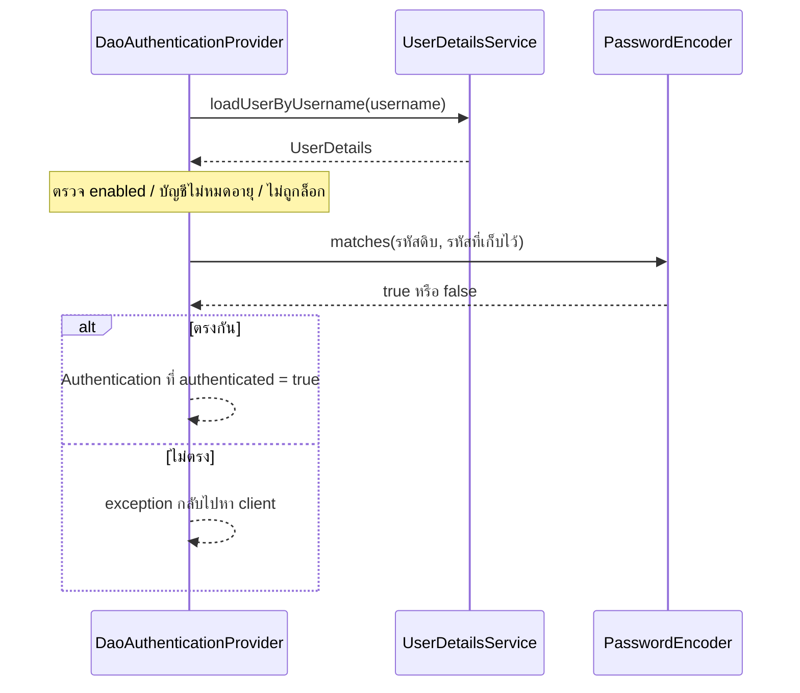
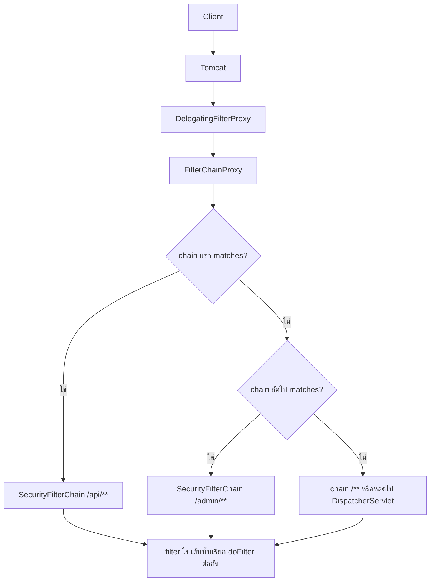
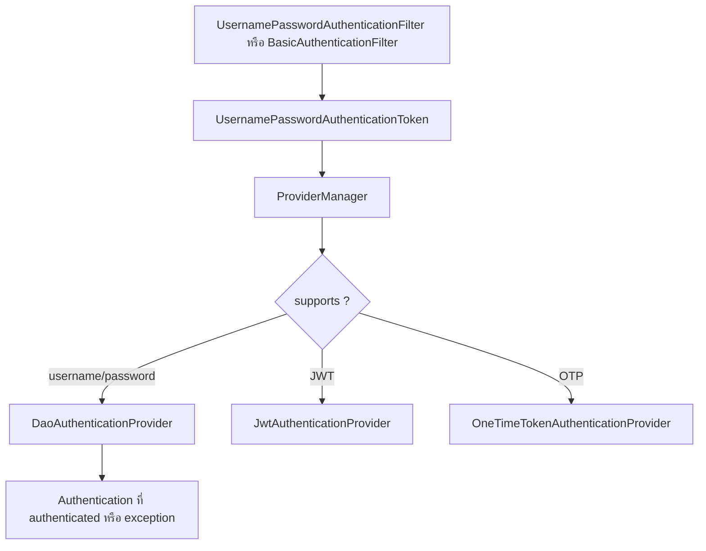

# #37 — ลำดับภายในของ Login ใน Spring Security

> **วิดีโอ:** [Spring Security Authentication Internals | Complete Login Flow | Spring Boot Full Course #37](https://youtu.be/0LLpt3OZ03g) — Coder Army, ~93 นาที
> **แหล่งที่ใช้สรุป:** ซับไตเติลภาษาฮินดีที่ YouTube สร้างอัตโนมัติ
> **เวอร์ชันในโค้ด:** Spring Boot 4.1 + Java 21 (ใส่หมายเหตุไว้ทุกจุดที่ Spring Boot 3.x ต่างกัน)

ตอนนี้ตอบคำถามเดียว: **พอมี user ในฐานข้อมูลแล้ว Spring Security login ให้เองได้อย่างไร** ตั้งแต่ HTTP request เข้า Tomcat จนได้ object `Authentication` ที่ authenticate แล้ว ผู้สอนไม่ได้ให้เราเขียน endpoint `/login` เอง เขาให้เราวาง `User` ของแอปลงในสัญญา `UserDetails` แล้วปล่อยให้ filter ของ Spring Security เดิน flow ที่เหลือ

ส่วนที่ติดป้าย `💡 เพิ่มเติม` คือของที่ผมเติมเอง ไม่ได้อยู่ในวิดีโอ ส่วนที่ติด `⚠️ แก้จากวิดีโอ` คือจุดที่วิดีโอพูดคลาดเคลื่อน

---

## สารบัญ

| เวลา | หัวข้อ |
|---|---|
| [0:00](https://youtu.be/0LLpt3OZ03g?t=0) | [1. เอา dummy login ออก](#1-เอา-dummy-login-ออก) |
| [1:54](https://youtu.be/0LLpt3OZ03g?t=114) | [2. ทบทวน register](#2-ทบทวน-register) |
| [3:09](https://youtu.be/0LLpt3OZ03g?t=189) | [3. ห้ามรับ role จาก client](#3-ห้ามรับ-role-จาก-client) |
| [5:29](https://youtu.be/0LLpt3OZ03g?t=329) | [4. API เพิ่ม role](#4-api-เพิ่ม-role) |
| [10:48](https://youtu.be/0LLpt3OZ03g?t=648) | [5. ผูก ROLE_USER ตอน register](#5-ผูก-role_user-ตอน-register) |
| [12:36](https://youtu.be/0LLpt3OZ03g?t=756) | [6. User ของแอปกับ UserDetails](#6-user-ของแอปกับ-userdetails) |
| [13:35](https://youtu.be/0LLpt3OZ03g?t=815) | [7. CustomUserDetails](#7-customuserdetails) |
| [18:42](https://youtu.be/0LLpt3OZ03g?t=1122) | [8. UserDetailsService](#8-userdetailsservice) |
| [25:21](https://youtu.be/0LLpt3OZ03g?t=1521) | [9. ทางเลือก User.builder](#9-ทางเลือก-userbuilder) |
| [26:34](https://youtu.be/0LLpt3OZ03g?t=1594) | [10. DaoAuthenticationProvider](#10-daoauthenticationprovider) |
| [33:08](https://youtu.be/0LLpt3OZ03g?t=1988) | [11. จาก Tomcat ถึง filter](#11-จาก-tomcat-ถึง-filter) |
| [35:36](https://youtu.be/0LLpt3OZ03g?t=2136) | [12. สี่หมวดและหลาย chain](#12-สี่หมวดและหลาย-chain) |
| [43:19](https://youtu.be/0LLpt3OZ03g?t=2599) | [13. SecurityFilterChain กับ HttpSecurity](#13-securityfilterchain-กับ-httpsecurity) |
| [47:49](https://youtu.be/0LLpt3OZ03g?t=2869) | [14. Chain ค่าเริ่มต้น Form login และ HTTP Basic](#14-chain-ค่าเริ่มต้น-form-login-และ-http-basic) |
| [55:42](https://youtu.be/0LLpt3OZ03g?t=3342) | [15. Filter สร้าง token แล้วส่งต่อ](#15-filter-สร้าง-token-แล้วส่งต่อ) |
| [1:02:32](https://youtu.be/0LLpt3OZ03g?t=3752) | [16. Provider และ supports](#16-provider-และ-supports) |
| [1:11:22](https://youtu.be/0LLpt3OZ03g?t=4282) | [17. SecurityContextHolder](#17-securitycontextholder) |
| [1:11:54](https://youtu.be/0LLpt3OZ03g?t=4314) | [18. เขียน bean ของ provider และ chain](#18-เขียน-bean-ของ-provider-และ-chain) |
| [1:23:23](https://youtu.be/0LLpt3OZ03g?t=5003) | [19. ปิด CSRF และไม่เขียน /login](#19-ปิด-csrf-และไม่เขียน-login) |
| [1:26:25](https://youtu.be/0LLpt3OZ03g?t=5185) | [20. LazyInitializationException](#20-lazyinitializationexception) |
| [1:29:38](https://youtu.be/0LLpt3OZ03g?t=5378) | [21. ผล login และช่องที่ยังต้องส่งรหัสทุกครั้ง](#21-ผล-login-และช่องที่ยังต้องส่งรหัสทุกครั้ง) |
| — | [22. สรุปท้ายตอน](#22-สรุปท้ายตอน) |

---

## 1. เอา dummy login ออก

[▶ 0:00](https://youtu.be/0LLpt3OZ03g?t=0)

ตอนที่แล้วมี endpoint register แล้ว แต่ login ยังเป็น method ที่เขียนเอง: เทียบรหัสที่ผู้ใช้ส่งกับรหัสในฐานข้อมูล แล้วคืน true หรือ false ตอนนี้เอา method นั้นออกทั้งจาก service และจาก controller เพราะ login ทั้งก้อนเป็นหน้าที่ของ filter ใน Spring Security

โปรเจกต์เดิมชื่อ spring practical demo เหลืออยู่สามจุดที่ยังเกี่ยวกับผู้ใช้

| ส่วน | ที่มีหลังลบ dummy login |
|---|---|
| `UserController` | `GET /hello`, `POST /register`, และ endpoint ที่แจก CSRF token |
| DTO | request รับ username กับ password, response คืน username กับ message |
| Entity | `User` และ `Role` พร้อม repository |
| `AuthenticationService` | เหลือ method `register` |

ตอนท้ายของวิดีโอ endpoint แจก token จะถูกลบด้วย เพราะปิด CSRF ทั้งแอป

---

## 2. ทบทวน register

[▶ 1:54](https://youtu.be/0LLpt3OZ03g?t=114)

`register` สร้าง `User` แล้วใส่ค่าจาก Postman

1. `username` มาจาก body ตรง ๆ
2. `password` ห้ามเก็บดิบ ต้องผ่าน `PasswordEncoder.encode` ก่อน แล้วค่อย `setPassword` ด้วยค่าที่ encode แล้ว
3. `enabled` ตั้งเป็น `true`

`enabled` มีเพราะ `UserDetails` ของ Spring Security มี flag นี้ ตอนที่แล้ว override แค่ `isEnabled` ส่วน boolean อีกสามตัวไม่ได้ใช้ จึงถือว่าเป็น true

จากนั้น `save` ลง `UserRepository` แล้วสร้าง response DTO คืนไป message ในโค้ดตอนก่อนคือ `"User saved successfully"`

สิ่งที่ยังไม่ทำคือ role ผู้ใช้มี username, password, enabled และ list ของ role แต่ `register` ยังไม่เคย `setRoles`

---

## 3. ห้ามรับ role จาก client

[▶ 3:09](https://youtu.be/0LLpt3OZ03g?t=189)

ทางที่ทำได้แต่ผิด คือให้ client ส่ง list ของ role มาใน body เช่น `ROLE_USER` กับ `ROLE_ADMIN` แล้ว `user.setRoles` จาก list นั้นทันที

ผู้สอนบอกว่าอย่าทำ เพราะคนที่กรอกฟอร์มจะเขียนเองว่าเป็น admin หรือ manager ได้ เว็บส่วนใหญ่ผู้ใช้เกือบทั้งหมดเป็น user คนที่เป็น admin หรือ manager มีไม่กี่คนและเป็นคนในทีม สิทธิ์นั้นต้องอยู่ที่เรา

จึงรับจาก client แค่ username กับ password แล้วไปหยิบ role จากฐานข้อมูลมาใส่ใน `User` เอง

ตอนเปิด DBeaver ตาราง `roles` ในฐานข้อมูล `student` ยังว่าง ไม่มี role ให้หยิบ ต้องสร้าง role ก่อน

---

## 4. API เพิ่ม role

[▶ 5:29](https://youtu.be/0LLpt3OZ03g?t=329)

`Role` มี `id` ที่ generate เองกับ `name` จึงรับแค่ชื่อก็พอ ผู้สอนไม่ทำ DTO เพราะ entity นี้มี field เดียวที่ client ต้องส่ง เขาใช้ `Role` เป็น `@RequestBody` ตรง ๆ

API นี้ไม่ใช่ของผู้ใช้ทั่วไป ถ้าเป็นโปรเจกต์จริงต้องเป็น API ภายใน คนที่ตัดสินว่าแอปมี role อะไรได้บ้างคือเจ้าของแอป จะ insert ผ่าน DBeaver ก็ได้ (`ROLE_USER`, `ROLE_ADMIN`) แต่เขาเลือกทำ endpoint เพื่อยิงจาก Postman ได้เร็ว

`RoleController` อยู่ที่ `/api/roles` method `addRole` คืน `ResponseEntity<String>`

`RoleService` เป็น `@Service` รับ `RoleRepository` ทาง constructor แล้ว `save` ตามที่ส่งมา ไม่มี validation ชื่ออะไรเข้ามาก็ลงตารางตามนั้น

### ยิงจาก Postman ตอนที่ security ยังเป็นค่าเริ่มต้น

[▶ 9:02](https://youtu.be/0LLpt3OZ03g?t=542)

ตอนนี้แอปยังใช้ user ที่ Spring Security สร้างให้ตอนสตาร์ท username คือ `user` รหัสอยู่ใน log การ POST จึงยังต้องมีสองอย่าง

1. Basic Auth ของ user คนนั้น
2. CSRF token จาก GET แล้วใส่ header `X-CSRF-TOKEN`

Body ของ role แรกคือ `{"name":"ROLE_USER"}` ได้คำว่า Done แล้ว refresh ตารางเห็น `ROLE_USER` เปลี่ยน body เป็น `ROLE_ADMIN` แล้วยิงซ้ำ ได้ทั้งสองแถว

> 💡 **เพิ่มเติม — ฐานข้อมูลในโน้ตนี้เป็น H2**
> วิดีโอใช้ MySQL ผ่าน DBeaver ฐานข้อมูลชื่อ student โน้ตนี้ใช้ H2 in-memory ชื่อ `studentdb` เพื่อให้รันได้โดยไม่ต้องมี MySQL พฤติกรรมของ JPA และ Spring Security ชุดเดียวกัน
> พอร์ตในวิดีโอคือ `8080` ในโน้ตใช้ `9037`
> ตาราง `USER` เป็นคำสงวนของ H2 จึงตั้งชื่อตารางผู้ใช้เป็น `users` ชื่อคอลัมน์ของตารางเชื่อม (`user_roles`, `user_id`, `role_id`) ผู้สอนไม่ได้อ่านออกเสียง ใช้ mapping มาตรฐานของ `@ManyToMany` ตามที่เดโมชี้ว่ามีแถวคู่ user id กับ role id
> H2 เริ่มว่างทุกครั้งที่สตาร์ท จึงมี `RoleDataInitializer` ใส่ `ROLE_USER` กับ `ROLE_ADMIN` ให้ตอนบูต วิดีโอใส่สองแถวนี้ผ่าน API ก่อนจะเปลี่ยน security config

```java
package com.spring.springpracticaldemo.entity;

import jakarta.persistence.Entity;
import jakarta.persistence.GeneratedValue;
import jakarta.persistence.GenerationType;
import jakarta.persistence.Id;
import jakarta.persistence.Table;
import lombok.Getter;
import lombok.NoArgsConstructor;
import lombok.Setter;

@Entity
@Table(name = "roles")
@Getter
@Setter
@NoArgsConstructor
public class Role {

  @Id
  @GeneratedValue(strategy = GenerationType.IDENTITY)
  private Long id;

  private String name;
}
```

```java
package com.spring.springpracticaldemo.controller;

import com.spring.springpracticaldemo.entity.Role;
import com.spring.springpracticaldemo.service.RoleService;
import org.springframework.http.ResponseEntity;
import org.springframework.web.bind.annotation.PostMapping;
import org.springframework.web.bind.annotation.RequestBody;
import org.springframework.web.bind.annotation.RequestMapping;
import org.springframework.web.bind.annotation.RestController;

@RestController
@RequestMapping("/api/roles")
public class RoleController {

  private final RoleService roleService;

  public RoleController(RoleService roleService) {
    this.roleService = roleService;
  }

  @PostMapping
  public ResponseEntity<String> addRole(@RequestBody Role role) {
    roleService.addRole(role);
    return ResponseEntity.ok("Done");
  }
}
```

```java
package com.spring.springpracticaldemo.service;

import com.spring.springpracticaldemo.entity.Role;
import com.spring.springpracticaldemo.repository.RoleRepository;
import org.springframework.stereotype.Service;

@Service
public class RoleService {

  private final RoleRepository roleRepository;

  public RoleService(RoleRepository roleRepository) {
    this.roleRepository = roleRepository;
  }

  public void addRole(Role role) {
    roleRepository.save(role);
  }
}
```

```java
package com.spring.springpracticaldemo.repository;

import com.spring.springpracticaldemo.entity.Role;
import java.util.Optional;
import org.springframework.data.jpa.repository.JpaRepository;

public interface RoleRepository extends JpaRepository<Role, Long> {

  Optional<Role> findByName(String name);
}
```

หลัง security config ตอนท้ายมีผล `POST /api/roles` ไม่ได้อยู่ใน `permitAll` จึงต้อง login ก่อน ยิงด้วย Basic Auth ของ Aditya ได้ body `Done`

---

## 5. ผูก ROLE_USER ตอน register

[▶ 10:48](https://youtu.be/0LLpt3OZ03g?t=648)

`AuthenticationService` รับ `RoleRepository` เพิ่ม ก่อน `save` ให้หา role ชื่อ `ROLE_USER`

`findByName` คืน `Optional<Role>` ผู้สอนเรียก `.get()` ตรง ๆ และบอกว่ายังไม่ตรวจว่าหาเจอหรือไม่ สมมติว่าแถวนั้นมีอยู่แล้ว จากนั้น `user.getRoles().add(role)` แล้วค่อย `userRepository.save`

พอ save ผู้ใช้คนใหม่ แถวในตารางเชื่อม user กับ role ถูกเขียนด้วย Hibernate ไม่ได้มีแค่แถวในตาราง user

`User` เป็นฝั่ง `@ManyToMany` list ต้องสร้างเป็น `ArrayList` ว่างไว้ก่อน ไม่งั้น `getRoles()` เป็น null ตอน `add`

```java
package com.spring.springpracticaldemo.entity;

import jakarta.persistence.Entity;
import jakarta.persistence.GeneratedValue;
import jakarta.persistence.GenerationType;
import jakarta.persistence.Id;
import jakarta.persistence.JoinColumn;
import jakarta.persistence.JoinTable;
import jakarta.persistence.ManyToMany;
import jakarta.persistence.Table;
import java.util.ArrayList;
import java.util.List;
import lombok.Getter;
import lombok.NoArgsConstructor;
import lombok.Setter;

@Entity
@Table(name = "users")
@Getter
@Setter
@NoArgsConstructor
public class User {

  @Id
  @GeneratedValue(strategy = GenerationType.IDENTITY)
  private Long id;

  private String username;

  private String password;

  private boolean enabled;

  @ManyToMany
  @JoinTable(
      name = "user_roles",
      joinColumns = @JoinColumn(name = "user_id"),
      inverseJoinColumns = @JoinColumn(name = "role_id"))
  private List<Role> roles = new ArrayList<>();
}
```

```java
package com.spring.springpracticaldemo.service;

import com.spring.springpracticaldemo.dto.UserRegistrationRequest;
import com.spring.springpracticaldemo.dto.UserRegistrationResponse;
import com.spring.springpracticaldemo.entity.Role;
import com.spring.springpracticaldemo.entity.User;
import com.spring.springpracticaldemo.repository.RoleRepository;
import com.spring.springpracticaldemo.repository.UserRepository;
import org.springframework.security.crypto.password.PasswordEncoder;
import org.springframework.stereotype.Service;

@Service
public class AuthenticationService {

  private final PasswordEncoder passwordEncoder;
  private final UserRepository userRepository;
  private final RoleRepository roleRepository;

  public AuthenticationService(
      PasswordEncoder passwordEncoder,
      UserRepository userRepository,
      RoleRepository roleRepository) {
    this.passwordEncoder = passwordEncoder;
    this.userRepository = userRepository;
    this.roleRepository = roleRepository;
  }

  public UserRegistrationResponse register(UserRegistrationRequest request) {
    User user = new User();
    user.setUsername(request.getUsername());
    user.setPassword(passwordEncoder.encode(request.getPassword()));
    user.setEnabled(true);

    Role role = roleRepository.findByName("ROLE_USER").get();
    user.getRoles().add(role);
    userRepository.save(user);

    UserRegistrationResponse response = new UserRegistrationResponse();
    response.setUsername(user.getUsername());
    response.setMessage("User saved successfully");
    return response;
  }
}
```

DTO สองตัวมี `username`/`password` ฝั่ง request และ `username`/`message` ฝั่ง response controller คืน `ResponseEntity` ของ response DTO ส่วน `GET /api/user/hello` คืนข้อความ `hello`

```java
package com.spring.springpracticaldemo.controller;

import com.spring.springpracticaldemo.dto.UserRegistrationRequest;
import com.spring.springpracticaldemo.dto.UserRegistrationResponse;
import com.spring.springpracticaldemo.service.AuthenticationService;
import org.springframework.http.ResponseEntity;
import org.springframework.web.bind.annotation.GetMapping;
import org.springframework.web.bind.annotation.PostMapping;
import org.springframework.web.bind.annotation.RequestBody;
import org.springframework.web.bind.annotation.RequestMapping;
import org.springframework.web.bind.annotation.RestController;

@RestController
@RequestMapping("/api/user")
public class UserController {

  private final AuthenticationService authenticationService;

  public UserController(AuthenticationService authenticationService) {
    this.authenticationService = authenticationService;
  }

  @GetMapping("/hello")
  public String hello() {
    return "hello";
  }

  @PostMapping("/register")
  public ResponseEntity<UserRegistrationResponse> register(
      @RequestBody UserRegistrationRequest request) {
    return ResponseEntity.ok(authenticationService.register(request));
  }
}
```

รหัสของ Aditya หลัง encode จริงหน้าตาประมาณนี้ (salt ใหม่ทุกครั้ง ค่านี้มาจากรันครั้งหนึ่ง)

```text
$2a$10$81JGv4ITqNFhzAnJHjg8T.olXVrRSV3tcCvLqHPNZY9aqxNGVRyj2
```

และมีแถวเชื่อม `user_id = 1` กับ `role_id = 1` ซึ่งคือ `ROLE_USER`

---

## 6. User ของแอปกับ UserDetails

[▶ 12:36](https://youtu.be/0LLpt3OZ03g?t=756)

จากตรงนี้ไม่เขียน login เอง Spring Security ทำงานกับ interface `UserDetails` ไม่ใช่ class `User` ที่เรา map ลงตาราง

`UserDetails` เป็นสัญญา มันต้องดึง username, password, authorities (role) และ boolean ของสถานะบัญชีได้ แอปเรามีแต่ `User` จึงต้อง implement interface นั้น แล้วหุ้ม `User` ไว้ข้างใน

ผู้สอนวาดภาพว่า Spring Security จะคุยกับ `UserDetails` แต่ของจริงที่ตอบคือ class ของเรา เพราะ interface ตอบเองไม่ได้ พอ framework เรียก `getUsername` เราคืน username ของ `User` พอเรียก `getPassword` เราคืน password ที่เก็บไว้

class นี้อยู่ใน package `entity` ได้ ถึงจะไม่ใช่ `@Entity` ผู้สอนบอกว่าวางที่อื่นก็ได้ แต่วางไว้ตรงนี้ก่อน

---

## 7. CustomUserDetails

[▶ 13:35](https://youtu.be/0LLpt3OZ03g?t=815)

`UserDetails` มาจาก `org.springframework.security.core.userdetails.UserDetails`

[▶ 15:17](https://youtu.be/0LLpt3OZ03g?t=917)

interface นี้มี default method ที่คืน `true` ให้ `isAccountNonExpired`, `isAccountNonLocked`, `isCredentialsNonExpired` และ `isEnabled` ถ้าไม่ override ก็ได้ true

โปรเจกต์นี้ใช้แค่ `enabled` ผู้สอนจึง override boolean ทั้งสี่ตัว แต่สามตัวที่ไม่ได้เก็บในตารางคืน `true` คงที่ ส่วน `isEnabled` คืน `user.isEnabled()`

`getPassword` และ `getUsername` ส่งต่อไปที่ `User`

`getAuthorities` ต้องคืน `Collection` ของ `GrantedAuthority` `Role` ไม่ใช่ type นั้น `GrantedAuthority` เป็น interface ตัวที่ใช้ทั่วไปคือ `SimpleGrantedAuthority` ซึ่งรับ string ชื่อ authority ใน constructor จึง stream role ทุกตัว สร้าง `new SimpleGrantedAuthority(role.getName())` แล้ว `toList()`

ชื่อที่เก็บคือ `ROLE_USER` ทั้งก้อน ไม่ใช่คำว่า `USER` อย่างเดียว

```java
package com.spring.springpracticaldemo.entity;

import java.util.Collection;
import org.springframework.security.core.GrantedAuthority;
import org.springframework.security.core.authority.SimpleGrantedAuthority;
import org.springframework.security.core.userdetails.UserDetails;

public class CustomUserDetails implements UserDetails {

  private final User user;

  public CustomUserDetails(User user) {
    this.user = user;
  }

  @Override
  public Collection<? extends GrantedAuthority> getAuthorities() {
    return user.getRoles().stream()
        .map(role -> new SimpleGrantedAuthority(role.getName()))
        .toList();
  }

  @Override
  public String getPassword() {
    return user.getPassword();
  }

  @Override
  public String getUsername() {
    return user.getUsername();
  }

  @Override
  public boolean isEnabled() {
    return user.isEnabled();
  }

  @Override
  public boolean isAccountNonExpired() {
    return true;
  }

  @Override
  public boolean isAccountNonLocked() {
    return true;
  }

  @Override
  public boolean isCredentialsNonExpired() {
    return true;
  }
}
```

พอ framework ถือ `UserDetails` อยู่ มันเรียก method เหล่านี้ได้โดยไม่รู้จัก class `User` ของเรา

---

## 8. UserDetailsService

[▶ 18:42](https://youtu.be/0LLpt3OZ03g?t=1122)

คนที่ไปขอ `UserDetails` คือ `UserDetailsService` ชื่อฟังดูใหญ่ แต่เป็น functional interface มี method เดียว

ตอนแรกผู้สอนเรียกมันว่า `loadByUsername` แล้วแก้เองเป็นชื่อจริง `loadUserByUsername` รับ username เป็น `String` แล้วคืน `UserDetails`

เราจึงทำ `CustomUserDetailsService` ในชั้น service เป็น `@Service` เพื่อให้เป็น Bean implement interface นั้น รับ `UserRepository` ทาง constructor

ใน method เรียก `findByUsername` ถ้าไม่เจอให้ `orElseThrow` เป็น `UsernameNotFoundException` พร้อมข้อความ `"User not found"` exception นี้เป็นของ Spring Security ผู้สอนบอกว่า framework จะห่อมันแล้วส่งกลับ

ถ้าเจอ user ห้ามคืน `User` ตรง ๆ ต้องคืน `new CustomUserDetails(user)` เพราะ `CustomUserDetails` เป็น `UserDetails`

```java
package com.spring.springpracticaldemo.service;

import com.spring.springpracticaldemo.entity.CustomUserDetails;
import com.spring.springpracticaldemo.entity.User;
import com.spring.springpracticaldemo.repository.UserRepository;
import org.springframework.security.core.userdetails.UserDetails;
import org.springframework.security.core.userdetails.UserDetailsService;
import org.springframework.security.core.userdetails.UsernameNotFoundException;
import org.springframework.stereotype.Service;

@Service
public class CustomUserDetailsService implements UserDetailsService {

  private final UserRepository userRepository;

  public CustomUserDetailsService(UserRepository userRepository) {
    this.userRepository = userRepository;
  }

  @Override
  public UserDetails loadUserByUsername(String username) {
    User user = userRepository.findByUsername(username)
        .orElseThrow(() -> new UsernameNotFoundException("User not found"));
    return new CustomUserDetails(user);
  }
}
```

> 💡 **เพิ่มเติม — client ไม่เห็นข้อความ User not found**
> ตอนยิง Basic Auth ด้วย user `Rohit` ที่ยังไม่มีในตาราง log ภายในบอก `Failed to find user 'Rohit'` แต่ `ProviderManager` บันทึกว่าล้มเพราะ `Bad credentials` และ HTTP ที่ client ได้คือ `401` body ว่าง ไม่มีประโยค User not found
> `DaoAuthenticationProvider` ซ่อน `UsernameNotFoundException` เป็นค่าเริ่มต้น เพื่อไม่ให้คนนอกแยกได้ว่า username ไม่มีอยู่ หรือมีอยู่แต่รหัสผิด

---

## 9. ทางเลือก User.builder

[▶ 25:21](https://youtu.be/0LLpt3OZ03g?t=1521)

ไม่จำเป็นต้องเขียน `CustomUserDetails` เอง Spring Security มี class `org.springframework.security.core.userdetails.User` ที่ implement `UserDetails` อยู่แล้ว และมี builder

แนวที่ข้าม wrapper ของเราได้คือ

```java
return User.withUsername(user.getUsername())
    .password(user.getPassword())
    .authorities(/* แปลง role เป็น GrantedAuthority */)
    .disabled(!user.isEnabled())
    .build();
```

ผู้สอนเปิด class นี้ให้ดูว่ามัน override `getAuthorities`, `getPassword`, `getUsername`, `isEnabled` เหมือนกัน เขาเลือกเขียน `CustomUserDetails` เพราะเรียก `return new CustomUserDetails(user)` จบในบรรทัดเดียว ไม่ต้อง map ทีละ field

ทั้งสองทางคืน `UserDetails` ได้เหมือนกัน ของในวิดีโอใช้ทาง wrapper

---

## 10. DaoAuthenticationProvider

[▶ 26:34](https://youtu.be/0LLpt3OZ03g?t=1594)

ตอนนี้มีสองฝั่งพร้อมแล้ว

- `CustomUserDetailsService` เรียก `loadUserByUsername` แล้วได้ `UserDetails`
- Bean `PasswordEncoder` เป็น `BCryptPasswordEncoder` มี `encode` กับ `matches`

ยังขาด class ที่รับ username กับรหัสดิบจาก request แล้วทำครบวงนี้

1. เอา username ไปขอ `UserDetails` จาก `UserDetailsService`
2. ดูสถานะบัญชีจาก `isEnabled` และ boolean อีกสามตัวที่ default เป็น true
3. ดึงรหัสที่ encode แล้วออกจาก `UserDetails` ส่งเข้า `matches` คู่กับรหัสดิบ
4. ถ้า `matches` เป็น true ให้สร้าง `Authentication` ที่ authenticated ถ้าเป็น false ให้โยน exception กลับ client

[▶ 32:32](https://youtu.be/0LLpt3OZ03g?t=1952)

class นั้นชื่อ `DaoAuthenticationProvider` พอประกอบมันเข้าไป งานที่เหลือ framework ทำให้ หน้าที่ของเราคือเข้าใจว่ามันไปถึงจุดนั้นได้อย่างไร



`matches` ไม่ได้ถอดรหัส BCrypt มันเทียบว่ารหัสดิบเมื่อผ่านอัลกอริทึมเดียวกันแล้วตรงกับค่าที่เก็บหรือไม่

---

## 11. จาก Tomcat ถึง filter

[▶ 33:08](https://youtu.be/0LLpt3OZ03g?t=1988)

request ของ client ลงที่ Tomcat ซึ่งเป็น Servlet Container ถัดจากนั้นคือ `DispatcherServlet` แล้วจึงถึง controller ชั้นที่ Spring Security แทรกอยู่ **ระหว่าง Tomcat กับ DispatcherServlet** และมันแทรกด้วย Filter

Filter เรียงเป็นโซ่ ตัวหนึ่งเรียก `doFilter` ของตัวถัดไป ชื่อมีมากมาย ทั้ง authentication, authorization และ CSRF ไม่ต้องจำทุกชื่อ ต้องจำว่าไหลอย่างไร และจำตัวที่ใช้บ่อย

ผู้สอนแบ่ง filter ใน chain หนึ่งเส้นเป็นสี่หมวด ตามลำดับที่วางจริง หมวดหลังจะไม่ถูกสลับมาไว้หน้าหมวดก่อน

| ลำดับ | หมวด | ตัวอย่างที่พูดถึง |
|---|---|---|
| 1 | Exploit protection | กัน CSRF และ exploit อื่น |
| 2 | Authentication | ตรวจว่าเป็นใคร |
| 3 | Exception handling boundary | เส้นแบ่งที่จับ exception ของ security |
| 4 | Authorization | ตรวจว่าคนนี้ทำสิ่งนี้ได้ไหม |

authentication มาก่อน authorization เสมอ และ authentication จะไม่ถูกวางไว้หน้า exploit protection

---

## 12. สี่หมวดและหลาย chain

[▶ 36:51](https://youtu.be/0LLpt3OZ03g?t=2211)

Tomcat ไม่รู้จัก filter ของ Spring Security ทุกตัว มันรู้จักแค่ตัวเดียวชื่อ `DelegatingFilterProxy` ตัวนี้เป็น Filter ธรรมดา เปิดโค้ดดูแล้วมันแทบไม่ทำงานเอง มันส่ง request ต่อไป

ปลายทางคือ `FilterChainProxy` ซึ่งถือ **หลาย** `SecurityFilterChain`

แต่ละ chain มี matcher ว่าจะรับ path ไหน ผู้สอนยกตัวอย่างสามเส้น

| Chain | Matcher | ความหมาย |
|---|---|---|
| 1 | `/api/**` | path ที่ขึ้นต้นด้วย `/api` |
| 2 | `/admin/**` | path ที่ขึ้นต้นด้วย `/admin` |
| 3 | `/**` | ที่เหลือทั้งหมด |

การเลือกเป็น if-else request มาถึง chain แรก ถ้า `matches` เป็น true ก็เข้าเส้นนั้นและไม่ไปดูเส้นหลัง ถ้าไม่ใช่ค่อยถามเส้นถัดไป เส้น `/**` กว้างที่สุด จึงควรอยู่ท้ายสุด

[▶ 45:13](https://youtu.be/0LLpt3OZ03g?t=2713)

ถ้าไม่มีเส้นไหน match เลย request ออกจาก Spring Security ไปที่ `DispatcherServlet` ตามปกติ security จะไม่แตะ request นั้น

ในแต่ละ chain มี list ของ filter ที่เรียก `doFilter` ต่อกัน chain คนละเส้นมี list คนละชุดได้



> 💡 **เพิ่มเติม — ชื่อ Bean ที่ Tomcat เรียก**
> `DelegatingFilterProxy` ที่ Boot ลงทะเบียนไว้ไปหา Bean ชื่อ `springSecurityFilterChain` ซึ่งเป็น `FilterChainProxy` ผู้สอนไม่ได้พูดชื่อ Bean นี้

---

## 13. SecurityFilterChain กับ HttpSecurity

[▶ 43:19](https://youtu.be/0LLpt3OZ03g?t=2599)

ผู้สอนร่าง interface ตามสิ่งที่ chain ต้องตอบได้ สอง method

```java
public interface SecurityFilterChain {
  boolean matches(HttpServletRequest request);
  List<Filter> getFilters();
}
```

`matches` อ่าน request แล้วเทียบกับ pattern เช่น `/api/**` ถ้า path ไม่เข้า คืน false `getFilters` คืน list ของ filter ในเส้นนั้น ชั้นนี้ยังเป็น HTTP จึงใช้ `HttpServletRequest`

เราไม่เขียน class ที่ implement interface นี้เอง Spring Security มี `HttpSecurity` ซึ่งสร้าง `SecurityFilterChain` ให้ด้วย Builder เราบอกมันว่า matcher คืออะไร และอยากเปิด filter กลุ่มไหน แล้วเรียก `build()`

สถาปัตยกรรมทั้งก้อนจึงสั้นมาก Tomcat ส่งให้ `DelegatingFilterProxy` จากนั้นไป `FilterChainProxy` ซึ่งเลือก `SecurityFilterChain` หนึ่งเส้น

---

## 14. Chain ค่าเริ่มต้น Form login และ HTTP Basic

[▶ 47:49](https://youtu.be/0LLpt3OZ03g?t=2869)

ถ้ายังไม่ประกาศ `SecurityFilterChain` เอง แอป security ที่สตาร์ทขึ้นมาจะขอ username `user` กับรหัสที่สุ่มใน log นั่นคือ chain ค่าเริ่มต้น matcher คือทุก request (`/**`) และใน list มี filter ชุดใหญ่ ผู้สอนอ่านชื่อที่เจอบนจอ

- `SecurityContextHolderFilter`
- `CsrfFilter`
- `LogoutFilter`
- `UsernamePasswordAuthenticationFilter`
- `BasicAuthenticationFilter`
- `AnonymousAuthenticationFilter`
- ท้ายสายมี `AuthorizationFilter`

ไม่ต้องทำงานกับทุกตัว วันนี้ใช้สองตัวในกลุ่ม authentication คือ `UsernamePasswordAuthenticationFilter` กับ `BasicAuthenticationFilter`

### สองวิธีส่ง username กับ password

[▶ 49:27](https://youtu.be/0LLpt3OZ03g?t=2967)

**Form login** คือหน้า HTML มีช่อง username, password และปุ่ม submit กดแล้วเป็น `POST /login` content type เป็น `application/x-www-form-urlencoded` เพราะมาจากฟอร์มในเบราว์เซอร์ ผู้สอนสมมติว่าค่าไปอยู่ใน request parameter เช่น username `Aditya` รหัส `secret123` และบอกว่าใส่ใน body ของ POST ก็ได้

**HTTP Basic** คือวิธียิงจาก Postman แท็บ Authorization เลือก Basic Auth แล้วกรอก username กับ password request ยังเป็น `POST /login` ได้ แต่ content type เป็น `application/json` และมี header

```http
Authorization: Basic <token>
```

ค่าหลัง `Basic` คือ username กับ password ที่เข้ารหัสไว้ ไม่ได้มากจากปุ่ม submit

[▶ 52:41](https://youtu.be/0LLpt3OZ03g?t=3161)

คนละวิธีจึงคนละ filter

| ทางที่ผู้ใช้ login | Filter |
|---|---|
| ฟอร์มในเบราว์เซอร์ | `UsernamePasswordAuthenticationFilter` |
| HTTP Basic จาก client อย่าง Postman | `BasicAuthenticationFilter` |

เขาอยากให้ทำได้ทั้งสองทาง จึงเปิดทั้งคู่ ถ้า content type เป็นฟอร์ม ตัวแรกทำงาน ถ้าเป็น Basic ตัวที่สองทำงาน

งานของทั้งสองตัวไม่ใช่ตรวจรหัส ทั้งคู่มีหน้าที่เดียวคือสร้าง object `Authentication` จาก request แล้วส่งให้คนอื่นตรวจ

---

## 15. Filter สร้าง token แล้วส่งต่อ

[▶ 55:42](https://youtu.be/0LLpt3OZ03g?t=3342)

สมมติ request เป็น `POST /login` พร้อม username `Aditya` และรหัส `secret123` `FilterChainProxy` เลือก chain ที่ matcher รับ `/login` ได้ filter ที่ตรงกับวิธีส่งค่าจะสร้าง token

`Authentication` เป็น interface มีหลาย implementation ของ login ด้วย username และ password ชื่อ `UsernamePasswordAuthenticationToken`

ตอนที่ filter เพิ่งสร้าง ยังไม่ผ่านการตรวจ ค่าข้างในเป็นแบบนี้

| ฟิลด์ | ค่าตอนยังไม่ผ่าน |
|---|---|
| principal | `Aditya` เพราะผู้ใช้กำลังอ้างว่าเป็นคนนี้ |
| credentials | `secret123` |
| authorities | ว่าง |
| authenticated | `false` |

ทั้ง form login และ HTTP Basic สร้าง token ชนิดเดียวกัน เพราะทั้งคู่เป็น username กับ password

จากนั้น filter ส่ง token ให้ `AuthenticationManager` แล้วบอกให้ไป authenticate หน้าที่ของ filter จบตรงนั้น

### สถานะหลังผ่าน

`AuthenticationManager` รับ token ที่ `authenticated` เป็น false แล้วคืน token ใหม่ที่ผ่านแล้ว

| ฟิลด์ | ค่าหลังผ่าน |
|---|---|
| principal | `UserDetails` ของ Aditya ไม่ใช่แค่ชื่อ |
| credentials | `null` เพราะตรวจเสร็จแล้ว ไม่ต้องถือรหัสไว้ |
| authorities | เช่น `ROLE_USER` ที่ใส่ไว้ตอน register |
| authenticated | `true` |

[▶ 59:30](https://youtu.be/0LLpt3OZ03g?t=3570)

`AuthenticationManager` เป็น interface มี method เดียว

```java
public interface AuthenticationManager {
  Authentication authenticate(Authentication authentication);
}
```

มันรับ `Authentication` แล้วคืน `Authentication` ของที่รับเข้ามาในเคสนี้คือ `UsernamePasswordAuthenticationToken` เพราะ token นั้นเป็น `Authentication` อยู่แล้ว

---

## 16. Provider และ supports

[▶ 1:02:32](https://youtu.be/0LLpt3OZ03g?t=3752)

`AuthenticationManager` รับ token ได้หลายชนิด เพราะวิธี login ไม่ได้มีแค่ username กับ password ผู้สอนยกอีกสองแบบ

- login ด้วย JWT ได้ token คนละชนิด เพราะส่ง token ไม่ได้ส่ง principal กับ credentials
- login ด้วย OTP ได้ token อีกชนิด เพราะส่งรหัสครั้งเดียว

วิธีตรวจคนละแบบ รหัสผ่านต้องไปอ่าน hash จากฐานข้อมูลแล้ว `matches` JWT ต้องอ่านของที่อยู่ใน token OTP อาจไปอ่านค่าที่เก็บไว้ใน Redis class ที่ตรวจจึงต้องคนละตัว

class เหล่านั้นเรียกว่า provider

| Token ที่เข้ามา | Provider ที่ผู้สอนชี้ |
|---|---|
| username และ password | `DaoAuthenticationProvider` |
| JWT | JWT authentication provider |
| OTP | custom OTP authentication provider |

[▶ 1:04:46](https://youtu.be/0LLpt3OZ03g?t=3886)

เขารวม provider เหล่านี้เข้าด้วยกันในชื่อ `ProviderManager` แล้วบอกว่า manager รับ request ไว้ แต่ตัวที่แปลง request authentication เป็น response authentication คือ provider ถ้าตรวจไม่ผ่านก็คืน exception แทน object

`AuthenticationManager` ถาม provider ทั้งสามว่าใครรับ token นี้ได้ `DaoAuthenticationProvider` รับ `UsernamePasswordAuthenticationToken` ตัว JWT รับของ JWT ตัว OTP รับของ OTP

[▶ 1:09:59](https://youtu.be/0LLpt3OZ03g?t=4199)

แต่ละ provider มี method `supports` ผู้สอนบอกว่ามันใช้ชนิดของ class ตัดสินว่า token นี้เป็นหน้าที่ของตัวเองหรือไม่ และกฎนี้ถูกกำหนดไว้ล่วงหน้า

เพราะ form filter กับ basic filter สร้าง token ชนิดเดียวกัน ทั้งสองเส้นจึงมาบรรจบที่ `DaoAuthenticationProvider` จากนั้น provider ทำ flow ใน[ส่วนที่ 10](#10-daoauthenticationprovider) คือ `loadUserByUsername` แล้ว `matches`

> ⚠️ **แก้จากวิดีโอ:** วิดีโอบอกว่า provider แต่ละตัว override `AuthenticationManager` และเรียก provider ว่าเป็นชนิดของ `ProviderManager` ที่ถูกคือ `DaoAuthenticationProvider` implement `AuthenticationProvider` ส่วน class ที่ implement `AuthenticationManager` คือ `ProviderManager` มันถือ list ของ provider แล้วเรียก `supports` ทีละตัว ตัวแรกที่รับ token ได้และ authenticate สำเร็จคือคำตอบ
> ตอนเล่า `LazyInitializationException` วิดีโอพูดชื่อ `DaoAuthenticationFilter` หนึ่งครั้ง class ที่เรียก `getAuthorities` คือ `DaoAuthenticationProvider`

> 💡 **เพิ่มเติม — ชื่อ class ของ JWT กับ OTP**
> กระดานในวิดีโอเป็นภาพแนวคิด class ที่มีจริงคือ `JwtAuthenticationProvider` ในโมดูล OAuth2 resource server และ `OneTimeTokenAuthenticationProvider` ใน Spring Security core ส่วน token ของ username/password ที่ใช้ในตอนนี้คือ `UsernamePasswordAuthenticationToken` ใน core
> `supports` มี signature `boolean supports(Class<?> authentication)` ของ `DaoAuthenticationProvider` คืน true เมื่อ class นั้นเป็น `UsernamePasswordAuthenticationToken`



---

## 17. SecurityContextHolder

[▶ 1:11:22](https://youtu.be/0LLpt3OZ03g?t=4282)

เมื่อ `DaoAuthenticationProvider` สำเร็จ มันคืน `Authentication` object นั้นถูกวางลง `SecurityContext` ที่อยู่ใน `SecurityContextHolder` request ถัดไปในสายเดียวกันจึงรู้ว่าผู้ใช้นี้ผ่านแล้ว

เราไม่ต้อง new `DaoAuthenticationProvider` เอง Spring Security สร้างให้เมื่อมี `UserDetailsService` กับ `PasswordEncoder` ผู้สอนยังเขียน Bean เองเพื่อให้เห็นว่ามันรับสองอย่างนี้อย่างไร

---

## 18. เขียน bean ของ provider และ chain

[▶ 1:11:54](https://youtu.be/0LLpt3OZ03g?t=4314)

ใน `SecurityConfig` มี Bean `PasswordEncoder` อยู่แล้วจากตอนก่อน เป็น `BCryptPasswordEncoder` เพิ่ม Bean ของ provider

constructor รับ `UserDetailsService` ของที่ส่งไปคือ `CustomUserDetailsService` เพราะนั่นคือตัวที่ implement interface จากนั้น `setPasswordEncoder` แล้ว return provider

ข้างในตอนทำงาน มันเรียก `loadUserByUsername` ซึ่งไป `findByUsername` แล้วหุ้มด้วย `CustomUserDetails` จากนั้นดึงรหัสที่ encode แล้วกับรหัสดิบจาก token ส่งเข้า `matches` true ก็สร้าง authentication สำเร็จ false ก็โยน exception

[▶ 1:15:29](https://youtu.be/0LLpt3OZ03g?t=4529)

ถ้าไม่ประกาศ `SecurityFilterChain` เอง Boot สร้าง chain ที่บังคับทุก endpoint ให้ authenticate chain ของเราจะเข้าแทน chain นั้น เราจึงกำหนดเองได้ว่า path ไหนเปิด

`HttpSecurity` ถูกส่งเข้า method เป็น argument `build()` คืน `SecurityFilterChain`

สิ่งที่ใส่ใน builder ตามวิดีโอ

1. `authenticationProvider` ชี้ไปที่ `DaoAuthenticationProvider` ที่เพิ่งสร้าง
2. `formLogin(Customizer.withDefaults())` เปิดค่าเริ่มต้นของฟอร์ม ซึ่งใส่ `UsernamePasswordAuthenticationFilter`
3. `httpBasic(Customizer.withDefaults())` เปิด Basic ซึ่งใส่ `BasicAuthenticationFilter`
4. `authorizeHttpRequests` กำหนดว่า path ไหนต้องผ่านการตรวจตัวตน

กฎที่เหลือในโค้ดจริงมีสองข้อ

- `requestMatchers("/api/user/register").permitAll()` เปิดให้สมัครโดยไม่ต้อง login ไม่งั้นคนที่ยังไม่มีบัญชีจะสมัครไม่ได้
- `anyRequest().authenticated()` ที่เหลือต้อง authenticate

เขายกตัวอย่างแล้วลบออก: ถ้ามี `/admin/**` จะใช้ `hasRole("admin")` และถ้ามี endpoint สาธารณะเพิ่ม จะ `permitAll` path อย่าง `/api/public` ตอนนี้ยังไม่มี endpoint พวกนั้น

> ⚠️ **แก้จากวิดีโอ:** `hasRole("admin")` ไปหา authority ชื่อ `ROLE_admin` ตัวพิมพ์เล็ก แต่ role ที่เซฟไว้ชื่อ `ROLE_ADMIN` ต้องเขียน `hasRole("ADMIN")` method นี้เติม prefix `ROLE_` ให้เอง ถ้าส่ง `"ROLE_ADMIN"` เข้าไป มันจะไปหา `ROLE_ROLE_ADMIN`

> ⚠️ **Boot 4 vs 3:** Spring Security 7 ที่มากับ Boot 4 มี constructor `DaoAuthenticationProvider(UserDetailsService)` ตัวเดียว constructor ว่างและ `setUserDetailsService` ถูกถอดแล้ว ใน Security 6 ของ Boot 3 ยังเขียน `new DaoAuthenticationProvider()` แล้วค่อย `setUserDetailsService(...)` ได้ แต่ถูก mark ว่า deprecate `setPasswordEncoder` ยังมีทั้งสองรุ่น
> ([DaoAuthenticationProvider 7.0 API](https://docs.spring.io/spring-security/reference/7.0/api/java/org/springframework/security/authentication/dao/DaoAuthenticationProvider.html), [issue #17298](https://github.com/spring-projects/spring-security/issues/17298))

> ⚠️ **Boot 4 vs 3:** Security 7 ใช้ Lambda DSL อย่างเดียว method `.and()` ที่เอาไว้ต่อสายแบบ `http.csrf().disable().and().formLogin()` ใช้ไม่ได้แล้ว ต้องเป็น `http.csrf(csrf -> csrf.disable()).formLogin(...)` แบบในวิดีโอนี้
> ([Configuration Migrations](https://docs.spring.io/spring-security/reference/6.5/migration-7/configuration.html))

```java
package com.spring.springpracticaldemo.config;

import com.spring.springpracticaldemo.service.CustomUserDetailsService;
import org.springframework.context.annotation.Bean;
import org.springframework.context.annotation.Configuration;
import org.springframework.security.authentication.dao.DaoAuthenticationProvider;
import org.springframework.security.config.Customizer;
import org.springframework.security.config.annotation.web.builders.HttpSecurity;
import org.springframework.security.crypto.bcrypt.BCryptPasswordEncoder;
import org.springframework.security.crypto.password.PasswordEncoder;
import org.springframework.security.web.SecurityFilterChain;

@Configuration
public class SecurityConfig {

  @Bean
  public PasswordEncoder passwordEncoder() {
    return new BCryptPasswordEncoder();
  }

  @Bean
  public DaoAuthenticationProvider authenticationProvider(
      CustomUserDetailsService userDetailsService,
      PasswordEncoder passwordEncoder) {
    DaoAuthenticationProvider provider = new DaoAuthenticationProvider(userDetailsService);
    provider.setPasswordEncoder(passwordEncoder);
    return provider;
  }

  @Bean
  public SecurityFilterChain securityFilterChain(
      HttpSecurity http,
      DaoAuthenticationProvider provider) throws Exception {
    return http
        .csrf(csrf -> csrf.disable())
        .authenticationProvider(provider)
        .formLogin(Customizer.withDefaults())
        .httpBasic(Customizer.withDefaults())
        .authorizeHttpRequests(auth -> auth
            .requestMatchers("/api/user/register").permitAll()
            .anyRequest().authenticated())
        .build();
  }
}
```

IDE แนะนำให้เปลี่ยน `csrf -> csrf.disable()` เป็น method reference ผู้สอนเลือกเก็บ lambda ไว้เพราะอ่านแล้วรู้ว่าต้องการปิด CSRF

> 💡 **เพิ่มเติม — คำเตือนตอนสตาร์ท**
> Boot 4.1 พิมพ์คำเตือนว่ามี Bean `AuthenticationProvider` แล้ว จึงไม่เอา `UserDetailsService` ไปประกอบ provider ให้อัตโนมัติ การส่ง `CustomUserDetailsService` เข้า constructor เองแบบด้านบนคือสิ่งที่คำเตือนบอกให้ทำ log ยังมีบรรทัด `Authenticated user` จาก `DaoAuthenticationProvider` ตอน login สำเร็จ แปลว่า provider ของเราถูกใช้จริง

`pom.xml` ใช้ parent `spring-boot-starter-parent` 4.1.1 และ Java 21 dependency คือ `spring-boot-starter-webmvc`, `spring-boot-starter-data-jpa`, `spring-boot-starter-security` และ `h2`

```properties
server.port=9037

spring.datasource.url=jdbc:h2:mem:studentdb
spring.datasource.driver-class-name=org.h2.Driver
spring.datasource.username=sa
spring.datasource.password=

spring.jpa.hibernate.ddl-auto=update
spring.jpa.show-sql=true
```

---

## 19. ปิด CSRF และไม่เขียน /login

[▶ 1:23:23](https://youtu.be/0LLpt3OZ03g?t=5003)

ก่อนปิด CSRF ทุก POST ต้องมี token เขาจึงใส่ `.csrf(csrf -> csrf.disable())` ไว้ต้นสายของ `HttpSecurity` แล้วลบ endpoint ที่แจก token ออกจาก `UserController` เหลือ `register` กับ `hello`

[▶ 1:24:14](https://youtu.be/0LLpt3OZ03g?t=5054)

ไม่ต้องเขียน `POST /login` ใน controller ของเรา `permitAll` มีแค่ `/api/user/register` ที่เหลือต้อง authenticate ผู้สอนบอกว่า framework สร้าง `/login` ให้ และถ้าเข้าหน้าที่ต้อง login มันจะพาไป `/login` เอง แบบที่เห็นในวิดีโอ security ตอนแรก

สตาร์ทครั้งนี้ไม่มีรหัสสุ่มใน log แล้ว เพราะไม่ได้ใช้ user `user` ของค่าเริ่มต้น

> ⚠️ **แก้จากวิดีโอ:** วิดีโอผูกการหายของรหัสสุ่มเข้ากับ class `CustomUserDetails` ที่ถูกคือ `UserDetailsServiceAutoConfiguration` ของ Boot 4 จะไม่สร้าง user `user` เมื่อมี Bean ชนิด `UserDetailsService` หรือ `AuthenticationProvider` อยู่แล้ว `CustomUserDetails` เป็นแค่ wrapper ไม่ได้เป็น Bean สิ่งที่ทำให้ auto-config ถอยคือ `@Service` ของ `CustomUserDetailsService` และ Bean `DaoAuthenticationProvider`
> (เงื่อนไข `@ConditionalOnMissingBean` บน `org.springframework.boot.security.autoconfigure.UserDetailsServiceAutoConfiguration` ใน `spring-boot-security` 4.1.1)

> ⚠️ **แก้จากวิดีโอ:** ประโยคที่ว่าการ authenticate คือ redirect ไป `/login` เสมอ ตรงกับ client ที่ขอ HTML เท่านั้น รันจริงแล้ว `GET /api/user/hello` พร้อม `Accept: text/html` ได้ `302` ไป `http://localhost:9037/login` ส่วน `Accept: application/json` หรือการยิงแบบ API ได้ `401` และหัว `WWW-Authenticate: Basic realm="Realm"` ซึ่งตรงกับที่ Postman ในวิดีโอขึ้นว่า unauthorized

---

## 20. LazyInitializationException

[▶ 1:26:25](https://youtu.be/0LLpt3OZ03g?t=5185)

ผู้สอนลบ user เก่าใน DBeaver แล้วสตาร์ทใหม่ จากนั้น `POST /api/user/register` โดยไม่ใส่ Authorization

```http
POST /api/user/register
Content-Type: application/json

{"username":"Aditya","password":"secret123"}
```

ได้ 200 เพราะ path นี้อยู่ใน `permitAll` ข้อความที่เขาอ่านจาก response คือ Aditya กับ user saved successfully ซึ่งคือสอง field ของ DTO

ในฐานข้อมูลมี user Aditya และแถวเชื่อมไป role id ของ `ROLE_USER`

จากนั้น `GET /api/user/hello` แบบ Basic Auth ของ Aditya / `secret123` ยังไม่ได้ `hello` log เป็น exception ของ servlet และข้อความทำนอง lazily initialize collection ไม่มี session

สาเหตุที่เขาไล่บนจอ

- `User.roles` เป็น `@ManyToMany` ซึ่ง lazy เป็นค่าเริ่มต้น
- ตอน `loadUserByUsername` ดึง user มา role ยังไม่ถูกโหลด
- `DaoAuthenticationProvider` เรียก `getAuthorities` ของ `CustomUserDetails`
- method นั้นเรียก `role.getName()` ทั้งที่ collection ยังไม่ถูก initialize และ session ของ repository ปิดไปแล้ว

ทางแก้คือ `@EntityGraph` บน `findByUsername` ให้ `attributePaths` เป็น `"roles"` ชื่อ field ใน `User` คือ `roles` ความหมายคือให้ดึง role มาพร้อม user ใน query นี้ แบบ eager เฉพาะคำสั่งนี้ ไม่ต้องเปลี่ยน mapping ทั้งก้อน

เขาบอกว่าถ้าไม่เคยเรียน JPA จะใส่บรรทัดนี้ตามที่ค้นเจอโดยไม่รู้ว่าทำไม ตอนนี้รู้เพราะเรียน EntityGraph ไปแล้ว

```java
package com.spring.springpracticaldemo.repository;

import com.spring.springpracticaldemo.entity.User;
import java.util.Optional;
import org.springframework.data.jpa.repository.EntityGraph;
import org.springframework.data.jpa.repository.JpaRepository;

public interface UserRepository extends JpaRepository<User, Long> {

  @EntityGraph(attributePaths = "roles")
  Optional<User> findByUsername(String username);
}
```

ก่อนใส่ annotation query เป็นแค่ตาราง `users` แล้วพังที่ `getAuthorities` ข้อความจริงจาก Hibernate 7.4 คือ

```text
Servlet.service() for servlet [dispatcherServlet] in context with path [] threw exception

org.hibernate.LazyInitializationException: Cannot lazily initialize collection of role 'com.spring.springpracticaldemo.entity.User.roles' with key '1' (no session)
    at org.hibernate.collection.spi.AbstractPersistentCollection.throwLazyInitializationException
    at com.spring.springpracticaldemo.entity.CustomUserDetails.getAuthorities(CustomUserDetails.java:20)
    at org.springframework.security.authentication.dao.AbstractUserDetailsAuthenticationProvider.createSuccessAuthentication
    at org.springframework.security.authentication.dao.DaoAuthenticationProvider.createSuccessAuthentication
    at org.springframework.security.authentication.ProviderManager.authenticate
    at org.springframework.security.web.authentication.www.BasicAuthenticationFilter.doFilterInternal
```

client ยังเห็น `401` body ว่าง ในขณะที่ log มี stack นี้ วิดีโอก็เห็นทั้ง unauthorized บน Postman และ exception ใน log พร้อมกัน stack อยู่ที่ `createSuccessAuthentication` หลังรหัสผ่านผ่าน `matches` แล้ว

> 💡 **เพิ่มเติม — open-in-view ช่วยตรงนี้ไม่ได้**
> Boot เปิด `spring.jpa.open-in-view` เป็นค่าเริ่มต้น แต่นั่นเป็น interceptor ของ Spring MVC ซึ่งทำงานตอนถึง `DispatcherServlet` การเรียก `getAuthorities` เกิดใน `BasicAuthenticationFilter` ก่อนถึง servlet session ของ `@Transactional` บน repository ปิดตอน `loadUserByUsername` return แล้ว `@EntityGraph` จึงต้องโหลด role ภายใน query นั้น

หลังใส่ `@EntityGraph` SQL กลายเป็น join

```sql
select u1_0.id, u1_0.enabled, u1_0.password, r1_0.user_id, r1_1.id, r1_1.name, u1_0.username
from users u1_0
left join user_roles r1_0 on u1_0.id = r1_0.user_id
left join roles r1_1 on r1_1.id = r1_0.role_id
where u1_0.username = ?
```

---

## 21. ผล login และช่องที่ยังต้องส่งรหัสทุกครั้ง

[▶ 1:29:38](https://youtu.be/0LLpt3OZ03g?t=5378)

สตาร์ทใหม่แล้วยิง `GET /api/user/hello` ด้วย Basic Auth ของ Aditya ได้ `hello`

user ที่ไม่มีอยู่เช่น Rohit กับรหัส `secret1234` ยังไม่ผ่าน เขาสั่ง register Rohit โดยไม่ใส่ Authorization ได้ user คนที่สองในตาราง รหัสถูกเก็บแบบ encode จากนั้นทั้ง Rohit และ Aditya ยิง `/hello` ได้ `hello`

[▶ 1:31:03](https://youtu.be/0LLpt3OZ03g?t=5463)

ถ้าจะเปิด path อื่นโดยไม่ต้อง login ให้เพิ่ม `requestMatchers` แล้ว `permitAll` เขายก `/api/public` เป็นตัวอย่าง ที่เหลือยังเป็น `anyRequest().authenticated()`

[▶ 1:31:30](https://youtu.be/0LLpt3OZ03g?t=5490)

ช่องที่ยังค้างคือทุก endpoint ที่ล็อกไว้ต้องส่ง username กับ password ใหม่ทุกครั้ง เหมือนเข้า Instagram แล้วจะกด like ก็ต้องกรอกรหัส จะคอมเมนต์ก็ต้องกรอกอีก ตอนนี้ยังไม่เก็บ session และยังไม่ใช้ JWT ให้แอปจำว่าคนนี้ login แล้ว เขาบอกว่าจะทำในตอนถัด ๆ ไป

> ⚠️ **แก้จากวิดีโอ:** ค่าเริ่มต้นของ Spring Security เก็บ `SecurityContext` ลง `HttpSession` อยู่แล้ว (`SessionCreationPolicy.IF_REQUIRED`) มันไม่ได้ปิด session ทิ้ง
> ที่ Postman ต้องใส่ Basic Auth ทุกครั้ง เพราะแต่ละ request ไม่ได้ส่ง `JSESSIONID` กลับไป รัน form login จริงแล้ว `POST /login` ด้วย `username=Aditya&password=secret123` ได้ `302` ไป `/` พร้อม `Set-Cookie: JSESSIONID=...` จากนั้น `GET /api/user/hello` ที่แนบ cookie อย่างเดียว โดยไม่มีหัว Authorization ได้ `200` และ body `hello`
> ตอนถัดไปเรื่อง JWT คือการทำให้จำผู้ใช้ได้โดยไม่พึ่ง session นี้ ไม่ใช่การเริ่มเก็บสถานะครั้งแรก

### ผลที่รันได้บนพอร์ต 9037

สตาร์ทขึ้นที่พอร์ตนี้ และไม่มีบรรทัดรหัสสุ่มของ user `user`

```text
Tomcat started on port 9037 (http) with context path '/'
```

สมัครโดยไม่ใส่รหัส

```http
HTTP/1.1 200
Content-Type: application/json

{"message":"User saved successfully","username":"Aditya"}
```

`GET /api/user/hello` โดยไม่ส่งหลักฐาน และ `Accept: application/json`

```http
HTTP/1.1 401
WWW-Authenticate: Basic realm="Realm", charset="UTF-8"
```

คนเดียวกันเมื่อส่ง Basic Auth ที่ถูก

```http
HTTP/1.1 200
Content-Type: application/json

hello
```

รหัสผิด log คือ `Failed to authenticate since password does not match stored value` แล้ว `ProviderManager` สรุปว่า `Bad credentials` HTTP ยังเป็น `401` body ว่าง

Rohit หลัง register แล้วยิง Basic Auth ด้วย `secret1234` ได้ `hello` เช่นกัน

`POST /api/roles` โดยไม่ login ได้ `401` ยิงด้วย Basic Auth ของ Aditya และ body `{"name":"ROLE_MANAGER"}` ได้ `Done`

---

## 22. สรุปท้ายตอน

### ประเด็นที่ต้องจำ

1. Role ไม่รับจาก client แอปเป็นคนเลือก `ROLE_USER` จากฐานข้อมูลแล้วค่อยผูกตอน register
2. Spring Security ไม่รู้จัก `User` ของเรา มันรู้จัก `UserDetails` `CustomUserDetails` คือ wrapper ที่ส่ง username, password, authorities และ `enabled` ออกไป
3. `UserDetailsService` มี method เดียวคือ `loadUserByUsername` ของเราหา user แล้วคืน `CustomUserDetails` ถ้าไม่เจอให้โยน `UsernameNotFoundException`
4. `DaoAuthenticationProvider` เป็นตัวที่เรียก service นั้น แล้วให้ `PasswordEncoder.matches` เทียบรหัสดิบกับรหัสที่เก็บไว้
5. Tomcat รู้จักแค่ `DelegatingFilterProxy` ตัวนั้นส่งต่อให้ `FilterChainProxy` ซึ่งเลือก `SecurityFilterChain` เส้นแรกที่ `matches`
6. ลำดับใน chain คือ exploit protection แล้ว authentication แล้วเส้นจับ exception แล้ว authorization
7. Form login เข้า `UsernamePasswordAuthenticationFilter` HTTP Basic เข้า `BasicAuthenticationFilter` ทั้งคู่สร้าง `UsernamePasswordAuthenticationToken`
8. Filter ไม่ได้ตรวจรหัส มันสร้าง token ที่ยังไม่ผ่าน แล้วให้ `AuthenticationManager` ซึ่งของที่ใช้จริงคือ `ProviderManager` เลือก `AuthenticationProvider` ด้วย `supports`
9. ประกาศ `SecurityFilterChain` เองแล้ว chain ที่บังคับทุก path ของ Boot จะไม่ถูกสร้าง `permitAll` ที่ `/api/user/register` ที่เหลือ `authenticated` และเปิดทั้ง `formLogin` กับ `httpBasic`
10. `@ManyToMany` เป็น lazy `getAuthorities` ตอน login จะพังถ้ายังไม่ดึง role มาด้วย `@EntityGraph`
11. ตอนนี้ client แบบ Basic Auth ต้องส่งรหัสทุก request การจำผู้ใช้ด้วย session cookie มีอยู่แล้วเป็นค่าเริ่มต้น ส่วน JWT อยู่ในตอนถัดไป

### คำถามทบทวน

1. ทำไม `register` ถึงไม่รับ list ของ role จาก body
2. `User` กับ `UserDetails` ต่างกันอย่างไร และ `CustomUserDetails.getAuthorities` แปลง role เป็นอะไร
3. `UserDetailsService` มีกี่ method และคืนอะไรเมื่อไม่เจอ username
4. `DaoAuthenticationProvider` ใช้ `PasswordEncoder` method ไหนตอน login และ method นั้นทำอะไรกับ BCrypt
5. Tomcat เรียก filter ตัวไหนเป็นตัวแรกของ Spring Security และตัวนั้นส่งต่อให้ใคร
6. ถ้ามีสาม `SecurityFilterChain` request จะเข้าเส้นไหน และจะเกิดอะไรถ้าไม่มีเส้นไหน match
7. Form login กับ HTTP Basic ใช้ filter คนละตัว แต่สร้าง token ชนิดเดียวกันได้ยังไง
8. `AuthenticationManager` กับ `AuthenticationProvider` ใครเป็นคน `authenticate` จริง
9. ทำไม `GET /hello` ถึงพังด้วย `LazyInitializationException` ทั้งที่ user ถูกเซฟพร้อม role แล้ว และ `@EntityGraph` ไปแก้ตรงไหน
10. ทำไมเบราว์เซอร์ที่ขอ HTML ถึงได้ `302` ไป `/login` แต่ client ที่ขอ JSON ได้ `401`

### ตอนถัดไป

[#38 — Spring JWT Authentication | JWT Internals & Stateless Security](./38-jwt-authentication.md) ผู้สอนบอกว่าจะทำให้แอปจำผู้ใช้ที่ login แล้ว โดยไม่ต้องส่ง username กับ password ทุก request
