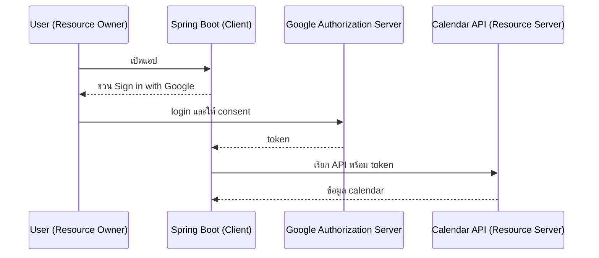
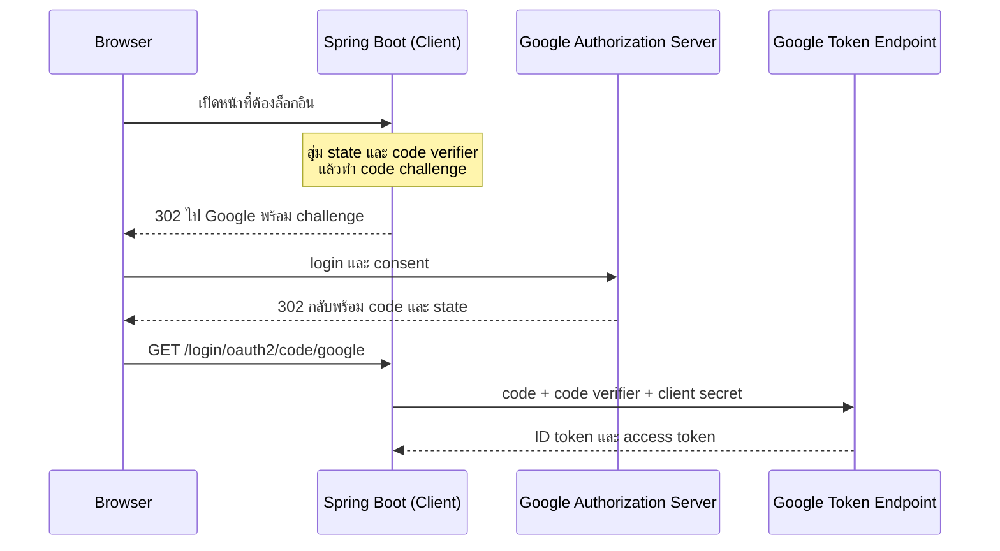
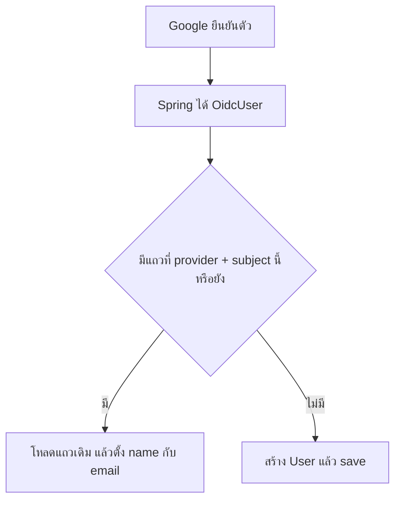
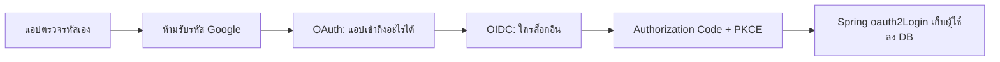

# #39 — OAuth 2.0: ล็อกอินด้วย Google, OIDC และ PKCE

> **วิดีโอ:** [OAuth 2.0 Masterclass | Google Login with Spring Boot, OIDC & PKCE | Spring Boot Full Course #39](https://youtu.be/t9kRN4wMVk0) — Coder Army, ~87 นาที
> **แหล่งที่ใช้สรุป:** ซับไตเติลภาษาอังกฤษที่ YouTube สร้างอัตโนมัติ (en-US)
> **เวอร์ชันในโค้ด:** Spring Boot 4.1 + Java 21 (ใส่หมายเหตุไว้ทุกจุดที่ Spring Boot 3.x ต่างกัน)

ตอนก่อนหน้านี้แอปเป็นคนตรวจ username กับ password เอง แล้วแจก session หรือ JWT ตอนนี้ตอบคำถามต่อจากนั้น: **จะให้ Google เป็นคนยืนยันตัวผู้ใช้ และจะขอสิทธิ์อ่านข้อมูลของผู้ใช้จาก Google โดยไม่รับรหัสผ่าน Google มาเก็บเองได้อย่างไร** คำตอบคือ OAuth 2.0 สำหรับคำถามว่าแอปนี้เข้าถึงอะไรได้ และ OpenID Connect สำหรับคำถามว่าใครเป็นคนล็อกอิน

ส่วนที่ติดป้าย `💡 เพิ่มเติม` คือของที่ผมเติมเอง ไม่ได้อยู่ในวิดีโอ ส่วนที่ติด `⚠️ แก้จากวิดีโอ` คือจุดที่วิดีโอพูดคลาดเคลื่อน

> 💡 **เพิ่มเติม — ล็อกอิน Google รันจบไม่ได้ในโน้ตนี้:** ไฟล์ไม่มี client secret จริง ใช้ placeholder `your-google-client-id` กับ `your-google-client-secret` แอปสตาร์ทที่พอร์ต `9039` ได้ และ `GET /` ตอบ 200 ได้ แต่เส้นที่ผู้ใช้ต้องล็อกอินบน Google แล้วกลับมาที่ `/profile` พร้อมข้อมูลจริงทำไม่ได้ output ด้านล่างจึงเป็นการ redirect ออกไปหา Google เท่านั้น ผู้สอนในวิดีโอใช้ client จริง เห็นหน้า consent ของแอปชื่อ Coder Army OS Demo แล้วได้ JSON ของโปรไฟล์กลับมา
>
> 💡 **เพิ่มเติม — วิดีโอใช้ MySQL ที่พอร์ต 8080:** ผู้สอนต่อ database ชื่อ student แล้วให้ Hibernate สร้างตารางตอนสตาร์ท โน้ตนี้รันบน **H2 in-memory** ที่พอร์ต **9039** เพื่อไม่ต้องติดตั้ง MySQL และไม่ชนกับตอนอื่น SQL ด้านล่างเป็นของ H2 กับ Spring Boot 4.1.1 (Hibernate ORM 7.4.5, Spring Security 7.1.1, Tomcat 11.0.24)

---

## สารบัญ

| เวลา | หัวข้อ |
|---|---|
| [0:00](https://youtu.be/t9kRN4wMVk0?t=0) | [1. ของเดิมคือแอปตรวจตัวเอง](#1-ของเดิมคือแอปตรวจตัวเอง) |
| [3:03](https://youtu.be/t9kRN4wMVk0?t=183) | [2. ทำไมผู้ใช้ถึงอยาก Login with Google](#2-ทำไมผู้ใช้ถึงอยาก-login-with-google) |
| [3:54](https://youtu.be/t9kRN4wMVk0?t=234) | [3. ห้ามรับรหัสผ่าน Google](#3-ห้ามรับรหัสผ่าน-google) |
| [4:35](https://youtu.be/t9kRN4wMVk0?t=275) | [4. อีกปัญหาคือขอสิทธิ์อ่าน Calendar](#4-อีกปัญหาคือขอสิทธิ์อ่าน-calendar) |
| [6:51](https://youtu.be/t9kRN4wMVk0?t=411) | [5. OAuth 2.0 กับสี่บทบาท](#5-oauth-20-กับสี่บทบาท) |
| [12:08](https://youtu.be/t9kRN4wMVk0?t=728) | [6. Access Token เป็น JWT หรือ opaque](#6-access-token-เป็น-jwt-หรือ-opaque) |
| [13:29](https://youtu.be/t9kRN4wMVk0?t=809) | [7. Scope กับ Consent](#7-scope-กับ-consent) |
| [17:26](https://youtu.be/t9kRN4wMVk0?t=1046) | [8. OpenID Connect กับ ID Token](#8-openid-connect-กับ-id-token) |
| [22:06](https://youtu.be/t9kRN4wMVk0?t=1326) | [9. ผู้ใช้เลือกสมัครเองหรือผ่าน Google](#9-ผู้ใช้เลือกสมัครเองหรือผ่าน-google) |
| [27:06](https://youtu.be/t9kRN4wMVk0?t=1626) | [10. Refresh Token](#10-refresh-token) |
| [31:36](https://youtu.be/t9kRN4wMVk0?t=1896) | [11. ห้ามส่ง token ผ่าน browser](#11-ห้ามส่ง-token-ผ่าน-browser) |
| [35:47](https://youtu.be/t9kRN4wMVk0?t=2147) | [12. Authorization Code ห้าขั้น](#12-authorization-code-ห้าขั้น) |
| [46:27](https://youtu.be/t9kRN4wMVk0?t=2787) | [13. PKCE](#13-pkce) |
| [50:50](https://youtu.be/t9kRN4wMVk0?t=3050) | [14. ลงทะเบียนแอปกับ Google](#14-ลงทะเบียนแอปกับ-google) |
| [52:03](https://youtu.be/t9kRN4wMVk0?t=3123) | [15. flow ที่โค้ดจะต้องทำ](#15-flow-ที่โค้ดจะต้องทำ) |
| [53:43](https://youtu.be/t9kRN4wMVk0?t=3223) | [16. โปรเจกต์และ dependency](#16-โปรเจกต์และ-dependency) |
| [55:22](https://youtu.be/t9kRN4wMVk0?t=3322) | [17. Entity User](#17-entity-user) |
| [58:05](https://youtu.be/t9kRN4wMVk0?t=3485) | [18. UserRepository](#18-userrepository) |
| [59:48](https://youtu.be/t9kRN4wMVk0?t=3588) | [19. UserService](#19-userservice) |
| [1:05:53](https://youtu.be/t9kRN4wMVk0?t=3953) | [20. CustomOidcUserService](#20-customoidcuserservice) |
| [1:13:43](https://youtu.be/t9kRN4wMVk0?t=4423) | [21. SecurityConfig](#21-securityconfig) |
| [1:16:12](https://youtu.be/t9kRN4wMVk0?t=4572) | [22. UserController](#22-usercontroller) |
| [1:22:46](https://youtu.be/t9kRN4wMVk0?t=4966) | [23. application.properties](#23-applicationproperties) |
| [1:24:07](https://youtu.be/t9kRN4wMVk0?t=5047) | [24. สิ่งที่เห็นตอนรัน](#24-สิ่งที่เห็นตอนรัน) |
| — | [25. สรุปท้ายตอน](#25-สรุปท้ายตอน) |

---

## 1. ของเดิมคือแอปตรวจตัวเอง

[▶ 0:00](https://youtu.be/t9kRN4wMVk0?t=0)

ผู้สอนเปิดตอนด้วยประกาศสั้น ๆ ว่าช่องเปิดสมาชิกแล้ว ค่าสมาชิกที่เขาพูดคือ ₹59 สมาชิกจะเห็นวิดีโอ members-only โปรเจกต์หลังจบซีรีส์ Spring, ไลฟ์, และแนวเตรียมสัมภาษณ์ จากนั้นเข้าเนื้อหา

จนถึงตอนนี้รูปของระบบเป็นแบบนี้ client ส่ง request มาที่ Spring Boot ครั้งแรกมักเป็น login แอป redirect ไปหน้า login แล้วตอบกลับด้วย token ถ้าเป็นสถาปัตยกรรมแบบ stateless หรือตอบ session id ถ้าเป็นแบบ stateful ครั้งแรก client ส่ง username กับ password ไปด้วย

ครั้งถัดไป เช่น ขอโปรไฟล์ client แนบ token ที่เคยได้ไว้ใน header เซิร์ฟเวอร์จำได้ว่าคนนี้ตรวจแล้ว จึงไม่ให้สมัครใหม่ แล้วส่ง response ของงานนั้นกลับไป token ที่ใช้ในคอร์สนี้คือ JWT ในรูป Bearer ใน header ถ้าเป็นแบบ stateful สิ่งที่อยู่ใน cookie คือ session id เซิร์ฟเวอร์เก็บ mapping ของการยืนยันตัวไว้เอง ฝั่ง stateless เมื่อ JWT กลับเข้ามา เซิร์ฟเวอร์สร้าง authentication object ให้

จุดร่วมของทั้งสองแบบคือ **แอปเราเป็นคนเก็บข้อมูลสมัคร และเป็นคนตรวจผู้ใช้เอง**

---

## 2. ทำไมผู้ใช้ถึงอยาก Login with Google

[▶ 3:03](https://youtu.be/t9kRN4wMVk0?t=183)

Login with Google หมายความว่าผู้ใช้ไม่สมัครตรงกับแอป แอปไปรับรายละเอียดที่จำเป็นผ่าน Google

เขาให้เหตุผลสองข้อ

1. **ความสะดวก** คนที่เปิดเว็บใน browser มักล็อกอิน Google อยู่แล้ว จึงไม่ต้องพิมพ์รหัสผ่านใหม่
2. **ความปลอดภัยจากมุมผู้ใช้** ผู้ใช้ไม่อยากยื่นรายละเอียดให้ทุกเว็บไซต์ เขาไว้ใจให้ Google เป็นตัวกลาง แล้วแอปรับเฉพาะข้อมูลเท่าที่ขอ

---

## 3. ห้ามรับรหัสผ่าน Google

[▶ 3:54](https://youtu.be/t9kRN4wMVk0?t=234)

ทางที่ผิดคือเปิด `POST /login-with-google` แล้วขอ email กับรหัสผ่านของ Google มาล็อกอินให้ ไม่มีใครควรให้รหัสนั้น และแอปก็ไม่ควรขอ ถ้ารหัสหลุด ฝั่งที่ได้รหัสเข้า Google Drive, Google Photos, Calendar และบริการอื่นของบัญชีนั้นได้ทั้งหมด

นี่คือปัญหาแรกของ Login with Google: ต้องการให้ Google **authenticate** ให้ แล้วบอกกลับมาว่าคนนี้คือใคร พร้อมรายละเอียดเท่าที่ตกลงกัน

---

## 4. อีกปัญหาคือขอสิทธิ์อ่าน Calendar

[▶ 4:35](https://youtu.be/t9kRN4wMVk0?t=275)

ปัญหาที่สองคนละเรื่อง เขาสมมติว่ากำลังทำแอปเพิ่ม productivity ของ Coder Army งานของแอปคือจัดตารางให้ผู้ใช้ จึงต้องอ่าน Google Calendar เพื่อรู้ว่าเมื่อไหร่ว่าง การยื่น username กับรหัสผ่าน Google เพื่อไปเปิด Calendar เองใช้ไม่ได้ ด้วยเหตุผลเดียวกับหัวข้อที่แล้ว

สิ่งที่ต้องการรอบนี้คือให้ Google **authorize** แอป ว่าแอปนี้อ่าน Calendar ของผู้ใช้คนนี้ได้ ผู้ใช้ไม่ยอมให้สิทธิ์ไม่จำกัด เขาไว้ใจ Google ระดับหนึ่ง จึงต้องมีสัญญาว่าแอปจะเก็บเฉพาะรายการที่ผู้ใช้กดยินยอม เมื่อกดแล้ว Google จึงส่งเฉพาะข้อมูลนั้นให้

สองประโยคนี้แยกกันทั้งตอน

| คำถาม | ใครตอบ | มาตรฐานที่เขาใช้ |
|---|---|---|
| คนที่ล็อกอินคือใคร | Google ยืนยันตัว แล้วส่งข้อมูลผู้ใช้มาให้แอป | OpenID Connect |
| แอปนี้เข้าถึงอะไรของผู้ใช้ได้ | Google ให้สิทธิ์เป็นชุด แล้วแอปใช้สิทธิ์นั้นเรียก API | OAuth 2.0 |

---

## 5. OAuth 2.0 กับสี่บทบาท

[▶ 6:51](https://youtu.be/t9kRN4wMVk0?t=411)

เขายก flow แนวคิดของปัญหา Calendar ก่อนลงรายละเอียด ผู้ใช้ไปที่ Google แล้วให้ความยินยอมในทำนองว่าอนุญาตให้ Coder Army อ่าน calendar ของตน จากนั้น Google มอบ token ให้แอป แอปใช้ token นั้นเรียก Google Calendar API เขาเปรียบ token นี้กับ JWT ในแง่ที่ว่าเป็นของที่เอาไปแสดงเพื่อขอ resource แต่ยังไม่ลงรายละเอียดว่าเป็น JWT จริงหรือไม่

[▶ 8:59](https://youtu.be/t9kRN4wMVk0?t=539)

สี่คำนี้ครอบทั้งปฏิสัมพันธ์

| คำ | ในตัวอย่างของเขา | ความหมาย |
|---|---|---|
| **Resource Owner** | ผู้ใช้ | เจ้าของ resource เจ้าของ Google Calendar คือผู้ใช้ |
| **Client** | แอป Spring Boot | ฝ่ายที่ขอ resource ในที่นี้คือ productivity app ไม่ใช่ browser |
| **Authorization Server** | ระบบ auth ของ Google | ฝ่ายที่ให้สิทธิ์ ถ้าผู้ใช้ยังไม่ล็อกอิน Google จะให้ล็อกอินก่อนจึงจะกด consent ได้ |
| **Resource Server** | Google Calendar API | ที่อยู่ของ resource ที่จะถูกเรียก |

เขาเตือนเรื่องคำว่า client ซ้ำจากตอนต้นคอร์ส client ไม่ได้แปลว่า browser เสมอไป ใครเป็นฝ่ายส่ง request คนนั้นคือ client รอบนี้แอป Spring Boot เป็นฝ่ายขอข้อมูลจาก Google จึงเป็น client ของ Google

[▶ 10:36](https://youtu.be/t9kRN4wMVk0?t=636)

ลำดับบนกระดานของเขาเป็นแบบนี้ ผู้ใช้ซึ่งเป็น resource owner เข้าแอป แอปชวนให้สมัครด้วย Google ผู้ใช้ไปที่ authorization server เพื่อ login และให้ consent เมื่อให้แล้ว authorization server มอบ token ที่เขาเรียกว่า bearer token แอปเอา token นั้นไปที่ resource server เพื่อพิสูจน์ว่ามีสิทธิ์อ่านข้อมูลนั้น



> ⚠️ **แก้จากวิดีโอ — ชื่อกล่องเดียวกันถูกเรียกสองอย่าง**
> เขานิยามกล่องนี้ว่า Authorization Server ถูกต้องตามบทบาทของ OAuth 2.0 แล้วช่วงหลังเรียกกล่องเดิมสลับกันว่า authentication server ทั้งตอนที่ออก token หลัง consent และตอนที่รับ refresh token บทบาทที่ออก access token ตาม OAuth คือ **Authorization Server** การที่ Google ให้ผู้ใช้ล็อกอินเป็นขั้นตอนข้างในของกล่องนั้น ไม่ได้ทำให้กล่องกลายเป็นคนละระบบ

---

## 6. Access Token เป็น JWT หรือ opaque

[▶ 12:08](https://youtu.be/t9kRN4wMVk0?t=728)

token ที่เอาไปยื่นให้ resource server บอกว่าผู้ถือมีสิทธิ์ ถ้ามันเป็น JWT ฝั่ง authorization server เซ็นแล้วส่งมา resource server ตรวจลายเซ็นได้ เพราะทั้งสองฝั่งเป็นของ Google แอปแค่ถือ token ส่งต่อ

มันอาจเป็น **opaque token** ก็ได้ คือสตริงที่อ่าน claim ออกมาเองไม่ได้ ต้องมี mapping ว่า token นี้ให้สิทธิ์อะไรกับผู้ใช้คนไหน เขาชี้ให้กลับไปดูตอนที่อธิบาย authentication token กับ opaque token ถ้ายังไม่คุ้น

OAuth ไม่ได้บังคับว่า access token ต้องเป็น JWT

[▶ 16:45](https://youtu.be/t9kRN4wMVk0?t=1005)

ชื่อของ token ใบนี้คือ **access token** เพราะมันให้สิทธิ์เข้า resource ได้ทั้งแบบ JWT และแบบ opaque ช่วงนี้ของกระดานยังเป็นเรื่อง authorization คือแอปขอเข้า Calendar ยังไม่ใช่เรื่องสมัครสมาชิก

---

## 7. Scope กับ Consent

[▶ 13:29](https://youtu.be/t9kRN4wMVk0?t=809)

**Scope** คือรายการที่แอปขอจาก Google แอปจัดตารางอาจต้องการแค่อ่าน calendar ไม่ต้องเขียน จึงขอ `calendar.read` ถ้าต้องแก้ข้อมูลด้วยจึงค่อยขอ `calendar.write` เขาบอกให้เข้าใจเป็นแนวคิดก่อน

เมื่อขอ scope ผู้ใช้จะเห็นฟอร์ม consent เป็นข้อ ๆ เช่น productivity app ขออ่าน Google Calendar และขอดูโปรไฟล์ ผู้ใช้กดอนุญาตหรือปฏิเสธก็ได้ ถ้าปฏิเสธ แอปไม่ได้สิทธิ์นั้น และอาจทำงานได้ไม่ครบ แต่สิทธิ์ตัดสินอยู่ที่ผู้ใช้ ถ้าอนุญาต authorization server ออก token ให้ แอปใช้ token นั้นติดต่อ resource server

จากมุม client ลำดับคือแอปส่งคำขอเข้าถึงโดยระบุ scope เช่น `calendar.read` ไปที่ authorization server เซิร์ฟเวอร์โชว์ consent ถ้าผู้ใช้ยอม จึงออก token แล้วแอปเอา token ไปที่ Calendar API

> 💡 **เพิ่มเติม:** สตริง `calendar.read` กับ `calendar.write` เป็นชื่อที่เขาตั้งบนกระดานเพื่อสอน ไม่ใช่ scope จริงของ Google Calendar scope จริงเป็น URI เช่น `https://www.googleapis.com/auth/calendar.readonly` ในโค้ดท้ายตอนเขาไม่ได้ขอ calendar เขาขอ `openid`, `profile`, และ `email` เพราะเดโมนี้ทำแค่ล็อกอิน

---

## 8. OpenID Connect กับ ID Token

[▶ 17:26](https://youtu.be/t9kRN4wMVk0?t=1046)

ปัญหาแรกยังค้างอยู่ คือ Login with Google ที่ต้องการให้ Google ยืนยันตัวผู้ใช้ แล้วส่งข้อมูลมาให้แอปสมัครให้ ชั้นที่วางบน OAuth เพื่อทำหน้าที่นี้ชื่อ **OpenID Connect** เขาเรียกสั้น ๆ ว่า OIDC

[▶ 18:28](https://youtu.be/t9kRN4wMVk0?t=1108)

เขานิยามคู่กันแบบนี้

- **OAuth** ตอบว่าแอปนี้เข้าถึงอะไรได้
- **OpenID Connect** ตอบว่าใครล็อกอิน

ทำไมไม่ใช้ access token ใบเดียวทั้งสองงาน 因为他บอกว่า access token ถูกสร้างตาม scope เช่น อ่าน calendar ได้อย่างเดียว จะเอาไปเขียน calendar ไม่ได้ resource server ตรวจสิทธิ์ใน token นั้น สมมติว่าเป็น JWT ก็ตรวจว่าการกระทำอยู่ในสิทธิ์หรือไม่ งานของ Login with Google คนละคำถาม คำถามคือใครล็อกอิน จึงต้องมี token อีกชนิด ใกล้กับ JWT ที่แอปเคยออกให้ผู้ใช้หลังตรวจ username กับ password ต่างตรงที่รอบนี้ผู้ใช้เอา username กับ password ไปให้ Google ไม่ได้เอาไปให้แอป Google จึงเป็นฝ่ายส่ง token ยืนยันตัวกลับมา

[▶ 20:41](https://youtu.be/t9kRN4wMVk0?t=1241)

token ของ OpenID Connect ชื่อ **ID token** token ของ OAuth ชื่อ **access token**

ID token ไปถึง client ซึ่งในตัวอย่างนี้คือแอป Spring Boot เขาให้มองว่าเป็น JWT แอปอ่านรายละเอียดของผู้ใช้ออกจาก token นี้ได้ โครงสร้างที่เขาวาดคือ JWT สามส่วน คือ header, payload, และ signature ทั้งสามส่วนถูก encode มา

[▶ 25:42](https://youtu.be/t9kRN4wMVk0?t=1542)

เขาสรุปผู้รับกับผู้ใช้ของแต่ละใบแบบนี้ ทั้ง ID token และ access token มาถึงที่ client ทั้งคู่ แต่คนละหน้าที่

| Token | ใช้ตอบคำถาม | ใครเป็นฝ่ายใช้ต่อ |
|---|---|---|
| ID token | ใครล็อกอิน | client เอาไปรู้จักผู้ใช้ |
| Access token | แอปมีสิทธิ์อะไร | client เอาไปยื่นให้ resource server เพื่อให้ฝั่งนั้นตรวจลายเซ็นหรือ mapping แล้วค่อยเปิด resource |

รวมสองใบแล้วทำได้ทั้ง authenticate และ authorize ผ่าน Google

> 💡 **เพิ่มเติม:** OIDC กำหนดว่า ID token ต้องเป็น JWT access token ของ OAuth ไม่ได้ถูกบังคับแบบนั้น ตามที่เขาพูดในหัวข้อ access token แล้ว การเรียก ID token ว่า bearer token ในวิดีโอหลวมไปหน่อย ของที่เอาไปยื่นเป็นหลักฐานเรียก API คือ access token ID token มีไว้ให้ client อ่านว่าผู้ใช้คือใคร

---

## 9. ผู้ใช้เลือกสมัครเองหรือผ่าน Google

[▶ 22:06](https://youtu.be/t9kRN4wMVk0?t=1326)

เขายกแอปคนละตัวจากแอป calendar สักครู่ ให้ชื่อว่า Coder Army server งานของแอปนี้มีแค่ Sign in with Google ผู้ใช้เข้ามาแล้วมีสองทาง

ทางแรกคือสมัครตรงกับแพลตฟอร์ม กรอก username กับ password แอปเก็บลง database สร้าง authentication object แล้วคืน JWT ครั้งถัดไปผู้ใช้นำ JWT นั้นกลับมา

ทางที่สองผู้ใช้บอกว่าไม่สมัครตรง จะล็อกอินด้วย Google เขาคลิกปุ่ม แอปตอบ **302** พา browser ไปที่ Google ถ้า browser ยังไม่ล็อกอิน Google ผู้ใช้กรอก email กับรหัสผ่านที่นั่น เมื่อผ่าน Google ส่ง ID token มาให้แอป Coder Army

[▶ 24:09](https://youtu.be/t9kRN4wMVk0?t=1449)

เมื่อถอด ID token ที่เขาสันนิษฐานว่าเป็น JWT จะได้ JSON ของผู้ใช้ เขาหยิบ claim เหล่านี้ขึ้นกระดาน

| Claim | สิ่งที่เขาบอก |
|---|---|
| `sub` (subject) | ตัวระบุผู้ใช้ |
| `iss` | ผู้ออก token เขายกตัวอย่างเป็นชื่อของ Google |
| `name` | ชื่อ เช่น Aditya |
| `email` | อีเมลของผู้ใช้ |

แอปใช้ข้อมูลชุดนี้สมัครผู้ใช้ในเว็บของตัวเอง ผู้ใช้ไม่ต้องตั้งรหัสบนเว็บนั้น ถ้าล็อกอิน Google ค้างอยู่แล้วก็ยิ่งสั้น แอปอาจสร้าง authentication object แล้วเก็บผู้ใช้เป็น entity ใน database เขาแยกต่อว่า authentication ที่ใช้ระหว่าง request อยู่ใน Security Context ที่ SecurityContextHolder ถือไว้ ส่วนที่ลง database คือตัวผู้ใช้

> 💡 **เพิ่มเติม — issuer จริงของ Google**
> เขาบอกเองว่า `google.com` เป็นแค่ตัวอย่าง และ URL จริงจะปรากฏใน token ค่า `iss` ที่ Google ใช้ออก ID token คือ `https://accounts.google.com` ตาม discovery document ที่ `https://accounts.google.com/.well-known/openid-configuration`

---

## 10. Refresh Token

[▶ 27:06](https://youtu.be/t9kRN4wMVk0?t=1626)

ID token ใช้ตอนยืนยันตัว แล้วแอปเก็บผู้ใช้ลง database ได้ access token คนละเรื่อง มันเป็นใบที่แอปใช้ขอข้อมูลต่อ และไม่ควรใช้ได้ตลอดไป

เขาย้อนไปที่รูป productivity app แอปได้ access token แล้วไปอ่าน Calendar ได้ resource server ตรวจผ่าน แต่ใบนี้ต้องหมดอายุสักจุด หนึ่งชั่วโมง สี่ชั่วโมง หรือสิบสองชั่วโมงก็ได้ เขาเชื่อมกับ JWT ที่เคยทำในคอร์ส ว่าตอนสร้าง JWT เราเขียนเวลาหมดอายุไว้ เพื่อให้หมดใน 15 นาที 30 นาที หรือครึ่งชั่วโมง

> ⚠️ **แก้จากวิดีโอ — 900 มิลลิวินาทีกับที่อยู่ของ `exp`**
> เขากล่าวว่าใส่เวลาไว้ที่ 900 milliseconds แล้วสมมติว่าอยากให้หมดอายุใน 15 นาที สองจำนวนนี้ไม่ใช่หน่วยเดียวกัน 15 นาทีเท่ากับ 900 วินาที หรือ 900,000 มิลลิวินาที ประโยคเดียวกันเขายังบอกว่าเขียนเวลานั้นไว้ใน signature หรือ payload claim `exp` ตาม RFC 7519 อยู่ใน **payload** signature เป็นผลเซ็นทับ header กับ payload ไม่ได้เป็นช่องที่เก็บวันหมดอายุ

เมื่อ access token หมด อายุของสิทธิ์นั้นจบ ถ้าต้องให้ผู้ใช้กด consent ใหม่ทุกครั้ง ทางจะยาว จึงมีใบที่สามชื่อ **refresh token**

refresh token เป็น token อายุยาว อยู่กับแอปนาน หมดช้า และเป็นของ client คือแอป Spring Boot ได้มันมา เอาไปขอ **access token ใบใหม่** จาก authorization server ได้ โดยไม่ต้องให้ผู้ใช้กด consent รอบใหม่ ที่มาของมันคือ authorization server มอบมาพร้อมกับ access token ใบแรก

รูปที่เขาวาดต่อคือแบบนี้

1. Authorization server ให้แอปสองใบ คือ access token กับ refresh token
2. แอปใช้ access token เรียก Calendar API
3. เมื่อใบนั้นหมด แอปยื่น refresh token กลับไปที่ authorization server
4. ได้ access token ใบใหม่ แล้ววนต่อ

เขาสมมติตัวเลขเพื่อให้เห็นภาพ access token ใช้ได้หนึ่งชั่วโมง refresh token อาจอยู่หนึ่งหรือสองวัน เมื่อ refresh token หมดจึงไม่มีทางลัด ผู้ใช้ต้องกลับไปให้ consent ที่ Google ใหม่

[▶ 31:14](https://youtu.be/t9kRN4wMVk0?t=1874)

สามใบที่ต้องแยกให้ได้คือ access token, refresh token, และ ID token เป้าหมายรวมคือใช้ Google ทั้งยืนยันตัวผู้ใช้ และให้สิทธิ์แอปไปดึงข้อมูลบางอย่างของผู้ใช้ เช่น calendar

เดโมในโค้ดท้ายตอนใช้แค่ ID token เพื่อสมัครและจำผู้ใช้ เขาอธิบาย refresh token ไว้บนกระดาน แต่ไม่ได้เขียนโค้ดขอ calendar หรือหมุน access token

---

## 11. ห้ามส่ง token ผ่าน browser

[▶ 31:36](https://youtu.be/t9kRN4wMVk0?t=1896)

คำถามถัดไปคือ Google จะส่ง token มาอย่างปลอดภัยได้อย่างไร และจะรู้ได้อย่างไรว่าไม่มีใครดักกลางทาง

ทางที่ดูง่ายแล้วอันตรายมีแบบนี้ ผู้ใช้เข้า `localhost:8080/home` แอปตอบ 302 ไปที่ Google ผู้ใช้ล็อกอินและกด consent ที่นั่น แล้ว Google 302 กลับมาที่แอปพร้อม token ใน URL เพราะการ redirect วิ่งผ่าน browser ทุกอย่างที่อยู่ใน URL ฝั่งผู้ใช้มองเห็น และคนกลางที่อ่าน redirect นั้นก็เห็น

ถ้าสิ่งที่หลุดเป็น access token คนที่ได้ใบนั้นยื่นให้ Calendar API ได้ API ตรวจผ่านเพราะ token ถูกต้อง แล้วตอบข้อมูล calendar ให้ทั้งแอปที่ตั้งใจขอและให้คนที่ดักได้

ข้อสรุปของเขาคือ การเคลื่อนที่ของ token ต้องไม่เกิดผ่าน browser หรือฝั่งหน้าเว็บ

---

## 12. Authorization Code ห้าขั้น

[▶ 35:47](https://youtu.be/t9kRN4wMVk0?t=2147)

ทางที่ใช้แทนชื่อ **Authorization Code** เขาบอกว่าเมื่อเข้าใจ flow นี้ การเขียนโค้ดจะสั้น เพราะ Spring รับงานที่เหลือไว้ คล้ายตอน JWT ที่ต้องรู้จักข้างใน แต่ไม่ต้องตรวจลายเซ็นเองทุกจุด

### ขั้นที่ 1 Authorization Request

[▶ 36:11](https://youtu.be/t9kRN4wMVk0?t=2171)

แอปซึ่งทำหน้าที่ client ตอบ 302 พาผู้ใช้ไปที่ authorization server ของ Google ในคำขอนั้นมีอย่างน้อยห้าอย่าง

| ส่งอะไร | ความหมายที่เขาอธิบาย |
|---|---|
| **client id** | รหัสแอปที่ได้ตอนไปลงทะเบียนกับ Google ทุกครั้งที่ขอ Google ต้องส่งค่านี้ |
| **redirect URI** | path ที่ให้ Google พากลับมาหลังผู้ใช้ล็อกอินและกด consent |
| **scope** | ข้อมูลที่ขอ เช่น อ่าน calendar |
| **response_type** | ค่าที่ใช้คือ `code` แปลว่าตอน redirect กลับมา อย่าใส่ token มาทางหน้าเว็บ |
| **state** | สตริงสุ่มที่แอปส่งไป และ Google ส่งคืนมาเหมือนเดิม |

`response_type=code` คือการบอกว่าอย่ามอบ token ทางประตูหน้า ให้แอปไปเรียก API ฝั่งหลังบ้านของ Google เอง แล้วรับ token จากทางนั้น รายละเอียดของประตูหลังอยู่ในขั้นที่ 5

เรื่อง state เขาอธิบายว่ามันผูก request ที่ส่งไปกับ callback ที่กลับมา ตัวอย่างบนกระดานคือส่ง id `123` ไป แล้วได้ `123` กลับมา จึงรู้ว่า callback นี้คู่กับครั้งนั้น ถ้ามีการ redirect ไป Google หลายครั้งพร้อมกัน แต่ละครั้งคนละ id การจับคู่ต้องอาศัยค่านี้

> ⚠️ **แก้จากวิดีโอ — authorization request ไม่ได้อยู่ใน body**
> เขาเรียกชุด client id, redirect URI, scope, response type, และ state ว่า request body ของ authorization request ใน Authorization Code flow ตาม RFC 6749 ส่วนนี้เป็นการ redirect แบบ GET พารามิเตอร์อยู่บน **query string** body ของ POST ไปอยู่ที่การแลก code เป็น token ในขั้นที่ 5 คนละข้อความ
>
> ⚠️ **แก้จากวิดีโอ — หน้าที่หลักของ state**
> การจับคู่ callback กับครั้งที่ส่งไปเป็นผลพลอยได้ที่เขาเล่า จุดที่ RFC 6749 ส่วน 10.12 กำหนด state ไว้คือกัน **CSRF** ผู้รับต้องตรวจว่า state ที่กลับมาตรงกับค่าที่ตัวเองเพิ่งสุ่มไว้ใน session นั้น ถ้าใครยิง callback ปลอมเข้ามาโดยไม่มี state ที่ตรง จะได้ไม่รับ code ของคนอื่น

### ขั้นที่ 2 Google ตรวจตัวผู้ใช้

[▶ 40:47](https://youtu.be/t9kRN4wMVk0?t=2447)

จากจุดนี้เป็นงานของ Google อาจถาม email กับรหัสผ่านของ Google ถ้าผู้ใช้เปิด two-factor authentication ไว้ ก็จะถามขั้นนั้นด้วย เมื่อ Google ตรวจผ่านแล้วไปขั้นถัดไป

### ขั้นที่ 3 Consent

[▶ 41:21](https://youtu.be/t9kRN4wMVk0?t=2481)

Google โชว์ฟอร์มว่า client ขอเข้าถึงข้อมูลรายการนี้ ผู้ใช้กดส่งความยินยอม ข้อความบนกระดานเป็นแนว "Coder Army wants this access"

### ขั้นที่ 4 ได้ authorization code กลับมาทาง browser

[▶ 41:40](https://youtu.be/t9kRN4wMVk0?t=2500)

Google redirect กลับไปที่ redirect URI ที่เคยส่งไปในคำขอ ของที่มากับการกลับมาไม่ใช่ token แต่เป็น **authorization code** ซึ่งเขาบอกว่าเป็นสตริงสุ่ม เช่น `ATY567` และส่ง **state** เดิมกลับมาด้วย เขาสมมติ state เป็น `ABC123`

[▶ 43:05](https://youtu.be/t9kRN4wMVk0?t=2585)

URL ที่เขาวาดเป็น path มาตรฐานของ Spring Security ไม่ใช่ path ที่เราต้องเขียน controller เอง

```text
http://localhost:8080/login/oauth2/code/google?state=ABC123&code=TAYFGV456
```

authorization code ไม่ใช่ access token และไม่ควรมีความหมายในตัวเอง แอปจะเอา code นี้ไปแลก token อีกที ค่า `code` กับ `state` ในบรรทัดนี้เป็นตัวอย่างบนกระดาน ไม่ใช่ค่าที่รันได้

### ขั้นที่ 5 แลก code เป็น token ทางหลังบ้าน

[▶ 44:15](https://youtu.be/t9kRN4wMVk0?t=2655)

เมื่อ redirect ถึง backend แอป Spring Boot เรียก **token endpoint** ของ Google Spring รู้ URL นี้อยู่แล้ว ในคำขอมี code ที่เพิ่งได้ Google ตอบกลับมาด้วย token ได้หลายใบในครั้งเดียว ทั้ง access token, ID token, และ refresh token

ฝั่งที่คุยกันรอบนี้คือเซิร์ฟเวอร์ของแอปกับเซิร์ฟเวอร์ของ Google browser เห็นแค่ code ที่เอาไปทำอะไรต่อเองไม่ได้ Google เก็บ mapping ของ code นั้นไว้ จึงยอมแลกเป็น token ให้คนที่ถือ code ที่ตัวเองเพิ่งออก

เขายังตั้งคำถามต่อทันที ถ้าคนดักอ่าน code จาก URL ของขั้นที่ 4 ได้ เขาก็รู้จัก token endpoint แล้วยื่น code นั้นขอ token เองได้ ไม่ใช่หรือ นั่นคือช่องที่ PKCE มาปิด



> 💡 **เพิ่มเติม:** พารามิเตอร์ที่ RFC 6749 กำหนดในการแลก code รวมถึง `grant_type=authorization_code` ด้วย วิดีโอไม่ได้เขียนชื่อพารามิเตอร์นี้ client secret ก็ไปในคำขอฝั่งหลังบ้านนี้ ไม่ไปใน URL ที่ browser เห็น หัวข้อถัดไปมี Location จริงจากแอปที่ยืนยันว่า URL ไป Google ไม่มี client secret

---

## 13. PKCE

[▶ 46:27](https://youtu.be/t9kRN4wMVk0?t=2787)

**PKCE** สะกด P-K-C-E อ่านว่า pixie ย่อจาก Proof Key for Code Exchange

ก่อนเริ่ม authorization แอปซึ่งเป็น client สุ่มสตริงยาวชื่อ **code verifier** แล้วทำแฮช SHA-256 ของ verifier นั้น ได้ค่าที่เรียก **code challenge** เขาบอกว่าชื่อนี้เป็นแค่ข้อตกลงในการเรียก

ตอน client ส่ง authorization request ไปที่ Google จะแนบ code challenge ไปด้วย และเก็บ code verifier ไว้ที่ตัวเอง Google จำ challenge ของคำขอนั้นไว้ จากนั้น flow ปกติยังเดินต่อ คือ consent แล้ว redirect กลับมาพร้อม authorization code

ตอนแลก token ฝั่ง backend ไม่ได้ส่งแค่ code ส่ง **code verifier** ไปด้วย token endpoint ทำ SHA-256 ของ verifier ที่เพิ่งได้ แล้วเทียบกับ code challenge ที่เคยรับไว้ตอนต้น ตรงกันจึงออก token ไม่ตรงก็ปฏิเสธ

ผลคือคนที่ดักได้แต่ authorization code ยังขอ token ไม่ได้ เพราะไม่มี code verifier และไม่มีทางคำนวณ verifier ย้อนจาก challenge

> ⚠️ **แก้จากวิดีโอ — challenge ไม่ใช่แฮชดิบ**
> เขาบอกว่าเอา SHA-256 ของ verifier ไปเทียบกับ challenge โดยตรง ตาม RFC 7636 เมื่อใช้วิธี `S256` ค่าที่ส่งคือ `code_challenge = BASE64URL(SHA-256(ASCII(code_verifier)))` โดยไม่มี padding การเทียบจึงเกิดบนค่าที่ encode แล้ว ไม่ใช่บนไบต์ของแฮชดิบ แอปที่รันในโน้ตนี้ส่ง `code_challenge_method=S256` ไปจริง ดูได้จาก Location ใน[ส่วนที่ 24](#24-สิ่งที่เห็นตอนรัน)

[▶ 50:21](https://youtu.be/t9kRN4wMVk0?t=3021)

เขาปิดภาคทฤษฎีตรงนี้ แล้วบอกว่าโค้ด OAuth เรียกไม่กี่จุดเพราะ Spring ทำให้ข้างในเอง สิ่งที่ต้องมั่นใจคือสถาปัตยกรรม ไม่งั้นจะไม่กล้าแก้อะไร

---

## 14. ลงทะเบียนแอปกับ Google

[▶ 50:50](https://youtu.be/t9kRN4wMVk0?t=3050)

แอปบน localhost จะสั่งให้ Google ส่งข้อมูลผู้ใช้มาให้ไม่ได้ ถ้า Google ยังไม่รู้จักแอปนี้ ต้องลงทะเบียนก่อน เขาไม่คลิกในวิดีโอ บอกว่าขั้นตอนสี่ถึงห้าขั้นอยู่ในโน้ตของเขา ให้ไปที่ Google Console สร้างแอป แล้วจะได้สองค่า

- **Client ID** คือค่าที่ต้องส่งทุกครั้งที่ขอ Google ตาม authorization request
- **Client Secret** เป็นความลับ ต้องเก็บให้ปลอดภัย

เขาจะไม่ push โค้ดที่มี client secret ของตัวเองขึ้น Git เวลาแจกโน้ตจะลบ secret ออก ให้ผู้ดูใส่ของตัวเอง

> 💡 **เพิ่มเติม:** ขั้นตอนคลิกบน Google Cloud Console ไม่ได้อยู่ในซับ เลยไม่เขียนเป็นขั้นตอนของวิดีโอ สิ่งที่ Spring ใช้เป็น redirect URI และต้องไปลงทะเบียนให้ตรง คือ `http://localhost:9039/login/oauth2/code/google` ในวิดีโอพอร์ตเป็น 8080 path เดียวกัน

---

## 15. flow ที่โค้ดจะต้องทำ

[▶ 52:03](https://youtu.be/t9kRN4wMVk0?t=3123)

เดโมนี้เหลือแค่ทาง Google ไม่ได้ทำฟอร์ม username และ password คู่กัน เขาบอกว่าถ้าอยากได้ทั้งสองทางให้ไปรวมเองจากตอนที่แล้ว

ลำดับในแอปเป็นแบบนี้

1. Google authenticate ผู้ใช้ แล้ว Spring ได้ token ยืนยันตัว ซึ่งเป็น ID token เขาเรียกผู้ใช้ที่ถอดออกมาแล้วว่า OIDC user
2. ถาม database ว่าเคยมีผู้ใช้นี้หรือยัง
3. ถ้ามี โหลดขึ้นมา หรืออัปเดต
4. ถ้าไม่มี สร้างแถวใหม่ เพื่อให้ครั้งถัดไปอ่านจาก database ของเราได้



---

## 16. โปรเจกต์และ dependency

[▶ 53:43](https://youtu.be/t9kRN4wMVk0?t=3223)

เขาเปิด Spring Initializr เลือก Java, group `in.strix`, artifact `oauth-demo`, Java 21

dependency ที่เขาเลือก

- Spring Web เพราะเป็นเว็บ
- Spring Data JPA เพราะจะเก็บผู้ใช้
- MySQL Driver เพราะในวิดีโอเขาใช้ MySQL
- **OAuth2 Client** อันนี้คือตัวที่ต้องใช้

เขาบอกไม่ต้องเลือก OAuth2 Resource Server เพราะแอปนี้เป็น client ไม่ใช่ฝ่ายถือ calendar ให้คนอื่นมาเรียก และไม่ต้องเลือก Authorization Server เพราะบทนั้นสมมติว่าเป็นของ Google

เขาบอกว่าไม่ต้องใส่ Spring Security แยก เพราะ OAuth2 Client ดึงพื้นฐานของ Spring Security มาให้แล้ว จากนั้น generate แล้วเปิดใน IntelliJ ใน `pom.xml` เขาชี้ว่ามี starter ของ JPA, OAuth2 Client, Web MVC, และตัว connector

> ⚠️ **Boot 4 vs 3 — ชื่อ starter**
> บนจอ Initializr ของยุค Boot 3 ชื่อที่เขาเลือกคือ `spring-boot-starter-oauth2-client` และของเว็บคือ `spring-boot-starter-web` Boot 4 เปลี่ยนชื่อให้ตรงโมดูล โดยตัวเก่ายังอยู่แต่ถือว่า deprecated
>
> | ที่วิดีโอเลือก | ที่โปรเจกต์นี้ใช้ |
> |---|---|
> | `spring-boot-starter-oauth2-client` | `spring-boot-starter-security-oauth2-client` |
> | `spring-boot-starter-oauth2-authorization-server` | `spring-boot-starter-security-oauth2-authorization-server` |
> | `spring-boot-starter-oauth2-resource-server` | `spring-boot-starter-security-oauth2-resource-server` |
> | `spring-boot-starter-web` | `spring-boot-starter-webmvc` |
>
> ([Spring Boot 4.0 Migration Guide](https://github.com/spring-projects/spring-boot/wiki/Spring-Boot-4.0-Migration-Guide) ตาราง Deprecated Starters)
>
> 💡 **เพิ่มเติม:** ตรวจจาก POM ของ `spring-boot-starter-security-oauth2-client:4.1.1` แล้วยังดึง `spring-boot-starter-security` มาให้ ประโยคที่เขาบอกว่าไม่ต้องใส่ Security แยกจึงยังใช้ได้กับ Boot 4.1.1 รุ่นที่ได้ตอนรันคือ Spring Security 7.1.1

`pom.xml` ที่ใช้รันในโน้ตนี้คือชุดนี้ เปลี่ยน MySQL เป็น H2 ตามหมายเหตุด้านบน

```xml
<?xml version="1.0" encoding="UTF-8"?>
<project xmlns="http://maven.apache.org/POM/4.0.0"
         xmlns:xsi="http://www.w3.org/2001/XMLSchema-instance"
         xsi:schemaLocation="http://maven.apache.org/POM/4.0.0 https://maven.apache.org/xsd/maven-4.0.0.xsd">
    <modelVersion>4.0.0</modelVersion>

    <parent>
        <groupId>org.springframework.boot</groupId>
        <artifactId>spring-boot-starter-parent</artifactId>
        <version>4.1.1</version>
        <relativePath/>
    </parent>

    <groupId>in.strix</groupId>
    <artifactId>oauth-demo</artifactId>
    <version>0.0.1-SNAPSHOT</version>
    <name>oauth-demo</name>

    <properties>
        <java.version>21</java.version>
    </properties>

    <dependencies>
        <dependency>
            <groupId>org.springframework.boot</groupId>
            <artifactId>spring-boot-starter-webmvc</artifactId>
        </dependency>
        <dependency>
            <groupId>org.springframework.boot</groupId>
            <artifactId>spring-boot-starter-data-jpa</artifactId>
        </dependency>
        <dependency>
            <groupId>org.springframework.boot</groupId>
            <artifactId>spring-boot-starter-security-oauth2-client</artifactId>
        </dependency>
        <dependency>
            <groupId>com.h2database</groupId>
            <artifactId>h2</artifactId>
            <scope>runtime</scope>
        </dependency>
        <dependency>
            <groupId>org.projectlombok</groupId>
            <artifactId>lombok</artifactId>
            <optional>true</optional>
        </dependency>
    </dependencies>

    <build>
        <plugins>
            <plugin>
                <groupId>org.springframework.boot</groupId>
                <artifactId>spring-boot-maven-plugin</artifactId>
            </plugin>
        </plugins>
    </build>
</project>
```

คลาสหลักมีแค่จุดสตาร์ท

```java
package in.strix.oauthdemo;

import org.springframework.boot.SpringApplication;
import org.springframework.boot.autoconfigure.SpringBootApplication;

@SpringBootApplication
public class OauthDemoApplication {

    public static void main(String[] args) {
        SpringApplication.run(OauthDemoApplication.class, args);
    }
}
```

---

## 17. Entity User

[▶ 55:22](https://youtu.be/t9kRN4wMVk0?t=3322)

เขาเพิ่ม Lombok ใน `pom.xml` แล้ว reload Maven จากนั้นสร้าง package `entity` และคลาส `User`

ฟิลด์ที่มี

- `id` เป็น `Long` พร้อม `@Id` และ `@GeneratedValue(strategy = GenerationType.IDENTITY)`
- `name`
- `email`
- `provider` คือใครเป็นคนยืนยันตัว ในเดโมนี้คือ Google
- `providerSubject` คือ subject ที่มากับ token ของ provider นั้น

เขาใส่ `@Getter`, `@Setter`, `@NoArgsConstructor` แล้วเขียน constructor เองโดยไม่รับ `id` เพราะไม่อยากให้ตอน `new` ต้องส่ง id

[▶ 57:10](https://youtu.be/t9kRN4wMVk0?t=3430)

ไม่มีฟิลด์ password เพราะเดโมนี้ไม่ให้ผู้ใช้ตั้งรหัสกับแอป ผู้ใช้เข้ามาทาง Login with Google เท่านั้น ถ้าจะรองรับทั้งสองทางเขาบอกว่าผูกเพิ่มเองได้

subject ที่ถอดจาก token ของ Google เป็นตัวระบุผู้ใช้ฝั่ง Google มักเป็นสตริงที่ดูสุ่ม เขาเก็บไว้เพราะนี่คือกุญแจที่ Google ใช้จำคนคนนั้น ครั้งถัดไปที่ต้องหาแถวเดิมจะใช้ค่านี้ ไม่ใช้ email เป็นกุญแจหลัก

> 💡 **เพิ่มเติม — ชื่อตาราง**
> เขาไม่ได้ใส่ `@Table` บนจอ MySQL ในวิดีโอสร้างตารางชื่อ `user` ได้ H2 มอง `user` เป็นคำสงวน ถ้าปล่อยให้ Hibernate สร้าง `create table user ...` จะได้ syntax error โปรเจกต์นี้จึงใส่ `@Table(name = "users")` คอลัมน์ยังเป็น `provider_subject` ตาม naming ปกติของ Boot

```java
package in.strix.oauthdemo.entity;

import jakarta.persistence.Entity;
import jakarta.persistence.GeneratedValue;
import jakarta.persistence.GenerationType;
import jakarta.persistence.Id;
import jakarta.persistence.Table;
import lombok.Getter;
import lombok.NoArgsConstructor;
import lombok.Setter;

@Entity
@Table(name = "users")
@Getter
@Setter
@NoArgsConstructor
public class User {

    @Id
    @GeneratedValue(strategy = GenerationType.IDENTITY)
    private Long id;

    private String name;

    private String email;

    private String provider;

    private String providerSubject;

    public User(String name, String email, String provider, String providerSubject) {
        this.name = name;
        this.email = email;
        this.provider = provider;
        this.providerSubject = providerSubject;
    }
}
```

---

## 18. UserRepository

[▶ 58:05](https://youtu.be/t9kRN4wMVk0?t=3485)

package `repository` มี interface `UserRepository` ที่ extend `JpaRepository<User, Long>`

เมธอดที่เขาเพิ่มคือ `findByProviderAndProviderSubject` เพราะคู่ของ provider กับ subject ทำให้ผู้ใช้ไม่ซ้ำในแอปนี้ เรียกด้วย `"google"` กับ subject แล้วได้ `Optional<User>`

> ⚠️ **แก้จากวิดีโอ — ไม่เจอแล้วได้ null**
> เขาสรุปว่าถ้าไม่มีแถว เมธอดนี้จะคืน `null` ชนิดกลับเป็น `Optional` เมื่อไม่เจอจะได้ `Optional.empty()` การเช็คใน service จึงใช้ `isPresent()` ตามที่เขาแก้ตัวเองตอนเขียนโค้ด ไม่ใช่การเทียบ `null`

```java
package in.strix.oauthdemo.repository;

import in.strix.oauthdemo.entity.User;
import org.springframework.data.jpa.repository.JpaRepository;

import java.util.Optional;

public interface UserRepository extends JpaRepository<User, Long> {

    Optional<User> findByProviderAndProviderSubject(String provider, String providerSubject);
}
```

---

## 19. UserService

[▶ 59:48](https://youtu.be/t9kRN4wMVk0?t=3588)

package `service` มี `UserService` ติด `@Service` เขา inject `UserRepository` ด้วย `@Autowired` บนฟิลด์ แล้วบอกเองว่าแบบนี้ไม่แนะนำ ค่าเริ่มต้นควรเป็น constructor injection ที่ทำแบบฟิลด์เพื่อความเร็ว โค้ดด้านล่างจึงใช้ constructor

เมธอดหลักชื่อ `registerAndUpdate` รับ `provider` กับ `OidcUser` คลาส `OidcUser` มีอยู่ใน Spring อยู่แล้ว ไม่ได้เขียนเอง เขาบอกว่าเมธอดลักษณะนี้เป็นโครงที่ต้องรู้จัก เพราะงานสำคัญอยู่ข้างใน Spring ไม่ได้อยู่ที่ชื่อเมธอด

ลำดับในเมธอด

1. อ่าน subject จาก `oidcUser.getSubject()`
2. อ่านชื่อกับอีเมล เขาเริ่มพูดถึง `getName()` แล้วเลือก `getClaimAsString("name")` กับ `getClaimAsString("email")` เพราะ claim เหล่านี้มาใน ID token
3. เรียก `findByProviderAndProviderSubject`
4. ถ้า `isPresent()` โหลด entity แล้ว `setName` กับ `setEmail` แล้วคืนแถวนั้น
5. ถ้าไม่มี สร้าง `User` ด้วย constructor สี่ฟิลด์ เรียก `save` แล้วคืนค่าที่ repository คืนมา

เขาไม่ได้ทำ DTO ในตอนนี้ controller จะได้ entity ตรง ๆ เขาบอกว่าใครอยากคั่นด้วย DTO ให้ทำเอง

มีเมธอดที่สองที่เขาเพิ่มทีหลังตอนเขียน `/profile` ชื่อ `findByProviderAndSubject` เป็นการค้นอย่างเดียว ไม่สร้างและไม่แก้แถว

> 💡 **เพิ่มเติม — กิ่งอัปเดตไม่ได้เรียก `save`**
> บนจอ กิ่งที่ผู้ใช้มีอยู่แล้วตั้งชื่อกับอีเมลแล้ว `return` โดยไม่เรียก `userRepository.save` กิ่งผู้ใช้ใหม่เรียก `save` ตอนรันแอปนี้มีคำเตือนว่า `spring.jpa.open-in-view` เปิดเป็นค่าเริ่มต้น session จึงอาจค้างถึงท้าย request และ flush ค่าที่แก้บน entity ที่ยังถูกจัดการอยู่ได้ นั่นเป็นพฤติกรรมของค่าเริ่มต้นนี้ ไม่ใช่เพราะเมธอดเรียก `save` ในกิ่งอัปเดต

> 💡 **เพิ่มเติม — constructor injection**
> ซับบอกว่าเขาใส่ `@Autowired` ที่ฟิลด์ของ `UserRepository`, `UserService`, และ service ใน controller เพื่อประหยัดเวลา แล้วบอกให้เปลี่ยนเป็น constructor ได้ โค้ดในโน้ตใช้ constructor ตั้งแต่แรก ผลตอนรันไม่ต่างกัน

```java
package in.strix.oauthdemo.service;

import in.strix.oauthdemo.entity.User;
import in.strix.oauthdemo.repository.UserRepository;
import org.springframework.security.oauth2.core.oidc.user.OidcUser;
import org.springframework.stereotype.Service;

import java.util.Optional;

@Service
public class UserService {

    private final UserRepository userRepository;

    public UserService(UserRepository userRepository) {
        this.userRepository = userRepository;
    }

    public User registerAndUpdate(String provider, OidcUser oidcUser) {
        String providerSubject = oidcUser.getSubject();
        String name = oidcUser.getClaimAsString("name");
        String email = oidcUser.getClaimAsString("email");

        Optional<User> existingUser = userRepository
                .findByProviderAndProviderSubject(provider, providerSubject);

        if (existingUser.isPresent()) {
            User user = existingUser.get();
            user.setName(name);
            user.setEmail(email);
            return user;
        }

        User newUser = new User(name, email, provider, providerSubject);
        return userRepository.save(newUser);
    }

    public Optional<User> findByProviderAndSubject(String provider, String subject) {
        return userRepository.findByProviderAndProviderSubject(provider, subject);
    }
}
```

---

## 20. CustomOidcUserService

[▶ 1:05:53](https://youtu.be/t9kRN4wMVk0?t=3953)

เขาสร้างคลาสในชั้น service เพื่อรับ `OidcUser` จาก Spring แล้วบอกว่า Spring รู้จักวิธีคุยกับ Google อยู่แล้ว หน้าที่ของเราคือลงคลาสที่ Spring เรียก คล้ายตอน JWT ที่รู้ข้างในแต่ไม่ตรวจลายเซ็นเอง และไม่ต้องยิง endpoint ของ Google เอง

คลาสนี้ implement `OAuth2UserService<OidcUserRequest, OidcUser>` สองพารามิเตอร์ของ interface คือ request กับ user เขาเลือกชนิดรูปธรรมเป็น `OidcUserRequest` กับ `OidcUser`

ข้างในมีสองฟิลด์

- `OidcUserService` ของ Spring สร้างด้วย `new` เพราะไม่ได้ใช้ที่อื่น เขาไม่ได้ให้ container inject ตัวนี้
- `UserService` ของเรา ซึ่งเขา autowire

ติด `@Service` แล้ว override เมธอดเดียวของ interface คือ `loadUser`

[▶ 1:08:04](https://youtu.be/t9kRN4wMVk0?t=4084)

ลำดับใน `loadUser` ที่เขาเขียน

1. เรียก `oidcUserService.loadUser(userRequest)` เพื่อให้ของเดิมของ Spring ผลิต `OidcUser` พารามิเตอร์ `userRequest` เป็นสิ่งที่ framework สร้างให้
2. อ่านชื่อ provider จาก `userRequest.getClientRegistration().getRegistrationId()` เขาไม่ hardcode คำว่า Google ในชั้นนี้ ค่าที่ได้ในเดโมคือ `google` เพราะ registration id ใน properties ชื่อนั้น
3. ส่ง provider กับ `OidcUser` เข้า `userService.registerAndUpdate`
4. คืน `OidcUser` ออกไป ชนิดกลับของเมธอดเป็น `OidcUser` ไม่ใช่ entity

เขาบอกว่าแพตเทิร์นนี้ตรงกับเอกสารของ Spring คือ override `loadUser` เรียกของเดิม ดึง provider แล้วมอบงานของแอปให้ service ของเราเอง บรรทัด `oidcUserService.loadUser(...)` คือจุดที่เขาชี้ว่าทำงานซึ่งเขาอธิบายบน Excalidraw ไว้แล้ว คือได้ authorization code, เอา code ไปเรียก token API, ได้ OpenID token, แล้วสร้าง OIDC user รวมถึงการสร้าง verifier กับ challenge

> ⚠️ **แก้จากวิดีโอ — `loadUser` ไม่ได้ทำ redirect และไม่ได้แลก code**
> งานนั้นเกิดก่อนเมธอดนี้ถูกเรียก `OAuth2AuthorizationRequestRedirectFilter` รับ `GET /oauth2/authorization/google` สุ่ม state กับ code verifier แล้ว 302 ไป Google การแลก code ที่ callback `GET /login/oauth2/code/google` เป็นงานของ `OAuth2LoginAuthenticationFilter` ซึ่งยิง token endpoint พร้อม code verifier `OidcUserService.loadUser` ได้ `OidcUserRequest` ที่มี token อยู่แล้ว งานของมันคืออ่าน ID token และดึง claim ของผู้ใช้ คลาสที่เราเขียนแค่รับ `OidcUser` นั้นต่อ แล้วไปสร้างแถวใน database

> 💡 **เพิ่มเติม — ชื่อคลาส**
> ซับเรียกคลาสนี้ทั้ง `OidcUserService` และ custom OIDC user service ถ้าตั้งชื่อซ้ำกับ `org.springframework.security.oauth2.client.oidc.userinfo.OidcUserService` จะชนกับคลาสที่ `new` ข้างใน โน้ตนี้จึงใช้ชื่อ `CustomOidcUserService`

```java
package in.strix.oauthdemo.service;

import org.springframework.security.oauth2.client.oidc.userinfo.OidcUserRequest;
import org.springframework.security.oauth2.client.oidc.userinfo.OidcUserService;
import org.springframework.security.oauth2.client.userinfo.OAuth2UserService;
import org.springframework.security.oauth2.core.OAuth2AuthenticationException;
import org.springframework.security.oauth2.core.oidc.user.OidcUser;
import org.springframework.stereotype.Service;

@Service
public class CustomOidcUserService implements OAuth2UserService<OidcUserRequest, OidcUser> {

    private final OidcUserService oidcUserService = new OidcUserService();
    private final UserService userService;

    public CustomOidcUserService(UserService userService) {
        this.userService = userService;
    }

    @Override
    public OidcUser loadUser(OidcUserRequest userRequest) throws OAuth2AuthenticationException {
        OidcUser oidcUser = oidcUserService.loadUser(userRequest);
        String provider = userRequest.getClientRegistration().getRegistrationId();
        userService.registerAndUpdate(provider, oidcUser);
        return oidcUser;
    }
}
```

---

## 21. SecurityConfig

[▶ 1:13:43](https://youtu.be/t9kRN4wMVk0?t=4423)

package `config` มี `SecurityConfig` ติด `@Configuration` แล้วประกาศ bean ของ `SecurityFilterChain`

เมธอดรับ `HttpSecurity` กับ `CustomOidcUserService` ที่เพิ่งสร้าง ลำดับที่เขาเล่าคือ

1. `authorizeHttpRequests` ให้ `/` เป็น `permitAll` เขาพูดพลาดแป๊บหนึ่งว่าอนุญาตทุก path ที่ขึ้นต้นด้วย `/` แล้วแก้เป็นอนุญาตเฉพาะหน้าแรก นอกนั้น `anyRequest().authenticated()`
2. `oauth2Login` แล้วบอกให้ใช้ custom OIDC user service นี้ เป็นคลาสที่ Spring จะเรียกเอง เราแค่ส่งเข้าไป
3. default success URL คือ `/profile` และใช้ URL นี้เสมอ เขาบอกว่า endpoint นี้เราต้องสร้างเอง
4. ไม่ต้องเขียน redirect URI ที่ Google จะเรียกกลับเอง Spring จัดการ path นั้นให้

> 💡 **เพิ่มเติม — รูปของ lambda**
> เขาไม่ได้สะกดสาย `userInfoEndpoint` ทีละเมธอด สิ่งที่พูดคือให้ใช้ custom service นี้ และให้ success URL เป็น `/profile` แบบเสมอ อาร์กิวเมนต์ตัวที่สองของ `defaultSuccessUrl` เป็น `true` คือความหมายของคำว่าเสมอ คือไม่หันกลับไปที่หน้าที่ผู้ใช้ขอก่อนล็อกอิน

```java
package in.strix.oauthdemo.config;

import in.strix.oauthdemo.service.CustomOidcUserService;
import org.springframework.context.annotation.Bean;
import org.springframework.context.annotation.Configuration;
import org.springframework.security.config.annotation.web.builders.HttpSecurity;
import org.springframework.security.web.SecurityFilterChain;

@Configuration
public class SecurityConfig {

    @Bean
    public SecurityFilterChain securityFilterChain(
            HttpSecurity http,
            CustomOidcUserService customOidcUserService) throws Exception {

        http
                .authorizeHttpRequests(auth -> auth
                        .requestMatchers("/").permitAll()
                        .anyRequest().authenticated())
                .oauth2Login(oauth2 -> oauth2
                        .userInfoEndpoint(userInfo -> userInfo.oidcUserService(customOidcUserService))
                        .defaultSuccessUrl("/profile", true));

        return http.build();
    }
}
```

---

## 22. UserController

[▶ 1:16:12](https://youtu.be/t9kRN4wMVk0?t=4572)

package `controller` มี `UserController` เขาเริ่มพูดถึง `@RestController` แล้วเปลี่ยนใจเรื่อง `@RequestMapping` ระดับคลาส สุดท้ายวาง mapping ที่เมธอด เพราะมีทั้ง `/` และ `/profile`

`GET /` เป็นหน้าเปิด เขาคืนข้อความที่บอกว่านี่คือหน้าสาธารณะ และบอก URL สำหรับล็อกอินเป็น `localhost:8080/oauth2/authorization/google` ในโค้ดด้านล่างพอร์ตเป็น 9039 ตามที่ใช้รัน

`GET /profile` เป็นหน้าป้องกัน พอเปิดโดยยังไม่ล็อกอิน ระบบจะพาไปยืนยันตัวกับ Google แล้วกลับมาที่นี่ เขาไม่อยากคืนข้อความคงที่ว่านี่คือโปรไฟล์ เพราะอยากเห็นของที่อยู่ใน OIDC user จริง ๆ จึงรับผู้ใช้ด้วย `@AuthenticationPrincipal OidcUser` เขาให้มองพารามิเตอร์นี้เหมือน authentication object

ชนิดกลับเป็น `Map<String, Object>` เพราะกุญแจเป็นสตริง ส่วนค่ามีได้หลายชนิด

[▶ 1:19:52](https://youtu.be/t9kRN4wMVk0?t=4792)

ใน `/profile` เขาเรียก `findByProviderAndSubject` โดยใส่ provider เป็น `"google"` เอง และเอา subject จาก `oidcUser.getSubject()` ผลเป็น `Optional` เขาใช้ `orElseThrow` เพื่อให้โยนข้อยกเว้นเมื่อไม่เจอแถว จากนั้นใส่ค่าลง map แล้วคืน

รายการที่เขาพูดว่าใส่ลง map

- internal user id จาก primary key ของแถวเรา เพราะ id นี้เป็นของแอป ไม่ใช่ของ Google
- provider ที่เก็บไว้
- subject ซึ่งอยู่ใน OIDC user ด้วย
- name จาก `getClaimAsString("name")`
- email จาก `getClaimAsString("email")`

> 💡 **เพิ่มเติม — ชื่อกุญแจใน JSON**
> เขาไม่ได้สะกดชื่อกุญแจทีละตัวอักษร โน้ตนี้ใช้ `internalUserId`, `provider`, `subject`, `name`, `email` ตามคำที่เขาเอ่ย โครงนี้ยังไม่ได้ถูกยิงจนได้ JSON จริง เพราะล็อกอิน Google ไม่จบ

> 💡 **เพิ่มเติม — `@RestController`**
> ซับสลับระหว่าง `@RestController` กับ `@RequestMapping` อยู่ครู่หนึ่ง สิ่งที่เขาทำให้เห็นใน Postman คือข้อความของ `/` กลับมาเป็น body และ `/profile` เป็นข้อมูลของผู้ใช้บนหน้าจอ แบบนั้นต้องให้เมธอดเขียน body เอง จึงใช้ `@RestController`

```java
package in.strix.oauthdemo.controller;

import in.strix.oauthdemo.entity.User;
import in.strix.oauthdemo.service.UserService;
import org.springframework.security.core.annotation.AuthenticationPrincipal;
import org.springframework.security.oauth2.core.oidc.user.OidcUser;
import org.springframework.web.bind.annotation.GetMapping;
import org.springframework.web.bind.annotation.RestController;

import java.util.HashMap;
import java.util.Map;

@RestController
public class UserController {

    private final UserService userService;

    public UserController(UserService userService) {
        this.userService = userService;
    }

    @GetMapping("/")
    public String home() {
        return "Public Home. This is a public home, open to all. "
                + "Login using http://localhost:9039/oauth2/authorization/google";
    }

    @GetMapping("/profile")
    public Map<String, Object> profile(@AuthenticationPrincipal OidcUser oidcUser) {
        User user = userService
                .findByProviderAndSubject("google", oidcUser.getSubject())
                .orElseThrow(() -> new IllegalStateException("User not found"));

        Map<String, Object> response = new HashMap<>();
        response.put("internalUserId", user.getId());
        response.put("provider", user.getProvider());
        response.put("subject", oidcUser.getSubject());
        response.put("name", oidcUser.getClaimAsString("name"));
        response.put("email", oidcUser.getClaimAsString("email"));
        return response;
    }
}
```

---

## 23. application.properties

[▶ 1:22:46](https://youtu.be/t9kRN4wMVk0?t=4966)

เขาตั้งค่าใน `application.properties` แล้วบอกว่าชื่อกุญแจยาว ถ้าอยากให้อ่านง่ายให้ย้ายไป `application.yml` จะเห็นเป็นต้นไม้

ชุดของ Google ที่เขาพูด

- `spring.security.oauth2.client.registration.google.client-id` ใส่ client id ที่สร้างไว้
- client secret ในกุญแจคู่กัน
- scope เป็น `openid`, `profile`, และ `email`

ชุดของ database เป็นของเดิม คือ URL, username, password, และ `ddl-auto` เขาชี้ database ชื่อ student

เขาบอกว่าตอนสาธิตจะ hardcode client id กับ client secret ลงไฟล์เพราะยังไม่ได้ทำ environment variable แต่ห้ามทำแบบนี้กับของจริง client id ยังพอพูดได้ว่าเปิดเผยได้ในบางกรณี client secret ห้ามใส่ในไฟล์ properties และห้าม push ขึ้น Git

> 💡 **เพิ่มเติม — คำว่า ddl-auto ในซับ**
> หลังคำว่า ddl-auto ซับได้ยินเป็น "command" ไม่ใช่ค่าที่อ่านออก ความหมายที่เขาทำให้เห็นคือสตาร์ทแล้วตารางผู้ใช้ถูกสร้างบน database ที่ยังว่าง โน้ตนี้ใช้ `update` ซึ่งสร้างตารางเมื่อยังไม่มี และไม่ทิ้งข้อมูลทุกครั้งที่สตาร์ท

```properties
server.port=9039

spring.datasource.url=jdbc:h2:mem:student;DB_CLOSE_DELAY=-1
spring.datasource.driver-class-name=org.h2.Driver
spring.datasource.username=sa
spring.datasource.password=
spring.jpa.hibernate.ddl-auto=update
spring.jpa.show-sql=true

spring.security.oauth2.client.registration.google.client-id=your-google-client-id
spring.security.oauth2.client.registration.google.client-secret=your-google-client-secret
spring.security.oauth2.client.registration.google.scope=openid,profile,email
```

> 💡 **เพิ่มเติม:** `show-sql` ไม่ได้ถูกพูดในตอนนี้ เปิดไว้เพื่อให้เห็นคำสั่งสร้างตารางตอนรัน ผู้สอนดูตารางผ่านเครื่องมือของ database

---

## 24. สิ่งที่เห็นตอนรัน

[▶ 1:24:07](https://youtu.be/t9kRN4wMVk0?t=5047)

ในวิดีโอเขาเปิด database ชื่อ student ที่ยังว่าง แล้วสตาร์ทแอป ไม่มี error จากนั้นรีเฟรชแล้วเห็นตาราง user มีคอลัมน์ id, email, name, provider, และ provider subject

จากนั้นยิง Postman ไปที่ `localhost:8080/` ได้ข้อความแนว public home พร้อม URL ให้ล็อกอิน

เขาเปิด browser ที่ `localhost:8080/profile` แล้วถูกพาไป `google.com` ให้เลือกบัญชี เขาล็อกอิน หน้า consent บอกว่า Google จะให้ Coder Army OS Demo เข้าถึงชื่อ รูปโปรไฟล์ และอีเมล เขากด continue แล้วถูกพากลับมาที่ `/profile` พร้อมข้อมูลที่พิมพ์ไว้ คือ provider, subject, name, internal user id, และ email

เปิด `/profile` อีกครั้งแล้วไม่ถูกถามใหม่ เขาเปิดเครื่องมือของ browser แล้วชี้ที่ cookie ชื่อ **JSESSIONID** ข้อสรุปของเขาคือหลังล็อกอินผ่านทางนี้ ระบบใช้สถาปัตยกรรมแบบ stateful ถ้าอยากให้ไร้สถานะให้ไปผูก JWT เอง

เขายังเปิด `localhost:8080/oauth2/authorization/google` ตรง ๆ แล้วฟอร์มของ Google โผล่ทันที ไม่ต้องผ่านหน้าแรก

ท้ายตอนเขาให้การบ้านว่าให้ฝึกผูก JWT เข้าไปด้วย เพื่อให้ผู้ใช้มีสองทาง คือล็อกอินกับเราเอง หรือล็อกอินผ่าน OAuth ทาง JWT ต้องเขียน `/login` เอง ส่วนทาง Google มี endpoint พร้อมแล้ว คือ `/oauth2/authorization/google`

### สิ่งที่รันได้ในโน้ตนี้

`mvn -q -DskipTests package` ผ่าน แล้วสตาร์ทที่พอร์ต 9039 Hibernate สร้างตารางแบบนี้

```text
Hibernate: create table users (id bigint generated by default as identity, email varchar(255), name varchar(255), provider varchar(255), provider_subject varchar(255), primary key (id))
```

`GET /` ไม่ต้องล็อกอิน

```http
HTTP/1.1 200
Content-Type: text/plain;charset=UTF-8
Content-Length: 110

Public Home. This is a public home, open to all. Login using http://localhost:9039/oauth2/authorization/google
```

`GET /profile` โดยยังไม่มี session ของผู้ใช้ที่ล็อกอินแล้ว ได้ 302 ไปที่จุดเริ่มของ Google และได้ cookie ชื่อ JSESSIONID ตั้งแต่ตอนนี้

```http
HTTP/1.1 302
Set-Cookie: JSESSIONID=9F0616368B959DB8F2ED7BB7146C7D7B; Path=/; HttpOnly
Location: http://localhost:9039/oauth2/authorization/google
Content-Length: 0
```

`GET /oauth2/authorization/google` ตอบ 302 ไปที่ Google จริง พารามิเตอร์บน Location คือ authorization request ที่เขาอธิบายบวกกับของที่ Spring ใส่ให้เอง ค่า `state`, `nonce`, และ `code_challenge` เปลี่ยนทุกครั้ง ที่วางด้านล่างเป็นของรอบที่รัน

```text
HTTP/1.1 302
Location: https://accounts.google.com/o/oauth2/v2/auth?response_type=code&client_id=your-google-client-id&scope=openid%20profile%20email&state=0Ei-sY4C97hKiRb3ky7EAfFwP5Q17cRzVvVplHhRKko%3D&redirect_uri=http://localhost:9039/login/oauth2/code/google&nonce=W-Iww5u_kYg-Em6stFWyxAuSo2GtXhyWfil4FrPsRrs&code_challenge=tfrg05oUuaV8IG0T0W_OLg7n-pvoUF6-Mzp_5Lg4p8k&code_challenge_method=S256
```

อ่านจาก URL นี้ได้ตรงกับภาคทฤษฎี

| พารามิเตอร์ | ค่าที่แอปส่ง |
|---|---|
| `response_type` | `code` |
| `client_id` | `your-google-client-id` ซึ่งเป็น placeholder ไม่ใช่ของจริง |
| `scope` | `openid profile email` |
| `state` | สตริงที่ Spring สุ่ม |
| `redirect_uri` | `http://localhost:9039/login/oauth2/code/google` |
| `code_challenge` | ค่าของ PKCE |
| `code_challenge_method` | `S256` |

ไม่มี `client_secret` บน URL นี้

> 💡 **เพิ่มเติม — JSESSIONID มาก่อนล็อกอินจะสำเร็จ**
> ในวิดีโอเขาชี้ cookie หลังล็อกอินผ่านแล้ว เพื่อบอกว่าต่อจากนั้นเป็นแบบ stateful ตอนรันโน้ตนี้ cookie ชื่อเดียวกันถูกตั้งตั้งแต่ `GET /profile` และตั้งแต่ตอนออกไปหา Google ทั้งที่ยังไม่ได้ล็อกอินสำเร็จ เพราะ Spring ต้องเก็บ state กับ code verifier ไว้ใน session ก่อน browser จะกลับมาแลก code verifier ไม่ได้ถูกส่งไปใน URL
>
> 💡 **เพิ่มเติม — `nonce`**
> Location มี `nonce` ซึ่งเขาไม่ได้วาดบนกระดาน OIDC ใช้ค่านี้ผูก ID token กับคำขอรอบนั้น Spring เก็บไว้ใน session แล้วตรวจตอนได้ token กลับมา
>
> 💡 **เพิ่มเติม — หน้า `/login` ที่เขาไม่ได้เปิด**
> ยิง `GET /login/oauth2/code/google` โดยไม่มี code และไม่มี session ที่ออกไปหา Google มาก่อน แอปตอบ 302 ไป `/login?error` หน้านั้นเป็น HTML ที่ Spring Security สร้างให้ หัวเรื่อง Login with OAuth 2.0 มีข้อความ Invalid credentials และมีลิงก์ไป `/oauth2/authorization/google` เขาไม่ได้ใช้หน้านี้ในวิดีโอ เพราะเปิด `/profile` กับ URL ของ Google โดยตรง

จากจุด 302 ไป `accounts.google.com` เป็นต้นไป ต้องใช้ client จริงและบัญชี Google จึงจะเห็น consent แล้วกลับมาที่ `/profile` โน้ตนี้หยุดตรงนั้น

---

## 25. สรุปท้ายตอน

### ลำดับของทั้งตอน



### ประเด็นที่ต้องจำ

1. Login with Google ไม่ใช่การรับ email กับรหัสผ่านของ Google มาเก็บ
2. **OAuth 2.0** ตอบว่า client เข้าถึงอะไรได้ **OpenID Connect** ตอบว่าใครล็อกอิน
3. สี่บทบาทคือ Resource Owner, Client, Authorization Server, และ Resource Server ใน flow นี้แอป Spring Boot คือ client
4. **Access token** เอาไปยื่นให้ resource server เป็น JWT หรือ opaque ก็ได้ **ID token** เป็นของ client ใช้รู้จักผู้ใช้ **Refresh token** เอาไปขอ access token ใบใหม่โดยไม่ให้ผู้ใช้กด consent ซ้ำ
5. **Scope** คือรายการที่ขอ **Consent** คือการที่ผู้ใช้กดยอมรายการนั้น
6. ห้ามให้ token วิ่งกลับมาใน URL ของ browser ใช้ **authorization code** แล้วให้เซิร์ฟเวอร์แลก token กับ token endpoint เอง
7. **PKCE** ให้ browser เห็นได้แค่ code คนที่ไม่มี code verifier แลก token ไม่ได้
8. **state** ต้องตรงกับค่าที่แอปสุ่มไว้ในรอบนั้น
9. ลงทะเบียนแอปกับ Google เพื่อได้ client id กับ client secret secret ห้ามใส่ในไฟล์ที่จะถูก commit
10. เดโมเก็บผู้ใช้ด้วยคู่ `provider` + `providerSubject` ไม่เก็บ password คลาสที่ Spring เรียกคือ `OAuth2UserService.loadUser`
11. หลังล็อกอินทาง `oauth2Login` ค่าเริ่มต้นของเดโมนี้ใช้ session มองเห็นเป็น cookie `JSESSIONID` จุดเริ่มล็อกอินคือ `/oauth2/authorization/google` จุดที่ Google เรียกกลับคือ `/login/oauth2/code/google`
12. ใน Boot 4 starter ที่ใช้คือ `spring-boot-starter-security-oauth2-client` และ `spring-boot-starter-webmvc`

### คำถามทบทวน

1. ทำไม `POST /login-with-google` ที่รับรหัสผ่าน Google ถึงใช้ไม่ได้
2. Resource Owner กับ Client ในตัวอย่าง calendar คือใคร และทำไมแอป Spring Boot ถึงถูกเรียกว่า client
3. access token กับ ID token ตอบคนละคำถามอย่างไร และใครเป็นฝ่ายเอาไปใช้ต่อ
4. refresh token ช่วยตัดขั้นไหนออก เมื่อ access token หมดอายุ
5. ถ้า Google ใส่ access token มาใน URL ตอน 302 กลับมา ใครอ่านค่านี้ได้ และเอาไปทำอะไรต่อได้
6. `response_type=code` เปลี่ยนสิ่งที่ browser ได้รับอย่างไร เมื่อเทียบกับการได้รับ token ทันที
7. คนที่ดักได้ authorization code แต่ไม่มี code verifier ถูกปฏิเสธที่ขั้นตอนไหน
8. state กับ code verifier เก็บอยู่ที่ไหนระหว่างที่ผู้ใช้กำลังล็อกอินอยู่บน Google
9. ทำไมแถวผู้ใช้ถึงหากลับมาด้วย provider กับ subject ไม่ใช่ด้วย email อย่างเดียว
10. หลังล็อกอินสำเร็จแล้วเปิด `/profile` ซ้ำ ทำไมถึงไม่เด้งไป Google อีก และจะต้องเปลี่ยนอะไรถ้าอยากให้ไร้สถานะ

### ตอนถัดไป

[#40 — Testing Spring Boot Applications | JUnit 5, Mockito & MockMvc](./40-testing-junit-mockito-mockmvc.md)
