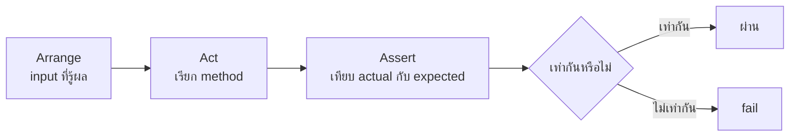
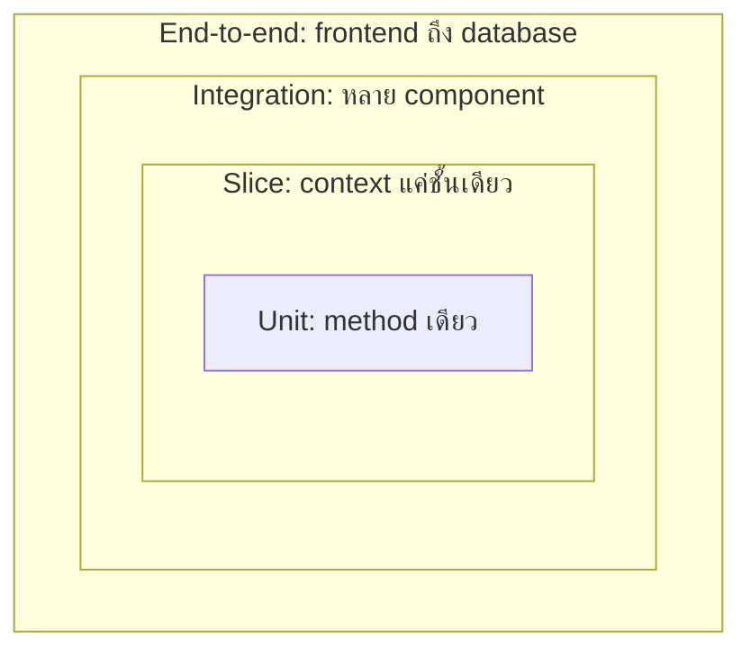
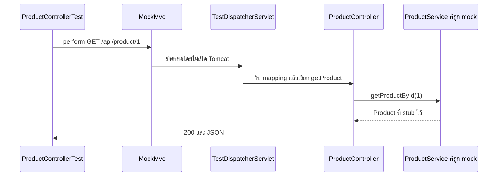
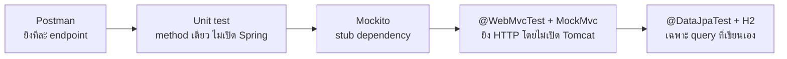

# #40 — เทส Spring Boot ด้วย JUnit, Mockito และ MockMvc

> **วิดีโอ:** [Testing Spring Boot Applications | JUnit 5, Mockito & MockMvc | Spring Boot Full Course #40](https://youtu.be/8MAjlB7g6uI) — Coder Army, ~1 ชม. 22 นาที
> **แหล่งที่ใช้สรุป:** ซับไตเติลภาษาอังกฤษที่ YouTube สร้างอัตโนมัติ (ไฟล์ที่ดึงได้เป็น `en-US` ไม่ใช่ซับฮินดี)
> **เวอร์ชันในโค้ด:** Spring Boot 4.1 + Java 21 (ใส่หมายเหตุไว้ทุกจุดที่ Spring Boot 3.x ต่างกัน)

ตอนนี้ตอบคำถามว่า หลังจากเขียน Controller, Service, Repository และ AOP มาทั้งคอร์สแล้ว จะตรวจโค้ดนั้นด้วยเทสอัตโนมัติอย่างไร ผู้สอนไล่จาก manual testing ด้วย Postman ไปสู่ unit test ที่ไม่เปิด Spring, mock dependency ด้วย Mockito, แล้วปิดด้วยการยิง HTTP เข้า Controller โดยไม่สตาร์ต Tomcat

ส่วนที่ติดป้าย `💡 เพิ่มเติม` คือของที่ผมเติมเอง ไม่ได้อยู่ในวิดีโอ ส่วนที่ติด `⚠️ แก้จากวิดีโอ` คือจุดที่วิดีโอพูดคลาดเคลื่อน

---

## สารบัญ

| เวลา | หัวข้อ |
|---|---|
| [0:00](https://youtu.be/8MAjlB7g6uI?t=0) | [1. ทำไมต้องเขียน unit test](#1-ทำไมต้องเขียน-unit-test) |
| [1:26](https://youtu.be/8MAjlB7g6uI?t=86) | [2. แอปตัวอย่าง Product](#2-แอปตัวอย่าง-product) |
| [4:54](https://youtu.be/8MAjlB7g6uI?t=294) | [3. ยิง endpoint ครั้งเดียวไม่ใช่การเทสที่จบ](#3-ยิง-endpoint-ครั้งเดียวไม่ใช่การเทสที่จบ) |
| [5:29](https://youtu.be/8MAjlB7g6uI?t=329) | [4. PriceCalculator และ edge case](#4-pricecalculator-และ-edge-case) |
| [9:03](https://youtu.be/8MAjlB7g6uI?t=543) | [5. จาก manual testing สู่ automated testing](#5-จาก-manual-testing-สู่-automated-testing) |
| [10:45](https://youtu.be/8MAjlB7g6uI?t=645) | [6. Test case กับ Arrange, Act, Assert](#6-test-case-กับ-arrange-act-assert) |
| [13:10](https://youtu.be/8MAjlB7g6uI?t=790) | [7. Unit, slice, integration และ end-to-end](#7-unit-slice-integration-และ-end-to-end) |
| [17:13](https://youtu.be/8MAjlB7g6uI?t=1033) | [8. ควรเทสอะไร และอะไรไม่ต้องเทส](#8-ควรเทสอะไร-และอะไรไม่ต้องเทส) |
| [20:12](https://youtu.be/8MAjlB7g6uI?t=1212) | [9. ที่อยู่ของเทสและ dependency](#9-ที่อยู่ของเทสและ-dependency) |
| [22:45](https://youtu.be/8MAjlB7g6uI?t=1365) | [10. เขียนเทสแรกโดยไม่โหลด Spring](#10-เขียนเทสแรกโดยไม่โหลด-spring) |
| [29:34](https://youtu.be/8MAjlB7g6uI?t=1774) | [11. mvn test ตอนผ่านและตอน fail](#11-mvn-test-ตอนผ่านและตอน-fail) |
| [32:49](https://youtu.be/8MAjlB7g6uI?t=1969) | [12. Assertion อื่นและ assertThrows](#12-assertion-อื่นและ-assertthrows) |
| [37:48](https://youtu.be/8MAjlB7g6uI?t=2268) | [13. @BeforeEach กับ @AfterEach](#13-beforeeach-กับ-aftereach) |
| [39:09](https://youtu.be/8MAjlB7g6uI?t=2349) | [14. ทำไม ProductService ถึงเทสตรง ๆ ไม่ได้](#14-ทำไม-productservice-ถึงเทสตรง-ๆ-ไม่ได้) |
| [41:46](https://youtu.be/8MAjlB7g6uI?t=2506) | [15. Test double: dummy, stub, fake, mock](#15-test-double-dummy-stub-fake-mock) |
| [46:01](https://youtu.be/8MAjlB7g6uI?t=2761) | [16. @ExtendWith, @Mock และ @InjectMocks](#16-extendwith-mock-และ-injectmocks) |
| [48:09](https://youtu.be/8MAjlB7g6uI?t=2889) | [17. เทส getProductById](#17-เทส-getproductbyid) |
| [58:12](https://youtu.be/8MAjlB7g6uI?t=3492) | [18. เทส createProduct และ never()](#18-เทส-createproduct-และ-never) |
| [1:03:39](https://youtu.be/8MAjlB7g6uI?t=3819) | [19. เทส Controller ด้วย @WebMvcTest และ MockMvc](#19-เทส-controller-ด้วย-webmvctest-และ-mockmvc) |
| [1:16:32](https://youtu.be/8MAjlB7g6uI?t=4592) | [20. เทส Repository ด้วย @DataJpaTest](#20-เทส-repository-ด้วย-datajpatest) |
| [1:19:19](https://youtu.be/8MAjlB7g6uI?t=4759) | [21. ปิดซีรีส์](#21-ปิดซีรีส์) |
| — | [22. สรุปท้ายตอน](#22-สรุปท้ายตอน) |

---

## 1. ทำไมต้องเขียน unit test

[▶ 0:00](https://youtu.be/8MAjlB7g6uI?t=0)

ผู้สอนทักทายแล้วบอกว่าทั้งซีรีส์เขียนโค้ดไปหลาย module แล้ว ทั้ง Aspect-Oriented Programming, Filter, Interceptor และ Spring Data JPA แต่ยังไม่ได้เขียน unit test ถ้าทำงานในโปรเจกต์จริง ความรู้ Spring Boot จะไม่ครบจนกว่าจะเขียนเทสได้ ตอนนี้จึงพูดสามเรื่องคู่กัน: เขียน unit test ใน Spring Framework อย่างไร, JUnit คืออะไร, และ Mockito ใช้ตอนไหน

ช่วงต้นเขายังชวนเข้า YouTube membership เพราะมีปุ่ม Join ใต้คลิป สมาชิกจะได้โปรเจกต์ระดับอุตสาหกรรม รวมถึงโปรเจกต์ของซีรีส์นี้ที่รวม microservices และมีส่วน frontend รายละเอียดของคลิปสมาชิกอยู่ท้ายตอน

จากนั้นเขาเปิดโปรเจกต์ว่างชื่อ **Spring Testing Demo**

---

## 2. แอปตัวอย่าง Product

[▶ 1:26](https://youtu.be/8MAjlB7g6uI?t=86)

โปรเจกต์มีสี่ชั้นที่คุ้นจากตอน CRUD: Controller, Service, Repository และ Entity เขาเริ่มที่ Entity

`Product` มีสี่ field คือ `id`, `name`, `price` และ `stock` งาน CRUD ในตอนนี้ทำแค่สองอย่าง คือสร้างสินค้า และดึงสินค้าตาม id

Controller มีสอง method

- `getProduct` รับ id แล้วคืนสินค้าให้ client ผ่าน `ResponseEntity.ok`
- `createProduct` รับสินค้าแล้วเก็บลง database

Service ผูก `ProductRepository` แล้วมีสอง method เช่นกัน

- `getProductById` เรียก `findById` ถ้าไม่เจอจะ throw exception เพราะ `findById` คืน `Optional` และ `orElseThrow` แปลง `Optional` นั้นเป็น entity หรือโยน exception เขาบอกว่าเรื่องนี้เคยอธิบายแล้ว
- `createProduct` ตรวจว่าชื่อนี้มีอยู่แล้วหรือยัง ถ้ามีจะ throw exception ข้อความว่าสินค้ามีอยู่แล้ว เพื่อไม่ให้บันทึกชื่อซ้ำ ถ้ายังไม่มีจึง `save`

การตรวจชื่อซ้ำอยู่ที่ method ของ repository ที่เขาตั้งชื่อว่า exists by name รับชื่อสินค้าแล้วตอบว่ามีหรือไม่

> ⚠️ **แก้จากวิดีโอ:** ช่วงหลังเขาพูดชื่อเมธอดว่า `existByName` แต่ derived query ของ Spring Data ใช้คำว่า `Exists` เมธอดที่ query ได้จริงคือ `existsByName` โน้ตใช้ชื่อนี้ทั้ง repository และตอน stub ด้วย Mockito

เขาบอกว่านี่คือ CRUD ที่เหลือแค่ create กับ get ถ้าสตาร์ตแอป ตารางจะถูกสร้างใน DBeaver ที่ต่อ MySQL อยู่ คอลัมน์คือ `id`, `name`, `price`, `stock`

[▶ 3:20](https://youtu.be/8MAjlB7g6uI?t=200)

จากนั้นเขาเปิด Postman ยิง `POST /api/product` body เป็น laptop ราคา 50,000 สต็อก 10 ได้ **201 Created** และสินค้าที่ได้มี id เป็น 1 refresh ตารางแล้วเจอแถวนั้น

เขาย้ำว่าบันทึกชื่อเดิมซ้ำไม่ได้ จึงยิง POST เดิมอีกครั้ง ได้ **500** เพราะมี exception ใน log เป็น `IllegalArgumentException` ข้อความว่า product already exists แปลว่า API ทำงานตามที่ตั้งใจ

> 💡 **เพิ่มเติม:** ซับไม่ได้อ่าน `application.properties` ออกมา จึงไม่ใส่ URL, username หรือ password ของ MySQL ลงในโปรเจกต์ที่ใช้รันเทส ผล 201 และ 500 ด้านบนเป็นสิ่งที่เขาเห็นใน Postman กับ DBeaver การตรวจของโน้ตนี้คือ `mvn test` ไม่ได้เปิดเว็บ

โค้ดของแอปที่เทสด้านล่างยิงอยู่ มี package `in.strikes.spring.testing.demo` ตามที่เขาพูดตอนเปิดโฟลเดอร์ ช่วงหนึ่งเขาหลุดคำว่า `spring` ในชื่อ package โน้ตยึดชื่อที่ยาวกว่า

> 💡 **เพิ่มเติม:** ในวิดีโอ Service และ Controller ใช้ `@Autowired` โน้ตใช้ constructor injection ซึ่งพฤติกรรมตอนรันเหมือนกัน และ `@InjectMocks` ของ Mockito ใส่ repository เข้า constructor ได้อยู่แล้ว

```java
package in.strikes.spring.testing.demo.entity;

import jakarta.persistence.Entity;
import jakarta.persistence.GeneratedValue;
import jakarta.persistence.GenerationType;
import jakarta.persistence.Id;
import lombok.AllArgsConstructor;
import lombok.Getter;
import lombok.NoArgsConstructor;
import lombok.Setter;

@Entity
@Getter
@Setter
@NoArgsConstructor
@AllArgsConstructor
public class Product {

  @Id
  @GeneratedValue(strategy = GenerationType.IDENTITY)
  private Long id;

  private String name;

  private double price;

  private int stock;
}
```

เขาเพิ่ม `@AllArgsConstructor` ตอนเขียนเทส เพราะตอนแรก entity ไม่มี constructor ที่รับครบทุก field ราคาเก็บเป็น `double` เขาเลยให้ `PriceCalculator` ใช้ `double` ด้วย สต็อกเป็นจำนวนชิ้นจึงเป็น `int`

```java
package in.strikes.spring.testing.demo.repository;

import in.strikes.spring.testing.demo.entity.Product;
import org.springframework.data.jpa.repository.JpaRepository;

public interface ProductRepository extends JpaRepository<Product, Long> {

  boolean existsByName(String name);
}
```

```java
package in.strikes.spring.testing.demo.service;

import in.strikes.spring.testing.demo.entity.Product;
import in.strikes.spring.testing.demo.repository.ProductRepository;
import org.springframework.stereotype.Service;

@Service
public class ProductService {

  private final ProductRepository productRepository;

  public ProductService(ProductRepository productRepository) {
    this.productRepository = productRepository;
  }

  public Product getProductById(Long id) {
    return productRepository.findById(id)
        .orElseThrow(() -> new RuntimeException("Product not found: " + id));
  }

  public Product createProduct(Product product) {
    if (productRepository.existsByName(product.getName())) {
      throw new IllegalArgumentException("Product already exists");
    }
    return productRepository.save(product);
  }
}
```

> 💡 **เพิ่มเติม:** ข้อความตอนหาสินค้าไม่เจอ ซับได้ยินว่าเป็น "Product not found" แล้วตามด้วย id 99 แต่ไม่ได้ยินเครื่องหมายคั่นชัด โน้ตใช้ `"Product not found: " + id` จึงคาดหวังข้อความ `Product not found: 99`

```java
package in.strikes.spring.testing.demo.controller;

import in.strikes.spring.testing.demo.entity.Product;
import in.strikes.spring.testing.demo.service.ProductService;
import org.springframework.http.HttpStatus;
import org.springframework.http.ResponseEntity;
import org.springframework.web.bind.annotation.GetMapping;
import org.springframework.web.bind.annotation.PathVariable;
import org.springframework.web.bind.annotation.PostMapping;
import org.springframework.web.bind.annotation.RequestBody;
import org.springframework.web.bind.annotation.RequestMapping;
import org.springframework.web.bind.annotation.RestController;

@RestController
@RequestMapping("/api/product")
public class ProductController {

  private final ProductService productService;

  public ProductController(ProductService productService) {
    this.productService = productService;
  }

  @GetMapping("/{id}")
  public ResponseEntity<Product> getProduct(@PathVariable Long id) {
    return ResponseEntity.ok(productService.getProductById(id));
  }

  @PostMapping
  public ResponseEntity<Product> createProduct(@RequestBody Product product) {
    Product saved = productService.createProduct(product);
    return ResponseEntity.status(HttpStatus.CREATED).body(saved);
  }
}
```

`GET /api/product/{id}` คืน 200 ตามที่เขาพูดว่า `ResponseEntity.ok` ส่วน `POST /api/product` คืน 201 Created ตามที่ Postman แสดง

```java
package in.strikes.spring.testing.demo;

import org.springframework.boot.SpringApplication;
import org.springframework.boot.autoconfigure.SpringBootApplication;

@SpringBootApplication
public class SpringTestingDemoApplication {

  public static void main(String[] args) {
    SpringApplication.run(SpringTestingDemoApplication.class, args);
  }
}
```

คลาสนี้คือ main class ที่ Initializr สร้างให้ ชื่อตรงกับเทสเปล่า `SpringTestingDemoApplicationTests` ที่เขาพูดถึงตอนหลัง `@DataJpaTest` และ `@WebMvcTest` ใช้มันเป็น `@SpringBootConfiguration` ของ slice

---

## 3. ยิง endpoint ครั้งเดียวไม่ใช่การเทสที่จบ

[▶ 4:54](https://youtu.be/8MAjlB7g6uI?t=294)

จนถึงตอนนี้ทั้งคอร์สเขียนโค้ดแล้วรู้สึกว่าจบงาน ถ้าจะตรวจก็เปิด Postman ยิง endpoint ส่ง body แล้วดู response ถ้าได้ 200 หรือ 201 ก็ถือว่าใช้ได้ รอบที่สองได้ exception ก็ถือว่าถูกเช่นกัน เพราะเป็นผลที่คาดไว้ตั้งแต่แรก งานที่ถูกหมายถึงโค้ดทำตามที่แอปควรทำ

แต่การยิง endpoint เดียวแล้วบอกว่าเทสแอปแล้ว ยังไม่จบ เขาชี้ที่ business logic ของ `ProductService` ว่าตอนนี้แทบไม่มีอะไร นอกจากบอก repository ให้หาหรือให้เซฟ ถ้ามีการคำนวณซับซ้อน จะมีหลาย scenario ที่เรียกว่า **edge case** วิธีคิดเหมือนตอนเทส method ใน Data Structures and Algorithms คือต้องมีหลาย test case

---

## 4. PriceCalculator และ edge case

[▶ 5:29](https://youtu.be/8MAjlB7g6uI?t=329)

เขาเพิ่มชั้นตัวอย่างอีกชั้น เป็นคลาส `PriceCalculator` แล้วใส่ `@Service` method ชื่อ `calculatePrice` รับ `price` กับ `discount` ตอนแรกเขากำลังจะใช้ `int` แล้วกลับไปดู entity ว่าราคาเป็น `double` จึงเปลี่ยนพารามิเตอร์และค่าที่คืนให้เป็น `double` ทั้งคู่

สูตรที่เขาเขียนคือเอาราคาตั้ง ลบด้วยส่วนลด ส่วนลดคำนวณจาก `price * discount / 100` ถ้าราคา 1000 และส่วนลด 20% ราคาสุดท้ายต้องเป็น 800 นี่คือ expected result ที่อยากให้ method คืนค่าเดียวกัน

จากนั้นเขาไล่ edge case ที่โค้ดยังไม่รับมือ

- ราคาเป็น 0
- ราคาติดลบ
- ส่วนลดติดลบ
- ส่วนลดเกิน 100

คำตอบของเขาคือยังไม่ได้จัดการเลย ถ้าอยู่กับ manual testing แบบ Postman จะไปเจอทีหลัง แล้วค่อยกลับมาแก้ เขาใส่เงื่อนไขทันที

- ถ้า `price` น้อยกว่า 0 ให้ throw `IllegalArgumentException` ข้อความว่า price cannot be negative
- ถ้าส่วนลดน้อยกว่า 0 หรือมากกว่า 100 ให้ throw `IllegalArgumentException` ข้อความว่า discount ต้องอยู่ในช่วง 0 ถึง 100

ช่วง 0 กับ 100 เองยังผ่านได้ เพราะเงื่อนไขคือ "น้อยกว่า 0" และ "มากกว่า 100" ราคาศูนย์ก็ยังผ่าน เพราะเขาเพิ่งห้ามแค่ราคาติดลบ ทั้งที่ก่อนหน้านี้เขายกศูนย์เป็น edge case ที่ยังไม่คิด

> ⚠️ **แก้จากวิดีโอ:** ตอนสรุปเคสราคาติดลบ เขาพูดว่าจะได้ `IllegalArithmeticException` แต่โค้ดที่เขาเขียนไว้ก่อนหน้า และที่เทสใช้จริง คือ `IllegalArgumentException` ไม่มีคลาสมาตรฐานชื่อ `IllegalArithmeticException`

```java
package in.strikes.spring.testing.demo.service;

import org.springframework.stereotype.Service;

@Service
public class PriceCalculator {

  public double calculatePrice(double price, double discount) {
    if (price < 0) {
      throw new IllegalArgumentException("Price cannot be negative");
    }
    if (discount < 0 || discount > 100) {
      throw new IllegalArgumentException("Discount should be within 0 to 100");
    }
    return price - (price * discount / 100);
  }
}
```

เขาบอกว่า controller หรือ service ตัวอื่นอาจเรียกคลาสนี้ทีหลังได้ ตอนนี้ยังไม่ได้ต่อเข้า API จริง ส่วนลดก็ยังไม่ได้เก็บลง database และ Postman ยังส่งแค่ name, price, stock คลาสนี้มีไว้เป็นตัวแทน business logic

> 💡 **เพิ่มเติม:** ข้อความ exception ด้านราคา ซับได้ยินทั้ง "price cannot be negative" และ "Price cannot be negative" โน้ตใช้อักษร P ตัวใหญ่ให้เข้ากับข้อความส่วนลดที่เขาคัดลอกมาเทสว่า `Discount should be within 0 to 100`

---

## 5. จาก manual testing สู่ automated testing

[▶ 9:03](https://youtu.be/8MAjlB7g6uI?t=543)

edge case ด้านบนเจอเพราะนั่งเทสมือ แต่เขาอยากย้ายจาก manual testing ไป **automated testing** วิธีคิดยังเหมือนตอนทำโจทย์อัลกอริทึม

1. เตรียม input ที่รู้ผลลัพธ์อยู่แล้ว เขาเรียกว่า **known input** เช่นราคา 1000 และส่วนลด 20
2. เอา input นั้นไปรันฟังก์ชัน
3. ค่าที่ได้เรียกว่า **actual output**
4. เทียบกับ **expected result** ซึ่งในตัวอย่างนี้คือ 800

ถ้าสองค่าเท่ากัน ฟังก์ชันทำงานถูก ถ้าไม่เท่ากัน test case นั้น fail เขาบอกว่า JUnit กับ Mockito คือเครื่องมือที่ทำให้กระบวนการนี้รันเอง และจะได้เห็นในคลิปนี้

---

## 6. Test case กับ Arrange, Act, Assert

[▶ 10:45](https://youtu.be/8MAjlB7g6uI?t=645)

**Test case** คือชุดที่ใช้ตรวจฟังก์ชันหนึ่ง หรือในความหมายกว้างคือตรวจทั้งแอป ตัวอย่างแรกใส่ 1000 กับ 20 แล้วคาดว่าจะได้ 800 พอรันได้ 800 จริง จึงผ่าน ตัวอย่างที่สองคาด 800 แต่ได้ 600 หรือ 1000 หรือค่าอื่นที่ไม่ใช่ราคาที่ควรได้ จึง fail test case มีได้แค่สองสถานะ คือผ่านหรือไม่ผ่าน เขาเปรียบว่าเป็นเงื่อนไข boolean

ใน test case หนึ่งมีสามส่วนที่ต้องแยกให้ขาด

| ส่วนที่เขาพูด | ชื่อใน JUnit / Mockito | ในตัวอย่างส่วนลด |
|---|---|---|
| Initial condition | **Arrange** | ราคา 1000 และส่วนลด 20 |
| Action | **Act** | เรียก `calculatePrice` ซึ่งเป็น method ที่อยากตรวจ |
| Expected result | **Assert** | ต้องได้ 800 |

[▶ 12:18](https://youtu.be/8MAjlB7g6uI?t=738)

Arrange คือเตรียมสภาพเริ่มต้น Act คือลงมือ ซึ่งโดยทั่วไปคือเรียก method ที่อยากเทส Assert คือตรวจว่าผลที่คาดไว้ถูกหรือไม่ เขาเรียกสามคำนี้รวมกันว่า Arrange, Act, Assert และบอกว่าสามคำนี้ประกอบเป็น test case



---

## 7. Unit, slice, integration และ end-to-end

[▶ 13:10](https://youtu.be/8MAjlB7g6uI?t=790)

ก่อนลงมือเขียน เขาแยกชนิดของการเทส

**Unit testing** คือเทสหน่วยหนึ่งของแอป หน่วยในตัวอย่างของเขาคือคลาสหรือ method เช่นเทส `calculatePrice` อย่างเดียว หรือเทส `getProductById` กับ `createProduct` ของ `ProductService` คำว่า independent หมายถึงไม่สนใจส่วนที่เหลือของแอป ถ้ากำลังเทส `PriceCalculator` จะไม่สนใจว่า Controller, Service ตัวอื่น หรือ Repository ทำอะไร

**Integration testing** คือเทส flow ทั้งเส้น หรือเทสโดยเอาหลาย component มารวมกัน ตัวอย่างที่เขาให้มีสองแบบ

- รวม Repository กับชั้น JPA หรือ Hibernate รวมถึงสิ่งที่เก็บใน database
- ไล่ทั้งเส้นจาก Controller ผ่าน Service ไปถึง Repository แล้วดูว่าตอนกลับมาตรงกับที่คาดหรือไม่

[▶ 15:01](https://youtu.be/8MAjlB7g6uI?t=901)

**Slice testing** เป็นคำที่เขาบอกว่าจะได้ยินเป็นครั้งคราว ไม่ได้พิเศษอะไร มันอยู่ระหว่าง unit กับ integration unit คือเทส method เดียวใน `PriceCalculator` ส่วน slice ในนิยามของเขาคือเทสทั้งชั้น เช่นทั้ง service layer เขาบอกว่าในวงสนทนาปกติคนพูดแค่ unit กับ integration

> 💡 **เพิ่มเติม:** ใน Spring Boot คำว่า slice หมายถึงการโหลด application context แค่บางชั้นผ่าน annotation เช่น `@WebMvcTest` และ `@DataJpaTest` ซึ่งเขาใช้เองช่วงท้ายคลิป ไม่ได้หมายถึงการ `new` service ทั้งแพ็กเกจแล้วเทสโดยไม่มี Spring

**End-to-end testing** คือให้เห็น flow ของทั้งระบบตั้งแต่ต้นจนจบ ฝั่ง frontend มีส่วนร่วมด้วย เช่นกดปุ่มแล้วมี API call ไป backend คำขออาจชน Filter หรือ security filter ก่อน จากนั้นมีการตรวจ authentication กับ authorization แล้วถึง DispatcherServlet แล้วถึง Controller และไปต่อจนถึง database เขาจัดให้ end-to-end อยู่เหนือ integration

เขาวาดเป็นวงกลมซ้อนกัน วงในสุดคือ unit testing ถัดออกมาคือ slice แล้วจึงเป็น integration วงนอกสุดคือ end-to-end เพราะตรวจตั้งแต่ frontend จนถึง database



[▶ 16:40](https://youtu.be/8MAjlB7g6uI?t=1000)

ตอนเขียนเทสใน Spring นักพัฒนาส่วนใหญ่เขียน unit test และเป็นหน้าที่ของเราในที่ทำงานที่จะเขียนให้ครบ edge case ของโค้ดที่ตัวเองเขียน ทุกเทสต้องผ่านก่อน push เขายกกรณี feature branch ที่จะ merge เข้า master ก่อน merge ต้องให้ unit test ผ่านทั้งหมด

---

## 8. ควรเทสอะไร และอะไรไม่ต้องเทส

[▶ 17:13](https://youtu.be/8MAjlB7g6uI?t=1033)

ไม่ใช่ทุก method ต้องมี unit test เขาแยกสิ่งที่ควรเขียนกับสิ่งที่ควรข้าม

สิ่งที่ควรเทส

- **Business logic** เพราะ edge case ที่หลุดจะถูกเทสจับได้
- **Conditional branch** เช่น if-else หลายชั้นหรือ switch ต้องรู้ว่าแต่ละเงื่อนไขเป็นจริงเมื่อไร และแต่ละประโยคทำงานถูกหรือไม่
- **Validation** ว่ากฎที่ใส่ไว้ทำงานตามที่ตั้งใจ
- **Exception** การมี exception ไม่ได้แปลว่าโค้ดพังเสมอไป บางครั้งเราตั้งใจ throw เช่นราคาติดลบหรือส่วนลดนอกช่วง 0 ถึง 100 ต้องได้ exception ที่คาดไว้ เคสนี้เทสผ่านแปลว่าการจัดการ exception ถูกต้อง
- **Security check** ว่า authentication และ authorization ทำงานถูก สิ่งพวกนี้คือจุดที่ไปพังบน production ได้

สิ่งที่ไม่ควรเทส เขาย้ำว่าข้อนี้สำคัญ เพราะเทสที่ AI สร้างมาทั้งไฟล์มักมีเคสที่ไม่มีประโยชน์ ถ้า push โดยไม่ตรวจ โปรแกรมไม่ได้ดีขึ้น แค่ช้าลงตอนรันเทส

- โค้ดของ library หรือ framework เขาเทสมาแล้ว เราไม่ได้เขียนมัน
- getter กับ setter ที่ไม่มี logic
- method ภายในของ Spring รวมถึง method ของ JPA เป็นหน้าที่ของ JPA ที่จะตรวจความถูกของมัน หน้าที่เราคือเทสโค้ดของเรา โดยเฉพาะจุดที่มี edge case
- โค้ดที่ไม่มีการตัดสินใจที่มีความหมาย

นอกนั้นให้เขียน test case

---

## 9. ที่อยู่ของเทสและ dependency

[▶ 20:12](https://youtu.be/8MAjlB7g6uI?t=1212)

เขาเปิด IntelliJ แล้วทบทวนโครงสร้างที่เคยพูดตอน Maven ใต้ `src` มี `main` กับ `test` โค้ดธุรกิจอยู่ที่ `src/main/java` ตาม package `in.strikes.spring.testing.demo` ซึ่งมี controller, entity และ repository

`src/test/java` ใช้ลำดับ package เดียวกัน เพื่อให้หาเทสของไฟล์นั้นเจอง่าย ตัวอย่างที่เขาให้คือถ้าจะเทส `PriceCalculator` ที่อยู่ในแพ็กเกจ service ก็สร้างแพ็กเกจ service ฝั่ง test แล้วสร้างคลาส `PriceCalculatorTest`

Initializr สร้าง `SpringTestingDemoApplicationTests` ไว้ให้แล้ว เป็นเทสของ main class เมธอดข้างในว่าง จึงไม่ทำอะไรและจะผ่านเสมอ เขาลบคลาสนี้ออกทีหลัง เพื่อไม่ให้รันซ้ำตอนเหลือแค่เทสของ `PriceCalculator`

[▶ 21:29](https://youtu.be/8MAjlB7g6uI?t=1289)

dependency ที่เขาใส่เองมีสามอย่างตอนสร้างโปรเจกต์ คือ Spring Data JPA, Web MVC และ MySQL connector เพราะต้องมี driver ไปต่อฐานข้อมูล นอกนั้นได้ test starter มาอีกสองตัว คือ starter ของ Data JPA test กับ starter ของ Web MVC test แล้วมี Lombok อีกตัว เขาบอกว่าไม่ต้องไปดาวน์โหลด dependency สำหรับเทสเพิ่ม และพอสร้างโปรเจกต์จาก Spring Initializr ก็เริ่มเขียนเทสของ service ที่อยากตรวจได้เลย เครื่องมือที่ใช้เขียนเทสในตอนนี้คือ JUnit

**JUnit** ในคำอธิบายของเขาคือ module สำหรับเขียน test case และมี annotation อีกชุดซึ่งจะได้เห็นทีละตัว Mockito ยังไม่ใส่ในเทสแรก เขาจะอธิบายเหตุผลตอนที่ service ตัวจริงต้องพึ่ง repository

> ⚠️ **Boot 4 vs 3:** ชื่อวิดีโอเขียน JUnit 5 และผู้สอนพูดถึง JUnit Jupiter ซึ่งยังเป็นชื่อที่ถูก เพราะ import ยังเป็น `org.junit.jupiter.api` แต่เลขเวอร์ชันคนละรุ่น Spring Boot 4.1.1 ล็อก `junit-jupiter.version` ที่ **6.0.3** ส่วน Spring Boot 3.5.16 ล็อกที่ **5.12.2** ตรวจจาก `spring-boot-dependencies` ของแต่ละรุ่น และจาก dependency tree ของโปรเจกต์นี้ที่ชี้ `junit-jupiter-api:6.0.3` กับ `mockito-core:5.23.0`
>
> Test starter ก็แยกตามเทคโนโลยีแล้ว ใน Boot 4 ตัวที่ใช้คือ `spring-boot-starter-webmvc-test` กับ `spring-boot-starter-data-jpa-test` ซึ่งตรงกับที่เขาเห็นในโปรเจกต์ ทั้งคู่ดึง `spring-boot-starter-test` มาให้ จึงไม่ต้องประกาศ starter-test ซ้ำ ของเดิมใน Boot 3 กอง `@WebMvcTest` ไว้ใน `spring-boot-test-autoconfigure` ภายใต้แพ็กเกจ `org.springframework.boot.test.autoconfigure.web.servlet`
> ([Spring Boot 4.0 Migration Guide](https://github.com/spring-projects/spring-boot/wiki/Spring-Boot-4.0-Migration-Guide) หัวข้อ Test Code และตาราง starter)

```xml
<parent>
  <groupId>org.springframework.boot</groupId>
  <artifactId>spring-boot-starter-parent</artifactId>
  <version>4.1.1</version>
</parent>

<dependencies>
  <dependency>
    <groupId>org.springframework.boot</groupId>
    <artifactId>spring-boot-starter-webmvc</artifactId>
  </dependency>
  <dependency>
    <groupId>org.springframework.boot</groupId>
    <artifactId>spring-boot-starter-data-jpa</artifactId>
  </dependency>
  <dependency>
    <groupId>com.mysql</groupId>
    <artifactId>mysql-connector-j</artifactId>
    <scope>runtime</scope>
  </dependency>
  <dependency>
    <groupId>org.projectlombok</groupId>
    <artifactId>lombok</artifactId>
    <optional>true</optional>
  </dependency>
  <dependency>
    <groupId>org.springframework.boot</groupId>
    <artifactId>spring-boot-starter-webmvc-test</artifactId>
    <scope>test</scope>
  </dependency>
  <dependency>
    <groupId>org.springframework.boot</groupId>
    <artifactId>spring-boot-starter-data-jpa-test</artifactId>
    <scope>test</scope>
  </dependency>
  <dependency>
    <groupId>com.h2database</groupId>
    <artifactId>h2</artifactId>
    <scope>test</scope>
  </dependency>
</dependencies>
```

> 💡 **เพิ่มเติม:** `h2` เป็นของที่เขาบอกให้เพิ่มตอนเทส repository ช่วงท้าย ไม่ได้อยู่ในรายการตอนต้นคลิป เวอร์ชันที่ Boot 4.1.1 จัดการให้คือ 2.4.240

---

## 10. เขียนเทสแรกโดยไม่โหลด Spring

[▶ 22:45](https://youtu.be/8MAjlB7g6uI?t=1365)

เทสแรกตรวจ `calculatePrice` ซึ่งเป็น method เดียวของ `PriceCalculator` หนึ่ง method ไม่ได้มีได้แค่หนึ่ง test case จำนวนเทสตามจำนวน edge case และหนึ่ง test case คือหนึ่ง method

ชื่อ method ควรบอกว่ากำลังตรวจอะไร เขาตั้งว่า `shouldApplyDiscountToPrice` ไม่ใช้ชื่อ `test1` หรือ `test2` เพราะคนอื่นอ่านแล้วรู้เรื่องทันที return type เป็น `void` เพราะ Maven เป็นคนรัน ไม่ได้รอค่ากลับจากเทส

[▶ 24:49](https://youtu.be/8MAjlB7g6uI?t=1489)

ใน lifecycle ของ Maven มีเฟส test พอสั่ง `mvn test` Maven จะรันทุก test case แล้วบอกว่าอันไหนผ่านอันไหนไม่ผ่าน เขาจะกดรันให้ดูอีกครั้งหลังเขียนเสร็จ

ในเทสต้องมีครบสามส่วน คือ Arrange, Act และ Assert

[▶ 25:42](https://youtu.be/8MAjlB7g6uI?t=1542)

คำถามที่เขาตั้งเองคือควร `@Autowired` ตัว `PriceCalculator` หรือไม่ คำตอบคือไม่ ตอนเขียน unit test เขาไม่ต้องการให้ทั้ง Spring ตื่น ไม่ต้องการให้สร้าง application context ทั้งก้อน ไม่ต้องการให้เซิร์ฟเวอร์หรือ Tomcat ฟังพอร์ต เขาอยากกลับไปที่ Java ธรรมดา แล้วตรวจ method เดียว

เหตุผลเรื่องความเร็วคือเฟส test อยู่ก่อนที่แอปจะรัน และเขาอยากให้เฟสนั้นสั้นที่สุด จึงไม่ใช้ `@Autowired` กับเคสนี้ แต่สร้าง object เองด้วย `new PriceCalculator()`

เพื่อบอก JUnit ว่า method นี้คือเทส เขาใส่ `@Test` ซึ่งมาจาก **JUnit Jupiter API** ตอน `mvn test` JUnit จะหาทุก method ที่มี annotation นี้แล้วรันเป็น test case

[▶ 27:31](https://youtu.be/8MAjlB7g6uI?t=1651)

เคสแรกตรวจว่าสูตรส่วนลดคิดถูก ไม่ใช่ตรวจ exception

- Arrange: `price = 1000`, `discount = 20`
- Act: `actualPrice = priceCalculator.calculatePrice(price, discount)`
- Assert: `assertEquals` โดยใส่ expected ก่อนคือ 800 แล้วตามด้วย actual

ถ้า 800 กับราคาที่ได้เท่ากัน เทสผ่าน ไม่งั้น fail

> 💡 **เพิ่มเติม:** ในคลิปเขาพูดเลข 800 เป็นจำนวนเต็ม โน้ตเขียน `800.0` เพื่อให้ไปจับ overload `assertEquals(double, double)` ของ JUnit Jupiter 6 ซึ่งยังมีเมธอดนี้อยู่ ตรวจจาก `javap` ของ `junit-jupiter-api-6.0.3.jar`

สองเคสถัดไปเขาบอกให้เขียนเพิ่มในจังหวะหลัง `assertThrows` คือ `shouldRejectDiscountBelowZero` และเคสราคาติดลบ โน้ตใส่ทั้งคู่ไว้ในคลาสเดียวกัน เพื่อให้ edge case ที่เขาไล่ไว้ถูกรันจริง

---

## 11. mvn test ตอนผ่านและตอน fail

[▶ 29:34](https://youtu.be/8MAjlB7g6uI?t=1774)

รันได้สองทาง คือพิมพ์ `mvn test` ในเทอร์มินัล หรือกดเฟส test ในหน้าต่าง Maven ของ IntelliJ

รอบแรกของเขาขึ้น `Tests run: 2` เพราะยังมี `SpringTestingDemoApplicationTests` ที่ว่างและผ่านเสมอ อันที่สองคือ `PriceCalculatorTest` สรุปของรอบนั้นคือ Failures 0, Errors 0, Skipped 0 แปลว่าได้ราคาตรงกับที่คาด

จากนั้นเขาตั้งใจทำให้พัง โดยเปลี่ยน expected จาก 800 เป็น 700 ทั้งที่รู้ว่าผิด แล้วรัน `mvn test` อีกครั้ง Maven หยุดเพราะ test failure เขาอ่านบรรทัดว่า failed to execute goal และ there are test failures ถ้าอยากได้ stack trace เต็มให้รันใหม่ด้วยสวิตช์ `-e` รายงานทั้งไฟล์อยู่ที่ `target/surefire-reports` เขาเปิดรายงานของ `PriceCalculatorTest` แล้วเจอว่า assertion failed, expected 700 but was 800 เทอร์มินัลไม่พิมพ์รายงานทั้งก้อนเพราะมันอาจยาว จึงชี้ path ของไฟล์แทน

ใน IntelliJ กดรันที่ gutter ของเทสได้เช่นกัน สีแดงบอก expected 700 กับ actual 800 สีเขียวบอกว่าผ่าน เขาเปลี่ยน expected กลับเป็น 800 แล้วเห็นหนึ่งเทสผ่าน

โน้ตทำเคส 700 นี้ซ้ำบนโปรเจกต์ Boot 4.1.1 แล้วคืนค่าเป็น 800 ก่อนรันชุดเต็ม ข้อความจริงตอน fail คือ

```text
[ERROR] Tests run: 4, Failures: 1, Errors: 0, Skipped: 0 <<< FAILURE!
[ERROR] PriceCalculatorTest.shouldApplyDiscountToPrice
org.opentest4j.AssertionFailedError: expected: <700.0> but was: <800.0>

[ERROR] Failed to execute goal org.apache.maven.plugins:maven-surefire-plugin:3.5.6:test
[ERROR] There are test failures.
[ERROR] See /private/tmp/sbc/ep40/target/surefire-reports for the individual test results.
[ERROR] To see the full stack trace of the errors, re-run Maven with the -e switch.
```

`4` ในบรรทัดนี้เป็นเพราะคลาสนี้มีสี่ method แล้ว ไม่ใช่สอง method แบบรอบแรกในคลิปที่ยังนับเทสเปล่าของแอปอยู่ด้วย ชนิดของ error คือ `AssertionFailedError` จาก OpenTest4J ซึ่ง JUnit Jupiter ใช้รายงาน assertion ที่ไม่ผ่าน

---

## 12. Assertion อื่นและ assertThrows

[▶ 32:49](https://youtu.be/8MAjlB7g6uI?t=1969)

`assertEquals` มาจากโมดูล JUnit Jupiter และใช้เทียบสองค่า เขากด autocomplete แล้วไล่ตัวอื่น

| เมธอด | สิ่งที่ตรวจ | จำนวนค่าที่ส่ง |
|---|---|---|
| `assertEquals` | สองค่าเท่ากัน | 2 |
| `assertNotEquals` | สองค่าไม่เท่ากัน | 2 |
| `assertTrue` | เงื่อนไขเป็นจริง เทียบได้กับเอาเงื่อนไขไปเทียบกับ true | 1 |
| `assertFalse` | เงื่อนไขเป็นเท็จ | 1 |
| `assertNull` | ค่าเป็น null | 1 |
| `assertNotNull` | ค่าไม่เป็น null | 1 |
| `assertThrows` | โค้ดใน lambda โยน exception ชนิดที่ระบุ | ชนิดของ exception กับ `Executable` |

[▶ 33:55](https://youtu.be/8MAjlB7g6uI?t=2035)

เทสที่สองชื่อ `shouldRejectDiscountAbove100` ใส่ `@Test` เช่นกัน ถ้าส่วนลดเกิน 100 หรือต่ำกว่า 0 โค้ดต้องโยน `IllegalArgumentException` เขาเลือก overload ของ `assertThrows` ที่รับคลาสของ exception กับ `Executable` อันแรกส่ง `IllegalArgumentException.class` อันที่สองส่ง lambda ที่เรียก `calculatePrice(1000, 120)`

`assertThrows` จับ exception ที่หลุดออกมา แล้วเขาเทียบข้อความด้วย `assertEquals` กับ `exception.getMessage()` ข้อความที่คัดลอกจากคลาสคือ `Discount should be within 0 to 100` ถ้ารันแล้วผ่าน แสดงว่า exception มาถูกตัวและถูกข้อความ เขาลองลบคำว่า should ออกจากข้อความที่คาดไว้ เทสก็ fail โดยโชว์ expected กับ actual คนละสตริง

ก่อนรันเขาลบ `SpringTestingDemoApplicationTests` ทิ้ง เพื่อให้เหลือเทสที่ตัวเองเขียน

เคสที่เขาบอกว่าเขียนเพิ่มได้แนวเดียวกัน คือ `shouldRejectDiscountBelowZero` และเคสที่ราคาต่ำกว่าศูนย์ต้องถูกปฏิเสธ สามอย่างที่ต้องมองทุกครั้งยังเป็น Arrange, Act และ Assert

```java
package in.strikes.spring.testing.demo.service;

import org.junit.jupiter.api.BeforeEach;
import org.junit.jupiter.api.Test;

import static org.junit.jupiter.api.Assertions.assertEquals;
import static org.junit.jupiter.api.Assertions.assertThrows;

class PriceCalculatorTest {

  private PriceCalculator priceCalculator;

  @BeforeEach
  void setUp() {
    priceCalculator = new PriceCalculator();
  }

  // @AfterEach
  // void tearDown() {
  // }

  @Test
  void shouldApplyDiscountToPrice() {
    double price = 1000;
    double discount = 20;

    double actualPrice = priceCalculator.calculatePrice(price, discount);

    assertEquals(800.0, actualPrice);
  }

  @Test
  void shouldRejectDiscountAbove100() {
    IllegalArgumentException exception = assertThrows(
        IllegalArgumentException.class,
        () -> priceCalculator.calculatePrice(1000, 120));

    assertEquals("Discount should be within 0 to 100", exception.getMessage());
  }

  @Test
  void shouldRejectDiscountBelowZero() {
    IllegalArgumentException exception = assertThrows(
        IllegalArgumentException.class,
        () -> priceCalculator.calculatePrice(1000, -5));

    assertEquals("Discount should be within 0 to 100", exception.getMessage());
  }

  @Test
  void shouldRejectNegativePrice() {
    IllegalArgumentException exception = assertThrows(
        IllegalArgumentException.class,
        () -> priceCalculator.calculatePrice(-1, 10));

    assertEquals("Price cannot be negative", exception.getMessage());
  }
}
```

`@BeforeEach` ในคลาสนี้เพิ่งถูกย้ายมาในหัวข้อถัดไป โค้ดด้านบนคือรูปสุดท้ายหลังเขาย้าย `new PriceCalculator()` เข้าไปใน `setUp`

---

## 13. @BeforeEach กับ @AfterEach

[▶ 37:48](https://youtu.be/8MAjlB7g6uI?t=2268)

JUnit มี annotation อีกสองตัว

`@BeforeEach` คือการเตรียมของก่อนทุก test case เขาสร้าง method `setUp` แล้วเอา `priceCalculator = new PriceCalculator()` มาไว้ตรงนี้ ทุกครั้งที่เทสถูกจะรัน method นี้ก่อน เขาเปรียบว่าเหมือน constructor ในเคสนี้ไม่จำเป็นต้องแยกก็ได้ เพราะ `new` ที่ field ได้เหมือนกัน เขาแยกเพื่ออธิบาย

`@AfterEach` คือ method ที่ถูกเรียกหลังทุก test case ถ้าเทสเปิด resource ไว้ ให้คืนตรงนี้ เขาเปรียบกับบล็อก `finally` แล้วคอมเมนต์ทิ้งเพราะเทสนี้ไม่มีอะไรต้องคืน

หลังจัดแล้ว เขาถือว่า service `PriceCalculator` ถูกเทสพอแล้ว

---

## 14. ทำไม ProductService ถึงเทสตรง ๆ ไม่ได้

[▶ 39:09](https://youtu.be/8MAjlB7g6uI?t=2349)

ถัดไปคือ `ProductService` ซึ่งมี `getProductById` กับ `createProduct` เขาสร้าง `ProductServiceTest` ในแพ็กเกจ service แล้วประกาศ field `ProductService`

ปัญหาคือ `new ProductService()` ปิดไม่ได้ เพราะ constructor ต้องการ `ProductRepository` และ repository ยังไม่มี object

ทางที่ดูเหมือนจะรอดคือประกาศ `ProductRepository` แล้ว `@Autowired` ส่งเข้า service แต่เขาตอบว่าไม่ควรทำ เพราะเป้าหมายคือเทสแค่ `ProductService` ถ้าสร้าง repository จริง เทสจะไปคุยกับ database จริง ทั้งที่เขาอยากให้เทสรันโดยไม่ปลุก Spring, ไม่สร้าง application context, และไม่ปลุก Tomcat ของพวกนั้นมีจังหวะรันของมันเอง ตอนนี้เขาอยากรันแค่ Java

Service พึ่ง repository จึงหนีไม่พ้นที่จะส่งอะไรบางอย่างเข้าไป จุดนี้เขาแนะนำ **Mockito** เขาชอบใช้ JUnit คู่กับ Mockito เพราะ Mockito สร้าง mock ของชั้น repository ให้ mock ทำตัวเหมือน repository แต่ไม่ใช่ repository จริง ข้างในจะไม่ไปแตะ database ผ่าน Hibernate หรือ EntityManager เขาเรียกสิ่งที่สร้างขึ้นว่า mock database ของเราเอง แล้วเอา `@Autowired` ออกจากเทส

---

## 15. Test double: dummy, stub, fake, mock

[▶ 41:46](https://youtu.be/8MAjlB7g6uI?t=2506)

ของที่สร้างขึ้นมาเพื่อการเทส เขาเรียกว่า **test double** คือตัวแทนของ object จริง แล้วแบ่งเป็นสี่แบบ

**Dummy** ไม่ทำงานอะไรเลย มีไว้ส่งเข้า dependency เพราะอีกฝั่งต้องการของชิ้นหนึ่ง เทสเองไม่ได้ใช้มัน ตัวอย่างที่เขาทำให้ดูคือส่ง `null` เข้าไปแทน repository โค้ดคอมไพล์ผ่านเพราะส่ง null ให้ object ได้ แต่พอ service เรียก method ของ repository จะได้ null pointer exception dummy จึงเป็นแค่ภาพให้เห็นว่า "ส่งของที่ไม่ได้ใช้" ไม่ใช่ทางที่เขาจะใช้ต่อ

**Stub** ทำงานตามที่กำหนดไว้ล่วงหน้า ตัวอย่างคือ `getProductById` ข้างในจะเรียก `findById` ทั้งที่ไม่ได้ต่อ repository จริง เราเลยกำหนดคำตอบของ `findById` ไว้ก่อน ถ้าค้นด้วย id 1 ให้ได้ laptop ราคา 50,000 สต็อก 10 เขายกเป็นค่าที่เตรียมไว้ล่วงหน้า แบบที่มีชื่อ ราคา และสต็อก

**Fake** แรงกว่า stub เพราะเลียนทั้งฐานข้อมูล แต่ไม่ใช่ MySQL จริง เขาไม่อยากสตาร์ต MySQL แค่เพื่อรัน `ProductServiceTest` ทางที่ทำได้คือใช้ `HashMap` เป็นฐานข้อมูลใน memory หรือใช้ **H2** ซึ่งเป็น in-memory database ที่รัน query ได้เหมือน SQL แต่พอรีสตาร์ตแอปข้อมูลหาย มีไว้สำหรับเทส

**Mock** เป็น test double ที่ปรับแต่งได้ เขาบอกว่ามันสวมบท dummy, stub หรือ fake ได้ คือคืนค่าที่กำหนดไว้ล่วงหน้าได้ หรือแทนฐานข้อมูลข้างในด้วย H2 หรือ HashMap ก็ได้ คนที่สร้าง mock ในที่นี้คือ Mockito และมันไม่ใช่ object จริง

> ⚠️ **แก้จากวิดีโอ:** mock ของ Mockito ไม่ได้เปิด H2 และไม่ได้เป็น `HashMap` ที่เซฟข้อมูลให้เอง มันบันทึกว่า method ไหนถูกเรียกด้วยอาร์กิวเมนต์อะไร และคืนค่าตามที่เรา stub ด้วย `when` ส่วน H2 กับ `HashMap` คือ fake ตามนิยามที่เขาพูดไว้เองในย่อหน้าก่อน สี่แบบจึงไม่ทับกันแบบที่ประโยคนี้บอก

| ชนิด | ทำอะไร | ตัวอย่างในคลิป |
|---|---|---|
| Dummy | ไม่ทำงาน ส่งเพื่อให้ constructor รับได้ | `null` แทน repository |
| Stub | คืนคำตอบที่กำหนดไว้ | `findById(1)` ได้ laptop |
| Fake | ของทำงานได้แบบย่อส่วน | `HashMap` หรือ H2 |
| Mock | โปรแกรมคำตอบได้ และตรวจได้ว่าถูกเรียกหรือไม่ | Mockito `@Mock` |

---

## 16. @ExtendWith, @Mock และ @InjectMocks

[▶ 46:01](https://youtu.be/8MAjlB7g6uI?t=2761)

ถ้าจะใช้ annotation ของ Mockito ในคลาส JUnit ต้องใส่ `@ExtendWith(MockitoExtension.class)` เขาบอกว่าถ้าไม่ใส่ JUnit จะไม่รู้จัก extension หรือ annotation ของ Mockito

ใน `ProductServiceTest` มีสอง field

- `ProductRepository` ติด `@Mock` หมายถึงอย่าใช้ repository จริง ให้สร้าง object ปลอมขึ้นมา
- `ProductService` ติด `@InjectMocks` หมายถึงนี่คือคลาสที่กำลังถูกเทส และให้ใส่ mock เข้าไปในนั้น

เขาอธิบายภาพในหัวว่า Mockito ทำประมาณ `repo` เป็น mock แล้ว `service = new ProductService(repo)` dependency ที่ถูก inject จึงเป็น mock ไม่ใช่ `ProductRepository` ที่ต่อฐานข้อมูล เรียก method จริงของมันเพื่อไปอ่าน MySQL ไม่ได้ เดี๋ยวจะกำหนดคำตอบเอง

mock ตัวนี้ไม่ใช่ Spring Bean ไม่มี application context มาดูแล Mockito เป็นคนดูแล และไม่ได้ต่อ DBeaver

> ⚠️ **Boot 4 vs 3:** `@Mock` กับ `@InjectMocks` สองตัวนี้เป็นของ Mockito ใช้ได้ทั้ง Boot 3 และ Boot 4 แต่อย่าสับสนกับ `@MockBean` ที่เขาใช้ตอนเทส Controller ในหัวข้อ 19 Boot 4 ถอด `@MockBean` ออกแล้ว รายละเอียดอยู่ที่นั่น
>
> อีกจุดใน migration guide: `MockitoTestExecutionListener` ที่เคยทำให้ `@Mock` ทำงานโดยไม่ต้องใส่ extension ถูกถอดใน Boot 4 ถ้า field ที่ติด `@Mock` ไม่ถูกสร้าง ให้ใส่ `MockitoExtension` ซึ่งเป็นสิ่งที่คลิปสอนอยู่แล้ว

---

## 17. เทส getProductById

[▶ 48:09](https://youtu.be/8MAjlB7g6uI?t=2889)

method แรกที่เทสคือ `getProductById` หน้าที่หลักคือถ้าสินค้ามีอยู่ต้องคืนสินค้านั้น เขาตั้งชื่อ `shouldReturnProductWhenProductExists` แล้วย้ำว่าชื่อยาวแต่อ่านรู้เรื่องดีกว่าชื่อสั้น

เรียก `getProductById` ตรง ๆ ไม่ได้ผลอย่างที่คิด เพราะข้างในจะไปเรียก `findById` ของ mock ซึ่งยังไม่มีคำตอบ Arrange จึงต้องสร้างสินค้าที่อยากให้คืนมาเอง เขาเปิด entity แล้วเจอว่ายังไม่มี all-arguments constructor จึงใส่ `@AllArgsConstructor` แล้วสร้าง

`new Product(1L, "Laptop", 50000, 10)`

จากนั้นใช้ `when` ซึ่งเขาบอกว่าอ่านชื่อก็เข้าใจ เมื่อมีคนเรียก `productRepository.findById(1L)` ให้ `thenReturn` สินค้านี้ แต่ `findById` คืน `Optional<Product>` จึงส่ง `Optional.of(product)` ไม่ใช่ตัว product ตรง ๆ แปลว่าไม่ได้แตะฐานข้อมูลจริง แต่กำหนดไว้ว่าถ้า repository ถูกเรียกด้วย id 1 ให้คืนสินค้าที่สร้างมือ

Act คือ `productService.getProductById(1L)` ข้างใน service แกะ `Optional` ให้แล้ว จึงได้ `Product` เขาเก็บในตัวแปร `actualResult`

Assert เทียบ id กับชื่อ เขาเทียบ `1L` กับ `actualResult.getId()` และเทียบ `"Laptop"` กับ `getName()` แล้วบอกว่าจะเทียบ price กับ stock เพิ่มก็ได้ ถ้ารันตอนนี้ Mockito ทำงานและเทสผ่าน ถ้าเปลี่ยนเงื่อนไขนิดเดียวเทสจะ fail

เขาแทรกว่าเทสนี้จริง ๆ แทบไม่มี logic เพราะข้างในคือ `findById` ที่ JPA ทำให้ และเขาเพิ่งบอกว่าอย่าเขียนเทสของสิ่งที่ไม่มีประโยชน์ เขาเขียนเพื่อสาธิตเท่านั้น ในโปรเจกต์จริงจุดนี้มักแปลง entity เป็น DTO มี validation และมี business logic ซึ่งเป็นสิ่งที่ควรเทส เขาทำให้โค้ดสั้นเพื่อให้ดูง่าย

[▶ 54:04](https://youtu.be/8MAjlB7g6uI?t=3244)

มีเมธอดเสริมที่เขาบอกว่าไม่บังคับ คือ `Mockito.verify` ใช้ถามว่าตอนเทสนี้รันไป `findById` ถูกเรียกจริงหรือไม่ แม้เราจะ mock มันไว้แล้ว ก็ยังอยากรู้ว่า branch นั้นเรียก method นี้หรือเปล่า เขาเขียน `verify(productRepository).findById(1L)` รันแล้วยังผ่าน เพราะ id 1 ถูกส่งเข้าไปจริง

[▶ 55:01](https://youtu.be/8MAjlB7g6uI?t=3301)

เทสคู่กันคือสินค้าไม่มีอยู่ต้อง throw ตาม `orElseThrow` ใน service ชื่อ method คือ `shouldThrowExceptionWhenProductDoesNotExist` เขาบอกอย่ากลัวชื่อยาว

Arrange: `when(productRepository.findById(99L)).thenReturn(Optional.empty())` id 99 เป็น id มั่วที่ถือว่าไม่มีในฐานข้อมูล จึงไม่ต้องสร้าง product และไม่คืนสินค้า แต่คืน optional ว่าง

Act กับ Assert รวมอยู่ใน `assertThrows` เพราะสิ่งที่อยากได้คือ exception ชนิดที่ service ใช้คือ `RuntimeException` lambda เรียก `productService.getProductById(99L)` ข้างในจะเรียก `findById` ได้ optional ว่าง แล้วเข้าทาง throw ข้อความมีคำว่า product not found และมี id 99

จากนั้น `assertEquals` เทียบข้อความนั้นกับ `exception.getMessage()` และ `verify` ว่า `findById(99L)` ถูกเรียก เขาลืม `@Test` รอบหนึ่ง ใส่แล้วรัน เทสผ่าน

```java
package in.strikes.spring.testing.demo.service;

import in.strikes.spring.testing.demo.entity.Product;
import in.strikes.spring.testing.demo.repository.ProductRepository;
import org.junit.jupiter.api.Test;
import org.junit.jupiter.api.extension.ExtendWith;
import org.mockito.InjectMocks;
import org.mockito.Mock;
import org.mockito.junit.jupiter.MockitoExtension;

import java.util.Optional;

import static org.junit.jupiter.api.Assertions.assertEquals;
import static org.junit.jupiter.api.Assertions.assertThrows;
import static org.mockito.ArgumentMatchers.any;
import static org.mockito.Mockito.never;
import static org.mockito.Mockito.verify;
import static org.mockito.Mockito.when;

@ExtendWith(MockitoExtension.class)
class ProductServiceTest {

  @Mock
  private ProductRepository productRepository;

  @InjectMocks
  private ProductService productService;

  @Test
  void shouldReturnProductWhenProductExists() {
    Product product = new Product(1L, "Laptop", 50000, 10);
    when(productRepository.findById(1L)).thenReturn(Optional.of(product));

    Product actualResult = productService.getProductById(1L);

    assertEquals(1L, actualResult.getId());
    assertEquals("Laptop", actualResult.getName());
    verify(productRepository).findById(1L);
  }

  @Test
  void shouldThrowExceptionWhenProductDoesNotExist() {
    when(productRepository.findById(99L)).thenReturn(Optional.empty());

    RuntimeException exception = assertThrows(
        RuntimeException.class,
        () -> productService.getProductById(99L));

    assertEquals("Product not found: 99", exception.getMessage());
    verify(productRepository).findById(99L);
  }

  @Test
  void shouldCreateProductWhenNameIsUnique() {
    Product request = new Product(null, "Keyboard", 200, 5);
    Product saved = new Product(10L, "Keyboard", 200, 5);
    when(productRepository.existsByName("Keyboard")).thenReturn(false);
    when(productRepository.save(request)).thenReturn(saved);

    Product result = productService.createProduct(request);

    assertEquals(10L, result.getId());
    assertEquals("Keyboard", result.getName());
    verify(productRepository).existsByName("Keyboard");
    verify(productRepository).save(request);
  }

  @Test
  void shouldRejectProductWhenNameAlreadyExists() {
    Product request = new Product(null, "Keyboard", 200, 5);
    when(productRepository.existsByName("Keyboard")).thenReturn(true);

    assertThrows(
        IllegalArgumentException.class,
        () -> productService.createProduct(request));

    verify(productRepository).existsByName("Keyboard");
    verify(productRepository, never()).save(any(Product.class));
  }
}
```

สอง method ท้ายเป็นของหัวข้อถัดไป วางไว้ในคลาสเดียวกันเพราะเขาเขียนต่อในไฟล์นี้

---

## 18. เทส createProduct และ never()

[▶ 58:12](https://youtu.be/8MAjlB7g6uI?t=3492)

`createProduct` ถูก Controller เรียก แล้ว service ถาม repository ว่าชื่อนี้มีแล้วหรือยัง ถ้ามีจะ throw ถ้าไม่มีจะ save เขาตั้งเทสชื่อ `shouldCreateProductWhenNameIsUnique`

ในเคสนี้ repository ถูกเรียกสองครั้ง คือ `existsByName` กับ `save` จึงต้อง stub ทั้งคู่

Arrange มีสินค้าสองก้อนที่เนื้อเดียวกัน คนละจังหวะ

- `request` คือของที่เข้ามาใน request id เป็น `null` เพราะเราไม่ได้กำหนด id เอง ชื่อ Keyboard ราคา 200 สต็อก 5
- `saved` คือของที่ `save` คืนกลับมา ข้อมูลเดียวกันแต่ได้ id เป็น 10

`when(existsByName("Keyboard")).thenReturn(false)` เพราะอยากจำลองว่าเพิ่งเจอชื่อนี้ครั้งแรก ชื่อจึง unique จากนั้น `when(save(request)).thenReturn(saved)` เพราะตอนเซฟจริง ผลที่กลับมาเป็นสินค้าก้อนเดิมที่ถูกใส่ id แล้ว

Act เรียก `productService.createProduct(request)` ได้ `result` กลับมา Assert ตรวจว่า `getId()` เป็น 10 และ `getName()` เป็น Keyboard แล้ว `verify` ทั้ง `existsByName` และ `save` เขารันแล้วเทสผ่าน

[▶ 1:01:22](https://youtu.be/8MAjlB7g6uI?t=3682)

เทสตรงข้ามชื่อ `shouldRejectProductWhenNameAlreadyExists` คราวนี้สร้างแค่ `request` เพราะสินค้านี้จะไม่ถูกเซฟ มันกำลังจะถูกปฏิเสธ `when(existsByName("Keyboard")).thenReturn(true)` เพื่อให้เงื่อนไข "มีอยู่แล้ว" เป็นจริง แล้วเข้า `IllegalArgumentException` ข้อความ product already exists

เขาเลือกไม่เก็บ exception ลงตัวแปรเพื่อเทียบข้อความ ทั้งที่ทำแบบเทสก่อนหน้าได้ เขายืนยันชนิดของ exception ใน `assertThrows` เลย จึงรวม Act กับ Assert ไว้ในบรรทัดเดียว

`verify` แรกยังเหมือนเดิม คือ `existsByName` ต้องถูกเรียก เพราะเป็น method แรกใน flow ส่วน `save` ครั้งนี้ต้องไม่ถูกเรียก เขาใส่อาร์กิวเมนต์ที่สองของ `verify` เป็น `never()` แล้วตามด้วย `save(any(Product.class))`

เหตุผลของ `any` คือเขาไม่ได้อยากตรวจแค่สินค้าก้อน `request` เขาอยากให้ `save` ไม่ถูกเรียกไม่ว่าจะส่ง `Product` ตัวไหนเข้าไป ถ้าใส่ `request` ลงใน `verify` Mockito จะตรวจเฉพาะก้อนนั้น `any(Product.class)` คือตัวจับทุก instance ของคลาสนั้น เขาเรียกชุดนี้ว่า boilerplate ของ Mockito สำหรับตรวจว่า method ไม่ควรถูกเรียก

จบตรงนี้ สอง method ของ service ถูกเทสแล้ว

---

## 19. เทส Controller ด้วย @WebMvcTest และ MockMvc

[▶ 1:03:39](https://youtu.be/8MAjlB7g6uI?t=3819)

คำถามคือเทส service แล้วจะเทส Controller อีกทำไม เขาตอบว่าหยุดตรง service ก็ได้ เพราะ business logic คือส่วนที่สำคัญที่สุด แต่บางครั้งอยากรู้ว่า Controller วาง argument ถูกหรือไม่ เช่น Path Variable จับ id ได้ไหม, Jackson แปลง JSON เป็น object ได้ตรงไหม, response ที่ส่งออกมาตรงกับที่อยากส่งหรือไม่, และตอนสร้างของได้ 201 Created หรือไม่ ถ้าอยากตรวจพวกนี้ให้มีเทสของ Controller

เขาจึงสร้างแพ็กเกจ `controller` ใต้ test แล้วสร้าง `ProductControllerTest`

[▶ 1:04:46](https://youtu.be/8MAjlB7g6uI?t=3886)

annotation แรกคือ `@WebMvcTest` เขาอยากตรวจว่า endpoint ถูก และ HTTP method เป็น GET หรือ POST ตาม mapping รวมถึง `@PathVariable`, `@RequestParam`, request body และ Jackson เพื่อตรวจสิ่งนี้ Controller ต้องถูกโหลดเข้า application context หรืออย่างน้อย Spring ต้อง inject dependency ให้ได้ ถ้า mock แล้วเรียก method ของ Controller ตรง ๆ จะได้แค่การเรียกคลาส Java ไม่ได้เห็นทางตั้งแต่ Filter เข้า DispatcherServlet แล้ว DispatcherServlet เลือก Controller เขาอยากเห็นทางนั้นเพราะ Jackson ทำงานตรง DispatcherServlet

`@WebMvcTest` จึงบอก Spring ให้สร้าง context แบบจำกัด อย่าสร้างทั้งแอป อย่าใส่ service อย่าใส่ repository อย่าใส่ configuration หรือ bean ส่วนเกิน เอาเฉพาะของที่เกี่ยวกับ Controller เขาพูดว่าข้างในจะเอา bean ของ GetMapping, PostMapping, RequestParam และ PathVariable เข้า classpath

> ⚠️ **แก้จากวิดีโอ:** `@GetMapping`, `@PostMapping`, `@PathVariable` และ `@RequestBody` เป็น annotation ไม่ใช่ bean ที่ถูกหย่อนลง classpath สิ่งที่ `@WebMvcTest` โหลดคือโครงสร้างของ Spring MVC เช่น `HandlerMapping`, argument resolver และตัวแปลง JSON เพื่อให้ DispatcherServlet เรียก method ของ Controller ได้

> ⚠️ **Boot 4 vs 3:** แพ็กเกจย้ายตามโมดูลเทสของ Boot 4 ตรวจจาก jar แล้ว
>
> - Boot 3.5.16 อยู่ใน `spring-boot-test-autoconfigure`: `org.springframework.boot.test.autoconfigure.web.servlet.WebMvcTest`
> - Boot 4.1.1 อยู่ใน `spring-boot-webmvc-test`: `org.springframework.boot.webmvc.test.autoconfigure.WebMvcTest`
>
> แนวนี้ตรงกับกติกาใน migration guide ว่าโมดูลเทสชื่อ `spring-boot-<เทคโนโลยี>-test` และ root package เป็น `org.springframework.boot.<เทคโนโลยี>.test` โค้ดด้านล่างใช้ import ของ Boot 4 ถ้าคัด import เก่ามาจะคอมไพล์ไม่ผ่าน
> ([Spring Boot 4.0 Migration Guide](https://github.com/spring-projects/spring-boot/wiki/Spring-Boot-4.0-Migration-Guide))

> 💡 **เพิ่มเติม:** ซับได้ยินแค่ชื่อ `@WebMvcTest` ไม่ได้ยินว่าใส่อาร์กิวเมนต์หรือไม่ โน้ตเขียน `@WebMvcTest(ProductController.class)` เพื่อให้ slice โหลด Controller ตัวนี้ตัวเดียว

[▶ 1:06:30](https://youtu.be/8MAjlB7g6uI?t=3990)

ของชิ้นที่สองคือ `MockMvc` เขา `@Autowired` field นี้ `@WebMvcTest` สร้าง context จำกัด ส่วน `MockMvc` ทำให้เรียก Controller ได้โดยไม่สตาร์ตเซิร์ฟเวอร์ ไม่เปิด Tomcat และไม่จับพอร์ต 8080 มันเลียน flow ของเซิร์ฟเวอร์ โดยเข้า filter chain ตรง ๆ filter chain เรียก DispatcherServlet, DispatcherServlet หา Controller, แล้วเรียก method ที่ตรงกับคำขอ ถ้าไม่ทำแบบนี้เขาบอกว่า Tomcat จะสตาร์ตจริง และเทสจะช้าเพราะต้องรันทั้งเซิร์ฟเวอร์

> ⚠️ **แก้จากวิดีโอ:** การไม่ประกาศ `MockMvc` ไม่ได้ทำให้ `@WebMvcTest` เปิด Tomcat slice นี้ไม่สตาร์ต Servlet Container อยู่แล้ว `MockMvc` เป็นตัวส่งคำขอเข้า `TestDispatcherServlet` ถ้าอยากให้ Tomcat ฟังพอร์ตจริง ต้องรันแอปหรือใช้ `@SpringBootTest` ที่ตั้ง web environment ให้เปิดเซิร์ฟเวอร์ ไม่ใช่การลบ `MockMvc` ออกจาก slice นี้

เขาไม่ประกาศ dependency ของ `ProductController` เพื่อไปเรียก `getProduct` แบบ method Java เขาอยากได้ทั้ง flow จึงประกาศแค่ dependency ของ service เพราะ Controller inject `ProductService`

[▶ 1:07:51](https://youtu.be/8MAjlB7g6uI?t=4071)

คำถามคือจะใส่ `@Mock` ที่ `ProductService` แบบใน `ProductServiceTest` ได้ไหม เขาตอบว่าทำได้แต่ผิด เพราะตรงนี้มี application context แบบจำกัดจาก `@WebMvcTest` mock ของ service ต้องเข้า context นั้นด้วย ไม่งั้น Spring เห็น Controller แต่หา `ProductService` ที่มันต้องการไม่เจอ แล้วเทสพังตั้งแต่สตาร์ต

annotation ที่เขาใช้จึงเป็น `@MockBean` ตัวนี้ mock `ProductService` และทำให้มันเป็น Bean ใน IoC Container context จึงมีทั้ง Controller จริงของ slice กับ service ที่เป็น mock ไม่ใช่ service จริง จากนั้นไม่มีปัญหา dependency และเทสรันได้

> ⚠️ **Boot 4 vs 3:** Boot 4 ถอด `@MockBean` และ `@SpyBean` ออก ให้ใช้ `@MockitoBean` กับ `@MockitoSpyBean` แทน ตรวจจาก migration guide หัวข้อ "`@MockBean` and `@SpyBean` Removal" และจาก jar
>
> - Boot 3.5 ยังมี `org.springframework.boot.test.mock.mockito.MockBean` ใน `spring-boot-test`
> - Boot 4 / Spring Framework 7 ใช้ `org.springframework.test.context.bean.override.mockito.MockitoBean` ใน `spring-test-7.0.9.jar` ไม่มีคลาส `MockBean` ในแพ็กเกจนั้นแล้ว
>
> บนคลาสเทส การเปลี่ยน field จาก `@MockBean` มาเป็น `@MockitoBean` ใช้แทนกันได้ตรง ๆ ข้อแตกต่างที่ guide ย้ำคือ annotation ใหม่วางบนคลาสเทสได้ แต่เอาไปประกาศใน `@Configuration` แบบสมัย `@MockBean` ไม่ได้ ถ้าต้องแชร์ mock หลายคลาส ให้ประกาศ `@MockitoBean(types = ...)` ที่คลาสเทสหรือที่ annotation ที่สร้างเอง เทสในโน้ตนี้เป็น field บนคลาสเทส จึงใช้รูปสั้น

[▶ 1:09:31](https://youtu.be/8MAjlB7g6uI?t=4171)

เทสแรกของ Controller คือถ้ายิงตาม id แล้วสินค้ามีอยู่ ต้องได้สินค้าทั้งก้อนกลับมา เพราะนั่นคือสิ่งที่ Controller ทำ ชื่อแนว `shouldReturnProductWhenProductExists`

Arrange สร้าง `Product(1L, "Laptop", 50000, 10)` แล้ว `when(productService.getProductById(1L)).thenReturn(product)` ถ้า Controller เรียก service ข้างใน จะได้ก้อนนี้ ไม่ลงไปเรียกของจริง

Act ไม่เรียก Controller ตรง ๆ ใช้ `mockMvc.perform` กับ `get("/api/product/1")` เขาพูด path เป็น `/api/product` แล้วต่อ path variable เป็น id 1 และใส่ `accept(MediaType.APPLICATION_JSON)`

หลังคำขอเข้าไป งานข้างในใช้ mock ที่จัดไว้ พอ response ถูกสร้าง เขาใส่ `andExpect` เป็นชุด

- `status().isOk()` เพราะ Controller คืน 200
- content type ใช้ร่วมกับ `application/json` ได้ ใน API คือ `content().contentTypeCompatibleWith(MediaType.APPLICATION_JSON)`
- `jsonPath("$.id").value(1)`
- `jsonPath("$.name").value("Laptop")` เขาเน้นให้ L เป็นตัวใหญ่
- ทำแบบเดียวกันกับ price และ stock จนครบสี่ field ที่อยู่ใน response

ตอนพิมพ์ `perform` IntelliJ ฟ้อง unhandled exception เพราะเมธอดนี้ throw checked exception เขาเลยประกาศ `throws Exception` ที่เทส

ท้ายสุด `verify(productService).getProductById(1L)` เขาเขียนว่าช่วง `perform` รวม Act กับ Assert ส่วน verify เป็นการตรวจการเรียก

[▶ 1:14:42](https://youtu.be/8MAjlB7g6uI?t=4482)

พอกดรัน เทสผ่าน เขาชี้ว่า Spring สตาร์ตบางส่วน มี dependency ถูกสร้างใน classpath แต่ Tomcat ไม่ได้สตาร์ต ตรงกับ log ของโน้ตนี้ มีบรรทัด `Initializing Spring TestDispatcherServlet` และ `Started ProductControllerTest` แต่ไม่มีบรรทัดที่ Tomcat เปิดพอร์ต

[▶ 1:15:22](https://youtu.be/8MAjlB7g6uI?t=4522)

เขาสั่งให้ทำ POST ในแนวเดียวกัน ส่งสินค้าเป็น request body แล้วตรวจว่า response ถูกต้อง เขาไม่ได้พิมพ์เมธอดนั้นบนจอจนจบ

> 💡 **เพิ่มเติม:** method `shouldCreateProduct` ด้านล่างเป็นของที่โน้ตเติมให้ครบตามที่เขาอธิบาย คือ POST JSON ของ Keyboard แล้วคาด 201 พร้อม id, ชื่อ, ราคา และสต็อก service ถูก stub ด้วย `any(Product.class)` เพราะ object ที่ Jackson สร้างจาก body ไม่ใช่ instance เดียวกับที่เทสถืออยู่

เขายังบอกว่าเทสแนวนี้ใช้กับ Spring Security ได้ ถ้ามี secured endpoint ให้ใส่ `@WithMockUser` ที่เมธอดของ Controller test ส่ง username ที่จะอยู่ใน authentication object เขาใช้ชื่อ Aditya และ role เป็น admin พอใส่แล้วจะเรียก method ที่ต้อง authenticate ได้ บนจอ annotation นี้ไม่ขึ้นเพราะยังไม่ได้ใส่ dependency ของ Spring Security เขาจึงลบออก

> 💡 **เพิ่มเติม:** โน้ตไม่ได้ใส่ `@WithMockUser` ในโปรเจกต์ เพราะเขาลบมันออกและไม่ได้เปิด security ในแอปนี้ ถ้าจะใช้บน Boot 4 ต้องมี `spring-boot-starter-security-test` migration guide บอกว่า `@WithMockUser` กับ `@WithUserDetails` จาก `spring-security-test` ต้องมี starter นี้ถึงจะทำงานครบ ไม่ใช่มีแค่ `spring-security-test` ลอย ๆ

> ⚠️ **Boot 4 vs 3:** Jackson ที่เขาพูดว่าแปลง JSON เป็น object บน Boot 4 คือ Jackson 3 แพ็กเกจ `tools.jackson` ส่วน Boot 3 ใช้ Jackson 2 แพ็กเกจ `com.fasterxml.jackson` เทสนี้ไม่ได้ import `ObjectMapper` เอง และ `mvn test` อ่าน `$.id`, `$.name`, `$.price`, `$.stock` จาก body ได้บน Boot 4.1.1 ถ้าโปรเจกต์อื่นสร้าง `ObjectMapper` เอง ตอนอัปเกรดต้องเปลี่ยนไปใช้ `JsonMapper`
> ([Spring Boot 4.0 Migration Guide](https://github.com/spring-projects/spring-boot/wiki/Spring-Boot-4.0-Migration-Guide) หัวข้อ Jackson)

```java
package in.strikes.spring.testing.demo.controller;

import in.strikes.spring.testing.demo.entity.Product;
import in.strikes.spring.testing.demo.service.ProductService;
import org.junit.jupiter.api.Test;
import org.springframework.beans.factory.annotation.Autowired;
import org.springframework.boot.webmvc.test.autoconfigure.WebMvcTest;
import org.springframework.http.MediaType;
import org.springframework.test.context.bean.override.mockito.MockitoBean;
import org.springframework.test.web.servlet.MockMvc;

import static org.mockito.ArgumentMatchers.any;
import static org.mockito.Mockito.verify;
import static org.mockito.Mockito.when;
import static org.springframework.test.web.servlet.request.MockMvcRequestBuilders.get;
import static org.springframework.test.web.servlet.request.MockMvcRequestBuilders.post;
import static org.springframework.test.web.servlet.result.MockMvcResultMatchers.content;
import static org.springframework.test.web.servlet.result.MockMvcResultMatchers.jsonPath;
import static org.springframework.test.web.servlet.result.MockMvcResultMatchers.status;

@WebMvcTest(ProductController.class)
class ProductControllerTest {

  @Autowired
  private MockMvc mockMvc;

  @MockitoBean
  private ProductService productService;

  @Test
  void shouldReturnProductWhenProductExists() throws Exception {
    Product product = new Product(1L, "Laptop", 50000, 10);
    when(productService.getProductById(1L)).thenReturn(product);

    mockMvc.perform(get("/api/product/1").accept(MediaType.APPLICATION_JSON))
        .andExpect(status().isOk())
        .andExpect(content().contentTypeCompatibleWith(MediaType.APPLICATION_JSON))
        .andExpect(jsonPath("$.id").value(1))
        .andExpect(jsonPath("$.name").value("Laptop"))
        .andExpect(jsonPath("$.price").value(50000))
        .andExpect(jsonPath("$.stock").value(10));

    verify(productService).getProductById(1L);
  }

  @Test
  void shouldCreateProduct() throws Exception {
    Product saved = new Product(10L, "Keyboard", 200, 5);
    when(productService.createProduct(any(Product.class))).thenReturn(saved);

    mockMvc.perform(post("/api/product")
            .contentType(MediaType.APPLICATION_JSON)
            .content("""
                {"name":"Keyboard","price":200,"stock":5}
                """))
        .andExpect(status().isCreated())
        .andExpect(jsonPath("$.id").value(10))
        .andExpect(jsonPath("$.name").value("Keyboard"))
        .andExpect(jsonPath("$.price").value(200))
        .andExpect(jsonPath("$.stock").value(5));
  }
}
```



---

## 20. เทส Repository ด้วย @DataJpaTest

[▶ 1:16:32](https://youtu.be/8MAjlB7g6uI?t=4592)

เขาถามว่าเทส `ProductRepository` ได้ไหม แล้วตอบว่าได้ แต่ method ส่วนใหญ่เป็นของ JPA การเขียน unit test ให้พวกนั้นไม่คุ้ม สิ่งที่ควรเทสคือ method ที่เราเขียนเอง เช่น native query หรือ custom query แล้วตรวจว่าข้อมูลเข้าและออกจากฐานถูกหรือไม่ เคสนั้นเขาอยากใช้ฐานจริงเพื่อเซฟแล้วดึงกลับ แต่ไม่จำเป็นต้องเป็น MySQL ใช้ H2 หรือสร้างฐานเองด้วย map ก็ได้ และเขาชอบ H2 มากกว่า

annotation คู่กับ `@WebMvcTest` ในชั้นนี้คือ `@DataJpaTest` หน้าที่คือเอาคลาสที่เกี่ยวกับ Data JPA เข้า application context ไม่โหลด Controller หรือ Service แต่เปิดของที่ใช้คุยกับ JPA ซึ่งรวม Hibernate, EntityManager และการสตาร์ต data source ภายใน

เขาสร้างแพ็กเกจ `repository` แล้วสร้างคลาส `ProductRepositoryTest` ใส่ `@DataJpaTest` จากนั้นบอกว่า repository นี้ยังไม่มี query ซับซ้อน เป็น method ที่มีอยู่แล้ว จึงยังไม่ต้องใช้เทสนี้ ถ้าวันหลังมี query ของตัวเอง ให้เพิ่ม dependency ของ H2 จาก Maven Repository มันคุยกับฐานภายในได้แบบ SQL แต่เป็น in-memory รันไปกับแอป ไม่ต้องตั้ง username หรือ password

เขาสรุปว่าปกติไม่เทส repository แบบนี้ สมมติฐานของเขาคือ SQL ถูกทดลองบนเซิร์ฟเวอร์จนชิน แล้วค่อยเอามาเป็น native query ส่วน unit test ด้วย JUnit และ Mockito ใช้กับ business function, ชั้น security และชั้น Controller

> 💡 **เพิ่มเติม:** เขาเปิดคลาสแล้วหยุดที่ annotation โน้ตใส่เมธอด `existsByNameReflectsSavedRows` เพื่อให้ `@DataJpaTest` ถูกรันจริงบน H2 ตามวิธีที่เขาอธิบาย ไม่ได้มีเมธอดนี้ในคลิป และมันเทส derived query ซึ่งเขาเพิ่งบอกว่าโดยทั่วไปไม่จำเป็นต้องเทส

> ⚠️ **Boot 4 vs 3:** `@DataJpaTest` ย้ายแพ็กเกจเหมือน `@WebMvcTest` ตรวจจาก jar
>
> - Boot 3.5.16: `org.springframework.boot.test.autoconfigure.orm.jpa.DataJpaTest` ใน `spring-boot-test-autoconfigure`
> - Boot 4.1.1: `org.springframework.boot.data.jpa.test.autoconfigure.DataJpaTest` ใน `spring-boot-data-jpa-test`
>
> starter ที่ดึงโมดูลนี้คือ `spring-boot-starter-data-jpa-test` ตามตารางใน migration guide

```java
package in.strikes.spring.testing.demo.repository;

import in.strikes.spring.testing.demo.entity.Product;
import org.junit.jupiter.api.Test;
import org.springframework.beans.factory.annotation.Autowired;
import org.springframework.boot.data.jpa.test.autoconfigure.DataJpaTest;

import static org.junit.jupiter.api.Assertions.assertFalse;
import static org.junit.jupiter.api.Assertions.assertTrue;

@DataJpaTest
class ProductRepositoryTest {

  @Autowired
  private ProductRepository productRepository;

  @Test
  void existsByNameReflectsSavedRows() {
    productRepository.save(new Product(null, "Keyboard", 200, 5));

    assertTrue(productRepository.existsByName("Keyboard"));
    assertFalse(productRepository.existsByName("Mouse"));
  }
}
```

log จริงของเทสนี้บน Boot 4.1.1 เปิด H2 ใน memory แล้วให้ Hibernate สร้างตาราง ไม่ได้ต่อ MySQL

```text
Replacing 'dataSource' DataSource bean with embedded version
Starting embedded database: url='jdbc:h2:mem:d0290f6b-f4a7-4d9c-bd71-1e3934909969;DB_CLOSE_DELAY=-1;DB_CLOSE_ON_EXIT=false', username='sa'
Hibernate ORM core version 7.4.5.Final
Database dialect: H2Dialect
Database version: 2.4.240
Hibernate: create table product (price float(53) not null, stock integer not null, id bigint generated by default as identity, name varchar(255), primary key (id))
Hibernate: insert into product (name,price,stock,id) values (?,?,?,default)
```

username `sa` คือค่าของ H2 ที่ Boot ใส่ให้ตอนแทน data source ไม่ใช่รหัสที่เขาตั้งในคลิป

---

## 21. ปิดซีรีส์

[▶ 1:19:19](https://youtu.be/8MAjlB7g6uI?t=4759)

เขาสรุปว่า unit testing สำคัญพอ ๆ กับตัวการพัฒนา ไม่ใช่เขียนโค้ดเสร็จแล้วผลักหน้าที่เทสให้ QA หรือ tester นักพัฒนาควรเขียน unit test ของตัวเอง

คลิปนี้คือตอนปิด Spring Framework ของซีรีส์ หลังจากนั้นยังมีวิดีโอโปรเจกต์อีกสองถึงสามตอนสำหรับสมาชิกช่องเท่านั้น จะเอามอดูลที่เรียนมาประกอบกัน รวม microservices ว่าสถาปัตยกรรมเป็นอย่างไร สร้างจากศูนย์อย่างไร และ API Gateway คืออะไร แล้วสร้างโปรเจกต์จริง

เขาชี้กลับไปที่แผนภาพในตอนแรก ว่าสิ่งที่บอกว่าจะเรียนถูกไล่ครบแล้ว ได้แก่ Spring MVC, Spring Security, Spring AOP, Spring Data และ Spring Core ซึ่งเขาเรียกว่ากระดูกสันหลังของเฟรมเวิร์ก รวมถึงวิธีที่แอป Spring Boot ถูกสร้าง, JPA, Hibernate, JDBC และ Spring JDBC

สิ่งที่เขาอยากให้ทำต่อคือฝึก ถ้าพลาดคลิปไหนให้ย้อนดู อ่านโน้ต Notion ที่เขาอัปโหลด โน้ตยาวแต่หลังจากดูคลิปแล้วจะเลื่อนอ่านง่าย เพราะเก็บสิ่งที่เขาพูดในคาบ จากนั้นลองสร้างโปรเจกต์เอง ใส่ Filter, Interceptor, AOP, exception handling, DTO, entity, Spring Security แล้วเขียน unit test ให้โปรเจกต์นั้น เขาบอกลาไว้ที่ซีรีส์หน้า

ผล `mvn package` ของโค้ดทั้งตอนบน Boot 4.1.1 กับ Java 21 คือผ่าน ไม่ได้เปิดเว็บ

```text
[INFO] Tests run: 11, Failures: 0, Errors: 0, Skipped: 0
[INFO] Building jar: /private/tmp/sbc/ep40/target/spring-testing-demo-0.0.1-SNAPSHOT.jar
[INFO] BUILD SUCCESS
```

สิบเอ็ดเทสแยกเป็น `PriceCalculatorTest` 4, `ProductServiceTest` 4, `ProductControllerTest` 2 และ `ProductRepositoryTest` 1

---

## 22. สรุปท้ายตอน

### ลำดับความคิดของทั้งตอน



### ประเด็นที่ต้องจำ

1. การได้ 200 หรือ 201 จาก Postman แปลว่า endpoint นั้นตอบตามเคสที่ยิง ไม่ได้แปลว่า edge case ของ business logic ถูกตรวจแล้ว
2. Test case หนึ่งมีสามส่วน คือ **Arrange**, **Act** และ **Assert** ผลมีแค่ผ่านหรือ fail
3. ชื่อเทสควรบอกเงื่อนไขที่กำลังตรวจ เช่น `shouldRejectDiscountAbove100` และ return type เป็น `void` เพราะ Maven เป็นคนรัน
4. Unit test ของ method ที่ไม่พึ่ง Spring ให้ `new` object เอง อย่าเปิด application context เพื่อให้เฟส `mvn test` เบากว่าการสตาร์ตแอป
5. `@Test`, `assertEquals`, `assertThrows`, `@BeforeEach` และ `@AfterEach` มาจาก JUnit Jupiter บน Boot 4.1.1 คือ JUnit 6 แม้ชื่อคลิปจะเขียน JUnit 5
6. เทส business logic, branch, validation, exception ที่ตั้งใจ throw และ security check อย่าเทส getter, setter, โค้ดของ framework หรือ method ของ JPA ที่เราไม่ได้เขียน
7. พอ class ต้องพึ่งของชิ้นอื่น ให้ใช้ test double **Dummy** ส่งไปเฉย ๆ, **stub** คืนค่าที่กำหนด, **fake** คือของทำงานได้แบบย่อเช่น H2, **mock** ของ Mockito ใช้ `when` กับ `verify`
8. `@ExtendWith(MockitoExtension.class)` คู่กับ `@Mock` และ `@InjectMocks` ทำให้เทส `ProductService` โดยไม่ต่อ MySQL
9. `verify(..., never()).save(any(Product.class))` ใช้เมื่อ branch นั้นต้องไม่เซฟ ไม่ว่าจะเป็น `Product` ตัวไหน
10. `@WebMvcTest` โหลดเฉพาะชั้น MVC `MockMvc.perform` ยิงเข้า `TestDispatcherServlet` โดยไม่เปิด Tomcat บน Boot 4 ต้อง import `org.springframework.boot.webmvc.test.autoconfigure.WebMvcTest` และใส่ service ปลอมด้วย `@MockitoBean` ไม่ใช่ `@MockBean`
11. `@DataJpaTest` เป็น slice ของ JPA ใช้เมื่อจะตรวจ query ที่เขียนเอง ร่วมกับ H2 ได้โดยไม่ตั้ง username ของ MySQL
12. นักพัฒนาเขียน unit test ของโค้ดตัวเองก่อน push ไม่รอให้เป็นงานของ QA อย่างเดียว

### คำถามทบทวน

1. ถ้าราคา 1000 และส่วนลด 20 อะไรคือ Arrange, อะไรคือ Act, และอะไรคือ Assert
2. ทำไม `PriceCalculatorTest` ถึงไม่ใช้ `@Autowired`
3. Unit test, slice test, integration test และ end-to-end test ครอบคลุมขอบเขตต่างกันอย่างไร
4. ทำไม getter, setter และ `findById` ของ JPA ถึงไม่ใช่เป้าหมายของ unit test ที่เขาแนะนำ
5. dummy ที่ส่ง `null` ต่างจาก mock ที่ `when(...).thenReturn(...)` อย่างไร และทำไมเขาไม่ใช้ null ต่อไป
6. ทำไม `findById` ที่ถูก stub ต้องคืน `Optional` ไม่คืน `Product` ตรง ๆ
7. `verify(repository, never()).save(any(Product.class))` ต่างจาก `verify(repository).save(request)` อย่างไร
8. ทำไม `@Mock` ธรรมดาถึงไม่พอใน `@WebMvcTest` และบน Boot 4 ต้องใช้อะไรแทน `@MockBean`
9. `MockMvc` ตรวจอะไรที่การเรียก `productController.getProduct(1L)` ตรง ๆ ตรวจไม่ได้
10. ถ้าเทส Boot 3 ที่ import `org.springframework.boot.test.autoconfigure.web.servlet.WebMvcTest` จะย้ายไปแพ็กเกจไหนบน Boot 4

### ตอนถัดไป

ตอนที่ 41–42 เป็นวิดีโอเฉพาะสมาชิกช่อง เข้าถึงไม่ได้ และนี่คือตอนสุดท้ายของคอร์สที่เปิดดูได้ ผู้สอนบอกว่าคลิปสมาชิกจะรวมสิ่งที่เรียนมาเป็นโปรเจกต์ microservices พร้อม API Gateway ไม่มีไฟล์โน้ตตอนถัดไปให้เปิดต่อ
